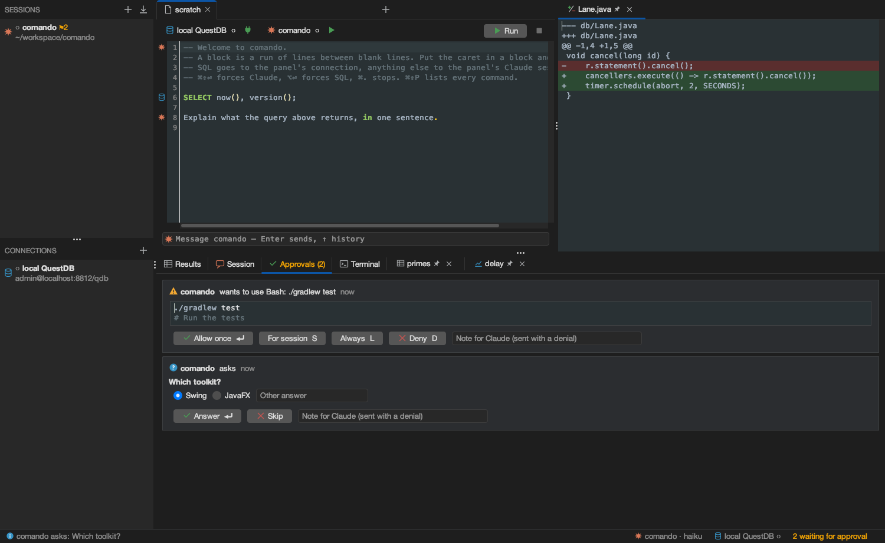

# comando

A macOS desktop workbench where SQL and Claude Code sessions share one editor. A block of text runs as SQL on the panel's database connection or as a prompt to the panel's Claude Code session; comando decides which, and shows the target in the gutter before it runs. Claude's sessions can put tables, plots, diffs and files on screen, run SQL under a policy, and ask for permissions through cards in the window.



## Features

| Area | What it does |
|---|---|
| Editor | SQL and prompts in one document; ⌘⏎ classifies the block, ⌘⇧⏎ forces a prompt, ⌥⏎ forces SQL; SQL completion from the live schema |
| Claude Code | one `claude -p` process per session; start, resume, fork, interrupt, stop; sessions imported from `~/.claude/projects`; a painted transcript with tool cards and nested subagents |
| Approvals | permission prompts, questions and plans as cards with keys; allow once, for the session, or always |
| Window tools for Claude | an MCP server in the app: show a table, a plot, a diff, a file; set the layout; run SQL and describe tables; read the window's state |
| Databases | PostgreSQL and QuestDB over the PostgreSQL wire protocol; one lane per connection with fast cancel; results stored by column, millions of rows; plots, live plots, `EXPLAIN` trees, a schema explorer; production connections framed in red and refused to Claude for writes |
| Development | a terminal per panel; Gradle runs with test results as a tree and failures sent to Claude; JFR recordings as tables and plots; jfrq; the scratchpad browser |
| Persistence | panels, bindings and text survive restarts; passwords in the macOS keychain; atomic store files |

## Quick start

Requires JDK 25 and the Claude Code CLI.

```
./gradlew :app:run           # start comando
./gradlew build              # compile and test
./gradlew :app:dmg           # unsigned macOS disk image in app/build/dmg
```

[Build and run](docs/guides/build-and-run.md) lists every task and setting.

## Documentation

| Document | Contents |
|---|---|
| [Architecture](docs/architecture/README.md) | state and intents, threads, modules and ports, ownership |
| [Design](docs/README.md#2-design) | the Claude bridge, panels, dispatch, MCP tools, widgets, the transcript, safety, persistence, tools, the database workbench, quality |
| [Decisions](docs/adr/README.md) | one record per decision, dated |
| [Guides](docs/README.md#4-guides) | build and run, coding guidelines |

## Status

Private repository, in daily use by its author. Version 2.0.0-SNAPSHOT. The macOS build is unsigned. comando is under the [Apache License 2.0](LICENSE).

Third-party components keep their licences: JediTerm (LGPL-3.0) and pty4j (EPL-1.0) for the terminal, FlatLaf, RSyntaxTextArea and AutoComplete, commonmark-java, java-diff-utils, Jackson, the PostgreSQL JDBC driver, QuestDB.
