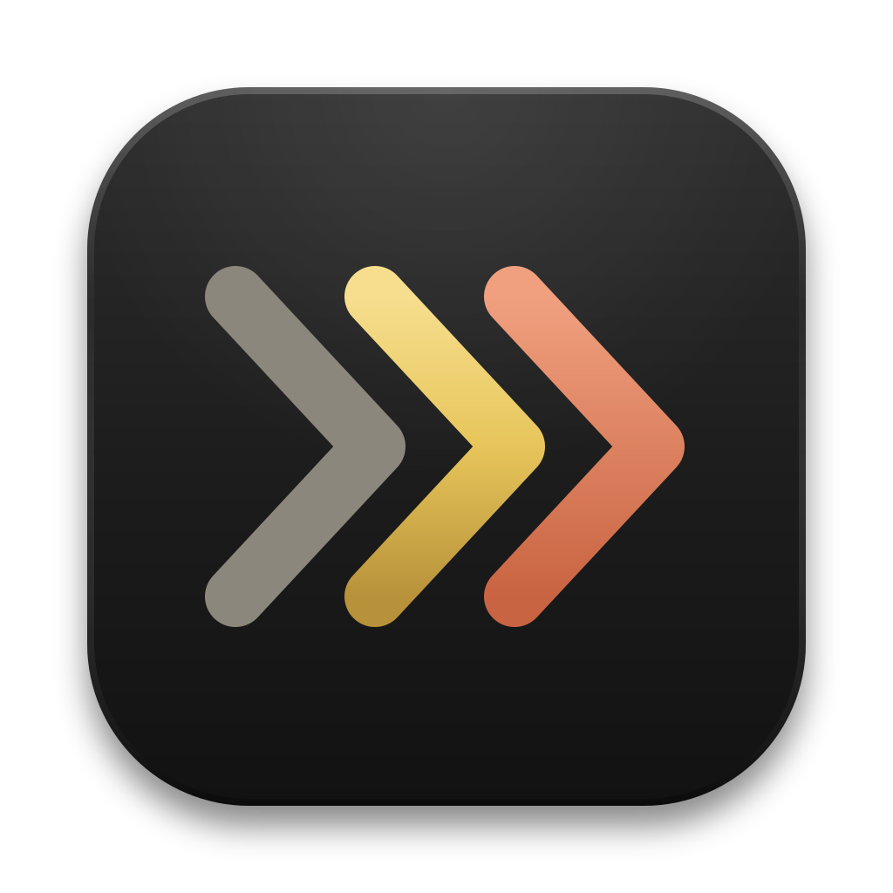

<p align="center">
  
</p>

<h1 align="center">comando</h1>

<p align="center">
  <b>One editor for SQL and Claude Code, built around the way I work.</b><br>
  A desktop workbench: a block of text runs on the panel's database or goes to the panel's Claude Code session,<br>
  and Claude answers with tables, plots, diffs and approval cards in the same window.
</p>

<p align="center">
  <a href="https://github.com/marregui/comando/actions/workflows/build.yml"></a>
  
  
  
  
  <a href="LICENSE"></a>
</p>

## Why it exists

comando started years ago as a personal tool. I had used paid tools to work with PostgreSQL databases, and when I joined
Crate.io, an open-source database company whose CrateDB speaks the PostgreSQL wire protocol, I had no tool that let me
test SQL statements the way I wanted to work. So I wrote one. I could open a connection to PostgreSQL in one panel and
to CrateDB in another, run the same statement on both, and compare response time, throughput and the data that came
back. It became my QA step: I validated my own pull requests with it before pushing them, and my colleagues' when I
reviewed theirs.

When I moved to QuestDB, another open-source startup, whose time-series database also speaks the PostgreSQL wire
protocol, the tool came with me. I taught it to read QuestDB's metadata files, and it sped up my day. It also became a
benchmark of usability and a way of gathering requirements for what QuestDB's web console could be, the two feeding
each other.

Then I joined HiveMQ, also an open-source product company. There were no databases in my work, and comando stopped. Over
two years I went from writing Java by hand, heads down in the broker, in HiveMQ Edge and in much in between, to
realising that I did not understand the world AI was opening up well enough. I also realised that my tool for that
world could not be an IDE made for everyone: it had to fit me and the way I work, because now AI can build the tool
that matches the flow. That is what comando is becoming, one of three parts, comando, the kit and the brain, which
together are my flow.

The reason is selfish. I want a tool that makes me more productive at my job, and building it pushes me to learn and
think in areas my job does not take me to but benefits from. That comando can run QuestDB and HiveMQ Edge is its
history showing; I see the potential in it, and that is what I will keep researching. Maybe what I find is useful to
others, maybe the tooling has merit beyond me. I think there is a lot of value here, or I would not be putting the time
in. It is close to what my company does, too: moving industry from the old era into the AI one, through agentic
intelligence and automation.

## How it works


A block is a run of lines between blank lines. comando decides where a block goes and marks it in the gutter before it
runs: ⌘⏎ or a click on the mark lets comando decide, ⌘⇧⏎ sends it to Claude, ⌥⏎ runs it as SQL.

comando runs every session on the kit when it finds one. [Kit and brain](docs/kit-and-brain.md) describes the kit and
the brain well enough for Claude Code to create both; no kit is published, and mine stay private.

## What it does

| | |
|---|---|
| **One editor, two targets** | SQL and prompts in one Markdown file per panel, each block coloured as what it is; SQL completion from the live schema ([Workbench](docs/workbench.md#2-running-text)) |
| **Claude Code, headless** | one `claude -p` process per session, with your own Claude Code setup: start, resume, fork, compact, checkpoint, interrupt, stop; model and effort per session ([Claude Code](docs/claude-code.md)) |
| **A painted transcript** | prompts, text, tool calls, nested subagents and turn ends painted with Java2D: 3.39 ms a frame at the 99th percentile on the gate's synthetic session ([Architecture](docs/architecture.md#145-the-transcript)) |
| **Claude drives the window** | an MCP server inside the app: tables, plots, diffs, files, Markdown and trees on screen, text into the editor, SQL under a lexical policy, every action the user has ([Claude Code](docs/claude-code.md#3-mcp-tools)) |
| **Approvals are cards** | allow once, for the session or always, with the rule shown before it is saved; a card waits up to 24 hours, as long as its session waits ([Claude Code](docs/claude-code.md#41-approval-cards)) |
| **Databases** | PostgreSQL and QuestDB over the PostgreSQL wire protocol, an embedded QuestDB one click away, results stored by column up to 5 000 000 rows, plots, live plots, `EXPLAIN` trees ([Workbench](docs/workbench.md#3-the-database)) |
| **Documents and changes** | chosen folders of Claude Code's folder as trees, Markdown rendered, uncommitted changes and a side-by-side comparison with `HEAD` that edits, rolls back and removes ([Workbench](docs/workbench.md#6-the-files-tab)) |
| **Several instances** | each with its own name, data root, kit and brain, talking through a local HiveMQ Edge comando runs on `127.0.0.1` ([Workbench](docs/workbench.md#4-instances-and-the-comando-edge)) |
| **Development tools** | a terminal per panel; Gradle runs with test results as a tree and failures sent to Claude ([Workbench](docs/workbench.md#5-development-tools)) |

## Install

Ask Claude Code:

```
Install comando from https://github.com/marregui/comando/releases/latest
```

Claude Code follows [INSTALL.md](INSTALL.md): it downloads the file for this system with `gh`, installs it, checks that
it starts, and asks whether to create a kit and a brain. Then **Help ▸ Tutorial** opens *comando in ten minutes*.

| System | Release file | Tested |
|---|---|---|
| macOS, Apple silicon | `comando-<version>-macos-arm64.dmg`, installed to `/Applications` | build, tests and window replay in CI on every push to `main` and every pull request; my daily use |
| Linux, x64 | `comando-<version>-linux-x64.tar.gz`, installed to `~/.local/share/comando` | build, tests and window replay in CI on every push to `main` and every pull request |
| Windows, x64 | `comando-<version>-windows-x64.zip`, installed to `%LOCALAPPDATA%\comando` | packaged only |

Each file carries its own Java runtime and is unsigned. Every system needs the
[Claude Code](https://github.com/anthropics/claude-code) CLI, at least the newest version on the day the release was
made ([INSTALL.md §1](INSTALL.md#1-prerequisites)); trouble with a later one is reported as an issue on
`marregui/comando`. comando's data stays in `~/.comando`.

## Build from source

JDK 25 and the Claude Code CLI.

```sh
./gradlew :app:run       # start comando
./gradlew build          # compile and test
./gradlew :app:package   # this system's release file, in app/build/package
```

[Development](docs/development.md) lists every task and setting.

## Documentation

[docs/README.md](docs/README.md) is the entry point: the tutorial, the workbench, Claude Code in comando, the kit and the
brain, the architecture, development, and the decision records.

## Built with

Java 25 and Swing, FlatLaf, jsvg, RSyntaxTextArea and AutoComplete, JediTerm and pty4j, commonmark-java,
java-diff-utils, Jackson, the PostgreSQL JDBC driver, QuestDB and the HiveMQ MQTT client. Eight Gradle modules (core,
testkit, db, claude, mcp, tools, ui, app): about 72 000 lines of Java and 48 000 of tests. CI builds, tests and
replays the window on Linux and macOS for every push to `main` and every pull request, except changes to documentation
alone; a version tag builds the packages for macOS, Linux and Windows and publishes them as a release.

## Status

In my daily use; version 2.0.0-SNAPSHOT. A release is made by pushing a version tag (`v2.0.0`); its packages are
unsigned.

comando is under the [Apache License 2.0](LICENSE). Third-party components keep their licences: JediTerm (LGPL-3.0)
and pty4j (EPL-1.0) for the terminal; Apache 2.0: FlatLaf, java-diff-utils, Jackson, QuestDB, the HiveMQ MQTT client,
HiveMQ Edge; BSD: RSyntaxTextArea and AutoComplete, commonmark-java, the PostgreSQL JDBC driver; MIT: jsvg, SLF4J.
