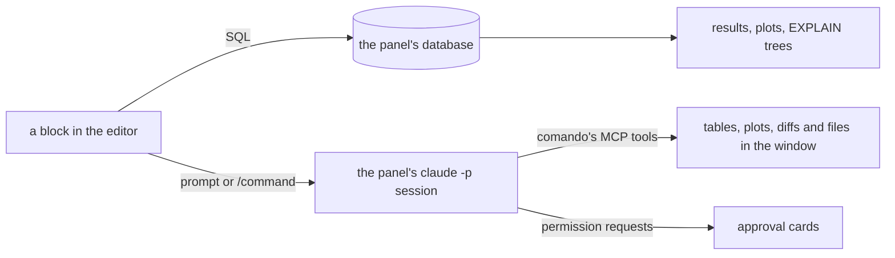

<p align="center">
  
</p>

<h1 align="center">comando</h1>

<p align="center">
  <b>One editor for SQL and Claude Code.</b><br>
  A macOS workbench where a block of text runs on your database or goes to your Claude Code session,<br>
  and Claude answers with tables, plots, diffs and approval cards in the same window.
</p>

<p align="center">
  <a href="https://github.com/marregui/comando/actions/workflows/build.yml"></a>
  
  
  
  
  <a href="LICENSE"></a>
</p>


<p align="center"><sub>A real turn, unedited. The query is coloured as SQL because the panel's QuestDB is open. The prompt under it went to a Claude Code session (haiku), which ran the query with comando's <code>db_run_sql</code> tool and placed the plot in the side pane with <code>ui_plot</code>: three tool calls, 9.8 s.</sub></p>

## Why

In a terminal, Claude Code's work is text that scrolls away. comando turns it into a window you can work in:

- **The database sits next to the conversation.** Write a query, run it, ask Claude about the result, in one document.
- **Claude can show, not only tell.** It puts tables, plots, diffs, files and Markdown on screen through tools that comando serves.
- **Approvals are cards, not prompts.** Allow once, for the session or always, with the rule shown before it is saved; nothing is missed while you look elsewhere.
- **Many sessions, each in its own panel.** Each tab shows whether its session is working, waiting on background work, needs you, failed or finished.

## How it works



A block is a run of lines between blank lines. comando decides where it goes and shows it in the gutter before it runs: ⌘⏎ lets comando decide, ⌘⇧⏎ sends it to Claude, ⌥⏎ runs it as SQL.

## What it does

| | |
|---|---|
| **One editor, two targets** | SQL and prompts in one Markdown file per panel. Each block is coloured as what it is: SQL only while the panel's database is open, prompts and notes as Markdown, a leading `/command` marked. SQL completion from the live schema. Clear in one step that ⌘Z undoes. |
| **Claude Code, headless** | One `claude -p` process per session: start, resume, fork, start fresh, interrupt, stop. Stored conversations import from `~/.claude/projects`. Model and effort per session. A checkpoint button sends the command you choose (`/reflect` by default) and turns purple once the context passes 60% of the window. |
| **A painted transcript** | Prompts, text, tool calls with their results, nested subagents, notes and turn ends, painted with Java2D so long sessions stream and scroll within a frame. Thinking gives way to the answer; the turn's conclusion reads in gold. Find, select, copy as Markdown. |
| **Claude drives the window** | An MCP server inside the app: show a table, a plot, a diff, a file, Markdown or a tree; set the layout; write into the editor; run SQL under a lexical policy (writes refused on production connections); read the window's state. Sessions can prompt one another and read each other's transcripts. |
| **Sessions at a glance** | Tabs show a spinner while working, an hourglass while background work runs, a question mark when you are needed; the Dock bounces then. Session rows show the plug, model, effort and how long the session has run. The status bar shows how much of the plan's limits is used (the current window, the week, per model); no dollar figures anywhere. |
| **Databases** | PostgreSQL and QuestDB over the PostgreSQL wire protocol, with an embedded QuestDB one click away. One lane per connection, cancel within two seconds, results stored by column (millions of rows), plots and live plots, `EXPLAIN` trees, a schema explorer. Production connections are framed in red. |
| **Documents** | The scratchpad as a tree; files open in panels, Markdown rendered with Mermaid diagrams, source coloured by language, `.log` files read-only and following their end. A file changed outside comando shows in its panel within a second. The tutorial and the log open the same way from Help. |
| **Development tools** | A terminal per panel; Gradle runs with test results as a tree and failures sent to Claude; JFR recordings as tables and plots; jfrq. |


## Quick start

You need macOS, JDK 25 and the [Claude Code](https://github.com/anthropics/claude-code) CLI (tested with 2.1.296 and later 2.1 releases).

```sh
./gradlew :app:run     # start comando
./gradlew build        # compile and test
./gradlew :app:dmg     # an unsigned macOS disk image in app/build/dmg
```

Then open **Help ▸ Tutorial**: *comando in ten minutes* takes you from an empty window to a database, a Claude session, approvals and plots. [Build and run](docs/guides/build-and-run.md) lists every task and setting.

Your data stays in `~/.comando`: panels as Markdown files, connections, sessions, logs. Connection passwords go to the macOS keychain.

## Documentation

| Document | Contents |
|---|---|
| [Architecture](docs/architecture/README.md) | state and intents, threads, modules and ports, ownership |
| [Design](docs/README.md#2-design) | the Claude bridge, panels, dispatch, MCP tools, widgets, the transcript, safety, persistence, tools, the database workbench, quality |
| [Decisions](docs/adr/README.md) | one record per decision, dated, with who decided |
| [Guides](docs/README.md#4-guides) | comando in ten minutes, build and run, coding guidelines |

## Built with

Java 25 and Swing, FlatLaf, RSyntaxTextArea, JediTerm and pty4j, commonmark-java, Jackson, the PostgreSQL JDBC driver and QuestDB. Eight Gradle modules (core, db, claude, mcp, tools, ui, app, testkit); CI builds, tests and replays the UI on macOS and Linux.

## Status

In daily use by its author; version 2.0.0-SNAPSHOT, not yet released. The macOS build is unsigned.

comando is under the [Apache License 2.0](LICENSE). Third-party components keep their licences: JediTerm (LGPL-3.0) and pty4j (EPL-1.0) for the terminal, FlatLaf, RSyntaxTextArea and AutoComplete, commonmark-java, java-diff-utils, Jackson, SLF4J, the PostgreSQL JDBC driver, QuestDB.
