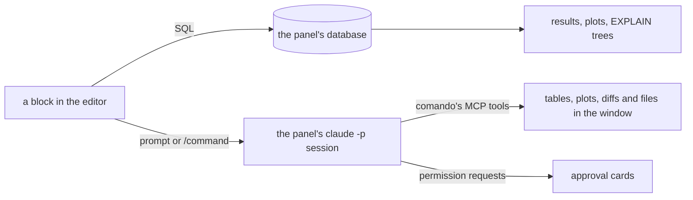
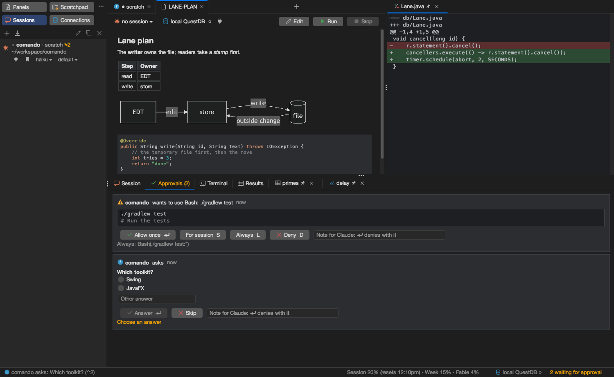

<p align="center">
  
</p>

<h1 align="center">comando</h1>

<p align="center">
  <b>One editor for SQL and Claude Code.</b><br>
  A desktop workbench where a block of text runs on your database or goes to your Claude Code session,<br>
  and Claude answers with tables, plots, diffs and approval cards in the same window.
</p>

<p align="center">
  <a href="https://github.com/marregui/comando/actions/workflows/build.yml"></a>
  
  
  
  
  <a href="LICENSE"></a>
</p>


<p align="center"><sub>A real turn, unedited. The query is coloured as SQL because the panel's QuestDB is open. The prompt under it went to a Claude Code session (haiku), which ran the query with comando's <code>db_run_sql</code> tool and placed the plot in the side pane with <code>ui_plot</code>: three tool calls, 13.8 s.</sub></p>

## Why

In a terminal, Claude Code's work is text that scrolls away. comando turns it into a window you can work in:

- **The database sits next to the conversation.** Write a query, run it, ask Claude about the result, in one document.
- **Claude can show, not only tell.** It puts tables, plots, diffs, files and Markdown on screen through tools that comando serves.
- **Approvals are cards, not prompts.** Allow once, for the session or always, with the rule shown before it is saved; nothing is missed while you look elsewhere.
- **Many sessions, each in its own panel.** Each tab shows whether its session is working, waiting on background work, needs you, failed or finished.

## How it works



A block is a run of lines between blank lines. comando decides where it goes and shows it in the gutter before it runs: ⌘⏎ lets comando decide, ⌘⇧⏎ sends it to Claude, ⌥⏎ runs it as SQL.

## What it does

| | |
|---|---|
| **One editor, two targets** | SQL and prompts in one Markdown file per panel, each block coloured as what it is (SQL only while the panel's database is open). SQL completion from the live schema. |
| **Claude Code, headless** | One `claude -p` process per session: start, resume, fork, start fresh, compact, checkpoint (then a clear, its summary carried into the next prompt), interrupt, stop; model and effort per session; each session's context and uptime on its row, its id in the row's tooltip, all copied with a click; stored conversations import from Claude Code's `projects/` folder. A checkpoint button sends `/reflect` (or your command) and turns purple at 60% of the context window. |
| **A painted transcript** | Prompts, text, tool calls with results, nested subagents, notes and turn ends, painted with Java2D so long sessions stream within a frame. Thinking gives way to the answer; the text reads in warm ivory on a near-black ground, its structure in a gold you choose, and the answer that ends a turn is framed as a report. |
| **Claude drives the window** | An MCP server inside the app: tables, plots, diffs, files, Markdown and trees on screen; text into the editor; SQL under a lexical policy (writes refused on production connections); the window's state. Sessions can prompt one another and read each other's transcripts. |
| **Sessions at a glance** | Tab icons for working, waiting on background work, needs you, failed and finished; the Dock bounces when you are needed or something failed. The status bar shows the usage limits of the Claude plan and, with Codex installed, the Codex plan; no spend is shown anywhere. |
| **Databases** | PostgreSQL and QuestDB over the PostgreSQL wire protocol, with an embedded QuestDB one click away. One lane per connection, cancel within two seconds, results stored by column (millions of rows), plots and live plots, `EXPLAIN` trees, a schema explorer. |
| **Documents and changes** | The folders and repositories you choose as trees in one tab, searchable by name and kept in sync while open; a double click opens a file in a panel to read and edit (Markdown rendered with Mermaid diagrams, an HTML page one click from the browser, source coloured by language). A folder or repository row marks what is uncommitted, and ⌘K opens Uncommitted changes with a side-by-side diff that edits, rolls back and removes. The tab's menu configures its folders and repositories (kept in `folders.json`, whose outside edits the tab follows). |
| **Development tools** | A terminal per panel; Gradle runs with test results as a tree and failures sent to Claude. |



## Install

Ask Claude Code:

```
Install comando from https://github.com/marregui/comando/releases/latest
```

It follows [INSTALL.md](INSTALL.md): it downloads the file for your system with `gh` (the repository is private, so
your GitHub account needs access), installs it, checks that it starts, and asks whether to install the kit. Then open
**Actions ▸ Tutorial**: *comando in ten minutes* takes you from an empty window to a database, a Claude session,
approvals and plots.

| System | Release file | Tested |
|---|---|---|
| macOS, Apple silicon | `comando-<version>-macos-arm64.dmg`, installed to `/Applications` | build, tests and window replay in CI weekly and on demand; daily use |
| Linux, x64 | `comando-<version>-linux-x64.tar.gz`, installed to `~/.local/share/comando` | build, tests and window replay in CI on every change |
| Windows, x64 | `comando-<version>-windows-x64.zip`, installed to `%LOCALAPPDATA%\comando` | packaged only |

Each file carries its own Java runtime and is unsigned; on macOS the install clears the quarantine flag. Every system
needs the [Claude Code](https://github.com/anthropics/claude-code) CLI (tested with 2.1.296 and later 2.1 releases).
Connection passwords go to the macOS keychain; elsewhere they stay in `connections.json`.

Your data stays in `~/.comando`: panels as Markdown files, connections, sessions, logs.

## The kit and the brain

The kit is a Claude Code setup in a repository of its own, [`marregui/comando-kit`](https://github.com/marregui/comando-kit),
versioned by tags: instructions, settings, skills and a plugin for the way of working comando is built for. It
installs into `~/.claude/comando-kit` beside your own setup, which it leaves alone. comando finds it at start and runs every
session on it, with one memory for all of them; the Files tab opens on its folders, the status bar shows its version,
and **Upgrade the kit…** moves it to a newer tag when you choose. The brain, `BRAIN/` in the kit's folder, holds what
the sessions learn (memory, knowledge base, scratchpad); it is never part of the kit, and **Back up the brain**
commits and pushes it, only when you click. [Workbench §7](docs/workbench.md#7-the-kit) has the details.

## Build from source

You need JDK 25 and the Claude Code CLI.

```sh
./gradlew :app:run       # start comando
./gradlew build          # compile and test
./gradlew :app:package   # this system's release file in app/build/package
```

[Build and run](docs/build-and-run.md) lists every task and setting.

## Documentation

| Document | Contents |
|---|---|
| [Install](INSTALL.md) | the recipe Claude Code follows to install, upgrade and uninstall comando, and to offer the kit |
| [Tutorial](docs/tutorial.md) | comando in ten minutes, step by step (also Actions ▸ Tutorial) |
| [Build and run](docs/build-and-run.md) | prerequisites, Gradle tasks, settings |
| [Workbench](docs/workbench.md) | panels and bindings, running text, the database, the tools, the Files tab and git changes, what is kept on disk, the kit |
| [Claude](docs/claude.md) | the `claude -p` bridge, the MCP tools, approvals and safety |
| [UI](docs/ui.md) | the UI's shared package (`ui.kit`), commands and keys, widgets, the painted transcript |
| [Architecture](docs/architecture.md) | modules, state and intents, ports, threads, ownership, code rules, quality |
| Module READMEs | one per module, on its classes and its interface with the rest: [core](core/README.md), [testkit](testkit/README.md), [db](db/README.md), [claude](claude/README.md), [mcp](mcp/README.md), [tools](tools/README.md), [ui](ui/README.md), [app](app/README.md) |
| [Decisions](docs/adr/README.md) | one record per decision, dated, with who decided |

## Built with

Java 25 and Swing, FlatLaf, jsvg, RSyntaxTextArea, JediTerm and pty4j, commonmark-java, Jackson, the PostgreSQL JDBC driver and QuestDB. Eight Gradle modules (core, db, claude, mcp, tools, ui, app, testkit); CI builds, tests and replays the UI on Linux for every change, and on macOS weekly and on demand; a version tag builds the packages for macOS, Linux and Windows and publishes them as a release.

## Status

In daily use by its author; version 2.0.0-SNAPSHOT. A release is made by pushing a version tag (`v2.0.0`); its packages are unsigned.

comando is under the [Apache License 2.0](LICENSE). Third-party components keep their licences: JediTerm (LGPL-3.0) and pty4j (EPL-1.0) for the terminal, FlatLaf, jsvg (MIT), RSyntaxTextArea and AutoComplete, commonmark-java, java-diff-utils, Jackson, SLF4J, the PostgreSQL JDBC driver, QuestDB.
