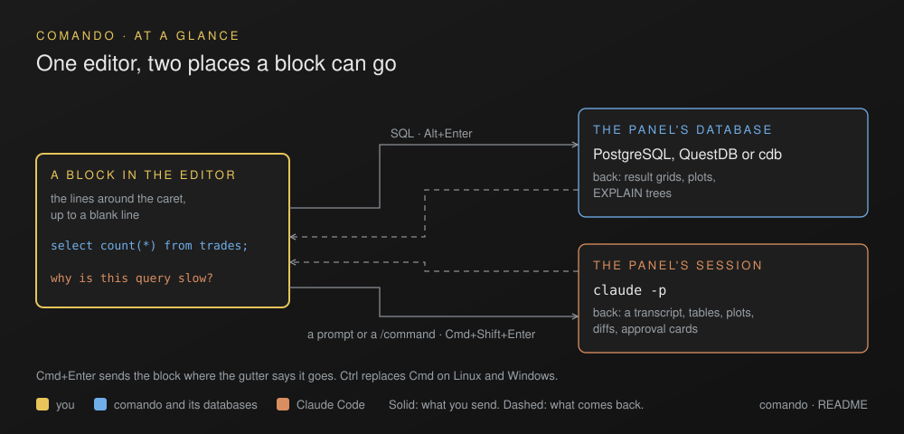

#  comando



**One editor for SQL and Claude Code, built around the way I work.**

[](https://github.com/marregui/comando/actions/workflows/build.yml)


[](LICENSE)

## In one paragraph

comando is a desktop workbench for people who work with databases and with Claude Code. You write in one editor. A
block of text runs as SQL on the panel's database, or goes as a prompt to the panel's Claude Code session. Claude
answers in the same window, with tables, plots, diffs and approval cards. Around that editor sit a database, a message
gateway, and a way to give an agent a memory. All three are written for comando, and its documentation explains each.

## What you get

| | | Read |
|---|---|---|
| **One editor, two targets** | SQL and prompts in one Markdown file per panel; each block goes where it belongs | [Workbench](docs/workbench.md) |
| **Claude Code, headless** | one `claude -p` process per session, with your own Claude Code setup | [Claude Code in comando](docs/claude-code.md) |
| **Claude drives the window** | an MCP server inside the app; approvals are cards you answer | [Claude Code in comando](docs/claude-code.md) |
| **Databases** | PostgreSQL and QuestDB over the PG wire protocol, and comando's own database, cdb | [cdb](docs/cdb.md) |
| **A kit and a brain** | the tools, rules and memory an agent works with | [Kit and brain](docs/kit-and-brain.md) |
| **Several instances** | comandos on one machine that ask each other questions | [Architecture](docs/architecture.md) |

## Install

Ask Claude Code:

```
Install comando from https://github.com/marregui/comando/releases/latest
```

Claude Code follows [INSTALL.md](INSTALL.md). Then **Help ▸ Tutorial** opens the [tutorial](docs/tutorial.md).

| System | Release file |
|---|---|
| macOS, Apple silicon | `comando-<version>-macos-arm64.dmg` |
| Linux, x64 | `comando-<version>-linux-x64.tar.gz` |
| Windows, x64 | `comando-<version>-windows-x64.zip` |

Each file carries its own Java runtime. You also need the [Claude Code](https://github.com/anthropics/claude-code)
CLI. comando keeps its data in `~/.comando`.

## Build from source

You need JDK 25 and the Claude Code CLI.

```sh
./gradlew :app:run       # start comando
./gradlew build          # compile and test
./gradlew :app:package   # this system's release file, in app/build/package
```

[Development](docs/development.md) lists every task and setting.

## Documentation

Start at [docs/README.md](docs/README.md). It is a map with three reading paths.

| You want to | Start with |
|---|---|
| use comando | [Tutorial](docs/tutorial.md) |
| learn how an agent gets tools and a memory | [Kit and brain](docs/kit-and-brain.md) |
| learn how a database or a gateway works inside | [cdb](docs/cdb.md), [frontear](docs/frontear.md) |
| read or change the code | [Architecture](docs/architecture.md) |

## Built with

Java 25 and Swing, FlatLaf, jsvg, RSyntaxTextArea, JediTerm and pty4j, commonmark-java, the PostgreSQL JDBC driver.
The database, the MQTT gateway and client, JSON, diffs, SQL completion and the icons are comando's own code. Ten Gradle
modules: about 139 000 lines of Java and 134 000 lines of tests.

## Licence

comando is under the [Apache License 2.0](LICENSE). Third-party components keep their licences: JediTerm (LGPL-3.0)
and pty4j (EPL-1.0) for the terminal; Apache 2.0: FlatLaf; BSD: RSyntaxTextArea, commonmark-java, the
PostgreSQL JDBC driver; MIT: jsvg, SLF4J.
