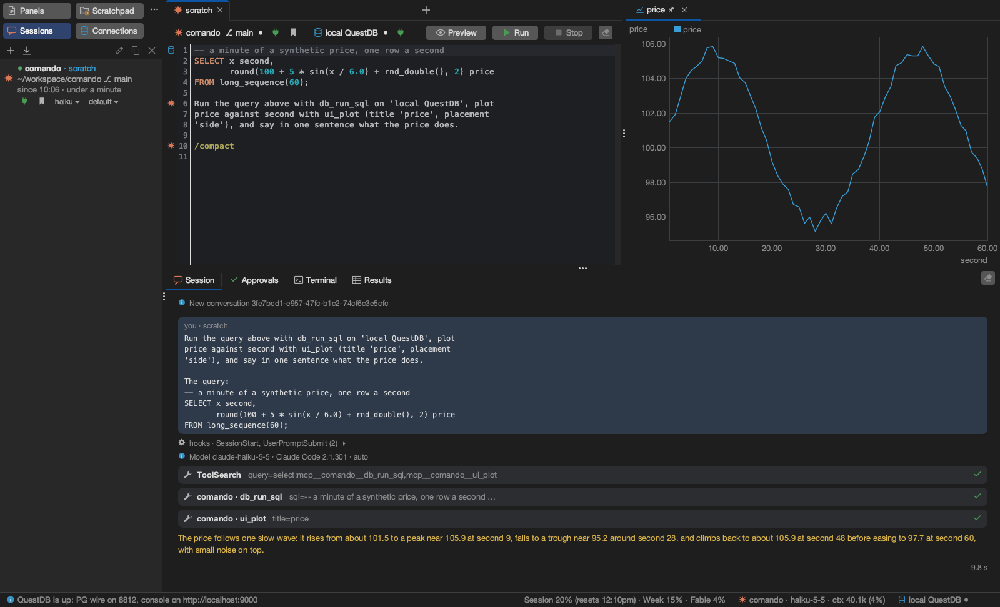
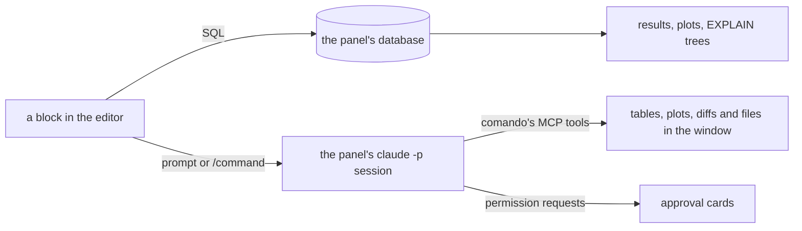
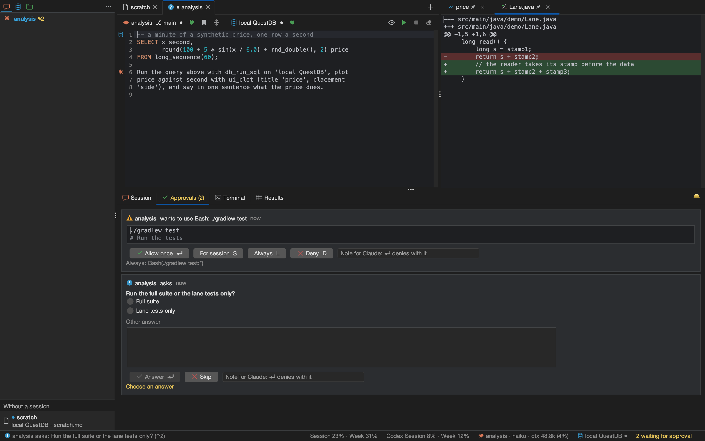

<p align="center">
  
</p>

<h1 align="center">comando</h1>

<p align="center">
  <b>One editor for SQL and Claude Code.</b><br>
  A desktop workbench: a block of text runs on the panel's database or goes to the panel's Claude Code session,<br>
  and Claude answers with tables, plots, diffs and approval cards in the same window.
</p>

<p align="center">
  <a href="https://github.com/marregui/comando/actions/workflows/build.yml"></a>
  
  
  
  
  <a href="LICENSE"></a>
</p>



<p align="center"><sub>One real turn, unedited. The panel's session (Haiku) ran the query above the prompt with comando's
<code>db_run_sql</code> tool on the panel's QuestDB and placed the plot beside the editor with <code>ui_plot</code>:
three tool calls, 10.2 s. Painted by <code>./gradlew :app:docImages</code>.</sub></p>

## Why

In a terminal, Claude Code's work is text that scrolls away, and a database client is another window. comando puts
both behind one editor:

- **The database sits next to the conversation.** A query, its result and a question about the result live in one
  Markdown file per panel.
- **Claude places results on screen.** Tables, plots, diffs, files, Markdown and trees arrive through MCP tools that
  comando serves, in the panel of the session that asked.
- **Approvals are cards.** Allow once, for the session or always, with the rule shown before it is saved. A card waits
  in the Approvals tab, for at most 55 minutes; a session that waits marks its tab and the status bar.
- **Each session has its own panel.** A tab shows whether its session is working, waiting on background work, waiting
  for the user, failed or finished.

## How it works



A block is a run of lines between blank lines. comando decides where a block goes and marks it in the gutter before
it runs: ⌘⏎ or a click on the mark lets comando decide, ⌘⇧⏎ sends it to Claude, ⌥⏎ runs it as SQL.

## What it does

| | |
|---|---|
| **One editor, two targets** | SQL and prompts in one Markdown file per panel, each block coloured as what it is (SQL only while the panel's database is open). SQL completion from the live schema. |
| **Claude Code, headless** | One `claude -p` process per session: start, resume, fork, start fresh, compact, checkpoint (its summary carried into the next prompt), interrupt, stop. Model and effort per session. Stored conversations import from Claude Code's `projects/` folder. The checkpoint button sends `/reflect`, or the command set in the session's dialog, and turns purple at 60% of the context window. |
| **A painted transcript** | Prompts, text, tool calls with their results, nested subagents, notes and turn ends, painted with Java2D: streaming a session of 8 turns and 41 tool calls, a frame takes 3.39 ms at the 99th percentile (`:ui:transcriptGate` fails above 16 ms). Thinking gives way to the answer; the answer that ends a turn is framed as a report. |
| **Claude drives the window** | An MCP server inside the app: tables, plots, diffs, files, Markdown and trees on screen; text into the editor; SQL under a lexical policy (writes refused on production connections); the window's state. Sessions can prompt one another and read each other's transcripts. |
| **Sessions at a glance** | Tab icons for working, waiting on background work, waiting for the user, failed and finished; the Dock bounces when the user is needed or something failed. The status bar shows the usage limits of the Claude plan and, with Codex installed, of the Codex plan; no spend is shown. |
| **Databases** | PostgreSQL and QuestDB over the PostgreSQL wire protocol, with an embedded QuestDB one menu item away. One lane per connection, cancel within two seconds, results stored by column (up to 5 000 000 rows), plots and live plots, `EXPLAIN` trees, a schema explorer. |
| **Documents and changes** | Chosen folders of Claude Code's folder (the kit, its brain) as trees in one tab, searchable by name and kept in sync while open; code repositories stay in the IDE. A double click opens a file in a panel: Markdown rendered (Mermaid diagrams drawn when `mmdc` is installed), source coloured by language. A folder row marks what is uncommitted; ⌘K shows the folders' uncommitted changes, and a file opens side by side against `HEAD`, to edit, roll back or remove. |
| **Development tools** | A terminal per panel; Gradle runs with test results as a tree and failures sent to Claude. |

<table>
  <tr>
    <td width="50%"></td>
    <td width="50%"></td>
  </tr>
  <tr>
    <td><sub>Approval cards for a tool and a question; a diff in the side pane.</sub></td>
    <td><sub>A folder in the Files tab and its uncommitted changes, grouped by kind.</sub></td>
  </tr>
  <tr>
    <td width="50%"></td>
    <td width="50%"></td>
  </tr>
  <tr>
    <td><sub>A query on the embedded QuestDB: 100 000 rows sampled by hour, 72 rows back in 46 ms.</sub></td>
    <td><sub>A file compared with <code>HEAD</code>: three differences, edited in place.</sub></td>
  </tr>
</table>

## Install

Ask Claude Code:

```
Install comando from https://github.com/marregui/comando/releases/latest
```

Claude Code follows [INSTALL.md](INSTALL.md): it downloads the file for this system with `gh`, installs it, checks that
it starts, and asks whether to install a kit. Then **Help ▸ Tutorial** opens *comando in ten minutes*: from an empty
window to a database, a Claude session, approvals and plots.

| System | Release file | Tested |
|---|---|---|
| macOS, Apple silicon | `comando-<version>-macos-arm64.dmg`, installed to `/Applications` | build, tests and window replay in CI on every push to `main` and every pull request; the author's daily use |
| Linux, x64 | `comando-<version>-linux-x64.tar.gz`, installed to `~/.local/share/comando` | build, tests and window replay in CI on every push to `main` and every pull request |
| Windows, x64 | `comando-<version>-windows-x64.zip`, installed to `%LOCALAPPDATA%\comando` | packaged only |

Each file carries its own Java runtime and is unsigned; on macOS the install clears the quarantine flag. Every system
needs the [Claude Code](https://github.com/anthropics/claude-code) CLI (tested from 2.1.296; a version from 2.2.0 on is
flagged as untested). On macOS, with the default data root, connection passwords go to the keychain; otherwise they
stay in `connections.json`.

comando's data stays in `~/.comando`: panels as Markdown files, connections, sessions, logs.

## The kit

A kit is a Claude Code setup in a git repository of its own, versioned by tags: instructions, settings, skills, a
plugin and a `comando-kit.json` that comando reads. comando runs every session on the kit's folder when it finds one
(`~/.claude` with a `comando-kit.json`, or a clone in `~/.claude/comando-kit`), and on `~/.claude` without a kit
otherwise. With a kit, the Files tab opens on its folders, the status bar shows its version, **Upgrade the kit…** moves
it to a newer tag, and **Back up the brain** and **Back up the kit** commit and push each, the commit saying what it adds.
The author's kit is private. [Workbench §7](docs/workbench.md#7-the-kit) has the rules.

## Build from source

JDK 25 and the Claude Code CLI.

```sh
./gradlew :app:run       # start comando
./gradlew build          # compile and test
./gradlew :app:package   # this system's release file, in app/build/package
```

[Build and run](docs/build-and-run.md) lists every task and setting.

## Documentation

| Document | Contents |
|---|---|
| [Install](INSTALL.md) | the recipe Claude Code follows to install, upgrade and uninstall comando, and to offer a kit |
| [Tutorial](docs/tutorial.md) | comando in ten minutes, step by step (also Help ▸ Tutorial) |
| [Build and run](docs/build-and-run.md) | prerequisites, Gradle tasks, CI, settings |
| [Workbench](docs/workbench.md) | panels and bindings, running text, the database, the tools, the Files tab and git changes, what is kept on disk, the kit |
| [Claude](docs/claude.md) | the `claude -p` bridge, the MCP tools, approvals and safety |
| [UI](docs/ui.md) | the UI's shared package (`ui.kit`), commands and keys, widgets, the painted transcript |
| [Architecture](docs/architecture.md) | modules, state and intents, ports, threads, ownership, code rules, quality |
| Module READMEs | one per module, on its classes and its interface with the rest: [core](core/README.md), [testkit](testkit/README.md), [db](db/README.md), [claude](claude/README.md), [mcp](mcp/README.md), [tools](tools/README.md), [ui](ui/README.md), [app](app/README.md) |
| [Decisions](docs/adr/README.md) | one record per decision, dated, with who decided |

## Built with

Java 25 and Swing, FlatLaf, jsvg, RSyntaxTextArea and AutoComplete, JediTerm and pty4j, commonmark-java,
java-diff-utils, Jackson, the PostgreSQL JDBC driver and QuestDB. Eight Gradle modules (core, testkit, db, claude, mcp,
tools, ui, app): 51 655 lines of Java and 28 245 of tests. CI builds, tests and replays the window on Linux and macOS
for every push to `main` and every pull request, except changes to documentation alone; a version tag builds the
packages for macOS, Linux and Windows and publishes them as a release.

## Status

In daily use by its author; version 2.0.0-SNAPSHOT. A release is made by pushing a version tag (`v2.0.0`); its
packages are unsigned.

comando is under the [Apache License 2.0](LICENSE). Third-party components keep their licences: JediTerm (LGPL-3.0)
and pty4j (EPL-1.0) for the terminal; FlatLaf, jsvg (MIT), RSyntaxTextArea and AutoComplete, commonmark-java,
java-diff-utils, Jackson, SLF4J, the PostgreSQL JDBC driver and QuestDB.
