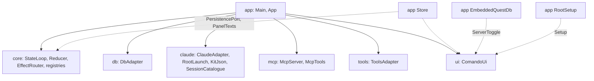

# `app`

The composition root: `main`, the configuration, the wiring of every module, the files comando keeps, the keychain,
the intent log, logging and the embedded QuestDB. It is the one module that sees all the others; none of them sees
it. It also holds the Gradle tasks that run, paint, replay and package the application.

1. [Architecture](#1-architecture)
2. [Interface with the rest of the app](#2-interface-with-the-rest-of-the-app)
3. [Configuration](#3-configuration)
4. [Threads](#4-threads)
5. [Tests and tasks](#5-tests-and-tasks)

## 1. Architecture

| Class | Does |
|---|---|
| `Main` | sets the dark appearance before AWT starts, reads `AppConfig`, configures logging, takes the data root's lock (`comando.lock`; a second instance on the same root refuses), builds and starts `App`, and adds a shutdown hook that closes it |
| `App` | builds every part in dependency order on a stack and closes them in reverse, each once; a failed constructor step closes what was built and rethrows |
| `AppConfig` | the data root and its folders (`run`, `logs`, `audit`, `questdb`), the `claude` executable, the kit root (`claude`'s `KitJson.resolve`), the keychain switch |
| `Store` | implements `core`'s `PersistencePort` and `ui`'s `PanelTexts`: `connections.json`, `sessions.json`, `folders.json` (with a kit's folders first, once per root, recorded in `kit-folders`), `panels.json`, and the panels' text: a Markdown file in `panels/` for a panel of comando's own, the file itself for a document; writes from immutable snapshots on its own threads |
| `PanelFiles` | each panel's text as a file: a panel of comando's own is named after its title and follows renames; a document is bound to its path and never renamed or deleted; no file is overwritten after an edit made outside comando |
| `JsonFile` | one store file: atomic replace through a temporary file; an unreadable file is renamed aside, not overwritten |
| `Secrets` | connection passwords in the macOS login keychain through `/usr/bin/security`; elsewhere `Secrets.NONE` |
| `IntentLog` | with `-Dcomando.recordIntents=true`, every intent as a JSON line after the starting state, passwords blanked |
| `Logging` | `System.Logger` to `logs/comando-<n>.log` (10 files of 1 MiB), warnings to stderr, uncaught exceptions logged |
| `EmbeddedQuestDb` | `ui`'s `ServerToggle`: a QuestDB server in `questdb/`, every listener on `127.0.0.1` |
| `RootSetup` | `ui`'s `Setup`: the kit root, its version and the brain's backup through `tools`' `KitGit` |
| `Welcome` | the first panel's text on a fresh data root |

**Build and close order** ([Architecture §7](../docs/architecture.md#7-ownership-and-exit)):

| Created | Part | Closed |
|---|---|---|
| 1 | `Store` | 9 |
| 2 | `IntentLog` (when recording) | 8 |
| 3 | `StateLoop` | 7 |
| 4 | `DbAdapter` | 6 |
| 5, 6 | `MermaidDiagrams`, `LocalImages` | 5, 4 |
| 7 | `McpServer` (with `McpTools`) | 3 |
| 8 | `ClaudeAdapter` | 2 |
| 9 | `ToolsAdapter` | 1 |
| 10 | `EmbeddedQuestDb` | 10, after the lanes it may serve |
| 11 | `ComandoUi` | 11, greyed and titled "comando — closing…" until the rest has closed |

`EffectRouter` needs the adapters, and the loop needs an effect handler before they exist: `App.DeferredEffects`
stands in until the router is built.

## 2. Interface with the rest of the app

What `app` connects, and nothing else does:

| From | To | Through |
|---|---|---|
| `EffectRouter` | `db`, `claude`, `mcp`, `ui`, `Store`, `tools` | the six effect ports |
| `mcp` `McpTools` | `db` | `QueryPort` |
| `claude` `ClaudeAdapter` | `mcp` `McpServer` | `McpGateway` |
| `tools` `ToolsAdapter` | the `PATH` | `ToolSettings::now`: a `gradle-serial` on it, else `./gradlew` |
| `ui` `Setup` | `tools` `KitGit` | `RootSetup`: the kit's version, the brain's backup |
| `tools` `ToolsAdapter` | `ui` `DesktopTrash` | `ToolsAdapter.Trash` |
| `ui` import dialog | `claude` `SessionCatalogue` | a supplier mapping entries to `StoredConversation` |
| `mcp` editor tools | `Store` | `McpTools.readOnly`: panels showing a log take no text |
| `Store` | `StateLoop` | `Notify` for a store warning, `FoldersRead` when `folders.json` changed outside |

**At start** (`App.start`): the reducer starts, the window is built, every folder's git repository is watched for the
Files tab's marks, the Files tab's open folders are read every 5 s,
the plan's usage every 5 minutes, every session with a stored conversation loads its transcript, `claude --version` is
checked, and, on a kit's root, the kit's version and its remote's newer releases are read now and every 6 hours for
the status bar. Before that, the constructor names the root (`KitRoot.use`) and gives the Files tab the kit's folders
at the first start on it.

**At quit:** the window asks when work would stop, then `onQuit` starts the `exit` thread: `App.close()`, then
`System.exit(0)`. The shutdown hook's `close()` does nothing the second time.

## 3. Configuration

| Setting | Effect |
|---|---|
| `-Dcomando.home`, else `COMANDO_HOME`, else `~/.comando` | the data root |
| `COMANDO_CLAUDE` | the `claude` executable; else the usual install paths, else `claude` on `PATH` |
| `-Dcomando.recordIntents=true` | writes the intent log to `logs/intents-<millis>.jsonl` |
| `-Dcomando.keychain` | passwords in the keychain; on by default only for `~/.comando` |
| `CLAUDE_CONFIG_DIR` | the kit root; else `~/.claude` when it has a `comando-kit.json`, else `~/.claude/comando-kit` when that has one, else `~/.claude` |

So a test or tool pointing the data root elsewhere never writes the user's keychain; tests name a temporary root
through `AppConfig`, never the user's `~/.claude`. The JVM options (`-Xms64m -Xmx4g`, periodic G1, the QuestDB export, the dark appearance) are in
`build.gradle.kts` for `run` and for the packages (`dmg`, `appImage`, `package`).

## 4. Threads

| Thread | Does |
|---|---|
| `store`, `store-secrets` | timed strand and strand: the store's writes; panel text 800 ms after the first unsaved change; a check of open panels' files and `folders.json` every second; keychain calls apart, so an unlock prompt never holds back panel text. Their threads are virtual, so daemons: `close()` waits for what is queued |
| `claude-version` | errand of `App`: the start-up check |
| `kit-check` | timed strand of `App`: the kit's version at start and every 6 hours, through `git` |
| `questdb-toggle` | errand of `EmbeddedQuestDb`: one start or stop; a toggle meanwhile only says so |
| `keychain-output` | fork: one `security` call's output, so a keychain call that gets no answer ends after 10 s |
| `exit`, `shutdown` | close the application after Quit, or from the shutdown hook |

## 5. Tests and tasks

Tests: `StoreTest`, `StoreSaveNowTest`, `PanelFilesTest`, `IntentLogTest`, `LoggingTest`, `MainTest`,
`EmbeddedQuestDbTest`, `ThreadRulesTest` (ArchUnit over every module: platform threads only of
the kinds that need them, every other thread from `core`'s thread kit); the window tests `UiReplayTest` (intent logs
replayed against the real shell with `testkit`'s `RecordingPorts`), `UiKeysTest` (keys typed into a real window),
`TreeClicksUiTest` (a tree's clicks, and the Files tab of a window started on a temporary kit root) and `ThreadBudgetTest` (the whole application with five fake sessions: comando's
own platform threads are the reducer, the watchdog and one reader per session, and none is left after the close) run
only under `:app:uiTest`.

| Task | Does |
|---|---|
| `./gradlew :app:run` | starts comando from a copy of the build output made at launch, so a build while it runs cannot break it |
| `./gradlew :app:uiTest` | the window tests; needs a display (`xvfb-run` on Linux), one JVM per class; the windows open on no screen and never take the desktop's focus |
| `./gradlew :app:snapshot -Pout=<dir>` | drives comando with intents and paints its window to PNG files (`-Plive=true` starts a real session) |
| `./gradlew :app:hero -Pout=<dir>` | paints the README's picture with a live Claude Code turn |
| `./gradlew :app:dmg` | an unsigned macOS disk image with its own runtime, in `build/dmg` |
| `./gradlew :app:appImage` | the application folder with its own runtime, for Linux and Windows |
| `./gradlew :app:package` | the release file for the running system in `build/package`: `.dmg`, Linux `.tar.gz` or Windows `.zip`; `-PreleaseVersion=X` sets the version |

Further reading: [Build and run](../docs/build-and-run.md), [Workbench §6](../docs/workbench.md#6-persistence).
