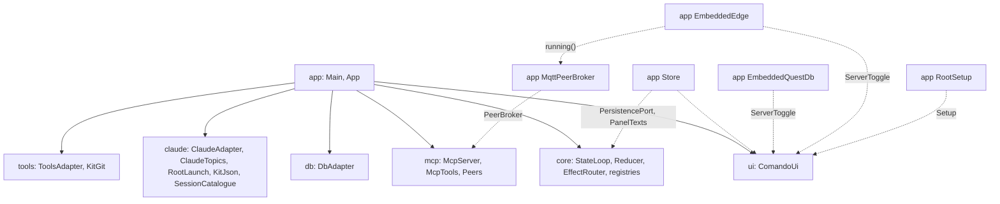

# `app`

The composition root: `main`, the configuration, the wiring of every module, the files comando keeps, the keychain, the
intent log, logging, the embedded QuestDB, the comando Edge and this instance's link to it. It depends on every other
module, QuestDB and the HiveMQ MQTT client; no module depends on it. It also holds the Gradle tasks that run, paint,
replay and package the application.

1. [Architecture](#1-architecture)
2. [Interface with the rest of the app](#2-interface-with-the-rest-of-the-app)
3. [Threads](#3-threads)
4. [Tests](#4-tests)

## 1. Architecture

One package, `dev.marregui.comando.app`.

| Class | Does |
|---|---|
| `Main` | sets the dark appearance before AWT starts, reads `AppConfig`, names the instance (`InstanceName`) for the Dock, the menu bar, the window's title and its preferences node, configures logging, takes the data root's lock (`comando.lock`; a second instance on the same root says so and exits), builds and starts `App`, and adds a shutdown hook that closes it |
| `App` | builds every part in dependency order on a stack and closes them in reverse, each once; a failed constructor step closes what was built and rethrows; `App.DeferredEffects` stands in for `EffectRouter` until the adapters it needs exist |
| `AppConfig` | the data root and its folders (`run`, `logs`, `audit`, `metrics`, `questdb`, `edge`), the `claude` executable, the kit root (`claude`'s `KitJson.resolve`), the keychain switch |
| `Store` | implements `core`'s `PersistencePort` and `ui`'s `PanelTexts`: `connections.json`, `sessions.json`, `folders.json` (with a kit's folders first, once per root, recorded in `kit-folders`), `panels.json`, and the panels' text: a Markdown file in `panels/` for a panel of comando's own, the file itself for a document; writes from immutable snapshots on its own threads |
| `PanelFiles` | each panel's text as a file: a panel of comando's own is named after its title and follows renames; a document is bound to its path and never renamed or deleted; no file is overwritten after an edit made outside comando |
| `JsonFile` | one store file, written through `core`'s `AtomicFiles`; an unreadable file is renamed aside (`.corrupt-<time>`), not overwritten |
| `Secrets` | connection passwords in the macOS login keychain through `/usr/bin/security`, each call through `core`'s `Processes`, bounded at 10 s; elsewhere `Secrets.NONE` |
| `IntentLog` | with `-Dcomando.recordIntents=true`, every intent as a JSON line after the starting state, every `password` field blanked |
| `Logging` | `System.Logger` to `logs/comando-<n>.log` (10 files of 1 MiB), warnings to stderr, uncaught exceptions logged |
| `EmbeddedQuestDb` | `ui`'s `ServerToggle`: a QuestDB server in `questdb/`, every listener on `127.0.0.1` (PostgreSQL wire on 8812, the web console on 9000) |
| `EmbeddedEdge` | `ui`'s `ServerToggle`: the one comando Edge on the machine, a child process from a distribution zip installed in `edge/`, every listener on `127.0.0.1` (MQTT 18883, WebSocket 18800, admin API 18080, JMX 18010); `~/.comando-edge.json` names its pid and the instance that started it, which alone stops it; no other process is signalled ([Workbench §3.5](../docs/workbench.md#35-the-comando-edge)) |
| `MqttPeerBroker` | `mcp`'s `PeerBroker` on the HiveMQ MQTT client (MQTT 5, async): client `comando-<instance>` to `127.0.0.1:18883` while `~/.comando-edge.json` names a live Edge, read every 5 s; reconnects 1 s after a drop, then at most every 5 s, while the Edge runs, and stops trying once it does not; the subscriptions renewed after every connect; the last will set at connect; messages to their handlers on one strand ([record 123](../docs/adr/0123-instances-consult-each-other.md)) |
| `RootSetup` | `ui`'s `Setup`: the kit root, its version and the brain's backup through `tools`' `KitGit`, its scheduled jobs through `claude`'s `KitJobsCli` |
| `Welcome` | the first panel's text on a fresh data root |

**Build and close order.** Every part is pushed on a stack as it is built and popped at the close; three are moved to
the end. The full table, with what each close does, is in
[Architecture §7](../docs/architecture.md#7-ownership-and-exit).

| Part | Built | Closed |
|---|---|---|
| the root named for every module (`KitRoot.use`), restored at the close | 1 | 16 |
| `kit-check`, `KitGit` | 2, 3 | 15, 14 |
| `Store` | 4 | 13 |
| the start-up errands (`Errands`) | 5 | 12 |
| `IntentLog` (when recording) | 6 | 11 |
| `StateLoop` | 7 | 10 |
| `DbAdapter` | 8 | 9 |
| `MermaidDiagrams`, `LocalImages` | 9, 10 | 8, 7 |
| `McpServer` (with `McpTools`) | 11 | 6 |
| `ClaudeAdapter` | 12 | 5 |
| `ToolsAdapter` | 13 | 4 |
| `ClaudeTopics` | 14 | 3 |
| `MqttPeerBroker`, `Peers` (unless `-Dcomando.peers=false`) | 15, 16 | 2, 1: the presence cleared first, then the disconnect, before the Edge stops |
| `EmbeddedQuestDb` | 17 | 18, after the lanes it may serve |
| `EmbeddedEdge` | 18 | 17, when this instance started the Edge; another's keeps running |
| `ComandoUi` | 19 | 19, greyed, its title followed by "— closing…", until the rest has closed |

**Configuration.**

| Setting | Effect |
|---|---|
| `-Dcomando.home`, else `COMANDO_HOME`, else `~/.comando` | the data root |
| `COMANDO_CLAUDE` | the `claude` executable; else the usual install paths, else `claude` on `PATH` |
| `-Dcomando.recordIntents=true` | writes the intent log to `logs/intents-<millis>.jsonl` |
| `-Dcomando.keychain` | passwords in the keychain; on by default only for `~/.comando` |
| `-Dcomando.name`, else `COMANDO_NAME`, else `instance.json`'s `name`, else the data root's folder | the instance's name: `~/.comando` is the main instance, `~/.comando_b` is `b` ([record 122](../docs/adr/0122-instances-name-kit-brain-data-root-edge.md)) |
| `-Dcomando.peers=false` | leaves this instance off the comando Edge: no presence, no instance tools; every test task of this module, `snapshot` and `docImages` set it, so no test joins a developer's running Edge |
| `CLAUDE_CONFIG_DIR` | the kit root; else `~/.claude` when it has a `comando-kit.json`, else `~/.claude/comando-kit` when that has one, else `~/.claude` |

A test or tool that points the data root elsewhere never writes the user's keychain. Tests name a temporary root through
`AppConfig`, never the user's `~/.claude`. The JVM options (`-Xms64m -Xmx4g`, `-XX:G1PeriodicGCInterval=60000`, the
export QuestDB's workers need, the dark appearance) are in `app/build.gradle.kts`, for `run` and for the packages
(`dmg`, `appImage`, `package`).

## 2. Interface with the rest of the app

What `app` connects, and nothing else does:

| From | To | Through |
|---|---|---|
| `EffectRouter` | `db`, `claude`, `mcp`, `ui`, `Store`, `tools` | the six effect ports |
| `mcp` `McpTools` | `db` | `QueryPort` |
| `claude` `ClaudeAdapter` | `mcp` `McpServer` | `McpGateway` |
| `ui` (the tabs' cards) | `claude` `ClaudeTopics` | `TopicPort`, set with `ComandoUi.topics` |
| `tools` `ToolsAdapter` | the `PATH` | `ToolSettings::now`: a `gradle-serial` on it, else `./gradlew` |
| `ui` `Setup` | `tools` `KitGit` | `RootSetup`: the kit's version, the brain's backup |
| `ui` `Setup` | `claude` `KitJobsCli` | `RootSetup`: the kit's scheduled jobs |
| `tools` `ToolsAdapter` | `ui` `DesktopTrash` | `ToolsAdapter.Trash` |
| `ui` import dialog | `claude` `SessionCatalogue` | a supplier mapping up to 500 entries to `StoredConversation` |
| `mcp` editor tools | `Store` | `McpTools.readOnly`: panels showing a log take no text |
| `Store` | `StateLoop` | `Notify` for a store warning, `FoldersRead` when `folders.json` changed outside |
| `mcp` `Peers` | the comando Edge | `PeerBroker`, implemented by `MqttPeerBroker`, which follows `EmbeddedEdge.running()` |

**At start** (`App.start`): the reducer starts, the window is built, every folder's git repository is watched for the
Files tab's marks, the Files tab's open folders are read every 5 s, the plans' usage every 5 minutes, every session with
a stored conversation loads its transcript, `claude --version` is checked, and, on a kit's root, the kit's version and
its remote's newer releases are read now and every 6 hours for the status bar, and `Peers` sets its last will and
subscriptions before `MqttPeerBroker` takes its first look at the Edge. Before that, the constructor names the
root (`KitRoot.use`) and gives the Files tab the kit's folders at the first start on it.

**At quit:** the window asks when work would stop, then `onQuit` starts the `exit` thread: `App.close()`, then
`System.exit(0)`. The shutdown hook's `close()` does nothing the second time.

## 3. Threads

| Thread | Kind | Does | Stopped by |
|---|---|---|---|
| `store` | timed strand | the store's writes; panel text 800 ms after the first unsaved change; a check of open panels' files and `folders.json` every second | `Store.close()`, which waits up to 5 s for what is queued |
| `store-secrets` | strand | keychain calls apart, so an unlock prompt never holds back panel text | `Store.close()`, which waits up to 11 s (one keychain call) |
| `claude-version` | errand of `App` | the start-up check | the errands' close |
| `kit-check` | timed strand of `App` | the kit's version at start and every 6 hours, through `git` | `App.close()` |
| `questdb-toggle` | errand of `EmbeddedQuestDb` | one start or stop; a toggle meanwhile only says so | `EmbeddedQuestDb.close()` |
| `edge-toggle`, `edge-check` | errands of `EmbeddedEdge` | one start or stop, up to 60 s for the admin API to answer; a read of the registry at most once a second for the button | `EmbeddedEdge.close()` |
| `peer-broker` | timed strand of `MqttPeerBroker` | whether the registry names a live Edge, at start and every 5 s; connects or leaves | `MqttPeerBroker.close()` |
| `peer-messages` | strand of `MqttPeerBroker` | the MQTT client's callbacks (its RxJava scheduler) and every message to its handlers, in order | `MqttPeerBroker.close()`, after the disconnect |
| `exit`, `shutdown` | platform, at quit only | close the application after Quit, or from the shutdown hook | the JVM's exit |

The MQTT client adds one Netty event loop thread, a platform thread of the library's, while a client exists.

The store's threads are virtual, so daemons: `close()` waits for what is queued, at a quit and in the shutdown hook. A
keychain call runs on `store-secrets` through `Processes`, which starts no thread of its own.

## 4. Tests

| Test | Covers | Runs in |
|---|---|---|
| `StoreTest`, `StoreSaveNowTest`, `PanelFilesTest`, `IntentLogTest`, `LoggingTest`, `MainTest`, `AppConfigTest`, `EmbeddedQuestDbTest`, `EmbeddedEdgeTest` | the store files and panel files, the intent log, logging, the lock message, the data root's choice, the embedded QuestDB, the comando Edge on a fake distribution and its download from a local server | `./gradlew :app:test` |
| `MqttPeerBrokerTest` | without a broker or a port: a question's response topic and correlation data through the client's types, a message to the handlers whose filters match, no connection while no Edge runs, the reconnect delays | `./gradlew :app:test` |
| `StoreTest`'s keychain round trip | writes and deletes one login keychain item | `./gradlew :app:test -PkeychainTest=true` |
| `EmbeddedEdgeTest`'s live start | downloads the pinned open-source Edge release (359 MB), runs it on free loopback ports, connects to its broker port, stops it | `./gradlew :app:test -PedgeLiveTest=true` |
| `ThreadRulesTest` | ArchUnit over every module: platform threads only in `StateLoop`, `Watchdog`, `ClaudeProcess` and `Main`; virtual threads, executors other than per-task virtual ones, pools and `java.util.Timer` only in `Threads`; nothing on the JDK's shared fork-join pool | `./gradlew :app:test` |
| `ColourRulesTest` | ArchUnit: colours made and named only in `ui`'s `kit.theme` | `./gradlew :app:test` |
| `AdrIndexTest` | `docs/adr/README.md` against the records: one row each, its title, date, deciders and status word for word | `./gradlew :app:test` |
| `UiReplayTest` | intent logs replayed against the real shell with `testkit`'s `RecordingPorts` | `./gradlew :app:uiTest` |
| `UiKeysTest` | keys typed into a real window, with macOS's keys and with the other desktops' | `./gradlew :app:uiTest` |
| `TreeClicksUiTest` | a tree's clicks, and the Files tab of a window started on a temporary kit root | `./gradlew :app:uiTest` |
| `DarkPageTintUiTest`, `LinksUiTest` | a rendered Markdown page in a window: its tint, a memory file's front matter and links | `./gradlew :app:uiTest` |
| `CheckpointCompactUiTest` | the Checkpoint button against a stand-in for `claude -p`: the checkpoint, then `/compact`, the conversation kept | `./gradlew :app:uiTest` |
| `SessionCardUiTest` | the card a session's row and a connection's row show | `./gradlew :app:uiTest` |
| `FocusBackUiTest` | closing gives the keyboard back to where the user came from: chained openings, the sidebar, the Session tab | `./gradlew :app:uiTest` |
| `LocateUiTest` | a panel's Locate: the file selected in the Files tab, its folders opened; the session selected in the Sessions tab | `./gradlew :app:uiTest` |
| `LowerDividerUiTest` | the lower divider kept per panel | `./gradlew :app:uiTest` |
| `OutlineUiTest` | a Markdown document's outline: shown at the right, a double click scrolling the page to its heading | `./gradlew :app:uiTest` |
| `OwnLogUiTest` | comando's own log in a panel, following the lines written after it opened | `./gradlew :app:uiTest` |
| `ThreadBudgetTest` | the whole application with more fake sessions than cores (cores + 4): comando's own platform threads are the reducer, the watchdog and one reader per session, and none is left after the close | `./gradlew :app:uiTest` |

`:app:uiTest` needs a display (`xvfb-run` on Linux) and runs one JVM per class; its windows open on no screen and never
take the desktop's focus.

| Task | Does |
|---|---|
| `./gradlew :app:run` | starts comando from a copy of the build output made at launch, so a build while it runs cannot break it |
| `./gradlew :app:snapshot -Pout=<dir>` | drives comando with intents and paints its window to PNG files (`Snapshot`; `-Plive=true` starts a real session) |
| `./gradlew :app:docImages -Pout=<dir>` | paints the README's and the docs' pictures at twice their size, one live Claude Code turn (haiku) included (`DocImages`) |
| `ProbeNewSession` (a `main` in the test sources, run from the IDE) | a probe of the new-session dialog: adds a session, types into its name field and reports the text, caret and focus |
| `./gradlew :app:dmg` | an unsigned macOS disk image with its own runtime, in `build/dmg` |
| `./gradlew :app:appImage` | the application folder with its own runtime, in `build/app-image` |
| `./gradlew :app:package` | the release file for the running system in `build/package`: `.dmg`, Linux `.tar.gz` or Windows `.zip`; `-PreleaseVersion=X` sets the version |

Further reading: [Build and run](../docs/build-and-run.md), [Workbench §6](../docs/workbench.md#6-persistence).
