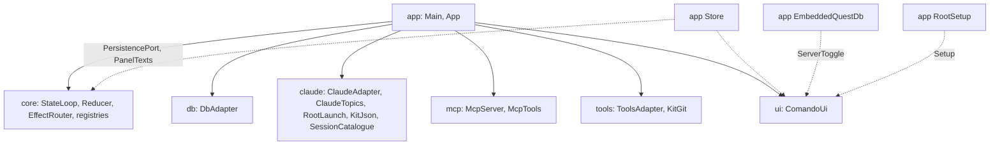

# `app`

The composition root: `main`, the configuration, the wiring of every module, the files comando keeps, the keychain, the
intent log, logging and the embedded QuestDB. It depends on every other module and QuestDB; no module depends on it. It
also holds the Gradle tasks that run, paint, replay and package the application.

1. [Architecture](#1-architecture)
2. [Interface with the rest of the app](#2-interface-with-the-rest-of-the-app)
3. [Threads](#3-threads)
4. [Tests](#4-tests)

## 1. Architecture

One package, `dev.marregui.comando.app`.

| Class | Does |
|---|---|
| `Main` | sets the dark appearance before AWT starts, reads `AppConfig`, configures logging, takes the data root's lock (`comando.lock`; a second instance on the same root says so and exits), builds and starts `App`, and adds a shutdown hook that closes it |
| `App` | builds every part in dependency order on a stack and closes them in reverse, each once; a failed constructor step closes what was built and rethrows; `App.DeferredEffects` stands in for `EffectRouter` until the adapters it needs exist |
| `AppConfig` | the data root and its folders (`run`, `logs`, `audit`, `questdb`), the `claude` executable, the kit root (`claude`'s `KitJson.resolve`), the keychain switch |
| `Store` | implements `core`'s `PersistencePort` and `ui`'s `PanelTexts`: `connections.json`, `sessions.json`, `folders.json` (with a kit's folders first, once per root, recorded in `kit-folders`), `panels.json`, and the panels' text: a Markdown file in `panels/` for a panel of comando's own, the file itself for a document; writes from immutable snapshots on its own threads |
| `PanelFiles` | each panel's text as a file: a panel of comando's own is named after its title and follows renames; a document is bound to its path and never renamed or deleted; no file is overwritten after an edit made outside comando |
| `JsonFile` | one store file: atomic replace through a temporary file; an unreadable file is renamed aside (`.corrupt-<time>`), not overwritten |
| `Secrets` | connection passwords in the macOS login keychain through `/usr/bin/security`; elsewhere `Secrets.NONE` |
| `IntentLog` | with `-Dcomando.recordIntents=true`, every intent as a JSON line after the starting state, every `password` field blanked |
| `Logging` | `System.Logger` to `logs/comando-<n>.log` (10 files of 1 MiB), warnings to stderr, uncaught exceptions logged |
| `EmbeddedQuestDb` | `ui`'s `ServerToggle`: a QuestDB server in `questdb/`, every listener on `127.0.0.1` (PostgreSQL wire on 8812, the web console on 9000) |
| `RootSetup` | `ui`'s `Setup`: the kit root, its version and the brain's backup through `tools`' `KitGit`, its scheduled jobs through `claude`'s `KitJobsCli` |
| `Welcome` | the first panel's text on a fresh data root |

**Build and close order.** Every part is pushed on a stack as it is built and popped at the close; two are moved to the
end. The full table, with what each close does, is in [Architecture §7](../docs/architecture.md#7-ownership-and-exit).

| Part | Built | Closed |
|---|---|---|
| the root named for every module (`KitRoot.use`), restored at the close | 1 | 14 |
| `kit-check`, `KitGit` | 2, 3 | 13, 12 |
| `Store` | 4 | 11 |
| the start-up errands (`Errands`) | 5 | 10 |
| `IntentLog` (when recording) | 6 | 9 |
| `StateLoop` | 7 | 8 |
| `DbAdapter` | 8 | 7 |
| `MermaidDiagrams`, `LocalImages` | 9, 10 | 6, 5 |
| `McpServer` (with `McpTools`) | 11 | 4 |
| `ClaudeAdapter` | 12 | 3 |
| `ToolsAdapter` | 13 | 2 |
| `ClaudeTopics` | 14 | 1 |
| `EmbeddedQuestDb` | 15 | 15, after the lanes it may serve |
| `ComandoUi` | 16 | 16, greyed and titled "comando — closing…" until the rest has closed |

**Configuration.**

| Setting | Effect |
|---|---|
| `-Dcomando.home`, else `COMANDO_HOME`, else `~/.comando` | the data root |
| `COMANDO_CLAUDE` | the `claude` executable; else the usual install paths, else `claude` on `PATH` |
| `-Dcomando.recordIntents=true` | writes the intent log to `logs/intents-<millis>.jsonl` |
| `-Dcomando.keychain` | passwords in the keychain; on by default only for `~/.comando` |
| `CLAUDE_CONFIG_DIR` | the kit root; else `~/.claude` when it has a `comando-kit.json`, else `~/.claude/comando-kit` when that has one, else `~/.claude` |

A test or tool that points the data root elsewhere never writes the user's keychain. Tests name a temporary root through
`AppConfig`, never the user's `~/.claude`. The JVM options (`-Xms64m -Xmx4g`, `-XX:G1PeriodicGCInterval=60000`, the
export QuestDB's workers need, the dark appearance) are in `app/build.gradle.kts`, for `run` and for the packages
(`dmg`, `appImage`, `package`).

## 2. Interface with the rest of the app

What `app` connects, and nothing else does:

| From | To | Through |
|---|---|---|
| `EffectRouter` | `db`, `claude`, `mcp`, `ui`, `Store`, `tools` | the six effect ports |
| `mcp` `McpTools` | `db` | `QueryPort` |
| `claude` `ClaudeAdapter` | `mcp` `McpServer` | `McpGateway` |
| `ui` (the tabs' cards) | `claude` `ClaudeTopics` | `TopicPort`, set with `ComandoUi.topics` |
| `tools` `ToolsAdapter` | the `PATH` | `ToolSettings::now`: a `gradle-serial` on it, else `./gradlew` |
| `ui` `Setup` | `tools` `KitGit` | `RootSetup`: the kit's version, the brain's backup |
| `ui` `Setup` | `claude` `KitJobsCli` | `RootSetup`: the kit's scheduled jobs |
| `tools` `ToolsAdapter` | `ui` `DesktopTrash` | `ToolsAdapter.Trash` |
| `ui` import dialog | `claude` `SessionCatalogue` | a supplier mapping up to 500 entries to `StoredConversation` |
| `mcp` editor tools | `Store` | `McpTools.readOnly`: panels showing a log take no text |
| `Store` | `StateLoop` | `Notify` for a store warning, `FoldersRead` when `folders.json` changed outside |

**At start** (`App.start`): the reducer starts, the window is built, every folder's git repository is watched for the
Files tab's marks, the Files tab's open folders are read every 5 s, the plans' usage every 5 minutes, every session with
a stored conversation loads its transcript, `claude --version` is checked, and, on a kit's root, the kit's version and
its remote's newer releases are read now and every 6 hours for the status bar. Before that, the constructor names the
root (`KitRoot.use`) and gives the Files tab the kit's folders at the first start on it.

**At quit:** the window asks when work would stop, then `onQuit` starts the `exit` thread: `App.close()`, then
`System.exit(0)`. The shutdown hook's `close()` does nothing the second time.

## 3. Threads

| Thread | Kind | Does | Stopped by |
|---|---|---|---|
| `store` | timed strand | the store's writes; panel text 800 ms after the first unsaved change; a check of open panels' files and `folders.json` every second | `Store.close()`, which waits up to 5 s for what is queued |
| `store-secrets` | strand | keychain calls apart, so an unlock prompt never holds back panel text | `Store.close()`, which waits up to 11 s (one keychain call) |
| `claude-version` | errand of `App` | the start-up check | the errands' close |
| `kit-check` | timed strand of `App` | the kit's version at start and every 6 hours, through `git` | `App.close()` |
| `questdb-toggle` | errand of `EmbeddedQuestDb` | one start or stop; a toggle meanwhile only says so | `EmbeddedQuestDb.close()` |
| `keychain-output` | fork | one `security` call's output, so a keychain call that gets no answer ends after 10 s | its caller |
| `exit`, `shutdown` | platform, at quit only | close the application after Quit, or from the shutdown hook | the JVM's exit |

The store's threads are virtual, so daemons: `close()` waits for what is queued, at a quit and in the shutdown hook.

## 4. Tests

| Test | Covers | Runs in |
|---|---|---|
| `StoreTest`, `StoreSaveNowTest`, `PanelFilesTest`, `IntentLogTest`, `LoggingTest`, `MainTest`, `EmbeddedQuestDbTest` | the store files and panel files, the intent log, logging, the lock message, the embedded QuestDB | `./gradlew :app:test` |
| `StoreTest`'s keychain round trip | writes and deletes one login keychain item | `./gradlew :app:test -PkeychainTest=true` |
| `ThreadRulesTest` | ArchUnit over every module: platform threads only in `StateLoop`, `Watchdog`, `ClaudeProcess` and `Main`; virtual threads, executors other than per-task virtual ones, pools and `java.util.Timer` only in `Threads` | `./gradlew :app:test` |
| `UiReplayTest` | intent logs replayed against the real shell with `testkit`'s `RecordingPorts` | `./gradlew :app:uiTest` |
| `UiKeysTest` | keys typed into a real window, with macOS's keys and with the other desktops' | `./gradlew :app:uiTest` |
| `TreeClicksUiTest` | a tree's clicks, and the Files tab of a window started on a temporary kit root | `./gradlew :app:uiTest` |
| `DarkPageTintUiTest`, `LinksUiTest` | a rendered Markdown page in a window: its tint, a memory file's front matter and links | `./gradlew :app:uiTest` |
| `CheckpointClearUiTest` | the Checkpoint button against a stand-in for `claude -p`: the conversation cleared, the summary carried | `./gradlew :app:uiTest` |
| `SessionCardUiTest` | the card a session's row and a connection's row show | `./gradlew :app:uiTest` |
| `ThreadBudgetTest` | the whole application with more fake sessions than cores (cores + 4): comando's own platform threads are the reducer, the watchdog and one reader per session, and none is left after the close | `./gradlew :app:uiTest` |

`:app:uiTest` needs a display (`xvfb-run` on Linux) and runs one JVM per class; its windows open on no screen and never
take the desktop's focus.

| Task | Does |
|---|---|
| `./gradlew :app:run` | starts comando from a copy of the build output made at launch, so a build while it runs cannot break it |
| `./gradlew :app:snapshot -Pout=<dir>` | drives comando with intents and paints its window to PNG files (`Snapshot`; `-Plive=true` starts a real session) |
| `./gradlew :app:docImages -Pout=<dir>` | paints the README's and the docs' pictures at twice their size, one live Claude Code turn (haiku) included (`DocImages`) |
| `./gradlew :app:dmg` | an unsigned macOS disk image with its own runtime, in `build/dmg` |
| `./gradlew :app:appImage` | the application folder with its own runtime, in `build/app-image` |
| `./gradlew :app:package` | the release file for the running system in `build/package`: `.dmg`, Linux `.tar.gz` or Windows `.zip`; `-PreleaseVersion=X` sets the version |

Further reading: [Build and run](../docs/build-and-run.md), [Workbench §6](../docs/workbench.md#6-persistence).
