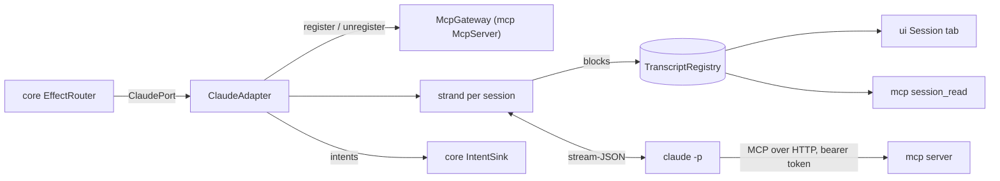

# `claude`

The Claude Code adapter: one headless `claude -p` process per session, speaking stream-JSON on standard input and
output, mapped into transcript blocks and intents. It also lists the conversations Claude Code stored, follows
sub-agents' stored conversations, reads the plan's usage, checks the installed CLI's version, and reads a kit's
`comando-kit.json`, so that every `claude` it starts runs on the kit's root. It depends on `core` and Jackson.

1. [Architecture](#1-architecture)
2. [Interface with the rest of the app](#2-interface-with-the-rest-of-the-app)
3. [Threads](#3-threads)
4. [Tests](#4-tests)

## 1. Architecture

| Class | Does |
|---|---|
| `ClaudeAdapter` | the port; a `Session` per name, each with its strand, its transcript, its `StreamMapper` and its current process run |
| `ClaudeCommand` | the argument list of a session's process: stream-JSON in and out with partial messages, sub-agent text and hook events (`--verbose`, `--include-partial-messages`, `--forward-subagent-text`, `--include-hook-events`), start mode (`--session-id`, `--resume`, `--fork-session`), `--name <session>`, `--mcp-config` with `--permission-prompt-tool mcp__comando__approve` and `--append-system-prompt` (only with comando's server), the spec's model, effort, permission mode, extra directories and budget |
| `ClaudeProcess` | one child process and its threads: stdout lines to the strand, stdin from a queue, the last 40 stderr lines, the exit |
| `StreamMapper` | stream-JSON events, or a stored conversation's lines, into `Block`s and intents; streaming blocks grow in place and the complete `assistant` event replaces them |
| `SubagentFiles` | finds and reads a sub-agent's stored conversation (`<session-id>/subagents/agent-<id>.jsonl`), reading only what the file gained since the last read |
| `SessionCatalogue` | Claude Code's stored conversations for the import dialog, from a bounded read of each file's head and tail |
| `PlanUsageReader` | the plan's usage limits from `claude --safe-mode -p /usage`, which sends no prompt |
| `ClaudeTopics` | the tabs' topics: one line each from Haiku (`claude --safe-mode -p --model haiku`, no tools, no thinking, no saved session), one read at a time, one ask waiting per tab |
| `ClaudeVersion` | `claude --version` against the tested line (2.1.296 up to 2.2.0): a warning outside it, not a refusal |
| `GitBranch` | the working directory's branch from `.git/HEAD`, without running git |
| `KitJson` | a kit's `comando-kit.json` (schema version 1) read into `core`'s `KitRoot.Manifest`, refused whole when it breaks the schema; `resolve()`, the root comando runs on |
| `RootLaunch` | what every `claude` comando starts gets from the root: `CLAUDE_CONFIG_DIR=<root>` when the root is not `~/.claude`, and with a kit `--settings {"autoMemoryDirectory": "<root>/<brain>/MEMORY"}`, merged into a `--settings` already given; the session `kit` in the root runs on the user's own `~/.claude`, so it can replace the kit |
| `ClaudeSettings` | the executable (found in the usual install paths, since an app started from Finder has a short `PATH`), the MCP configuration folder, Claude Code's `projects` folder under the root, the appended instructions, the `RootLaunch` |
| `UiInstructions` | the text appended to the system prompt that tells a session about comando's tools |

- **One writer per transcript.** Every change to a session (start, a stdout line, a prompt, interrupt, stop, history)
  runs on its strand, a single-threaded virtual executor; the strand is the only writer of the session's
  `Transcript` and the only owner of its process.
- **MCP per process.** At each start the adapter asks `McpGateway.register` for a ticket (URL and bearer token),
  writes it with a 60 min timeout into `<run>/<session>-<uuid>.mcp.json` (mode `0600` from creation), and passes the
  file with `--mcp-config`. The ticket is revoked and the file deleted when the process exits; files a killed comando
  left are deleted at the next start.
- **Not `--bare`.** The process loads CLAUDE.md, hooks, plugins, skills and the user's MCP servers as a terminal
  session does; the login is the CLI's own.
- **On the kit's root.** Sessions, the `/usage` read, the topic reads and `claude --version` all go through the one
  `RootLaunch`: one root for every `claude` comando starts.

## 2. Interface with the rest of the app

**Provides.**

| Interface | Methods | Caller |
|---|---|---|
| `ClaudePort` | `start`, `stop`, `send(name, text, origin, preface)`, `interrupt`, `clearTranscript`, `clearConversation`, `loadHistory`, `forget`, `showSubagent` | the reducer's effects, through `EffectRouter` |
| `ClaudeAdapter.watchPlanUsage(every)` | reads the plan's usage now and every period | `app` at start (every 5 min) |
| `SessionCatalogue.scan(limit)` | the stored conversations, newest first | `app`, which maps each entry to `ui`'s `StoredConversation` for the import dialog |
| `ClaudeVersion.check(executable, launch)` | a warning, or empty | `app` at start |
| `KitJson.resolve`, `KitJson.read` | the root and its kit | `app`'s `AppConfig` |
| `RootLaunch.on(root)` | the root's environment and settings for every `claude` | `app`'s wiring: `ClaudeSettings`, `ClaudeTopics`, `ClaudeVersion` |
| `ClaudeSettings.findExecutable`, `UiInstructions.TEXT` | configuration | `app`'s `AppConfig` and wiring |

**Needs.** The `IntentSink`, the `TranscriptRegistry` it writes, an `McpGateway` (`McpServer`, or `McpGateway.NONE` to
start sessions without comando's tools) and `ClaudeSettings`.

**Sends back.** `SessionStarted`, `SessionInit`, `SessionActivity`, `SessionTurnRunning`, `SessionTurnEnded`,
`SessionTasksChanged`, `SessionExited`, `SessionBranch`, `PlanUsageRead`, `ShowView` and `RefreshView` (a sub-agent's
conversation as a lower view, followed while it grows), `Notify`.

**Reads, never writes:** the root's `projects/` and its `comando-kit.json`. **Writes outside the data root:** only a temporary
file in the system temp folder for each plan-usage read, each topic read and each process's stderr, deleted after it.

## 3. Threads

| Thread | Does |
|---|---|
| `claude-out-<session>` | platform, the one a session costs: stdout lines (a pipe read holds its thread even on a virtual thread) |
| `claude-in-`, `claude-exit-<session>` | virtual forks: the stdin queue; the exit, then the stderr tail read from its file in the temp folder, which is deleted |
| `claude-strand-<session>` | strand: every change to the session |
| `claude-timer` | timed strand: the stop sequence, SIGTERM 3 s after the interrupt, SIGKILL 2 s later |
| `subagent-tail` | timed strand: follows up to 4 sub-agent conversations every 2 s while they run |
| `plan-usage` | timed strand: the periodic `/usage` read |
| `topic-reader` | strand: the tabs' topic reads, one at a time |
| `claude-version` | fork: `claude --version`'s output |

`close()` stops every process (SIGTERM, SIGKILL 2 s later) and deletes every MCP configuration file.

## 4. Tests

- `ClaudeAdapterTest`, `SubagentViewTest`, `SubagentFollowTest` and `SubagentTailEdgesTest` run the adapter against
  fake CLI scripts in `src/test/resources` (`fake-claude.sh`, `fake-claude-crash.sh`, `fake-claude-agents.sh`), and
  one `ClaudeAdapterTest` writes its own (a process that dies mid-tool). The sub-agent tests shorten the 2 s follow
  period to 100 ms.
- `StreamMapperTest` replays `testkit`'s recorded streams; `SubagentFilesTest` reads the fixtures in
  `src/test/resources/subagents/`, the other sub-agent tests write their files into a temporary projects folder as
  they go; `SubagentFilesProbeTest` feeds `SubagentFiles` generated inputs.
- `PlanUsageReaderTest` and `ClaudeTopicsTest` run their reads against fake scripts written in a temporary folder;
  `ClaudeTopicsTest` also paces a stubbed read to check one read at a time, the replacement of a waiting ask and the close.
- `KitJsonTest` reads a `comando-kit.json` as the kit's installer writes it, refuses broken ones, and resolves roots with it;
  `RootLaunchTest` checks the environment and `--settings` each `claude` gets, the upgrade session's exception, and a
  real process's `CLAUDE_CONFIG_DIR`.

Further reading: [Claude §1](../docs/claude.md#1-the-claude-bridge).
