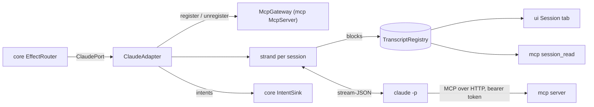

# `claude`

The Claude Code adapter: one headless `claude -p` process per session, speaking stream-JSON on standard input and
output, mapped into transcript blocks and intents. It also lists the conversations Claude Code stored, follows
sub-agents' stored conversations, reads the plan's usage, checks the installed CLI's version, and installs comando's
Claude Code kit. It depends on `core` and Jackson.

1. [Architecture](#1-architecture)
2. [Interface with the rest of the app](#2-interface-with-the-rest-of-the-app)
3. [Threads](#3-threads)
4. [Tests](#4-tests)

## 1. Architecture

| Class | Does |
|---|---|
| `ClaudeAdapter` | the port; a `Session` per name, each with its strand, its transcript, its `StreamMapper` and its current process run |
| `ClaudeCommand` | the argument list of a session's process: stream-JSON in and out, start mode (`--session-id`, `--resume`, `--fork-session`), `--mcp-config`, `--permission-prompt-tool mcp__comando__approve`, `--append-system-prompt`, the spec's model, effort, permission mode, extra directories and budget |
| `ClaudeProcess` | one child process and its threads: stdout lines to the strand, stdin from a queue, the last 40 stderr lines, the exit |
| `StreamMapper` | stream-JSON events, or a stored conversation's lines, into `Block`s and intents; streaming blocks grow in place and the complete `assistant` event replaces them |
| `SubagentFiles` | finds and reads a sub-agent's stored conversation (`<session-id>/subagents/agent-<id>.jsonl`), reading only what the file gained since the last read |
| `SessionCatalogue` | Claude Code's stored conversations for the import dialog, from a bounded read of each file's head and tail |
| `PlanUsageReader` | the plan's usage limits from `claude --safe-mode -p /usage`, which sends no prompt |
| `ClaudeVersion` | `claude --version` against the tested line (2.1.296 up to 2.2.0): a warning outside it, not a refusal |
| `GitBranch` | the working directory's branch from `.git/HEAD`, without running git |
| `Kit` | comando's Claude Code plugin (the repository's `kit/`), copied into the data root and installed through Claude Code's plugin commands with the user's consent |
| `ClaudeSettings` | the executable (found in the usual install paths, since an app started from Finder has a short `PATH`), the MCP configuration folder, Claude Code's `projects` folder, the appended instructions |
| `UiInstructions` | the text appended to the system prompt that tells a session about comando's tools |

- **One writer per transcript.** Every change to a session (start, a stdout line, a prompt, interrupt, stop, history)
  runs on its strand, a single-threaded virtual executor; the strand is the only writer of the session's
  `Transcript` and the only owner of its process.
- **MCP per process.** At each start the adapter asks `McpGateway.register` for a ticket (URL and bearer token),
  writes it with a 60 min timeout into `<run>/<session>-<uuid>.mcp.json` (mode `0600` from creation), and passes the
  file with `--mcp-config`. The ticket is revoked and the file deleted when the process exits; files a killed comando
  left are deleted at the next start.
- **Not `--bare`.** The process loads CLAUDE.md, hooks, plugins, skills and the user's MCP servers as a terminal
  session does; the login is the CLI's own.
- **The kit in the jar.** The build copies `kit/` into the jar's resources with an index of its files
  (`claude/build.gradle.kts`, task `kitIndex`), because a jar cannot list a folder.

## 2. Interface with the rest of the app

**Provides.**

| Interface | Methods | Caller |
|---|---|---|
| `ClaudePort` | `start`, `stop`, `send(name, text, origin)`, `interrupt`, `clearTranscript`, `loadHistory`, `forget`, `showSubagent` | the reducer's effects, through `EffectRouter` |
| `ClaudeAdapter.watchPlanUsage(every)` | reads the plan's usage now and every period | `app` at start (every 5 min) |
| `SessionCatalogue.scan(limit)` | the stored conversations, newest first | `app`, which maps each entry to `ui`'s `StoredConversation` for the import dialog |
| `ClaudeVersion.check(executable)` | a warning, or empty | `app` at start |
| `Kit` | `refresh`, `status`, `install`, `folders`, `gradleSerial` | `app` (at start, and through `KitSetup` for the menus); `gradleSerial` also tells `tools` where Gradle runs queue |
| `ClaudeSettings.findExecutable`, `defaultProjectsDir`, `UiInstructions.TEXT` | configuration | `app`'s `AppConfig` and wiring |

**Needs.** The `IntentSink`, the `TranscriptRegistry` it writes, an `McpGateway` (`McpServer`, or `McpGateway.NONE` to
start sessions without comando's tools) and `ClaudeSettings`.

**Sends back.** `SessionStarted`, `SessionInit`, `SessionActivity`, `SessionTurnRunning`, `SessionTurnEnded`,
`SessionTasksChanged`, `SessionExited`, `SessionBranch`, `PlanUsageRead`, `ShowView` and `RefreshView` (a sub-agent's
conversation as a lower view, followed while it grows), `Notify`.

**Reads, never writes:** Claude Code's `~/.claude/projects/`. **Writes outside the data root:** only what `Kit.install`
does after the user consents (Claude Code's plugin commands, the skeleton files that are missing, one settings key).

## 3. Threads

| Thread | Does |
|---|---|
| `claude-strand-<session>` | virtual, single-threaded: every change to the session |
| `claude-out-`, `-in-`, `-err-`, `-exit-<session>` | per process: stdout lines, the stdin queue, the stderr tail, the exit |
| `claude-timer` | the stop sequence: SIGTERM 3 s after the interrupt, SIGKILL 2 s later |
| `subagent-tail` | follows up to 4 sub-agent conversations every 2 s while they run |
| `plan-usage` | the periodic `/usage` read |

`close()` stops every process (SIGTERM, SIGKILL 2 s later) and deletes every MCP configuration file.

## 4. Tests

- `ClaudeAdapterTest`, `SubagentFollowTest` and `SubagentTailEdgesTest` run the adapter against fake CLI scripts in
  `src/test/resources` (`fake-claude.sh`, `fake-claude-crash.sh`, `fake-claude-agents.sh`).
- `StreamMapperTest` replays `testkit`'s recorded streams; `SubagentFilesTest` and the sub-agent tests read the
  fixtures in `src/test/resources/subagents/`; `SubagentFilesProbeTest` feeds `SubagentFiles` generated inputs.
- `KitLiveTest` runs the installed `claude` in a throwaway `CLAUDE_CONFIG_DIR`, only with `COMANDO_KIT_LIVE=true`.

Further reading: [Claude §1](../docs/claude.md#1-the-claude-bridge), [the kit](../kit/README.md).
