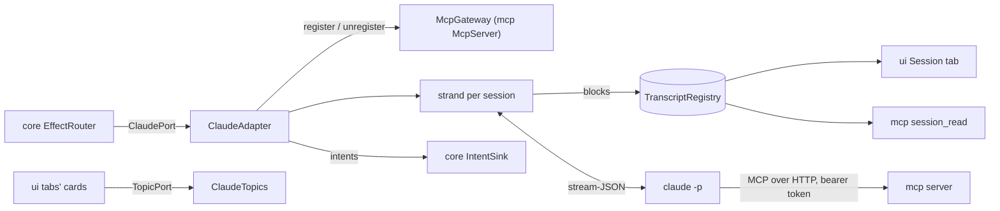

# `claude`

The Claude Code adapter: one headless `claude -p` process per session, speaking stream-JSON on standard input and
output, mapped into transcript blocks and intents. It also lists the conversations Claude Code stored, follows
subagents' stored conversations, reads the plans' usage (Claude Code's, and Codex's when its CLI is installed), reads
the tabs' topics with Haiku, checks the installed CLI's version, keeps the sessions' metrics, and reads a kit's
`comando-kit.json`, so that every `claude` it starts runs on the kit's root. It depends on `core` and Jackson; `app`
alone constructs it.

1. [Architecture](#1-architecture)
2. [Interface with the rest of the app](#2-interface-with-the-rest-of-the-app)
3. [Threads](#3-threads)
4. [Tests](#4-tests)

## 1. Architecture

One package, `dev.marregui.comando.claude`.

| Class | Does |
|---|---|
| `ClaudeAdapter` | the port; a `Session` per name, each with its strand, its transcript, its `StreamMapper` and its current process run |
| `ClaudeCommand` | the argument list of a session's process: stream-JSON in and out with partial messages, subagent text and hook events (`--verbose`, `--include-partial-messages`, `--forward-subagent-text`, `--include-hook-events`); the start mode (`--session-id`, `--resume`, `--fork-session`); `--name <session>`; `--mcp-config` with `--permission-prompt-tool mcp__comando__approve` and `--append-system-prompt`, only with comando's server; the spec's model, effort, permission mode, extra directories and budget |
| `ClaudeProcess` | one child process and its threads: stdout lines to the strand, stdin from a queue, stderr to a file in the temp folder whose last 40 lines are read at the exit |
| `StreamMapper` | stream-JSON events, or a stored conversation's lines, into `Block`s and intents; streaming blocks grow in place and the complete `assistant` event replaces them |
| `RunSettings` | the model and effort a message ran at, from the assistant line of the conversation's transcript (`message.model`, `perTurnEffort`, else `effort`), read from the file's last 256 KiB on the session's strand; the stream names the model but not the effort |
| `MetricsLog` | what the sessions spend and how their work ends, one JSON line per turn, sub-agent or plan-usage read, in `metrics/metrics-<UTC date>.jsonl` of the data root ([record 110](../docs/adr/0110-metrics-for-calibration.md)); `MetricsLog.NONE` keeps nothing |
| `BaseEffort` | the effort a model's turns start at, from the root's `settings.json` (`modelSettings.<model>.effortLevel`, else `effortLevel`); the stream does not report it |
| `SubagentFiles` | finds and reads a subagent's stored conversation (`<session-id>/subagents/agent-<id>.jsonl`), reading only what the file gained since the last read |
| `SessionCatalogue` | Claude Code's stored conversations for the import dialog and the session dialog's conversation picker, from a bounded read of each file's head (64 KiB) and tail (256 KiB) |
| `PlanUsageReader` | the plan's usage limits from `claude --safe-mode -p /usage`, a local command that sends no prompt |
| `CodexUsageReader` | the Codex plan's usage limits from `codex app-server` (`account/rateLimits/read` over JSON-RPC on stdio), which sends no prompt; without Codex installed or signed in, the read says why |
| `ClaudeTopics` | the tabs' topics: one or two sentences from Haiku (`claude --safe-mode -p --model haiku`, no tools, no saved session), one read at a time, at most one ask waiting per tab |
| `ClaudeVersion` | `claude --version` against the tested range, 2.1.296 inclusive to 2.2.0 exclusive: a warning outside it, not a refusal |
| `GitBranch` | the working directory's branch from `.git/HEAD`, without running git |
| `KitJson` | a kit's `comando-kit.json` (schema version 1) read into `core`'s `KitRoot.Manifest`, refused whole when it breaks the schema; `resolve()`, the root comando runs on |
| `KitJobsCli` | the kit's scheduled jobs through the root's `install/kit.py` (record 117): `jobs --json` read into `core`'s `KitJobs`, the whole list handed to `jobs set` on standard input, `job run` for one; each call through `Processes`, at most 60 s |
| `RootLaunch` | what every `claude` comando starts gets from the root: `CLAUDE_CONFIG_DIR=<root>` when the root is not `~/.claude`, and with a kit `--settings {"autoMemoryDirectory": "<root>/<brain>/MEMORY"}`, merged into a `--settings` already given; the session `kit` runs on the user's own `~/.claude` when the root is `~/.claude` or inside it, and on its own root for a sibling kit such as `~/.claude_b` (record 122), so it can replace the kit |
| `ClaudeSettings` | the executable (found in the usual install paths, since an app started from Finder has a short `PATH`), the MCP configuration folder, Claude Code's `projects` folder under the root, the appended instructions, the `RootLaunch` |
| `UiInstructions` | the text appended to the system prompt that tells a session about comando's tools |

**One writer per transcript.** Every change to a session (start, a stdout line, a prompt, interrupt, stop, history) runs
on its strand, a single-threaded virtual executor. The strand is the only writer of the session's `Transcript` and the
only owner of its process.

**MCP per process.** At each start the adapter asks `McpGateway.register` for a ticket (URL and bearer token), writes it
with a 60 min timeout into `<run>/<session>-<uuid>.mcp.json` (mode `0600` from creation), and passes the file with
`--mcp-config`. The ticket is revoked and the file deleted when the process exits; files a killed comando left are
deleted at the next start.

**Not `--bare`.** The process loads CLAUDE.md, hooks, plugins, skills and the user's MCP servers as a terminal session
does; the login is the CLI's own.

**On the kit's root.** Sessions, the `/usage` read, the topic reads and `claude --version` all go through the one
`RootLaunch`: one root for every `claude` comando starts.

**Short commands.** The `/usage` read, the topic reads, `claude --version` and `kit.py` run through `core`'s
`Processes`: on the caller's thread, the output on temporary files, ended at the bound with every process they started.

**Measured.** A topic read with 2 000 characters in took a median of 2.0 s on Claude Code 2.1.308, so one reader serves
every tab: however many panels ask, at most one Haiku process runs.

## 2. Interface with the rest of the app



**Provides.**

| Interface | Methods | Caller |
|---|---|---|
| `ClaudePort` | `start`, `stop`, `send(name, text, origin, preface)`, `interrupt`, `clearTranscript`, `clearConversation(name, carried)`, `loadHistory`, `forget`, `showSubagent` | the reducer's effects, through `EffectRouter` |
| `TopicPort` (`ClaudeTopics`) | `read(key, source, urgent, done)` | `ui`, set by `app` through `ComandoUi.topics` |
| `ClaudeAdapter.watchPlanUsage(every)` | reads both plans' usage now and every period | `app` at start (every 5 min) |
| `SessionCatalogue.scan(limit)` | the stored conversations, newest first | `app`, which maps each entry to `ui`'s `StoredConversation` for the import dialog and the session dialog |
| `ClaudeVersion.check(executable, launch)` | a warning, or empty | `app` at start |
| `KitJson.resolve`, `KitJson.read` | the root and its kit | `app`'s `AppConfig` |
| `KitJobsCli` | the kit's jobs: read, save, run | `app`'s `RootSetup` |
| `RootLaunch.on(root)` | the root's environment and settings for every `claude` | `app`'s wiring: `ClaudeSettings`, `ClaudeTopics`, `ClaudeVersion` |
| `ClaudeSettings.findExecutable`, `UiInstructions.TEXT` | configuration | `app`'s `AppConfig` and wiring |

**Needs.** The `IntentSink`, the `TranscriptRegistry` it writes, an `McpGateway` (`McpServer`, or `McpGateway.NONE` to
start sessions without comando's tools) and `ClaudeSettings`.

**Sends back.** `SessionStarted`, `SessionInit`, `SessionActivity`, `SessionTurnRunning`, `SessionTurnEnded`,
`SessionTasksChanged`, `SessionExited`, `SessionBranch`, `PlanUsageRead`, `ShowView` and `RefreshView` (a subagent's
conversation as a lower view, followed while it grows), `Notify`.

**Reads, never writes:** the root's `projects/`, its `settings.json` and its `comando-kit.json`. **Writes in the data
root:** `run/` (the MCP configurations) and `metrics/`. **Writes outside it:** only temporary files in the system temp
folder, for each short command's output and each process's stderr, deleted after use.

## 3. Threads

| Thread | Kind | Does | Stopped by |
|---|---|---|---|
| `claude-out-<session>` | platform, the one a running session costs | stdout lines; a pipe read holds its operating-system thread even on a virtual thread (measured on JDK 25: 100 blocked readers, 101 carriers) | the process's exit |
| `claude-in-`, `claude-exit-<session>` | forks | the stdin queue; the wait for the exit, then the stderr tail read from its file, which is deleted | the process's exit |
| `claude-strand-<session>` | strand | every change to the session | `close()` |
| `claude-timer` | timed strand | the stop sequence: SIGTERM 3 s after the interrupt, SIGKILL 2 s later | `close()` |
| `subagent-tail` | timed strand | follows up to 4 subagent conversations every 2 s while they run (a fifth stops the oldest); a file that has not grown for 10 minutes stops being followed | `close()` |
| `plan-usage` | timed strand | the periodic `/usage` read, stopped after 30 s; then the Codex read, stopped after 10 s | `close()` |
| `topic-reader` | strand | the tabs' topic reads, one at a time, each stopped after 30 s | `ClaudeTopics.close()` |

`close()` sends SIGTERM to every process, SIGKILL to those alive 2 s later, deletes every MCP configuration file and
revokes its token. `ClaudeVersion.check` runs on its caller's thread, bounded at 5 s.

## 4. Tests

| Test | Covers |
|---|---|
| `ClaudeAdapterTest`, `SubagentViewTest`, `SubagentFollowTest`, `SubagentTailEdgesTest` | the adapter against fake CLI scripts in `src/test/resources` (`fake-claude.sh`, `fake-claude-crash.sh`, `fake-claude-agents.sh`); one `ClaudeAdapterTest` case writes its own (a process that dies mid-tool); the subagent tests shorten the 2 s follow period to 100 ms |
| `ClaudeProcessTest` | the exit after the last line, a child holding the output open, the stderr tail, one platform thread per session |
| `ClaudeCommandTest` | the argument list for a new, resumed and forked session |
| `StreamMapperTest` | `testkit`'s recorded streams |
| `RunSettingsTest` | a message's model and effort from a transcript written in a temporary folder; a line not written yet; a file larger than the tail |
| `MetricsTest` | the turn and sub-agent lines `MetricsLog` writes, none from replayed history, nothing when metrics are off |
| `SubagentFilesTest`, `SubagentFilesProbeTest` | the fixtures in `src/test/resources/subagents/`; generated inputs |
| `PlanUsageReaderTest`, `CodexUsageReaderTest`, `ClaudeTopicsTest` | reads against fake scripts written in a temporary folder; `ClaudeTopicsTest` also paces a stubbed read to check one read at a time, the replacement of a waiting ask and the close |
| `ClaudeVersionTest` | the version parse, the half-open tested range, a missing executable |
| `SessionCatalogueTest`, `GitBranchTest` | stored conversations newest first; the branch from any directory, a detached head |
| `KitJobsCliTest` | a stand-in `kit.py` recording its arguments and standard input: the report read, the list handed over in the manifest's form, `job run`, and each failure read as a reason |
| `KitJsonTest`, `RootLaunchTest` | a `comando-kit.json` as the kit's installer writes it, broken ones refused, roots resolved with it; the environment and `--settings` each `claude` gets, the upgrade session's exception, a real process's `CLAUDE_CONFIG_DIR` |

```
./gradlew :claude:test
```

Further reading: [Claude §1](../docs/claude.md#1-the-claude-bridge).
