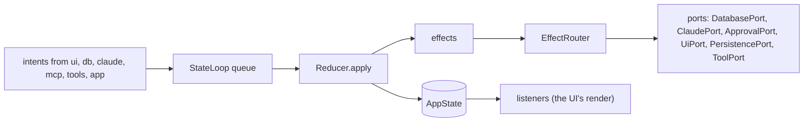

# `core`

The domain of comando: one immutable state, the intents that change it, the reducer that applies them, the effects
it asks for, and the ports through which every outside system is reached. It depends on the JDK only; every other
module depends on it (`api(project(":core"))`, `implementation` in `app`), and none of them depends on another except through `app`.

1. [Architecture](#1-architecture)
2. [Interface with the rest of the app](#2-interface-with-the-rest-of-the-app)
3. [Threads](#3-threads)
4. [Tests](#4-tests)

## 1. Architecture

`StateLoop` takes intents from any thread, applies each with `Reducer` on its own thread, publishes the new
`AppState` through a volatile field, hands the effects to `EffectRouter` in order, then tells its listeners. The
reducer is pure in its arguments, a `Clock` and the home folder. Data too large to copy with every state (result rows,
transcripts, console output, schemas) lives in registries the state refers to by id.

| Package | Holds |
|---|---|
| `state` | `AppState` and its parts: `PanelState`, `ConnectionState`, `SessionState`, `SqlRun`, `ViewState`, `Notice`, `LowerTab`, `BackgroundTask`, `Reflection`, `RunStatus`, `SessionInfo` |
| `intent` | `Intent`, the sealed interface of every change; `EditMode` |
| `reduce` | `Reducer` (intent → `Transition`), `Transition` (next state and effects) |
| `effect` | `Effect`, the sealed interface of work for adapters; `EffectRouter`, which hands each effect to its port |
| `loop` | `StateLoop`: the queue, the reducer thread, its watchdog, listeners and observers |
| `port` | the interfaces adapters implement ([§2](#2-interface-with-the-rest-of-the-app)) |
| `model` | configuration and values shared by every module: `ConnectionSpec`, `SessionSpec`, `FolderRoot`, `PanelId`, `Approval`, `ApprovalDecision`, `ApprovalKind`, `PermissionRules`, `PlanUsage`, `Topic`, `HomeDir`, `Status`, `StartMode`; `KitRoot` (the Claude Code folder sessions run on and its kit's `comando-kit.json`), `KitVersion` (the kit's release and the newer ones), `KitFolders` (the kit's folders merged into the Files tab's); `RepoStatus` (a repository's branch and changed files), `ChangeTexts` (a changed file's two versions), `ChangeAsk` (why they are asked for) |
| `resource` | `ResourceKind`, its kinds (`ConnectionKind`, `SessionKind`, `FolderKind`) and `Attribute`: the attributes and rules one dialog edits |
| `dispatch` | `Blocks`, `Statements`, `Classifier`, `Target`: editor text split into blocks and statements, and the SQL-or-prompt decision |
| `view` | `ViewSpec` (the data of each view type), `Placement`, `Layout`, `FileView`, `Clip` |
| `result` | `ResultView` (read access to a run's rows), `ResultRegistry`, `ColumnKind`, `Formats` |
| `transcript` | `Block`, `Transcript` (one writer, many readers), `TranscriptRegistry`, `TopicSource` (what a tab's topic is read from) |
| `console` | `Console` (a command run's output), `ConsoleRegistry` |
| `schema` | `Schema`, `SchemaRegistry` |

## 2. Interface with the rest of the app

**Into `core`.** Every producer calls `IntentSink.dispatch`, which `StateLoop` implements and which never blocks.
Readers take `StateLoop.state()`, a consistent snapshot, from any thread. `app` creates the loop and registers an
`IntentObserver` (the intent log); `ui` registers a `Listener` (its coalesced render).

**Out of `core`.** Effects leave through ports. Every port method queues work and returns; outcomes come back as
intents.

| Port | Implemented by | Called by |
|---|---|---|
| `IntentSink` | `StateLoop` | every module |
| `Clock` | `Clock.SYSTEM` | `Reducer`, `mcp` |
| `DatabasePort` | `db` `DbAdapter` | `EffectRouter` |
| `QueryPort` | `db` `DbAdapter` | `mcp` (`db_run_sql`, `db_describe`) |
| `ClaudePort` | `claude` `ClaudeAdapter` | `EffectRouter` |
| `TopicPort` | `claude` `ClaudeTopics` | `ui` (the tabs' cards; a topic is view data and never passes the reducer) |
| `McpGateway` | `mcp` `McpServer` | `claude` (a ticket per process) |
| `ApprovalPort` | `mcp` `McpServer` | `EffectRouter` |
| `ToolPort` | `tools` `ToolsAdapter` | `EffectRouter` |
| `UiPort` | `ui` `ComandoUi` | `EffectRouter` |
| `PersistencePort` | `app` `Store` | `EffectRouter` |

`app` builds `EffectRouter` from the six effect ports once they exist.

**Shared stores.** `app` creates one of each registry and hands it to its writer and its readers.

| Registry | Written by | Read by |
|---|---|---|
| `ResultRegistry` | `db` (a connection's lane) | `ui` (Results tab, plots, attachments) |
| `TranscriptRegistry` | `claude` (a session's strand) | `ui` (Session tab), `mcp` (`session_read`) |
| `ConsoleRegistry` | `tools` (a run's thread) | `ui` (console views) |
| `SchemaRegistry` | `db` | `ui` (completion, schema explorer) |

**Shared helpers.** `Classifier` is used by the reducer, by the editor (block colours, gutter, completion) and by
`mcp` (DDL detection for `db_run_sql`); `Statements` by the reducer and the editor; `Intent.Notify.logged` writes a
failure to the log and makes the notice whose click opens it there (`Notice.log`), for every adapter; `HomeDir` decides `~` expansion and Claude Code's folder for every module, the root `KitRoot` resolves: `CLAUDE_CONFIG_DIR` when comando was started with it, else `~/.claude` with a `comando-kit.json`, else `~/.claude/comando-kit` with one, else `~/.claude`; `app` names it once (`KitRoot.use`), and parses `comando-kit.json` through `claude`'s `KitJson`, as `core` reads no JSON; `Clip` shortens labels the same
way in the window and in what Claude is told; `PermissionRules` derives the allow rules an approval adds, for `mcp`
and the approval card.

**Adding a change.** A new intent is a record in `Intent` and a case in `Reducer`; a new effect is a record in
`Effect`, a case in `EffectRouter` and a port method, which `testkit`'s `RecordingPorts` must then implement too.

## 3. Threads

| Thread | Does |
|---|---|
| `comando-reducer` | platform: applies intents in order; the only writer of `AppState` |
| `watchdog` | platform, shared with the EDT's watchdog (`Watchdog.shared()`): looks at the loop every 100 ms; an intent still applying at 1 s is logged with the loop's stack |

`loop` also holds the thread kit every module uses ([Architecture §6](../docs/architecture.md#6-threads)): `Threads`
makes strands (`strand`, `timedStrand`) and forks on virtual threads and lists the live ones by name for tests;
`Errands` is one owner's errands, interrupted and waited for at its close; `Watchdog` is the one platform thread that
runs every watchdog's look.

An intent that takes 200 ms or more is a stall, logged once it ends with the slowest part; one of 1 s or more also
sets a notice whose click opens the log at the hang. The reducer, each effect
and each listener are guarded: a failure is logged and the loop goes on.

## 4. Tests

Unit tests, with no I/O except the temporary files of `FileViewTest`, `KitRootTest` and `KitFoldersTest`: `ReducerTest`, `ReducerNoticeAndLayoutTest`,
`ReducerSubagentTest`, `ReducerChangesTest`, `StateLoopTest` (`applyNow` drives the loop without its thread),
`NotifyLoggedTest`, `ThreadKitTest`, `ClassifierTest`, `BlocksTest`, `StatementsTest`, `TranscriptTest`, `TopicSourceTest`, `ConsoleTest`, `FormatsTest`,
`ReflectionTest`, `ResourceKindTest`, `FileViewTest`, `HomeDirTest`, `ClipTest`, `KitRootTest`, `KitVersionTest`, `KitFoldersTest`. They use `testkit`'s `FakeClock` and
`States`.

Further reading: [Architecture §3–§6](../docs/architecture.md#3-the-flow-of-one-command).
