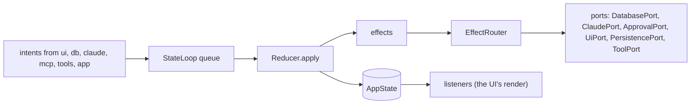

# `core`

The domain of comando: one immutable state, the intents that change it, the reducer that applies them, the effects
it asks for, and the ports through which every outside system is reached. It depends on the JDK only; every other
module depends on it (`api(project(":core"))`), and none of them depends on another except through `app`.

1. [Architecture](#1-architecture)
2. [Interface with the rest of the app](#2-interface-with-the-rest-of-the-app)
3. [Threads](#3-threads)
4. [Tests](#4-tests)

## 1. Architecture

`StateLoop` takes intents from any thread, applies each with `Reducer` on its own thread, publishes the new
`AppState` through a volatile field, hands the effects to `EffectRouter` in order, then tells its listeners. The
reducer is pure in its arguments, a `Clock` and the home folder. Data too large to copy with every state (result rows,
transcripts, console output, schemas) lives in registries the state refers to by id.

| Package | Holds |
|---|---|
| `state` | `AppState` and its parts: `PanelState`, `ConnectionState`, `SessionState`, `SqlRun`, `ViewState`, `Notice`, `LowerTab`, `BackgroundTask`, `Reflection` |
| `intent` | `Intent`, the sealed interface of every change; `EditMode` |
| `reduce` | `Reducer` (intent → `Transition`), `Transition` (next state and effects) |
| `effect` | `Effect`, the sealed interface of work for adapters; `EffectRouter`, which hands each effect to its port |
| `loop` | `StateLoop`: the queue, the reducer thread, its watchdog, listeners and observers |
| `port` | the interfaces adapters implement ([§2](#2-interface-with-the-rest-of-the-app)) |
| `model` | configuration and values shared by every module: `ConnectionSpec`, `SessionSpec`, `FolderRoot`, `PanelId`, `Approval`, `ApprovalDecision`, `ApprovalKind`, `PermissionRules`, `PlanUsage`, `HomeDir`, `Status`, `StartMode` |
| `resource` | `ResourceKind` and its kinds (`ConnectionKind`, `SessionKind`, `FolderKind`): the attributes and rules one dialog edits |
| `dispatch` | `Blocks`, `Statements`, `Classifier`, `Target`: editor text split into blocks and statements, and the SQL-or-prompt decision |
| `view` | `ViewSpec` (the data of each view type), `Placement`, `Layout`, `FileView`, `Clip` |
| `result` | `ResultView` (read access to a run's rows), `ResultRegistry`, `ColumnKind`, `Formats` |
| `transcript` | `Block`, `Transcript` (one writer, many readers), `TranscriptRegistry` |
| `console` | `Console` (a command run's output), `ConsoleRegistry` |
| `schema` | `Schema`, `SchemaRegistry` |

## 2. Interface with the rest of the app

**Into `core`.** Every producer calls `IntentSink.dispatch`, which `StateLoop` implements and which never blocks.
Readers take `StateLoop.state()`, a consistent snapshot, from any thread. `app` creates the loop and registers an
`IntentObserver` (the intent log); `ui` registers a `Listener` (its coalesced render).

**Out of `core`.** Effects leave through ports. Every port method queues work and returns; outcomes come back as
intents.

| Port | Implemented by | Called by |
|---|---|---|
| `IntentSink` | `StateLoop` | every module |
| `Clock` | `Clock.SYSTEM` | `Reducer`, `mcp` |
| `DatabasePort` | `db` `DbAdapter` | `EffectRouter` |
| `QueryPort` | `db` `DbAdapter` | `mcp` (`db_run_sql`, `db_describe`) |
| `ClaudePort` | `claude` `ClaudeAdapter` | `EffectRouter` |
| `McpGateway` | `mcp` `McpServer` | `claude` (a ticket per process) |
| `ApprovalPort` | `mcp` `McpServer` | `EffectRouter` |
| `ToolPort` | `tools` `ToolsAdapter` | `EffectRouter` |
| `UiPort` | `ui` `ComandoUi` | `EffectRouter` |
| `PersistencePort` | `app` `Store` | `EffectRouter` |

`app` builds `EffectRouter` from the six effect ports once they exist.

**Shared stores.** `app` creates one of each registry and hands it to its writer and its readers.

| Registry | Written by | Read by |
|---|---|---|
| `ResultRegistry` | `db` (a connection's lane) | `ui` (Results tab, plots, attachments) |
| `TranscriptRegistry` | `claude` (a session's strand) | `ui` (Session tab), `mcp` (`session_read`) |
| `ConsoleRegistry` | `tools` (a run's thread) | `ui` (console views) |
| `SchemaRegistry` | `db` | `ui` (completion, schema explorer) |

**Shared helpers.** `Classifier` and `Statements` are used by the reducer, by the editor (block colours, gutter) and
by `mcp`; `HomeDir` decides `~` expansion and Claude Code's folder for every module; `Clip` shortens labels the same
way in the window and in what Claude is told; `PermissionRules` derives the allow rules an approval adds, for `mcp`
and the approval card.

**Adding a change.** A new intent is a record in `Intent` and a case in `Reducer`; a new effect is a record in
`Effect`, a case in `EffectRouter` and a port method, which `testkit`'s `RecordingPorts` must then implement too.

## 3. Threads

| Thread | Does |
|---|---|
| `comando-reducer` | applies intents in order; the only writer of `AppState` |
| `reducer-watchdog` | looks at the loop every 100 ms; an intent still applying at 1 s is logged with the loop's stack |

An intent that takes 200 ms or more is a stall, logged once it ends with the slowest part. The reducer, each effect
and each listener are guarded: a failure is logged and the loop goes on.

## 4. Tests

Unit tests with no I/O: `ReducerTest`, `ReducerNoticeAndLayoutTest`, `ReducerSubagentTest`, `StateLoopTest`
(`applyNow` drives the loop without its thread), `ClassifierTest`, `BlocksTest`, `StatementsTest`, `TranscriptTest`,
`ConsoleTest`, `FormatsTest`, `ReflectionTest`, `ResourceKindTest`, `FileViewTest`, `HomeDirTest`, `ClipTest`. They
use `testkit`'s `FakeClock`, `States` and `RecordingPorts`.

Further reading: [Architecture §3–§6](../docs/architecture.md#3-the-flow-of-one-command).
