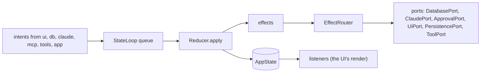

# `core`

The domain of comando: one immutable state, the intents that change it, the reducer that applies them, the effects it
asks for, the ports through which every outside system is reached, and the thread kit every module uses. It depends on
the JDK only. Every other module depends on it (`api(project(":core"))`; `implementation` in `app`), and no adapter
module depends on another: `app` connects them.

1. [Architecture](#1-architecture)
2. [Interface with the rest of the app](#2-interface-with-the-rest-of-the-app)
3. [Threads](#3-threads)
4. [Tests](#4-tests)

## 1. Architecture



`StateLoop` takes intents from any thread and applies each with `Reducer` on its own thread. It publishes the new
`AppState` through a volatile field, hands the effects to `EffectRouter` in order, then tells its listeners. The reducer
is pure in its arguments, a `Clock` and the home folder. Data too large to copy with every state (result rows,
transcripts, console output, schemas) lives in registries the state refers to by id.

| Package | Holds |
|---|---|
| `state` | `AppState` and its parts: `PanelState`, `ConnectionState`, `SessionState`, `SqlRun`, `ViewState`, `Notice`, `LowerTab`, `BackgroundTask`, `Reflection`, `RunStatus`, `SessionInfo` |
| `intent` | `Intent`, the sealed interface of every change; `EditMode` |
| `action` | `Action` and `Actions`: every user action as an agent's tool, with its arguments and class, and every kind of intent classified (offered, event, window, not yet) ([record 121](../docs/adr/0121-an-agent-has-every-action-the-user-has.md)) |
| `reduce` | `Reducer` (intent → `Transition`), which hands each intent to the rules of its domain: `PanelRules`, `SessionRules`, `TurnRules`, `QueryRules`, `ApprovalRules`, `FolderRules`, `ViewRules`, with `Shared` for what several use (notices, the saved lists, fresh panel ids); `Transition` (the next state and its effects) |
| `effect` | `Effect`, the sealed interface of work for adapters; `EffectRouter`, which hands each effect to its port |
| `loop` | `StateLoop` (the queue, the reducer thread, its look on the watchdog, listeners and observers); the thread kit: `Threads`, `Errands`, `Watchdog`, `ExecutorStop` (an owner's bounded stop of its executors); `Processes`, the one way a short command is run |
| `port` | the interfaces adapters implement ([§2](#2-interface-with-the-rest-of-the-app)) |
| `model` | configuration and values every module shares: `ConnectionSpec`, `SessionSpec`, `FolderRoot`, `PanelId`, `Approval`, `ApprovalDecision`, `ApprovalKind`, `PermissionRules`, `PlanUsage`, `Topic`, `HomeDir`, `Status`, `StartMode`; `AtomicFiles` (a file written whole or not at all); `InstanceName` (the name an instance goes by, from `-Dcomando.name`, `COMANDO_NAME`, the data root's `instance.json` or its folder); `KitRoot` (the Claude Code folder sessions run on and its `comando-kit.json`), `KitVersion` (the kit's release and the newer ones), `KitFolders` (the kit's folders merged into the Files tab's), `KitJob` and `KitJobs` (the kit's scheduled jobs, their checks, and how the scheduler holds them); `RepoStatus` (a repository's branch and changed files), `ChangeTexts` (a changed file's two versions), `ChangeAsk` (why they are asked for); `LinearTickets` (ticket ids in a text, with the address Linear shows each at) |
| `resource` | `ResourceKind`, its kinds (`ConnectionKind`, `SessionKind`, `FolderKind`) and `Attribute`: the attributes and rules one dialog edits |
| `dispatch` | `Blocks`, `Statements`, `Classifier`, `Target`: editor text split into blocks and statements, and the SQL-or-prompt decision |
| `view` | `ViewSpec` (the data of each view type), `Placement`, `Layout`, `FileView`, `Clip` |
| `result` | `ResultView` (read access to a run's rows), `ResultRegistry`, `ColumnKind`, `Formats` |
| `transcript` | `Block`, `Transcript` (one writer, many readers), `TranscriptRegistry`, `TopicSource` (what a tab's topic is read from) |
| `console` | `Console` (a command run's output), `ConsoleRegistry` |
| `schema` | `Schema`, `SchemaRegistry` |

## 2. Interface with the rest of the app

**Into `core`.** Every producer calls `IntentSink.dispatch`, which `StateLoop` implements and which never blocks.
Readers take `StateLoop.state()`, a consistent snapshot, from any thread. `app` creates the loop and registers an
`IntentObserver` (the intent log); `ui` registers a `Listener` (its coalesced render).

**Out of `core`.** Effects leave through ports. Every port method queues work and returns; outcomes come back as
intents.

| Port | Implemented by | Called by |
|---|---|---|
| `IntentSink` | `StateLoop` | every module |
| `Clock` | `Clock.SYSTEM` | `Reducer`, `mcp` |
| `DatabasePort` | `db` `DbAdapter` | `EffectRouter` |
| `QueryPort` | `db` `DbAdapter` | `mcp` (`db_run_sql`, `db_describe`) |
| `ClaudePort` | `claude` `ClaudeAdapter` | `EffectRouter` |
| `TopicPort` | `claude` `ClaudeTopics` | `ui` (the tabs' cards; a topic is view data and never passes the reducer) |
| `McpGateway` | `mcp` `McpServer` | `claude` (a ticket per process) |
| `ApprovalPort` | `mcp` `McpServer` | `EffectRouter` |
| `ToolPort` | `tools` `ToolsAdapter` | `EffectRouter` |
| `UiPort` | `ui` `ComandoUi` | `EffectRouter` |
| `PersistencePort` | `app` `Store` | `EffectRouter` |

`app` builds `EffectRouter` from the six effect ports once they exist.

**Shared stores.** `app` creates one of each registry and hands it to its writer and its readers.

| Registry | Written by | Read by |
|---|---|---|
| `ResultRegistry` | `db` (a connection's lane) | `ui` (Results tab, plots, attachments) |
| `TranscriptRegistry` | `claude` (a session's strand) | `ui` (Session tab), `mcp` (`session_read`) |
| `ConsoleRegistry` | `tools` (a run's thread) | `ui` (console views) |
| `SchemaRegistry` | `db` | `ui` (completion, schema explorer) |

**Shared helpers.**

| Helper | Decides | Used by |
|---|---|---|
| `Classifier` | SQL or prompt, and DDL | the reducer, the editor (block colours, gutter, completion), `mcp` (DDL in `db_run_sql`) |
| `Statements` | the statements of a block | the reducer, the editor |
| `Intent.Notify.logged` | a failure written to the log, and the notice whose click opens it there (`Notice.log`) | every adapter |
| `HomeDir` | `~` expansion and shortening; Claude Code's folder, the root `KitRoot` resolves | every module |
| `KitRoot` | the root: `CLAUDE_CONFIG_DIR` when comando was started with it, else `~/.claude` with a `comando-kit.json`, else `~/.claude/comando-kit` with one, else `~/.claude` | `app` names it once (`KitRoot.use`) and parses `comando-kit.json` through `claude`'s `KitJson`, as `core` reads no JSON |
| `Clip` | a label shortened the same way in the window and in what Claude is told | `ui`, `claude`, `mcp`, `tools` |
| `PermissionRules` | the allow rules an approval adds | `mcp`, the approval card |

**Adding a change.** A new intent is a record in `Intent` and a case in `Reducer`. A new effect is a record in `Effect`,
a case in `EffectRouter` and a port method, which `testkit`'s `RecordingPorts` must then implement too.

## 3. Threads

| Thread | Kind | Does | Stopped by |
|---|---|---|---|
| `comando-reducer` | platform | applies intents in order; the only writer of `AppState` | `StateLoop.close`, after the queued intents |
| `watchdog` | platform, shared with the EDT's watchdog (`Watchdog.shared()`) | every 100 ms runs each registered look; an intent still applying at 1 s is logged with the loop's stack | itself, a period after the last look is closed |

`loop` also holds the thread kit of [Architecture §6](../docs/architecture.md#6-threads). `Threads` makes strands
(`strand`, `timedStrand`) and forks on virtual threads, and lists the live ones by name for tests (`Threads.alive`).
`Errands` holds one owner's errands, interrupted and waited for at its close. `Watchdog` is the one platform thread that
runs every watchdog's look. `Processes` runs a short command on the caller's thread with its standard streams on
temporary files, so no thread reads a pipe; past its time limit, or when the caller is interrupted, the command and
every process it started are ended.

An intent that takes 200 ms or more is a stall, logged once it ends with its slowest part. One of 1 s or more also sets
a notice whose click opens the log at the hang. The reducer, each effect and each listener are guarded: a failure is
logged and the loop goes on.

## 4. Tests

Unit tests, with no I/O except the temporary files of `FileViewTest`, `KitRootTest`, `KitFoldersTest` and
`AtomicFilesTest`, and the child processes of `ProcessesTest`. They use `testkit`'s `FakeClock` and `States`.

| Subject | Tests |
|---|---|
| reducer | `ReducerTest`, `ReducerNoticeAndLayoutTest`, `ReducerSubagentTest`, `ReducerChangesTest` |
| loop and threads | `StateLoopTest` (`applyNow` drives the loop without its thread), `ThreadKitTest`, `NotifyLoggedTest`, `ProcessesTest` |
| dispatch | `ClassifierTest`, `BlocksTest`, `StatementsTest` |
| stores | `TranscriptTest`, `TopicSourceTest`, `ConsoleTest`, `FormatsTest` |
| state and model | `ReflectionTest`, `ResourceKindTest`, `FileViewTest`, `HomeDirTest`, `InstanceNameTest`, `AtomicFilesTest`, `ClipTest`, `KitRootTest`, `KitVersionTest`, `KitFoldersTest`, `KitJobTest`, `LinearTicketsTest` |

```
./gradlew :core:test
```

Further reading: [Architecture §3–§6](../docs/architecture.md#3-the-flow-of-one-command).
