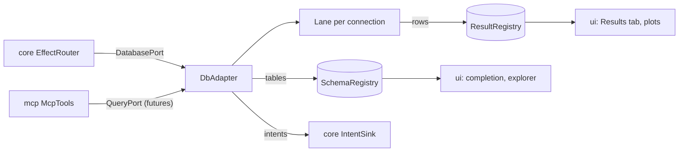

# `db`

The database adapter: SQL over the PostgreSQL wire protocol (QuestDB, PostgreSQL) through the PostgreSQL JDBC driver.
It runs the user's statements and Claude's, stores rows by column, reads schemas, and reports every outcome as an
intent. It depends on `core` and pgjdbc.

1. [Architecture](#1-architecture)
2. [Interface with the rest of the app](#2-interface-with-the-rest-of-the-app)
3. [Threads](#3-threads)
4. [Tests](#4-tests)

## 1. Architecture

| Class | Does |
|---|---|
| `DbAdapter` | the port: a lane per connection name, a request-to-lane map for cancel, a timer, virtual threads for connection tests and cancels; schema loads |
| `Lane` | one JDBC connection and the one thread that uses it: opens, closes, statements and health checks run on it in order; cancel and abort |
| `ColumnarResult` | a run's rows by column in primitive chunks of 16 384 values (`long` for integers, booleans and times; `double`; text for the rest); implements `core`'s `ResultView` |
| `DbSettings` | tunables; `DEFAULTS`: no statement timeout, 5 000 000 rows kept, 5 000 rows per fetch, a health check every 60 s, abort 2 s after an unanswered cancel |

- **A lane per connection.** A JDBC connection runs one statement at a time, so everything a connection does is a task
  on its lane. A lane lives while it holds a connection or has work queued; a stopped lane refuses tasks and the
  adapter starts a new one, so a connection's intents keep their order.
- **Request identity.** Every run carries the request id the reducer assigned; its rows go to `ResultRegistry` under
  that id, and its events name it, so the reducer drops events for a run it superseded.
- **Cancel.** The caller marks the request cancelled, then reads the running statement; the lane publishes its
  statement, then reads the mark. A statement still running `abortAfterMillis` after its cancel has its connection
  aborted.
- **Publication.** The lane fills a row's cells, then publishes the row count with a volatile write; the grid and plots
  read rows below the count while the fetch goes on.
- **Schema.** QuestDB's own catalogue for up to 50 tables, else one `information_schema.columns` query (at most 50 000
  rows). A close, removal or change of the connection while a load runs overtakes it, and its tables are not kept.

## 2. Interface with the rest of the app

**Provides.**

| Interface | Methods | Caller |
|---|---|---|
| `DatabasePort` | `open`, `close`, `forgetSchema`, `test`, `execute`, `cancel`, `release`, `loadSchema` | the reducer's effects, through `EffectRouter` |
| `QueryPort` | `query(spec, sql, maxRows)`, `describe(spec, table)`: futures of text rows, run on the same lane as the user's statements | `mcp` (`db_run_sql`, `db_describe`) |

**Needs.** `app` constructs it with the `IntentSink`, `ResultRegistry`, `SchemaRegistry` and `DbSettings.DEFAULTS`,
and closes it after the MCP server and before the embedded QuestDB.

**Sends back.** `ConnectionOpened`, `ConnectionClosed`, `ConnectionFailed`, `ConnectionLost`, `ConnectionTested`,
`SqlStarted`, `SqlRows`, `SqlCompleted`, `SqlFailed`, `SqlCancelled`, `SqlWarning`, `ShowView` (the schema as a tree,
when `loadSchema` is asked to show it), `Notify`.

`db` never imports `ui`, `claude`, `mcp` or `tools`; the UI reads rows only through `core`'s `ResultView`.

## 3. Threads

| Thread | Does |
|---|---|
| `db-<connection>` | the lane: opens, statements, fetches, closes, health checks |
| `db-timer` | health checks every 60 s; the abort after an unanswered cancel |
| virtual | connection tests (`isValid(10)` on a connection of their own); `Statement.cancel()` calls |

`close()` cancels running statements and closes every connection.

## 4. Tests

- `DbAdapterTest` runs against an embedded QuestDB (`EmbeddedQuestDb` in the test sources).
- `DbAdapterPostgresTest` runs against PostgreSQL through Testcontainers when Docker is there.

Further reading: [Workbench §3](../docs/workbench.md#3-the-database), [Claude §3.2](../docs/claude.md#32-sql-from-claude).
