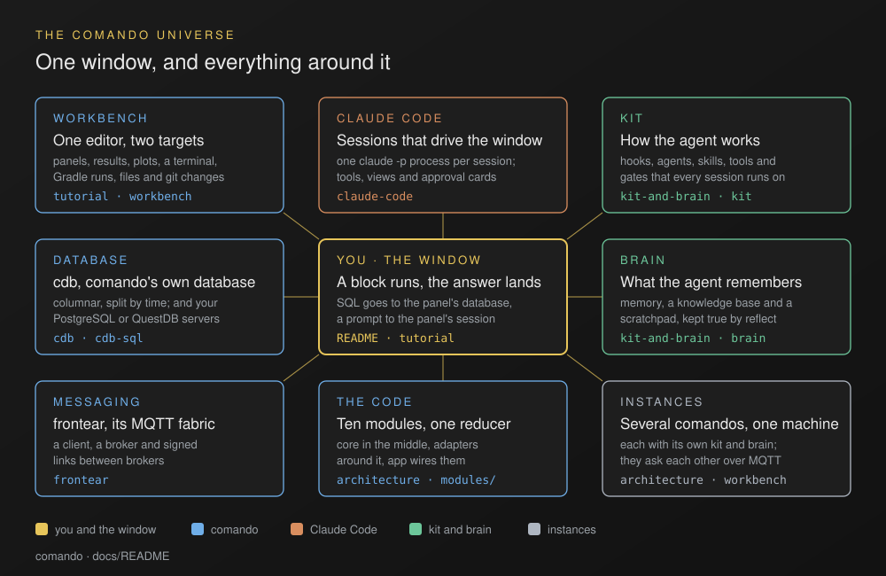

# comando's documentation

## In one paragraph

This is the map of comando's documentation. comando is a desktop workbench: one editor that sends SQL to your databases
and prompts to Claude Code. Around it sit a database, a message broker, and a kit and a brain that give an agent tools
and memory. Every page here starts with a picture and one paragraph, so you can stop early and still know the idea.
Boxes marked **Learn** explain the computer science behind a design, in plain words. Pick a path below, or jump
to any page from the table.

## Three reading paths

| You are | You want | Read, in this order |
|---|---|---|
| **A newcomer** | to use comando today | [INSTALL](../INSTALL.md) → [Tutorial](tutorial.md) → [Workbench](workbench.md) → [Claude Code in comando](claude-code.md) |
| **A learner** | to understand how agents, databases and brokers work | [Kit and brain](kit-and-brain.md) → [The kit](kit.md) → [The brain](brain.md) → [cdb's SQL](cdb-sql.md) → [cdb](cdb.md) → [frontear](frontear.md) |
| **A developer** | to read or change the code | [Architecture](architecture.md) → [the module pages](#the-code) → [Development](development.md) → [the decision records](adr/README.md) |

## Every page

### Use comando

| Page | What it explains |
|---|---|
| [INSTALL](../INSTALL.md) | how Claude Code installs comando for you |
| [Tutorial](tutorial.md) | a guided first session: a query, a prompt, an answer |
| [Workbench](workbench.md) | the window: panels, running text, databases, instances, tools |
| [Claude Code in comando](claude-code.md) | sessions, the tools Claude has in comando, approvals |

### Give an agent tools and a memory

| Page | What it explains |
|---|---|
| [Kit and brain](kit-and-brain.md) | the two ideas together, and how comando shows them |
| [The kit](kit.md) | the tools, rules and checks an agent works with |
| [The brain](brain.md) | what an agent remembers between sessions, and how it stays true |

### The engines comando wrote for itself

| Page | What it explains |
|---|---|
| [cdb](cdb.md) | a database for time series: how it stores, writes and queries |
| [cdb's SQL](cdb-sql.md) | the SQL cdb speaks |
| [frontear](frontear.md) | an MQTT broker and client: how messages travel between programs |

### The code

| Page | What it explains |
|---|---|
| [Architecture](architecture.md) | how the pieces fit: modules, one command's path, threads, sessions, instances, files |
| [core](modules/core.md) | the state, the reducer, the ports, the thread kit |
| [testkit](modules/testkit.md) | the fakes the tests share |
| [db](modules/db.md) | connections, lanes, results |
| [cdb](modules/cdb.md) | the database's code |
| [frontear](modules/frontear.md) | the broker's code |
| [claude](modules/claude.md) | the `claude -p` process and its stream |
| [mcp](modules/mcp.md) | the MCP server and its tools |
| [tools](modules/tools.md) | Gradle, folders, git |
| [ui](modules/ui.md) | the Swing window and its widgets |
| [app](modules/app.md) | the wiring, the store, start and exit |
| [Development](development.md) | build, test, release, and the rules for code |
| [The decision records](adr/README.md) | why each choice is the way it is, one record per decision |

## How to read a page

Every page has the same shape, so you always know where you are.

1. **A picture.** The whole idea, before any words.
2. **In one paragraph.** What it is, who it is for, why it exists.
3. **Numbered sections.** The idea, how it works, what it offers. A picture where structure matters.
4. **Learn boxes.** The general idea behind the design: an event loop, a reducer, publish and subscribe.
5. **Where next.** Two to five pages that follow from this one.

Colours mean the same in every picture.

| Colour | Means |
|---|---|
| Gold | the centre of the picture: you, or the part the page is about |
| Blue | comando |
| Copper | Claude Code |
| Green | the kit and the brain |
| Grey | other instances, and what travels between them |

> **Learn: abstraction.** Nobody can hold a whole system in their head at once. So engineers draw it at several
> levels, like maps: a country map shows cities, a city map shows streets. Each level hides the detail of the one
> below and keeps only what you need to decide where to go. These pages work the same way. The hub shows the universe,
> the architecture page shows the modules, a module page shows the classes. When you feel lost, go up one level.

## Where next

- [Tutorial](tutorial.md): start using comando.
- [Kit and brain](kit-and-brain.md): start learning how an agent works.
- [Architecture](architecture.md): start reading the code.
