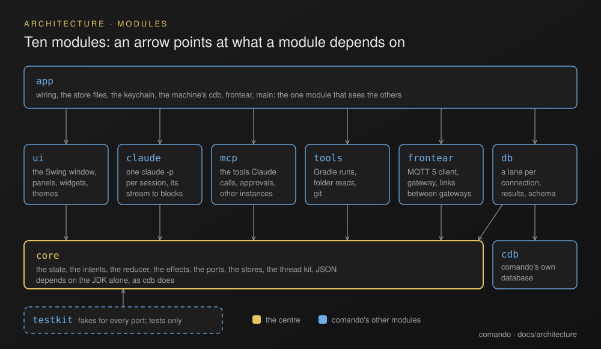
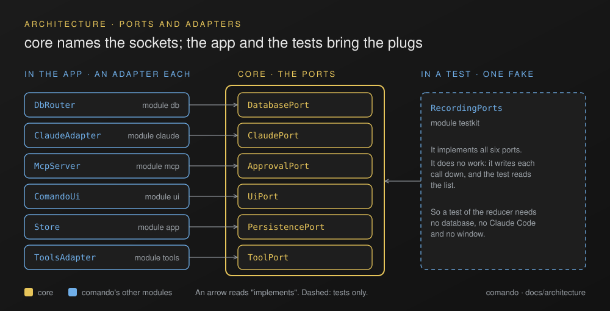
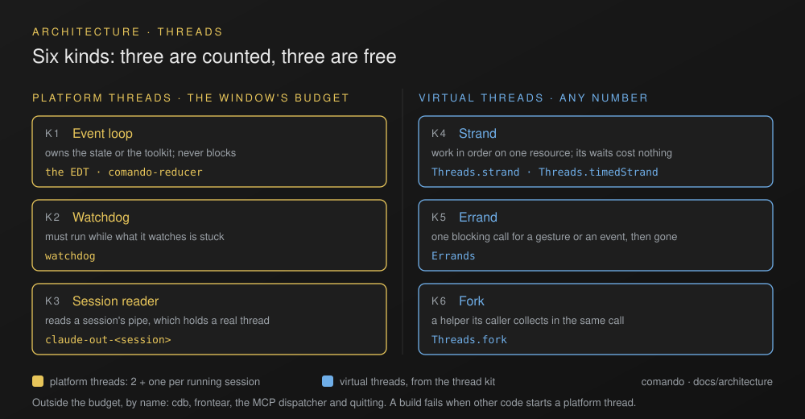

# Architecture

## In one paragraph

comando is a desktop program: one Java process with a window, written in Java 25 with Swing. It sends SQL to your
databases and prompts to Claude Code, and it shows what comes back. This page is for you if you want to change comando,
or to learn how a program of this size stays understandable. It shows the pieces, how one command travels through them,
which threads do the work, and what lands on disk. Each module has a page of its own under `modules/`; this page shows
how they fit.

## 1. What runs on your machine

Look at the picture above. It holds six things.

| Thing | What it is | How comando talks to it |
|---|---|---|
| comando | one JVM: the window, the state, the adapters, an MCP server, an in-process database | — |
| A session | one `claude -p` process per running session: Claude Code without its own screen | two pipes, and HTTP back to comando |
| The machine's cdb | comando's own database as a server; one per machine, it outlives comando | the PG wire protocol, on `127.0.0.1` |
| Your databases | PostgreSQL or QuestDB servers you connect to | the PG wire protocol (JDBC) |
| frontear | a local MQTT broker on `127.0.0.1`, one node inside each instance's JVM, each on a port from 18883 up, linked to the others | MQTT 5 |
| Other instances | more comandos, each its own JVM and data root | messages through frontear |

Nothing here listens on the network: every server comando starts binds `127.0.0.1`.

> **Learn: a process.** A process is a running program with its own memory. Two processes cannot read each other's
> memory, so a crash in one does not corrupt the other. They talk through channels the operating system gives them:
> pipes, sockets, files. comando runs each Claude Code session as its own process. A session that hangs or dies leaves
> the window, and every other session, working.

## 2. Modules

The code is ten Gradle modules. An arrow in the picture means "depends on". Arrows only point down, so there are no
cycles.

| Module | What it holds | Depends on | Page |
|---|---|---|---|
| `core` | the state, the intents, the reducer, the effects, the ports, the thread kit, JSON | the JDK | [core](modules/core.md) |
| `testkit` | fakes for the ports, fixtures; used by tests only | `core` | [testkit](modules/testkit.md) |
| `cdb` | comando's own database: columnar, partitioned by time, with SQL | the JDK | [cdb](modules/cdb.md) |
| `frontear` | an MQTT 5 client, a broker, and links between brokers | `core` | [frontear](modules/frontear.md) |
| `db` | one lane per connection, results, schema reads | `core`, `cdb`, the PostgreSQL JDBC driver | [db](modules/db.md) |
| `claude` | one `claude -p` process per session, its stream turned into transcript blocks | `core` | [claude](modules/claude.md) |
| `mcp` | the MCP server: the tools Claude calls, approvals, questions between instances | `core` | [mcp](modules/mcp.md) |
| `tools` | Gradle runs, folder reads, git | `core` | [tools](modules/tools.md) |
| `ui` | the Swing window: panels, widgets, themes, the terminal | `core`, and the UI libraries | [ui](modules/ui.md) |
| `app` | the wiring, the store files, the servers comando starts, `main` | every module above except `cdb` and `testkit` | [app](modules/app.md) |

Three rules shape this picture.

- **`core` knows nobody.** It has no dependency but the JDK. It cannot open a socket, a window or a file by accident.
- **The adapters do not know each other.** `ui` cannot call `db`; `claude` cannot call `mcp`. They meet only in `core`'s
  types.
- **Only `app` sees everything.** It builds each part and hands it to the others. So the whole program is wired in one
  place.

> **Learn: a dependency graph.** Draw each module as a dot and each "needs" as an arrow. If you can follow arrows and
> come back to where you started, you have a cycle. Two pieces in a cycle cannot be understood, built or tested apart.
> A graph without cycles has layers. You can read it bottom-up, and a change at the top never breaks the bottom.
> comando's build enforces its layers: a module can only import what its build file names.

## 3. One command, start to end

You type a block and press a key. Here is what happens.

1. **The key becomes an intent.** The window runs on Swing's thread, the EDT. It does no work itself. It describes what
   you asked as a small immutable value, an *intent*, and puts it on a queue.
2. **The reducer applies it.** One thread, `comando-reducer`, takes intents one at a time. For each it calls
   `Reducer.apply(state, intent)`, which returns the next state and a list of *effects*.
3. **Effects go out.** `EffectRouter` hands each effect to its port. An effect says "run this SQL" or "send this
   prompt"; it does not do it.
4. **An adapter does the work.** The adapter behind the port queues the work on its own thread and returns at once.
5. **Results come back as intents.** Rows, events and failures enter the same queue as your key did.
6. **The window follows the state.** After each intent the window is told. It draws the latest state, on the EDT.

### Where a block goes

A *block* is the run of lines around the caret, up to a blank line. Three keys send it.

| Key (Ctrl for Cmd on Linux and Windows) | Sends the block |
|---|---|
| Cmd+Enter | where `Classifier` says: SQL to the database, a prompt or a command to Claude |
| Cmd+Shift+Enter | to the panel's Claude session |
| Alt+Enter | to the panel's database, as SQL |

`Classifier` in `core.dispatch` decides with five rules, in this order.

1. A first line `-- @sql` or `-- @claude` wins.
2. A leading `/` followed by a letter is a Claude command.
3. A block of comments only goes nowhere.
4. A block is SQL when it starts with an SQL keyword, in the shape that keyword takes. It must hold no English
   function word and must not end in `?` or `.`.
5. Everything else is a prompt.

The tutorial shows this from the user's side: [Tutorial](tutorial.md).

> **Learn: an event loop.** An event loop is one thread that takes messages from a queue and handles them one by one.
> Nothing else touches the data it owns, so that data needs no locks, and two things can never happen "at the same
> time". The price is one rule: a handler must be quick, because everyone behind it waits. Slow work goes elsewhere and
> reports back with a new message. comando has two event loops: the EDT owns the window, the reducer owns the state.

## 4. State, intents, effects

The whole program state is one immutable record, `AppState`. Nothing changes it in place. The reducer builds the next
one, and publishes it for every thread to read.

| In `AppState` | Meaning |
|---|---|
| `panels`, `closed`, `focused` | the open panels, the closed ones you can reopen, the one with the caret |
| `connections`, `sessions`, `folders` | the three things a panel works with: a database, a Claude session, folders of files |
| `runs` | the SQL statements now running, at most one per panel |
| `approvals` | the cards waiting for your answer |
| `views`, `lowerTab`, `panelTabs` | what the lower half of each panel shows |
| `notice`, `notices` | the status bar's message, and the recent ones |
| `instances` | the other comandos, and the questions between you |
| `logbook` | the open tasks the Logbook tab lists |
| `nextId` | a counter: every run and request gets a fresh id |

The state holds names and ids only. Big data stays out of it: result rows, transcripts, console output, schemas. They
live in *stores*, each written by one owner and referenced from the state by id. A copy of the state stays cheap.

- **An intent** is something that happened: a key, a row batch, a session event. `Intent` is a sealed interface of 95
  records.
- **An effect** is something to do: open a connection, send a prompt, save a file. `Effect` is a sealed interface of 42
  records.
- **The reducer** is a pure function between them. The same state, intent, clock time, home folder and checkpoint
  setting always give the same result.
  It lives in `core.reduce`, split by domain: `PanelRules`, `SessionRules`, `TurnRules`, `QueryRules`, `ApprovalRules`,
  `FolderRules`, `ViewRules`.

Two things follow from "pure". A test feeds intents and compares states, with no database, no Claude and no window.
And a recorded run replays: start comando with `-Dcomando.recordIntents=true` and it writes every intent to
`logs/intents-<millis>.jsonl`.

Late answers are dropped by id. Every SQL run gets an id from `nextId`, and a panel holds one run. An event that
carries any other id changes nothing.

The detail of every intent, effect and rule: [core](modules/core.md).

> **Learn: immutable state and a reducer.** Imagine a game where every move produces a new photo of the board. Nobody
> may draw on an old photo. Any player can look at any photo without fear that it changes under their eyes.
> That is immutable state. A *reducer* is the rule book: given a photo and a move, it returns the next photo. Bugs get
> easier to find, because every change has one cause you can name: the intent that produced it.

## 5. Ports and adapters

A *port* is a Java interface in `core.port`. It says what `core` needs from the world, in `core`'s own words. An
*adapter* is a class in another module that implements it. Effects leave through six ports.

| Port | An effect asks it to | Adapter | Module |
|---|---|---|---|
| `DatabasePort` | open, run, cancel, close | `DbRouter`, over `DbAdapter` and `CdbAdapter` | [db](modules/db.md) |
| `ClaudePort` | start a session, send a prompt, interrupt, stop | `ClaudeAdapter` | [claude](modules/claude.md) |
| `ApprovalPort` | hand your answer to a waiting card | `McpServer` | [mcp](modules/mcp.md) |
| `UiPort` | do what only the window can | `ComandoUi` | [ui](modules/ui.md) |
| `PersistencePort` | save specs and panels | `Store` | [app](modules/app.md) |
| `ToolPort` | run Gradle, read folders, run git | `ToolsAdapter` | [tools](modules/tools.md) |

Other ports carry calls between adapters without letting them import each other. Each is declared in `core` and handed
over by `app`.

| Port | Lets | Implemented by |
|---|---|---|
| `IntentSink` | any adapter send an intent | `StateLoop` |
| `QueryPort` | the MCP tools run SQL for Claude | `DbRouter` |
| `McpGateway` | a session's process get its MCP address and token | `McpServer` |
| `InstancesPort` | the Instances tab act on other instances | `Peers` in `mcp` |
| `TerminalPort` | the MCP tools reach a panel's terminal | `TerminalAccess` in `ui` |
| `SearchPort` | the window search files and conversations | `Searcher` in `app` |
| `TopicPort` | the window ask for a panel's topic line | `ClaudeTopics` in `claude` |
| `ServerSwitch` | the MCP tools start or stop a local server, as your button does | `MachineCdb`, `FrontearOctopus` in `app` |
| `Clock`, `WaitLog` | code read the time, and record how long a wait took | the system clock, `MetricsLog` in `claude` |

In a test, `testkit` brings the plugs instead: `RecordingPorts` implements all six effect ports and writes each call
down as a line. See [testkit](modules/testkit.md).

> **Learn: ports and adapters.** A wall socket does not care whether you plug in a lamp or a phone charger. It only
> fixes the shape of the plug. A port is that socket, written as an interface. The core of the program talks to
> sockets, never to a lamp. So you can swap PostgreSQL for a fake that records calls, and the core cannot tell. This
> shape has a second name, *hexagonal architecture*.

## 6. Threads

This section is the thread rules. `core.loop.Threads`, `core.loop.Processes` and `ThreadRulesTest` cite it.

Every thread the window starts for itself is one of six kinds. Only the first three use operating-system threads.
That budget is fixed: **two, plus one per running Claude session**, whatever the number of folders, panels or runs.
A few named threads sit [outside the budget](#outside-the-budget).

| # | Kind | What it is | Threads |
|---|---|---|---|
| K1 | Event loop | owns the state or the toolkit; never blocks | the EDT (AWT's own); `comando-reducer` (platform) |
| K2 | Watchdog | must run while what it watches is stuck | one `watchdog` (platform), shared by the EDT and the reducer |
| K3 | Session reader | reads a session's pipe; a pipe read holds a real thread even from a virtual one | `claude-out-<session>` (platform), one per running session |
| K4 | Strand | work in order on one resource; its waits hold no operating-system thread | one virtual thread each, from `Threads.strand` or `Threads.timedStrand` |
| K5 | Errand | one blocking call started by a gesture or an event, then gone | a virtual thread from its owner's `Errands` |
| K6 | Fork | a helper its caller collects in the same call, with a bound | a virtual thread from `Threads.fork` |

### The rules

1. **An event loop never blocks.** No I/O, no lock that another thread holds for long, no wait. Blocking work moves to
   a strand or an errand.
2. **Threads come from the thread kit.** Virtual threads come from `Threads`, or from a per-task virtual executor
   (`Executors.newVirtualThreadPerTaskExecutor`). No other executor, thread pool or `java.util.Timer` is built
   outside it. Platform threads are started by `StateLoop`, `Watchdog` and `ClaudeProcess`, and by `Main` for
   quitting: its `exit` and `shutdown` threads.
3. **`cdb` and `frontear` keep short lists of their own.** `cdb` depends on the JDK alone, so it cannot take the
   thread kit. Its platform threads come from `Applier`, `QueryPool`, `LogForcer` and its launcher's shutdown hook.
   Its server's admission starts the request threads, which are virtual. In `frontear`: its `LogForcer` and its
   launcher's shutdown hook. [cdb](modules/cdb.md) and [frontear](modules/frontear.md) say why.
4. **Nothing runs on the shared fork-join pool.** No `parallelStream`, no `.parallel()` on a stream, no parallel
   `StreamSupport` stream, no `Arrays.parallel*`, no `ForkJoinPool` or `ForkJoinTask` call, and no
   `CompletableFuture.*Async` without an executor. Work spread over the cores goes to forks.
5. **Every thread has an owner that stops it.** An owner's `close()` interrupts its threads and waits a bound. A thread
   still alive at the bound is logged with its owner.
6. **A program run to its end goes through `Processes`.** Its input and output are temporary files, so no thread sits
   in a pipe read while it runs.

Two tests hold the rules. `ThreadRulesTest` runs with the `app` module's tests, so in every build. It fails when code
outside the lists above starts a platform thread, calls `Thread.ofVirtual`, or builds a pool or a timer.
`ThreadBudgetTest` opens the real window, so it runs only in `./gradlew :app:uiTest`. It runs more sessions than
the machine has cores (cores + 4), counts the window's own platform threads, and checks that none is left after
the close.

### Outside the budget

The budget counts the window's own threads. These platform threads are the named exceptions:

| Who | Platform threads | When |
|---|---|---|
| `cdb` | `cdb-applier-<name>` and `cdb-log-force-<name>`, one each per store; the `cdb-query-<n>` workers, one pool per process | a connection of kind cdb opens the database in this process |
| `frontear` | `frontear-log-force-<name>`, one per link log | the instance's frontear node runs |
| The MCP server | `HTTP-Dispatcher`, made by the JDK's HTTP server | while the MCP server runs; its close stops it |
| `Main` | `exit` and `shutdown` | at quit |

For `cdb` and `frontear` the reason is one: a file force or a CPU-bound query holds an operating-system thread anyway.

### Who owns what

| Owner | Kind | Thread |
|---|---|---|
| `StateLoop` | K1 | `comando-reducer` |
| `Watchdog` | K2 | `watchdog`: started with the first watcher, ended after the last |
| `ClaudeProcess` | K3 | `claude-out-<session>` |
| `ClaudeAdapter` | K4 | `claude-strand-<session>`: owns a session's process and writes its transcript |
| `db`'s `Lane` | K4 | one per connection; it ends when it has no connection and no work |
| `Errands` of `App`, `MachineCdb`, `FrontearOctopus`, `MetricsSink`, `ClaudeAdapter`, `DbAdapter`, `Peers`, `ToolsAdapter`, `UiErrands` | K5 | one virtual thread per call |

Each module's page lists its own threads and what stops each.

### How work crosses threads

- **Into the reducer.** `IntentSink.dispatch` puts the intent on an unbounded queue. Intents from one thread keep their
  order.
- **Out of the reducer.** A port queues the work on its strand and returns.
- **To the EDT.** One listener asks for a render through a `Coalescer`: many state changes become at most one pending
  run on the EDT.
- **From the EDT.** Input becomes an intent; blocking work moves to an errand.

### The loops are watched

The watchdog looks at both event loops. A slow handler is the one bug an event loop cannot hide.

| Loop | Stall | Hang |
|---|---|---|
| The reducer | one intent takes 200 ms (`STALL_MILLIS`): a log line naming its slowest part | still applying at 1 s (`HANG_MILLIS`): logged with the thread's stack, while it is stuck |
| The EDT | a 200 ms pause: a log line | past 1 s: logged with the EDT's stack |

### Bounded waits

A wait that could last forever carries a bound, and says what happens when it runs out. Three examples:

| Wait | Bound | When it runs out |
|---|---|---|
| An approval card | 24 h | the call is denied, the card withdrawn |
| `instance_ask`, `instance_reply` with `wait_seconds` | at most 600 s, 300 s by default | an id to read the reply with later |
| The reducer at close | 2 s (`CLOSE_MILLIS`) | logged with its stack |

The other bounds belong to the adapter that waits: see its module page. The reasons for the six kinds and the budget:
[Threads by kind, with a budget](adr/0082-threads-by-kind-with-a-budget.md).

> **Learn: virtual threads.** An operating-system thread is expensive: each needs its own memory for a stack, and the
> system must juggle them all. A *virtual thread* is a thread the Java runtime manages itself. While it waits, for a
> socket or a lock, it gives its operating-system thread to another virtual thread. So a program can afford thousands
> of them, and code can simply wait where it needs to. There is one catch comando measured on JDK 25: a virtual thread
> reading a file or a process pipe keeps its operating-system thread. That is why a session's reader is a real thread.

## 7. Sessions

A session is a conversation with Claude Code. While it runs, it is one `claude -p` process that comando starts and
owns. comando does not call a model itself: Claude Code does, with your login, your settings and your kit.

Two channels connect the process and comando.

- **The pipes.** comando writes prompts to the process's standard input and reads events from its standard output.
  Both carry *stream-JSON*: one JSON object per line. `StreamMapper` turns the events into transcript blocks and
  intents.
- **The MCP server.** Claude Code calls back into comando over HTTP, at `POST /mcp` on `127.0.0.1`, on a port the
  system picks. Each process gets its own bearer token, which names the calling session. Through this door Claude
  runs SQL on your connection, places a table or a plot in a panel, and asks for approvals.

**Approvals travel the second channel.** comando starts each process with `--permission-prompt-tool
mcp__comando__approve`. When Claude Code wants to use a tool that needs your consent, it calls `approve`. The call
waits while a card shows in the Approvals tab. Your answer returns as the call's result. Every tool call and every
decision is appended to `audit/` in the data root.

What a session can do, and every tool it has: [Claude Code in comando](claude-code.md). The process side:
[claude](modules/claude.md). The server side: [mcp](modules/mcp.md).

> **Learn: pipes and line-delimited JSON.** A pipe is a one-way tube between two processes: what one writes, the other
> reads, in order. Every program has three by default: standard input, output and error. To send structured messages
> through a tube of bytes, both sides need a way to tell where a message ends. The simplest is one JSON object per
> line. comando and Claude Code speak exactly that, so each can be tested with a text file in place of the other.

## 8. Instances

You can run several comandos on one machine. Each is an *instance*: its own JVM, its own data root, its own window.
`COMANDO_HOME` names the data root, and `comando.lock` in it refuses a second start on the same root.

Instances find and ask each other through frontear, a local MQTT broker of linked nodes. Each instance uses three topics
under `comando/v1/local/instance/<id>/`.

| Topic | Carries |
|---|---|
| `presence` | "I am here", as a retained message; its own node clears it if the instance dies (a *last will*), and the other instances drop it once its process is gone |
| `inbox` | questions for this instance |
| `reply` | answers to the questions this instance asked |

A session asks with the tool `instance_ask`. The instance asked answers in a session of its own, named
`consult-<asker>`. The file `agents.json` in the data root can refuse instances by id.

Each instance runs a frontear node of its own inside its JVM, named as its id, on the port the registry
`~/.comando-fabric.json` keeps for it, and connects to that node alone. Each node keeps a link to every other node
the registry names, which carries the instance's presence there and the questions and answers for that instance; a
link to a node that is down queues until it starts again. A node lets the links in only once its instance has
subscribed its topics on it, so what was queued for that instance finds its subscriber. A node starts at launch and
stops with its instance.
`-Dcomando.peers=false` turns the whole feature off ([why](adr/0187-frontear-lab-node-per-instance.md)).

Using instances: [Workbench](workbench.md). The broker comando wrote for itself: [frontear](frontear.md). Why
instances consult each other: [the record](adr/0123-instances-consult-each-other.md).

> **Learn: publish and subscribe.** In a phone call you must know who to dial. In *publish/subscribe* you do not. A
> sender publishes a message to a named *topic*; a broker delivers it to whoever subscribed to that topic. Sender and
> receiver never meet, and either can start first. MQTT is a small protocol for exactly this. A *retained* message is
> one the broker keeps, so a late subscriber still learns the last value. That is how a new instance sees who is here.

## 9. Data on disk

Everything an instance keeps is under one folder, the *data root*: `-Dcomando.home`, else `COMANDO_HOME`, else
`~/.comando`.

| In the data root | Holds |
|---|---|
| `connections.json`, `sessions.json`, `folders.json`, `panels.json` | the specs: what exists and how panels bind to it |
| `panels/<title>.md` | each panel's text, a Markdown file you can diff or keep in git |
| `settings.json`, `themes/` | the window's kept state, your own themes |
| `run/` | the MCP configuration of each running session, readable by you alone |
| `logs/` | `comando-<n>.log`, and the intent log when recording |
| `audit/` | every MCP tool call and approval decision, one file per day |
| `cache/` | drawn diagrams and pictures; safe to delete |
| `cdb/`, `fabric/` | the data of the local cdb, of this instance's frontear node |
| `instance.json`, `comando.lock`, `agents.json`, `instances-seen.json` | who this instance is, and who it talks to |

Three things live outside it.

- **`~/.comando-cdb/`**: the machine's cdb, one server for every instance. Its registry `server.json` holds the pid,
  the ports and the token.
- **`~/.comando-fabric.json`**: the registry of the one frontear node, shared by every instance; `~/.comando-fabric.json.lock` serialises its changes across processes.
- **Claude Code's own root**: the kit and each session's conversation. comando reads them; Claude Code writes them.
  See [Kit and brain](kit-and-brain.md).

On macOS, with the default data root (or `-Dcomando.keychain=true`), connection passwords go to the login keychain.
Otherwise they stay in `connections.json`.

**Writes are atomic.** A store file is written to a temporary file beside the target, then moved over it. A crash
leaves the old file or the new one, never half of each. Every stored file names its schema version:
[the record](adr/0133-every-stored-file-has-a-schema-and-a-version.md). Specs are saved at once; panel text 800 ms
after the first unsaved change.

**After a restart** connections and sessions come back closed, panels with their text and bindings. Results, views and
terminals belong to one run and are gone.

> **Learn: an atomic write.** Suppose the power fails while a program is halfway through saving a file. The file now
> holds half old and half new data, and may be unreadable. The fix: write the new content to a second file first, then
> *rename* it over the old one. A rename is one step for the file system: it happens entirely or not at all. Databases
> use the same idea at a larger scale, and call it a transaction.

## 10. Ownership and exit

`App` builds every long-lived part in dependency order and keeps them on a stack. `close()` pops the stack, so parts
close in reverse order, each once. A program that starts cleanly and stops cleanly needs four rules.

- **Every part has one owner.** The owner creates it and closes it. Nobody else does.
- **`close()` is safe to call twice, never throws, and works on a half-built part.** A start that fails rolls back
  through the same path.
- **Three parts close last**: frontear, after this instance has left it; the machine's cdb's errands; and the
  window, greyed until everything behind it has closed.
- **The servers have their own lives.** The machine's cdb keeps running after comando exits. An instance's
  frontear node stops with it; the other instances' nodes keep running, their links to it queueing.

Quit asks first when work would stop: a running query, a turn, a Gradle run, a shell job. Then `App.close()` runs,
then the JVM exits. The order of every part and what closing it does: [app](modules/app.md).

## Where next

- [core](modules/core.md): the state, the reducer and the thread kit in full.
- [Development](development.md): build, test, and the rules for code.
- [Claude Code in comando](claude-code.md): sessions, tools and approvals from the user's side.
- [cdb](cdb.md): the database comando wrote for itself.
- [The decision records](adr/README.md): why each choice is the way it is.
