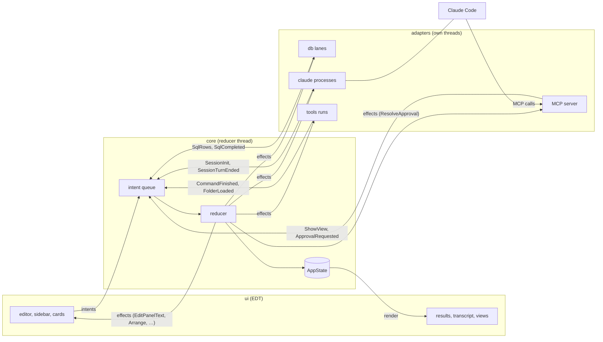

# Architecture

How comando is built: the modules, the one state and its reducer, the threads, who owns what, the UI's package rules, the
code rules and the tests.

1. [What comando is](#1-what-comando-is)
2. [Modules](#2-modules)
3. [The flow of one command](#3-the-flow-of-one-command)
4. [State, intents, effects](#4-state-intents-effects)
5. [Ports and test fakes](#5-ports-and-test-fakes)
6. [Threads](#6-threads)
7. [Ownership and exit](#7-ownership-and-exit)
8. [UI packages](#8-ui-packages)
9. [Code rules](#9-code-rules)
10. [Quality](#10-quality)

## 1. What comando is

A Java Swing desktop application for working with Claude Code and SQL databases in one window. It runs Claude Code
headless (`claude -p`, stream-JSON on standard input and output) and shows each session as a painted transcript with
tool cards, diffs and approval cards. One editor holds SQL and prompts: a block runs on the panel's database connection
when it is SQL and goes to the panel's Claude session otherwise. Claude Code reaches back into the window through an
MCP server comando runs on `127.0.0.1`: tables, plots, diffs and trees, text in the editor, SQL under a policy, and
permission prompts answered on cards. The rest of the window replaces the terminal: a shell per panel, Gradle runs with
test trees, and a browser over folders of documents.

## 2. Modules

| Module | Holds | Depends on |
|---|---|---|
| `core` | state, intents, reducer, effects, ports, the stores outside the state, the SQL-or-prompt classifier | JDK only |
| `testkit` | fakes for every port, recorded Claude streams, a synthetic session, a recording intent sink | `core` |
| `db` | JDBC lanes (one thread per connection), cancel, columnar results, schema reading, queries for Claude | `core`, pgjdbc |
| `claude` | the `claude -p` process per session, the stream-JSON mapper, stored conversations, the Claude Code kit (`Kit`) | `core`, Jackson |
| `mcp` | the MCP server on loopback, its tools, the SQL policy, the audit log | `core`, Jackson |
| `tools` | Gradle runs, the Files tab's folder reads | `core` |
| `ui` | the Swing shell, panels, dialogs, the kit, the widgets | `core`, FlatLaf (and Extras), RSyntaxTextArea and AutoComplete, CommonMark (with tables), java-diff-utils, Jackson, JediTerm, pty4j |
| `app` | wiring, the store files, the keychain, the intent log, the embedded QuestDB, `main` | all, QuestDB |

`ui` depends on `core` only; `app` is the one module that sees every other.

## 3. The flow of one command

Every change to what the window shows is an intent, applied by one reducer on one thread. Keys, database rows, Claude
Code events and MCP calls enter the same queue. The reducer returns the next state and a list of effects; adapters do
the effects on their own threads and report back with more intents. The UI renders the state.



Principles:

1. **Ports and adapters.** `core` names every outside system as a port; adapters implement them; tests replace each
   with a fake from `testkit`.
2. **One state, one direction.** `AppState` is immutable; only the reducer replaces it, one intent at a time.
3. **Request identity.** Every SQL run and command run has an id the reducer assigns; every approval has an id the MCP
   server assigns. A late event for a superseded id is dropped.
4. **Nothing blocks the EDT or the reducer.** Port methods queue work and return; every wait has a deadline.
5. **Ownership is a tree.** `App` creates every part and closes them in reverse order, each once.
6. **Replay.** Every intent can be logged, after the state the log started from; a log replayed against the real Swing shell
   with fake adapters is a UI test.

## 4. State, intents, effects

### 4.1 `AppState`

One immutable record of metadata and ids. Lists are tens of entries, so lookups scan.

| Field | Holds |
|---|---|
| `panels` | each open editor panel: id, title, connection and session bindings, whether it is a document (a file from outside comando's folder) |
| `closed` | comando's own panels the user closed, kept with their bindings until removed |
| `focused` | the panel the user works in; the lower panel follows it |
| `connections` | each connection's spec, status (closed, opening, open, closing, failed) and last error |
| `sessions` | each session's spec, status, `system/init` facts, pending turns, cost, context size and window, activity, branch, process and turn start, last turn error, background tasks, whether a checkpoint is due |
| `folders` | the Files tab's folders in order: name, path, index file, names left out, icon |
| `runs` | at most one SQL run per panel: request id, SQL, status, counts, timings, error, whether it is a live plot's background refresh |
| `approvals` | permission prompts waiting for an answer, from every session |
| `views` | views placed by Claude or the user: id, title, spec, placement (lower or side), pinned, owning session, version |
| `lowerTab` | the selected lower tab: Session, Approvals, Terminal, Results, or a view |
| `notice`, `notices` | the standing status-bar message (level, text, time, subject) and the last 50 |
| `nextId` | the next request, view or run id |

Invariants: at least one panel; `focused` names a panel (both checked by the record's constructor); connection and
session names are unique; one run per panel; a session is bound to at most one panel, open or closed.

### 4.2 Intents

A record of the sealed interface `Intent`; anything that changes the state is one.

| Group | Intents |
|---|---|
| Panels | `AddPanel`, `ClosePanel`, `ReopenPanel`, `RemovePanel`, `RenamePanel`, `MovePanel`, `FocusPanel`, `BindConnection`, `BindSession`, `OpenSession` |
| Running text | `RunText` (target auto, SQL or Claude), `RefreshSql` (a live plot's re-run), `CancelRun` |
| SQL events | `SqlStarted`, `SqlRows`, `SqlCompleted`, `SqlFailed`, `SqlCancelled`, `SqlWarning` |
| Connections | `SaveConnection`, `RemoveConnection`, `OpenConnection`, `CloseConnection`, `TestConnection`, `ExploreSchema`, `SchemaChanged`, `ConnectionOpened`, `ConnectionClosed`, `ConnectionFailed`, `ConnectionLost`, `ConnectionTested` |
| Sessions | `SaveSession`, `RemoveSession`, `ImportSessions`, `StartSession`, `StartFresh`, `StopSession`, `InterruptSession`, `Checkpoint`, `SessionCommand`, `OrderSessions`, `ClearTranscript`, `SetSessionModel`, `SetSessionEffort`, `SessionStarted`, `SessionInit`, `SessionActivity`, `SessionTurnRunning`, `SessionTurnEnded`, `SessionTasksChanged`, `SessionExited`, `SessionBranch`, `PlanUsageRead` |
| Approvals | `ApprovalRequested`, `ApprovalAnswered`, `ApprovalWithdrawn` |
| Views | `ShowView`, `RefreshView`, `CloseView`, `PinView`, `SelectLowerTab`, `Arrange`, `SessionLayout`, `SessionFocus` |
| Editor and files | `EditPanel`, `OpenFile` |
| Tools and folders | `RunGradle`, `CommandFinished`, `CancelCommand`, `AddFolder`, `FoldersRead`, `BrowseFolders`, `WatchFolders`, `FolderLoaded` |
| Notices | `Notify`, `DismissNotice` |

A null panel in `RunText`, `RunGradle` or `EditPanel` means the focused panel.

### 4.3 The reducer

`Reducer.apply(state, intent)` returns a `Transition`: the next state and a list of effects. It is pure in its
arguments, a `Clock` and the home folder, so tests drive it with a fake clock. Nothing a user or an adapter sends makes
it throw: an intent naming a missing panel, connection or session changes nothing or sets a notice.

- **Ids.** Request, run and view ids come from `nextId`; an event for a run no longer active is dropped.
- **Start on demand.** SQL on a closed connection opens it first; a prompt to a stopped session starts it first.
- **Same state for no change.** Focusing the focused panel returns the same object, so nothing re-renders.
- **User wins.** `ShowView` replaces an unpinned view with the same title, session and placement; a pinned view is
  never replaced.
- **Notices.** Every notice joins the history. A new notice replaces the standing one, except that a standing ERROR
  stays until dismissed, replaced by another error, or settled by its own subject. An event that settles a subject
  clears its notice (a run completing, a connection opening, a turn succeeding, an approval answered). A new ERROR also
  asks for a desktop notification while the window is behind.
- **The user's file.** `FoldersRead`, `folders.json` read again after the user changed it, replaces the folders and
  saves nothing; `AddFolder`, the kit's, saves.

### 4.4 Effects

Work the reducer asks of an adapter. `EffectRouter` hands each to its port on the reducer thread; every port method
queues and returns.

| Port | Effects |
|---|---|
| `DatabasePort` | `OpenDb`, `CloseDb`, `ForgetSchema`, `TestDb`, `ExecuteSql`, `CancelSql`, `ReleaseResult`, `LoadSchema` |
| `ClaudePort` | `StartClaude`, `StopClaude`, `SendToClaude`, `InterruptClaude`, `LoadHistory`, `ClearTranscript`, `ForgetSession` |
| `ApprovalPort` | `ResolveApproval` |
| `UiPort` | `EditPanelText`, `DesktopNotify`, `ForgetPanel`, `DeletePanel`, `ShowFile`, `Arrange`, `ShowFolder`, `ShowPlanUsage` |
| `PersistencePort` | `SaveConnections`, `SaveSessions`, `SaveFolders`, `SavePanels` |
| `ToolPort` | `RunGradle`, `CancelCommand`, `ForgetCommand`, `ReadFolders`, `WatchFolders` |

`StateLoop` runs one intent at a time: observers (the intent log), the reducer, the effects in order, then the state
listeners (the UI's coalesced render). The reducer, each effect and each listener are guarded, so a failure is logged and
the loop goes on; an observer must not throw (the intent log catches its own failures).

### 4.5 Stores outside the state

Large data would make every state copy expensive, so it lives in stores the state refers to by id. Each has one writer
thread.

| Store | Keyed by | Written by | Read by |
|---|---|---|---|
| `ResultRegistry` → `ColumnarResult` | SQL request id | the connection's lane | Results tab, plots, MCP |
| `TranscriptRegistry` → `Transcript` | session name | the session's strand | Session tab |
| `ConsoleRegistry` → `Console` | command run id | the run's thread | console views |
| `SchemaRegistry` → `Schema` | connection name | the database adapter | completion, schema explorer |
| `PanelTexts` | panel id | the EDT | the store thread, on save |

`ColumnarResult` and `Transcript` publish their size through a `volatile` field written after the data, so a reader
that reads the size first sees complete rows or blocks. `Console` guards its buffer with its own lock.

### 4.6 The intent log

With `-Dcomando.recordIntents=true`, `IntentLog` writes one JSON line per intent to `logs/intents-<millis>.jsonl`; the
first line is the starting state; every `password` field is blanked. `UiReplayTest` feeds a log to a real `StateLoop`
and the real Swing shell, with recording fakes for every other port, and checks the window against the final state.
The stores outside the state are not recorded, so a replay reproduces layout, panels, views and run states, not rows or
transcript text.

## 5. Ports and test fakes

| Port | Methods | Adapter |
|---|---|---|
| `IntentSink` | `dispatch` | `StateLoop` |
| `Clock` | `millis` | `Clock.SYSTEM` |
| `DatabasePort` | `open`, `close`, `forgetSchema`, `test`, `execute`, `cancel`, `release`, `loadSchema` | `DbAdapter` |
| `QueryPort` | `query`, `describe` (futures of text rows, for Claude) | `DbAdapter` |
| `ClaudePort` | `start`, `stop`, `send`, `interrupt`, `clearTranscript`, `loadHistory`, `forget` | `ClaudeAdapter` |
| `McpGateway` | `register(session)` gives the URL and bearer token a session's CLI uses; `unregister` | `McpServer` |
| `ApprovalPort` | `resolve` | `McpServer` |
| `ToolPort` | `runGradle`, `cancelRun`, `forgetRun`, `readFolders`, `watchFolders` | `ToolsAdapter` |
| `UiPort` | `editPanel`, `notifyDesktop`, `forgetPanel`, `deletePanel`, `showFile`, `arrange`, `showFolder`, `showPlanUsage` | `ComandoUi` |
| `PersistencePort` | `saveConnections`, `saveSessions`, `saveFolders`, `savePanels` | `Store` |

`testkit` holds what every module's tests share: `RecordingPorts` (every effect port, each call recorded as a line),
`RecordingSink` (keeps intents, awaits one with a deadline), `FakeClock`, `States` (a two-panel state), `Fixtures`
(sanitized stream-JSON recorded from Claude Code), `SyntheticSession` (a deterministic eight-turn session replayed delta
by delta), `FakeResult`.

## 6. Threads

| Thread | Kind | Does |
|---|---|---|
| EDT | AWT | renders the state, turns input into intents; owns every Swing component |
| `comando-reducer` | platform | applies intents in order; the only writer of `AppState` |
| `db-<connection>` | platform, one per connection | opens the connection, runs statements one at a time, fetches rows |
| `db-timer` | platform | health checks every 60 s; the abort after an unanswered cancel |
| `claude-strand-<session>` | virtual, single-threaded | every change to a session: start, send, interrupt, stop, history; the transcript's one writer |
| `claude-out-`, `-in-`, `-err-`, `-exit-<session>` | platform, per process | stdout lines, the stdin queue, the last 40 stderr lines, the exit |
| `claude-timer` | platform | the stop sequence's deadlines |
| `plan-usage` | platform, daemon | `claude --safe-mode -p /usage` at start and every 5 minutes, stopped after 30 s |
| MCP requests | virtual, one per request | JSON-RPC; an `approve` call waits for its card |
| `gradle-<run>`, `tool-output-<run>`, `tool-kill-<run>` | virtual | a run's process and output; SIGKILL what a stop left alive after 2 s |
| `folder-read` | virtual | folder reads |
| `folder-poll` | platform, daemon | every 5 s reads the open folders, sends a tree only when it changed |
| `store`, `store-secrets` | platform | atomic writes of the store files; panel text 800 ms after the first unsaved change; a check of open panels' files and `folders.json` every second; keychain calls apart, so an unlock prompt never holds back panel text |
| `mermaid` | platform, daemon | `mmdc`, one diagram at a time, 30 s bound |
| `edt-watchdog` | platform, daemon | a probe to the EDT every 100 ms |
| `exit`, `shutdown` | platform | close the application after Quit, or from the shutdown hook |
| short virtual threads | virtual | one blocking call each off the EDT: opening a file, the tutorial, stored conversations, links, the external editor, notifications, the kit, exports, preparing a large plot |

How work crosses threads:

- **Into the reducer.** `IntentSink.dispatch` puts the intent on an unbounded queue; intents from one thread keep their
  order.
- **Out of the reducer.** Ports queue work on their own executors and return.
- **To the EDT.** One state listener requests a render through a `Coalescer`: many state changes become at most one
  pending `invokeLater`. Growing stores (transcripts, consoles) ask for repaints the same way.
- **From the EDT.** Input becomes an intent; blocking work moves to a virtual thread.

Bounded waits:

| Wait | Bound | On expiry |
|---|---|---|
| An approval card | 55 min (the MCP configuration comando writes gives its server a 60 min timeout) | `deny`, card withdrawn |
| `db_run_sql` for Claude | 90 s | a queued statement is withdrawn; the tool says so |
| `db_describe` | 60 s | tool error |
| `session_read` with `wait_seconds` | at most 600 s | the blocks so far, status still working |
| Statement cancel | `cancelSignalTimeout=2` | the connection is aborted after 2 s |
| Claude process stop | SIGTERM after 3 s, SIGKILL 2 s later | the exit is reported |
| Tool run stop | SIGKILL 2 s after SIGTERM | the run ends as stopped |
| Output after a process exits (tools, Claude) | 2 s | a child holding the pipe no longer holds the run or session |
| `claude --version` | 5 s | a warning |
| Desktop notification (`osascript`) | 10 s | killed, not shown |
| Keychain calls | 10 s | killed; the connection loads without its password, the item is kept |
| Closing the window at quit | 5 s | quit anyway |
| The EDT | 200 ms | a stall, one INFO line when it ends; past 1 s (2 s in the JDK's drawing) a hang, logged with the EDT's stack |

## 7. Ownership and exit

`App` creates every long-lived part in dependency order on a stack; `close()` pops it, so parts close in reverse order,
each once. Two are moved to the end: the embedded QuestDB, which the lanes may still use, and the window, titled "comando —
closing…" and greyed under a cover until everything behind it has closed. Every `close()` is idempotent, never throws
(failures are logged with the part's name), and is safe on a half-built part; a failed constructor step closes what was
built and rethrows.

| Created | Part | Closing it |
|---|---|---|
| 1 | `Store` | writes pending panel text and `panels.json`, finishes queued writes; waits up to 5 s (11 s for connections, one keychain call) |
| 2 | `IntentLog` | closes the log after the loop, so the shutdown's intents are recorded |
| 3 | `StateLoop` | stops the reducer after the queued intents |
| 4 | `DbAdapter` | cancels running statements, closes connections |
| 5 | `MermaidDiagrams` | stops `mmdc` and its children |
| 6 | `McpServer` | denies every waiting approval, stops the server |
| 7 | `ClaudeAdapter` | SIGTERM, SIGKILL 2 s later; deletes every MCP configuration file and revokes its token |
| 8 | `ToolsAdapter` | SIGTERM to every run's process tree, SIGKILL 2 s later; stops the folder poll |
| 9 | `EmbeddedQuestDb` | closes after the lanes |
| 10 | `ComandoUi` | closes last: terminals, live plots, the EDT watchdog, the window |

Quit (window, Dock, menu) first asks when work would stop: a running query, a turn, a shell job in the foreground, a
Gradle run; Cancel is the default. It then saves the layout, ends terminals and live plots, greys the window, and
runs `onQuit`, which starts the `exit` thread: `App.close()`, then `System.exit(0)`. A shutdown hook calls `App.close()`
too; the second call does nothing.

## 8. UI packages

```
dev.marregui.comando.ui
├── kit/            theme, icons, commands, overlays, EDT helpers, formatting, text, trees, tabs, desktop
├── widget/         the contract: Widget, WidgetContext, WidgetRegistry; capability/ (Searchable, Copyable, …)
├── widgets/        one package per widget: approval, console, diff, editor, markdown, plot, table, terminal, text,
│                   transcript (with doc/ and render/), tree
├── panels/         the window's regions: Workspace, EditorPanel, LowerPanel, SessionsSidebar, PanelsTab, FilesTab,
│                   SidePane, StatusBar, ResultsView, TerminalTabs, ViewTabs, …
├── dialogs/        resource/ (ResourceDialog, one dialog for connections, sessions and folders), sessions/ (import)
├── shell/          ComandoUi (the frame and the UI port), WindowLayout, HelpActions, Menus, Keys, LivePlots, Notifier, HelpFiles, OpenFiles, …
└── PanelTexts      editor text between saves
```

A layer uses only those above it in this list: `kit` uses `core` and the UI libraries; `widget` adds `kit`; a widget
package adds `widget` but no other widget package; `panels`, `dialogs` and `shell` use everything before them.
`UiArchitectureTest` (ArchUnit) fails the build when a widget imports another widget or `panels`, `shell` or
`dialogs`; when the kit imports a widget, `panels` or `shell`; or when any UI class refers to `db`, `claude`, `mcp`,
`tools` or `java.sql`. The Gradle module graph enforces it a second time for `db`, `claude`, `mcp` and `tools`.

New code goes: a view Claude or the user can place → `widgets/<name>`, a `ViewSpec` record in `core`, a registration
in `ComandoUi`, and for Claude a case in `mcp`'s `ViewSpecs` and its schema in the tool list; behaviour two widgets share → `kit` or a capability; a region of the window → `panels`; a user action →
a `Command`.

## 9. Code rules

1. A change to state is an intent; the reducer is the only writer of `AppState`.
2. Every thread a part starts ends when the part closes, or is a daemon.
3. Every wait has a bound and an action on expiry.
4. Nothing in `ui` imports an adapter module; no widget imports another widget.
5. Nothing blocks the EDT: process runs, network, reads of unknown size and keychain calls go to other threads; Swing
   only on the EDT.
6. Text from Claude, a database or a file reaches Swing as text, never as HTML (`Plain`, `MarkdownHtml`).
7. Tests never touch the user's data root, keychain or window preferences unless a flag says so.
8. Code and comments name no tool, agent or review finding.
9. Compiler warnings are errors (`-Xlint:all -Werror`, except `serial`, `processing`, `this-escape`).
10. Types are imported, never fully qualified, except to tell apart two types with one simple name. Imports: project,
    `javax`, `java`, each sorted; no wildcards.
11. Logging is `System.Logger`; messages read `verb phrase [key=value]`; a failure logs its exception, a handled
    condition its message.

Hot paths follow the author's high-throughput Java guidelines: results stored by column in primitive chunks, grid
cells formatted into one reused buffer, plots reduced to min and max per pixel column, transcript layouts kept and only
the clip painted, release-acquire publication in the stores. Object pools, ring queues, padding and worker pools are not
used: comando's event rates are UI rates.

## 10. Quality

`./gradlew build` compiles every module with warnings as errors and runs the unit and adapter tests. The database tests run against an embedded QuestDB, and against PostgreSQL through Testcontainers
when Docker is there; the Claude adapter runs against fake CLI scripts and recorded streams; the MCP server is tested
over HTTP.

| Opt-in test | Enabled by | Why |
|---|---|---|
| keychain round trip | `./gradlew test -PkeychainTest=true` | writes and deletes a login keychain item |
| window replay | `./gradlew :app:uiTest` | needs a display |
| the kit with the real Claude Code | `COMANDO_KIT_LIVE=true ./gradlew :claude:test --tests '*KitLiveTest'` | runs the installed `claude` in a throwaway `CLAUDE_CONFIG_DIR` |

Gates:

| Gate | Command | Budget |
|---|---|---|
| transcript frame time | `./gradlew :ui:transcriptGate` | p99 ≤ 16 ms ([UI](ui.md#43-the-frame-time-gate)) |
| EDT responsiveness | always on: `EdtWatchdog` | a probe answered within 200 ms |

comando has no JFR code. It is profiled from outside like any JVM, with the JDK's own events, and its EDT stalls are
in its log ([UI §1](ui.md#1-the-kit)); the packaged runtime keeps `jdk.jfr`, `jdk.management.jfr` and
`jdk.management.agent` so the installed app can be recorded, and watched over JMX, too
([record 54](adr/0054-comando-knows-nothing-of-jfr.md)).

CI (`.github/workflows/build.yml`, Ubuntu and macOS, Temurin 25, actions pinned by SHA) runs `build`, `:app:uiTest`
(under `xvfb-run` on Ubuntu), a test summary (`ci/TestReport.java`), the transcript gate (reported, not enforced), and on
macOS `:app:dmg` as a packaging smoke test. `dependabot.yml` groups weekly updates of the actions and the Gradle
dependencies. `./gradlew :app:dmg` builds an unsigned disk image with `jpackage` and a runtime of the modules listed in `app/build.gradle.kts`
([decision 16](adr/0016-unsigned-macos-build.md)).
