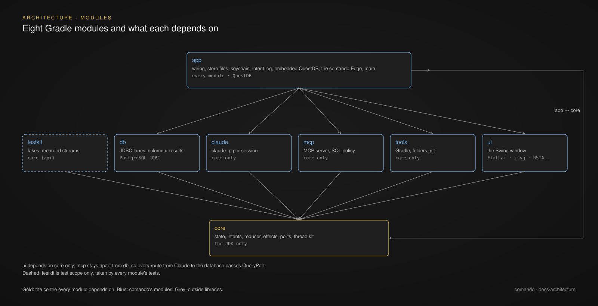

# Architecture

How comando is built: the modules, the one state and its reducer, the ports, the threads, who owns what, and then each
module in turn, with its classes, its interface with the others, its threads and its tests. I hold this document to one
bar: an agent could rebuild comando in another language from it and the decision records alone. How to build, test and
release comando, and the code rules it follows, are in [Development](development.md). §8 to §15 hold only what the
overview does not: each module's classes, its interface with the others, its own threads and its tests; a new module
gets a section with the same four parts.

1. [What comando is](#1-what-comando-is)
2. [Modules](#2-modules)
3. [The flow of one command](#3-the-flow-of-one-command)
4. [State, intents, effects](#4-state-intents-effects)
5. [Ports and test fakes](#5-ports-and-test-fakes)
6. [Threads](#6-threads)
7. [Ownership and exit](#7-ownership-and-exit)
8. [The `core` module](#8-the-core-module)
9. [The `testkit` module](#9-the-testkit-module)
10. [The `db` module](#10-the-db-module)
11. [The `claude` module](#11-the-claude-module)
12. [The `mcp` module](#12-the-mcp-module)
13. [The `tools` module](#13-the-tools-module)
14. [The `ui` module](#14-the-ui-module)
15. [The `app` module](#15-the-app-module)

## 1. What comando is

A Java Swing desktop application for working with Claude Code and SQL databases in one window. It runs Claude Code
headless (`claude -p`, stream-JSON on standard input and output) and shows each session as a painted transcript with
tool cards, diffs and approval cards. One editor holds SQL and prompts: a block runs on the panel's database connection
when it is SQL and goes to the panel's Claude session otherwise. Claude Code reaches back into the window through an MCP
server comando runs on `127.0.0.1`: tables, plots, diffs and trees, text in the editor, SQL under a policy, and
permission prompts answered on cards. The rest of the window covers what a terminal beside it would: a shell per panel,
Gradle runs with test trees, and a browser over folders of documents and their git changes.

comando is built with and runs on JDK 25.

## 2. Modules



| Module | Holds | Depends on |
|---|---|---|
| `core` | state, intents, reducer, effects, ports, the stores outside the state, the SQL-or-prompt classifier, the thread kit, the root sessions run on and its kit (`KitRoot`) | JDK only |
| `testkit` | fakes for every effect port, a fake clock, recorded Claude streams, a synthetic session, a recording intent sink | `core` |
| `db` | JDBC lanes (one strand per connection), cancel, columnar results, schema reading, queries for Claude | `core`, PostgreSQL JDBC driver |
| `claude` | the `claude -p` process per session, the stream-JSON mapper, stored conversations, subagents' conversations, the plans' usage, the tabs' topics, `comando-kit.json` (`KitJson`) and the kit's jobs through its `kit.py` (`KitJobsCli`) | `core`, Jackson |
| `mcp` | the MCP server on loopback, its tools, the SQL policy, the audit log, the other instances (`Peers`, through the `PeerBroker` interface) | `core`, Jackson |
| `tools` | Gradle runs, the Files tab's folder reads and moves to the Trash, the folders' git repositories, the kit's version and the brain's and the kit's backups (the `git` command line) | `core` |
| `ui` | the Swing shell, panels, dialogs, widgets and `ui.kit`, which they share | `core`, FlatLaf (and Extras), jsvg, RSyntaxTextArea and AutoComplete, CommonMark (with tables), java-diff-utils, Jackson, JediTerm, pty4j |
| `app` | wiring, the store files, the keychain, the intent log, the machine's QuestDB, the comando Edge and the instances' link to it (`MqttPeerBroker`), `main` | every module, Jackson, QuestDB, the HiveMQ MQTT client |

`ui` depends on `core` only; `app` is the one module that sees every other.

A module exists only where it separates an external dependency or enforces a boundary a package cannot: `core` depends
on the JDK alone, each adapter module wraps one outside system, only `app` sees them all, and `testkit` holds the fakes
every module's tests share. `mcp` stays apart from `db` so that every route from Claude to the database passes
`QueryPort` and, for a statement that is not read-only, the approval card.

Each module has a section below, [§8](#8-the-core-module) to [§15](#15-the-app-module), on its classes, its interface
with the others, its threads and its tests.

## 3. The flow of one command

Every change to what the window shows is an intent, applied by one reducer on one thread. Keys, database rows, Claude
Code events and MCP calls enter the same queue. The reducer returns the next state and a list of effects; adapters do
the effects on their own threads and report back with more intents. The UI renders the state.


Principles:

1. **Ports and adapters.** `core` names every outside system as a port; adapters implement them
   ([§5](#5-ports-and-test-fakes)).
2. **One state, one direction.** `AppState` is immutable; only the reducer replaces it, one intent at a time.
3. **Request identity.** Every SQL run and command run has an id the reducer assigns; every approval has an id the MCP
   server assigns. A late event for a superseded id is dropped.
4. **Nothing blocks the EDT or the reducer.** Port methods queue work and return; every wait has a deadline.
5. **Ownership is a tree.** `App` creates every part and closes them in reverse order, each once.
6. **Replay.** Every intent can be logged, after the state the log started from; a log replayed against the real Swing
   shell with fake adapters is a UI test.

## 4. State, intents, effects

### 4.1 `AppState`

One immutable record of metadata and ids. Lists hold tens of entries, so lookups scan.

| Field | Holds |
|---|---|
| `panels` | each open editor panel: id, title, connection and session bindings, whether it is a document (a file from outside comando's folder), whether it sits in the right-hand partition (`side`) and whether it is the preview tab (`preview`, never saved; record 141) |
| `closed` | comando's own panels the user closed, kept with their bindings until removed |
| `focused` | the panel the user works in; the lower panel follows it |
| `connections` | each connection's spec, status (closed, opening, open, closing, failed) and last error |
| `sessions` | each session's spec, status, `system/init` facts, pending turns, cost, context size and window, activity, branch, what its writes say it works on (`SessionSubject`, record 138), process and turn start, last turn error, background tasks and whether the last turn handed work to them, whether a checkpoint is due (`Reflection`), whether the running checkpoint compacts when it ends, whether the automatic checkpoint is armed (record 129), whether the automatic checkpoint's compaction is followed by a carry-on prompt (`checkpointContinues`, `Reducer.CONTINUE_PROMPT`), whether the carry-on ran and no prompt of the user's or another session's has since (`carriedOn`, which holds the next automatic checkpoint back), and `checkpointTurns`, the turns still to end up to the checkpoint command or its `/compact`: while non-zero the session is locked and every intent on it but an interrupt or a stop is dropped (record 130) |
| `instances` | the other comando instances on the comando Edge and the questions between them (`InstancesState`, record 124) |
| `folders` | the Files tab's folders in order: name, path, index file, names left out, icon, whether entries go to the Trash, the listing file, the group whose row shows them ([record 118](adr/0118-brain-and-kit-are-rows-each-one-unit.md)) |
| `runs` | at most one SQL run per panel: request id, SQL, status, counts, timings, error, whether it is a live plot's background refresh |
| `approvals` | permission prompts waiting for an answer, from every session |
| `logbook` | the scratchpad's open tasks as the newest day folder's `INDEX.md` lists them (`Logbook`, `LogbookTask`), set by `LogbookRead`; read only, never saved ([record 150](adr/0150-a-card-only-when-a-session-cannot-go-on.md)) |
| `views` | views placed by Claude or the user: id, title, spec, placement (lower or side), pinned, owning session, version, and its home: where the user moved it, which a view shown again with the same title keeps (record 141) |
| `lowerTab` | the selected lower tab: Session, Approvals, Terminal, Results, or a view |
| `notice`, `notices` | the standing status-bar message (level, text, time, subject) and the last 50 |
| `nextId` | the next request, view or run id; it never goes back |

Invariants: at least one panel; `focused` names a panel (both checked by the record's constructor); connection and
session names are unique; one run per panel; a session has at most one panel of comando's own, open or closed, titled
with its name, and any number of documents attached ([record 88](adr/0088-a-session-and-its-panel-share-a-name.md)).

### 4.2 Intents

A record of the sealed interface `Intent`; anything that changes the state is one.

| Group | Intents |
|---|---|
| Panels | `AddPanel`, `ClosePanel`, `ReopenPanel`, `RemovePanel`, `RenamePanel`, `MovePanel`, `PlacePanel` (to the partition or the main tabs), `PinPanel` (the preview tab stays), `FocusPanel`, `BindConnection`, `BindSession`, `OpenSession` |
| Running text | `RunText` (target auto, SQL or Claude), `RefreshSql` (a live plot's re-run), `CancelRun` |
| SQL events | `SqlStarted`, `SqlRows`, `SqlCompleted`, `SqlFailed`, `SqlCancelled`, `SqlWarning` |
| Connections | `SaveConnection`, `RemoveConnection`, `OpenConnection`, `CloseConnection`, `TestConnection`, `ExploreSchema`, `SchemaChanged`, `ConnectionOpened`, `ConnectionClosed`, `ConnectionFailed`, `ConnectionLost`, `ConnectionTested` |
| Sessions | `SaveSession`, `RemoveSession`, `ImportSessions`, `StartSession`, `StartFresh`, `StopSession`, `InterruptSession`, `Checkpoint`, `SessionCommand`, `OrderSessions`, `ClearTranscript`, `SetSessionModel`, `SetSessionEffort`, `SessionStarted`, `SessionInit`, `SessionActivity`, `SessionTurnRunning`, `SessionTurnEnded`, `SessionTasksChanged`, `SessionExited`, `SessionBranch`, `SessionSubjectRead` (what a session's writes name, record 138), `SessionRanAt` (the model and effort a turn ran at), `SessionContext` (record 120), `PromptSession` (one session prompting another, record 44, and an instance's consult, record 123), `PlanUsageRead` |
| Approvals | `ApprovalRequested`, `ApprovalAnswered`, `ApprovalWithdrawn` |
| Logbook | `LogbookRead` (the Logbook tab's tasks, from `tools`' read of the newest day folder's index, record 150) |
| Views | `ShowView`, `RefreshView`, `CloseView`, `PinView`, `PlaceView` (a view moved between the lower panel and the partition), `SelectLowerTab`, `Arrange`, `SessionLayout`, `SessionFocus` |
| Editor and files | `EditPanel`, `OpenFile`, `OpenSubagent` |
| Tools and folders | `RunGradle`, `CommandFinished`, `CancelCommand`, `AddFolder`, `SaveFolders`, `FoldersRead`, `BrowseFolders`, `WatchFolders`, `FolderLoaded`, `DeleteFiles` (the Files tab's move to the Trash), `ReposLoaded`, `OpenChange`, `ChangeRead`, `RollBack`, `RemoveFiles`, `Unstage` (the git writes of the Changes view and the comparison window) |
| Notices | `Notify`, `DismissNotice` |
| Instances | `InstancesChanged` (the Instances tab's state, from `mcp`'s `Peers`, record 124) |

A null panel in `RunText`, `RunGradle` or `EditPanel` means the focused panel; `RunText` naming a panel closed since the
text was sent (a console's origin) also runs on the focused one, where `EditPanel` sets an ERROR notice.

### 4.3 The reducer

`Reducer.apply(state, intent)` returns a `Transition`: the next state and a list of effects. It is pure in its
arguments, a `Clock`, the home folder and the checkpoint threshold (a window setting, a percentage of the session's
context window from 10 to 100, read at each turn's end), so tests drive it with a fake clock. Nothing a user or an
adapter sends makes it throw: an intent naming a missing panel, connection or session changes nothing or sets a notice.
`Reducer` holds the entry point and dispatches each intent to the rules of its domain, package-private classes beside
it: `PanelRules`, `SessionRules`, `TurnRules`, `QueryRules` (runs and connections), `ApprovalRules`,
`FolderRules`, `ViewRules`, with `Shared` for the helpers several use (notices, the saved lists, fresh panel ids).

| Rule | What the reducer does |
|---|---|
| Ids | request, run and view ids come from `nextId`; an event for a run no longer active is dropped |
| Start on demand | SQL on a closed connection opens it first; a prompt to a stopped session starts it first, for the user or one of the session's creators only (record 44, amended) |
| Refusals | `Reducer.refusal(state, intent)` names why the reducer would refuse an intent (the checkpoint lock, a name another panel holds, a stopped session another session would start, a command with nothing to send, no session to settle in), so an agent's action answers it before sending; an agent's intent refused after all is a warning notice naming the agent (record 121, amended) |
| A connection pointed elsewhere | a save that changes host, port, database or user drops the stored password unless it gives one, with a notice (record 20, amended) |
| Same state for no change | focusing the focused panel returns the same object, so nothing re-renders |
| User wins | `ShowView` replaces an unpinned view with the same title, session and placement; a pinned view is never replaced |
| Repositories | after any intent, folders that changed, or a Changes view that appeared or went, add `WatchRepos` with every folder and whether the view shows; `App` asks for the first read at start |
| To read | `Shared.finished` sets `SessionSpec.unreadMillis` to the time when a turn's work ends or a session exits at work, unless the focused panel is on it; after every intent a session busy or the focused panel's loses the mark, and when a mark changed, one `SaveSessions` replaces any other (record 136) |
| The folders window | `SaveFolders` replaces the folders and saves them; its notice says when it replaced a change to `folders.json` read while the window was open; a list naming one folder twice saves nothing |
| The user's file | `FoldersRead`, `folders.json` read again after the user changed it, replaces the folders and saves nothing; the kit's folders join the list read at start, once per root, and are saved ([Kit and brain §3.2](kit-and-brain.md#32-the-files-tab)) |

**Notices.** Every notice joins the history. A new notice replaces the standing one, except that a standing ERROR stays
until it is dismissed, replaced by another error, or settled by its own subject. An event that settles a subject clears
its notice: a run completing, a connection opening, a turn succeeding, an approval answered. A new ERROR also asks for a
desktop notification while the window is behind. The subject is also where a click on the notice goes, where the window
has a target: `log:<millis>` opens the log at that entry, found by its time, and `panel:<id>` focuses the panel
([record 79](adr/0079-a-notice-takes-you-to-what-it-is-about.md)); a notice of another subject opens the recent notices.
`Intent.Notify.logged` writes a failure to the log and names that entry.

### 4.4 Effects

Work the reducer asks of an adapter. `EffectRouter` hands each to its port on the reducer thread; every port method
queues and returns.

| Port | Effects |
|---|---|
| `DatabasePort` | `OpenDb`, `CloseDb`, `ForgetSchema`, `TestDb`, `ExecuteSql`, `CancelSql`, `ReleaseResult`, `LoadSchema` |
| `ClaudePort` | `StartClaude`, `StopClaude`, `SendToClaude`, `InterruptClaude`, `LoadHistory`, `ClearTranscript`, `ForgetSession`, `ShowSubagent` |
| `ApprovalPort` | `ResolveApproval` |
| `UiPort` | `EditPanelText`, `DesktopNotify`, `ForgetPanel`, `DeletePanel`, `ShowFile`, `Arrange`, `ShowFolder`, `ShowRepos`, `ShowChange`, `ShowPlanUsage` |
| `PersistencePort` | `SaveConnections`, `SaveSessions`, `SaveFolders`, `SavePanels` |
| `ToolPort` | `RunGradle`, `CancelCommand`, `ForgetCommand`, `ReadFolders`, `WatchFolders`, `DeleteFiles`, `WatchRepos`, `ReadChange`, `RollBack`, `RemoveFiles`, `Unstage` |

`StateLoop` runs one intent at a time: the observers (the intent log), the reducer, whose new `AppState` it publishes
through a volatile field, the effects in order, then the state listeners (the UI's coalesced render). Each observer, the
reducer, each effect and each listener are guarded, so an exception is logged with the intent's name and the loop goes
on. An `Error` (out of memory, a stack overflow) leaves the state of no trust: the loop stops for good, logs it with its
stack, drops what was queued, and from then on drops every intent with one ERROR line instead of queuing it unseen.
`Watchdog` drops a look that throws an `Error` and keeps the others.

### 4.5 Stores outside the state

Large data (result rows, transcripts, console output, schemas) would be copied with every state, so it lives in stores
the state refers to by id. Each has one writer thread.

| Store | Keyed by | Written by | Read by |
|---|---|---|---|
| `ResultRegistry` → `ColumnarResult` | SQL request id | the connection's lane | Results tab, plots, attachments |
| `TranscriptRegistry` → `Transcript` | session name | the session's strand | Session tab, `session_read` |
| `ConsoleRegistry` → `Console` | command run id | the run's thread | console views |
| `SchemaRegistry` → `Schema` | connection name | the database adapter | completion, schema explorer |
| `PanelTexts` | panel id | the EDT | the store thread, on save |

`ColumnarResult` and `Transcript` publish their size through a `volatile` field written after the data, so a reader
that reads the size first sees complete rows or blocks. `Console` synchronizes on its buffer.

### 4.6 The intent log

With `-Dcomando.recordIntents=true`, `IntentLog` writes one JSON line per intent to `logs/intents-<millis>.jsonl`. The
first line is the starting state, the log's schema version and the checkpoint threshold in force; a change of the
threshold is a line of its own before the next intent; every `password` field is blanked. `IntentLog.Replay.loop`
replays each intent under the threshold the log read and wrote for it, read once per intent (without a log the reducer
reads the setting), and a log that recorded none under a reducer that never
checkpoints. `UiReplayTest` feeds a log to a real `StateLoop` and the real Swing shell, with recording fakes for every
other port, and checks the window against the final state. The stores outside the state are not recorded, so a replay
reproduces layout, panels, views and run states, not rows or transcript text.

## 5. Ports and test fakes

`core` names every outside system as a port, and adapters implement the ports. Every port method queues work and
returns; outcomes come back as intents.

| Port | Methods | Implemented by | Called by |
|---|---|---|---|
| `IntentSink` | `dispatch` | `core` `StateLoop` | every module |
| `Clock` | `millis` | `Clock.SYSTEM` | `Reducer`, `mcp` |
| `DatabasePort` | `open`, `close`, `forgetSchema`, `test`, `execute`, `cancel`, `release`, `loadSchema` | `db` `DbAdapter` | `EffectRouter` |
| `QueryPort` | `query`, `describe` (futures of text rows, for Claude) | `db` `DbAdapter` | `mcp` (`db_run_sql`, `db_describe`) |
| `ClaudePort` | `start`, `stop`, `send`, `interrupt`, `clearTranscript`, `loadHistory`, `forget`, `showSubagent` | `claude` `ClaudeAdapter` | `EffectRouter` |
| `TopicPort` | `read` (a tab's topic, delivered to a callback; a topic is view data and never passes the reducer) | `claude` `ClaudeTopics` | `ui` (the tabs' cards) |
| `SearchPort` | `search`, `cancel` (a search's answers go to its sink: derived data that never passes the reducer; record 139) | `app` `Searcher` | `ui` (`SearchWidget`, through `SearchHub`) |
| `McpGateway` | `register(session)` gives the URL and bearer token a session's CLI uses; `unregister` | `mcp` `McpServer` | `claude` (a ticket per process) |
| `ApprovalPort` | `resolve` | `mcp` `McpServer` | `EffectRouter` |
| `ToolPort` | `runGradle`, `cancelRun`, `forgetRun`, `readFolders`, `watchFolders`, `deleteFiles`, `watchRepos`, `readChange`, `rollBack`, `removeFiles`, `unstage` | `tools` `ToolsAdapter` | `EffectRouter` |
| `UiPort` | `editPanel`, `notifyDesktop`, `forgetPanel`, `deletePanel`, `showFile`, `arrange`, `showFolder`, `showRepos`, `showChange`, `showPlanUsage` | `ui` `ComandoUi` | `EffectRouter` |
| `PersistencePort` | `saveConnections`, `saveSessions`, `saveFolders`, `savePanels` | `app` `Store` | `EffectRouter` |
| `InstancesPort` | `ask`, `deny`, `forget`, `role` (the Instances tab's acts, off the caller's thread; record 124) | `mcp` `Peers` | `ui` (the Instances tab; the outcome comes back as a notice and in `AppState.instances`) |
| `ServerSwitch` | `name`, `isRunning`, `want(up)`, `status` (a local server an agent starts or stops, record 121) | `app` `EmbeddedEdge`, `MachineQuestDb` | `mcp` (`ActionTools`: `server_start`, `server_stop`) |

Tests replace each effect port with a fake from `testkit`; `McpGateway.NONE`, `TopicPort.NONE` and a test's own
`QueryPort` stand in for the others.

## 6. Threads

comando's threads are of six kinds ([record 82](adr/0082-threads-by-kind-with-a-budget.md)). Only the first three use
operating-system threads, and their number is fixed: **two, plus one per running Claude session**, whatever the number
of connections, folders, panels, diagrams or runs. `ThreadBudgetTest` (in `:app:uiTest`) holds the budget with more
sessions than cores (cores + 4) and checks that nothing is left after the close: no platform thread and none of the
named executor threads the thread kit makes. An owner stops its executors through `ExecutorStop`: `now` interrupts and
waits a bound (2 s), `drain` lets queued work finish within a bound and then interrupts, and a thread still alive at the
bound is logged with its owner. `ThreadRulesTest` fails the build when code outside the kinds below starts a thread or
an executor.

| # | Kind | Is | Threads |
|---|---|---|---|
| K1 | Event loop | owns state or the toolkit; never blocks | the EDT (AWT's); `comando-reducer` (platform) |
| K2 | Watchdog | must run while what it watches is held | one `watchdog` (platform) for the EDT and the reducer, from `Watchdog.shared()`; started with the first look, ended after the last |
| K3 | Session reader | reads a pipe live: a pipe read holds its operating-system thread even on a virtual thread (measured on JDK 25: 100 blocked readers, 101 carriers) | `claude-out-<session>` (platform), one per running session |
| K4 | Strand | sequential work on one resource; its waits hold no operating-system thread | one virtual thread each, from `Threads.strand` or, with timers, `Threads.timedStrand` (the JDK's one delay thread keeps the timers) |
| K5 | Errand | one blocking call started by a gesture or an event, then gone | a virtual thread from its owner's `Errands` (`App`, `ToolsAdapter`, `MachineQuestDb`, `EmbeddedEdge`, `Peers`, `DbAdapter`'s connection tests, the window's `UiErrands`), interrupted and waited for at the owner's close |
| K6 | Fork | a thread its caller collects in the same call, with a bound | a virtual thread from `Threads.fork` |

The rest of a running process is not comando's: the JVM's (GC, compiler, VM), AWT's and Java2D's, the virtual threads'
scheduler (its carriers: one per core while busy, plus one for each virtual thread held in file or pipe I/O, which is
why a session's reader is a platform thread), the JDK's `process reaper` (one per child process), the MCP server's
dispatcher and the libraries' (JNA, a `java.util.Timer`, and the MQTT client's one Netty event loop while this
instance is connected to the comando Edge). Measured with five sessions: about 45 threads in all, 7 of them comando's
own platform threads. Halving the GC threads to two lengthened the G1 pause p99 from 5–6 ms to 30–48 ms on
`:ui:transcriptGate`, so the JVM keeps its default.

Swing timers are not threads, so neither test above sees them, yet one left running keeps AWT, and a JVM that does
not call `System.exit`, alive. A delay after the last of a burst is a `Debouncer`; a timer that repeats while
something holds is a `ShownTimer`, which runs only while its owner wants it and the owner component is showing; a
component built and never shown starts none (an editor's caret stays hidden, its blink stopped, until the first
focus).

A program run to its end with a bound (`ps`, `git`, `claude --version`, the keychain tool) goes through `Processes`;
the streamed tool runs, Mermaid's renderer and fire-and-forget launches keep their own handling. Its output and input
go through temporary files, so no thread holds a carrier in a pipe read while it runs (measured with two readers per
run: five carriers on three cores in `ThreadBudgetTest`). Each output is kept to a bound when read back, and at the
bound or an interrupt the program's descendants are killed, then the program. A file written whole goes through
`AtomicFiles`: a temporary file of a unique name beside the target, moved over it atomically where the file system
can.

A search from the Search view ([Workbench §1.2](workbench.md#12-panels), [record 139](adr/0139-one-window-finds-in-files-and-conversations.md))
runs on two strands of `app`'s `Searcher`: `search-scan` runs a search's sources in turn, and `search-hits`, a timed
strand, hands what they found to the view every 100 ms. `FolderSearch` reads files on forks, `folder-search-<n>`, at
most half the cores, and collects them in the same call: virtual threads, as comando has no bounded platform kind
([Development §5](development.md#5-code-rules), departures). The preview tab opens a hit's file as any panel opens a file.

Each module's own threads, with what stops each, are in the module's section below.

How work crosses threads:

- **Into the reducer.** `IntentSink.dispatch` puts the intent on an unbounded queue; intents from one thread keep their
  order.
- **Out of the reducer.** Ports queue work on their strands and return.
- **To the EDT.** One state listener requests a render through a `Coalescer`: many state changes become at most one
  pending `invokeLater`. Growing stores (transcripts, consoles) ask for repaints the same way.
- **From the EDT.** Input becomes an intent; blocking work moves to an errand.

Bounded waits:

| Wait | Bound | On expiry |
|---|---|---|
| An approval card | 24 h (the MCP configuration comando writes gives its server 24 h 5 min, so the server's timeout never expires first; record 150) | `deny`, card withdrawn; a question too, nothing held |
| `db_run_sql` for Claude | 90 s | a queued statement is withdrawn; the tool says so |
| `db_describe` | 60 s | tool error |
| `result_stats` | 20 s of scanning | the per-column figures over the rows scanned, and how many |
| `session_read` with `wait_seconds` | at most 600 s | the blocks so far, status still working |
| `instance_ask`, `instance_reply` with `wait_seconds` | at most 600 s (default 300) | an id to read the reply with later |
| Another instance's question: its consult turn | 600 s | the reply `timeout` |
| Presence cleared at close; the disconnect | 2 s each | closed anyway; the last will clears the presence otherwise |
| Statement cancel | `cancelSignalTimeout=2` | the connection is aborted after 2 s |
| Claude process stop | SIGTERM after 3 s, SIGKILL 2 s later | the exit is reported |
| Tool run stop | SIGKILL 2 s after SIGTERM | the run ends as stopped |
| Output after a process exits (tools, Claude) | 2 s | a child holding the pipe no longer holds the run or session |
| `claude --version` | 5 s | a warning |
| A tab's topic read (Haiku) | 30 s | killed; the card says Haiku did not answer |
| Desktop notification (`osascript`) | 10 s | killed, not shown |
| A `git` command | 10 s | killed with its whole process tree; the read or write says git took too long |
| A kit's remote (`git ls-remote`, `git push`); the brain's commit | 120 s; 60 s | killed; the KIT row or the backup says why |
| Keychain calls | 10 s | killed; the connection loads without its password, the item is kept |
| Closing the window at quit | 5 s | quit anyway |
| The EDT | 200 ms | a stall, one INFO line when it ends; past 1 s (2 s in the JDK's drawing) a hang, logged with the EDT's stack; a stall of 1 s or more a notice whose click opens the log at the stack, or at the stall's line |
| One intent in the reducer | 200 ms | a stall, one INFO line when it ends naming its slowest part; past 1 s a hang, logged with the reducer's stack while it holds, a WARNING and the user's notice when it ends, whose click opens the log at the stack |

## 7. Ownership and exit

`App` creates every long-lived part in dependency order on a stack; `close()` first has the window save the comparison
window's edits (`ComandoUi.saveEdits`), since on the shutdown hook's path no quit flow ran and the window closes last,
then pops the stack, so parts close in reverse order, each once. Three are moved to the end: the comando Edge, which
stops after this instance has cleared its presence there and left it, the machine's QuestDB's errands (the server
keeps running, record 146), and the window, titled with the instance's name and "— closing…" and greyed under a cover until everything behind
it has closed. Every `close()` is idempotent, never throws (failures are logged with the part's name), and is safe on a
half-built part; a failed constructor step closes what was built and rethrows its cause: a start that fails before the
window exists rolls back through the same `close()`, without the save, as there are no edits to save. A part that takes
100 ms or more to close is named in the log.

| Created | Part | Closed | Closing it |
|---|---|---|---|
| 1 | the root, named for every module (`KitRoot.use`) | 17 | restores the root that was named before |
| 2 | `kit-check` | 16 | stops the kit's periodic read and the queues' |
| 3 | `KitGit` | 15 | lets a backup's `git add` or `git commit` under way finish, up to its 60 s bound, so no `.git/index.lock` is left, then kills its git runs and every process they started |
| 4 | `Store` | 14 | writes pending panel text and `panels.json`, finishes queued writes; waits up to 5 s (11 s for connections, one keychain call), then interrupts what is left (each file is written through `AtomicFiles`, so an interrupted write leaves the old one) |
| 5 | `App`'s errands | 13 | interrupts the start-up check and waits for it |
| 6 | `IntentLog` (when recording) | 12 | closes the log after the loop, so the shutdown's intents are recorded |
| 7 | `StateLoop` | 11 | stops the reducer after the queued intents, then its look on the watchdog; a reducer thread still alive after 2 s (`CLOSE_MILLIS`) is logged with its stack, and the loop hands out no more effects |
| 8 | `DbAdapter` | 10 | cancels every lane's running statement at once, then waits for the lanes on one 3 s bound, stops the timer (at most 2 s), and lets the cancels sent finish (2 s, then 2 s more after an interrupt): at most 9 s |
| 9 | `MermaidDiagrams` | 9 | stops `mmdc` and its children |
| 10 | `LocalImages` | 8 | stops reading pictures and drawing SVGs |
| 11 | `McpServer` | 7 | denies every waiting approval, stops the server |
| 12 | `ClaudeAdapter` | 6 | SIGTERM to each `claude` process and every process it started; SIGKILL 2 s later to what is left of them, a child that ignored the SIGTERM after `claude` exited included; the session strands end on one 2 s bound (2 s more after an interrupt); deletes every MCP configuration file and revokes its token |
| 13 | `ToolsAdapter` | 5 | SIGTERM to every run's process tree, SIGKILL 2 s later; stops the folder poll; lets a queued repository write (stage, roll back, remove) finish within 10 s, one git run, so no `.git/index.lock` is left, then stops git; its errands last |
| 14 | `ClaudeTopics` | 4 | drops the waiting asks, stops a read under way |
| 15 | `Searcher` | 3 | ends the running search and both its strands |
| 16 | `MqttPeerBroker` (unless `-Dcomando.peers=false`) | 2 | stops following the Edge, disconnects (so the broker drops the last will), at most 2 s |
| 17 | `Peers` | 1 | clears this instance's presence on the comando Edge (at most 2 s), interrupts the answers under way, which reply `error`, and fails this instance's questions still waiting |
| 18 | `EmbeddedEdge` | 18 | stops the Edge this instance started (SIGTERM to its recorded pid, bounded wait) and clears `~/.comando-edge.json` |
| 19 | `MachineQuestDb` | 19 | its errands close after the lanes; the server keeps running |
| 20 | `ComandoUi` | 20 | closes last: terminals (a shell or a job it started still alive 2 s after the hangup and SIGTERM is killed), live plots, the EDT's watchdog look, the window, the window's errands; each step is guarded, so one that throws is logged and the next still runs, the errands always close and the quit always reaches the application |

Quit (window, Dock, menu) first asks when work would stop: a running query, a turn, a session's background work, a shell
job in the foreground, a Gradle run; Cancel is the default. The shells' jobs are looked up off the EDT, every shell
at once, 2 s in all (a shell not answered by then is asked about as a program comando could not check); the question
opens, or the quit goes on, once they answer; closing a panel looks up its shell's job the same way. Quit then saves
the layout, ends terminals and live plots, greys the window, and runs `onQuit`, which starts the `exit` thread:
`App.close()`, then `System.exit(0)`. A shutdown hook calls `App.close()` too; the second call does nothing. `QuitFlow`
holds the question and the greying.

## 8. The `core` module

The domain of comando: one immutable state, the intents that change it, the reducer that applies them, the effects it
asks for, the ports through which every outside system is reached, and the thread kit every module uses. It depends on
the JDK only. Every other module depends on it (`api(project(":core"))`; `implementation` in `app`), and no adapter
module depends on another: `app` connects them.

### 8.1 Classes and design

The flow through `StateLoop` and `Reducer` is in [§3](#3-the-flow-of-one-command) and [§4.3](#43-the-reducer), and the
registries for data too large to copy with every state in [§4.5](#45-stores-outside-the-state).

| Package | Holds |
|---|---|
| `state` | `AppState` and its parts: `PanelState`, `ConnectionState`, `SessionState`, `SqlRun`, `ViewState`, `Notice`, `LowerTab`, `BackgroundTask`, `Reflection`, `RunStatus`, `SessionInfo`, `SessionSubject`; `Attention`, what a session asks of the user, the first that applies (record 136); `InstancesState`, the other instances on the comando Edge and the questions between them ([record 124](adr/0124-the-sidebar-shows-the-instances.md)) |
| `intent` | `Intent`, the sealed interface of every change; `EditMode` |
| `action` | `Action` and `Actions`: every user action as an agent's tool, with its arguments and class, and every kind of intent classified (offered, event, window, not yet) ([record 121](adr/0121-an-agent-has-every-action-the-user-has.md)) |
| `reduce` | `Reducer`; the rules of each domain ([§4.3](#43-the-reducer)): `PanelRules`, `SessionRules`, `TurnRules`, `QueryRules`, `ApprovalRules`, `FolderRules`, `ViewRules`, `Shared`; `Transition` (the next state and its effects) |
| `effect` | `Effect`, the sealed interface of work for adapters; `EffectRouter`, which hands each effect to its port |
| `loop` | `StateLoop` (the queue, the reducer thread, its look on the watchdog, listeners and observers); the thread kit: `Threads`, `Errands`, `Watchdog`, `ExecutorStop` (an owner's bounded stop of its executors), with `Threads.alive` listing the live threads by name for tests; `Queues`, the depth and peak of each unbounded queue (the intent queue, every strand, a timed strand's waiting and delayed tasks, each `claude` process's stdin), counted with two atomic operations a task, a timed strand's queue, which the JDK keeps, sampled at each submission, and read for the metrics log; `Processes`, the one way a short command is run |
| `port` | the interfaces adapters implement ([§8.2](#82-interface-with-the-rest-of-the-app)); among them `SearchPort` (`search`, `cancel`, with its `Sink` and `Source`: record 139), `InstancesPort` (`ask`, `deny`, `forget`, `role`: what the user does from the Instances tab, implemented by `mcp`'s `Peers`, record 124) and `ServerSwitch` (`name`, `isRunning`, `want(up)`, `status`: a local server an agent starts or stops naming the direction, the comando Edge or the embedded QuestDB, record 121) |
| `model` | configuration and values every module shares: `ConnectionSpec`, `SessionSpec`, `FolderRoot`, `PanelId`, `Approval`, `ApprovalDecision`, `ApprovalKind`, `PermissionRules`, `PlanUsage`, `Topic`, `SearchHit`, `SearchQuery`, `HomeDir`, `Status`, `StartMode`; `AtomicFiles` (a file written whole or not at all); `VersionedLines` (a file of one entry a line whose first line names its format and version, record 133); `InstanceName` (the name an instance goes by, from `-Dcomando.name`, `COMANDO_NAME`, the data root's `instance.json` or its folder); `KitRoot` (the Claude Code folder sessions run on and its `comando-kit.json`), `KitVersion` (the kit's release and the newer ones), `KitFolders` (the kit's folders merged into the Files tab's), `KitJob` and `KitJobs` (the kit's scheduled jobs, their checks, and how the scheduler holds them); `RepoStatus` (a repository's branch and changed files), `ChangeTexts` (a changed file's two versions), `ChangeAsk` (why they are asked for); `LinearTickets` (ticket ids in a text, with the address Linear shows each at) |
| `resource` | `ResourceKind`, its kinds (`ConnectionKind`, `SessionKind`, `FolderKind`) and `Attribute`: the attributes and rules one dialog edits |
| `dispatch` | `Blocks`, `Statements`, `Classifier`, `Target`: editor text split into blocks and statements, and the SQL-or-prompt decision |
| `logbook` | `Logbook` and `LogbookTask` (the scratchpad's open tasks, and which of them wait on the user), `IndexParser` (an `INDEX.md` read into them: the tasks under `## Open`, their key lines, documents and `**Needs you:**` items; a heading with no number is skipped, an unknown key ignored), [record 150](adr/0150-a-card-only-when-a-session-cannot-go-on.md) |
| `view` | `ViewSpec` (the data of each view type), `Placement`, `Layout`, `FileView`, `Clip` |
| `files` | `OwnerOnly`: the one way any module makes a data-root file `rw-------` or folder `rwx------`, at creation and narrowed again at each start whatever the umask (rule 15); `App` narrows `logs`, `run` and `audit`; `Logging`, `IntentLog` and `mcp`'s `AuditLog` (which recreates its folder and narrows its files) make theirs through it, `ClaudeAdapter` the `run` folder and each `.mcp.json`, `ClaudeProcess` its stderr temporary file, `EmbeddedEdge` the Edge's `conf/`, `config.xml` and `admin-password`. `Mapped`: every file read, mapped read-only and scanned in place, decoding only the slice asked for, malformed UTF-8 as the replacement character (rule 16, record 140): `read` for a mapping that ends with its body, `open` for one a single thread holds, `text`, `bytes`, `lines`, `head`, `linesWith`, and on a mapping `text(from, to)`, `lines`, `stream()`, `stream(from, to)`; a file cut while mapped fails as an `IOException`. `ByteScan`: finds a needle in mapped bytes, ASCII letters in either case, every other byte as itself |
| `result` | `ResultView` (read access to a run's rows), `ResultRegistry`, `ColumnKind`, `Formats`, `ResultText` (a result as column names and text rows, SQL NULL as a null cell) |
| `transcript` | `Block`, `Transcript` (one writer, many readers), `TranscriptRegistry`, `TopicSource` (what a tab's topic is read from) |
| `console` | `Console` (a command run's output), `ConsoleRegistry` |
| `schema` | `Schema`, `SchemaRegistry` |

### 8.2 Interface with the rest of the app

**Into `core`.** Every producer calls `IntentSink.dispatch`, which `StateLoop` implements and which never blocks.
Readers take `StateLoop.state()`, a consistent snapshot, from any thread. `app` creates the loop and registers an
`IntentObserver` (the intent log); `ui` registers a `Listener` (its coalesced render).

**Out of `core`.** Effects leave through ports. Every port, what implements it and what calls it:
[§5](#5-ports-and-test-fakes).

`app` builds `EffectRouter` from the six effect ports once they exist.

**Shared stores.** `app` creates one of each registry (`ResultRegistry`, `TranscriptRegistry`, `ConsoleRegistry`,
`SchemaRegistry`) and hands it to its writer and its readers: [§4.5](#45-stores-outside-the-state).

**Shared helpers.**

| Helper | Decides | Used by |
|---|---|---|
| `Classifier` | SQL or prompt, and DDL | the reducer, the editor (block colours, gutter, completion), `mcp` (DDL in `db_run_sql`) |
| `Statements` | the statements of a block | the reducer, the editor |
| `Intent.Notify.logged` | a failure written to the log, and the notice whose click opens it there (`Notice.log`) | every adapter |
| `HomeDir` | `~` expansion and shortening; Claude Code's folder, the root `KitRoot` resolves | every module |
| `KitRoot` | the root and the brain ([Kit and brain §3.1](kit-and-brain.md#31-the-root)): the kit from `CLAUDE_CONFIG_DIR`, else `~/.claude`, `~/comando-kit` or `~/.claude/comando-kit`, the first that holds a `comando-kit.json`, which is the kit even when its manifest does not read (comando then runs with no kit and a notice says why; it never passes on to the next folder); the brain, only with a kit, from `COMANDO_BRAIN`, else the manifest's `brain`, else `<root>/BRAIN`; each manifest folder under its `root`, `kit` or `brain` | `app` names it once (`KitRoot.use`) and parses `comando-kit.json` through `claude`'s `KitJson`, as `core` reads no JSON |
| `Clip` | a label shortened the same way in the window and in what Claude is told | `ui`, `claude`, `mcp`, `tools` |
| `Attention` | what a session asks of the user: needs you, working, to read, idle | the Sessions tab, the work list, the tabs |
| `Mapped` | how a file is read (rule 16) | every module |
| `PermissionRules` | the allow rules an approval adds | `mcp`, the approval card |

**Adding a change.** A new intent is a record in `Intent`, a case in `Reducer` and a classification in `Actions` (sent by an action, an event, the window's own, or not yet; `ActionParityTest` fails otherwise). A new effect is a record in `Effect`,
a case in `EffectRouter` and a port method, which `testkit`'s `RecordingPorts` must then implement too.

### 8.3 Threads

| Thread | Kind | Does | Stopped by |
|---|---|---|---|
| `comando-reducer` | platform | applies intents in order; the only writer of `AppState` | `StateLoop.close`, after the queued intents, waiting at most 2 s; or an `Error`, for good |
| `watchdog` | platform, shared with the EDT's watchdog (`Watchdog.shared()`) | every 100 ms runs each registered look; an intent still applying at 1 s is logged with the loop's stack | itself, a period after the last look is closed |

The thread kit: [§6](#6-threads); stalls and an `Error`: [§4.4](#44-effects).

### 8.4 Tests

Unit tests, with no I/O except the temporary files of `FileViewTest`, `KitRootTest`, `KitFoldersTest`,
`AtomicFilesTest` and `MappedTest`, and the child processes of `ProcessesTest`. They use `testkit`'s `FakeClock` and `States`.

| Subject | Tests |
|---|---|
| reducer | `ReducerTest`, `ReducerAttentionTest` (the To read mark: set, cleared, saved, kept), `ReducerNoticeAndLayoutTest`, `ReducerSubagentTest`, `ReducerChangesTest`, `ReducerFamilyTest` (the creation family kept when the user removes its root, saved, the walk up the creators unbounded and loop-safe) |
| loop and threads | `StateLoopTest` (`applyNow` drives the loop without its thread), `ThreadKitTest`, `ExecutorStopTest` (an owner's executors have ended when its close returns; `now` gives up at its bound and says so), `WatchdogTest` (a look that fails does not stop the others), `NotifyLoggedTest`, `ProcessesTest`, `QueuesTest` (a gauge's depth and peak; a strand's gauge gone when it ends) |
| effects | `EffectRouterTest` (each effect to its own port method with its own arguments; every effect the sealed interface permits has a row) |
| dispatch | `ClassifierTest`, `BlocksTest`, `StatementsTest` |
| logbook | `IndexParserTest` (over a synthetic index: bullet and bare keys, continuation lines, `**Needs you:**` with and without sub-items, Scheduled reports left out, a heading with no number), `IndexParserLiveTest` (skipped unless `logbook.liveIndex` names an index: its open-task count equals the `#### ` headings under `## Open`, each task has a State) |
| stores | `TranscriptTest`, `TopicSourceTest`, `ConsoleTest`, `FormatsTest`, `ResultTextTest` |
| state and model | `AttentionTest`, `ReflectionTest`, `ResourceKindTest`, `FileViewTest`, `HomeDirTest`, `InstanceNameTest`, `AtomicFilesTest`, `ClipTest`, `KitRootTest`, `KitVersionTest`, `KitFoldersTest`, `KitJobTest`, `LinearTicketsTest`; `OwnerOnlyTest`, `MappedTest`, `ByteScanTest` (`files`) |

```
./gradlew :core:test
```

## 9. The `testkit` module

What every module's tests share: a fake for every effect port, a recording intent sink, a fake clock, a small state,
in-memory preferences, Claude Code streams recorded from the real CLI, and a synthetic session for rendering
measurements. It depends on `core`
(`api`, so a test sees `core`'s types through it). Its code sits in `src/main` so that other modules can depend on it;
every module takes it as `testImplementation`, and no production code does.

### 9.1 Classes and design

One package, `dev.marregui.comando.testkit`.

| Class | Does |
|---|---|
| `RecordingPorts` | implements `DatabasePort`, `ClaudePort`, `ApprovalPort`, `UiPort`, `PersistencePort` and `ToolPort`; each call is kept as one line, such as `db.execute 7 local SELECT 1`, so a test asserts on the port calls the effect router made |
| `RecordingSink` | an `IntentSink` that keeps what adapters send; `of(type)` filters, `await(type, match, timeout)` waits for a matching intent with a deadline |
| `FakeClock` | a `Clock` a test advances |
| `States` | `twoPanels()`: panel `p1` bound to connection `local` (QuestDB defaults) and session `work`, panel `p2` bound to `local` alone; the connection and the session closed |
| `FakeResult` | a small `ResultView` held as rows of objects, its text read as `ColumnarResult` gives it (`FakeResultTest`) |
| `MemoryPreferences` | Java preferences held in memory, so a test never reads or writes the user's store |
| `Fixtures` | `stream(name)`: recorded stream-JSON, one event per line, from `fixtures/stream/<name>.jsonl` |
| `SyntheticSession` | a deterministic eight-turn session: Markdown text, 41 tool calls with one subagent, about 10 k tokens in all; `steps(deltaChars)` replays it as the stream would arrive, `transcript()` gives it whole |

The recorded streams in `src/main/resources/fixtures/stream/` are sanitised recordings of Claude Code:

| Stream | Lines | Recorded from |
|---|---|---|
| `approvals-and-question` | 95 | 2.1.296 |
| `queued-compact-interrupt` | 122 | 2.1.296 |
| `clear` | 24 | 2.1.302 |

The CLI versions comando is tested against are in [Claude Code §1](claude-code.md#1-the-claude-bridge).

### 9.2 Interface with the rest of the app

| User | Takes |
|---|---|
| adapter tests (`db`, `claude`, `mcp`, `tools`) | a `RecordingSink` in place of the state loop; the test awaits the intents the adapter sends back |
| reducer tests (`core`) | `States` and `FakeClock`; they assert on the effects a `Transition` returns |
| widget and panel tests (`ui`) | a `RecordingSink` and a state from `States` |
| `UiReplayTest`, `UiKeysTest` (`app`) | `RecordingPorts` behind a real `EffectRouter`, with a real `StateLoop` and Swing shell |
| transcript tests and `./gradlew :ui:transcriptGate` (`ui`) | `SyntheticSession` |
| `StreamMapperTest` (`claude`) | `Fixtures` |
| `SettingsTest` (`ui`) | `MemoryPreferences` |

`RecordingPorts` implements the port interfaces, so a new port method does not compile until it records here too.

### 9.3 Threads

`testkit` starts no thread. `RecordingSink.await` waits on the calling thread, bounded by its timeout.

### 9.4 Tests

`testkit` has no tests of its own; every module's tests exercise it.

## 10. The `db` module

The database adapter: SQL over the PostgreSQL wire protocol (QuestDB, PostgreSQL) through the PostgreSQL JDBC driver.
It runs the user's statements and Claude's, stores rows by column, reads schemas, reports the outcome of every user
run, open and test as an intent, and answers Claude's queries as futures of rows. It depends on `core` and the
PostgreSQL JDBC driver; `app` alone constructs it.

### 10.1 Classes and design

One package, `dev.marregui.comando.db`.

| Class | Does |
|---|---|
| `DbAdapter` | the port: a lane per connection name, a request-to-lane map for cancel, a timer, an errand per connection test, virtual threads for cancels; schema loads |
| `Lane` | one JDBC connection and the one thread that uses it: opens, closes, statements and health checks run on it in order; cancel and abort |
| `ColumnarResult` | a run's rows by column in primitive chunks of 16 384 values (`long` for integers, booleans and times, the times as epoch microseconds UTC; `double` for floats; text for the rest, `numeric` included); implements `core`'s `ResultView` |
| `DbSettings` | tunables; `DEFAULTS`: no statement timeout for the user's runs, 5 000 000 rows kept, 5 000 rows per fetch, a health check every 60 s, abort 2 s after an unanswered cancel |

**A lane per connection.** A JDBC connection runs one statement at a time, so everything a connection does is a task on
its lane. A lane lives while it holds a connection or has work queued. A stopped lane refuses tasks and the adapter
starts a new one, so a connection's intents keep their order.

**Request identity.** Every run carries the request id the reducer assigned. Its rows go to `ResultRegistry` under that
id and its events name it, so the reducer drops events for a run it superseded.

**Cancel.** The caller marks the request cancelled, then reads the running statement; the lane publishes its statement,
then reads the mark. Either the lane sees the mark before it runs, or the caller sees the statement and cancels it. A
statement still running `abortAfterMillis` after its cancel has its connection aborted, which unblocks a socket read the
server ignores; the lane opens a new connection at its next run. The driver's own cancel is bounded by
`cancelSignalTimeout=2`.

**Publication.** The lane fills a row's cells, then publishes the row count with a volatile write. The grid and plots
read rows below the count while the fetch goes on. Progress (`SqlRows`) is sent after 100 rows, then at steps that
double up to 50 000 rows.

**Schema.** QuestDB's own catalogue (`tables()`, then each table's columns) for up to 50 tables, so the explorer and
completion show QuestDB's types (`SYMBOL`, `TIMESTAMP`); a larger QuestDB and any other server answer one
`information_schema.columns` query, at most 50 000 rows. A close, removal or change of the connection while a load runs
overtakes it: its remaining queries do not run and its tables are not kept.

### 10.2 Interface with the rest of the app

**Provides.**

| Interface | Methods | Caller |
|---|---|---|
| `DatabasePort` | `open`, `close`, `forgetSchema`, `test`, `execute`, `cancel`, `release`, `loadSchema` | the reducer's effects, through `EffectRouter` |
| `QueryPort` | `query(spec, sql, maxRows)`, `describe(spec, table)`: futures of text rows, run on the same lane as the user's statements, each with a 60 s statement timeout and a 65 s network timeout, so a server that stops answering breaks the connection and the lane takes the next run; `describe` caps `SHOW COLUMNS` at 10 000 rows | `mcp` (`db_run_sql`, `db_describe`) |

**Needs.** `app` constructs it with the `IntentSink`, `ResultRegistry`, `SchemaRegistry` and `DbSettings.DEFAULTS`, and
closes it after the MCP server and before the machine's QuestDB's errands.

**Sends back.** `ConnectionOpened`, `ConnectionClosed`, `ConnectionFailed`, `ConnectionLost`, `ConnectionTested`,
`SqlStarted`, `SqlRows`, `SqlCompleted`, `SqlFailed`, `SqlCancelled`, `SqlWarning`, `ShowView` (the schema as a tree,
when `loadSchema` is asked to show it), `Notify`.

`db` imports no other adapter module and no `ui`; the UI reads rows only through `core`'s `ResultView`.

### 10.3 Threads

| Thread | Kind | Does | Stopped by |
|---|---|---|---|
| `db-<connection>` | strand, one per connection | opens, statements, fetches, closes, health checks (`isValid(5)`); its socket waits hold no operating-system thread | `close()`, after the running statement's cancel |
| `db-timer` | timed strand | health checks every 60 s; the abort after an unanswered cancel | `close()` |
| `db-test-<connection>` | errands | a connection test: `isValid(10)` on a connection of its own | `close()`, which interrupts and waits for them |
| unnamed virtual threads | per-task executor | `Statement.cancel()` calls | `close()` |

`close()` cancels running statements and closes every lane, then stops the timer, the testers and the cancellers.

### 10.4 Tests

| Test | Runs against |
|---|---|
| `DbAdapterTest` | an embedded QuestDB in a temporary directory (`EmbeddedQuestDb` in the test sources), PostgreSQL wire on a free port |
| `DbAdapterPostgresTest` | PostgreSQL through Testcontainers; skipped without Docker |
| `ColumnarResultTest`, `LaneTest` | unit tests: readers on other threads read the rows below the count while the writer appends and grows its chunk tables; the lane bounds Claude's queries and the schema loads, so a server that stops answering cannot hold it |

```
./gradlew :db:test
```

Further reading: [Workbench §3](workbench.md#3-the-database),
[Claude Code §4.2](claude-code.md#42-sql-from-claude).

## 11. The `claude` module

The Claude Code adapter: one headless `claude -p` process per session, speaking stream-JSON on standard input and
output, mapped into transcript blocks and intents. It also lists the conversations Claude Code stored, follows
subagents' stored conversations, reads the plans' usage (Claude Code's, and Codex's when its CLI is installed), reads
the tabs' topics with Haiku, checks the installed CLI's version, keeps the sessions' metrics, and reads a kit's
`comando-kit.json`, so that every `claude` it starts runs on the kit's root. It depends on `core` and Jackson; `app`
alone constructs it.

### 11.1 Classes and design

One package, `dev.marregui.comando.claude`.

| Class | Does |
|---|---|
| `ClaudeAdapter` | the port; a `Session` per name, each with its strand, its transcript, its `StreamMapper` and its current process run |
| `ClaudeCommand` | the argument list of a session's process: stream-JSON in and out with partial messages, subagent text and hook events (`--verbose`, `--include-partial-messages`, `--forward-subagent-text`, `--include-hook-events`); the start mode (`--session-id`, `--resume`, `--fork-session`); `--name <session>`; `--mcp-config` with `--permission-prompt-tool mcp__comando__approve` and `--append-system-prompt`, only with comando's server; the spec's model, effort and budget; no `--permission-mode` and no `--add-dir`, as the root's `settings.json` holds the permissions (record 7, amended) |
| `ClaudeProcess` | one child process and its threads: stdout lines to the strand, stdin from a queue, stderr to a file in the temp folder whose last 40 lines are read at the exit |
| `StreamMapper` | stream-JSON events, or a stored conversation's lines, into `Block`s and intents; streaming blocks grow in place and the complete `assistant` event replaces them |
| `RunSettings` | the model and effort a message ran at, from the assistant line of the conversation's transcript (`message.model`, `perTurnEffort`, else `effort`), read from the file's last 256 KiB on the session's strand; the stream names the model but not the effort |
| `MetricsLog` | what the sessions spend and how their work ends, an event per turn, sub-agent, plan-usage read or changed queue reading (`queues`: each unbounded queue's depth and peak) ([record 110](adr/0110-metrics-for-calibration.md)), kept only in the machine's QuestDB reached through `QuestDbEndpoint` (records 146 and 149), through `MetricsSink` (a bounded queue, one thread, ILP over HTTP, rows mapped by `MetricsLines`; a batch not taken is lost, the first of an outage a warning notice), and read back once: the context the last turn of a stored conversation ended with, from `comando_turn` alone, when the conversation loads (record 120); `MetricsLog.NONE` keeps nothing |
| `BaseEffort` | the effort a model's turns start at, from the root's `settings.json` (`modelSettings.<model>.effortLevel`, else `effortLevel`); the stream does not report it |
| `SubagentFiles` | finds and reads a subagent's stored conversation (`<session-id>/subagents/agent-<id>.jsonl`), reading only what the file gained since the last read |
| `SessionCatalogue` | Claude Code's stored conversations for the import dialog and the session dialog's conversation picker, from a bounded read of each file's head (64 KiB) and tail (256 KiB) |
| `PlanUsageReader` | the plan's usage limits from `claude --safe-mode -p /usage`, a local command that sends no prompt |
| `CodexUsageReader` | the Codex plan's usage limits from `codex app-server` (`account/rateLimits/read` over JSON-RPC on stdio), which sends no prompt; without Codex installed or signed in, the read says why |
| `ClaudeTopics` | the tabs' topics: one or two sentences from Haiku (`claude --safe-mode -p --model haiku`, no tools, no saved session), one read at a time, at most one ask waiting per tab |
| `ClaudeVersion` | `claude --version` against the tested range, 2.1.316 (the newest Claude Code on the release's day, its minimum) inclusive to 2.2.0 exclusive: a warning outside it, not a refusal |
| `GitBranch` | the working directory's branch from `.git/HEAD`, without running git; `top`, the repository holding a folder, which need not exist |
| `SessionSubjects` | what a session works on, from its own writes ([Claude Code §1.5](claude-code.md#15-what-a-session-works-on)): a pass over the blocks added since the last, at a turn's end and after a history load, on the session's strand |
| `TranscriptSearch` | a word in the messages of the stored conversations ([Claude Code §1.4](claude-code.md#14-stored-conversations)): each file mapped, its bytes scanned, only a line holding the word parsed; no index |
| `KitJson` | a kit's `comando-kit.json` read into `core`'s `KitRoot.Manifest` by the schema of [record 133](adr/0133-every-stored-file-has-a-schema-and-a-version.md) §2.1: `kit` is the version, 1 when absent, a later one refused; refused whole when it is not JSON, has no name, or names a folder outside its root (`KitRoot.refused` says why; `brain` is optional, `<root>/BRAIN` when absent); a folder that breaks the rules `FolderKind` holds every folder to is left out and named in `Manifest.problems`; `repair()` rewrites the file without those entries, the old one kept as `comando-kit.json.bak-<time>`, one per repair, never overwritten; `resolve()`, the root comando runs on |
| `KitJobsCli` | the kit's scheduled jobs through the root's `install/kit.py` (record 117): `jobs --json` read into `core`'s `KitJobs`, the whole list handed to `jobs set` on standard input, `job run` for one; each call through `Processes`, at most 60 s |
| `RootLaunch` | what every `claude` comando starts gets from the root: its environment and `--settings` ([Kit and brain §3.1](kit-and-brain.md#31-the-root)), the kit's settings merged into a `--settings` already given; the root of the session `kit` ([Kit and brain §3.4](kit-and-brain.md#34-version-and-upgrade)); `COMANDO_HOME`, the instance's data root, for every process (record 122, amended), and `COMANDO_BRAIN`, the brain's folder, with a kit; `COMANDO_CREATED_BY` for a session an agent made and `CONTEXT_CHECKPOINT_BY` for one launched while comando runs the checkpoint (record 129), both taken out of every other process ([Claude Code §1.1](claude-code.md#11-the-process)) |
| `ClaudeSettings` | the executable (found in the usual install paths, since an app started from Finder has a short `PATH`), the MCP configuration folder, Claude Code's `projects` folder under the root, the appended instructions, the `RootLaunch` |
| `UiInstructions` | the text appended to the system prompt that tells a session about comando's tools |

The process contract (the arguments, the MCP configuration, stderr, one writer per transcript, the threads):
[Claude Code §1.1](claude-code.md#11-the-process), with the session's strand, the `McpGateway.register` ticket and when
it is revoked.

**On the kit's root.** Sessions, the `/usage` read, the topic reads and `claude --version` all go through the one
`RootLaunch`: one root for every `claude` comando starts.

**Short commands.** The `/usage` read, the topic reads, `claude --version` and `kit.py` run through `core`'s
`Processes`: on the caller's thread, the output on temporary files, ended at the bound with every process they started.

**Measured.** A topic read with 2 000 characters in took a median of 2.0 s on Claude Code 2.1.308, so one reader serves
every tab: however many panels ask, at most one Haiku process runs.

### 11.2 Interface with the rest of the app

**Provides.**

| Interface | Methods | Caller |
|---|---|---|
| `ClaudePort` | `start`, `stop`, `send(name, text, origin, preface)`, `interrupt`, `clearTranscript`, `loadHistory`, `forget`, `showSubagent` | the reducer's effects, through `EffectRouter` |
| `TopicPort` (`ClaudeTopics`) | `read(key, source, urgent, done)` | `ui`, set by `app` through `ComandoUi.topics` |
| `ClaudeAdapter.watchPlanUsage(every)` | reads both plans' usage now and every period | `app` at start (every 20 min) |
| `ClaudeAdapter.metrics(log)`, `checkpointByComando()` | the `MetricsLog` the sessions write, and `CONTEXT_CHECKPOINT_BY` on every session launched (record 129) | `app`'s wiring |
| `SessionCatalogue.scan(limit)` | the stored conversations, newest first | `app`, which maps each entry to `ui`'s `StoredConversation` for the import dialog and the session dialog |
| `TranscriptSearch.scan(query, found, ended)` | a `SearchPort.Source`: the hits in the stored conversations, newest first, and how many files failed | `app`'s wiring |
| `ClaudeVersion.check(executable, launch)` | a warning, or empty | `app` at start |
| `KitJson.resolve`, `KitJson.read` | the root and its kit | `app`'s `AppConfig` |
| `KitJobsCli` | the kit's jobs: read, save, run | `app`'s `RootSetup` |
| `RootLaunch.on(root)` | the root's environment and settings for every `claude` | `app`'s wiring: `ClaudeSettings`, `ClaudeTopics`, `ClaudeVersion` |
| `ClaudeSettings.findExecutable`, `UiInstructions.TEXT` | configuration | `app`'s `AppConfig` and wiring |

**Needs.** The `IntentSink`, the `TranscriptRegistry` it writes, an `McpGateway` (`McpServer`, or `McpGateway.NONE` to
start sessions without comando's tools) and `ClaudeSettings`.

**Sends back.** `SessionStarted`, `SessionInit`, `SessionActivity`, `SessionTurnRunning`, `SessionTurnEnded`,
`SessionTasksChanged`, `SessionExited`, `SessionBranch`, `SessionSubjectRead`, `SessionRanAt` (the model and effort a
message ran at),
`SessionContext` (the context size a turn ended with, record 120), `PlanUsageRead`, `ShowView` and `RefreshView` (a
subagent's conversation as a lower view, followed while it grows), `Notify`.

**Reads, never writes:** the root's `projects/`, its `settings.json` and its `comando-kit.json` (the kit's jobs are
written by its `kit.py`, which `KitJobsCli` runs). **Writes in the data root:** `run/` (the MCP configurations); the
metrics go to the machine's QuestDB (record 149). **Writes outside it:** only temporary files in the system temp
folder, for each short command's output and each process's stderr, deleted after use.

### 11.3 Threads

| Thread | Kind | Does | Stopped by |
|---|---|---|---|
| `claude-out-<session>` | platform, the one a running session costs | stdout lines (K3, [§6](#6-threads)) | the end of its output; at most 2 s after the process's exit, when a child still holds the pipe |
| `claude-in-`, `claude-exit-<session>` | forks | the stdin queue; the wait for the exit, then the stderr tail read from its file, which is deleted | the process's exit |
| `claude-strand-<session>` | strand | every change to the session | `close()`, or `forget` of that session |
| `claude-timer` | timed strand | the stop sequence: SIGTERM 3 s after the interrupt, SIGKILL 2 s later; the re-read of a message's model and effort from the transcript, every 100 ms for up to 2 s, until the CLI has written the line | `close()` |
| `subagent-tail` | timed strand | follows up to 4 subagent conversations every 2 s while they run (a fifth stops the oldest); a file that has not grown for 10 minutes stops being followed | `close()` |
| `plan-usage` | timed strand | the periodic `/usage` read, stopped after 30 s; then the Codex read, stopped after 10 s | `close()` |
| `topic-reader` | strand | the tabs' topic reads, one at a time, each stopped after 30 s | `ClaudeTopics.close()` |

`close()` sends SIGTERM to every process, SIGKILL to those alive 2 s later, deletes every MCP configuration file and
revokes its token. `ClaudeVersion.check` runs on its caller's thread, bounded at 5 s, plus one more for the CLI to be killed.

### 11.4 Tests

| Test | Covers |
|---|---|
| `ClaudeAdapterTest`, `SubagentViewTest`, `SubagentFollowTest`, `SubagentTailEdgesTest` | the adapter against fake CLI scripts in `src/test/resources` (`fake-claude.sh`, `fake-claude-crash.sh`, `fake-claude-agents.sh`); two `ClaudeAdapterTest` cases write their own (a process that dies mid-tool; a session launched while the checkpoint threshold is on); the subagent tests shorten the 2 s follow period to 100 ms |
| `ClaudeProcessTest` | the exit after the last line, a child holding the output open, the stderr tail, one platform thread per session |
| `ClaudeCommandTest` | the argument list for a new, resumed and forked session |
| `StreamMapperTest` | `testkit`'s recorded streams (4 of its 16 tests) and stream lines written in the test |
| `RunSettingsTest` | a message's model and effort from a transcript written in a temporary folder; a line not written yet; a file larger than the tail |
| `MetricsTest` | the turn, sub-agent and queues rows a loopback QuestDB receives from `MetricsLog`, none from replayed history, nothing when metrics are off; an event QuestDB does not take lost, with a notice and no file; the last context from QuestDB alone |
| `SubagentFilesTest`, `SubagentFilesProbeTest` | the fixtures in `src/test/resources/subagents/`; generated inputs |
| `PlanUsageReaderTest`, `CodexUsageReaderTest`, `ClaudeTopicsTest` | reads against fake scripts written in a temporary folder; `ClaudeTopicsTest` also paces a stubbed read to check one read at a time, the replacement of a waiting ask and the close |
| `ClaudeVersionTest` | the version parse, the half-open tested range, a missing executable |
| `SessionCatalogueTest`, `GitBranchTest` | stored conversations newest first; the branch from any directory, a detached head, the repository holding a folder |
| `SessionSubjectsTest` | the latest write's repository wins and the others follow; only the write tools count, and only when they succeeded; a path under the working folder or Claude Code's folder dropped with no `.git` read; a pass reads only what is new; the ticket in upper case; the adapter reads at turn end and after a history load |
| `TranscriptSearchTest` | only a typed prompt and an answer's text count; a word as JSON writes it, ASCII in either case; the snippet; the title a hit goes by; newest first, top level only; a stopped scan; a file cut while mapped |
| `KitJobsCliTest` | a stand-in `kit.py` recording its arguments and standard input: the report read, the list handed over in the manifest's form, `job run`, and each failure read as a reason |
| `KitJsonTest`, `RootLaunchTest` | a `comando-kit.json` as the kit's installer writes it, broken ones refused, roots resolved with it; the environment and `--settings` each `claude` gets, the upgrade session's exception, a real process's `CLAUDE_CONFIG_DIR` |

```
./gradlew :claude:test
```

Further reading: [Claude Code §1](claude-code.md#1-the-claude-bridge).

## 12. The `mcp` module

comando's MCP server: the way a Claude Code session reaches back into the window. Streamable HTTP on `127.0.0.1`,
JSON-RPC written on the JDK's `HttpServer` and Jackson with no MCP library, one bearer token per Claude Code process. It
serves the UI tools, the database tools, the session tools, the tools that consult the other comando instances and the
permission-prompt tool behind every approval card. It depends on `core` and Jackson, never on the MQTT client; `app`
constructs it, and `claude` reaches it through `core`'s `McpGateway`.

### 12.1 Classes and design

One package, `dev.marregui.comando.mcp`.

| Class | Does |
|---|---|
| `McpServer` | HTTP and JSON-RPC: `POST /mcp`, protocol versions `2025-03-26`, `2025-06-18` (the default), `2025-11-25`; `initialize`, `tools/list`, `tools/call`, `ping`; one JSON response per request and no server-initiated stream; the token-to-session map; 401 for an unknown token, 403 for a foreign `Origin`; at most 256 requests at once and 16 per session token, one past either answered 503 with `Retry-After: 1`, not queued; at most 1 024 open connections (`jdk.httpserver.maxConnections`, set before the server is made); a request has 5 s to arrive, from its first byte to its body's last, headers included, else its connection is closed (a deadline on the timed strand `mcp-deadlines`, armed before the JDK reads the request line, disarmed once the body is in, so a long `session_read` or approval wait is never cut) |
| `McpTools` | the tools: validates arguments, sends intents, answers; parks the calling thread for an approval and for every database call |
| `ActionTools` | the registry's other actions (record 121): their schemas from `core`'s `Actions`, performing them for a caller, rule 1 (no session of the asker's creation family answers its card, `AppState.sameFamily`), rule 2 (a destructive action only with a grant in `agents.json`, or on a session the caller created, directly or through others), the start rule, a notice per act other than a read, or a refusal; `server_start` and `server_stop` through the `ServerSwitch`es `app` hands it (the comando Edge, the embedded QuestDB) |
| `ViewSpecs` | view arguments into `core`'s `ViewSpec` records (`table`, `plot`, `diff`, `markdown`, `text`, `tree`); an invalid spec is a tool error naming the problem and never reaches the reducer |
| `SqlPolicy` | the lexical check of what Claude may run without asking; it errs towards "not read-only" (a second statement, dollar quoting, a backslash in a string) and does not detect a function with side effects |
| `TranscriptText` | another session's transcript as numbered text blocks after a cursor, for `session_read`; the cursor stops at the first block still streaming; the text of the turn that answers a prompt, for a reply to another instance |
| `Turns` | the wait for a session's turns to end, shared by `session_read` and `Peers` |
| `PeerBroker` | the interface to the broker the instances reach each other through (record 123): connected, a listener on connect, the last will, publish with response topic and correlation data, subscribe; `app`'s `MqttPeerBroker` implements it |
| `Peers` | this instance among the others: its presence (on connect, on a change at most every 2 s, cleared at close), the table of the others, the questions it answers in its session `consult-<asker>`, each answered once though delivered twice (the last 256 asker and correlation pairs remembered), and the replies it waits for, a question expiring past its answer's bound and margins; `instances_list`, `instance_ask`, `instance_reply`; and, as `core`'s `InstancesPort`, what the user does from the sidebar's Instances tab (record 124): ask as the user, refuse an asker, forget an instance that left, set this instance's role (written to `instance.json`); the instances seen are remembered in the data root's `instances-seen.json`, and every change sends `InstancesChanged` |
| `Summaries` | one line per permission request, for cards, lists and notifications |
| `AuditLog` | every tool call and approval decision, appended to `audit/audit-<UTC date>.jsonl`; never read back |

The tools: `approve`; `ui_show_table`, `ui_plot`, `ui_show_view`, `ui_set_editor`, `ui_insert`, `ui_open_file`,
`ui_notify`, `ui_get_state`, `ui_set_layout`, `ui_close_view`; `db_run_sql`, `db_describe`; `result_list`,
`result_read`, `result_stats`, which read the `ResultRegistry` the application hands `McpTools`; `session_send`,
`session_read`; `instances_list`, `instance_ask`, `instance_reply`; and, through `ActionTools`, every other action of
`core`'s `Actions`. Their arguments and limits are in [Claude Code §3.2](claude-code.md#32-the-tools).

**A UI tool** validates its input, sends one intent and returns at once. The reducer decides what the window does: that
session's unpinned view with the same title and placement is replaced, a pinned one never is.

**An approval** gets an id from comando's own counter (ids above 1 000 000), a future, and an `ApprovalRequested`
intent. The request's virtual thread waits on the future until the user answers or 24 hours pass.

The approval's sequence is drawn in [Claude Code, approval cards](claude-code.md#41-approval-cards).

A card is withdrawn (`ApprovalWithdrawn`) and its call denied when Claude Code cancels the call, the process exits, the
session is removed, or the wait expires. A SQL card (`ApprovalKind.SQL_WRITE`) is also withdrawn when its session's turn
ends with nothing running or queued and no background work. At exit every waiting card is denied.

**A question to another instance** (record 123) carries a random id; the call waits on the id's future up to
`wait_seconds`, else returns the id for `instance_reply`. The instance asked runs an errand per question: unless its
`agents.json` denies the asker, it makes `consult-<asker>` once (created by `peer:<asker>`), sends `PromptSession`, finds
that prompt in the transcript, waits through `Turns` for the session's turns to end (600 s), and replies with the text
of the turn that answers it. The topics and the question's sequence:
[Workbench, what travels between instances](workbench.md#42-what-travels-between-instances).

### 12.2 Interface with the rest of the app

**Provides.**

| Interface | Methods | Caller |
|---|---|---|
| `McpGateway` | `register(session)` gives a ticket (URL and token) per process; `unregister(session, ticket)` revokes it | `claude`, at each process start and exit |
| `ApprovalPort` | `resolve(approval, decision)` completes the waiting call | the reducer's `ResolveApproval` effect, through `EffectRouter` |
| `McpServer.start(tools, port, version)`, `url()` | starts the server; port 0 picks a free one | `app` |
| `McpTools.readOnly(predicate)` | panels that take no text (a log), which the editor tools refuse | `app`, with the store's view |
| `McpTools.peers(peers)`; `Peers` (`start()`, `close()`), `Peers.Me.of(name, version, role)` (its `clientId()`, `comando-<slug>`, is the MQTT client id), `Peers.slug(name)`, `Peers.dataRoot(home)`, `Peers.edge(startedHere)`, `Peers.kit(described)` | the instance tools, through the comando Edge; the presence's facts | `app`, with `MqttPeerBroker`; `Peers` also goes to `ui` as its `InstancesPort` |
| `McpTools.agentsFile(path)`, `McpTools.servers(switches)` | rule 2's grants; the servers an agent may start or stop | `app` |
| `PeerBroker` | what `Peers` needs of a broker | implemented by `app`'s `MqttPeerBroker` |

**Needs.** `app` constructs `McpTools` with:

| Dependency | Used for |
|---|---|
| `IntentSink` | every change the tools ask of the window |
| `Supplier<AppState>` | `ui_get_state`, and the panel, connection and session a call refers to |
| `TranscriptRegistry` | `session_read` |
| `QueryPort` (`db`) | `db_run_sql`, `db_describe`, on the connection's lane behind the user's runs |
| `AuditLog`, `Clock`, the approval timeout | the audit file, deadlines |

`app` constructs `Peers` with a `PeerBroker`, this instance's `Me`, the `IntentSink`, `Supplier<AppState>` and
`TranscriptRegistry` above, the folder consult sessions are made in, and `agents.json`.

`core`'s `PermissionRules` derives the allow rules a "For session" or "Always" answer returns.

**Sends back.** `ShowView`, `CloseView`, `EditPanel`, `SessionLayout`, `RunText` (`session_send`), `SchemaChanged`
(after DDL from `db_run_sql`), `ApprovalRequested`, `ApprovalWithdrawn`, `Notify`; for another instance's question,
`SaveSession`, `OpenSession` and `PromptSession`; `InstancesChanged` after each change the Instances tab shows; and,
through `ActionTools`, the intent of every action it performs (`ApprovalAnswered`, `StartSession`, `AddPanel`,
`RunGradle`, `PinView`, … ; `session_new` sends `SaveSession` and `PromptSession`).

The tools never touch Swing or the database directly: the window changes only through intents, and SQL runs only through
`QueryPort`.

### 12.3 Threads

| Thread | Kind | Does | Stopped by |
|---|---|---|---|
| one unnamed virtual thread per HTTP request, at most 256 at once and 16 per session token, on at most 1 024 open connections | per-task executor | JSON-RPC; parks on a future for an approval, a database call or another instance's reply, or polls every 200 ms for `session_read` with `wait_seconds` | `close()`, which denies every waiting approval and stops the listener and the request threads |
| `peers` | K4, timed (`Peers`) | this instance's presence, looked at every 2 s and sent when it changed | `Peers.close()` |
| `peer-answer` | K5 (`Peers`' errands) | one question from another instance, up to 600 s | `Peers.close()`: interrupted, replies `error` |
| `peer-ask` | K5 (`Peers`' errands) | one question asked from the Instances tab as the user, waiting up to 600 s for the reply, then a notice | `Peers.close()`: interrupted |
| `mcp-deadlines` | K4, timed (`McpServer`) | each request's 5 s arrival deadline: past it the request's thread is interrupted and its connection closed | `close()` |

The JDK's `HttpServer` adds its own dispatcher thread, which is not comando's.

### 12.4 Tests

| Test | Covers |
|---|---|
| `McpServerTest` | the server and every tool over HTTP |
| `SqlPolicyTest` | the read-only policy |
| `ViewSpecsPlotTest` | a plot's arguments into numeric series: named series, top-level `x` and `y`, the error naming a missing or non-numeric field |
| `PermissionRulesTest` | the rules a "For session" or "Always" answer adds |
| `McpToolsFormatTest` | the rows text the database tools return, within its budget |
| `ActionToolsTest` | `session_new` with a first prompt and its creator, edits keeping the creator, the start rule, rule 1, rule 2, every action listed and run |
| `ActionParityTest` | every kind of intent classified once; every intent the window sends offered or said why not |
| `McpToolsAuditTest` | the audit log writes every credential among a call's arguments as `***` |
| `AuditLogTest` | the audit folder and files stay the user's alone, whoever made the folder first |
| `PeersTest` | two or three fake instances over a broker in memory: presence seen, following the sessions, cleared at close and by the last will; the consult session made once and prompted headed with the asker; the reply after the turn ends, Claude's text without tool output; a busy session's own turn; a denied peer refused; an id and `instance_reply`; a consult turn's timeout; the Edge down |

```
./gradlew :mcp:test
```

Further reading: [Claude Code §3](claude-code.md#3-mcp-tools).

## 13. The `tools` module

The development tools behind `core`'s `ToolPort`: Gradle runs with their console and test tree, the Files tab's folders
read as trees and their entries moved to the Trash, and the git repositories of those folders read, and changed on
request from the comparison window (roll back, remove, unstage). It also reads a kit's version and backs up its brain
and its root for `app`. Everything runs outside the reducer and the EDT and ends in an intent or a returned value. It
depends on `core` only, and never imports Swing or AWT.

### 13.1 Classes and design

One package, `dev.marregui.comando.tools`.

| Class | Does |
|---|---|
| `ToolsAdapter` | the port: Gradle runs as child processes, folder reads, the folder poll, the Logbook's read of the newest day folder's `INDEX.md`, moves to the Trash, the repositories' reads, and roll back, removal and unstaging through git and the Trash |
| `Git` | the `git` command line: the repositories a folder belongs to (at most 20), `git status --porcelain=v2` parsed into a `RepoStatus` and the ignored entries, a changed file's `HEAD` and working-tree versions (a version over 4 MB is not compared); every run goes through `core`'s `Processes`, its output on temporary files, bounded (10 s, 32 MiB of output, 4 KiB of errors), without optional locks or prompts, with `LC_ALL=C` so its messages, which the code reads, are English whatever the user's locale, killed at close |
| `GradleBuild` | the build a directory belongs to and the command that runs its tasks ([Workbench §5.2](workbench.md#52-gradle-runs)) |
| `Args` | splits the tasks the user typed as a POSIX shell splits words, without expansion |
| `TestReports` | JUnit XML written since the run started, as a tree with failures first, each linked to its source line |
| `FolderTree` | a folder as a tree, ordered and bounded (12 levels; 80 000 names listed, 20 000 entries kept), without hidden entries, excluded names and the entries a caller skips; read whole, or only as deep as the Files tab shows it: one level, plus each open subfolder and one level inside it, a subfolder not read holding one `…` entry (`ViewSpec.TreeNode.NOT_READ`) so it can still be opened |
| `FolderSearch` | a `SearchPort.Source`: the Files tab's folders, less its excludes, `FolderRoot.ALWAYS_EXCLUDED` and hidden entries; names first, then each file mapped and scanned with `ByteScan`, at most `Searcher.SCANNERS` at once and 500 000 files in all. A NUL in the first 8 kB skips a file, a line's slice is clipped to 200 characters, and a file or folder that fails counts as failed; no index (record 139) |
| `ListingLines` | the lines a listing file (an index file that names the entries beside it) gives an entry, taken out once the entry went to the Trash; other lines naming it stay and are reported |
| `ToolSettings` | where the tools are, by convention: a `gradle-serial` executable on comando's `PATH` when there is one, and the JDK for child processes |
| `KitGit` | the kit's root and brain as git checkouts: `git describe --tags --always` and the newer `vX.Y.Z` tags of `git ls-remote --tags origin` (`core`'s `KitVersion`); the backup of the brain or the kit's root (`git add -A`, a commit when anything changed whose message says what it adds, `Brain backup <date>: <top folders and counts>` or `Kit backup …`, then one line a file, `git push`) only when the folder is a repository's top with a remote; remote runs bounded at 120 s, the commit at 60 s |

**A Gradle run.** The process runs on an errand that copies its output into the run's `Console` and sends
`CommandFinished` with the exit code, the test tree and the failures. Past 4 Mi characters the rest of the output is
held back and its last 64 Ki characters are shown at the end, where a build's failure summary is. The command and the
stop: [Workbench §5.2](workbench.md#52-gradle-runs).

**Settings per run.** `ToolsAdapter` takes a `Supplier<ToolSettings>` and asks it at each run, so a `gradle-serial`
installed while comando runs is used from the next run.

**Folders.** `readFolders` reads once, whole, and sends each tree (Refresh, the filter's reads of closed folders).
`watchFolders(folders, open)` replaces the set the poll reads and, by folder name, the subfolders open in the Files tab:
a folder with an entry is read one level deep, plus each open subfolder and one level inside it, so every row the tab
shows has its entries and its count; a folder with no entry is read whole, which is what an agent's `folders_browse`, a
replay and the one-argument `watchFolders` ask for. The Files tab sends no entries while its filter has text, so the
filter searches every level, and the partial read comes back when it is cleared. Opening or closing a subfolder changes
the watch, and a folder whose open set changed is read at once, as a folder newly watched is. The poll sends a tree only
when it changed. Reads are ticketed, so an older read never overwrites a newer one.

**Repositories.** `watchRepos` names every configured folder. Each poll first reads the repositories of the watched
folders (of all folders while the Changes view is open), the others every sixth poll, and sends `ReposLoaded`, with
every repository, when any changed. A folder in a repository is read without what git ignores, from a status at most 30
s old; a folder git ignores as a whole is read whole. `readChange` reads a change's two versions on one thread, in the
order asked, and sends `ChangeRead`.

**The Trash.** `deleteFiles` moves entries through a `ToolsAdapter.Trash`, then edits the folder's listing file and
reads the open folders again. Nothing is deleted for good.

### 13.2 Interface with the rest of the app

**Provides.**

| Interface | Methods | Caller |
|---|---|---|
| `ToolPort` | `runGradle(runId, workDir, tasks)`, `cancelRun`, `forgetRun`, `readFolders`, `watchFolders(folders, open)` (the one-argument form reads whole), `deleteFiles(folder, paths)`, `watchRepos(folders, changesShown)`, `readChange(root, change, ask)`, `rollBack(root, changes)`, `removeFiles(root, paths)`, `unstage(root, paths)` | the reducer's effects, through `EffectRouter` |
| `ToolsAdapter.pollFolders(every)` | starts the folder poll | `app` at start (every 5 s) |
| `ToolsAdapter.watchLogbook(scratchpad, sink)` | on the folder poll's thread, finds the newest day folder of the scratchpad, reads its `INDEX.md` through `Mapped` and parses it; calls the sink when the result differs from the last one sent (the first read always sends; no day folder sends `Logbook.NONE`; a failed read sends a `Logbook` with its `problem`); a second call replaces the sink; nothing is sent after `close()` | `app`, which sends each result as a `LogbookRead` |
| `ToolsAdapter.Trash` | `moveToTrash(file)`; `Trash.NONE` for tests and desktops without one | implemented in `ui` (`DesktopTrash`), passed in by `app` |
| `FolderSearch.scan(query, found, ended)` | a `SearchPort.Source`: the hits in the folders, in the walk's order on the scanning thread, and how many failed | `app`'s wiring |
| `KitGit` | `version(root)`, `canBackUp(brain)`, `backUp(brain, today)`, `backUp(repo, what, today)` | `app`'s `RootSetup`, off the EDT: the kit's version at start and every 6 hours, the brain's and the kit's backups when the user asks for them |

**Needs.** The `IntentSink`, the `ConsoleRegistry` it writes, a `Supplier<ToolSettings>` (`app` passes
`ToolSettings::now`), and a `Trash`.

**Sends back.** `CommandFinished` (the reducer updates the run's console view and may ask for a desktop notification),
`FolderLoaded` (the reducer turns it into a `ShowFolder` effect for the Files tab), `ReposLoaded` (`ShowRepos`: the
Files tab's colours and the Changes view), `ChangeRead` (`ShowChange`: the diff window), `Notify`.

The terminal is not here: JediTerm is a Swing component and lives in `ui`.

### 13.3 Threads

| Thread | Kind | Does | Stopped by |
|---|---|---|---|
| `gradle-<run>`, `tool-kill-<run>` | errands of the adapter | the run's process; the SIGKILL 2 s after a stop | `close()`, last, once the processes have ended |
| `tool-output-<run>` | fork | the run's output while the run waits for its process | its run, at most 2 s after the exit |
| `folder-search-<n>` | fork | a search's file reads, at most half the cores | `FolderSearch.scan`, which collects them; the search's end stops their reading |
| `folder-read`, `repo-read`, `file-trash` | errands | a read asked for now; the repositories read at once when `watchRepos` changes them; moves to the Trash and the listing edits | `close()` |
| `folder-poll` | timed strand | reads the watched repositories, then the open folders, each as deep as the Files tab shows it, every period | `close()` |
| `change-read` | strand | a changed file's two versions, one at a time | `close()` |
| `repo-write` | strand | `RollBack`, `RemoveFiles`, `Unstage` through git (`restore`, `rm --cached`) and the Trash, then the repositories read again | `close()`, which lets the queued writes finish within 10 s first (one git run each), so no `.git/index.lock` is left |

A git run starts no thread: it runs on the calling thread through `Processes`, which writes the output to temporary
files and reads them back once git has exited.

`close()` stops the folder poll and the change reads, lets a queued repository write finish within 10 s, stops every git
run, sends SIGTERM to every run's process tree and SIGKILL 2 s later, and closes the errands last.

### 13.4 Tests

| Test | Covers |
|---|---|
| `ToolsAdapterTest` | Gradle runs against a fake `gradlew` (a shell script that prints its arguments and writes one failing JUnit report); folder reads in temporary directories, a folder read only as deep as it shows (a counting lister names each folder listed), a subfolder opened read at once |
| `GitTest`, `ToolsAdapterReposTest` | a repository built with the real `git` in a temporary directory: a change of each kind, an ignored folder |
| `KitGitTest` | the kit's version and the brain's and the kit's backups, their messages, against a checkout and a bare remote on disk |
| `FolderSearchTest` | a line hit and its number, names before lines; what the tab leaves out; a binary file passed over; a long line clipped, the mark in characters; hits in the walk's order on the scanning thread; a refused hit or an ended search stops the reading; what cannot be read counted; links and special files; overlapping folders read once; a match across a chunk's seam |
| `ListingLinesTest`, `ToolSettingsTest` | unit tests |

```
./gradlew :tools:test
```

Further reading: [Workbench §5.2](workbench.md#52-gradle-runs),
[Workbench §6](workbench.md#6-the-files-tab), [record 62](adr/0062-gradle-runs-by-convention.md),
[record 68](adr/0068-git-changes-and-a-side-by-side-diff.md).

## 14. The `ui` module

The Swing window: the shell, the editor panels, the lower panel and side pane, the sidebar, the dialogs, the widgets and
`ui.kit`, which they share. It renders `core`'s `AppState`, turns input into intents, and does the effects addressed to the
window. It depends on `core` and the UI libraries (FlatLaf and its extras, jsvg, RSyntaxTextArea and AutoComplete,
CommonMark with its tables extension, java-diff-utils, JediTerm, pty4j, Jackson; slf4j-jdk14 at run time), never on
`db`, `claude`, `mcp` or `tools`. `app` alone constructs it.

### 14.1 Packages and layers

The packages under `dev.marregui.comando.ui`, in layer order between `kit`, `widget`, `widgets`, `panels`, `dialogs` and
`shell`. Inside `kit` the sub-packages use each other (`kit.theme` uses `kit.desktop`; `kit.text` and `kit.desktop` each
other), and no test orders them.

| Package | Holds |
|---|---|
| `kit.*` | what every part builds on: theme, icons, commands, overlays, EDT helpers, formatting, text, trees, tabs, layout, resource actions, desktop, vcs; each package and its classes in [§14.2](#142-the-uikit-package) |
| `widget` | the contract: `Widget`, `WidgetContext`, `WidgetRegistry`, `Unmountable` (listeners and timers released in one call); `capability`: `Searchable`, `Copyable`, `Exportable`, `Zoomable`, `FindBar`, `Capabilities` |
| `widgets.*` | one package per widget: `approval` (`ApprovalInbox`), `changes` (`ChangesWidget`, `ChangeEditor`), `console` (`ConsoleWidget`), `deliverables` (`DeliverablesWidget`, `WrittenFiles`), `diff` (`DiffWidget`), `editor` (`CommandEditor`, `PanelDocument`, `PanelTokenMaker`, `SqlCompletion`), `markdown` (`MarkdownWidget`), `plot` (`PlotWidget`, `PlotCanvas`), `search` (`SearchWidget`, `SearchTree`, `SearchHub`), `table` (`TableViewWidget`, `GridTable`, `TableSource`), `terminal` (`TerminalWidget`, `Pty`, `InputGate`), `text` (`TextWidget`), `tree` (`TreeWidget`) |
| `widgets.transcript` | `TranscriptWidget`, `TranscriptView`, `AgentWidget` (a sub-agent's tab), `AgentStrip`, `ToolText`; `doc`: `MarkdownDoc`, `Para`, `Span`; `render`: `TranscriptCanvas` (the painted transcript), `Items` and its `Item`s (`ToolCallItem` among them), `Paras`, `Rich`, `TextBox`, `Placed`, `Style`, `Marks`, `Fold`, `Finder` (find within cells), `AgentTracker` |
| `panels` | the window's regions: `Workspace` (the main tabs and the right-hand partition's strip, record 141; `TabLook`, the look both strips share), `EditorPanel` (with `OutlinePane`), `LowerPanel`, `SidePane`, `StatusBar`, `SessionBar`, `ResultsView` (with `PlanTree`), `TerminalTabs`, `ViewTabs`, `SessionsSidebar` (its rows: `IconRow`, `SessionRow`, `ConnectionRow`; `PanelsWithoutSession`), `FilesTab` (its watch carries each folder's open subfolders, none while the filter has text; every expand and collapse re-checks it; a reveal into a subfolder not read yet waits for that read), `InstancesTab` (the other instances from their presence on the comando Edge, the questions between them, record 124), `LogbookTab` (the scratchpad's open tasks from `AppState.logbook`: Needs you first, then each topic; a task opens as a page, resumes in a session or asks its decisions there, record 150), `TabCard`, `CardFacts`, `Delegation`, `TabStatus`, `SessionIcons`, `CommandButton`, `ThemeButton`, `ThemeChooser` and `ModeSwitch` (the popover under the swatch and its Dark / Light switch, record 128), `LockVeil` (greys the views of a session whose checkpoint runs, record 130) |
| `dialogs` | `FormRows` (the labelled rows, list side and frame the folders and jobs windows share), `folders` (`FoldersEditor`, `FoldersDialog`), `jobs` (`JobsEditor`, `JobsDialog`), `resource` (`ResourceDialog`, one dialog for connections and sessions; `ConversationField`, the session's conversation picked from those stored; `ProjectSettings`, the working folder's own `.claude/settings.json` and `settings.local.json` and the permission mode they set over the kit's), `sessions` (`ImportSessionsDialog`, `StoredConversation`) |
| `shell` | `ComandoUi` (the frame and the UI port) and the parts it delegates to: `Commands` (the command table), `MenuBuilder` and `Menus`, `Keys`, `LayoutKeeper` (splits and panes), `FocusRouter` and `FocusOrigins` (where the keyboard goes back to), `PanelFiles` (files opened, panels saved, views exported), `QuitFlow` and `ClosingCover`, `ShellParts`; then `WindowLayout`, `Settings`, `HelpActions`, `HelpFiles`, `About`, `MarkdownSheet`, `AppIcon`, `KitActions`, `JobActions`, `LivePlots`, `ResultViews`, `Attachments`, `Notifier`, `OpenFiles`, `DiffWindow`, `WorkedIn`, `ThemeFade` (a chosen theme fading in over the one before, record 103); `ServerToggle` and `Setup`, implemented in `app` |
| (top) | `PanelTexts`: editor text between saves, implemented in `app` |

A layer uses only those above it in this table: `kit` uses `core` and the UI libraries; `widget` adds `kit`; a widget
package adds `widget` but no other widget package; `panels`, `dialogs` and `shell` use everything before them.
`UiArchitectureTest` (ArchUnit) fails the build when a class uses a layer below its own: a widget imports another
widget, `panels`, `dialogs`, `shell` or `PanelTexts`; `ui.kit` imports `widget`, `widgets`, `panels`, `dialogs`, `shell`
or `PanelTexts`; the contract imports `widgets`, `panels`, `dialogs`, `shell` or `PanelTexts`; a panel imports
`dialogs` or `shell`; a dialog imports `shell`. It also fails when any UI class refers to `db`, `claude`, `mcp`,
`tools` or `java.sql`. The Gradle module graph enforces it a second time for `db`, `claude`, `mcp` and `tools`.

Where new code goes:

| New | Goes to |
|---|---|
| a view Claude or the user can place | `widgets/<name>`, a `ViewSpec` record in `core`, a registration in `ComandoUi`; for Claude, a case in `mcp`'s `ViewSpecs` and its schema in the tool list |
| behaviour two widgets share | `kit` or a capability |
| a region of the window | `panels` |
| a user action | a `Command` |

**Render.** `ComandoUi` registers a `StateLoop.Listener`, which renders the latest state through a `Coalescer`
([§6](#6-threads)).

**Input.** Every user action is a `Command` in the `ActionRegistry` (menus, keys, palette), registered once by
`Commands`; a command dispatches an intent. Blocking work (opening a file, links, exports, the kit's git and `kit.py`
runs) moves to an errand of `UiErrands`.

**Views.** [§14.4.2](#1442-the-registry).

**Text from outside** (Claude, a database, a file) reaches Swing as text, never as HTML (`Plain`, `MarkdownHtml`).

### 14.2 The `ui.kit` package

`ui.kit` holds what would otherwise be written once per widget. It depends on no widget, panel or shell class.

| Package | Holds |
|---|---|
| `theme` | `Theme`: FlatLaf dark (`FlatMacDarkLaf` on macOS) on the ground chosen, the colour tokens in four tiers ([record 100](adr/0100-a-theme-is-four-tiers-of-tokens.md)), spacing, the fonts; `NamedTheme`, the curated themes, each a `Ground` and the `Tint` on it, chosen together ([record 103](adr/0103-curated-themes-in-actions.md)), read from JSON files (`BuiltInThemes` the twelve in `/themes` on the class path, `ThemeFiles` the user's in the data root's `themes`, `ThemeSpec` their shape, `ThemeRules` the contrast floors a file must pass) ([record 126](adr/0126-themes-are-json-files.md)); `ContentPalette`, the colours of syntax, the terminal, diffs, plots and code derived from them in OKLCH (`Oklch`) ([record 101](adr/0101-content-colours-derived-from-the-theme.md)); `SidebarLook`, `TintBarBorder`, `TintTitle`, `GroundIcon`; `ThemePreview` (a theme drawn small in its own colours) and `GildedSplitIcon` (the theme button's icon, [record 128](adr/0128-a-chooser-of-twelve-themes.md)); `FocusRing`, a hairline in the tint round a content view's scroll pane while the view holds the keyboard. FlatLaf's own focus marks (focused borders, the underline of the tab in front) take the tint too, set again with each tint. A border is replaced by an empty one, never removed with `null`: installing the look and feel again, as each theme change does, puts its border back on a component that has none. Dark or light by the theme's mode ([record 127](adr/0127-light-themes.md)): a light ground takes FlatLaf's light look, the colours a light ground cannot take as they are have a second value (`ByMode`, `OnGround`), and each window's title bar takes the mode; a JVM option at launch sets the application's macOS appearance dark, which its menus and the native file dialogs keep |
| `icon` | `Icons` (one SVG set under `/icons`, HiDPI); `SpinnerIcon` (one shared wheel, advanced by its owner's timer; every owner's timer ticks on one spinner clock); `OverlayIcon`, `BesideIcon`; `RowIcon` (icons in a row: two marks where a cell has room for one, [record 78](adr/0078-a-rows-marks-and-double-click-show-its-changes.md)) |
| `action` | `Command`, `ActionRegistry`, `MenuEntry`, `CommandPalette`, `KeyPriority`, `ToolButton` ([§14.3](#143-commands-and-keys)) |
| `resource` | `ResourceActions`: a list of resources' add, from its tab's menu, and its removal question, from a row's menu; no bar of buttons ([Workbench §1.4](workbench.md#14-the-sidebar)) |
| `overlay` | `Overlay`, `Balloon`, `Flash` ([§14.2.3](#1423-trees-tabs-and-overlays)) |
| `async` | `Edt`, `Coalescer`, `Debouncer`, `ShownTimer`, `SharedClock`, `EdtWatchdog` ([§14.2.1](#1421-threads)); `UiErrands`, the window's errands; `Waiters`, the callers waiting on one render, each told once |
| `format` | `Labels` (times, uptimes, counts, short paths), `Json`, `KeyText` (keys named as the desktop names them), `Versions` (version texts compared by number) |
| `text` | editors, find, diffs, Markdown and links ([§14.2.2](#1422-text)); `Tooltips`, `FrontMatter`, `LocalImages`; `Previews`, the port to the workspace's preview tab the shell gives the Search and Files written views (records 141, 143) |
| `tree`, `layout`, `tabs` | `TreeView`, `ShrinkingRow`, `TabStrip`, `MovableTabs` ([§14.2.3](#1423-trees-tabs-and-overlays)) |
| `vcs` | `RepoChanges`: the watched git repositories on the EDT, looked up by path (a file's change, a folder holding one), with git's colour for each kind. `OpenedFiles`: the files opened in comando, kept in `opened-files`, so the Files tab stops marking a new file once it is opened. The Files tab and the Changes view keep one each. `RepositoryTop`: the top of the git repository above a folder, for the files a session wrote, the folders it worked in and a note's links |
| `desktop` | `FileChoosers` (native on macOS), `Platform` (macOS or not, the menu modifier, `PATH` lookup), `Browser`, `FileSearch`, `DesktopTrash` (the Files tab's Trash), `Links` ([§14.2.2](#1422-text)) |

#### 14.2.1 Threads

| Class | Does |
|---|---|
| `Edt.run`, `Edt.runAndWait` | run on the EDT now, or posted; the bounded wait gives up, and a task given up never starts late |
| `Coalescer` | many requests from any thread become at most one pending run on the EDT, which reads the latest data |
| `Debouncer` | runs once requests stop for a delay (the editor's gutter: 250 ms) |
| `ShownTimer` | repeats while its owner wants it and the owner component is showing (the working spinners, the approval ages, running cards' elapsed time) |
| `SharedClock` | one Swing timer many `ShownTimer`s tick on, all in the same event, so what they repaint is painted in one pass: the sidebar's, the tabs' and the agent strip's spinners share one (three 80 ms timers caused up to three paint passes per step, 2026-11-02); a timer ticks every beat while comando is in front (any of its windows active), one beat in six while another application is in front, and not while its window is minimised (on macOS each pass waits for the window's last present; 2026-11-10) |
| `EdtWatchdog` | posts a probe to the EDT every 100 ms. A probe waiting 200 ms is a stall, classified once as `startup`, `drawing` (in Java2D's render queue), `comando` or `jdk`, with where it was; one INFO line when it ends. A stall of 1 s, or 2 s for `drawing`, is a hang, logged with the EDT's stack |

#### 14.2.2 Text

| Class | Does |
|---|---|
| `Editors` | configures every text area: the theme's content colours, the font, syntax by extension, file name or fence language |
| `EditorThemes`, `Fences` | the editors' theme, built from `Theme.content()` and built again for another tint or ground, the font and zoom kept ([record 101](adr/0101-content-colours-derived-from-the-theme.md)); a fenced block's language |
| `TextSearch` | find in a text area, with every match marked |
| `Highlighter` | syntax colours for text painted outside a text area (the transcript); callable from any thread |
| `Diffs`, `DiffPane` | a unified diff with three lines of context, coloured |
| `SplitDiff` | two versions side by side in editors, each with its syntax colours and line numbers, the right one editable: lost lines red, gained green, changed words marked, a band joining each difference, scrolling kept in step by the diff's line mapping. F7 and ⇧F7 move between differences. `compute` works the match out off the EDT and stops at a deadline; `remark` marks a comparison worked out for its new text without setting it ([record 68](adr/0068-git-changes-and-a-side-by-side-diff.md)) |
| `MarkdownHtml`, `HtmlPane` | CommonMark with tables to HTML for Swing, raw HTML escaped. An image is its picture when it is a file on this machine (`LocalImages`: PNG, JPEG and GIF as they are, an SVG drawn by jsvg into `cache/images/`), else its alt text. Fences are coloured as in the editors; a pane has one dark style sheet (`HtmlPane.styles`). A table is a `grid`: its lines are the table's ground showing through 1 px between cells, with no CSS cell borders (Swing drew each as a polygon per side, and on the Metal pipeline each flushed the render queue: stalls up to 4 s, 2026-11-02). Headings carry GitHub's ids. Web addresses and `[[name]]` note links in text become links; front matter shows as a table of its facts (`FrontMatter`) |
| `RenderedMarkdown` | an `HtmlPane` padded in a scroll pane: a panel's preview, the comparison window's rendered sides, which `MarkdownHtml.Marks` shades where a comparison found changes |
| `MermaidDiagrams` | Mermaid blocks drawn by `mmdc` into `cache/mermaid/`, once per diagram text and mode, one at a time: Mermaid's dark theme on a dark theme, its default one on a light theme. A diagram or picture not ready yet stands as an element of its own, which the picture replaces when it arrives; the rest of the page is untouched. Without `mmdc`, no diagram is drawn |
| `SourceLinks` | `path/File.java:42` becomes a link that opens the file at the line |
| `TextLinks` | the one finder of links in plain text: web addresses, `[[name]]` notes, `path:line` references, file paths with a folder (`docs/a.md`, `/tmp/b.log`, `~/c.md`) and, outside parsed Markdown, Markdown links |
| `NoteLinks` | `[[name]]`, `[[name#heading]]` and `[[name\|label]]` as `comando-note:` links. `resolve` looks in the repository that holds the document, else in its folder, hidden folders left out: a file named `name` or `name.md`, then a Markdown file whose front matter says `name: <name>`, then the name with `-` and `_` swapped; the nearest wins; off the EDT |
| `Links` (`kit/desktop`) | follows a link from any surface: a web address to the browser; a file or a note to the opener the shell installs (a panel); a note that names no file is told as a notice. A session's links are read from its working directory ([record 94](adr/0094-links-in-both-styles-everywhere.md)) |
| `LocalLinks` | the file on this machine a link in a document names: the one reading of a link destination as a path |
| `LogLines` | an entry of comando's log, found by its time |
| `Plain` | `Plain.only(c)` turns HTML rendering off before text is set; `Plain.text(s)` guards a string that starts with `<html>` |
| `CaseFold` | the one case fold of the finds (the transcript's, the grid's): char by char, the length kept, so an offset in the folded text is one in the original |

A link in a rendered page is followed at a double click. A `#` link scrolls to its heading and keeps it in place as
pictures arrive, until the reader scrolls; any other link goes to the pane's owner, else to `Links`.
`Workspace.headingWhenOpen` scrolls another document's panel to the heading its link names.

#### 14.2.3 Trees, tabs and overlays

| Class | Does |
|---|---|
| `TreeView` | the one tree. A double click activates a leaf, Enter the selected node; per node a label colour, an icon and a trailing icon after the name. Optionally one click opens or closes a folder, and a double click's first click can be undone by its caller. `rowsChanged` lays the shown rows out again when a caller's cells change width, as a mark appearing does |
| `ShrinkingRow` | a row in which chips give up width before buttons |
| `TabStrip` | tab headers in one row, icons named by their tooltips; a right click asks for a tab's menu |
| `MovableTabs` | a tab dragged along the row reports where it lands |
| `Overlay` | the empty, loading and error states a widget switches between |
| `Balloon` | a short word beside a component that asks for nothing, gone after 2.5 s or at the next click or key |
| `Flash` | the hint on what a click brought into view: attention's gold (`Theme.ATTENTION`) fading to nothing over 2 s, one at a time on a component; a line's flash spans the text's whole width, under the text ([record 79](adr/0079-a-notice-takes-you-to-what-it-is-about.md)) |

A tree row is plain labels, never HTML, and the tree names a node by its label. Measured with HTML labels and a node
record's own text as its name, a row cost 63 µs: HTML in a renderer is parsed again for every row, and a record's
`toString` prints its whole subtree. With plain labels it costs 2.5 µs. The sidebar's rows (`IconRow`) follow the same
rule: the name is a bold label and each mark after it (↑, the context, ⚑, prod) a label of its own colour. With an HTML
title, each paint re-added the row to the list's renderer pane, the scale change of its graphics configuration made
the label parse its text into a new HTML document, and at the spinner's 12.5 Hz that was 35 % of comando's allocation
(2026-11-02).

#### 14.2.4 Rules

| Rule | Except | Record |
|---|---|---|
| colours, fonts and spacing come from `Theme` | the transcript's `Style`, the terminal's palette | — |
| placeholder, spinner and error states are an `Overlay` | the terminal: its placeholder starts the shell on a click, its exit bar offers a restart | — |
| a user action is a `Command` | — | [§14.3](#143-commands-and-keys) |
| work from other threads reaches Swing through `Edt` or a `Coalescer` | — | — |
| a tooltip is one line of at most 80 characters, imperative, without a closing period: what the control does and one fact it does not show (its key through `KeyText`, where the result goes, what it costs). A tooltip that reports live state keeps its data | a form field's tooltip, which may run to four short lines ([record 73](adr/0073-the-claude-folders-window-explains-and-creates-the-index.md)) | [record 70](adr/0070-the-sidebars-tabs-in-one-row-with-a-menu-each.md) |

### 14.3 Commands and keys

Every user action is a `Command`: id, label, icon, key, menu path or area, action, enablement. Key bindings and the
palette (⌘⇧P) come from the `ActionRegistry`.

`MenuBuilder` builds the menu bar from `Menus`. The bar holds only what has no key or control in the window, and what
macOS expects in a menu: after the application menu macOS draws, Edit, Find (the view's finds and Find in files,
record 139), then Help, which holds the palette, a separator
and the help ([record 114](adr/0114-help-menu-and-corner-buttons.md), replacing
[record 75](adr/0075-the-menu-bar-is-edit-and-actions-flat.md)). The refreshing plots, the machine's QuestDB and the
comando Edge (each of the last two when comando has one) are buttons at the tab row's right end, left of the theme's
swatch and New panel (`Menus.corner`, `CommandButton`: each shows the first of its commands that can run now); the
shell has no button (record 114, amended 2026-11-01).
Every item has an icon and a tooltip saying what it does. A command in no menu is named by its area in the palette and
in the keyboard shortcuts: Panels, Run, Session, Session ▸ Model, Session ▸ Effort, Connection, Results, Edit, Files,
Kit, Window, Theme, comando. The registry refuses a command with neither.

About comando, in the application menu and the palette, opens `About`'s card: drawn by hand (warm charcoal, a tinted
hairline, Helvetica Neue Light, Charter italic, spaced small capitals) and worded by `about.md` beside the class, whose
`{version}`, `{java}`, `{claude}`, `{system}`, `{home}` and `{year}` take the run's values
([record 60](adr/0060-about-is-a-card-worded-by-a-file.md)).

| Rule | Mechanism |
|---|---|
| one place, one key | a command sits in at most one menu and has at most one key; registering an id twice throws |
| comando's keys first | in the main window a command's key is claimed before the focused component sees it (`KeyPriority`). RSyntaxTextArea binds ⌘⏎, ⌘J and ⌘⇧K, which comando's commands also use, and the terminal takes every key |
| the terminal's keys | the terminal keeps the keys [Workbench §2.3](workbench.md#23-keys) gives its shell, and on macOS ⌘K for its Clear Buffer (`TerminalWidget.keepsKey`) |
| a disabled command yields | a disabled command leaves its key to the component. So ⌘J (plot) stays enabled and says "The panel has no rows to plot" rather than joining lines; ⌘/ is left to the editor |
| where keys act | run keys act only in the focused panel's editor. Edit commands (undo, redo, cut, copy, paste, select all) run the focused component's own binding |
| what shows | menu items grey out what cannot run; the palette lists only what can, ranked by label match |
| quit | on macOS ⌘Q belongs to the application menu's quit handler |
| other desktops | `Platform.macKeys()` chooses macOS's keys or the other desktops' ([Workbench §2.3](workbench.md#23-keys)). `-Dcomando.keys=mac` or `linux` chooses either on any desktop, for tests. Every text that names a key passes through `KeyText.of`, and the palette's `keyText` names keys the same way ([record 65](adr/0065-keys-on-desktops-other-than-macos.md)) |

### 14.4 Widgets

#### 14.4.1 The contract

```java
public interface Widget<V> extends Unmountable {
    JComponent component();
    void render(V view);          // on the EDT, when the value or its version changes
    default void unmount() { }    // about to leave the hierarchy
}
```

A widget holds no state beyond what Swing needs and changes nothing directly: it dispatches intents through
`WidgetContext.intents()`. It calls no adapter, imports no other widget, and in `unmount()` removes every listener it
added to a long-lived object. `WidgetContext` carries the intent sink and the action registry. `unmount()` comes from
`Unmountable`, which the panel editors that are not widgets (`CommandEditor`, `ChangeEditor`) implement too, so every
holder releases a component by one name; `TerminalWidget.close()` keeps its own, as it ends a shell process. A
component that hears the theme's tint subscribes in `addNotify` and unsubscribes in `removeNotify`.

#### 14.4.2 The registry

`WidgetRegistry` maps a placed view's type to a factory; a new widget is one registration and one `ViewSpec` record.
`ViewTabs` creates the widget when the view appears, renders it when the view's version changes, and unmounts it when
the view closes. A view tab has a pin toggle and a close button.

| Type | Widget | Shows |
|---|---|---|
| `table` | `TableViewWidget` over `GridTable` | rows, only the visible ones painted, each cell formatted into one reused buffer; sort and find run on the EDT, so a sort stops at 200 000 rows and a find at 2 000 000 cells, the first rows that fit; a copy takes at most 200 000 rows; a growing result appends rows |
| `plot` | `PlotWidget` over `PlotCanvas` | series over shared axes, each pixel column reduced to its min and max; more than 100 000 points are sorted off the EDT; time axes step on clock units; drag to zoom, double-click to reset |
| `changes` | `ChangesWidget` | the Files tab's git repositories: Changed, Untracked and Removed, by folder. A file opens the side-by-side window, whose body is `ChangeEditor`: edited and saved every second with an edited/saved cue, undo by keys, roll back and remove from its menu, Markdown rendered. The selection's menu rolls back or removes its files ([Workbench §6.1](workbench.md#61-changes)) |
| `search` | `SearchWidget` | Find in files and conversations: a field, then the hits by folder, folder chain and file, each named by its heading and line; the conversations last. The selection shows a file's hit in the preview tab through `kit.text.Previews`, which the shell gives (record 141); `SearchHub` keeps the text and toggles while comando runs ([Workbench §1.2](workbench.md#12-panels), record 139) |
| `diff` | `DiffWidget` | a unified diff |
| `deliverables` | `DeliverablesWidget` | Files written: the files the session with the keyboard wrote, read off the EDT from its transcript, first write first, gold until opened; ↓/↑ show a row's file in the preview tab through `kit.text.Previews`, Enter keeps it (record 143) |
| `markdown` | `MarkdownWidget` | rendered Markdown; a view replaced by another document starts at its top |
| `text` | `TextWidget` | a file or text, read-only, highlighted, at a line; a header button opens it in IntelliJ |
| `tree` | `TreeWidget` | test results, a schema; file links open files, insert links fill the editor |
| `console` | `ConsoleWidget` | a Gradle run: output, state, stop, test tree |
| `agent` | `AgentWidget` | a subagent's conversation as a transcript of its own ([§14.5.2](#1452-the-widget)) |

Panels build the rest:

| Part | Is |
|---|---|
| `CommandEditor` | RSyntaxTextArea with per-block gutter icons; a click on one runs the selection inside its block, or the block. Each block is coloured as what it is, SQL only while the panel's database is open, with SQL completion from the bound schema while it is open. A session's insert is one undo step and never moves the caret |
| the Results grid | the panel's last result |
| `TranscriptWidget` | the Session tab ([§14.5](#145-the-transcript)) |
| `TerminalWidget` | JediTerm on pty4j |
| `ApprovalInbox` | the approval cards in one queue grouped by session, the focused session's first ([record 131](adr/0131-an-automatic-checkpoint-asks-nothing.md)) |

#### 14.4.3 Capabilities

A widget marks its root with `Capabilities.mark` and implements what it can do. The shell binds each key once; the key
acts on the capability nearest the focused component, else on the lower tab in front.

| Capability | Key | Implemented by |
|---|---|---|
| `Searchable` | ⌘F opens the one find bar (finds as you type; ⌘G, ⌘⇧G; Esc closes) | transcript, text, diff, grid, console, editor, terminal |
| `Copyable` | ⌘⇧C | transcript, text, markdown, diff, tree, changes, grid, console, Results |
| `Exportable` | ⌘⇧S (a save dialog in the last export directory) | grid (CSV), plot (PNG), markdown, diff |
| `Zoomable` | ⌘= ⌘- ⌘0 | transcript, text, editor, plot, terminal (8–40 pt) |

### 14.5 The transcript

The Session tab paints a session's transcript with Java2D rather than Swing text components. Swing's HTML renderer
lays out the whole document on every change; a day's transcript reaches thousands of blocks, and its last block
changes on every stream delta. The painted renderer lays out a block once per width and style, lays out again only what
changed, and paints only the clip.

#### 14.5.1 Data and layout

| Layer | Type | Notes |
|---|---|---|
| Store | `Transcript` (`core.transcript`) | the session's blocks; one writer (the strand); appended or replaced by index, published through a volatile version |
| Block | `UserPrompt`, `AssistantText`, `Thinking`, `ToolCall`, `Note`, `TurnEnd` | a block with a `parent` belongs to a subagent |
| Paragraphs | `MarkdownDoc.parse` → `Para` of `Span` runs | headings, text, lists, quotes, code, tables, rules; `path:line` and a file path become links, in code spans too |
| Layout | `TextBox` | lines broken with `LineBreakMeasurer`, kept until the width or style changes |

While text streams, paragraphs equal to earlier ones keep their layout; only the growing last one is laid out again.
`TranscriptCanvas` holds one item per top-level block, a subagent's blocks inside its tool card, and finds each
block's item by its transcript index in a list: each render asks it for every block, which a map keyed by a boxed index
made an allocation per block per render. Changed and visible
items are laid out at once. After a width or zoom change the rest get an estimated height, and an idle pass lays them
out in 8 ms slices, nearest the viewport first, keeping the first visible line in place. Painting finds the items in
the clip by binary search. `Items` makes the item for each block kind (`ToolCallItem` the tool card); the canvas
leaves find to `Finder` and the running cards and subagents to `AgentTracker`, both EDT only.

The canvas paints no ground of its own; the viewport under it is the ground chosen (`Theme.ground()`, Graphite `#121212`
by default), not pure black, as bright text on pure black blurs at its edges. A character a run's font lacks is drawn in
Java's logical sans serif, which covers most of Unicode on every desktop.

| What | Colour |
|---|---|
| text outside the prompt bubble and the tool cards: Claude's text, thinking, notes, hook lines, the turn's time | a warm ivory, low in saturation (`Theme.TRANSCRIPT_TEXT`, `#E2DCCD`) |
| Claude's headings, list marks, a quote's bar, a table's head | the theme's tint (`Theme.tint()`, Treasure gold in the default theme), chosen with the theme from the swatch left of New panel ([record 103](adr/0103-curated-themes-in-actions.md), [record 104](adr/0104-the-theme-beside-new-panel.md)) |
| headings, first three levels | a serif: New York on macOS, else Georgia or another installed serif, else Java's logical serif. The first two levels run along the tint's ramp from highlight to shade, with a rule under them. Sizes ×1.45, ×1.25, ×1.1 of the text's (`Theme.HEADING_SCALE`), in rendered pages too |
| bold | a brighter ivory |
| inline code | a quiet teal of the content palette, on a ground a step above the panels' ([record 101](adr/0101-content-colours-derived-from-the-theme.md)) |
| the turn's report: its last text, when only notes, hooks or thinking follow it | the transcript's ground, a bar of the tint down its left edge |
| errors, links, code | red, blue, the code's highlighting |

Every tooltip, and the tab card, reads as a report: the transcript's ground, a bar of the tint down the left edge,
ivory text. A rendered Markdown page (an editor tab's preview, a view) reads as an answer, its headings in the serif and
the tint. What asks to be looked at (an approval waiting, "● edited", the flash, the warning icons) is Treasure gold in
every tint (`Theme.ATTENTION`), a status colour as red is for errors.

| Item | Paints |
|---|---|
| prompt | a bubble, with the panel it came from |
| text | paragraphs, highlighted code, tables, quotes; the turn's report framed |
| thinking | shown only while it is the latest item of its list; collapsed with its token count once it ends; no mark before its line, which keeps the tools' column ([record 119](adr/0119-the-ui-simplified-kit-row-locate-no-thinking-mark.md)) |
| tool card | running, done or failed; a one-line summary; "running · 12 s", or "waiting for your approval · ⌃2". Open: the input, the result (400 lines), a subagent's blocks. It opens by itself for edits, errors and running subagents |
| subagent card | adds the tool calls its blocks made, at any depth, and the latest: "running · 1 min 04 s · 9 tools · Read docs/ui.md" (the latest drops first when the card is narrow), then "done · 1 min 30 s · 12 tools". An Agent call whose result says it launched its subagent into the background reads "running in background · …" while the session lists that subagent among its open tasks, and done once it leaves the list. A card with no nested blocks shows no count: a stored conversation keeps a subagent's blocks in a file of its own. The header links to the subagent's stored conversation |
| note | an icon by kind and the first line; error notes start open |
| hook group | consecutive hook outputs as one line: "hooks · UserPromptSubmit, SessionStart (3)" |
| turn row | `Items.StepsItem`, the hook group's sibling: at `TurnEnd` the items back to the prompt, under one line, "44 tools · 6 min", "· 1 failed" in the danger colour (record 137) |
| turn end | the duration, no cost ([record 46](adr/0046-clear-buttons-text-coloured-by-kind-checkpoint-due.md)); a failed turn shows its error first, in red; an interrupted turn reads "interrupted · 12.0 s", in the ivory of any text |

#### 14.5.2 The widget

`TranscriptWidget` holds the whole conversation: every block is an item, and later blocks are appended. Only a window of
pixels around the view is laid out: the idle pass lays out two view heights (at least 1 600 px,
`TranscriptCanvas.BAND_MIN` and `BAND_VIEWS`) above and below the view, and the window slides with the scroll; an item
farther than twice that drops its layout and keeps its height as its estimate. An answer's Markdown is parsed when it is
first laid out, so opening a conversation parses nothing ([record 24](adr/0024-the-window-belongs-to-the-user.md),
amended). It follows the end until the user scrolls; a "↓ Latest" button returns, and sending a prompt follows again.
While the view is not at the end, the block at its top keeps its place on screen when blocks arrive or change, a card
opens or closes elsewhere, or estimated heights become exact; at the end, the view follows. `TranscriptWidget.Move`
names its keys: Home the first block, End the latest (and follows it), ⌥↑ and ⌥↓ the previous and next top-level prompt,
PgUp and PgDn a page. Each is a command in the palette under Session, enabled while the transcript is the capability
nearest the focused component or the lower tab in front ([§14.4.3](#1443-capabilities)), and bound on the scroll pane
over its own page keys; a component that has the key itself, as the editor has all six, keeps it. Selection runs across
blocks; ⌘⇧C copies it, or all blocks, as Markdown. Select-all lays out nothing, and copying it reads each block's text;
a selection whose ends lie far apart copies the items between from their blocks when they are not laid out. ⌘F reads
each block's text as its boxes would show it (`Item.findTexts`: Markdown marks and tabs as painted, a note link as its
label), so counting the matches over the whole conversation and stepping through them lay out nothing. It opens the
closed cards that hold a match and closes them again when the find ends, and lays out only the item of the match it
scrolls to. On a long conversation the reading for a find or a copy of everything is spread over the cores while the EDT
waits (`Forks`). A link is followed at a double click: a `path:line` link opens the file in the side pane at the line; a
file path opens as the Files tab opens a file, in a panel, or brings forward the panel that has it (a binary or large
file in the side pane), and a relative one that is not under the session's folder is looked for in that folder's tree,
then in the Files tab's folders ([record 111](adr/0111-a-file-link-opens-as-the-files-tab-does.md)); a Markdown link to
such a file is looked for the same way, its `#heading` dropped; a web address, a `[[name]]` note or any other Markdown
link goes to `Links`. Every text a card shows has its links: the prompt, the text, thinking, hook notes, a tool's result
and what the call is given (a command, a delegation's prompt, the JSON of any other call); a card's summary links the
file a file tool works on, whole even when the summary is clipped, the address a fetch reads, and a skill's `SKILL.md`
in the user's skills folder ([record 108](adr/0108-links-in-every-card.md)).

While a subagent runs, a strip above the transcript holds one chip per running top-level Agent card, foreground or
background, in start order: a spinner, the description clipped to 28 characters, the elapsed time. Then comes one chip
per background subagent of the session (`local_agent` tasks, an hourglass) that no card shows. Shell tasks stay out;
they show in the session's waiting status. A press on a card's chip opens the card and scrolls it to the top of the
view; a double click opens the subagent's own tab in the lower panel, or brings it forward when it is open, as the
card's "transcript" link does. The chip acts on the press: the strip rebuilds its chips as the subagents change, and a
click whose press and release land on two chips would be lost. The strip is one line: chips that do not fit are counted
in a last "+N" chip, whose tooltip names them. The strip hides when it is empty, and its timer runs only while it shows;
a transcript that followed its end still does when the strip appears or goes. A card's counts are kept as blocks arrive,
never by walking its blocks on a paint, and its times survive a rebuild of the tab (a session switch).

The "transcript" link in a subagent card's header (`subagent:<toolUseId>`), and a line of the session card's
sub-agents outline, open the subagent's stored conversation as a tab of its own in the lower panel, "agent ·
<description>", with the agent icon ([record 109](adr/0109-a-sub-agent-is-a-session-tab.md)): the same transcript a
session's Session tab shows (`AgentWidget` around a `TranscriptWidget`), its cards, links and strip, read from the
subagent's own file (`SubagentFiles.Conversation` hands each whole line to a `StreamMapper` that reads it as a stored
conversation's and tells the window nothing). Its transcript is kept under `TranscriptRegistry.subagentKey` and goes
with its session. A nested subagent's link opens its own tab the same way. Two subagents with one description get
"agent · <description>" and "agent · <description> (2)". While the subagent runs, the tab follows its end as a
session's does, under a line that reads "Updating while the sub-agent runs."; when updates stop, the line says why
([Claude Code §1.4](claude-code.md#14-stored-conversations)).

A turn folds at `TurnEnd`, when `TranscriptCanvas.frameReport` knows its report ([record 137](adr/0137-a-turn-reads-as-its-report.md)):
`foldSteps` moves the items back to the prompt under a `StepsItem`, `spliceTops` rewrites `items`, and `readerOn`,
`selectionMeets` and `closeHeld` hold a fold open while the reader is on it, its height taken above the view. `Fold`
says who opened it, and a click lasts as long as the canvas; fold state is not saved. `TranscriptWidget.showReport`
stops following and puts the last report's first line at the view's top; a following transcript stays at its end when a
turn ends. A stored turn's `TurnEnd` carries `spanMillis`, which `timed()` and `summary()` do not read.

#### 14.5.3 The frame-time gate

`./gradlew :ui:transcriptGate` replays `SyntheticSession` (8 turns, 41 tool calls with a subagent, about 10 k tokens)
one 16-character delta per frame, laying out and painting a 1200 × 800 viewport at the end, then replays it with each
turn's row opened as it forms, since most of a finished transcript is otherwise one row per turn. It streams a
9 000-character open thinking block, and times folding, opening and closing a turn of 224 calls. It fails when any of
those 99th percentiles exceeds 16 ms. It also prints, without failing on them, the frames of a 1 500-line code fence whose last 100 lines stream (a growing block keeps the layouts of its
whole lines), the time of the idle pass after a width change, which lays out only the window around the view, the time
of a full exact relayout, and the time of a find over 2 000 blocks (the first search and the next match for a word in
most of them, and a search from the end for a word in a few). A find needs no layout. A find, a copy of everything and
an exact layout are spread over the cores (`Forks`, on forks from `Threads`).

The gate has no `System.exit` on its happy path: AWT ends the JVM once nothing posts to it, so a Swing timer or a
displayable component left behind by the code under measurement would hang it. Measured once: a never-shown
`RSyntaxTextArea`, built only to read a `Theme` from, kept its caret timer running, and CI waited 30 min for the step.
So a daemon watch reports the non-daemon threads and exits 2 when the JVM is still alive 10 s after the measurement.

Two measurements of the same shape, which print and never fail (exit 0; exit 3 when the component has no size):
`./gradlew :ui:gridGate` paints a `GridTable` of 100 000 rows × 12 columns (numbers, text, nulls) at 1600 × 900 while
scrolling, and `./gradlew :ui:plotGate` paints a `PlotCanvas` of 4 series × 200 000 points through 200 crosshair moves
and 50 zoom steps. Each prints p50, p90, p99 and max, `HOT` when p99 exceeds 4 ms (the line at which the standard's
hot-path rules apply, [Development §5](development.md#5-code-rules)) and `OVER BUDGET` above 16 ms. Measured 2026-10-31
on an M2 Max, three runs each: grid p99 1.41–1.54 ms; plot p99 28.3–32.3 ms, because a crosshair move repaints and
re-reduces every series (p50 27 ms), while a zoom step costs p50 14 ms.

| Measure (2026-10-18, Apple silicon, 12 cores, JDK 25, headless, 1 798 frames) | Value |
|---|---|
| frame p99 | 3.39 ms |
| open thinking block, p99 | 1.41 ms |
| 1 500-line code fence, p99 | 4.75 ms |
| find, a word in most blocks | 540 ms |
| find, a word in a few blocks | 457 ms |

| Measure (2026-11-07, turns folding) | p50 | p99 |
|---|---|---|
| the replay, each row opened as it forms | 1.09 ms | 3.09 ms |
| a turn of 224 calls, folding as it ends | 0.13 ms | 0.24 ms |
| a turn of 224 calls, opening | 5.67 ms | 15.44 ms |
| a turn of 224 calls, closing | 0.06 ms | 0.23 ms |

On one core the find took 1.4 s: the font code contends, so 12 cores give about 2.7 times.

**A known departure: the Markdown preview.** A panel's preview (`EditorPanel.showPreview`, `RenderedMarkdown`,
`HtmlPane.setMarkdown`) renders on the EDT, and a reload while previewing renders the whole page again. Measured
2026-11-01 on `docs/architecture.md` (134 kB): first open 501 ms, warm 208 ms, of which Markdown to HTML 11 ms, the
HTML parse 28 ms and Swing's layout 140 ms; `docs/workbench.md` (70 kB) 88 ms and 81 ms. Layout, about 70 % of it, is
Swing building its views, which runs on the EDT only. Miguel accepted the stall for this release, so a large document
opened rendered, or changed outside comando while previewed, holds the window for that long. The way out, when the
preview is next reworked, is to paint it as the transcript is (`MarkdownDoc`, `TextBox`, layout in slices); a size
above which documents open in source is the smaller alternative.

`TranscriptShot <file> <offset> [width] [height]`, a main class in the `ui` test sources with no Gradle task, paints
the synthetic session at a scroll offset to a PNG.

### 14.6 Interface with the rest of the app

**Provides.**

| Interface | Methods | Caller |
|---|---|---|
| `UiPort` | `editPanel`, `notifyDesktop`, `forgetPanel`, `deletePanel`, `showFile`, `arrange`, `showFolder`, `showRepos`, `showChange`, `showPlanUsage`; each hands its work to the EDT, an errand (`showFile`) or the store (`forgetPanel`, `deletePanel`) and returns | the reducer's effects, through `EffectRouter` |
| `ComandoUi(Dependencies)`, `topics(port)`, `search(port)`, `instances(port)`, `checkpointThreshold(consumer)`, `start()`, `kitStatus(status)`, `close()` | builds and shows the window from any thread; reads the tabs' topics through the port `topics` sets before `start()`; acts on the other instances through the `InstancesPort` `instances` sets (`mcp`'s `Peers`, record 124); tells the given consumer the checkpoint threshold the settings hold (record 129); shows the kit's version on the Files tab's KIT row; closes terminals, live plots, the EDT watchdog and the window, then the errands | `app` |
| `MermaidDiagrams.install(cache)`, `LocalImages.install(cache)` and their `shutdown()` | the drawing services Markdown previews use, with their caches under the data root | `app` |
| `DesktopTrash.moveToTrash(file)` | the desktop's Trash | `app` passes it to `tools` as its `Trash` |

**Needs.** `ComandoUi.Dependencies`, filled by `app`:

| Field | Is |
|---|---|
| `intents`, `state`, `loop` | the `IntentSink`, the state snapshot, the `StateLoop` to listen to |
| `transcripts`, `results`, `consoles`, `schemas` | `core`'s registries, read here |
| `texts` | `PanelTexts`: each panel's file and text (`app`'s `Store`) |
| `catalogue` | the stored conversations for the import dialog and the session dialog's conversation picker (record 125), as `StoredConversation` (`app` maps `claude`'s `SessionCatalogue`) |
| `server` | `ServerToggle`: the machine's QuestDB (`app`'s `MachineQuestDb`) |
| `edge` | `ServerToggle`: the comando Edge (`app`'s `EmbeddedEdge`), its button right of QuestDB's; null, no button |
| `setup` | `Setup`: the kit root comando runs on, the kit's version and newer releases, the brain's and the kit's backups, the kit's jobs (`app`'s `RootSetup`). `KitActions` shows the kit on the KIT row, repairs `comando-kit.json` on Kit ▸ Repair comando-kit.json… after a confirm, sends the upgrade to the session `kit` and offers to restart the sessions on the old kit once it reported; `JobActions` reads the kit's jobs at start, after each change comando makes, and, while the Files tab shows, when `comando-kit.json` or a runner file in `.kit-jobs/` changed (looked at every 10 s; logs left out), puts them on the Jobs row, and opens the Kit jobs window ([record 117](adr/0117-kit-jobs-a-row-and-a-window.md)) |
| `version`, `home`, `logDir`, `onQuit` | for About, Help and the log; `home` (the data root) holds `settings.json` (the window's layout and settings, record 106), `themes/` (the user's theme files, record 126) and `opened-files`, the files opened once, which the Files tab no longer marks new; a null `home` keeps the settings in memory, offers no user themes and turns Tutorial and Reveal off; what quitting runs once the window has asked |

`PanelTexts`, `ServerToggle` and `Setup` are declared here and implemented in `app`, and `StoredConversation` is a
record declared here that `app` fills, so the window reaches the store, QuestDB, the Edge, the kit and the stored
conversations without importing them.

**Sends back.** The user's intents: panels, running text, connections, schema exploration, sessions (the checkpoint and
a fresh start among them), approvals answered, views, editor edits, files, Gradle runs, folders, the git changes (open,
roll back, remove, unstage), notices ([§4.2](#42-intents)).

**Resources.**

| Resource | Is |
|---|---|
| `icons/` | SVG icons, and the application's `comando.png` |
| `themes/` | the twelve built-in themes, one JSON file each (record 126) |
| `shell/about.md` | the About card's text |
| `shell/markdown-sheet.md` | the Markdown sheet Help shows |
| `help/tutorial.md` | copied from `docs/tutorial.md` by `ui/build.gradle.kts`, so Help ▸ Tutorial and the docs show one text |

### 14.7 Threads

| Thread | Kind | Does | Stopped by |
|---|---|---|---|
| EDT | event loop | renders, handles input; owns every Swing component | the JVM's exit |
| `watchdog` | the shared one (`core`'s `Watchdog`) | `EdtWatchdog`'s probes of the EDT ([§14.2.1](#1421-threads)) | `ComandoUi.close()` closes the EDT's look |
| `mermaid` | strand | `mmdc`, one diagram at a time, 30 s bound | `MermaidDiagrams.shutdown()`, called by `app` |
| `local-images` | strand | the pictures a Markdown view names; SVGs drawn into `cache/images/` | `LocalImages.shutdown()`, called by `app` |
| `transcript-layout-<n>`, `transcript-find-<n>`, `transcript-reveal-<n>`, `transcript-copy-<n>` | forks | a transcript's work split across cores when it covers 64 or more items, 16 items a fork at least: an exact layout (measurements and tests), a find's reading of every block's text and of which closed items hold the text, a copy of every block after select-all. Each fork reads only its own items; the EDT, which owns them, takes its share and waits | the work's end |
| `terminal-job` | fork, one per shell | the shell's foreground job, read with `ps`; `terminal-jobs` waits for them within a bound | the bound |
| errands of the window (`UiErrands`) | errands | one blocking call each, off the EDT, named in the next table | `ComandoUi.close()`, which interrupts and waits for those still running |

| Errand | Does |
|---|---|
| `open-file`, `preview-file`, `show-file`, `reveal`, `opened-files` | a file read for a panel, the preview tab or the side pane; a folder opened in the desktop's file manager; `opened-files` written |
| `open-link`, `note-link`, `log-entry` | a link or a `[[name]]` note found and opened; the log opened at an entry |
| `outline` | a document's headings for its outline |
| `export`, `plot-prepare`, `diff-compute` | a view written to a file; a plot's series; a comparison's differences |
| `folder-facts`, `read-conversations` | the folders window's facts of a folder; the stored conversations for the import and session dialogs |
| `kit-status`, `brain-backup`, `kit-backup` | the kit's version; the brain's or the kit's backup |
| `kit-jobs`, `kit-jobs-save`, `kit-jobs-apply`, `kit-jobs-run` | the kit's jobs read, saved, applied, one run now, each through `kit.py` |
| `write-tutorial`, `show-tutorial` | the tutorial written to `help/` and opened |
| `notify` | `osascript` posts a desktop notification, bounded at 10 s |
| `pty-preload`, `terminal-exit`, `terminal-jobs`, `terminal-kill` | pty4j loaded before the first shell; the wait for a shell's exit; the shells' foreground jobs before a close; a shell that ignores the hangup killed after a grace |

The terminal's threads (JediTerm's emulator and pty4j's process readers) belong to those libraries.

### 14.8 Tests

Every test class sits in the package of what it tests and uses `testkit`'s fakes where it needs a sink or a state.
Tests that drive components with Swing timers run on the EDT through the `OnEdt` extension.

| Package | Test classes |
|---|---|
| (top) | `UiArchitectureTest`, `PanelTextsTitleTest` |
| `kit.action` | `CommandPaletteTest`, `KeyPriorityTest`, `MenuBarTest` |
| `kit.async` | `EdtTest`, `EdtWatchdogTest`, `DebouncerTest`, `ShownTimerTest`, `SharedClockTest`, `WaitersTest` |
| `kit.desktop` | `BrowserTest`, `FileChoosersTest`, `FileSearchTest`, `LinksTest`, `PlatformTest` |
| `kit.format`, `kit.icon`, `kit.layout`, `kit.overlay` | `JsonTest`, `KeyTextTest`, `VersionsTest`; `GildedIconsTest`, `SpinnerIconTest`; `ShrinkingRowTest`; `FlashTest`, `OverlayTest` |
| `kit.resource`, `kit.tabs`, `kit.tree`, `kit.vcs` | `ResourceActionsTest`; `MovableTabsTest`, `TabStripTest`; `TreeViewTest`; `OpenedFilesTest`, `RepoChangesTest`, `RepositoryTopTest` |
| `kit.text` | `MarkdownHtmlTest`, `HtmlPaneTest`, `ContentSheetTest`, `DarkPageTest`, `FrontMatterTest`, `FencesTest`, `MermaidDiagramsTest`, `LocalImagesTest`, `PlainTest`, `LogLinesTest`, `TextLinksTest`, `NoteLinksTest`, `SourceLinksTest`, `EditorsTest`, `EditorThemesTest`, `DiffsTest`, `SplitDiffTest`, `CaseFoldTest` |
| `kit.theme` | `NamedThemeTest`, `ContentPaletteTest`, `OnGroundTest`, `SerifTest`, `TooltipTintTest`, `TypeAndSpacingRulesTest`, `ThemeFilesTest`, `ThemeChoiceTest`, `ThemePreviewTest`, `FocusRingTest` |
| `widgets.*` | `ApprovalInboxTest`, `ApprovalInboxGroupsTest`; `ChangesWidgetTest`, `ChangeEditorTest`; `DeliverablesWidgetTest`, `WrittenFilesTest`; `CommandEditorTest`, `PanelTokenMakerTest`, `SqlCompletionTest`; `PlotCanvasTest`; `GridTableTest`, `TableSourceTest`; `TerminalWidgetTest`, `TerminalKeysTest`, `PtyTest`, `InputGateTest`; `TextWidgetTest`; `TreeWidgetTest` |
| `widgets.transcript` | `TranscriptWidgetTest`, `AgentWidgetTest`, `AgentStripTest`, `AgentStripFollowTest`, `SubagentViewRefreshTest`, `ToolTextTest`; `doc`: `MarkdownDocTest`; `render`: `TranscriptCanvasTest`, `TranscriptCanvasViewportTest`, `TranscriptReadingTest`, `TranscriptFoldTest`, `TextBoxTest`, `FinderTest`, `ParasTest`, `RichFallbackTest`, `TintSheetTest`, `AgentStatusTest`, `AgentStatusEdgesTest`, `AgentBackgroundTest` |
| `panels` | `WorkspaceTest`, `WorkspacePartitionTest`, `EditorPanelHitsTest`, `EditorPanelHeaderTest`, `EditorPanelOutlineTest`, `EditorPanelPreviewTest`, `PanelTextsTest`, `PanelsWithoutSessionTest`, `SessionsSidebarTest`, `SessionRowControlsTest`, `SidebarLookTest`, `SessionBarTest`, `TabStatusTest`, `CardFactsTest`, `FilesTabTest`, `FilesTabGroupsTest`, `FilesTabJobsTest`, `ResultsViewTest`, `PlanTreeTest`, `StatusBarNoticeTest`, `StatusBarUsageTest`, `StatusBarWorkTest`, `TerminalTabsTest`, `ViewTabsTest`, `TabCardTest`, `ThemeChooserTest`, `CheckpointLockTest`, `LowerPanelApprovalsTest`, `InstancesTabTest` |
| `dialogs.*` | `FormRowsTest`, `FoldersEditorTest`, `JobsEditorTest`, `ResourceDialogTest`, `ProjectSettingsTest`, `ImportSessionsDialogTest` |
| `shell` | `MenusTest`, `DiffWindowTest` (edits waiting to be written forgotten when their file changed elsewhere and was dropped), `QuitWorkTest` (what quitting would stop, which the quit question lists), `CommandsTest` (the checkpoint threshold's parser: 10 to 100, anything else refused), `CommandKeysTest`, `KeyTextUseTest`, `WindowLayoutTest`, `FocusOriginsTest`, `OpenFileTest`, `QuitQuestionTest`, `ClosingCoverTest`, `SettingsTest`, `HelpFilesTest`, `AboutTest`, `MarkdownSheetTest`, `KitActionsTest`, `JobActionsTest`, `LivePlotsTest`, `ResultViewsTest`, `AttachmentsTest`, `NotifierTest`, `WorkedInTest` |

| Command | Runs |
|---|---|
| `./gradlew :ui:test` | the tests above, headless |
| `./gradlew :ui:gridGate`, `:ui:plotGate` | grid and plot frame times (`GridGate`, `PlotGate`), printed, never failing ([§14.5.3](#1453-the-frame-time-gate)) |
| `./gradlew :ui:transcriptGate` | transcript frame times on `testkit`'s `SyntheticSession` (`TranscriptGate`), which can fail the build ([§14.5.3](#1453-the-frame-time-gate)) |

The real window is tested from `app` (`./gradlew :app:uiTest`).

## 15. The `app` module

The composition root: `main`, the configuration, the wiring of every module, the files comando keeps, the keychain, the
intent log, logging, the machine's QuestDB, the comando Edge and this instance's link to it. It depends on every other
module, QuestDB and the HiveMQ MQTT client; no module depends on it. It also holds the Gradle tasks that run, paint,
replay and package the application.

### 15.1 Classes and design

One package, `dev.marregui.comando.app`.

| Class | Does |
|---|---|
| `Main` | sets the dark appearance before AWT starts, reads `AppConfig`, names the instance (`InstanceName`) for the Dock, the menu bar, the window's title and its preferences node, configures logging, takes the data root's lock (`comando.lock`; a second instance on the same root says so and exits), builds and starts `App`, and adds a shutdown hook that closes it |
| `App` | builds and closes every part ([§7](#7-ownership-and-exit)); `App.DeferredEffects` stands in for `EffectRouter` until the adapters it needs exist |
| `AppConfig` | the data root and its folders (`run`, `logs`, `audit`, `questdb`, `edge`), the `claude` executable, the kit root (`claude`'s `KitJson.resolve`), the keychain switch |
| `Store` | implements `core`'s `PersistencePort` and `ui`'s `PanelTexts`: `connections.json`, `sessions.json`, `folders.json` (with a kit's folders first, once per root, recorded in `kit-folders`), `panels.json`, and the panels' text: a Markdown file in `panels/` for a panel of comando's own, the file itself for a document; each file with its schema's version ([record 133](adr/0133-every-stored-file-has-a-schema-and-a-version.md)); writes from immutable snapshots on its own threads |
| `PanelFiles` | each panel's text as a file: a panel of comando's own is named after its title and follows renames; a document is bound to its path and never renamed or deleted; no file is overwritten after an edit made outside comando |
| `JsonFile` | one store file, `{"version": n, <key>: [...]}` ([record 133](adr/0133-every-stored-file-has-a-schema-and-a-version.md)), written through `core`'s `AtomicFiles`, and not at all when the bytes are this run's last write and the file's modification time and size are those it left; a bare list or no `version` reads as version 1; a later version is refused, kept as it is and never written, and the user told; an unreadable file is renamed aside (`.corrupt-<time>`), not overwritten |
| `Secrets` | connection passwords in the macOS login keychain through `/usr/bin/security`, under service `comando` and an account naming the connection and the target the password was given for (`Store.account`: `name user@host:port/database`, each part URL-encoded), so a connection pointed elsewhere never reads its old target's item; each call through `core`'s `Processes`, bounded at 10 s; with the keychain switch off (the default on any data root but `~/.comando`) and on other systems `Secrets.NONE`, and the store keeps the password in `connections.json` |
| `IntentLog` | with `-Dcomando.recordIntents=true`, every intent as a JSON line after the starting state, every `password` field blanked |
| `Logging` | `System.Logger` to `logs/comando-<n>.log` (10 files of 1 MiB), warnings to stderr, uncaught exceptions logged |
| `MachineQuestDb` | `ui`'s `ServerToggle`, `core`'s `ServerSwitch` (an agent's `server_start` and `server_stop`, record 121) and `claude`'s `QuestDbEndpoint` (the metrics sink's): the machine's one QuestDB, its own process in `~/.comando-questdb/` (record 146). Writes `bin/start.sh` and copies the jar to `lib/` at each start, runs the launcher under `Processes`, waits for `/exec`, writes the token to `qdb_server` and the registry `server.json`, all under `start.lock`, which the kit's `qdb` takes too. Live = the registry's pid alive and its token answered. Every listener on `127.0.0.1` (PostgreSQL wire on 8812, the web console on 9000, its minimal HTTP on 9003, ILP on 9009; UDP and telemetry off; tables by DDL only). Only the instance that started it stops it; `close()` leaves it running |
| `EmbeddedEdge` | `ui`'s `ServerToggle` and `core`'s `ServerSwitch`: the one comando Edge on the machine, from the zip `-Dcomando.edge.zip` or `COMANDO_EDGE_ZIP` names, else the pinned release downloaded into `edge/dist`; a child process from a distribution zip installed in `edge/`, every listener on `127.0.0.1` (MQTT 18883, WebSocket 18800, admin API 18080, JMX 18010); `~/.comando-edge.json` names its pid and the instance that started it, which alone stops it; no other process is signalled ([Workbench §4.1](workbench.md#41-the-comando-edge)) |
| `MqttPeerBroker` | `mcp`'s `PeerBroker` on the HiveMQ MQTT client (MQTT 5, async): client `comando-<instance>` to `127.0.0.1:18883` while `~/.comando-edge.json` names a live Edge, read every 5 s; reconnects 1 s after a drop, then at most every 5 s, while the Edge runs, and stops trying once it does not; the subscriptions renewed after every connect; the last will set at connect; messages to their handlers on one strand ([record 123](adr/0123-instances-consult-each-other.md)) |
| `RootSetup` | `ui`'s `Setup`: the kit root, its version and the brain's backup through `tools`' `KitGit`, its scheduled jobs through `claude`'s `KitJobsCli`, the manifest's repair through `KitJson.repair` |
| `Searcher` | implements `SearchPort`: one search at a time, its sources in turn on `search-scan`, its hits to the sink every 100 ms on `search-hits`; it stops at 1 000 hits and says so, and a new search or `cancel` ends the running one by generation, after which its sink hears nothing more (record 139) |
| `Welcome` | the first panel's text on a fresh data root |

**Build and close order, and quit:** [§7](#7-ownership-and-exit).

**Configuration.** The data root, the `claude` executable, the intent log, the keychain, the instance's name,
`comando.peers` and the kit root: [Development §4](development.md#4-configuration).

A test or tool that points the data root elsewhere never writes the user's keychain. Tests name a temporary root through
`AppConfig`, never the user's `~/.claude`. The JVM options (`-Xms64m -Xmx4g`, `-XX:G1PeriodicGCInterval=60000`, the
export QuestDB's workers need, the dark appearance) are in `app/build.gradle.kts`, for `run` and for the packages
(`dmg`, `appImage`, `package`).

### 15.2 Interface with the rest of the app

What `app` connects, and nothing else does:

| From | To | Through |
|---|---|---|
| `EffectRouter` | `db`, `claude`, `mcp`, `ui`, `Store`, `tools` | the six effect ports |
| `mcp` `McpTools` | `db` | `QueryPort` |
| `claude` `ClaudeAdapter` | `mcp` `McpServer` | `McpGateway` |
| `ui` (the tabs' cards) | `claude` `ClaudeTopics` | `TopicPort`, set with `ComandoUi.topics` |
| `tools` `ToolsAdapter` | the `PATH` | `ToolSettings::now`: a `gradle-serial` on it, else `./gradlew` |
| `ui` `Setup` | `tools` `KitGit` | `RootSetup`: the kit's version, the brain's backup |
| `ui` `Setup` | `claude` `KitJobsCli` | `RootSetup`: the kit's scheduled jobs |
| `tools` `ToolsAdapter` | `ui` `DesktopTrash` | `ToolsAdapter.Trash` |
| `ui` import dialog | `claude` `SessionCatalogue` | a supplier mapping up to 500 entries to `StoredConversation` |
| `mcp` editor tools | `Store` | `McpTools.readOnly`: panels showing a log take no text |
| `Store` | `StateLoop` | `Notify` for a store warning, `FoldersRead` when `folders.json` changed outside |
| `mcp` `Peers` | the comando Edge | `PeerBroker`, implemented by `MqttPeerBroker`, which follows `EmbeddedEdge.running()` |
| `mcp` `McpTools` | `EmbeddedEdge`, `MachineQuestDb` | `ServerSwitch`: an agent starts or stops them (record 121) |
| `mcp` `McpTools` | the data root's `agents.json` | `McpTools.agentsFile`: the callers' grants |
| `mcp` `Peers` | `McpTools` | the instance tools |
| `ui` (the Instances tab) | `mcp` `Peers` | `InstancesPort`, set with `ComandoUi.instances` |
| `ui` (the Search view) | `Searcher`, over `tools` `FolderSearch` and `claude` `TranscriptSearch` | `SearchPort`, set with `ComandoUi.search`; each source a `SearchPort.Source` |
| `ui` (the settings) | the reducer and `claude` | the checkpoint threshold (record 129) |
| the kit's `settings.json` | `SessionKind`'s defaults | the model the CLI observes (record 125) |
| `EmbeddedEdge.startedHere`, the kit's commit | `Peers` | this instance's presence |
| `claude` `MetricsSink` | `StateLoop` | `IntentSink`: `Notify` for a metrics outage, once an outage (record 149) |

**At start** (`App.start`): the reducer starts, the window is built, every folder's git repository is watched for the
Files tab's marks, the Files tab's open folders are read every 5 s while the tab shows in an active window, the plans' usage every 20 minutes, every session with
a stored conversation loads its transcript, `claude --version` is checked, and, on a kit's root, the kit's version and
its remote's newer releases are read now and every 6 hours for the Files tab's KIT row and this instance's presence, and `Peers` sets its last will and
subscriptions before `MqttPeerBroker` takes its first look at the Edge. Before that, the constructor names the
root (`KitRoot.use`) and gives the Files tab the kit's folders at the first start on it.

### 15.3 Threads

| Thread | Kind | Does | Stopped by |
|---|---|---|---|
| `store` | timed strand | the store's writes; panel text 800 ms after the first unsaved change; a check of open panels' files and `folders.json` every second | `Store.close()`, which waits up to 5 s for what is queued |
| `store-secrets` | strand | keychain calls apart, so an unlock prompt never holds back panel text | `Store.close()`, which waits up to 11 s (one keychain call) |
| `claude-version` | errand of `App` | the start-up check | the errands' close |
| `kit-check` | timed strand of `App` | the kit's version at start and every 6 hours, through `git`; the queues' readings every minute, written to the metrics log when they changed | `App.close()` |
| `questdb-toggle`, `questdb-start`, `questdb-stop` | errands of `MachineQuestDb` | one start or stop from the user's toggle, or from an agent's `ServerSwitch.want`; a toggle meanwhile only says so | `MachineQuestDb.close()` |
| `edge-toggle`, `edge-start`, `edge-stop`, `edge-check` | errands of `EmbeddedEdge` | one start or stop from the toggle or an agent's `ServerSwitch.want`, up to 60 s for the admin API to answer; a read of the registry at most once a second for the button | `EmbeddedEdge.close()` |
| `peer-broker` | timed strand of `MqttPeerBroker` | whether the registry names a live Edge, at start and every 5 s; connects or leaves | `MqttPeerBroker.close()` |
| `peer-messages` | strand of `MqttPeerBroker` | the MQTT client's callbacks (its RxJava scheduler) and every message to its handlers, in order | `MqttPeerBroker.close()`, after the disconnect |
| `search-scan` | strand of `Searcher` | one search's sources, in turn | `Searcher.close()` |
| `search-hits` | timed strand of `Searcher` | the hits found, to the sink every 100 ms | `Searcher.close()` |
| `exit`, `shutdown` | platform, at quit only | close the application after Quit, or from the shutdown hook | the JVM's exit |

The MQTT client adds one Netty event loop thread, a platform thread of the library's, while a client exists.

The store's threads are virtual, so daemons: `close()` waits for what is queued, at a quit and in the shutdown hook. A
keychain call runs on `store-secrets` through `Processes`, which starts no thread of its own.

### 15.4 Tests

| Test | Covers | Runs in |
|---|---|---|
| `StoreTest`, `StoreSaveNowTest`, `JsonFileTest`, `PanelFilesTest`, `IntentLogTest`, `LoggingTest`, `MainTest`, `AppConfigTest`, `MachineQuestDbTest`, `EmbeddedEdgeTest` | the store files and panel files, the intent log, logging, the lock message, the data root's choice, the machine's QuestDB (a real process on free ports), the comando Edge on a fake distribution and its download from a local server | `./gradlew :app:test` |
| `AppCloseTest`, `DataRootFoldersTest` | `App.closeAll` closes every part, the last created first, whatever one of them throws (an `Error` included, the first rethrown with the later ones suppressed), and a failed start rolls back and reports its own cause; the start creates the data root's logs, run and audit folders owner-only, and no metrics folder, and narrows one that exists wider, and the logging setup makes its folder the user's | `./gradlew :app:test` |
| `MqttPeerBrokerTest` | without a broker or a port: a question's response topic and correlation data through the client's types, a message to the handlers whose filters match, no connection while no Edge runs, the reconnect delays | `./gradlew :app:test` |
| `SearcherTest` | sources in turn, the end after every hit; a new search or a cancel silences the last one; the limit and the cut; hits in batches while a source reads; a source that fails counts as one and the next runs; a close ends a running search and leaves no thread | `./gradlew :app:test` |
| `StoreTest`'s keychain round trip | writes and deletes one login keychain item | `./gradlew :app:test -PkeychainTest=true` |
| `EmbeddedEdgeTest`'s live start | downloads the pinned open-source Edge release (359 MB), runs it on free loopback ports, connects to its broker port, stops it | `./gradlew :app:test -PedgeLiveTest=true` |
| `ThreadRulesTest` | ArchUnit over every module: platform threads only in `StateLoop`, `Watchdog`, `ClaudeProcess` and `Main`; virtual threads, executors other than per-task virtual ones, pools and `java.util.Timer` only in `Threads`; nothing on the JDK's shared fork-join pool | `./gradlew :app:test` |
| `ColourRulesTest` | ArchUnit: colours made and named only in `ui`'s `kit.theme` | `./gradlew :app:test` |
| `FileReadRulesTest` | ArchUnit over every module: no main class calls `Files.readString`, `readAllBytes`, `readAllLines`, `lines`, `newBufferedReader` or `newInputStream`, or depends on `FileInputStream`, `FileReader` or `RandomAccessFile` (rule 16) | `./gradlew :app:test` |
| `AdrIndexTest` | `docs/adr/README.md` against the records: one row each, its title, date, deciders and status word for word | `./gradlew :app:test` |
| the window tests | the real window, one JVM per class; each class and what it checks in [Development §2.1](development.md#21-the-window-tests) | `./gradlew :app:uiTest` |

`:app:uiTest` needs a display (`xvfb-run` on Linux) and runs one JVM per class; its windows open on no screen and never
take the desktop's focus.

The Gradle tasks of this module (`run`, `snapshot`, `dmg`, `appImage`, `package`) are in
[Development §2](development.md#2-gradle-tasks). `ProbeNewSession`, a `main` in the test sources run from the IDE,
probes the new-session dialog: adds a session, types into its name field and reports the text, caret and focus.

Further reading: [Development](development.md), [Workbench §7](workbench.md#7-persistence).
