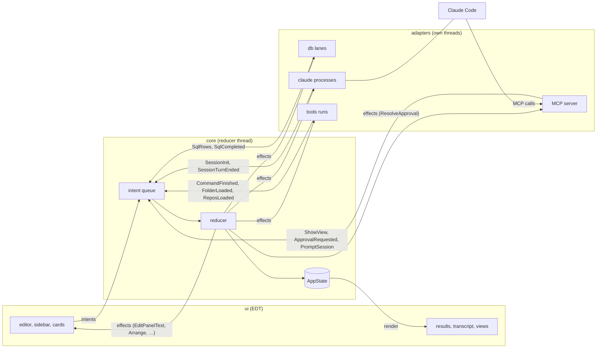

# Architecture

How comando is built: the modules, the one state and its reducer, the ports, the threads, who owns what, the UI's
package rules, the code rules and the tests. For contributors and for readers of the module READMEs, which hold each
module's classes in detail.

1. [What comando is](#1-what-comando-is)
2. [Modules](#2-modules)
3. [The flow of one command](#3-the-flow-of-one-command)
4. [State, intents, effects](#4-state-intents-effects)
5. [Ports and test fakes](#5-ports-and-test-fakes)
6. [Threads](#6-threads)
7. [Ownership and exit](#7-ownership-and-exit)
8. [UI packages](#8-ui-packages)
9. [Code rules](#9-code-rules)
10. [Quality](#10-quality)

## 1. What comando is

A Java Swing desktop application for working with Claude Code and SQL databases in one window. It runs Claude Code
headless (`claude -p`, stream-JSON on standard input and output) and shows each session as a painted transcript with
tool cards, diffs and approval cards. One editor holds SQL and prompts: a block runs on the panel's database connection
when it is SQL and goes to the panel's Claude session otherwise. Claude Code reaches back into the window through an MCP
server comando runs on `127.0.0.1`: tables, plots, diffs and trees, text in the editor, SQL under a policy, and
permission prompts answered on cards. The rest of the window covers what a terminal beside it would: a shell per panel,
Gradle runs with test trees, and a browser over folders of documents and their git changes.

comando is built with and runs on JDK 25.

## 2. Modules

| Module | Holds | Depends on |
|---|---|---|
| `core` | state, intents, reducer, effects, ports, the stores outside the state, the SQL-or-prompt classifier, the thread kit, the root sessions run on and its kit (`KitRoot`) | JDK only |
| `testkit` | fakes for every effect port, a fake clock, recorded Claude streams, a synthetic session, a recording intent sink | `core` |
| `db` | JDBC lanes (one strand per connection), cancel, columnar results, schema reading, queries for Claude | `core`, PostgreSQL JDBC driver |
| `claude` | the `claude -p` process per session, the stream-JSON mapper, stored conversations, subagents' conversations, the plans' usage, the tabs' topics, `comando-kit.json` (`KitJson`) | `core`, Jackson |
| `mcp` | the MCP server on loopback, its tools, the SQL policy, the audit log, the other instances (`Peers`, through the `PeerBroker` interface) | `core`, Jackson |
| `tools` | Gradle runs, the Files tab's folder reads and moves to the Trash, the folders' git repositories, the kit's version and the brain's and the kit's backups (the `git` command line) | `core` |
| `ui` | the Swing shell, panels, dialogs, widgets and the kit they share | `core`, FlatLaf (and Extras), jsvg, RSyntaxTextArea and AutoComplete, CommonMark (with tables), java-diff-utils, Jackson, JediTerm, pty4j |
| `app` | wiring, the store files, the keychain, the intent log, the embedded QuestDB, the comando Edge and the instances' link to it (`MqttPeerBroker`), `main` | every module, Jackson, QuestDB, the HiveMQ MQTT client |

`ui` depends on `core` only; `app` is the one module that sees every other.

A module exists only where it separates an external dependency or enforces a boundary a package cannot: `core` depends
on the JDK alone, each adapter module wraps one outside system, only `app` sees them all, and `testkit` holds the fakes
every module's tests share. `mcp` stays apart from `db` so that every route from Claude to the database passes
`QueryPort` and, for a statement that is not read-only, the approval card.

Each module has a README on its classes, its interface with the others, its threads and its tests:
[`core`](../core/README.md), [`testkit`](../testkit/README.md), [`db`](../db/README.md),
[`claude`](../claude/README.md), [`mcp`](../mcp/README.md), [`tools`](../tools/README.md), [`ui`](../ui/README.md),
[`app`](../app/README.md).

## 3. The flow of one command

Every change to what the window shows is an intent, applied by one reducer on one thread. Keys, database rows, Claude
Code events and MCP calls enter the same queue. The reducer returns the next state and a list of effects; adapters do
the effects on their own threads and report back with more intents. The UI renders the state.

Principles:

1. **Ports and adapters.** `core` names every outside system as a port; adapters implement them. Tests replace each
   effect port with a fake from `testkit`; `McpGateway.NONE`, `TopicPort.NONE` and a test's own `QueryPort` stand in for
   the others.
2. **One state, one direction.** `AppState` is immutable; only the reducer replaces it, one intent at a time.
3. **Request identity.** Every SQL run and command run has an id the reducer assigns; every approval has an id the MCP
   server assigns. A late event for a superseded id is dropped.
4. **Nothing blocks the EDT or the reducer.** Port methods queue work and return; every wait has a deadline.
5. **Ownership is a tree.** `App` creates every part and closes them in reverse order, each once.
6. **Replay.** Every intent can be logged, after the state the log started from; a log replayed against the real Swing
   shell with fake adapters is a UI test.

## 4. State, intents, effects

### 4.1 `AppState`

One immutable record of metadata and ids. Lists hold tens of entries, so lookups scan.

| Field | Holds |
|---|---|
| `panels` | each open editor panel: id, title, connection and session bindings, whether it is a document (a file from outside comando's folder) |
| `closed` | comando's own panels the user closed, kept with their bindings until removed |
| `focused` | the panel the user works in; the lower panel follows it |
| `connections` | each connection's spec, status (closed, opening, open, closing, failed) and last error |
| `sessions` | each session's spec, status, `system/init` facts, pending turns, cost, context size and window, activity, branch, process and turn start, last turn error, background tasks and whether the last turn handed work to them, whether a checkpoint is due (`Reflection`), whether the running checkpoint clears when it ends |
| `folders` | the Files tab's folders in order: name, path, index file, names left out, icon, whether entries go to the Trash, the listing file |
| `runs` | at most one SQL run per panel: request id, SQL, status, counts, timings, error, whether it is a live plot's background refresh |
| `approvals` | permission prompts waiting for an answer, from every session |
| `views` | views placed by Claude or the user: id, title, spec, placement (lower or side), pinned, owning session, version |
| `lowerTab` | the selected lower tab: Session, Approvals, Terminal, Results, or a view |
| `notice`, `notices` | the standing status-bar message (level, text, time, subject) and the last 50 |
| `nextId` | the next request, view or run id |

Invariants: at least one panel; `focused` names a panel (both checked by the record's constructor); connection and
session names are unique; one run per panel; a session has at most one panel of comando's own, open or closed, titled
with its name, and any number of documents attached ([record 88](adr/0088-a-session-and-its-panel-share-a-name.md)).

### 4.2 Intents

A record of the sealed interface `Intent`; anything that changes the state is one.

| Group | Intents |
|---|---|
| Panels | `AddPanel`, `ClosePanel`, `ReopenPanel`, `RemovePanel`, `RenamePanel`, `MovePanel`, `FocusPanel`, `BindConnection`, `BindSession`, `OpenSession` |
| Running text | `RunText` (target auto, SQL or Claude), `RefreshSql` (a live plot's re-run), `CancelRun` |
| SQL events | `SqlStarted`, `SqlRows`, `SqlCompleted`, `SqlFailed`, `SqlCancelled`, `SqlWarning` |
| Connections | `SaveConnection`, `RemoveConnection`, `OpenConnection`, `CloseConnection`, `TestConnection`, `ExploreSchema`, `SchemaChanged`, `ConnectionOpened`, `ConnectionClosed`, `ConnectionFailed`, `ConnectionLost`, `ConnectionTested` |
| Sessions | `SaveSession`, `RemoveSession`, `ImportSessions`, `StartSession`, `StartFresh`, `StopSession`, `InterruptSession`, `Checkpoint`, `SessionCommand`, `OrderSessions`, `ClearTranscript`, `SetSessionModel`, `SetSessionEffort`, `SessionStarted`, `SessionInit`, `SessionActivity`, `SessionTurnRunning`, `SessionTurnEnded`, `SessionTasksChanged`, `SessionExited`, `SessionBranch`, `SessionRanAt` (the model and effort a turn ran at), `SessionContext` (record 120), `PromptSession` (one session prompting another, record 44, and an instance's consult, record 123), `PlanUsageRead` |
| Approvals | `ApprovalRequested`, `ApprovalAnswered`, `ApprovalWithdrawn` |
| Views | `ShowView`, `RefreshView`, `CloseView`, `PinView`, `SelectLowerTab`, `Arrange`, `SessionLayout`, `SessionFocus` |
| Editor and files | `EditPanel`, `OpenFile`, `OpenSubagent` |
| Tools and folders | `RunGradle`, `CommandFinished`, `CancelCommand`, `AddFolder`, `SaveFolders`, `FoldersRead`, `BrowseFolders`, `WatchFolders`, `FolderLoaded`, `DeleteFiles` (the Files tab's move to the Trash), `ReposLoaded`, `OpenChange`, `ChangeRead`, `RollBack`, `RemoveFiles`, `Unstage` (the git writes of the Changes view and the comparison window) |
| Notices | `Notify`, `DismissNotice` |

A null panel in `RunText`, `RunGradle` or `EditPanel` means the focused panel.

### 4.3 The reducer

`Reducer.apply(state, intent)` returns a `Transition`: the next state and a list of effects. It is pure in its
arguments, a `Clock` and the home folder, so tests drive it with a fake clock. Nothing a user or an adapter sends makes
it throw: an intent naming a missing panel, connection or session changes nothing or sets a notice. `Reducer` holds the entry
point and dispatches each intent to the rules of its domain, package-private classes beside it: `PanelRules`,
`SessionRules`, `TurnRules`, `QueryRules` (runs and connections), `ApprovalRules`, `FolderRules`, `ViewRules`, with
`Shared` for the helpers several use.

| Rule | What the reducer does |
|---|---|
| Ids | request, run and view ids come from `nextId`; an event for a run no longer active is dropped |
| Start on demand | SQL on a closed connection opens it first; a prompt to a stopped session starts it first |
| Same state for no change | focusing the focused panel returns the same object, so nothing re-renders |
| User wins | `ShowView` replaces an unpinned view with the same title, session and placement; a pinned view is never replaced |
| Repositories | after any intent, folders that changed, or a Changes view that appeared or went, add `WatchRepos` with every folder and whether the view shows; `App` asks for the first read at start |
| The folders window | `SaveFolders` replaces the folders and saves them; its notice says when it replaced a change to `folders.json` read while the window was open; a list naming one folder twice saves nothing |
| The user's file | `FoldersRead`, `folders.json` read again after the user changed it, replaces the folders and saves nothing; the kit's folders join the list read at start, once per root, and are saved ([Workbench §7.3](workbench.md#73-the-files-tab)) |

**Notices.** Every notice joins the history. A new notice replaces the standing one, except that a standing ERROR stays
until it is dismissed, replaced by another error, or settled by its own subject. An event that settles a subject clears
its notice: a run completing, a connection opening, a turn succeeding, an approval answered. A new ERROR also asks for a
desktop notification while the window is behind. The subject is also where a click on the notice goes, where the window
has a target: `log:<millis>` opens the log at that entry, found by its time, and `panel:<id>` focuses the panel
([record 79](adr/0079-a-notice-takes-you-to-what-it-is-about.md)); a notice of another subject opens the recent notices.
`Intent.Notify.logged` writes a failure to the log and names that entry.

### 4.4 Effects

Work the reducer asks of an adapter. `EffectRouter` hands each to its port on the reducer thread; every port method
queues and returns.

| Port | Effects |
|---|---|
| `DatabasePort` | `OpenDb`, `CloseDb`, `ForgetSchema`, `TestDb`, `ExecuteSql`, `CancelSql`, `ReleaseResult`, `LoadSchema` |
| `ClaudePort` | `StartClaude`, `StopClaude`, `SendToClaude`, `InterruptClaude`, `LoadHistory`, `ClearTranscript`, `ClearConversation`, `ForgetSession`, `ShowSubagent` |
| `ApprovalPort` | `ResolveApproval` |
| `UiPort` | `EditPanelText`, `DesktopNotify`, `ForgetPanel`, `DeletePanel`, `ShowFile`, `Arrange`, `ShowFolder`, `ShowRepos`, `ShowChange`, `ShowPlanUsage` |
| `PersistencePort` | `SaveConnections`, `SaveSessions`, `SaveFolders`, `SavePanels` |
| `ToolPort` | `RunGradle`, `CancelCommand`, `ForgetCommand`, `ReadFolders`, `WatchFolders`, `DeleteFiles`, `WatchRepos`, `ReadChange`, `RollBack`, `RemoveFiles`, `Unstage` |

`StateLoop` runs one intent at a time: the observers (the intent log), the reducer, the effects in order, then the state
listeners (the UI's coalesced render). The reducer, each effect and each listener are guarded, so a failure is logged
and the loop goes on; an observer must not throw (the intent log catches its own failures).

### 4.5 Stores outside the state

Large data (result rows, transcripts, console output, schemas) would be copied with every state, so it lives in stores
the state refers to by id. Each has one writer thread.

| Store | Keyed by | Written by | Read by |
|---|---|---|---|
| `ResultRegistry` → `ColumnarResult` | SQL request id | the connection's lane | Results tab, plots, attachments |
| `TranscriptRegistry` → `Transcript` | session name | the session's strand | Session tab, `session_read` |
| `ConsoleRegistry` → `Console` | command run id | the run's thread | console views |
| `SchemaRegistry` → `Schema` | connection name | the database adapter | completion, schema explorer |
| `PanelTexts` | panel id | the EDT | the store thread, on save |

`ColumnarResult` and `Transcript` publish their size through a `volatile` field written after the data, so a reader
that reads the size first sees complete rows or blocks. `Console` synchronizes on its buffer.

### 4.6 The intent log

With `-Dcomando.recordIntents=true`, `IntentLog` writes one JSON line per intent to `logs/intents-<millis>.jsonl`. The
first line is the starting state; every `password` field is blanked. `UiReplayTest` feeds a log to a real `StateLoop`
and the real Swing shell, with recording fakes for every other port, and checks the window against the final state. The
stores outside the state are not recorded, so a replay reproduces layout, panels, views and run states, not rows or
transcript text.

## 5. Ports and test fakes

| Port | Methods | Adapter |
|---|---|---|
| `IntentSink` | `dispatch` | `StateLoop` |
| `Clock` | `millis` | `Clock.SYSTEM` |
| `DatabasePort` | `open`, `close`, `forgetSchema`, `test`, `execute`, `cancel`, `release`, `loadSchema` | `DbAdapter` |
| `QueryPort` | `query`, `describe` (futures of text rows, for Claude) | `DbAdapter` |
| `ClaudePort` | `start`, `stop`, `send`, `interrupt`, `clearTranscript`, `clearConversation`, `loadHistory`, `forget`, `showSubagent` | `ClaudeAdapter` |
| `TopicPort` | `read` (a tab's topic, delivered to a callback; it never passes the reducer) | `ClaudeTopics` |
| `McpGateway` | `register(session)` gives the URL and bearer token a session's CLI uses; `unregister` | `McpServer` |
| `ApprovalPort` | `resolve` | `McpServer` |
| `ToolPort` | `runGradle`, `cancelRun`, `forgetRun`, `readFolders`, `watchFolders`, `deleteFiles`, `watchRepos`, `readChange`, `rollBack`, `removeFiles`, `unstage` | `ToolsAdapter` |
| `UiPort` | `editPanel`, `notifyDesktop`, `forgetPanel`, `deletePanel`, `showFile`, `arrange`, `showFolder`, `showRepos`, `showChange`, `showPlanUsage` | `ComandoUi` |
| `PersistencePort` | `saveConnections`, `saveSessions`, `saveFolders`, `savePanels` | `Store` |

`testkit` holds what every module's tests share: `RecordingPorts` (every effect port, each call recorded as a line),
`RecordingSink` (keeps intents, awaits one with a deadline), `FakeClock`, `States` (a two-panel state), `Fixtures`
(sanitised stream-JSON recorded from Claude Code), `SyntheticSession` (a deterministic eight-turn session replayed delta
by delta), `FakeResult`.

## 6. Threads

comando's threads are of six kinds ([record 82](adr/0082-threads-by-kind-with-a-budget.md)). Only the first three use
operating-system threads, and their number is fixed: **two, plus one per running Claude session**, whatever the number
of connections, folders, panels, diagrams or runs. `ThreadBudgetTest` (in `:app:uiTest`) holds the budget with more
sessions than cores (cores + 4) and checks that nothing is left after the close. `ThreadRulesTest` fails the build when
code outside the kinds below starts a thread or an executor.

| # | Kind | Is | Threads |
|---|---|---|---|
| K1 | Event loop | owns state or the toolkit; never blocks | the EDT (AWT's); `comando-reducer` (platform) |
| K2 | Watchdog | must run while what it watches is held | one `watchdog` (platform) for the EDT and the reducer, from `Watchdog.shared()`; started with the first look, ended after the last |
| K3 | Session reader | reads a pipe live: a pipe read holds its operating-system thread even on a virtual thread (measured on JDK 25: 100 blocked readers, 101 carriers) | `claude-out-<session>` (platform), one per running session |
| K4 | Strand | sequential work on one resource; its waits hold no operating-system thread | one virtual thread each, from `Threads.strand` or, with timers, `Threads.timedStrand` (the JDK's one delay thread keeps the timers) |
| K5 | Errand | one blocking call started by a gesture or an event, then gone | a virtual thread from its owner's `Errands` (`App`, `ToolsAdapter`, `EmbeddedQuestDb`, `EmbeddedEdge`, `Peers`, `DbAdapter`'s connection tests, the window's `UiErrands`), interrupted and waited for at the owner's close |
| K6 | Fork | a thread its caller collects in the same call, with a bound | a virtual thread from `Threads.fork` |

The rest of a running process is not comando's: the JVM's (GC, compiler, VM), AWT's and Java2D's, the virtual threads'
scheduler (its carriers: one per core while busy, plus one for each virtual thread held in file or pipe I/O, which is
why a session's reader is a platform thread), the JDK's `process reaper` (one per child process), the MCP server's
dispatcher and the libraries' (JNA, a `java.util.Timer`, and the MQTT client's one Netty event loop while this instance is
connected to the comando Edge). Measured with five sessions: about 45 threads in all, 7 of
them comando's own platform threads. The GC threads were measured too: halving them to two lengthened the G1 pause p99
from 5–6 ms to 30–48 ms on `:ui:transcriptGate`, so the JVM keeps its default.

Swing timers are not threads, so neither test above sees them, yet one left running keeps AWT, and a JVM that does
not call `System.exit`, alive. A delay after the last of a burst is a `Debouncer`; a timer that repeats while
something holds is a `ShownTimer`, which runs only while its owner wants it and the owner component is showing; a
component built and never shown starts none (an editor's caret stays hidden, its blink stopped, until the first
focus).

A program run to its end with a bound (`ps`, `git`, `claude --version`, the keychain tool) goes through `Processes`
(the streamed tool runs, Mermaid's renderer and fire-and-forget launches keep their own handling):
its output and input go through temporary files, so no thread holds a carrier in a pipe read while it runs (a K3
reason: `ThreadBudgetTest` counted five carriers on three cores while two readers per run did), each output kept to a
bound when read back, and at the bound or an interrupt the program's descendants are killed, then the program. A file written whole goes through `AtomicFiles`: a temporary
file of a unique name beside the target, moved over it atomically where the file system can.

| Thread | Kind | Does |
|---|---|---|
| EDT | K1 | renders the state, turns input into intents; owns every Swing component |
| `comando-reducer` | K1 | applies intents in order; the only writer of `AppState` |
| `watchdog` | K2 | every 100 ms: a probe to the EDT, a look at the reducer; an EDT held 200 ms is a stall, an intent still applying at 1 s a hang, each logged |
| `claude-out-<session>` | K3 | stdout lines of the session's process; stderr goes to a file, read once at the exit |
| `claude-strand-<session>` | K4 | every change to a session: start, send, interrupt, stop, history; the transcript's one writer |
| `claude-timer` | K4, timed | the stop sequence's deadlines |
| `subagent-tail` | K4, timed | finds and renders a subagent's stored conversation; follows up to 4 of them every 2 s while they run, reading only what their files gained |
| `plan-usage` | K4, timed | `claude --safe-mode -p /usage` at start and every 5 minutes, stopped after 30 s; then `codex app-server` for Codex's plan, stopped after 10 s |
| `topic-reader` | K4 | the tabs' topics with Haiku, one `claude --safe-mode -p --model haiku` at a time; at most one ask waiting per tab, the card shown first |
| `db-<connection>` | K4 | opens the connection, runs statements one at a time, fetches rows |
| `db-timer` | K4, timed | health checks every 60 s; the abort after an unanswered cancel |
| `folder-poll` | K4, timed | every 5 s reads the watched git repositories, then the open folders; sends each only when it changed |
| `change-read`, `repo-write` | K4 | a changed file's two versions, one at a time; rolling back, removing and unstaging files with git and the Trash, one at a time |
| `store` | K4, timed | atomic writes of the store files; panel text 800 ms after the first unsaved change; a check of open panels' files and `folders.json` every second |
| `store-secrets` | K4 | keychain calls apart, so an unlock prompt never holds back panel text |
| `mermaid`, `local-images` | K4 | `mmdc`, one diagram at a time, 30 s bound; the pictures a Markdown view names, SVGs drawn into `cache/images/` |
| `kit-check` | K4, timed | the kit's version and newer tags, at start and every 6 hours |
| `peers` | K4, timed | this instance's presence on the comando Edge, sent when it changed, looked at every 2 s |
| `peer-broker`, `peer-messages` | K4, timed; K4 | whether the registry names a live Edge, every 5 s, connecting or leaving; the MQTT client's callbacks and the messages to their handlers, in order |
| `claude-in-`, `claude-exit-<session>` | K6 | the stdin queue; the wait for the process's exit, then the stderr tail |
| `tool-output-<run>` | K6 | one streamed run's output while its caller waits for it, bounded |
| `terminal-job`, `transcript-layout-<n>` | K6 | each shell's foreground program, by `ps`, one per shell, joined within one bound; a transcript's stale blocks laid out across forks, joined in the same call |
| `gradle-<run>`, `tool-kill-<run>`, `folder-read`, `repo-read`, `file-trash` | K5 (`ToolsAdapter`) | a run's process; SIGKILL what a stop left alive after 2 s; folder and repository reads; moving files to the Trash |
| `claude-version`, `questdb-toggle`, `edge-toggle`, `edge-check` | K5 (`App`, `EmbeddedQuestDb`, `EmbeddedEdge`) | the start-up check; one start or stop of the embedded QuestDB or of the comando Edge; the Edge registry read at most once a second |
| `db-test-<connection>` | K5 (`DbAdapter`) | one connection test |
| `peer-answer` | K5 (`Peers`) | one question from another instance: its consult session made and prompted, the wait for the turn, the reply |
| `open-file`, `show-file`, `log-entry`, `open-link`, `note-link`, `reveal`, `external-editor`, `notify`, `export`, `plot-prepare`, `diff-compute`, `folder-facts`, `read-conversations`, `opened-files`, `kit-status`, `brain-backup`, `write-tutorial`, `show-tutorial`, `pty-preload`, `terminal-exit`, `terminal-jobs`, `terminal-kill`, `outline`, `kit-jobs`, `kit-jobs-save`, `kit-jobs-apply`, `kit-jobs-run` | K5 (`UiErrands`) | one blocking call each, off the EDT |
| MCP requests; a cancel | per-task virtual executors | JSON-RPC (an `approve` call waits for its card); `DbAdapter`'s cancellers |
| `exit`, `shutdown` | platform, at quit only | close the application after Quit, or from the shutdown hook |

How work crosses threads:

- **Into the reducer.** `IntentSink.dispatch` puts the intent on an unbounded queue; intents from one thread keep their
  order.
- **Out of the reducer.** Ports queue work on their strands and return.
- **To the EDT.** One state listener requests a render through a `Coalescer`: many state changes become at most one
  pending `invokeLater`. Growing stores (transcripts, consoles) ask for repaints the same way.
- **From the EDT.** Input becomes an intent; blocking work moves to an errand.

Bounded waits:

| Wait | Bound | On expiry |
|---|---|---|
| An approval card | 55 min (the MCP configuration comando writes gives its server a 60 min timeout) | `deny`, card withdrawn |
| `db_run_sql` for Claude | 90 s | a queued statement is withdrawn; the tool says so |
| `db_describe` | 60 s | tool error |
| `session_read` with `wait_seconds` | at most 600 s | the blocks so far, status still working |
| `instance_ask`, `instance_reply` with `wait_seconds` | at most 600 s (default 300) | an id to read the reply with later |
| Another instance's question: its consult turn | 600 s | the reply `timeout` |
| Presence cleared at close; the disconnect | 2 s each | closed anyway; the last will clears the presence otherwise |
| Statement cancel | `cancelSignalTimeout=2` | the connection is aborted after 2 s |
| Claude process stop | SIGTERM after 3 s, SIGKILL 2 s later | the exit is reported |
| Tool run stop | SIGKILL 2 s after SIGTERM | the run ends as stopped |
| Output after a process exits (tools, Claude) | 2 s | a child holding the pipe no longer holds the run or session |
| `claude --version` | 5 s | a warning |
| A tab's topic read (Haiku) | 30 s | killed; the card says Haiku did not answer |
| Desktop notification (`osascript`) | 10 s | killed, not shown |
| A `git` command | 10 s | killed with its whole process tree; the read or write says git took too long |
| A kit's remote (`git ls-remote`, `git push`); the brain's commit | 120 s; 60 s | killed; the KIT row or the backup says why |
| Keychain calls | 10 s | killed; the connection loads without its password, the item is kept |
| Closing the window at quit | 5 s | quit anyway |
| The EDT | 200 ms | a stall, one INFO line when it ends; past 1 s (2 s in the JDK's drawing) a hang, logged with the EDT's stack; a stall of 1 s or more a notice whose click opens the log at the stack, or at the stall's line |
| One intent in the reducer | 200 ms | a stall, one INFO line when it ends naming its slowest part; past 1 s a hang, logged with the reducer's stack while it holds, a WARNING and the user's notice when it ends, whose click opens the log at the stack |

## 7. Ownership and exit

`App` creates every long-lived part in dependency order on a stack; `close()` pops it, so parts close in reverse order,
each once. Three are moved to the end: the comando Edge, which stops after this instance has cleared its presence there and left it, the
embedded QuestDB, which the lanes may still use, and the window, titled
"comando — closing…" and greyed under a cover until everything behind it has closed. Every `close()` is idempotent,
never throws (failures are logged with the part's name), and is safe on a half-built part; a failed constructor step
closes what was built and rethrows. A part that takes 100 ms or more to close is named in the log.

| Created | Part | Closed | Closing it |
|---|---|---|---|
| 1 | the root, named for every module (`KitRoot.use`) | 16 | restores the root that was named before |
| 2 | `kit-check` | 15 | stops the kit's periodic read |
| 3 | `KitGit` | 14 | kills its git runs |
| 4 | `Store` | 13 | writes pending panel text and `panels.json`, finishes queued writes; waits up to 5 s (11 s for connections, one keychain call) |
| 5 | `App`'s errands | 12 | interrupts the start-up check and waits for it |
| 6 | `IntentLog` (when recording) | 11 | closes the log after the loop, so the shutdown's intents are recorded |
| 7 | `StateLoop` | 10 | stops the reducer after the queued intents, then its look on the watchdog |
| 8 | `DbAdapter` | 9 | cancels every lane's running statement at once, then waits for the lanes on one 3 s bound, stops the timer |
| 9 | `MermaidDiagrams` | 8 | stops `mmdc` and its children |
| 10 | `LocalImages` | 7 | stops reading pictures and drawing SVGs |
| 11 | `McpServer` | 6 | denies every waiting approval, stops the server |
| 12 | `ClaudeAdapter` | 5 | SIGTERM, SIGKILL 2 s later; deletes every MCP configuration file and revokes its token |
| 13 | `ToolsAdapter` | 4 | SIGTERM to every run's process tree, SIGKILL 2 s later; stops the folder poll and git; its errands last |
| 14 | `ClaudeTopics` | 3 | drops the waiting asks, stops a read under way |
| 15 | `MqttPeerBroker` (unless `-Dcomando.peers=false`) | 2 | stops following the Edge, disconnects (so the broker drops the last will), at most 2 s |
| 16 | `Peers` | 1 | clears this instance's presence on the comando Edge (at most 2 s), interrupts the answers under way, which reply `error`, and fails this instance's questions still waiting |
| 17 | `EmbeddedEdge` | 17 | stops the Edge this instance started (SIGTERM to its recorded pid, bounded wait) and clears `~/.comando-edge.json` |
| 18 | `EmbeddedQuestDb` | 18 | closes after the lanes |
| 19 | `ComandoUi` | 19 | closes last: terminals (a shell still alive 2 s after the hangup is killed), live plots, the EDT's watchdog look, the window, the window's errands |

Quit (window, Dock, menu) first asks when work would stop: a running query, a turn, a session's background work, a shell
job in the foreground, a Gradle run; Cancel is the default. The shells' jobs are looked up off the EDT, every shell
at once, 2 s in all (a shell not answered by then is asked about as a program comando could not check); the question
opens, or the quit goes on, once they answer; closing a panel looks up its shell's job the same way. Quit then saves the layout, ends terminals and live plots,
greys the window, and runs `onQuit`, which starts the `exit` thread: `App.close()`, then `System.exit(0)`. A shutdown
hook calls `App.close()` too; the second call does nothing.

## 8. UI packages

The packages of `ui`, under `dev.marregui.comando.ui`, in layer order. The classes of each are listed in the
[`ui` README](../ui/README.md#1-architecture).

| Package | Holds |
|---|---|
| `kit` | theme, icons, commands, overlays, EDT helpers, formatting, text, trees, tabs, layout, resource actions, desktop, vcs |
| `widget` | the contract: `Widget`, `WidgetContext`, `WidgetRegistry`; `capability` (`Searchable`, `Copyable`, …) |
| `widgets` | one package per widget: approval, changes, console, diff, editor, markdown, plot, table, terminal, text, transcript (with `doc` and `render`), tree |
| `panels` | the window's regions: `Workspace`, `EditorPanel`, `LowerPanel`, `SessionsSidebar` (its rows: `SessionRow`, `ConnectionRow`), `PanelsWithoutSession`, `FilesTab`, `SidePane`, `SessionBar`, `StatusBar`, `ResultsView`, `TerminalTabs`, `ViewTabs`, … |
| `dialogs` | `folders` (the Files tab's folders: `FoldersEditor`, `FoldersDialog`), `resource` (`ResourceDialog`, one dialog for connections and sessions), `sessions` (import), `jobs` (the Kit jobs window, [record 117](adr/0117-kit-jobs-a-row-and-a-window.md)) |
| `shell` | `ComandoUi` (the frame, the render and the UI port) and its collaborators `Commands` (the command table), `MenuBuilder`, `LayoutKeeper` (split panes and the saved layout), `FocusRouter`, `PanelFiles` (open, save, close, export), `QuitFlow`; `WindowLayout`, `HelpActions`, `Menus`, `Keys`, `LivePlots`, `Notifier`, `HelpFiles`, `OpenFiles`, `DiffWindow`, … |
| (top) | `PanelTexts`: editor text between saves |

A layer uses only those above it in this table: `kit` uses `core` and the UI libraries; `widget` adds `kit`; a widget
package adds `widget` but no other widget package; `panels`, `dialogs` and `shell` use everything before them.
`UiArchitectureTest` (ArchUnit) fails the build when a class uses a layer below its own: a widget imports another
widget, `panels`, `dialogs`, `shell` or `PanelTexts`; the kit imports `widget`, `widgets`, `panels`, `dialogs`, `shell`
or `PanelTexts`; the contract imports `widgets`, `panels`, `dialogs`, `shell` or `PanelTexts`; a panel imports
`dialogs` or `shell`; a dialog imports `shell`. It also fails when any UI class refers to `db`, `claude`, `mcp`,
`tools` or `java.sql`. The Gradle module graph enforces it a second time for `db`, `claude`, `mcp` and `tools`.

Where new code goes:

| New | Goes to |
|---|---|
| a view Claude or the user can place | `widgets/<name>`, a `ViewSpec` record in `core`, a registration in `ComandoUi`; for Claude, a case in `mcp`'s `ViewSpecs` and its schema in the tool list |
| behaviour two widgets share | `kit` or a capability |
| a region of the window | `panels` |
| a user action | a `Command` |

## 9. Code rules

1. A change to state is an intent; the reducer is the only writer of `AppState`.
2. A thread is of one of the six kinds of §6 and comes from `Threads`, an owner's `Errands` or `Watchdog`; a new
   platform thread needs a new kind. Every thread a part starts ends when the part closes. Repeated work goes to a
   part's strand, at most one ask waiting per key, never to a thread of its own per occurrence.
3. Every wait has a bound and an action on expiry.
4. Nothing in `ui` imports an adapter module; no widget imports another widget.
5. Nothing blocks the EDT: process runs, network, reads of unknown size and keychain calls go to other threads; Swing
   only on the EDT.
6. Text from Claude, a database or a file reaches Swing as text, never as HTML (`Plain`, `MarkdownHtml`).
7. Tests never touch the user's data root, keychain or Java preferences unless a flag says so.
8. Code and comments name no tool, agent or review finding.
9. Compiler warnings are errors (`-Xlint:all -Werror`, except `serial`, `processing`, `this-escape`).
10. Types are imported, never fully qualified, except to tell apart two types with one simple name. Imports: project,
    `javax`, `java`, each sorted; no wildcards.
11. Logging is `System.Logger`; messages read `verb phrase [key=value]`; a failure logs its exception, a handled
    condition its message.

Hot paths: results are stored by column in primitive chunks, grid cells are formatted into one reused buffer, plots are
reduced to min and max per pixel column, transcript layouts are kept and only the clip is painted, and the stores
publish with release-acquire ordering. Object pools, ring queues, padding and worker pools are not used: comando's event
rates are UI rates.

## 10. Quality

`./gradlew build` compiles every module with warnings as errors and runs the unit and adapter tests. The database tests
run against an embedded QuestDB, and against PostgreSQL through Testcontainers when Docker is there; the Claude adapter
runs against fake CLI scripts and recorded streams; the MCP server is tested over HTTP.

| Opt-in test | Enabled by | Why |
|---|---|---|
| keychain round trip | `./gradlew test -PkeychainTest=true` | writes and deletes a login keychain item |
| comando Edge live start | `./gradlew :app:test -PedgeLiveTest=true` | downloads the pinned open-source Edge release (359 MB) and runs it |
| window tests | `./gradlew :app:uiTest` | need a display; their windows open on no screen and take no focus |

Gates:

| Gate | Command | Budget |
|---|---|---|
| transcript frame time | `./gradlew :ui:transcriptGate` | p99 ≤ 16 ms ([UI](ui.md#43-the-frame-time-gate)) |
| EDT responsiveness | always on: `EdtWatchdog` | a probe answered within 200 ms |
| reducer responsiveness | always on: `StateLoop` and its watchdog look | each intent applied within 200 ms |

comando has no JFR code. It is profiled from outside like any JVM, with the JDK's own events, and its EDT stalls are in
its log ([UI §1](ui.md#1-the-kit)). The packaged runtime keeps `jdk.jfr`, `jdk.management.jfr` and
`jdk.management.agent`, so the installed application can be recorded and watched over JMX
([record 54](adr/0054-comando-knows-nothing-of-jfr.md)).

CI (`.github/workflows/build.yml`, Temurin 25, actions pinned by SHA) runs on Ubuntu and macOS for every push to `main`
and every pull request that changes more than the docs (`docs/tutorial.md` counts as code: the ui jar bundles it), every
Monday, and on demand (`workflow_dispatch`). Each system runs `build`, `:app:uiTest` (under `xvfb-run` on Ubuntu, on the
runner's display on macOS), a test summary (`ci/TestReport.java`) and the transcript gate (reported, not enforced, as
runner speed varies); macOS also builds `:app:dmg` as a packaging smoke test. PostgreSQL through Testcontainers runs on
Ubuntu only, as macOS runners have no Docker. `dependabot.yml` groups monthly updates of the actions and of the Gradle
dependencies. `./gradlew :app:dmg` builds an unsigned disk image with `jpackage` and a runtime of the modules listed in
`app/build.gradle.kts` ([record 16](adr/0016-unsigned-macos-build.md)).

Releases (`.github/workflows/release.yml`): a pushed tag `v*` runs `:app:package` with `-PreleaseVersion=<tag without
v>` on `macos-latest`, `ubuntu-latest` and `windows-latest`, without the tests, keeps each file as an artifact, and a
last job on Ubuntu makes the tag's GitHub release with the three files and the commits since the previous tag as its
notes. Run by hand (`workflow_dispatch`), it builds the three files as artifacts kept 7 days and makes no release unless
it runs on a tag with dry run off. Nothing is signed; [INSTALL.md](../INSTALL.md) is the install recipe.
