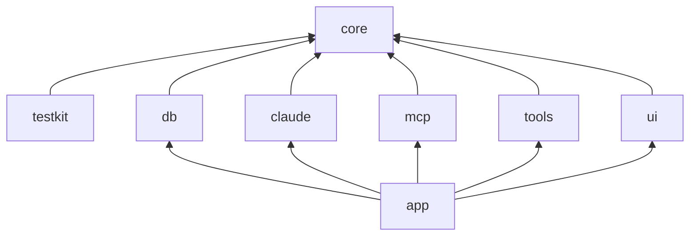
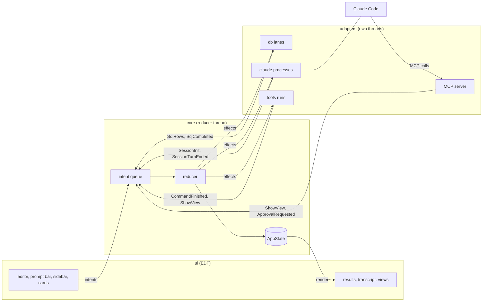

# Architecture overview

## 1. What comando is

comando is a desktop application in Java Swing for working with Claude Code and SQL databases in one window. It runs Claude Code headless (`claude -p` with stream-JSON on standard input and output) and shows each session as a structured transcript with tool cards, diffs and approval cards, instead of a terminal. The same editor holds SQL and prompts: a block of text runs on the panel's database connection when it is SQL and goes to the panel's Claude session otherwise. Claude Code reaches back into the window through an MCP server that comando runs on `127.0.0.1`: its tools open tables, plots, diffs and trees, put text in the editor, run SQL under a policy, and answer Claude Code's permission prompts through cards the user answers with one key.

The rest of the window replaces what a terminal was used for: a shell per panel, Gradle runs with their test results as a tree, JFR recordings and `jfrq`, and a browser for the scratchpad's documents.

## 2. Modules

| Module | Holds | Depends on |
|---|---|---|
| `core` | the state, intents, reducer, effects, ports, the stores that live outside the state, the SQL-or-prompt classifier | JDK only |
| `testkit` | fakes for every port, fixtures (recorded Claude streams, a synthetic session), a recording intent sink | `core` |
| `db` | JDBC lanes (one thread per connection), cancel, columnar results, schema reading, queries for Claude | `core`, pgjdbc |
| `claude` | the `claude -p` process per session, the stream-JSON mapper, stored-conversation loading, the session catalogue | `core`, Jackson |
| `mcp` | the MCP server over HTTP on loopback, the tools, the SQL policy, the audit log | `core`, Jackson |
| `tools` | Gradle and jfrq runs, JFR summaries, the scratchpad tree | `core` |
| `ui` | the Swing shell, panels, dialogs, the widget kit, the widgets | `core`, FlatLaf, RSyntaxTextArea, JediTerm, pty4j |
| `app` | wiring, configuration, the store files, the keychain, the intent log, `main` | all |

`ui` depends on `core` only: the build fails if a UI class refers to `db`, `claude`, `mcp`, `tools` or `java.sql` ([UI packages](../design/ui-packages.md)).

## 3. The flow of one command

Every change to what the window shows is an intent applied by one reducer on one thread. The user's keys, rows from the database, events from Claude Code and calls to the MCP tools all enter the same queue. The reducer returns the next state and a list of effects; the effects go to adapters, which do the work on their own threads and report back with more intents. The UI renders the state and owns nothing that the state should hold.

Large data does not pass through the state. Result rows, transcript blocks, command output, schemas and editor text live in stores outside it, each written by one thread and read by the EDT; the state refers to them by id ([State and intents](01-state-and-intents.md)).

## 4. Principles

1. **Ports and adapters.** `core` names every outside system as a port interface; adapters implement them, and tests replace each with a fake from `testkit`.
2. **One state, one direction.** `AppState` is an immutable value. Only the reducer replaces it, one intent at a time, on its own thread.
3. **Request identity.** Every SQL run, every command run and every approval has an id the reducer assigns. A late event for a superseded id is dropped, so a stale result never binds to a new run.
4. **Nothing blocks the EDT or the reducer.** Adapters queue work on their own threads and return at once. Every wait has a deadline ([Threads](02-threads.md)).
5. **Ownership is a tree.** `App` creates every part and closes them in reverse order, each once ([Ownership](04-ownership.md)).
6. **Widgets on one foundation.** A view type maps to one widget; widgets share the kit and the capability implementations and never import each other ([Widgets](../design/widgets.md)).
7. **Replay.** Every intent can be written to a log with the state it started from; a log replayed against the real Swing shell with fake adapters is a UI test ([Quality](../design/quality.md)).

## 5. Reading order

[State and intents](01-state-and-intents.md), then [Threads](02-threads.md), [Modules and ports](03-modules-and-ports.md) and [Ownership](04-ownership.md). The [design documents](../README.md#2-design) take one subsystem each.
