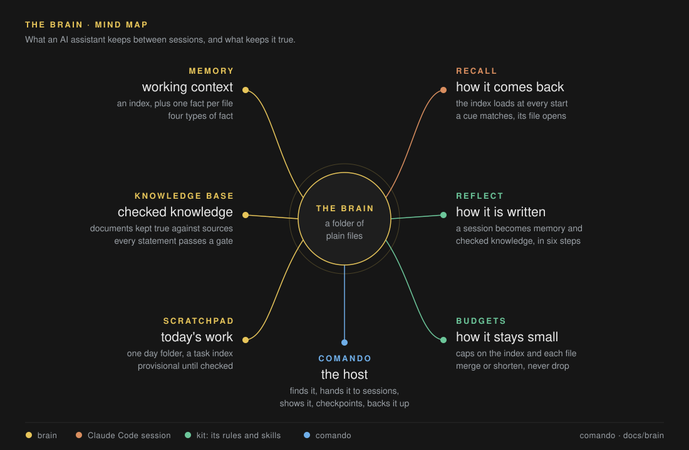
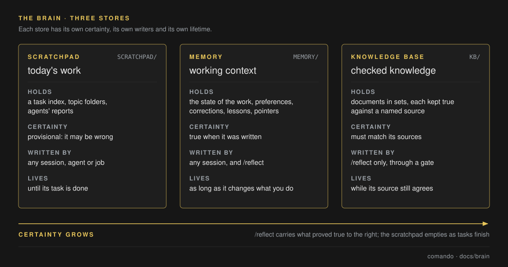
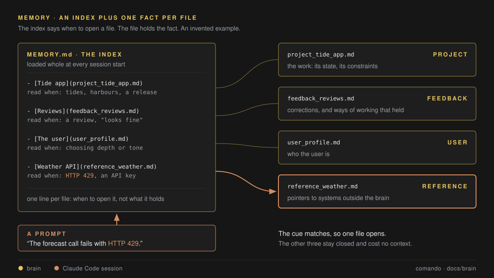
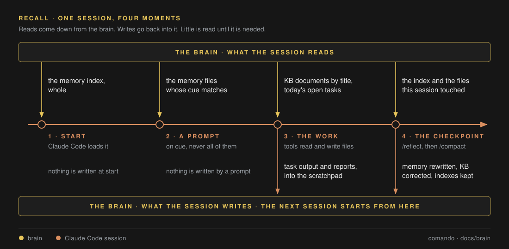
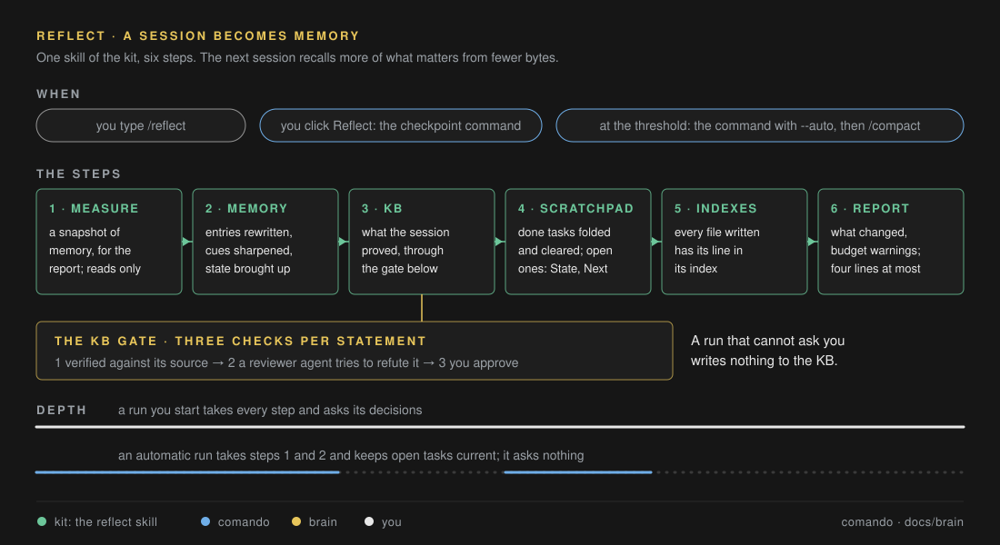
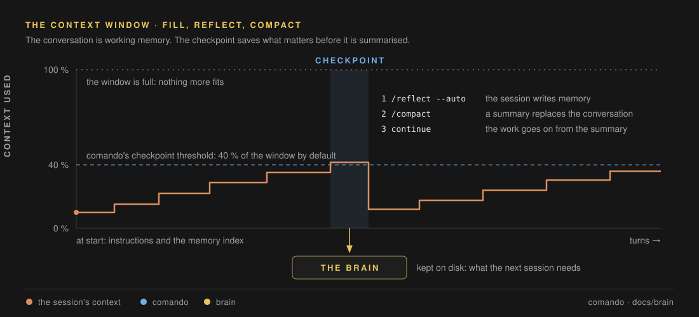
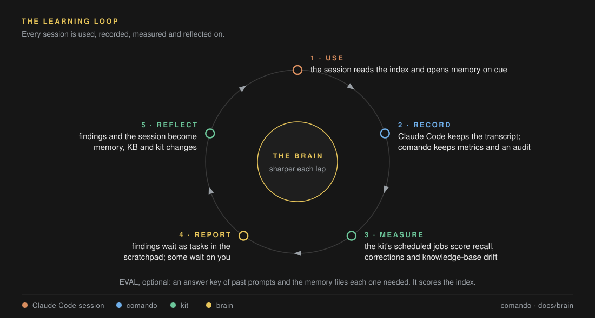
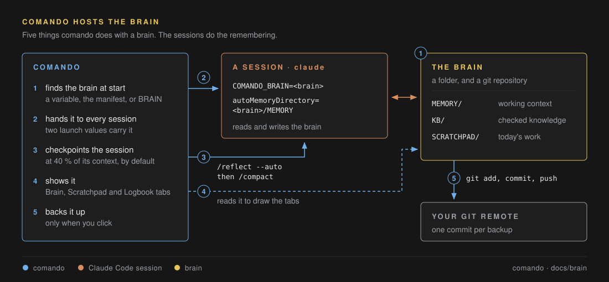

# The brain



**In one paragraph.** A brain is a folder of plain files that holds what your AI sessions know: their memory, their
checked knowledge and today's work. It exists because a language model forgets everything when a session ends. The
sessions write the brain as they work, under the rules of a [kit](kit.md). comando finds the brain, hands it to every
session it starts, shows it in three tabs and backs it up. This page is for anyone who wants an assistant that
gets better with use, and wants to know how that works.

The map at the top is this page: the left branches are sections 1 to 4, the right ones 5 to 7, the host is section 9.

| Section | What it answers |
|---|---|
| [1. Three stores](#1-three-stores-three-kinds-of-certainty) | what a brain holds, and how sure each part is |
| [2. Memory](#2-memory-an-index-plus-one-fact-per-file) | how facts are stored so that few of them are read |
| [3. The knowledge base](#3-the-knowledge-base) | how knowledge stays true |
| [4. The scratchpad](#4-the-scratchpad) | where today's work lives |
| [5. Recall](#5-recall-how-memory-comes-back) | what a session reads, and when |
| [6. The reflect cycle](#6-the-reflect-cycle) | how a session becomes memory |
| [7. Budgets](#7-budgets-how-a-brain-stays-small) | why a brain stays small |
| [8. The learning loop](#8-the-learning-loop) | how a brain gets sharper |
| [9. comando hosts the brain](#9-comando-hosts-the-brain) | what comando does with it |
| [10. A new brain](#10-a-new-brain) | the files a brain starts with |

## 1. Three stores, three kinds of certainty

A brain separates what is being worked out from what is known. Each store has its own certainty, its own writers
and its own lifetime.



| Store | Holds | Certainty | Written by |
|---|---|---|---|
| `SCRATCHPAD/` | today's work: a task index, topic folders, agents' reports | provisional | any session, agent or scheduled job |
| `MEMORY/` | working context: the state of the work, your preferences and corrections, lessons, pointers | true when it was written | any session, and `/reflect` |
| `KB/` | checked knowledge: sets of documents, each kept true against a named source | must match its sources | `/reflect` only |
| `EVAL/` (optional) | an answer key that scores recall ([section 8](#8-the-learning-loop)) | labelled by hand | `/reflect`, with you |

Three rules hold the model together:

1. **Memory and the knowledge base never point at each other.** Memory changes daily. A knowledge-base document
   must read on its own.
2. **The knowledge base has one writer, behind a gate.** Only `/reflect` writes it, and every statement passes three
   checks ([section 3](#3-the-knowledge-base)).
3. **The index is part of every write.** A file without its line in its index is invisible to the next session.

The kit and the brain are two things. The kit says how sessions behave; the brain holds what they know. One kit can
serve many people. A brain belongs to one person or one comando instance.

> **Learn: a language model has no memory of its own.** A language model answers from two things: what its training
> left in it, and the text you hand it right now. It keeps nothing between two sessions. Close the session and your
> corrections, your project's state and yesterday's decisions are gone. The only way to make a model "remember" is to
> write things down and hand them back later. A brain is that notebook, with rules about what goes in and who may
> write it. comando's part is to point every session at the same notebook.

## 2. Memory: an index plus one fact per file

Memory is many small files and one index. Each file holds one topic. The index holds one line per file, and that
line says *when* to open the file, not what is in it.



Every memory file has one of four types:

| Type | Holds | Invented example |
|---|---|---|
| `project` | the work: its state and its constraints | "The tide app ships on Fridays. The harbour list is frozen." |
| `feedback` | your corrections, and ways of working that held | "Run the tests before calling a change done." |
| `user` | who you are | "Knows databases well, is new to mobile apps." |
| `reference` | pointers to systems outside the brain | "The weather service allows 60 calls a minute." |

A memory file opens with front matter: `name`, `description` (one line) and `type`.

```markdown
---
name: Weather API
description: Limits and keys of the weather service the tide app calls
type: reference
---

- The service allows 60 calls a minute. Past that it answers HTTP 429.
- The key lives in the app's settings file, never in the code.
```

Its line in `MEMORY.md` is a cue: the situations, names and error strings that should open the file.

```markdown
- [Weather API](reference_weather.md) — read when the forecast call fails, HTTP 429, or an API key comes up.
```

Two more shapes complete memory. One file holds the current work, with a section per topic. Logs are dated records
that only grow: a small head plus monthly files, queried by a tool and never loaded whole.

> **Learn: an index.** A book's index does not repeat the book. It lists words and the pages to turn to. You read
> one small list, then only the page you need. Databases, search engines and file systems all work this way: a
> small structure that points into a big one. `MEMORY.md` is the brain's index. The session reads it once, and each
> line tells it which file to open when a matching situation comes up.

## 3. The knowledge base

Memory is what was true when someone wrote it. The knowledge base is what was *checked*. It holds documents that
describe a subject and must agree with a source you can name: code, a document, a web page.

| Part | What it is |
|---|---|
| a set | a folder of documents about one subject |
| `00_START_HERE.md` | the set's way in: what it covers, one line per document |
| `99_MAINTENANCE.md` | the set's upkeep, in four sections: **Rules**, **Source register**, **Drift check**, **Change log** |
| a document | reads on its own, and cites the source it was verified against |

Every statement enters through a gate of three checks:

1. The session verifies it against its source.
2. An independent reviewer agent tries to refute it.
3. You approve what survives.

A run that cannot ask you writes nothing to the knowledge base. A scratchpad file is never a source: it is
provisional.

## 4. The scratchpad

The scratchpad is the brain's workbench. Plans, notes, agents' reports and half-finished thinking land here first.
Nothing in it is trusted until it is checked.

| Part | Role |
|---|---|
| the day folder | one folder, today's; a kit hook renames it each day, so open tasks carry over |
| topic folders | one per subject, with numbered documents (`NN-<what>.md`) and a `work/` folder for raw material |
| `INDEX.md` | every open task with its **State**, its **Next** step and where to resume from |
| a `**Needs you:**` line | a decision that waits on you, written into its task |
| agents' reports | stamped `generated` when they land, `verified` once a session has checked them |
| `FRICTION.md` | one line for each thing that got in an agent's way; `/reflect` turns each into a change |

Files leave one at a time, through the Trash. An emptied folder goes with `rmdir`. Sessions run in parallel in
the same folder, so nothing deletes a folder that still holds files.

## 5. Recall: how memory comes back

A session reads little, and reads it late. The index arrives at the start. A memory file arrives only when its
cue matches what you asked.



| Moment | The session reads | The session writes |
|---|---|---|
| start | the memory index, whole | nothing |
| a prompt | the memory files whose cue matches | nothing |
| the work | knowledge-base documents by title, today's open tasks | task output and reports, into the scratchpad |
| the checkpoint | the index and the files it touched | memory, the knowledge base, every index |

Claude Code does the first step itself. It loads `MEMORY.md` at every session start, up to 200 lines and 25,000
characters. The rest is the kit's work: a kit hook can name the matching memory files for each prompt.

> **Learn: retrieval.** A model cannot use a fact that is not in front of it. One answer is to hand it everything
> you have, every time. That is slow and costly, and the one fact that matters drowns among the others. The other
> answer is retrieval: look up the few pieces that fit this question, and hand over only those. A brain retrieves by
> cue. The index says "open this file when you see HTTP 429", and the file is read only then.

## 6. The reflect cycle

`/reflect` is the step that turns a session into memory and checked knowledge. It is a skill of the kit. Its aim is
the same on every run: the next session recalls more of what matters from fewer bytes.



### When it runs

| Trigger | What is sent |
|---|---|
| you type `/reflect` | the command, as you typed it |
| you click **Reflect** on the session bar | the session's checkpoint command, and nothing after it |
| the context reaches comando's threshold | that command with `--auto`, then `/compact`, then a prompt to continue |

The checkpoint command belongs to the session: its **Checkpoint prompt**, `/reflect` by default. A session may
set another command. An empty one hides **Reflect** and turns the automatic checkpoint off.

### The six steps

| Step | Reads | Changes |
|---|---|---|
| 1. Measure | the index and the files the session touched | nothing: a snapshot for the report |
| 2. Memory | the conversation | entries rewritten, cues sharpened, the state of the work brought up to date |
| 3. KB | what the session proved | each statement through the gate, then into its set |
| 4. Scratchpad | the task index | done tasks folded into memory and cleared; open tasks rewritten to State and Next |
| 5. Indexes | every file written | each file's line in its index |
| 6. Report | the snapshot | what changed and any budget warning, four lines at most |

### Two depths

| Run | Does |
|---|---|
| full: you start it | every step, and it asks you its decisions |
| automatic: `--auto` | steps 1 and 2 and the open tasks' state; it asks nothing and writes inside the brain only |

An automatic run still meets decisions: a memory change to confirm, a statement for the gate. It writes each one as
a `**Needs you:**` line in its task. comando's Logbook tab lists those tasks first.

### Why it works this way

- **Rewrite, not append.** An entry stays one rule and its evidence. Notes that only grow become noise.
- **Parallel sessions.** A session re-reads a file right before writing it and changes only its own lines.
- **Reflect before compacting.** The summary a compaction leaves is lossy. Memory is written while the detail is
  still there.

The records: [a checkpoint reflects, then compacts](adr/0129-a-checkpoint-reflects-then-compacts.md),
[an automatic checkpoint asks nothing](adr/0131-an-automatic-checkpoint-asks-nothing.md),
[a session locks while its checkpoint runs](adr/0130-a-session-locks-while-its-checkpoint-runs.md).



> **Learn: the context window and compaction.** A model reads a fixed amount of text at once: its context window.
> Text is counted in tokens, which are pieces of words. Your prompts, the files the session opens and every tool
> result all land in that window. When it fills, nothing more fits. Compaction replaces the long conversation with a
> short summary, which frees room and loses detail. comando does not wait for a full window. By default, when a
> turn ends at or above 40 % of it, comando sends the session's checkpoint command: `/reflect --auto`, unless you
> set another. The session saves what matters to the brain first. Then comando sends `/compact`, and the work goes
> on from the summary.

## 7. Budgets: how a brain stays small

A brain that only grows stops working. Its index no longer fits, and each cue competes with hundreds of others. So
every part has a cap. These are defaults a kit may change.

| Part | Default cap |
|---|---|
| the index, `MEMORY.md` | 160 lines and 24,000 bytes: a margin under what Claude Code loads |
| a memory file | 32 KB; past it the file takes no addition until an entry is merged or archived |
| a log's head | 16 KB |
| a file that became a log | 40 dated entries, then it splits into a head and monthly files |

Nothing is dropped to fit a cap. An entry is merged with its neighbour, shortened to its cue, or moved to an archive
that is not loaded. A no-loss check then confirms that every date, number, quote and link of the original survives.

> **Learn: why small beats complete.** Every token in the window costs time and money, and takes room from the work
> itself. A long context also makes each fact harder for the model to pick out. So the goal is not to store the
> most. It is to hand the model the *right* few lines at the right moment. A brain's budgets force that choice at
> write time, when the session still knows what mattered.

## 8. The learning loop

A brain improves because its use is measured. Each session is used, recorded, measured and reflected on. The next
one starts from the result.



| Station | What happens |
|---|---|
| 1. Use | the session loads the index, opens memory on cue, reads knowledge-base documents by title |
| 2. Record | Claude Code keeps the transcript; comando keeps metrics and an audit of its own tool calls |
| 3. Measure | the kit's scheduled jobs score recall, corrections and knowledge-base drift |
| 4. Report | findings wait as tasks in the scratchpad; decisions wait on you |
| 5. Reflect | `/reflect` turns findings and the session into memory, knowledge and confirmed kit changes |

| Measuring job | Asks |
|---|---|
| recall replay | did the index lead each prompt to the files it needed? |
| correction curator | what caused each correction you made: a missed cue, an ignored rule, or no rule? |
| drift check | which knowledge-base statements no longer match their source? |

`EVAL/` is optional. It is an answer key: past prompts, each labelled by hand with the memory files it needed.
The recall score is the share of those files the session had loaded.

> **Learn: measuring with an answer key.** You cannot improve what you cannot score. A teacher marks a test against
> an answer key: the same questions, the known right answers. Engineers test AI systems the same way and call it an
> evaluation. For a brain the question is narrow: "did this prompt open the files it needed?" A cue that keeps
> missing gets rewritten, and the next score shows whether the rewrite helped.

## 9. comando hosts the brain

comando does not write memory. The sessions do. comando does five things for one brain, and a sixth when you run
several.



### It finds the brain

A brain applies only with a kit. comando resolves its folder once, at start, in this order:

| Order | Source |
|---|---|
| 1 | the `COMANDO_BRAIN` environment variable, when comando starts with it |
| 2 | the `brain` entry of the kit's manifest, `comando-kit.json`: absolute, `~/…`, or relative to the kit |
| 3 | the `BRAIN` folder inside the kit |

A new install puts the brain at `~/comando-brain`, beside the kit and outside it.

### It hands the brain to every session

comando sets a few values on every `claude` process it starts on a kit. Two of them carry the brain:

| Value | Effect |
|---|---|
| `COMANDO_BRAIN=<brain>` | hooks, skills and tools of the kit know where the brain is |
| `--settings '{"autoMemoryDirectory": "<brain>/MEMORY"}'` | Claude Code loads and writes its memory there |

The others tell the kit where it runs:

| Value | Set when | Effect |
|---|---|---|
| `COMANDO_HOME=<data root>` | always | a kit hook reads this instance's own comando files |
| `CLAUDE_CONFIG_DIR=<kit root>` | the kit root is not your own Claude Code folder | Claude Code runs on that kit |
| `COMANDO_CREATED_BY=<creator>` | an agent made the session | a hook can tell it from a session you made |
| `CONTEXT_CHECKPOINT_BY=comando` | comando runs the session's checkpoint | a hook that checkpoints on its own leaves it to comando |

### It checkpoints the session

comando watches each session's context. A turn that ends at or above the threshold makes the session due.

| Fact | Value |
|---|---|
| the threshold | 40 % of the context window by default; 10 to 100; there is no "off" |
| where you set it | **Checkpoint threshold…** in the command palette; `sessions.checkpointThresholdPercent` in `settings.json` |
| the warning | the **Reflect** button blinks from 2 points below the threshold |
| the command | the session's **Checkpoint prompt**, `/reflect` by default; an empty one turns this checkpoint off |
| the sequence | the command with `--auto`, then `/compact`, then a prompt to continue from the summary |
| the next one | only after a turn ends below the threshold and the context crosses it again |

### It shows the brain

| Tab | Shows |
|---|---|
| **Brain** | the brain's folders and their git changes |
| **Scratchpad** | the scratchpad and its git changes |
| **Logbook** | the open tasks of the newest day folder's `INDEX.md`; tasks that wait on you come first |

A Logbook task offers **Resume in**, followed by your running sessions. It sends the one you pick
`Resume task N from the scratchpad.` A task that waits on you also offers **Ask me its decisions in**. Search
covers the same folders, with no index to maintain.
The tabs only show and open files; [the workbench](workbench.md) describes them.

### It backs the brain up

**Back up the brain** is in the **Kit** menu, the command palette and the menu of a brain folder's row. It runs
only when you click it, and only when the brain is the top folder of a git repository with a remote.

| Step | What runs |
|---|---|
| 1 | `git add -A` |
| 2 | a commit, only when something changed |
| 3 | `git push` |

The commit's first line counts the changes per top folder:
`Brain backup <date>: MEMORY 2 changed; SCRATCHPAD 3 added, 1 changed`. Its body lists one line per file. comando
never asks for credentials. It gives a commit step 60 seconds and a remote step 120 seconds.

> **Learn: version control as a backup.** A version control system such as git stores snapshots of a folder, called
> commits. Each commit records what changed since the one before. Push the commits to a second computer, a remote,
> and a lost laptop loses nothing. You can also read back how the folder looked last month, or see when a line
> changed. A brain is plain text, which git handles well. So one commit per backup gives you a copy and a history
> at once.

### It keeps brains apart

Each comando instance names its own kit and brain. When two instances talk, only the text a session chose to send
travels, and the reply. A brain's files never do. The record:
[instances name kit, brain, data root](adr/0122-instances-name-kit-brain-data-root-edge.md).

## 10. A new brain

A new brain is a skeleton: the indexes, the rules and nothing else. Use fills it.

| File | First content |
|---|---|
| `MEMORY/MEMORY.md` | the index's head: what a line is, and the form of a memory file |
| `KB/00_START_HERE.md` | what the knowledge base is; no sets yet |
| `KB/99_MAINTENANCE.md` | the four sections, each empty |
| `SCRATCHPAD/README.md` | the scratchpad's rules |
| `SCRATCHPAD/FRICTION.md` | a title |
| `SCRATCHPAD/<today>/INDEX.md` | the task index's headings, empty |

[The kit and the brain](kit-and-brain.md) has the steps that create a kit and a brain together.

## Where next

- [The kit and the brain](kit-and-brain.md): the mind map of both, and how they meet.
- [The kit](kit.md): the hooks, skills, agents and tools that write and guard a brain.
- [Claude Code in comando](claude-code.md): sessions, the checkpoint and the tools a session calls.
- [The workbench](workbench.md): the Brain, Scratchpad and Logbook tabs in the window.
- [Architecture](architecture.md): where the brain sits among comando's processes and files.
