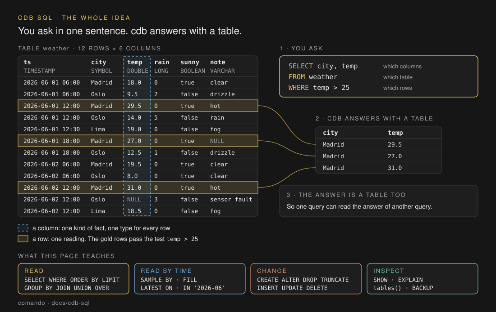
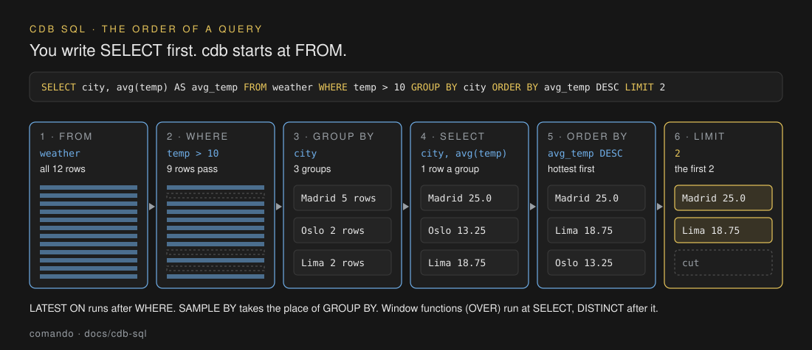
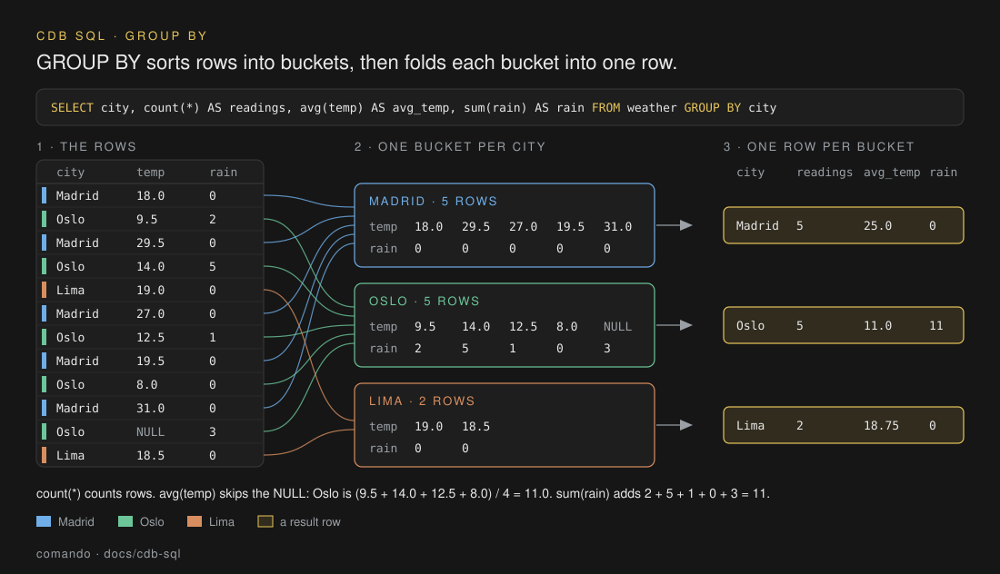
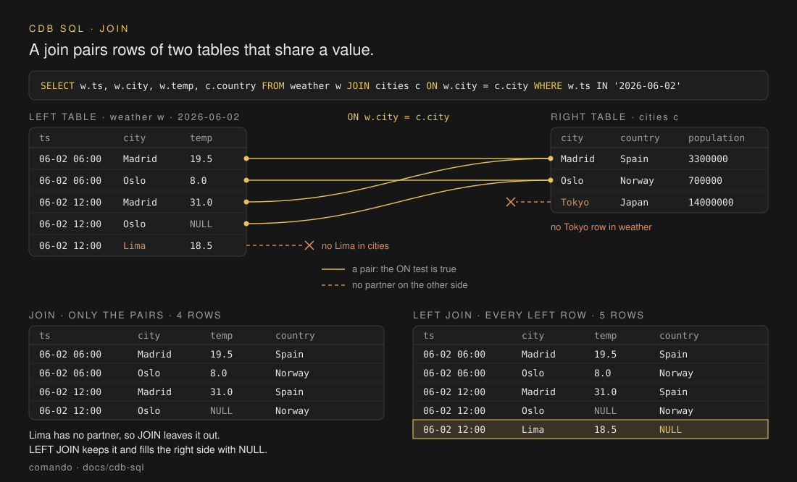
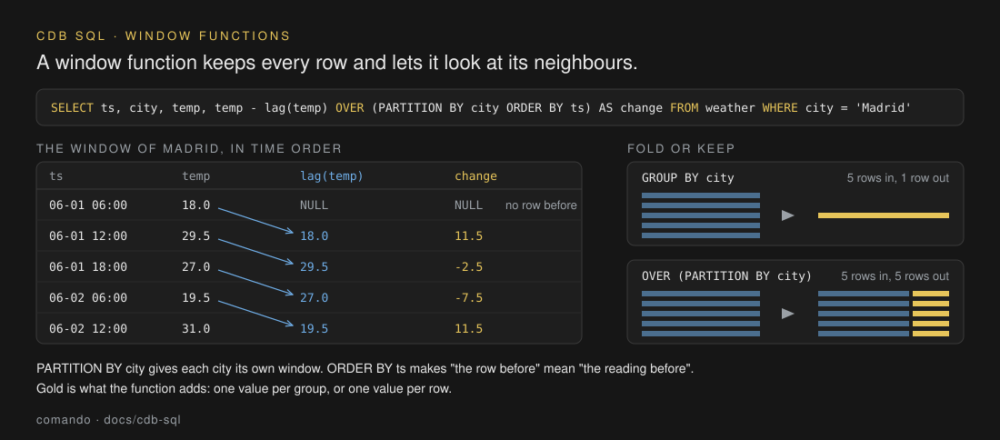
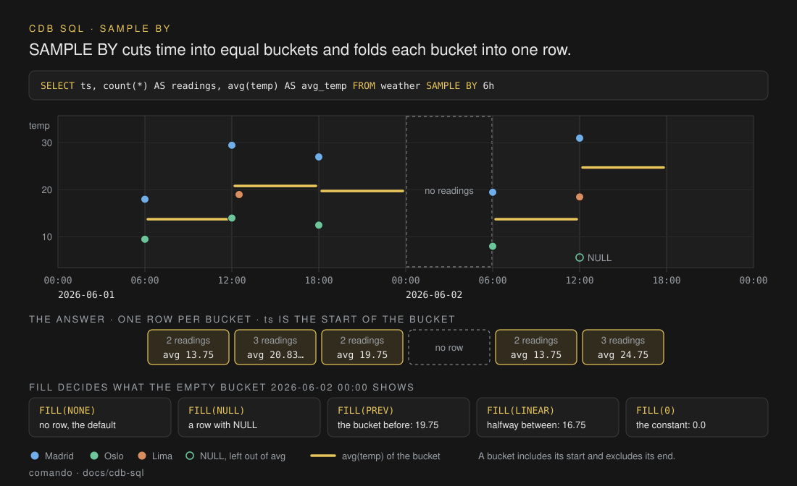
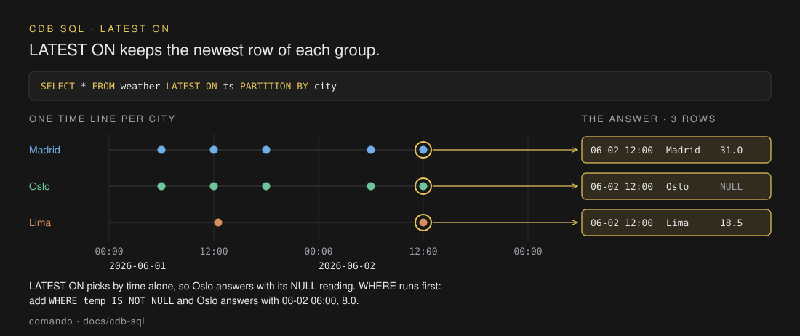
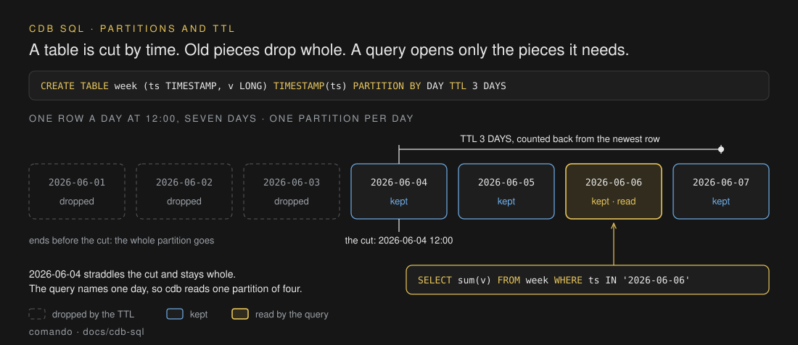

# cdb SQL: from the first query to the whole language



## In one paragraph

SQL is the language you use to ask a database questions. This page teaches it from zero on cdb, comando's own
database, and then lists everything cdb's SQL can do. It is for you if you have never written a query, and also if
you write SQL daily and need to know what cdb runs. cdb speaks a subset of QuestDB's SQL: the usual `SELECT`, plus
`SAMPLE BY` and `LATEST ON` for data that carries a time. Every example runs on one small table and shows its real
answer. Sections 1 to 13 teach; [section 14](#14-reference) is the reference.

## 1. The example: two days of weather

Every example on this page reads the two tables below. Create them once and you can run every statement yourself.
[cdb](cdb.md) shows how to start cdb and how to reach it. [The tutorial](tutorial.md) shows comando's SQL panel.

```sql
CREATE TABLE weather (
    ts TIMESTAMP,
    city SYMBOL,
    temp DOUBLE,
    rain LONG,
    sunny BOOLEAN,
    note VARCHAR
) TIMESTAMP(ts) PARTITION BY DAY;

INSERT INTO weather (ts, city, temp, rain, sunny, note) VALUES
    ('2026-06-01T06:00:00Z', 'Madrid', 18.0, 0, true, 'clear'),
    ('2026-06-01T06:00:00Z', 'Oslo', 9.5, 2, false, 'drizzle'),
    ('2026-06-01T12:00:00Z', 'Madrid', 29.5, 0, true, 'hot'),
    ('2026-06-01T12:00:00Z', 'Oslo', 14.0, 5, false, 'rain'),
    ('2026-06-01T12:30:00Z', 'Lima', 19.0, 0, false, 'fog'),
    ('2026-06-01T18:00:00Z', 'Madrid', 27.0, 0, true, NULL),
    ('2026-06-01T18:00:00Z', 'Oslo', 12.5, 1, false, 'drizzle'),
    ('2026-06-02T06:00:00Z', 'Madrid', 19.5, 0, true, 'clear'),
    ('2026-06-02T06:00:00Z', 'Oslo', 8.0, 0, true, 'clear'),
    ('2026-06-02T12:00:00Z', 'Madrid', 31.0, 0, true, 'hot'),
    ('2026-06-02T12:00:00Z', 'Oslo', NULL, 3, false, 'sensor fault'),
    ('2026-06-02T12:00:00Z', 'Lima', 18.5, 0, false, 'fog');

CREATE TABLE cities (city SYMBOL, country VARCHAR, population LONG);

INSERT INTO cities VALUES
    ('Madrid', 'Spain', 3300000), ('Oslo', 'Norway', 700000), ('Tokyo', 'Japan', 14000000);
```

cdb takes **one statement per request**, so send the four statements one at a time. A `;` at the end is allowed.
`temp` is in degrees Celsius and `rain` in millimetres. Two details are deliberate: one `temp` and one `note` are
`NULL`, and `cities` has a Tokyo that `weather` lacks and no Lima. They make the later sections honest.

This page writes a timestamp as `2026-06-01T06:00:00Z`. Your client may print more digits of the same instant.

## 2. Tables, rows, columns and queries

A **table** is a grid with a name. A **column** holds one kind of fact and has one type, so `temp` is a number in
every row. A **row** is one thing that happened: here, one reading in one city at one moment. A **query** is a
sentence that describes the rows and columns you want. The answer is a table again.

> **Learn: a table.** A table is a list of records that all have the same shape. Think of a class register: one line
> per pupil, the same boxes on every line. Because every row has the same columns, a program can answer questions
> about a million rows the same way it answers them about ten. The fixed shape is called the *schema*. In comando,
> cdb keeps a table's schema beside its data, and `SHOW COLUMNS FROM weather` prints it.

> **Learn: a declarative language.** Most programming languages are recipes: do this, then that. SQL is a wish: you
> describe the answer and the database works out the steps. You never write a loop over rows. That freedom lets the
> database pick a fast route, such as reading one column instead of six, or using several processor cores.
> cdb turns each query into a small tree of steps, and `EXPLAIN` shows you that tree ([section 13](#13-inspect)).

A query is written in one order and run in another. Knowing the run order explains most surprises in SQL.



```sql
SELECT city, avg(temp) AS avg_temp
FROM weather
WHERE temp > 10
GROUP BY city
ORDER BY avg_temp DESC
LIMIT 2;
```

```text
city    avg_temp
Madrid  25.0
Lima    18.75
```

## 3. SELECT: choose columns

`SELECT` names the columns of the answer, `FROM` names the table.

```sql
SELECT ts, city, temp FROM weather;
```

| You write | You get |
|---|---|
| `SELECT * FROM weather` | every column, all 12 rows, in time order |
| `weather` | the same: a table name alone is a query |
| `SELECT city, temp FROM weather` | two columns |
| `SELECT city, temp * 9 / 5 + 32 AS fahrenheit FROM weather` | a computed column with a name of your choice |
| `SELECT DISTINCT city FROM weather` | each different value once: Madrid, Oslo, Lima |
| `SELECT 7 / 2 AS c, 'hi' AS greeting` | no table at all: one row of computed values |

`AS` gives a column a name, called an *alias*. A column can hold any expression:

```sql
SELECT city, temp, temp * 9 / 5 + 32 AS fahrenheit FROM weather LIMIT 3;
```

```text
city    temp  fahrenheit
Madrid  18.0  64.4
Oslo    9.5   49.1
Madrid  29.5  85.1
```

`CASE` picks a value by a test, top to bottom. The first test that holds wins:

```sql
SELECT city, temp,
       CASE WHEN temp >= 25 THEN 'hot' WHEN temp >= 15 THEN 'mild' ELSE 'cold' END AS feel
FROM weather WHERE ts IN '2026-06-02';
```

```text
city    temp  feel
Madrid  19.5  mild
Oslo    8.0   cold
Madrid  31.0  hot
Oslo    NULL  cold
Lima    18.5  mild
```

Text joins with `||`: `city || ', ' || note` gives `Madrid, clear`. The functions for numbers, text and time are in
[section 14.6](#146-functions).

> **Learn: whole numbers and floating-point numbers.** A computer stores a whole number exactly. It stores a number
> with a fraction in binary, and most decimal fractions have no exact binary form, just as 1/3 has no exact decimal
> form. So `0.1 + 0.2` answers `0.30000000000000004`. In cdb, `LONG` is the whole number and `DOUBLE` the
> floating-point one. Two `LONG`s divide as whole numbers: `7 / 2` is `3`, and `7 / 2.0` is `3.5`. Use
> `round(x, 2)` to show a value, and count money in whole cents.

## 4. WHERE: choose rows

`WHERE` keeps the rows for which a test is true.

```sql
SELECT ts, city, temp FROM weather WHERE temp > 25;
```

```text
ts                    city    temp
2026-06-01T12:00:00Z  Madrid  29.5
2026-06-01T18:00:00Z  Madrid  27.0
2026-06-02T12:00:00Z  Madrid  31.0
```

| Test | Meaning | On the example |
|---|---|---|
| `=` `!=` `<>` `<` `<=` `>` `>=` | compare two values | `temp > 25`: 3 rows |
| `AND`, `OR`, `NOT` | combine tests | `city = 'Oslo' AND rain > 0`: 4 rows |
| a `BOOLEAN` column alone | true where the column is true | `WHERE NOT sunny`: 6 rows |
| `IN (a, b, …)` | equal to one of a list | `city IN ('Lima', 'Oslo')`: 7 rows |
| `BETWEEN a AND b` | from a to b, both included | `temp BETWEEN 18 AND 19.5`: 4 rows |
| `LIKE` | text pattern: `%` any run, `_` one character, `\` escapes | `note LIKE 'dr%'`: the two drizzles |
| `ILIKE` | `LIKE` that ignores upper and lower case | `note ILIKE 'CLEAR'`: 3 rows |
| `IS NULL`, `IS NOT NULL` | the value is missing, or present | `temp IS NULL`: the Oslo fault |

`AND` binds tighter than `OR`. Use brackets when you mix them.

### 4.1 Filter by time

Time is the most common filter, so it has a short form. `ts IN '<a date or part of one>'` means the whole interval.

| Test | Rows it keeps |
|---|---|
| `ts IN '2026-06'` | the whole month |
| `ts IN '2026-06-01'` | the whole day: 7 rows |
| `ts IN '2026-06-01T12:30'` | that minute: the Lima row |
| `ts IN ('2026-06-01T06', '2026-06-02T06')` | two separate hours: 4 rows |
| `ts < '2026-06-02'` | before that instant: 7 rows |
| `ts BETWEEN '2026-06-01T12:00:00Z' AND '2026-06-01T12:30:00Z'` | both ends included: 3 rows |
| `ts > dateadd('d', -7, now())` | the last seven days |
| `ts = '2026-06-02'` | the instant of midnight only: 0 rows |

The last line is the trap: `=` compares with one instant, `IN` with an interval. A time of day may carry an offset
such as `+02:00`. Without one it is UTC. A `TIMESTAMP` also compares with a `LONG`, read as microseconds since 1970.

A time filter on the designated timestamp is cheap: cdb opens only the partitions inside it
([section 11.2](#112-partitions-and-ttl)).

### 4.2 NULL: the missing value

`NULL` means "no value here". It is not zero and not an empty text.

| Rule | Example |
|---|---|
| A calculation with `NULL` gives `NULL` | `1 + NULL` is `NULL` |
| A test is always true or false, never `NULL` | `temp > 10` is false where `temp` is `NULL` |
| So the opposite test is true there | `temp != 31.0` and `NOT (temp > 10)` keep the `NULL` row |
| `NULL` equals `NULL` | `note = NULL` finds the row without a note, as `note IS NULL` does |
| `coalesce(a, b, …)` gives the first value that is present | `coalesce(note, 'none')` |
| `||` reads `NULL` as an empty text | `'a' || NULL || 'b'` is `ab` |
| A `BOOLEAN` has no `NULL` | a missing `BOOLEAN` reads `false` |
| Division by zero gives `NULL` | `1 / 0` is `NULL` |

Other databases give tests a third answer, "unknown". cdb does not, so check these rules when you port a query.

## 5. ORDER BY and LIMIT: sort and cut

Without `ORDER BY`, a table answers in time order. `ORDER BY` sorts the answer, `LIMIT` cuts it.

```sql
SELECT ts, city, temp FROM weather ORDER BY city, temp DESC LIMIT 4;
```

```text
ts                    city    temp
2026-06-01T12:30:00Z  Lima    19.0
2026-06-02T12:00:00Z  Lima    18.5
2026-06-02T12:00:00Z  Madrid  31.0
2026-06-01T12:00:00Z  Madrid  29.5
```

| Form | Meaning |
|---|---|
| `ORDER BY temp` | smallest first (`ASC`, the default) |
| `ORDER BY temp DESC` | largest first |
| `ORDER BY city, temp DESC` | by city, and within one city by temperature |
| `ORDER BY 2` | by the second column of the answer |
| `ORDER BY avg_temp`, `ORDER BY count(*) DESC` | by an alias or by an expression |
| `LIMIT 3` | the first 3 rows |
| `LIMIT -3` | the last 3 rows |
| `LIMIT 2, 4` | rows 3 and 4: skip 2, stop after the 4th |

A `NULL` in a `DOUBLE` column sorts last ascending and first descending. So `ORDER BY temp DESC LIMIT 1` answers the Oslo fault,
not the hottest reading. Add `WHERE temp IS NOT NULL` when you rank.

`ORDER BY ts DESC LIMIT 10` is the fast way to the newest rows: cdb reads the table newest first and sorts nothing.

## 6. Aggregates and GROUP BY: fold many rows into one

An **aggregate** folds many values into one: a count, a sum, an average.

```sql
SELECT count(*), count(temp), avg(temp), min(temp), max(temp), sum(rain) FROM weather;
```

```text
count()  count(temp)  avg(temp)           min(temp)  max(temp)  sum(rain)
12       11           18.772727272727273  8.0        31.0       11
```

`count(*)` counts rows. `count(temp)` counts the rows where `temp` is present. `avg`, `sum`, `min` and `max` skip
`NULL` too. `first` and `last` do not skip it: they answer the first and last row in time, whatever it holds.

`GROUP BY` makes one fold per group instead of one for the whole table.



```sql
SELECT city, count(*) AS readings, avg(temp) AS avg_temp, sum(rain) AS rain
FROM weather
GROUP BY city;
```

```text
city    readings  avg_temp  rain
Madrid  5         25.0      0
Oslo    5         11.0      11
Lima    2         18.75     0
```

| You can | Example |
|---|---|
| group by several columns | `GROUP BY city, sunny`: 4 groups |
| group by an expression, an alias or a position | `GROUP BY hour(ts)`, `GROUP BY 1` |
| leave `GROUP BY` out | cdb groups by every selected column that is not an aggregate |
| compute with aggregates | `max(temp) - min(temp) AS swing` |
| count different values | `count(DISTINCT city)` or `count_distinct(city)`: 3 |
| sort by an aggregate | `ORDER BY count(*) DESC` |

Every selected column must be a group key or sit inside an aggregate. Otherwise cdb answers
`cannot select column outside GROUP BY [column=rain]`.

`WHERE` runs before the fold, so it cannot test an aggregate. cdb has no `HAVING`. Wrap the query instead:

```sql
SELECT * FROM (
    SELECT city, avg(temp) AS avg_temp FROM weather GROUP BY city
) WHERE avg_temp > 15;
```

```text
city    avg_temp
Madrid  25.0
Lima    18.75
```

> **Learn: a hash table.** To group a million rows by city, you could sort them first, which is slow. A hash table
> is faster. It turns each key, such as `Oslo`, into a number with a fixed formula, and uses that number as a shelf
> address. Every `Oslo` row lands on the same shelf, so finding its group takes one step, however many groups exist.
> The cost per row stays the same as the table grows. cdb groups this way, keeps every group in memory, and stops at
> 1,000,000 groups with `cannot hold more groups in memory [limit=1000000]`.

## 7. JOIN: read two tables at once

A join pairs each row of one table with the rows of another that pass a test, usually "the same key".



```sql
SELECT w.ts, w.city, w.temp, c.country
FROM weather w JOIN cities c ON w.city = c.city
WHERE w.ts IN '2026-06-02';
```

```text
ts                    city    temp  country
2026-06-02T06:00:00Z  Madrid  19.5  Spain
2026-06-02T06:00:00Z  Oslo    8.0   Norway
2026-06-02T12:00:00Z  Madrid  31.0  Spain
2026-06-02T12:00:00Z  Oslo    NULL  Norway
```

`w` and `c` are short names for the tables, and `w.city` says which table a column comes from. Lima is missing: it
has no partner in `cities`. Write `LEFT JOIN` and the answer gains `… Lima 18.5 NULL`.

| Join | Keeps |
|---|---|
| `JOIN`, `INNER JOIN` | only the pairs that pass `ON` |
| `LEFT JOIN`, `LEFT OUTER JOIN` | the pairs, plus every left row without a partner, its right side `NULL` |
| `CROSS JOIN` | every left row with every right row; it takes no `ON` |

More that works:

- **Find what is missing.** `FROM cities c LEFT JOIN weather w ON w.city = c.city WHERE w.ts IS NULL` answers Tokyo.
- **Any test in `ON`.** `ON w.city = c.city AND w.temp > 28`, or a comparison such as `<`.
- **A table with itself.** `FROM weather a JOIN weather b ON a.city = b.city AND b.ts = dateadd('d', 1, a.ts)` pairs
  each reading with the one a day later.
- **Three tables or more**, and a subquery or a table function in place of a table.
- **Joins feed everything else.** Group the pairs by `c.country` and Spain answers 5 readings, hottest 31.0.

Two columns with the same name get a suffix in the answer: `ts` and `ts_2`. cdb runs no `RIGHT JOIN`, no
`FULL JOIN` and no comma join (`FROM a, b`). Swap the tables and use `LEFT JOIN`.

> **Learn: a hash join.** The slow way to join compares every left row with every right row: a million times a
> million steps. The fast way has two phases. *Build*: read one table whole and file its rows in a hash table by the
> join key. *Probe*: stream the other table and look each row's key up in one step. The work grows with the sum of
> the two sizes, not their product. cdb uses a hash join when `ON` is one `=` between two columns, and compares pair
> by pair otherwise. Its plan says which side it builds: `build side right: read whole first, the left streams`.

## 8. Queries inside queries

An answer is a table, so a query can stand wherever a table or a list can.

**In `FROM`.** The inner query runs first, and the outer one reads its answer. Section 6 does this in place of
`HAVING`.

**With a name: `WITH`.** A common table expression (CTE) names a query so that the main query reads cleanly. A later
CTE can read an earlier one.

```sql
WITH daily AS (
    SELECT city, max(temp) AS hottest FROM weather GROUP BY city
)
SELECT * FROM daily WHERE hottest > 15 ORDER BY hottest;
```

```text
city    hottest
Lima    19.0
Madrid  31.0
```

**In `WHERE`, as a list.** `IN (SELECT …)` tests a value against the one column another query answers.

```sql
SELECT ts, city, temp FROM weather
WHERE city IN (SELECT city FROM cities WHERE population > 1000000);
```

This answers the five Madrid rows. `NOT IN (SELECT city FROM cities)` answers the two Lima rows. The subquery runs
once, answers one column and at most 1,000,000 rows, and cannot name a column of the outer query.

**As sets.** Two queries with the same number of columns combine as sets of rows:

| Operator | Keeps | `SELECT city FROM weather` … `SELECT city FROM cities` |
|---|---|---|
| `UNION` | rows of either, each once | Madrid, Oslo, Lima, Tokyo |
| `UNION ALL` | rows of both, repeats kept | 15 rows |
| `INTERSECT` | rows found in both | Madrid, Oslo |
| `EXCEPT` | rows of the first that the second lacks | Lima |

`INTERSECT` binds tighter than `UNION` and `EXCEPT`. A final `ORDER BY` and `LIMIT` apply to the combined answer.
Put a part in brackets to sort or cut it alone.

> **Learn: composition.** Lego works because every brick has the same studs. SQL works the same way: every query
> takes tables in and gives a table out, so queries plug into each other without limit. A hard question becomes a
> chain of easy ones, each named with `WITH`. In cdb a subquery is one more node in the plan tree. The parser stops
> at 256 levels of nesting.

## 9. Window functions: compute without folding

`GROUP BY` answers one row per group and the single rows are gone. A **window function** keeps every row and adds a
value computed from the row's neighbours. `OVER (…)` marks it and describes the neighbourhood.



```sql
SELECT ts, city, temp,
       temp - lag(temp) OVER (PARTITION BY city ORDER BY ts) AS change
FROM weather WHERE city = 'Madrid';
```

```text
ts                    city    temp  change
2026-06-01T06:00:00Z  Madrid  18.0  NULL
2026-06-01T12:00:00Z  Madrid  29.5  11.5
2026-06-01T18:00:00Z  Madrid  27.0  -2.5
2026-06-02T06:00:00Z  Madrid  19.5  -7.5
2026-06-02T12:00:00Z  Madrid  31.0  11.5
```

| Part of `OVER` | Meaning | Left out |
|---|---|---|
| `PARTITION BY city` | each city is its own window | the whole answer is one window |
| `ORDER BY ts` | the order inside a window | the function sees its whole window at once |

| Function | Answers |
|---|---|
| `row_number()` | 1, 2, 3… inside the window |
| `lag(x)`, `lag(x, n)`, `lag(x, n, default)` | `x` of the row `n` places before; `n` is 1 unless given |
| `lead(x)`, `lead(x, n)`, `lead(x, n, default)` | `x` of the row `n` places after |
| `first_value(x)`, `last_value(x)` | `x` of the window's first or last row |
| `sum`, `avg`, `count`, `min`, `max`, `first`, `last` | the aggregate over the window |

With `ORDER BY`, an aggregate runs along the window. `sum(rain) OVER (PARTITION BY city ORDER BY ts)` gives Oslo
2.0, 7.0, 8.0, 8.0, 11.0: the rain so far. Without `ORDER BY` every row gets the total of its window.

The classic use is "the top row of each group". Number the rows, then keep number 1:

```sql
SELECT * FROM (
    SELECT city, ts, temp,
           row_number() OVER (PARTITION BY city ORDER BY temp DESC) AS place
    FROM weather WHERE temp IS NOT NULL
) WHERE place = 1;
```

This answers each city's hottest reading: Oslo 14.0, Lima 19.0, Madrid 31.0.

cdb's windows have limits. There are no frames (`ROWS BETWEEN …`) and no `rank()`. A window's `ORDER BY` takes
columns, not expressions. A query cannot mix window functions with plain aggregates: fold in a subquery first.

## 10. Time: SAMPLE BY, LATEST ON and time functions

Data with a timestamp has two questions of its own: "how did it change over time?" and "what is the state now?".
cdb answers each with one clause, in QuestDB's syntax. Both need a table with a designated timestamp
([section 11.1](#111-create-table)).

### 10.1 SAMPLE BY: one row per stretch of time



```sql
SELECT ts, count(*) AS readings, avg(temp) AS avg_temp FROM weather SAMPLE BY 6h;
```

```text
ts                    readings  avg_temp
2026-06-01T06:00:00Z  2         13.75
2026-06-01T12:00:00Z  3         20.833333333333332
2026-06-01T18:00:00Z  2         19.75
2026-06-02T06:00:00Z  2         13.75
2026-06-02T12:00:00Z  3         24.75
```

`SAMPLE BY 6h` is `GROUP BY` with time buckets as the groups. `ts` in the answer is the start of each bucket. A
bucket includes its start and excludes its end, and buckets sit on round clock times.

| Part | What you write |
|---|---|
| Bucket size | a whole number and a unit: `U` microsecond, `T` millisecond, `s`, `m` minute, `h`, `d`, `M` month, `y` |
| More keys | select another column: `SELECT ts, city, avg(temp) … SAMPLE BY 1d` answers one row per day and city |
| Empty buckets | `FILL(…)`, below |
| Sorting | `ORDER BY` and `LIMIT` after it, as usual |

The units are case-sensitive: `m` is a minute, `M` a month. There is no week unit, and `7d` buckets start on
Thursdays, counted from 1970-01-01. For weeks from Monday, write `GROUP BY timestamp_floor('w', ts)`.

The bucket from midnight to 06:00 on 2026-06-02 has no reading. `FILL` says what the answer shows there:

| `FILL` | The empty bucket | `avg_temp` at `2026-06-02T00:00:00Z` |
|---|---|---|
| `FILL(NONE)`, or no `FILL` | no row | |
| `FILL(NULL)` | a row with `NULL` | `NULL` |
| `FILL(PREV)` | the value of the bucket before | 19.75 |
| `FILL(LINEAR)` | a straight line between its neighbours | 16.75 |
| `FILL(0)` | the constant you give | 0.0 |

`FILL` fills between the first and the last bucket that hold data, never outside them. Give one value per
aggregate to fill each differently: `FILL(PREV, 0)`.

Without `SAMPLE BY`, a function does the same job: `GROUP BY timestamp_floor('d', ts)`.

> **Learn: a time series.** A time series is the same measurement taken again and again: a temperature each hour, a
> price each second. Nobody reads a million points one by one. You shrink them: cut time into equal buckets and
> keep one number per bucket. That is called *downsampling*, and it is how a year of readings fits on one chart.
> cdb stores rows in time order, so one bucket is one neighbouring run of rows, cheap to fold. comando's own
> metrics live in cdb and are read this way.

### 10.2 LATEST ON: the newest row of each group



```sql
SELECT ts, city, temp FROM weather LATEST ON ts PARTITION BY city;
```

```text
ts                    city    temp
2026-06-02T12:00:00Z  Madrid  31.0
2026-06-02T12:00:00Z  Oslo    NULL
2026-06-02T12:00:00Z  Lima    18.5
```

It answers "what is the state now?": the last reading of each sensor, the last status of each job. `WHERE` runs
first, so `WHERE temp IS NOT NULL` gives Oslo its 06:00 reading of 8.0. `PARTITION BY` takes several columns.

### 10.3 Time functions

All examples use the instant `2026-06-01T06:00:00Z`, a Monday, as `ts`.

| Function | Answers | Example |
|---|---|---|
| `now()` | the current instant | `ts > dateadd('h', -1, now())` |
| `hour(ts)` | the hour of the day, 0 to 23 | `6` |
| `date_trunc('unit', ts)` | `ts` cut down to the start of its unit | `date_trunc('month', ts)`: `2026-06-01T00:00:00Z` |
| `timestamp_floor('unit', ts)` | the same with short units and a count | `timestamp_floor('15m', ts)` |
| `dateadd('unit', n, ts)` | `ts` moved by `n` units; `n` may be negative | `dateadd('h', 2, ts)`: `08:00` |
| `datediff('unit', a, b)` | the whole units between two instants | `datediff('h', ts, '2026-06-03')`: `42` |
| `to_str(ts, 'pattern')` | the instant as text | `to_str(ts, 'yyyy-MM-dd HH:mm')`: `2026-06-01 06:00` |

| Function | Units |
|---|---|
| `date_trunc` | `microsecond`, `millisecond`, `second`, `minute`, `hour`, `day`, `week`, `month`, `quarter`, `year` |
| `timestamp_floor` | `U`, `T`, `s`, `m`, `h`, `d`, `w`, `M`, `y`, with an optional count in front: `'12h'` |
| `dateadd`, `datediff` | `u`, `T`, `s`, `m`, `h`, `d`, `w`, `M`, `y` |

A week starts on Monday. `dateadd('M', 1, '2026-01-31')` answers `2026-02-28`: a month added never spills over.

`to_str` patterns are built from these letters; any other character is copied:

| Letters | Mean | Letters | Mean |
|---|---|---|---|
| `yyyy`, `yy` | year: `2026`, `26` | `HH`, `H` | hour 0 to 23: `06`, `6` |
| `MM`, `M` | month: `06`, `6` | `hh`, `h` | hour 1 to 12 |
| `MMMM`, `MMM` | month name: `June`, `Jun` | `a` | `AM` or `PM` |
| `dd`, `d` | day: `01`, `1` | `mm`, `ss` | minutes, seconds |
| `EE`, `E` | weekday: `Monday`, `Mon` | `SSS`, `UUU` | milliseconds, microseconds |

Timestamps do arithmetic too. `max(ts) - min(ts)` is a `LONG` of microseconds, and `ts + 3600000000` is the instant
one hour later.

## 11. Make and change tables

### 11.1 CREATE TABLE

```sql
CREATE TABLE weather (
    ts TIMESTAMP, city SYMBOL, temp DOUBLE, rain LONG, sunny BOOLEAN, note VARCHAR
) TIMESTAMP(ts) PARTITION BY DAY;
```

A column is a name and a type. cdb has seven types:

| Type | Holds | Write a value as |
|---|---|---|
| `BOOLEAN` | true or false | `true`, `false` |
| `LONG` | a whole number, 64 bits | `42`, `-7` |
| `DOUBLE` | a number with a fraction | `3.5`, `1e3`, `.5` |
| `TIMESTAMP` | an instant, to the microsecond, in UTC | `'2026-06-01T06:00:00Z'`, or a `LONG` of microseconds |
| `SYMBOL` | a text that repeats: a city, a status | `'Oslo'` |
| `VARCHAR` | any text | `'It''s fine'` |
| `JSON` | one JSON text: an object, an array, a string, a number, `true`, `false` or `null` | `'{"status":"ok","busy":true}'` |

Choose `SYMBOL` for a column with few different values and `VARCHAR` for free text. cdb stores each symbol's text
once; [cdb](cdb.md) shows how each type is stored. Other type names map onto the seven
([section 14.4](#144-types-and-casts)).

A `JSON` column is a `VARCHAR` column that takes only JSON. cdb checks each value as it is written, by `INSERT`,
`UPDATE` or a line-protocol string field, and refuses the statement or the line when a value is not JSON. It keeps
the text as it was sent, spaces and key order included, and compares, sorts and groups it as text. Read inside it
with `->`, `->>`, `json_extract` and `json_exists` ([section 14.6](#146-functions)):

```sql
SELECT ts, payload ->> 'activity' AS activity
FROM frontear_packet
WHERE payload ->> 'status' = 'ok';
```

The clauses after the columns:

| Clause | What it does |
|---|---|
| `TIMESTAMP(ts)` | names the **designated timestamp**: the column that says when each row happened |
| `PARTITION BY HOUR` \| `DAY` \| `WEEK` \| `MONTH` \| `YEAR` | cuts the table by time; needs a designated timestamp |
| `TTL 3 DAYS` | drops old partitions by itself; needs partitions |
| `DEDUP UPSERT KEYS(ts, city)` | a row with the same keys replaces the stored one; the keys include the timestamp |
| `IF NOT EXISTS` | after `CREATE TABLE`: no error when the table exists |

A table with a designated timestamp keeps its rows in time order, whatever order they arrive in. `SAMPLE BY` needs
it, and every `INSERT` must give it a value. A table without one, like `cities`, is a plain list.

`DEDUP` turns "add" into "add or replace". With `KEYS(ts, city)`, a second Madrid row for 06:00 replaces the first.
Without `DEDUP`, both rows stay.

cdb also accepts QuestDB's `WAL` and `BYPASS WAL` after `TTL` and before `DEDUP`, and `CAPACITY n`, `CACHE`,
`NOCACHE` and `INDEX` after a `SYMBOL` column, so QuestDB's DDL runs as written.

### 11.2 Partitions and TTL



A partition holds the rows of one stretch of time and has a name:

| `PARTITION BY` | A partition's name |
|---|---|
| `HOUR` | `2026-11-14T10` |
| `DAY` | `2026-06-01` |
| `WEEK` | `2026-W46` |
| `MONTH` | `2026-11` |
| `YEAR` | `2026` |

Partitions pay twice. A query with a time filter opens only the partitions inside it. And old data leaves by
dropping a whole partition, which is far cheaper than deleting row by row.

**TTL** (time to live) does the dropping for you. A partition goes once all of it is older than the TTL, counted
back from the newest row. In the picture, seven days of rows with `TTL 3 DAYS` keep four partitions. The check runs
each time rows are written. A newest row in the future does not hurry it: cdb then counts from the present.

| TTL | Rule |
|---|---|
| Units | `HOURS`, `DAYS`, `WEEKS`, `MONTHS`, `YEARS`, singular too, or the letters `H`, `D`, `W`, `M`, `Y` as in `2w` |
| Size | a whole number of partitions: `36 HOURS` on a `DAY` table is refused |
| Change it | `ALTER TABLE weather SET TTL 2 WEEKS` |
| Remove it | `ALTER TABLE weather SET TTL 0 DAYS` |

### 11.3 ALTER, TRUNCATE, DROP

| Statement | Effect | Answer |
|---|---|---|
| `ALTER TABLE weather ADD COLUMN wind DOUBLE` | a new column; old rows read `NULL` (`false` for `BOOLEAN`) | |
| `ALTER TABLE weather ADD humidity LONG, station SYMBOL` | several columns; `COLUMN` is optional | |
| `ALTER TABLE weather RENAME COLUMN wind TO gust` | a new name | |
| `ALTER TABLE weather DROP COLUMN gust` | the column and its data go | |
| `ALTER TABLE weather DROP PARTITION LIST '2026-06-01'` | whole partitions go, by name | partitions dropped |
| `ALTER TABLE weather DROP PARTITION WHERE ts < '2026-06-02'` | every partition that lies wholly in the range | partitions dropped |
| `TRUNCATE TABLE weather` | every row goes, the table stays | |
| `DROP TABLE weather` | the table goes | |

`ADD COLUMN IF NOT EXISTS`, `DROP COLUMN IF EXISTS` and `DROP TABLE IF EXISTS` turn the error into a no-op. The
designated timestamp can be neither renamed nor dropped. A `DEDUP` key and a table's last column cannot be dropped.
`DROP PARTITION WHERE` takes a test on the designated timestamp only.

cdb has no `CREATE TABLE … AS SELECT`. Create the table, then fill it with `INSERT INTO … SELECT`.

Why these statements have this shape:
[destructive SQL, EXPLAIN and access](adr/0182-cdb-destructive-sql-explain-and-access.md) and
[column changes, backup and IN subqueries](adr/0183-cdb-column-changes-backup-and-in-subqueries.md).

## 12. Change rows: INSERT, UPDATE, DELETE

Work on a copy, so that the earlier examples keep their answers:

```sql
CREATE TABLE lab (
    ts TIMESTAMP, city SYMBOL, temp DOUBLE, rain LONG, sunny BOOLEAN, note VARCHAR
) TIMESTAMP(ts) PARTITION BY DAY;

INSERT INTO lab SELECT * FROM weather;
```

The copy answers 12, the rows written. Run the statements below in this order to get the answers shown:

| Statement | Effect | Answer |
|---|---|---|
| `INSERT INTO lab (ts, city, temp) VALUES ('2026-06-03T06:00:00Z', 'Lima', 21)` | names the columns; the others read `NULL` | 1 |
| `UPDATE lab SET note = 'storm', rain = rain + 10 WHERE city = 'Oslo' AND ts = '2026-06-01T12:00:00Z'` | changes columns of the rows that pass | 1 |
| `DELETE FROM lab WHERE city = 'Lima'` | removes the rows that pass | 3 |

Every statement answers the number of rows it wrote, changed or removed. An `INSERT` without a column list takes
one value per column, in the table's order.

The rules that save you from surprises:

- **Types must fit.** A `LONG` goes into a `DOUBLE` column. A text does not go into a number column:
  `cannot insert value of other type [column=temp, type=VARCHAR, target=DOUBLE]`.
- **A timestamp** is a text such as `'2026-06-03T06:00:00Z'`, a `LONG` of microseconds, or `now()`.
- **`UPDATE` cannot move a row in time**, nor change a `DEDUP` key. It sets each column once.
- **No `WHERE` means every row.** `DELETE FROM lab` empties the table.
- **Mind `NULL` in `DELETE`.** `DELETE FROM lab WHERE temp != 31.0` also removes the row whose `temp` is `NULL`
  ([section 4.2](#42-null-the-missing-value)).
- **Each statement is one transaction.** It happens whole or not at all. A query that started earlier still sees
  the table as it stood.

To remove a whole day, `DROP PARTITION` is cheaper than `DELETE`. For high-volume writes, cdb has a second door
that needs no SQL: line protocol, in [cdb](cdb.md).

## 13. Inspect

### 13.1 SHOW and the catalogue functions

| Statement | Answers |
|---|---|
| `SHOW TABLES` | the table names |
| `SHOW COLUMNS FROM weather` | one row per column: name, type, whether it is the designated timestamp or a `DEDUP` key |
| `SHOW CREATE TABLE weather` | the `CREATE TABLE` statement that rebuilds the table |
| `SHOW PARTITIONS FROM weather` | one row per partition: name, first and last timestamp, rows, size on disk |
| `SHOW WAL`, `SHOW WAL FROM weather` | the state of each table's write log |

The same facts come as table functions, which you can filter, join and sort like any table:

```sql
SELECT table_name, designatedTimestamp, partitionBy FROM tables();
```

```text
table_name  designatedTimestamp  partitionBy
cities      NULL                 NONE
weather     ts                   DAY
```

| Table function | Answers |
|---|---|
| `tables()` | one row per table |
| `table_columns('weather')` | the columns of a table |
| `table_partitions('weather')` | the partitions of a table |
| `wal_tables()`, `show_wal()`, `wal_apply_stats()` | the write log's state and counters |
| `long_sequence(n)` | the numbers 1 to `n` in a column `x` |

`long_sequence` makes practice data together with three generators:

```sql
SELECT timestamp_sequence('2026-06-01', 3600000000) AS ts, rnd_symbol('a', 'b') AS tag, rnd_double() AS v
FROM long_sequence(1000);
```

`timestamp_sequence(start, step)` counts up in microseconds, here one hour a row. `rnd_symbol` picks one of its
texts and `rnd_double` a number between 0 and 1.

### 13.2 EXPLAIN: see the plan

Put `EXPLAIN` before any statement. cdb answers the plan and runs nothing, so it is safe before a `DELETE`.

```sql
EXPLAIN SELECT city, avg(temp) AS avg_temp FROM weather
WHERE temp > 10 GROUP BY city ORDER BY avg_temp DESC LIMIT 2;
```

```text
Limit 0, 2 -- serial
  Sort [$1 desc] -- serial
    Aggregate keys=[city:SYMBOL=$1] aggs=[avg_temp:DOUBLE=avg($2)] -- parallel over frames
      Filter >($2, 10) -- per frame on the pool
        Scan weather [0, 1, 2, 3, 4, 5] [-inf, +inf) terms [$2 > 10.0] -- reads [city, temp], selects on [temp], frames on the pool
```

Read it from the bottom up. It is the picture of section 2, drawn by cdb.

| In the plan | Means |
|---|---|
| indentation | each step reads the rows of the step below it |
| `$2` | column number 2 of the step below, counted from 0 |
| `Scan weather … reads [city, temp]` | of six columns, cdb opens the two the query names |
| `[-inf, +inf)` | the time range the scan covers: here, all of it |
| `terms [$2 > 10.0]` | a test the scan applies while it reads |
| `-- parallel over frames`, `-- serial` | whether the step runs on several cores or one |

Add `ts IN '2026-06-02'` to the query and the scan's range becomes `[2026-06-02T00:00:00Z, 2026-06-03T00:00:00Z)`:
proof that the time filter skips the other partitions. A change explains itself too:
`EXPLAIN DELETE FROM weather WHERE city = 'Lima'` answers `Delete weather where =($1, 'Lima')`.

> **Learn: a query plan.** A plan is a tree of small machines, each doing one job: read, filter, fold, sort, cut.
> Rows flow from the leaves to the root, and each machine asks the one below for its next rows. This design, called
> the *iterator model*, lets a database build any query from a dozen parts. It also explains speed: a machine low in
> the tree that drops rows early saves work for all the machines above. When a cdb query is slow, read its plan and
> ask which step sees more rows than it needs.

### 13.3 BACKUP

`BACKUP TO '/absolute/folder'` copies every table into a new folder and answers the number of tables copied. The
folder must not exist yet. Restoring is a server task, in [cdb](cdb.md).

## 14. Reference

### 14.1 Statements

| Statement | Answers |
|---|---|
| `SELECT …`, `WITH …`, a set operation, a bare table name | rows |
| `CREATE TABLE` | nothing |
| `ALTER TABLE … ADD COLUMN` \| `DROP COLUMN` \| `RENAME COLUMN` \| `SET TTL` | nothing |
| `ALTER TABLE … DROP PARTITION LIST` \| `WHERE` | the partitions dropped |
| `DROP TABLE`, `TRUNCATE TABLE` | nothing |
| `INSERT` | the rows written |
| `UPDATE`, `DELETE` | the rows changed or removed |
| `SHOW TABLES` \| `COLUMNS` \| `CREATE TABLE` \| `PARTITIONS` \| `WAL` | rows |
| `BACKUP [DATABASE] TO 'folder'` | the tables copied |
| `EXPLAIN <statement>` | one `QUERY PLAN` row per line of the plan; the statement does not run |

One statement per request. A refusal reads `cannot <do something> [name=value, …]`, and a parse error gives the
position: `unexpected token [expected=end of statement, found=HAVING, position=…]`.

### 14.2 Grammar

> **Learn: a grammar.** A grammar is the complete rule book of a language, short enough to read. Each line names a
> part and says what it is made of. The notation below is EBNF: `[ ]` means optional, `{ }` means "repeat as often as
> you like", `|` means "or", and quoted words are keywords. cdb's parser has one function per line of this grammar,
> a design called *recursive descent*. If your statement cannot be built from these rules, cdb refuses it.

Keywords are accepted in any case.

```
statement      ::= ( query | create_table | alter_table | drop_table | truncate | insert | update | delete | show
                   | backup | "EXPLAIN" statement ) [ ";" ]
query          ::= [ "WITH" cte { "," cte } ] set_expr [ "ORDER BY" order_item { "," order_item } ] [ "LIMIT" limit ]
cte            ::= name "AS" "(" query ")"                       -- non-recursive: sees only the CTEs before it
set_expr       ::= intersect_expr { ( "UNION" [ "ALL" ] | "EXCEPT" ) intersect_expr }
intersect_expr ::= operand { "INTERSECT" operand }
operand        ::= "(" query ")" | select | from select_tail     -- a FROM clause alone is SELECT * FROM it
select         ::= "SELECT" [ "DISTINCT" ] expr [ alias ] { "," expr [ alias ] } [ "FROM" from ] select_tail
select_tail    ::= [ "WHERE" expr ]
                   [ "LATEST" "ON" name "PARTITION" "BY" name { "," name } ]
                   [ "SAMPLE" "BY" integer unit [ "FILL" "(" fill { "," fill } ")" ]
                                         [ "ALIGN" "TO" "CALENDAR" ] ]  -- ALIGN TO FIRST OBSERVATION is refused
                   [ "GROUP BY" expr { "," expr } ]
unit           ::= "U" | "T" | "s" | "m" | "h" | "d" | "M" | "y"   -- case-sensitive
fill           ::= word | [ "-" ] number                            -- NONE, NULL, PREV, LINEAR or a constant
from           ::= from_item { join_kind from_item [ "ON" expr ] } -- ON required except for CROSS
join_kind      ::= "JOIN" | "INNER" "JOIN" | "LEFT" [ "OUTER" ] "JOIN" | "CROSS" "JOIN"
from_item      ::= ( "(" query ")" | string | name "(" [ expr { "," expr } ] ")" | name ) from_suffix
from_suffix    ::= [ "TIMESTAMP" "(" name ")" ] [ alias ] [ "TIMESTAMP" "(" name ")" ]   -- read and ignored
alias          ::= "AS" any_name | name
order_item     ::= expr [ "ASC" | "DESC" ]
limit          ::= expr [ "," expr ]                               -- n, -n (the last n), lo, hi

create_table   ::= "CREATE" "TABLE" [ "IF" "NOT" "EXISTS" ] name "(" column_spec { "," column_spec } ")"
                   [ "TIMESTAMP" "(" name ")" ] [ "PARTITION" "BY" word ] [ "TTL" number word ]
                   [ "BYPASS" "WAL" | "WAL" ] [ "DEDUP" "UPSERT" "KEYS" "(" name { "," name } ")" ]
column_spec    ::= name type [ "CAPACITY" integer ] [ "CACHE" | "NOCACHE" ] [ "INDEX" [ "CAPACITY" integer ] ]
alter_table    ::= "ALTER" "TABLE" name ( "SET" "TTL" number word
                                        | "ADD" [ "COLUMN" ] [ "IF" "NOT" "EXISTS" ] column_spec
                                                   { "," [ "IF" "NOT" "EXISTS" ] column_spec }
                                        | "DROP" "PARTITION" ( "LIST" string { "," string } | "WHERE" expr )
                                        | "DROP" "COLUMN" [ "IF" "EXISTS" ] name
                                        | "RENAME" "COLUMN" name "TO" name )
drop_table     ::= "DROP" "TABLE" [ "IF" "EXISTS" ] name
truncate       ::= "TRUNCATE" "TABLE" name
backup         ::= "BACKUP" [ "DATABASE" ] "TO" string
insert         ::= "INSERT" "INTO" name [ "(" name { "," name } ")" ]
                   ( "VALUES" "(" expr { "," expr } ")" { "," "(" expr { "," expr } ")" } | query )
update         ::= "UPDATE" name "SET" name "=" expr { "," name "=" expr } [ "WHERE" expr ]
delete         ::= "DELETE" "FROM" name [ "WHERE" expr ]
show           ::= "SHOW" ( "TABLES" | "COLUMNS" "FROM" name | "CREATE" "TABLE" name | "PARTITIONS" "FROM" name
                          | "WAL" [ "FROM" name ] )

expr           ::= and_expr { "OR" and_expr }
and_expr       ::= not_expr { "AND" not_expr }
not_expr       ::= "NOT" not_expr | predicate
predicate      ::= concat { comp_op concat | "IS" [ "NOT" ] "NULL"
                          | [ "NOT" ] "IN" ( "(" ( query | expr { "," expr } ) ")" | concat )
                          | [ "NOT" ] "BETWEEN" concat "AND" concat | [ "NOT" ] ( "LIKE" | "ILIKE" ) concat }
comp_op        ::= "=" | "!=" | "<>" | "<" | "<=" | ">" | ">="
concat         ::= additive { "||" additive }
additive       ::= multiplicative { ( "+" | "-" ) multiplicative }
multiplicative ::= unary { ( "*" | "/" | "%" ) unary }
unary          ::= "-" unary | cast
cast           ::= primary { "::" type }
primary        ::= number | string | "NULL" | "TRUE" | "FALSE" | "*" | "(" query ")" | "(" expr ")"
                 | "CASE" [ expr ] "WHEN" expr "THEN" expr { "WHEN" expr "THEN" expr } [ "ELSE" expr ] "END"
                 | "CAST" "(" expr "AS" type ")"
                 | word "(" [ "*" | [ "DISTINCT" ] expr { "," expr } ] ")"
                   [ "OVER" "(" [ "PARTITION" "BY" expr { "," expr } ] [ "ORDER BY" order_item { "," order_item } ] ")" ]
                 | name { "." any_name } [ "." "*" ]
```

A statement that parses can still be refused later: for an unknown table, column or function, or for a form in
[section 14.7](#147-what-cdb-does-not-run).

### 14.3 Lexical rules

| Element | Rule |
|---|---|
| Names | a letter or `_`, then letters, digits, `_` or `$`; or `"double quoted"`, which allows spaces and reserved words |
| Reserved words | `all and as between by case cross distinct else end except false from full group having ilike in inner intersect is join latest left like limit not null on or order outer over right sample select then true union when where with` |
| Reserved words as names | allowed after `AS` and after a dot, or in double quotes; a table cannot be named `latest` bare |
| Text | `'single quoted'`; write `''` for a quote inside |
| Numbers | digits are a `LONG` (`1L` is accepted too); a decimal point or an exponent makes a `DOUBLE` |
| Comments | `-- to the end of the line` and `/* between the marks */` |
| Case | keywords and names ignore case; text values do not |

### 14.4 Types and casts

| You write | cdb stores |
|---|---|
| `BOOLEAN`, `LONG`, `DOUBLE`, `TIMESTAMP`, `SYMBOL`, `VARCHAR`, `JSON` | the type itself |
| `INT`, `INTEGER`, `SHORT`, `BYTE` | `LONG` |
| `FLOAT` | `DOUBLE` |
| `DATE` | `TIMESTAMP` |
| `STRING`, `CHAR` | `VARCHAR` |
| any other type, such as `UUID` | refused: `cannot map unsupported type [type=UUID]` |

A cast changes a value's type. Write `x::TYPE` or `CAST(x AS TYPE)`.

| Cast | Answers |
|---|---|
| `'42'::LONG`, `'3.5'::DOUBLE` | `42`, `3.5` |
| `'abc'::LONG` | `NULL`: a text that is no number |
| `3.9::LONG` | `3`: the fraction is cut, not rounded |
| `1::BOOLEAN`, `'true'::BOOLEAN` | `true` |
| `42::VARCHAR` | `'42'` |
| `'[1, 2]'::JSON`, `42::JSON` | the JSON text `[1, 2]`, `42` |
| `'{oops'::JSON` | an error: `cannot cast value to JSON [type=VARCHAR, at=1]`, the byte where the text stops being JSON |
| `payload::VARCHAR` | the JSON text as a `VARCHAR` |
| `'2026-06-01'::TIMESTAMP` | the instant |
| `ts::LONG` | microseconds since 1970: `1780293600000000` |
| `sum(rain)::DOUBLE / count(*)` | a division with a fraction: `0.9166666666666666` |

### 14.5 Operators

From tightest to loosest. Brackets override the order.

| Operators | Notes |
|---|---|
| `::` | cast |
| `-x` | negation |
| `*` `/` `%` | `LONG` with `LONG` stays `LONG`: `7 / 2` is `3`; `%` is the remainder, signed like its left side |
| `+` `-` | a `DOUBLE` on either side makes the answer a `DOUBLE` |
| `||`, `->`, `->>` | `||` joins texts; `->` and `->>` read inside JSON, left to right: `p -> 'a' ->> 'b'` |
| `=` `!=` `<>` `<` `<=` `>` `>=`, `IS [NOT] NULL`, `[NOT] IN`, `[NOT] BETWEEN`, `[NOT] LIKE`, `[NOT] ILIKE` | `1 = 1.0` is true; `BETWEEN` accepts its bounds in either order |
| `NOT` | |
| `AND` | |
| `OR` | |

### 14.6 Functions

**Scalar functions** answer one value per row.

| Function | Answers | Example |
|---|---|---|
| `abs(x)` | the distance from zero, in the type of `x` | `abs(-2.5)`: `2.5` |
| `round(x)`, `round(x, n)` | a `DOUBLE` rounded to `n` decimals; negative `n` rounds tens | `round(3.14159, 2)`: `3.14`; `round(1234.5, -2)`: `1200.0` |
| `coalesce(a, b, …)` | the first argument that is not `NULL` | `coalesce(NULL, NULL, 3)`: `3` |
| `length(s)` | the number of characters; `-1` for `NULL` | `length('Madrid')`: `6` |
| `upper(s)`, `lower(s)` | the text in capitals, or in small letters | `upper('Oslo')`: `OSLO` |
| `substring(s, start, n)` | `n` characters from position `start`, counted from 1 | `substring('comando', 3, 4)`: `mand` |
| `replace(s, old, new)` | every `old` swapped for `new` | `replace('aaa', 'a', 'bb')`: `bbbbbb` |
| `concat(a, b, …)` | all arguments as one text, of any type | `concat('x', 1, 2.5, true)`: `x12.5true` |
| `json_extract(j, path)` | the value at `path` as `VARCHAR`: a string's text, any other value's JSON text; `NULL` for JSON `null`, a path that names nothing, or a text that is not JSON | `json_extract('{"a":{"b":[1,"x"]}}', '.a.b[1]')`: `x` |
| `j ->> key` | `json_extract` of one step: `key` a member's name, or a whole number for an array's element | `'{"s":"ok"}' ->> 's'`: `ok` |
| `j -> key` | the value at one step as `JSON`, a string with its quotes | `'{"s":"ok"}' -> 's'`: `"ok"` |
| `json_exists(j, path)` | `true` when `path` names a value, JSON `null` included | `json_exists('{"n":null}', '.n')`: `true` |
| `now()`, `hour`, `date_trunc`, `timestamp_floor`, `dateadd`, `datediff`, `to_str` | time: [section 10.3](#103-time-functions) | |
| `rnd_double()`, `rnd_symbol(a, b, …)`, `timestamp_sequence(start, step)` | practice data: [section 13.1](#131-show-and-the-catalogue-functions) | |

A JSON path is the one QuestDB's `json_extract` takes: `.name` for a member, `["name"]` for a member whose name
holds a dot, a bracket or an escape, `[n]` for an array's element from 0, after an optional `$`. A member that occurs
twice answers its first value. The JSON functions take any text, so they also read JSON kept in a `VARCHAR`; the
path is a constant. Each row's text is read once, from the start to the value, and nothing past it.

**Aggregate functions** answer one value per group.

| Function | Answers |
|---|---|
| `count(*)`, `count()` | the rows |
| `count(x)` | the rows where `x` is not `NULL` |
| `count(DISTINCT x)`, `count_distinct(x)` | the different values of `x` |
| `sum(x)`, `avg(x)` | the total (in the type of `x`) and the mean (a `DOUBLE`) |
| `min(x)`, `max(x)` | the smallest and largest: numbers, texts and timestamps |
| `first(x)`, `last(x)` | `x` of the first and of the last row in time |
| `percentile_cont(x, p)` | the value below which the share `p` (0 to 1) of the values lies, interpolated |
| `percentile_disc(x, p)` | the same, answered with a value that occurs |
| `approx_percentile(x, p)`, `approx_percentile(x, p, precision)` | a percentile; exact over a `DOUBLE` column |
| `approx_median(x)` | the middle value |

`DISTINCT` inside an aggregate works for `count` only.

**Window functions**: `row_number`, `lag`, `lead`, `first_value`, `last_value`, and the aggregates `sum`, `avg`,
`count`, `min`, `max`, `first`, `last` with `OVER` ([section 9](#9-window-functions-compute-without-folding)).

**Table functions**: `tables`, `table_columns`, `table_partitions`, `wal_tables`, `show_wal`, `wal_apply_stats`,
`long_sequence` ([section 13.1](#131-show-and-the-catalogue-functions)). Their arguments are constants.

### 14.7 What cdb does not run

cdb refuses these with a clear error. Each has a way round.

| Not in cdb | Write instead |
|---|---|
| `HAVING` | wrap the query and filter with `WHERE` ([section 6](#6-aggregates-and-group-by-fold-many-rows-into-one)) |
| `RIGHT JOIN`, `FULL JOIN`, `FROM a, b` | swap the tables and use `LEFT JOIN`; `CROSS JOIN` |
| `LIMIT n OFFSET m` | `LIMIT m, m + n` |
| a subquery that answers one value, as in `WHERE temp > (SELECT avg(temp) …)` | join with the one-row subquery: `CROSS JOIN (SELECT avg(temp) AS a FROM weather)` |
| a subquery that names a column of the outer query | a join |
| `IN (SELECT …)` outside `WHERE`, or with several columns | a join |
| window frames, `rank()`, `dense_rank()` | `row_number()` |
| window functions beside plain aggregates in one `SELECT` | fold in a subquery, then apply the window |
| `sum(DISTINCT x)` and other `DISTINCT` aggregates | `count(DISTINCT x)`, or `SELECT DISTINCT` in a subquery |
| `SAMPLE BY 1w`, `ALIGN TO FIRST OBSERVATION` | `GROUP BY timestamp_floor('w', ts)`; buckets align to the calendar |
| `CREATE TABLE … AS SELECT` | `CREATE TABLE`, then `INSERT INTO … SELECT` |
| several statements in one request | one request each |
| types beyond the seven and their aliases | the nearest of the seven |

### 14.8 Limits and access

| Limit of the language | Value |
|---|---|
| Nesting of expressions, operator chains and subqueries | 256 levels |
| Rows an `IN (SELECT …)` subquery answers | 1,000,000 |
| Groups of one `GROUP BY`, `DISTINCT` or set operation | 1,000,000 |

Over HTTP and the PostgreSQL wire, the server adds two limits of its own: 1,000,000 rows for one result and 60 s
for one query. A change runs to its end.

A server started with secrets has two roles. The reader's secret runs queries, `SHOW` and `EXPLAIN`. Every other
statement needs the owner's secret. The secrets, the server's limits and the answer for each are in [cdb](cdb.md).

## Where next

- [The tutorial](tutorial.md): run your first query in comando's SQL panel.
- [cdb](cdb.md): start the database, reach it over HTTP or `psql`, back it up, and see how it stores a table.
- [The cdb module](modules/cdb.md): the engine behind this page, from parser to column files.
- [The workbench](workbench.md): result tables and charts for the answers you get here.
