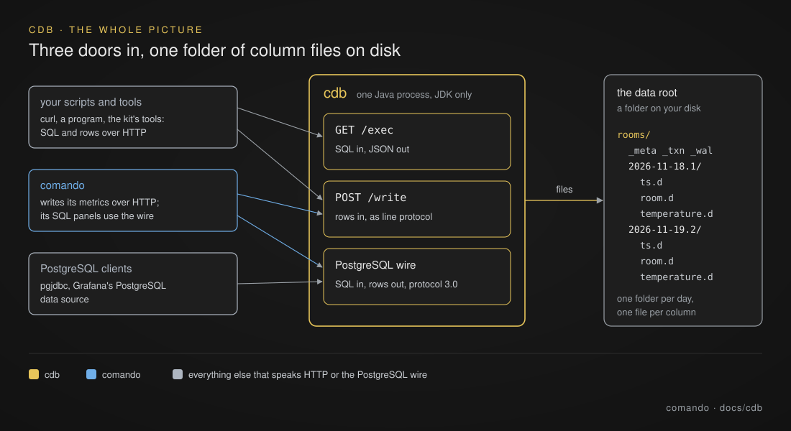
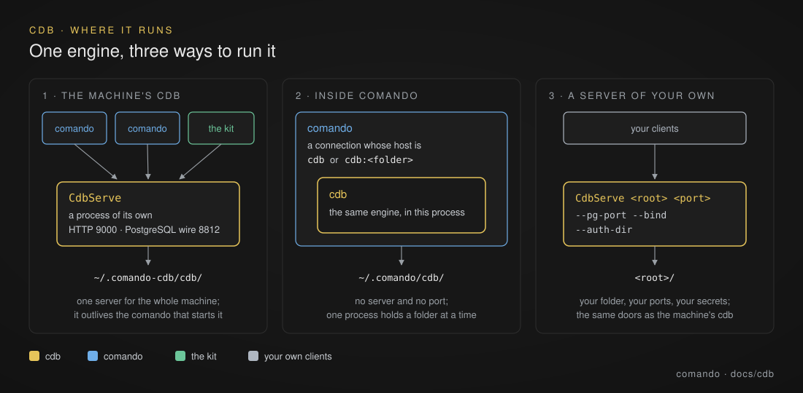
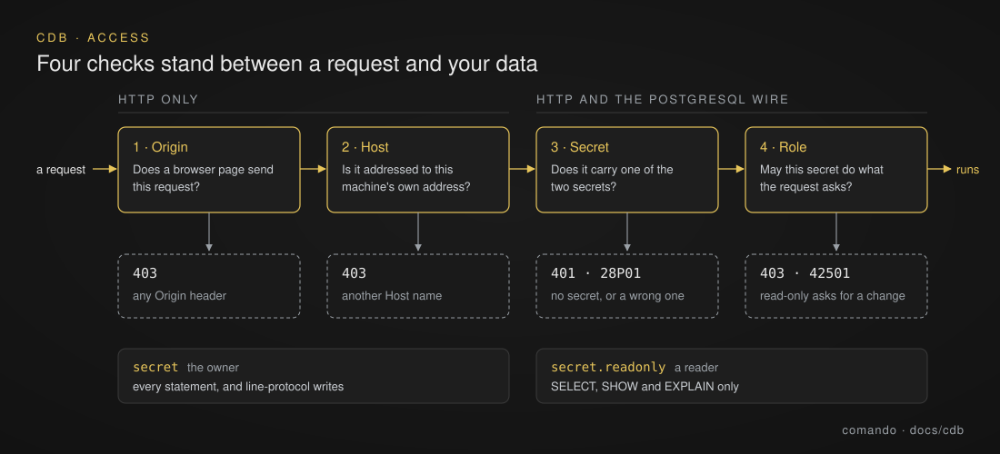
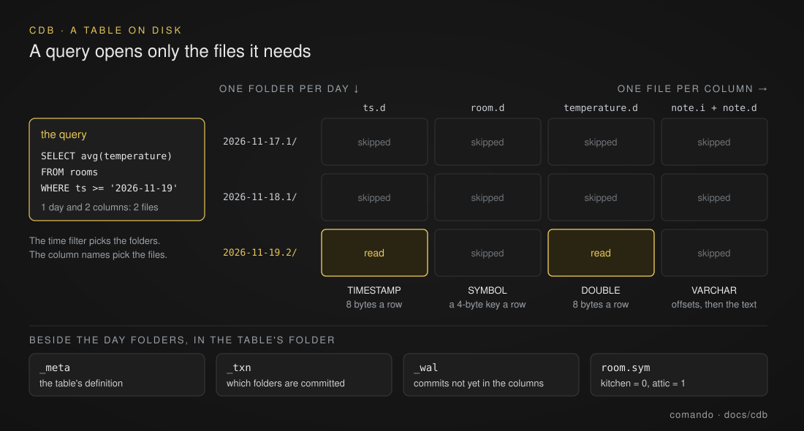
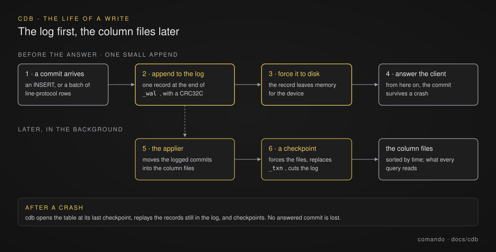
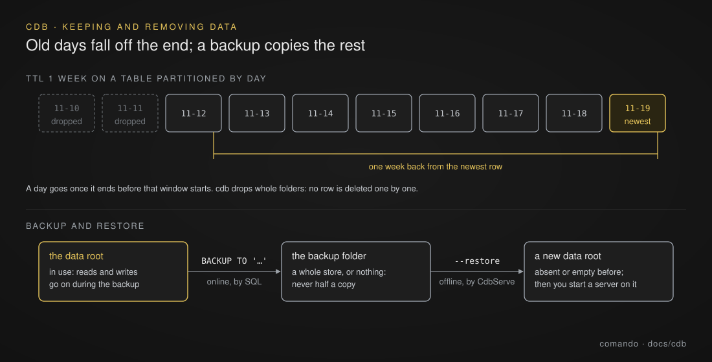

# cdb: comando's own time-series database



## In one paragraph

cdb is a small database for data that arrives with a timestamp: measurements, events, a log of what happened when.
It keeps each table as one folder per day and one file per column, so a question about Tuesday opens only Tuesday's
files. You talk to it in SQL, or you send it rows over HTTP. comando stores its own metrics in it and offers it to
you as a database to explore. It is one Java process built on the JDK alone. It speaks QuestDB's protocols, so
clients made for QuestDB or PostgreSQL connect to it unchanged.

This page is the user's guide: when to use cdb, how to run it, how to reach it, how it keeps your data, and where
its edges are. The SQL language has its own page, [cdb SQL](cdb-sql.md). The engine's internals are in
[the cdb module](modules/cdb.md).

## 1. When to use it

| cdb fits when | Pick another database when |
|---|---|
| every row carries a timestamp and rows arrive roughly in time order | rows are found by an id and updated in place all day |
| your questions are about time: the last hour, per day, the latest per device | you need a transaction that spans statements or tables |
| you want one process and one folder, with nothing to install | you need users and grants finer than "owner" and "reader" |
| a QuestDB or PostgreSQL client must connect to it | you need more than seven column types, or more than one machine |

Why comando has a database of its own:
[cdb, comando's own database](adr/0158-cdb-comandos-own-database.md).

## 2. Run it

cdb is one engine. It runs in three places, and each place has its own folder.



### 2.1 The machine's cdb

Every comando on the machine shares one cdb server. It is a process of its own, the launcher `CdbServe`, and it
keeps running when the comando that starts it quits. Whoever needs it first starts it: a comando instance, or a kit
tool. comando writes its metrics there, and the connection named `local cdb` in a fresh comando points at it.

In comando, run the command **Start the machine's cdb** ([Workbench](workbench.md) shows where it lives).

Two terms first. The **PostgreSQL wire** is the network language that PostgreSQL clients speak. **Loopback** is the
address a machine uses to talk to itself: `127.0.0.1`, also named `localhost`.

| Fact | Value |
|---|---|
| HTTP port | `9000`, bound to `127.0.0.1` |
| PostgreSQL wire port | `8812`, bound to `127.0.0.1` |
| Machine folder | `~/.comando-cdb` |
| Data root | `~/.comando-cdb/cdb/` |
| Secrets | `~/.comando-cdb/secret` and `~/.comando-cdb/secret.readonly` ([§4](#4-access-two-secrets)) |
| Registry | `~/.comando-cdb/server.json`: the process id, its owner, its ports |
| Log | `~/.comando-cdb/stdout.log`, rotated past 10 MiB when cdb starts; **Help ▸ Show cdb's log** opens it |
| Memory | a 256 MiB heap at most: `-Xmx256m`, the Java option that caps the memory for a program's objects |

The `local cdb` connection uses host `localhost`, port `8812`, user `admin`. comando fills in the owner secret as
the password when it connects, and never writes the secret into your saved connections. It does so only for
`localhost` or `127.0.0.1` on port `8812`, when the password is empty or the default `quest`. With any other
password or host, type the secret yourself.

Why one server for the machine: [cdb is the machine's server](adr/0180-cdb-is-the-machine-server.md).

### 2.2 Inside comando

A connection whose host is `cdb` opens the database inside comando itself. There is no server and no port: your SQL
panel calls the engine directly.

| Host you type | Folder it opens (comando's data root at its default, `~/.comando`) |
|---|---|
| `cdb` | `~/.comando/cdb` |
| `cdb:~/data/lab` | `~/data/lab` |
| `cdb:lab` | `~/.comando/cdb/lab` |

comando's data root is `~/.comando` unless `-Dcomando.home` or `COMANDO_HOME` names another folder. The first and
last rows move with it.

Two connections on one folder share one open database. Only one process holds a folder at a time. A second process
gets `refuse to open store another store holds [root=…]`. So you never point this at `~/.comando-cdb/cdb` while the
machine's cdb runs.

### 2.3 A server of your own

`CdbServe` serves any folder. It needs Java 25 and the cdb classes, nothing else.

```sh
java -cp <cdb jar or classes> dev.marregui.comando.cdb.CdbServe ~/data/lab 9100 \
  --pg-port 8813 --auth-dir ~/data/lab-secrets
```

It prints one line when it is ready:

```text
cdb serving [root=/Users/you/data/lab, address=127.0.0.1, port=9100, pgPort=8813, auth=true]
```

| Option | What it sets | Default |
|---|---|---|
| `<root> <port>` | the data folder and the HTTP port | required |
| `--pg-port N` | adds the PostgreSQL wire on port `N` | no PostgreSQL wire |
| `--bind ADDR` | the address both listeners bind | `127.0.0.1` |
| `--auth-dir DIR` | the folder that holds the two secrets | none: every client is the owner |
| `--log-force-ms N` | how long an answered write may wait for the disk ([§6](#6-how-a-write-becomes-durable)) | `0`: never |
| `--read-max-lag-ms N` | how stale a read may be ([§6](#6-how-a-write-becomes-durable)) | `0`: never |
| `--query-threads N` | workers that run queries in parallel | cores − 1 |
| `--restore <backup> <root>` | restores a backup and exits ([§7](#7-keeping-and-removing-data)) | |

`CdbServe` refuses to listen beyond your own machine without secrets. `--bind 0.0.0.0` with no `--auth-dir` prints
`refuse to bind a non-loopback address without --auth-dir` and exits with status 2.

From the repository, `./gradlew :cdb:serve -Proot=<folder> -Pport=9100 -PpgPort=8813` starts the same server. This
task passes no `--auth-dir`.

## 3. The three doors

cdb listens on HTTP and on the PostgreSQL wire. There is no line-protocol TCP port: rows go in over HTTP.

| Door | You send | You get | Made for |
|---|---|---|---|
| `GET /exec` | one SQL statement in the URL | JSON | scripts, `curl`, dashboards |
| `POST /write` | rows, one per line | status `204` | fast ingestion |
| PostgreSQL wire | SQL, as a PostgreSQL client | rows | pgjdbc, Grafana, comando's SQL panels |

The examples below talk to the machine's cdb. They read the owner secret first:

```sh
SECRET=$(cat ~/.comando-cdb/secret)
```

### 3.1 `GET /exec`: SQL in, JSON out

```sh
curl -G http://127.0.0.1:9000/exec -H "Authorization: Bearer $SECRET" \
  --data-urlencode "query=CREATE TABLE rooms (ts TIMESTAMP, room SYMBOL, temperature DOUBLE)
                          TIMESTAMP(ts) PARTITION BY DAY TTL 1 WEEK DEDUP UPSERT KEYS(ts, room)"
```

```json
{"ddl":"OK"}
```

A query answers with its columns, its rows and a count:

```json
{"query":"SELECT * FROM rooms",
 "columns":[{"name":"ts","type":"TIMESTAMP"},{"name":"room","type":"SYMBOL"},{"name":"temperature","type":"DOUBLE"}],
 "timestamp":0,
 "dataset":[["2026-11-18T21:06:40.000000Z","kitchen",21.5],
            ["2026-11-18T22:06:40.000000Z","attic",17.25],
            ["2026-11-19T21:06:40.000000Z","kitchen",22.0]],
 "count":3}
```

`timestamp` is the position of the table's time column, or `-1` when the result has none.

| What you send | What comes back |
|---|---|
| a query | `columns`, `dataset`, `count` |
| `CREATE TABLE` | `{"ddl":"OK"}` |
| any other change: `INSERT`, `UPDATE`, `DELETE`, `ALTER`, `TRUNCATE`, `DROP`, `BACKUP` | `{"dml":"OK","updated":n}` |
| a statement cdb refuses | status `400` and `{"query":…,"error":…,"position":…}` |

| Parameter | Meaning |
|---|---|
| `query` | the statement |
| `limit=n` | at most `n` rows |
| `limit=lo,hi` | rows `lo` to `hi`, counted from 1 |
| `max_lag_ms=n` | this read may miss writes younger than `n` ms ([§6](#6-how-a-write-becomes-durable)) |

An error names what is wrong and where. `SELECT nope FROM rooms` answers
`"error":"cannot find column [column=nope]","position":7`.

### 3.2 `POST /write`: rows in, as line protocol

Each line is one row: the table, its tags, its fields, its time.

```sh
curl -X POST "http://127.0.0.1:9000/write?precision=s" -H "Authorization: Bearer $SECRET" \
  --data-binary 'rooms,room=kitchen temperature=21.5 1795036000
rooms,room=attic temperature=17.25 1795039600
rooms,room=kitchen temperature=22 1795122400'
```

| Part of a line | Example | Becomes |
|---|---|---|
| table | `rooms` | the table; cdb creates it when it is missing |
| tag | `room=kitchen` | a `SYMBOL` column |
| field, whole number | `count=3i` | `LONG` |
| field, number | `temperature=21.5` | `DOUBLE` |
| field, text | `note="door open"` | `VARCHAR`; into an existing `JSON` column, the text must be JSON or the line is refused |
| field, true or false | `ok=t` | `BOOLEAN` |
| field, time | `seen=1795036000000000t` | `TIMESTAMP`, in microseconds |
| trailing number | `1795036000` | the row's time; left out, cdb uses the arrival time |

| Parameter | Meaning |
|---|---|
| `precision` | the unit of the trailing time: `n` nanoseconds (the default), `u` microseconds, `ms`, `s` |
| `durable=true` | answer only when the rows are on the disk |

A table that cdb creates this way gets a time column named `timestamp` and `PARTITION BY DAY`. A field cdb has not
seen adds a column.

cdb reads the whole body before it writes anything. One malformed line refuses the body with status `400`, and
nothing is written:

```json
{"code":"invalid","message":"could not parse field value [line=1, offset=13]","line":1}
```

Bodies that arrive together for one table share one commit, so many small writers cost one trip to the disk. A body
that spans several tables commits table by table.

### 3.3 The PostgreSQL wire

cdb speaks PostgreSQL's protocol 3.0, the way QuestDB does on port `8812`. A PostgreSQL driver connects as it
would to PostgreSQL.

| Setting | Value |
|---|---|
| host, port | `127.0.0.1`, `8812` for the machine's cdb |
| user, database | any name; cdb ignores both |
| password | the owner secret or the read-only secret |
| SSL | not offered; the client must allow a plain connection |

```text
jdbc:postgresql://127.0.0.1:8812/qdb
```

Simple queries, prepared statements with `$1` parameters and query cancellation all work. There are no
transactions: each statement applies when it runs, and `BEGIN`, `COMMIT` and `ROLLBACK` change nothing. A `JSON`
column is described as PostgreSQL's `json` (type OID 114), so a client shows it as JSON; its values are their text.

A session has two settings of its own:

| Statement | Effect on this session |
|---|---|
| `SET cdb.max_lag_ms = 200` | reads may miss writes younger than 200 ms |
| `SET cdb.durable = on` | every write waits for the disk before it answers |
| `RESET cdb.max_lag_ms`, `RESET cdb.durable` | back to the server's default |

## 4. Access: two secrets

cdb has no user accounts. It has two secrets, and each one is a role.



| File in the auth folder | Role | May run |
|---|---|---|
| `secret` | owner | every statement, and `/write` |
| `secret.readonly` | reader | `SELECT`, `SHOW` and `EXPLAIN` only |

Each secret is 64 hexadecimal characters, made from 32 random bytes. cdb creates both files at its first start, and
only your user can read them. To rotate a secret, delete its file and restart cdb.

| Door | How you present the secret | A wrong or missing secret | A reader asks for a change |
|---|---|---|---|
| HTTP | header `Authorization: Bearer <secret>` | status `401` | status `403` |
| PostgreSQL wire | the password | SQLSTATE `28P01` | SQLSTATE `42501` |

Two more checks guard the HTTP door, before the secret is even read:

- A request with an `Origin` header is refused with `403`. Browsers add that header; scripts do not.
- When cdb is bound to loopback, the `Host` header must name `127.0.0.1`, `localhost` or `[::1]` with cdb's port.

Without `--auth-dir`, cdb serves every client as the owner. That suits a test on your own machine and nothing else.

> **Learn: why a local server distrusts the browser.** A server on `127.0.0.1` feels private, because no other
> machine can reach it. Your browser can, though, and your browser runs code from every page you visit. A hostile
> page can tell the browser to send a request to `http://127.0.0.1:9000`. Browsers mark such requests with an
> `Origin` header that names the page. cdb refuses every request that carries one, so a web page can never read or
> change your data. The secret then stops other programs and other users of your machine.

Why two secrets and not accounts:
[destructive SQL, EXPLAIN and access](adr/0182-cdb-destructive-sql-explain-and-access.md).

## 5. How data is stored

A database in cdb is a folder, the data root. Each table is a folder inside it. Each day of a table is a folder
inside that, and each column is a file.



### 5.1 Tables and their time column

A table names one `TIMESTAMP` column as its designated timestamp: `TIMESTAMP(ts)`. cdb keeps the rows sorted by it
and splits the table by it. Rows may arrive out of order; cdb sorts them into place.

### 5.2 Seven column types

| Type | Holds | On disk, per row |
|---|---|---|
| `BOOLEAN` | true or false | 1 byte |
| `LONG` | a whole number | 8 bytes |
| `DOUBLE` | a number with a fraction | 8 bytes |
| `TIMESTAMP` | an instant, in microseconds, UTC | 8 bytes |
| `SYMBOL` | a text that repeats: a room, a device, a status | a 4-byte key into the column's dictionary |
| `VARCHAR` | any text | its UTF-8 bytes, plus an 8-byte offset |
| `JSON` | one JSON text, checked when written | as `VARCHAR` |

A `SYMBOL` column stores each distinct text once, in `<column>.sym`, and a small number per row. Ten million rows
that say `kitchen` or `attic` cost four bytes each, and comparing them is comparing numbers.

### 5.3 Partitions

`PARTITION BY` chooses how much time one folder holds.

| `PARTITION BY` | One folder holds | A folder's name |
|---|---|---|
| `HOUR` | one hour | `2026-11-19T14` |
| `DAY` | one day | `2026-11-19` |
| `WEEK` | one week | `2026-W47` |
| `MONTH` | one month | `2026-11` |
| `YEAR` | one year | `2026` |
| `NONE` | the whole table | `default` |

On disk each name ends with the number of the transaction that wrote the folder, as in `2026-11-19.2`. When cdb
must rewrite a day, it writes a new folder under a new number. A reader that began earlier keeps the old folder
until it finishes.

A day is rewritten when a commit's rows land among rows it already holds. cdb then streams the old folder and the
new rows into the new folder, column by column, a MiB at a time: the heap a rewrite needs grows with the commit,
not with the day, so a day many times the size of the heap rewrites within it. If the rewrite fails part way,
cdb deletes the new folder before the commit reports the failure, and the old folder stays the table's. Opening a
table deletes any folder its `_txn` file does not name.

Days are UTC days.

### 5.4 What a query touches

The picture shows the whole trick. This query needs one day and two columns, so cdb opens two files:

```sql
EXPLAIN SELECT avg(temperature) FROM rooms WHERE ts >= '2026-11-19'
```

```text
Aggregate keys=[] aggs=[avg(temperature):DOUBLE=avg($2)] -- parallel over frames
  Filter >=($0, 2026-11-19T00:00:00Z) -- per frame on the pool
    Scan rooms [0, 1, 2] [2026-11-19T00:00:00Z, +inf) -- reads [ts, temperature], frames on the pool
```

The scan line says it all: the time range it reads, and the columns it reads. `EXPLAIN` is your tool to check
that a query touches as little as you expect.

> **Learn: columnar storage.** Picture a table on paper. A row store keeps it row by row: all of Monday's first
> reading, then all of the second. A column store keeps it column by column: every time, then every room, then
> every temperature. To average the temperature, a row store reads everything, and a column store reads one column.
> A column also holds one kind of value, so it packs tightly and a processor runs through it fast. cdb is a column
> store: each column is its own file of fixed-size values, and a query maps only the files it names.

> **Learn: a B-tree or time partitions.** Most databases find rows with a B-tree: a sorted index, like the index
> of a book, that leads to any row in a few steps. It is great for "find order 4711". Each insert must also update
> the tree, wherever that row belongs. Time-series data has a simpler shape: new rows come at the end, and questions
> ask for ranges of time. So cdb keeps no tree. It sorts rows by time and cuts them into folders by day. It finds
> the start of a range by halving the day's timestamps until it lands. Dropping a day is deleting a folder.

## 6. How a write becomes durable

"Durable" means the data survives a crash or a power cut. cdb answers a write only after one small, safe step, and
does the heavy work later.



1. A commit arrives: an `INSERT`, or a batch of line-protocol rows.
2. cdb appends one record to the table's log, the file `_wal`.
3. cdb forces that record to the disk.
4. cdb answers. From here on, the commit survives a crash.
5. Later, a background thread, the applier, moves logged commits into the column files, sorted and deduplicated.
6. A checkpoint forces the column files, replaces `_txn`, and cuts the log short.

Big changes skip the log and write the column files directly: a commit of 100,000 rows or more, a change to the
table's definition, `TRUNCATE`, `DELETE`, `UPDATE`, and dropping partitions.

After a crash, cdb opens each table at its last checkpoint, replays the records still in the log, and checkpoints.
If the crash cut the last record in half, cdb discards that half. Such a record belongs to a commit that never got
its answer.

> **Learn: the write-ahead log.** Writing a row into sorted column files touches several files, and a crash halfway
> leaves a mess. So a database first writes down what it is about to do, in a file it only ever appends to. An
> append is one write in one place, and it is quick to push to the disk. If the machine dies, the database reads
> that log at the next start and finishes the job. The log comes ahead of the real write, hence the name. In cdb
> the log is `_wal`, one per table, and the applier is the part that catches up.

> **Learn: a checksum (CRC).** How does cdb know that a log record is whole? Before it writes a record, it runs
> the record's bytes through a formula that yields a short number, a checksum. It stores that number with the
> record. On reading, it runs the formula again and compares. A record cut short by a crash, or damaged on the
> disk, gives a different number with near certainty. cdb uses the checksum CRC32C on every log record.

### 6.1 Two dials: how safe, how fresh

By default cdb is as safe and as fresh as it can be. You can trade a little of either for speed.

| Dial | Default | You may relax it | Where |
|---|---|---|---|
| Safety of a write | every commit reaches the disk before its answer | answer first, reach the disk within `N` ms | `--log-force-ms N` |
| Freshness of a read | a read sees every write answered before it began | a read may miss writes younger than `N` ms | `--read-max-lag-ms N`, `max_lag_ms=N`, `SET cdb.max_lag_ms` |

With `--log-force-ms N`, a crash of the cdb process still loses nothing. A power cut can lose the answered writes
of about the last `N` ms. One write can insist on the disk anyway: `durable=true` on `/write`, or
`SET cdb.durable = on`.

Readers and writers do not wait for each other. Any number of readers run at once, each on a fixed snapshot of the
table. One writer at a time changes a table.

The reasons, in order:
[the write-ahead log](adr/0161-cdb-write-ahead-log.md),
[commits applied from the log](adr/0162-cdb-applies-commits-from-its-log.md),
[the timed log force](adr/0166-cdb-timed-log-force.md).

## 7. Keeping and removing data



### 7.1 TTL: old data leaves by itself

A table with `TTL 1 WEEK` keeps about a week of data. cdb counts back from the table's newest row, not from the
clock, and drops each partition that ends before that window starts. It drops whole folders, so expiry costs
almost nothing.

```sql
ALTER TABLE rooms SET TTL 1 MONTH
```

A TTL must be a whole number of partitions. `SET TTL 36 HOURS` on a table partitioned by day is refused:

```text
cannot set TTL that is not a multiple of the partition size [table=rooms, ttl=36 HOURS, partitionBy=DAY]
```

A table with `PARTITION BY NONE` takes no TTL. A row stamped in the future does not expire the rest: cdb then
counts back from now.

### 7.2 Remove data yourself

| You want to | Statement | Cost |
|---|---|---|
| drop one day | `ALTER TABLE rooms DROP PARTITION LIST '2026-11-18'` | deletes a folder |
| drop days by a condition | `ALTER TABLE rooms DROP PARTITION WHERE ts < '2026-11-01'` | deletes folders |
| empty the table | `TRUNCATE TABLE rooms` | deletes every folder |
| remove chosen rows | `DELETE FROM rooms WHERE …` | writes the table's folders anew |
| remove the table | `DROP TABLE rooms` | deletes the table's folder |

### 7.3 Replace a row instead of adding one

`DEDUP UPSERT KEYS(ts, room)` makes a pair of time and room unique. A second row with the same pair replaces the
first one, whole. The keys must include the designated timestamp. A client can then send a batch twice without
creating duplicates.

### 7.4 Backup

```sql
BACKUP TO '/backups/2026-11-19'
```

cdb copies every table into that folder while reads and writes go on. The answer counts the tables:
`{"dml":"OK","updated":2}`.

- The folder is an absolute path outside the data root, and it must not exist yet.
- cdb builds the copy beside it, under a temporary name, and renames it when it is whole. The folder holds a
  complete backup or nothing.
- Each table is copied at one committed moment. Two tables may be copied at slightly different moments.
- A backup costs a full rewrite of every table. Only the owner secret may run it.

### 7.5 Restore

A backup is itself a cdb data root. To restore, stop the server and run:

```sh
java -cp <cdb jar or classes> dev.marregui.comando.cdb.CdbServe --restore /backups/2026-11-19 ~/data/lab
```

```text
cdb restored [backup=/backups/2026-11-19, root=/Users/you/data/lab, tables=[clicks, rooms]]
```

The target root must be absent or an empty folder. cdb refuses a root that holds anything:
`refuse to restore into a data root that is not empty`. Restore starts no server; start one on the new root after.

The reasons: [column changes, backup and IN subqueries](adr/0183-cdb-column-changes-backup-and-in-subqueries.md).

## 8. Watch it

cdb answers questions about itself in SQL. Each of these is a statement you run through any door.

| Statement | Shows |
|---|---|
| `tables()` | every table: its time column, partitioning, TTL, dedup, row count |
| `SHOW CREATE TABLE rooms` | the statement that recreates the table |
| `SHOW COLUMNS FROM rooms` | each column, its type, whether it is a dedup key |
| `SHOW PARTITIONS FROM rooms` | each partition: its time range, rows, size on disk |
| `wal_tables()` | each table's log state, and whether the table is suspended |
| `wal_apply_stats()` | how far the applier is behind: pending commits, rows, bytes, lag |
| `EXPLAIN <query>` | the plan: the time range and the columns the query reads |

A table shows `suspended` when cdb fails three times in a row to apply its log, or once when the failure is an
error such as running out of memory, which may leave its files half-written. It then refuses new commits and
keeps the logged ones. `last_error` in `wal_apply_stats()` says what went wrong. To bring the table back, restart
cdb: it reopens the table and replays the log.

The server's own log is its standard output. For the machine's cdb that is `~/.comando-cdb/stdout.log`. It names
request paths and never the text of a query.

## 9. Limits

Every limit refuses loudly. cdb never cuts a result short in silence.

| What | Limit | When you reach it |
|---|---|---|
| Time for one query | 60 s | HTTP `408`; PostgreSQL wire SQLSTATE `57014` |
| Rows in one result | 1,000,000 | HTTP `400`; PostgreSQL wire SQLSTATE `54000` |
| Groups in memory (`GROUP BY`, `SAMPLE BY`, `LATEST ON`) | 1,000,000 | `cannot hold more groups in memory [limit=1000000]` |
| Distinct rows in memory (`DISTINCT`) | 1,000,000 | `cannot hold more distinct rows in memory [limit=1000000]` |
| Rows an `IN` subquery returns | 1,000,000 | `cannot run an IN subquery past its rows [limit=1000000]` |
| Body of one `/write` | 16 MiB | the request is refused |
| `/write` bodies held at once | 64 MiB | `503` after 5 s of waiting |
| HTTP requests in flight | 64 | the connection is closed |
| PostgreSQL wire connections | 64 | cdb serves no further connection |
| An idle PostgreSQL wire connection | 300 s | cdb closes it |
| Prepared statements on one connection | 1,024 | the statement is refused |
| Tables in one data root | 1,000 | `CREATE TABLE` is refused |
| Columns in one table | 1,024 | the statement is refused |
| A table or column name | 127 characters | the statement is refused |
| Processes on one data root | 1 | `refuse to open store another store holds` |

A statement that changes data has no deadline: once started, it runs to its end.

## 10. cdb and QuestDB

cdb speaks QuestDB's protocols and follows its rules where it implements a feature. It is its own engine with its
own files, and it is much smaller.

| Topic | Same as QuestDB | Different in cdb |
|---|---|---|
| HTTP | `/exec` with its JSON and parameters; `/write` with its line protocol and error shape | no other HTTP path: no web console, no CSV import or export |
| Line protocol | the syntax, and how a missing table and a new column are created | over HTTP only; no TCP port `9009` |
| PostgreSQL wire | port `8812` by convention; reports server version `11.3` as QuestDB does | the password is a cdb secret; user names mean nothing |
| SQL | the time-series extensions cdb implements keep QuestDB's syntax | a subset; a statement outside it fails with a clear error ([cdb SQL](cdb-sql.md)) |
| Types | `NULL` is stored as QuestDB stores it | seven types; `INT`, `FLOAT`, `STRING` and `DATE` map onto them; `JSON` is cdb's own: QuestDB keeps JSON in `VARCHAR` |
| Listings | `tables()`, `wal_tables()`, `SHOW PARTITIONS`, `SHOW COLUMNS` use QuestDB's column names | `wal_apply_stats()` is cdb's own |
| TTL | the same rule for which partition expires | |
| Files on disk | | cdb's own format; neither database opens the other's folder |
| Access | | two secrets, not users |

To move data between the two, read it out of one through SQL and send it to the other through `/write`.

## Where next

- [cdb SQL](cdb-sql.md): the language, statement by statement.
- [Tutorial](tutorial.md): a first session, hands on, with the machine's cdb, a connection, SQL and plots.
- [The cdb module](modules/cdb.md): the engine inside, its packages, threads and measurements.
- [Workbench](workbench.md): connections, SQL panels and the machine's cdb in comando's window.
- [Architecture](architecture.md): where cdb sits among comando's modules and processes.
