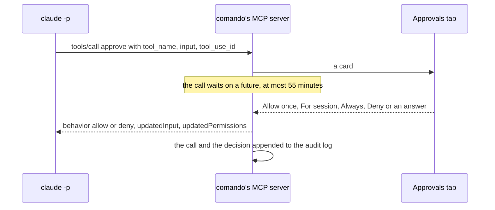

# Claude

How comando runs Claude Code, what a session can do in the window, and what it must ask for. It is for a user who
wants to know what a session may change without asking, and for a contributor working on the `claude` and `mcp`
modules.

1. [The Claude bridge](#1-the-claude-bridge)
2. [MCP tools](#2-mcp-tools)
3. [Approvals and safety](#3-approvals-and-safety)

## 1. The Claude bridge

comando runs Claude Code as one child process per session, speaks stream-JSON over its standard input and output, and
maps the stream into transcript blocks and intents. The CLI facts below were verified with recorded probes against
Claude Code 2.1.296 (fixtures in `testkit`), and against 2.1.300 for background tasks.

### 1.1 The process

```
claude -p --input-format stream-json --output-format stream-json --verbose \
  --include-partial-messages --forward-subagent-text --include-hook-events \
  ( --session-id <new uuid> | --resume <id> | --resume <id> --fork-session ) \
  --name <session name> \
  --mcp-config <run>/<session>-<uuid>.mcp.json --permission-prompt-tool mcp__comando__approve \
  --append-system-prompt <comando's UI instructions> \
  [--model m] [--effort e] [--permission-mode p] [--add-dir d]... [--max-budget-usd n]
```

- **Start mode.** A new session gets a fresh id; a session resumes its own conversation. An imported conversation is
  forked on its first start, and a cloned session forks its source's conversation, so two processes never write one
  conversation ([record 4](adr/0004-a-session-open-in-another-terminal.md)).
- **Not `--bare`.** The session loads CLAUDE.md, hooks, plugins, skills and the user's MCP servers as a terminal session
  does. The login is the CLI's own; comando stores no key.
- **The root.** Every `claude` comando starts runs on one Claude Code folder, the root: with
  `CLAUDE_CONFIG_DIR=<root>` in its environment when the root is not `~/.claude`, and, when the root holds a kit,
  `--settings '{"autoMemoryDirectory": "<root>/<brain>/MEMORY"}'` (`RootLaunch`,
  [Workbench §7.1](workbench.md#71-the-root)). The session named `kit` that upgrades the kit runs on the user's own
  `~/.claude` instead when the root is `~/.claude` or inside it; a sibling kit such as `~/.claude_b` keeps its own root
  ([record 122](adr/0122-instances-name-kit-brain-data-root-edge.md)).
- **An agent's session.** A session with a creator (`createdBy`) runs with `COMANDO_CREATED_BY=<creator>`, so a kit's
  hooks can tell it from a person's; every other process has the variable taken out
  ([record 121](adr/0121-an-agent-has-every-action-the-user-has.md)).
- **MCP configuration.** One file per running process under `run/` in the data root, mode `0600` from creation, named
  after the session and a random UUID. It names comando's server, the process's bearer token, and `"timeout": 3600000`,
  which lets an approval card wait up to 55 minutes. Deleted when the process exits; files a killed comando left are
  deleted at the next start.
- **Working directory.** The session's; the session bar shows its git branch, read from `.git/HEAD` after each turn.
- **Threads.** stdout is read on a platform thread, `claude-out-<session>`, the one operating-system thread a session
  costs: a read of a process pipe holds its carrier thread even from a virtual thread (measured on JDK 25). The stdin
  writer, fed by a queue, and the exit waiter are virtual threads. stderr goes to a temporary file (`0600`) whose last
  40 lines are read at the exit, for the error message, and the file deleted. Every change to the session runs on its
  strand, `claude-strand-<session>`, a single-threaded virtual executor, so the transcript has one writer.
- **Instructions.** `--append-system-prompt` carries `UiInstructions`: the tools and when to use them (a view when a
  table, plot or diff shows a result better than text; explanations stay in text).
- **Other runs.** Besides one process per running session, comando runs `claude --safe-mode -p /usage` at start and
  every 5 minutes for the plan's usage (no prompt, no saved session; 30 s bound), `claude --version` once at start
  ([§1.3](#13-turns-interrupt-stop)), and `claude --safe-mode -p --model haiku --effort low` for the summary on a tab's
  card, one at a time (30 s bound); each runs on the root, as a session does. After each `/usage` read, the same thread
  runs `codex app-server` for the Codex plan's usage (`account/rateLimits/read`, no prompt; 10 s bound), when Codex is
  installed.

### 1.2 Mapping the stream

| Event | Becomes |
|---|---|
| `system/init` | an init note when the model changed; `SessionInit` with the conversation id (the next start resumes it), model, CLI version, permission mode, capabilities |
| `system/status`, `task_started`, `task_notification` | `SessionActivity` (requesting, compacting, a task's description) |
| `system/background_tasks_changed` | `SessionTasksChanged`: the open background tasks, the whole set ([record 43](adr/0043-a-session-waiting-on-background-work-shows-it.md)) |
| `stream_event` `message_start` with no parent tool call | `SessionTurnRunning`, also for a turn Claude Code started itself after background work |
| `stream_event` block start and deltas | a streaming text, thinking or tool-call block, updated in place |
| `assistant` | the final form of each block; for a message with no parent tool call, `SessionRanAt` with the model and effort it ran at, read from its line in the conversation's transcript (`RunSettings`), the turn's first marked so ([Workbench](workbench.md)) |
| `user` with `tool_result` | the result on its tool card; the card turns done or failed |
| `user` with text | the compaction summary, local command output or the interrupt marker, as notes |
| `system/compact_boundary`, `hook_response`, `api_retry`, `permission_denied` | a note of that kind |
| `result` | the pending `SessionRanAt` first; a turn end (its duration, after the error text when it failed or was interrupted; no cost shown); `SessionTurnEnded` with the queued turn count, cost, context size and context window. The context size is the input of the turn's last main-thread call; after `compact_boundary`, the compacted size; after `conversation_reset`, 0 |
| `rate_limit_event` | a note when its status is not `allowed` |
| `conversation_reset` | a note "Conversation cleared"; the context size becomes 0 until a call reports the new one |

Subagent blocks carry `parent_tool_use_id` and nest inside the card that started them. Tool results are kept to 64 kB
of text and shown to 400 lines.

### 1.3 Turns, interrupt, stop

- **Turns.** A prompt sent mid-turn is folded into the running turn; `result.queued_turn_count` reports what is still
  queued. comando counts pending turns per session and sets the count to `queued_turn_count` at each turn end; the
  session is busy while it is above zero. A turn that ends with nothing queued posts "Turn finished" or "Turn failed:
  <message>" as a desktop notification while the window is not active; a turn that handed its work to the background
  notifies when the turn Claude Code starts after that work ends, and a result while no turn ran notifies nothing.
- **Interrupt** writes a `control_request` with subtype `interrupt`. The turn ends with a `result` marked interrupted;
  its turn end reads "interrupted · <time>" in the transcript's ivory, not red; the session stays open and no "Turn
  failed" notification is sent.
- **Stop** interrupts, closes stdin, sends SIGTERM after 3 s and SIGKILL 2 s later. A prompt sent while stopping is
  refused with a notice and stays in the editor. A process that cannot start is reported once, naming `COMANDO_CLAUDE`
  or the run directory when those are the cause. A tool call left running when the process ends reads "no result: the
  session ended before the tool returned".
- **Slash commands** (`/compact`, `/clear`, `/model x`, `/effort x`) are sent as prompts; `/compact` and `/clear` work
  under `-p`. `/clear` writes `conversation_reset`, ends its turn with no model call and reports the new conversation
  in a new `system/init`: comando zeroes the context, notes the clear, and resumes the new id from then on, saying the
  previous one can be imported again.
- **The checkpoint** sends the session's checkpoint command. Once its turn has finished (nothing running, queued or out
  in the background), the `result` event's `result`, the turn's last answer, is kept as the session's carried summary
  (`SessionSpec.carried`); `/clear` is sent with its note and turn end not shown, and the transcript is emptied to the
  summary. The next prompt that is not a slash command goes to Claude with the summary in front of it, its block
  showing the prompt as typed. [Workbench §1.4](workbench.md#14-the-checkpoint) lists when the conversation is kept
  instead ([record 86](adr/0086-a-checkpoint-clears-and-carries-its-summary.md)).
- **Versions.** At start `claude --version` runs with a 5 s bound on its exit and 1 s more for its output. A version
  outside the tested line (2.1.296 up to, not including, 2.2.0) gets a warning, not a refusal; features are read from
  `system/init`'s capabilities.

### 1.4 Stored conversations

- **Import.** The session catalogue reads `<root>/projects/*/*.jsonl` (the first 64 kB for the directory and branch;
  the last 256 kB for the title, the last prompt and the latest branch) and lists the newest 500 first. An imported
  session's next start is a fork; its dialog's "Conversation" can be set to resume, which is safe only when no terminal
  holds the conversation (comando does not check).
- **History.** A session with a conversation id shows its stored transcript without starting a process. After a
  restart every session comes back closed with its transcript; nothing is sent until the user sends something, and the
  first prompt resumes the conversation. A stored conversation records no turn results; a turn ends where a message
  stopped at the end of its turn (`stop_reason` `end_turn`) and gets a turn end without time, as it did live; one cut
  off mid-turn gets none.
- **Background subagents** (observed in a `-p` stream-json run of Claude Code 2.1.302 with comando's flags;
  undocumented): an Agent call with `run_in_background` returns at once, its result text reading "Async agent launched
  successfully. … agentId: <id>"; `<id>` is the `task_id` of its `local_agent` task in `background_tasks_changed`, and
  `task_started` carries the call's `tool_use_id`. The subagent's messages keep arriving in the stream with
  `parent_tool_use_id` set to the call, so its blocks nest in the card as a foreground one's do. At its end a
  `task_notification` names the call's `tool_use_id` with `status` `completed`. The transcript reads the card as running
  in the background while the task is listed ([record 64](adr/0064-sub-agents-are-shown-live.md)).
- **Subagent files.** Not documented by Claude Code (observed with 2.1.302): beside `<session-id>.jsonl` sits
  `<session-id>/subagents/`, with per subagent `agent-<id>.jsonl` (its whole conversation, `isSidechain: true`) and
  `agent-<id>.meta.json` (`agentType`, `description`, `toolUseId` = the Agent call's id; `finished: true` once it ended,
  written by Claude Code 2.1.30x and absent from files earlier versions wrote). `SubagentFiles` finds the meta file
  whose `toolUseId` matches (files over 4 kB skipped). Its `Conversation` reads the file as it grows and hands on only
  the whole lines added since the last read; a file over 256 MB is read from where its last 256 MB start, and the tab
  says so.
- **Following a subagent.** `ClaudeAdapter.showSubagent` reads the file on the `subagent-tail` strand into a
  transcript of its own, shown as a tab in the lower panel (`ViewSpec.Agent`,
  [record 109](adr/0109-a-sub-agent-is-a-session-tab.md)); while the session runs it reads the lines the file gained
  every 2 s. It stops when the stream says the subagent ended (`StreamMapper` records the Agent call's result, unless it
  is a launch, and a background task's `task_notification`), when the meta file says `finished`, when the session
  stops, or after 10 min without growth, a backstop: a subagent writes nothing while a tool runs or the model answers,
  often for minutes. The tab's last line says whether it is still updated and, if not, why. At most 4 tabs follow at
  once; the oldest stops first. A file missing or moved by a later Claude Code gives the notice "transcript not found
  for this sub-agent" ([record 64](adr/0064-sub-agents-are-shown-live.md)). The tab itself is in
  [UI §4.2](ui.md#42-the-widget).

## 2. MCP tools

### 2.1 The server

| Property | Value |
|---|---|
| Transport | streamable HTTP, `POST /mcp` on `127.0.0.1`, an ephemeral port |
| Authentication | a 256-bit random bearer token per process (`SecureRandom`), naming the calling session; revoked when the process ends; no known token, 401 |
| Origin | an `Origin` naming a host other than `localhost`, `127.0.0.1` or `::1` gets 403, so a web page cannot call the tools; the CLI sends none |
| Protocol versions | `2025-03-26`, `2025-06-18`, `2025-11-25`; `initialize` answers the client's when supported, else `2025-06-18` |
| Methods | `initialize`, `tools/list`, `tools/call`, `ping`; notifications get 202; anything else, including the `server/discover` Claude Code sends first, gets method-not-found |
| Implementation | JSON-RPC over the JDK's `HttpServer` and Jackson, a virtual thread per request; no MCP library |

### 2.2 The tools

| Tool | Arguments | Does |
|---|---|---|
| `approve` | `tool_name`, `input`, `tool_use_id` | Claude Code's permission prompt: a card, and a wait for the answer ([§3](#3-approvals-and-safety)) |
| `ui_show_table` | `title`, `columns`, `rows`, `placement` | a table view |
| `ui_plot` | `title`, `x_label`, `y_label`, `time_x`, `series` (`name`, `x`, `y`), or `x` and `y` for one series named after the title, `placement` | a plot; with `time_x`, x is epoch milliseconds; an array sent as JSON text reads as the array |
| `ui_show_view` | `type`, `title`, `data`, `placement` | a `markdown`, `diff`, `text`, `tree`, `table` or `plot` view |
| `ui_set_editor` | `text`, `panel`, `force` | replaces a panel's text, one step the user's ⌘Z undoes |
| `ui_insert` | `text`, `panel`, `mode`, `force` | adds text as its own block: at the end (`append`), or after the block that ran last (`insert`); the user's caret and selection stay put |
| `ui_open_file` | `path`, `line` | shows a file in the side pane: Markdown rendered when no `line` is given, other text read-only at the line, binary said so; `~/` and relative paths resolve; at most 4 MB |
| `ui_notify` | `text`, `level` | a status-bar message, and a desktop notification while the window is not active |
| `ui_get_state` | none | panels with bindings and last run, connections, sessions (busy, `waitingOn`), open views |
| `ui_set_layout` | `panel`, `lower_tab`, `sidebar`, `side_pane`, `lower_share` | without `panel`, selects `lower_tab` at once while the user looks at a panel of this session; with `panel` (one of this session's), focuses it and selects the tab once the user has not typed for 2 s, if the panel is still this session's; panes and the lower share change after the same pause; Restore layout in the palette undoes it |
| `ui_close_view` | `id` | closes a view this session placed; the user's or pinned views are refused |
| `db_run_sql` | `sql`, `connection`, `max_rows`, `show`, `title` | runs SQL on the connection's lane under the policy ([§3.2](#32-sql-from-claude)); returns the first result as tab-separated text; `show` also opens it as a table |
| `db_describe` | `table`, `connection` | a table's columns and types |
| `session_send` | `session`, `text` | prompts another running session with an open panel, headed `[from session <sender>]`, without a card ([record 44](adr/0044-sessions-prompt-each-other-without-asking.md)); returns a cursor for `session_read` |
| `session_read` | `session`, `after`, `wait_seconds` | another session's transcript as numbered blocks after a cursor, or the last 40; `wait_seconds` (≤ 600) waits until its turns are over |
| `instances_list` | none | the other comando instances present on the comando Edge: name, id, version, busy, their sessions with what each busy one is doing and its last prompt's first line ([record 123](adr/0123-instances-consult-each-other.md), [124](adr/0124-the-sidebar-shows-the-instances.md)) |
| `instance_ask` | `instance`, `text`, `wait_seconds` | asks another instance: its session `consult-<this instance>` is prompted in its panel, headed `[from instance <name> · session <s>]`; the reply is Claude's text in the turn that answers it; waits up to `wait_seconds` (default 300, ≤ 600), else returns an id |
| `instance_reply` | `id`, `wait_seconds` | the reply to an earlier `instance_ask` by its id, read once |

**Every action the user has** ([record 121](adr/0121-an-agent-has-every-action-the-user-has.md)). The tools above,
except the three instance tools, are entries of `core`'s registry `action/Actions`; its other entries are tools too,
named `<area>_<verb>`, their schemas built from the registry, performed by `ActionTools` with the intents the window
sends for the same gesture:

| Area | Tools |
|---|---|
| sessions | `session_new` (name, work dir, model, effort, permission mode, extra directories, checkpoint, and an optional first `prompt` that starts it), `session_edit`, `session_open`, `session_start`, `session_stop`, `session_interrupt`, `session_fresh`, `session_checkpoint`, `session_command`, `session_model`, `session_effort`, `session_order`, `session_import`, `session_subagent`, `session_clear`*, `session_remove`* |
| panels | `panel_add`, `panel_close`, `panel_reopen`, `panel_rename`, `panel_move`, `panel_focus`, `panel_bind_session`, `panel_bind_connection`, `panel_run`, `panel_cancel`, `panel_refresh`, `panel_remove`* |
| approvals | `approval_answer` (allow with a scope, deny with a message, or answer an AskUserQuestion card) |
| connections | `connection_save`, `connection_test`, `connection_open`, `connection_close`, `connection_schema`, `connection_remove`* |
| views and the window | `view_pin`, `view_close`, `notice_dismiss` |
| servers | `server_start`, `server_stop` (`edge` or `questdb`: what the toggles at the top of the workspace do; a server already in the state asked for is left alone, an Edge another instance started is not stopped; `ui_get_state` lists `servers`) |
| commands and folders | `gradle_run`, `command_cancel`, `folders_browse` |

- **Creator.** A session made by `session_new` or `session_import` records its caller in `createdBy` (`sessions.json`;
  empty for the user); an edit keeps it.
- **First prompt.** `session_new`'s `prompt` goes out as `PromptSession`, which the reducer sends to the session's own
  panel, the one created with it ([record 88](adr/0088-a-session-and-its-panel-share-a-name.md)), whatever panel the
  user has focused meanwhile.
- **Rule 1.** `approval_answer` refuses a card raised by the caller, or by a session the caller created, directly or
  through others.
- **Rule 2.** A destructive tool (marked * above) runs only for a caller the user granted it in the data root's
  `agents.json`, `{"grants": {"<caller>": ["destructive"]}}`, read at each call; `session_clear` and `session_remove`
  also run for the session's creator, directly or through others, so a caller cleans up the sessions it made.
- **Start rule.** `session_start` and `session_fresh` run only for the session's creator; stopping and interrupting are
  open to every caller ([record 44](adr/0044-sessions-prompt-each-other-without-asking.md)'s breaker, amended).
- **Notice.** Every act names its caller in the status bar (`foreman: session new — …`).
- **Not yet.** The Files tab's git changes and entries (open a change, delete, roll back, remove, unstage) and the
  folders window; `Actions.NOT_YET` names each with the reason, and `ActionParityTest` fails for any other intent the
  window sends without an action.
- **Other instances** ([record 123](adr/0123-instances-consult-each-other.md)). `instances_list`, `instance_ask` and
  `instance_reply` are not in the registry: the window has no gesture for them and they send no intent of their own, so
  `ActionParityTest` holds without them. They work while this instance is connected to the comando Edge
  ([workbench §3.5](workbench.md#35-the-comando-edge)); otherwise each says so and how to start it. The instance asked
  makes `consult-<asker>` on the first question (in the home folder, created by `peer:<asker>`), prompts it with
  `PromptSession`, so its user sees the question in that session's panel, and replies when the turn ends: `ok` with the
  text (at most 64 kB), `refused` for an asker its user denied in `agents.json` (`{"peers": {"deny": ["<id>"]}}`),
  `timeout` when the turn has not ended within 600 s, `error` otherwise. A brainstorm has no tool of its own: a session
  asks each instance in turn and passes the others' answers on, as `instance_ask`'s description says.
- **What an agent sees.** `ui_get_state` adds each session's model, effort and creator, the closed panels, the pending
  approval cards (id, session, kind, tool, summary), the Files tab's folders, the local servers and the other instances
  on the comando Edge (`instances`: connected, and each one's name, id, role, version, busy, whether it is refused,
  whether it is present or one that left, and whether it started the Edge;
  [record 124](adr/0124-the-sidebar-shows-the-instances.md)).

- **Scope.** Without `panel`, the editor tools write to the focused panel when it is bound to the calling session, else
  to the session's own panel, else to a document attached to it. A session with no panel open gets a tool error that
  names the panels to pass, and says when its own panel is closed. A panel bound to another session needs `force`; a
  log panel takes no text. Without `connection`, the database tools use the connection of that same panel, or of the
  session's own panel while it is closed. Every edit posts a notice naming the session, panel and change. Every call
  gets an answer; an unexpected failure is a tool error.
- **Validation.** Every view argument is checked before an intent is sent; an invalid spec is a tool error that names
  the problem and changes nothing. Limits: 100 000 table rows, 2 000 000 plot points, 200 SQL rows to Claude by default
  and up to 10 000 with `max_rows`, 64 kB of text to Claude.
- **Placement.** A session's view replaces that session's unpinned view with the same title and placement, without
  moving the user to it. The first placement selects the new tab only for the session bound to the focused panel;
  another session's adds the tab and posts a notice. Titles are clipped to 80 characters; a file is titled with its
  folder (`docs/README.md`). A pinned view is never replaced.
- **Audit.** Every tool call and approval decision is appended to `audit/audit-<UTC date>.jsonl` in the data root:
  time, session, event, tool, the arguments (clipped to 2 000 characters), the outcome. Never read back.
- **Metrics.** What the sessions spend and how their work ends is appended to `metrics/metrics-<UTC date>.jsonl` in the
  data root, one JSON object a line with `ts` and `event` ([record 110](adr/0110-metrics-for-calibration.md)): `turn`
  at each `result` (model, base effort, duration and API time, model calls, the turn's `usage` and `modelUsage` as
  Claude Code sends them, context and window, how it ended); `agent` at each sub-agent's end, live only (the Agent
  call's type, description and model asked, the parent's model, background, status, start and duration, the tool calls
  inside it at any depth, and its `spend` read from its own file: model calls, tokens by kind, models); `usage` at each
  plan-usage read (provider, window, percent, reset). Money fields are kept as they arrive and shown nowhere. Read by
  the kit's calibration, never by comando.

## 3. Approvals and safety

### 3.1 Approval cards

`--permission-prompt-tool mcp__comando__approve` makes Claude Code ask comando before each tool call its permission
rules do not settle. Each request is a card in the Approvals tab; the MCP call waits on a future until the user
answers.




| Kind | Raised by | Answers |
|---|---|---|
| tool | Bash, Edit, Write, an MCP tool | Allow once (⏎ or A), For session (S), Always (L twice; Bash and WebFetch only), Deny (D or Esc) |
| question | `AskUserQuestion` | Answer (⏎ or A, once every question has one), Skip (D or Esc); each question's Other answer is a plain text box in the editors' font, five lines of 120 characters (⏎ a new line; undo, redo, cut, copy, paste, select all; only Answer sends it), gone with the card; answers return in `updatedInput.answers` |
| plan | `ExitPlanMode` | Approve plan (⏎ or A), "Approve, auto-accept edits" (`setMode` `acceptEdits` for the session), Keep planning (D or Esc) |
| SQL write | `db_run_sql`, not read-only | Run (⏎ or A), Deny (D or Esc); the card names the connection and statement |

"For session" and "Always" return an `addRules` update with destination `session` or `localSettings`. The rules follow
how Claude Code matches them and never allow more than the command could do (`PermissionRules`):

| Tool | Rule | Always |
|---|---|---|
| Bash | one per subcommand of `&&`, `\|\|`, `;`, `\|`, `&` and newlines, after the wrappers Claude Code strips (`timeout`, `time`, `nice`, `nohup`, `stdbuf`, `command`, `builtin`, `noglob`): the command's prefix with `:*`, one word (`Bash(ls:*)`), two for commands with subcommands (`Bash(git commit:*)`), three for runners (`npm run test:*`) and `python -m <module>`. The exact command instead for anything that runs other code (`sudo`, `env`, `xargs`, `eval`, shells, interpreters, `ssh`, `rm`, `docker exec`, `find -exec`, …), nested commands, here-documents, and prefixes holding a quote, `$`, `=` or an option | yes |
| WebFetch | `domain:<host>` | yes; a URL with no host, the tool for the session only |
| Edit, Write, MultiEdit, NotebookEdit | `Edit(//abs/dir/**)`, the file's directory | no |
| Read, Glob, Grep | `Read(//abs/dir/**)`; without a `path`, the tool | no |
| MCP and other tools | the tool | no |

- The card shows the rule its answer adds. Always writes the project's `.claude/settings.local.json`, so its key must be
  pressed twice within 3 s; Esc cancels a pending Always before it denies.
- A denial carries the note typed on the card. In the note, ⏎ denies once it holds text and gives the primary answer
  while empty; ⌘⏎ denies with the note. ↑ and ↓ move between cards. The keyboard is never taken from outside the tab.
- A new card brings the Approvals tab forward; the keyboard stays where it is, so typing in the editor goes on. While a
  card waits, its tool call reads "waiting for your approval · ⌃2" in the Session tab.
- The Approvals tab comes forward at its top, the oldest card first, however it is brought forward (a new card, a
  click, ⌃2); a card arriving while it is in front, or while the keyboard is in a card, moves nothing.
- Answering the last card while the Approvals tab is in front brings the Session tab forward, on the panel of the
  session that asked, with the keyboard; a card withdrawn, or answered after the user moved to another tab, moves
  nothing.
- A card is withdrawn and its call denied when Claude Code cancels the call, the process exits, or the session is
  removed. A SQL card is also withdrawn at a turn end with nothing queued and no background work; while background work
  runs every card stays ([record 43](adr/0043-a-session-waiting-on-background-work-shows-it.md)).
- A card unanswered for 55 minutes is withdrawn and denied; at exit every waiting card is denied.

### 3.2 SQL from Claude

`db_run_sql` runs on the connection's lane behind the user's runs, waits at most 90 s (a statement still queued is then
withdrawn; one running ends at its 60 s statement timeout), and is not stopped by the user's ⌘..

| Statement | Ordinary connection | Production connection |
|---|---|---|
| read-only | runs | runs |
| not read-only | a card; runs on Run | refused; nothing runs |

A statement is read-only when, comments removed: its first word is `SELECT`, `WITH`, `SHOW`, `EXPLAIN`, `DESCRIBE` or
`TABLES`; no later word outside quotes writes or locks (`INSERT`, `UPDATE`, `DELETE`, `MERGE`, `UPSERT`, `INTO`,
`CREATE`, `DROP`, `ALTER`, `TRUNCATE`, `GRANT`, `REVOKE`, `COPY`, `CALL`, `VACUUM`, `REINDEX`, `CLUSTER`, `LOCK`,
`REFRESH`, `NOTIFY`, `SHARE`); and it holds no semicolon between statements, no `$` outside quotes and no backslash
inside a quoted string. This catches writes behind a read-only first word (a data-modifying CTE, `EXPLAIN ANALYZE` of a
write, `SELECT … INTO`, `SELECT … FOR UPDATE`) and refuses what the scanner cannot settle. It cannot see a function
with side effects called from a `SELECT`, so a production connection should use a role without write privileges: the
check guards against mistakes and is not access control. Text with several statements is never read-only: a card on an
ordinary connection, refused on a production one.

A production connection frames its panels in red, shows a red "prod" on its sidebar row, refuses Claude's writes, and
runs the user's own statements as typed.

### 3.3 Secrets

| Secret | Where it lives |
|---|---|
| Claude login | Claude Code's own; comando never sees an API key |
| MCP tokens | the session's MCP configuration under `run/`, mode `0600`; deleted when the process exits and at exit; files a killed comando left are deleted at the next start |
| Database passwords | the macOS login keychain, service `comando`, account = connection name, through `/usr/bin/security`; `connections.json` keeps an empty password. Used for the default data root, and for another only with `-Dcomando.keychain=true`; otherwise the password stays in `connections.json` |
| Intent log | every `password` field blanked |

The keychain tool takes the password as an argument, so it is visible in the process list for the milliseconds the tool
runs; it never reaches a file. Passwords are read with `find-generic-password -g`, so any UTF-8 password round-trips.
Every keychain call is bounded at 10 s; when the keychain cannot be asked, the connection loads without its password
and later saves keep the stored item. Copy details on a connection never includes the password.

### 3.4 Text is never rendered as HTML

Swing renders a label, button, tooltip, tab title or table cell as HTML when its text starts with `<html>`, and loads
the images it names. Text from Claude, a database or a stored conversation goes through `Plain` (renderers with HTML
off; a guard character before an `<html>` prefix). Markdown shows only pictures that are files on this machine, an SVG
among them loading only files beside it; any other image is its alt text
([record 58](adr/0058-markdown-shows-the-pictures-beside-it.md)). No content reaching the window makes comando issue a
network request; a link opens in the browser only at the user's double click.
