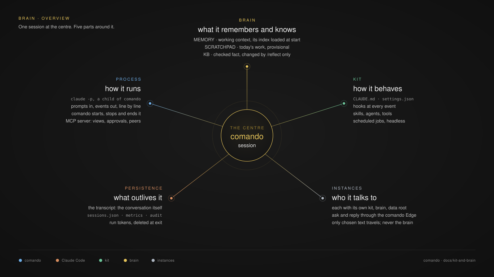
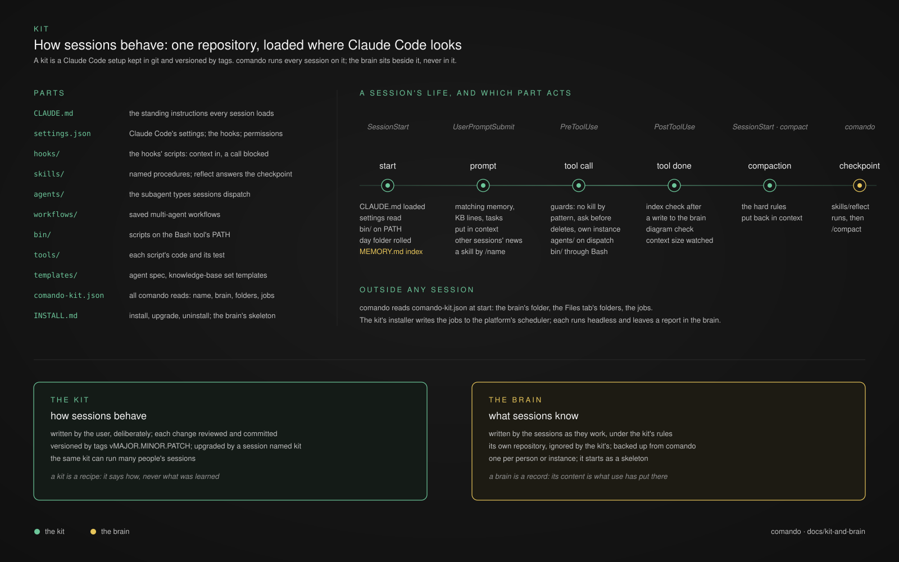
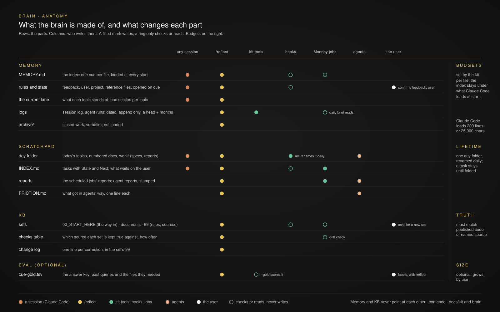
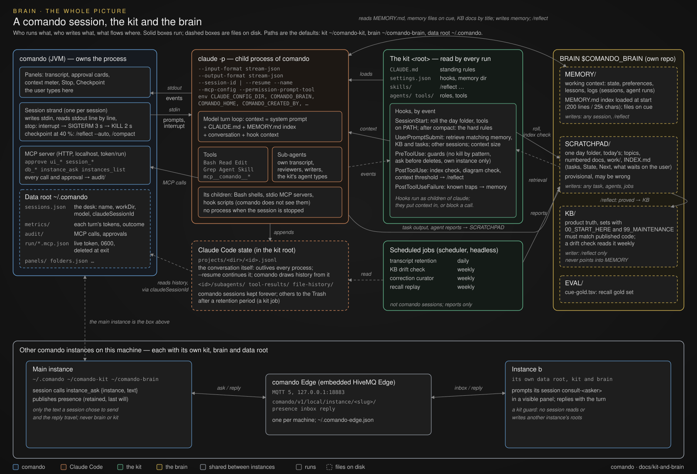
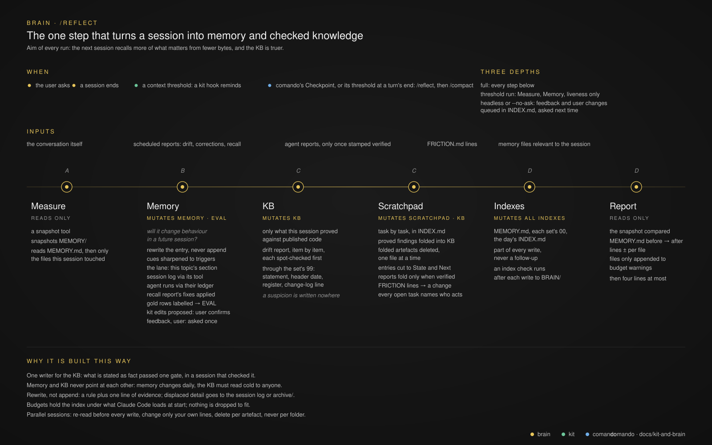
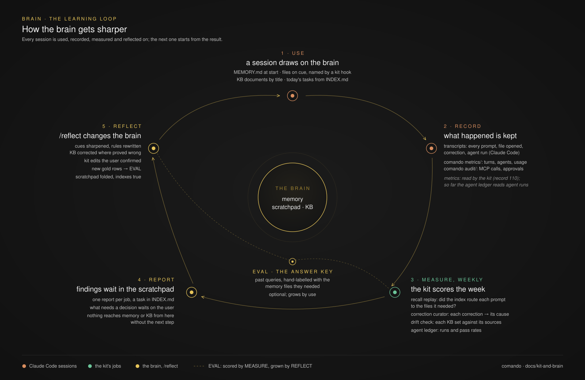

# The kit and the brain

comando is one of three parts I think of as one thing: comando is the window, the kit is how the sessions in it behave,
and the brain is what they remember and know. I keep the three apart because they change at different speeds and for
different reasons. The kit changes when its user decides it should, one reviewed commit at a time; the brain changes
every day, as the sessions work; comando changes when the window needs to. This document is the model of the kit and the
brain, and what comando does with them. No kit is published with comando: an agent creates a kit and a brain for each
user from this document ([§8](#8-creating-a-kit-and-a-brain)), in two folders of their own outside `~/.claude`, or the
user brings their own. Each is one incarnation of the model.

1. [The model: a session and its five parts](#1-the-model-a-session-and-its-five-parts)
2. [The kit](#2-the-kit)
3. [comando and a kit](#3-comando-and-a-kit)
4. [The brain](#4-the-brain)
5. [Flows: comando, the session, the kit and the brain](#5-flows-comando-the-session-the-kit-and-the-brain)
6. [/reflect: the consolidation step](#6-reflect-the-consolidation-step)
7. [The learning loop: how the brain gets sharper](#7-the-learning-loop-how-the-brain-gets-sharper)
8. [Creating a kit and a brain](#8-creating-a-kit-and-a-brain)

## 1. The model: a session and its five parts



A comando session is one Claude Code conversation that comando runs. Five parts surround it; each answers one question.

| Part | Question | In short | Detail |
|---|---|---|---|
| Brain | what does it remember and know? | memory, today's scratchpad, the checked KB | [§4.1](#41-anatomy-the-parts-and-who-changes-them) |
| Process | how does it run? | `claude -p`, a child of comando; prompts in, events out; comando starts and stops it | [Claude Code §1](claude-code.md#1-the-claude-bridge) |
| Kit | how does it behave? | instructions, settings, hooks, skills, agents, tools, scheduled jobs | [§2](#2-the-kit) |
| Persistence | what outlives it? | the transcript (the conversation itself), comando's desk, metrics and audit | [§5.2](#52-what-persists) |
| Instances | who does it talk to? | other comando instances, each with its own kit, brain and data root, through the comando Edge | [Workbench §4.1](workbench.md#41-the-comando-edge) |

The process lives as long as comando keeps it; the conversation lives in its transcript and resumes in a new process.

## 2. The kit



A kit is a Claude Code setup kept in a git repository. Its parts sit at the top of the repository, each where Claude
Code loads it from a config folder; no part is a plugin. comando runs every session on it
([record 80](adr/0080-the-kit-is-a-claude-code-setup-comando-runs-its-sessions-on.md)).

Parts of this document are a **contract**: what comando's code reads or calls, and what the sessions it starts rely on.
A kit honours the contract; everything else here is the recommended way of working, which a kit may change and which
drifts with its user's habits, as it should. The contract is: the manifest ([§2.4](#24-the-manifest)), where comando finds the kit and the brain
([§3.1](#31-the-root)), the settings
comando reads and the retention it needs ([§2.5](#25-settings)), what the repository ignores
([§2.6](#26-what-the-repository-ignores)), the launch environment ([§3.1](#31-the-root)), the layout of the Kit, Brain and Scratchpad tabs
([§3.2](#32-the-kit-brain-and-scratchpad-tabs)), the `INSTALL.md` section *Upgrade* when the kit is tagged on a remote
([§3.4](#34-version-and-upgrade)), the jobs tool when the manifest lists jobs ([§3.5](#35-scheduled-jobs)) and the
checkpoint skill with its automatic form ([§6.2](#62-depths)). A kit created from this document, or brought by the user, is checked
against these sections alone. A kit may add a **layout contract** of its own, the rules its hooks and tools meet, in
its `README.md`; comando reads none of it.

### 2.1 Parts

| Part | What it holds | |
|---|---|---|
| `comando-kit.json` | the manifest: the kit's name, its brain, the folders of the Kit, Brain and Scratchpad tabs, its scheduled jobs, what it needs outside the folder ([§2.4](#24-the-manifest)) | required |
| `.gitignore` | what the kit's repository leaves out: credentials, Claude Code's runtime files, the brain when it sits inside the kit ([§2.6](#26-what-the-repository-ignores)) | required |
| `settings.json` | Claude Code's settings: permissions, retention, the hooks; each hook entry runs a command under `${CLAUDE_CONFIG_DIR:-$HOME/.claude}`, so it works on any root ([§2.5](#25-settings)) | required |
| `skills/` | the skills; `reflect` answers the checkpoint ([§6](#6-reflect-the-consolidation-step)) | `reflect` required |
| `CLAUDE.md` | the instructions every session loads | recommended |
| `README.md` | the kit's layout contract: what each folder holds and the rules every hook and tool meets, proved by a check among its tools | recommended |
| `hooks/` | one folder per hook: its contract, its code and its test, and the files it puts in context | recommended |
| `agents/` | the subagent types the sessions dispatch ([§2.7](#27-agents-specs-and-reviews)) | recommended |
| `templates/` | the agent spec ([§2.7](#27-agents-specs-and-reviews)) and the KB's set templates ([§4.1.3](#413-kb)) | recommended |
| `tools/` | one folder per tool: its contract, its command and its test; the command folders are on the Bash tool's `PATH` | recommended |
| `workflows/` | saved multi-agent workflows | optional |
| `INSTALL.md` | the kit's own recipe; its section *Upgrade* is what the `kit` session follows ([§3.4](#34-version-and-upgrade)) | when tagged on a remote |
| `install/kit.py` | the jobs tool, which alone writes the jobs to the platform's scheduler ([§3.5](#35-scheduled-jobs)) | when the manifest lists jobs |

comando's code reads of a kit: the manifest; the folders it names and their index files ([§3.2](#32-the-kit-brain-and-scratchpad-tabs)); the
root's `settings.json`, for the keys of [§2.5](#25-settings); the root's `projects/`, for stored conversations; the
root's `skills/<name>/SKILL.md`, to link a skill call in a transcript to its file; the root as a git repository, for
its version and backup ([§3.3](#33-back-up-the-brain-and-the-kit), [§3.4](#34-version-and-upgrade)); `.kit-jobs/`, the
jobs' runner files ([§3.5](#35-scheduled-jobs)); `tools/`, where the job editor's program chooser starts; and, when the
kit has one, the jobs tool, which it calls. Its upgrade prompt names the kit's `INSTALL.md`. It writes, on the user's
action: a file edited in a panel or the comparison window; a listing file's lines for an entry moved to the Trash
([Workbench §6](workbench.md#6-the-kit-brain-and-scratchpad-tabs)); the backup's commits and pushes ([§3.3](#33-back-up-the-brain-and-the-kit));
the manifest when the user repairs it, keeping the old one as `comando-kit.json.bak-<time>`
([§2.4](#24-the-manifest)). When the folders are saved it writes a missing index file of a configured folder inside the
kit or the brain ([§3.2](#32-the-kit-brain-and-scratchpad-tabs)). The rest of the layout is what the sessions work by: a kit that lacks a recommended
part runs without what that part carries.

### 2.2 A session's life, and which part acts

| Moment | Claude Code event | What the kit does |
|---|---|---|
| start | `SessionStart` | `CLAUDE.md` and the settings load; a hook puts the tools on `PATH`; the brain's memory index loads (`autoMemoryDirectory`); a hook may prepare the brain (the scratchpad's day folder) |
| a prompt | `UserPromptSubmit` | hooks put context in: the memory files, KB lines and tasks that match, what other sessions did; a skill runs when named |
| a tool call | `PreToolUse` | guards may refuse a call: a kill by pattern, a delete without asking, another instance's files; agents run on dispatch; the tools run through Bash |
| a tool done | `PostToolUse` | checks after the fact: the brain's indexes after a write, reporting what is now missing; diagrams in a written document |
| a command failed | `PostToolUseFailure` | a tripwire may point the session at the memory file that documents that error string, without restating its fix |
| a compaction | `SessionStart` (`compact`) | the rules that must survive go back in context |
| the checkpoint | comando's | the `reflect` skill writes memory, corrects the KB and folds the scratchpad ([§6](#6-reflect-the-consolidation-step)), then comando sends `/compact` ([record 129](adr/0129-a-checkpoint-reflects-then-compacts.md)) |
| the checkpoint, automatic | comando's | at a turn's end past comando's threshold, comando sends the checkpoint command with `--auto`: the skill asks the user nothing and writes each decision it would have asked as a `**Needs you:**` line in its task's entry in the day's `INDEX.md`, which comando's Logbook tab lists ([§6.2](#62-depths), [record 131](adr/0131-an-automatic-checkpoint-asks-nothing.md), [record 150](adr/0150-a-card-only-when-a-session-cannot-go-on.md)) |

A hook adds context or blocks a call; it never rewrites a prompt. The variables comando sets in a session's environment
(`CLAUDE_CONFIG_DIR`, `COMANDO_BRAIN`, `COMANDO_HOME`, `COMANDO_CREATED_BY`, `CONTEXT_CHECKPOINT_BY`) are in
[§3.1](#31-the-root): a hook reads them to find the kit, the brain and comando's data root, to leave out what only a
person needs in a session an agent made, and to stay silent at a size where comando runs the checkpoint itself.

Guards fail closed: a guard hook sets Claude Code's `"onFailure": "block"`, so one that crashes, times out or cannot
start refuses the call instead of letting it through, and it refuses with exit code 2. The hook that puts the tools on
`PATH` appends `export PATH=…` lines to the file Claude Code names in `CLAUDE_ENV_FILE`, at every start, so the Bash
tool of the session and of its subagents finds the tools. The rules that must survive compaction come back after each
compaction as the plain output of a `SessionStart` hook with the matcher `compact` (plain standard output is context on
`SessionStart` and `UserPromptSubmit`; other events need Claude Code's JSON `additionalContext`).

### 2.3 Outside any session

comando reads `comando-kit.json` at start for the brain's folder and the folders the Kit, Brain and Scratchpad tabs show; the jobs it asks the
kit's jobs tool for. The tool writes the jobs to the platform's scheduler; each runs headless, outside comando, and leaves a report in the brain's
scratchpad for `/reflect` ([§3.5](#35-scheduled-jobs), [§7](#7-the-learning-loop-how-the-brain-gets-sharper)).

### 2.4 The manifest

`comando-kit.json`, at the top of the root, is a JSON object. Its schema is version 1, recorded with every other file
comando reads in [record 133](adr/0133-every-stored-file-has-a-schema-and-a-version.md) §2.1:

| Key | Required | Rule |
|---|---|---|
| `kit` | no; write it | the schema's version, `1`; a file without it is read as version 1, any other value is refused ("the kit is newer than comando" for a higher one) |
| `name` | yes | the kit's name, not empty; lower-case letters, digits and `-` keep it usable in the scheduler's ids |
| `brain` | no; write it | the brain's folder: absolute, `~/…`, or relative to the kit; `BRAIN` (inside the kit) when absent; `COMANDO_BRAIN` overrides it ([§3.1](#31-the-root)); memory is its `MEMORY/` |
| `folders` | no | the folders the Kit, Brain and Scratchpad tabs show, a list of objects: `name` (used once), `root` (`kit`, the default, or `brain`: the folder the path starts from), `path` (relative to that root, without `..`; `"."` is the root itself), `index` (a file inside the folder, or empty), `excludes` (a list of names left out), `icon` (`folder`, `scratchpad`, `memory`, `knowledge`, `skills` or `plugin`; empty is `folder`), `deletable` (`true`: its entries go to the Trash from its tab), `listedIn` (a file name, no `/`), `group` |
| `requirements` | no | the tools the kit needs outside the folder: `tool`, `check` (a command as a list of words), `install` (an object, one command per `macos`, `linux`, `windows`); for the agent that installs or checks the kit; comando reads them and uses none of them |
| `credentials` | no | the keys the kit's tools read from the root's `settings.local.json`: `key`, `for`, `where` (where the user gets it); never a value; comando uses none of them |
| `jobs` | no | the scheduled jobs, written by the jobs tool only ([§3.5](#35-scheduled-jobs)) |

comando ignores keys it does not know, so a kit may add its own (`required` and `for` on a requirement, say). A file
that is not a JSON object, has another version, no `name`, or a folder whose path is empty or leaves its root, is refused whole:
comando tells the user why at start and runs without the kit, ending "Correct the file, then restart comando to run on
the kit". A folder that breaks one of the rules every folder of the three tabs meets
([Workbench §6](workbench.md#6-the-kit-brain-and-scratchpad-tabs): a name, used once; a `root` of `kit` or `brain`; its icon; an index
inside it; a listing file that is a file name) is left out, and the window names it at start, by its place and name, with what is wrong; **Kit ▸ Repair
comando-kit.json…** in the palette rewrites the file without those entries once the user confirms (and removes nothing
when the file's problems changed since, as after a kit upgrade), a notice naming each entry it took out, and keeps the
old one beside it as `comando-kit.json.bak-<time>`, one per repair, never overwritten. comando writes the manifest only
then; the jobs tool writes its `jobs` block; anything else is edited by the kit's user or the agent that made it.

A manifest for a kit at `~/comando-kit` with its brain at `~/comando-brain`, laid out as [§3.2](#32-the-kit-brain-and-scratchpad-tabs)
wants, is in [§8.2](#82-the-kits-files).

### 2.5 Settings

The root's `settings.json` is Claude Code's, and comando reads four of its keys:

| Key | comando uses it for |
|---|---|
| `model`, `effortLevel` | a new session's model and effort when it names none; the session dialog shows them as the kit's defaults |
| `modelSettings.<model>.effortLevel` | the base effort comando takes for a session of that model (Claude Code starts its turns at it), before `effortLevel` |
| `permissions.defaultMode` | shown, read-only, in the session dialog's context line |

**Permissions.** The kit's `permissions` (its `defaultMode`, `allow` and `deny` rules) hold for every session; what a
working folder adds on top is in [Claude Code §1.1](claude-code.md#11-the-process). A tool call the rules leave to ask comes to comando's approval cards
([Claude Code §4.1](claude-code.md#41-approval-cards)). comando allows nothing of its own. An automatic checkpoint must
ask nothing and runs while the session is locked ([§6.2](#62-depths)), so a kit used with comando allows everything that
run does, or each call is a card and the locked session waits on the user:

| Allow | Why |
|---|---|
| `Read(/<brain>/**)` | reads of memory, the scratchpad and the KB, which sit outside the session's working folder; `Read` rules also cover `Grep` and `Glob` |
| `Edit(/<brain>/**)` | the checkpoint's writes to memory and the day's index; an `Edit` rule covers the `Write` tool too, as Claude Code checks file writes against `Edit` rules only (a `Write(…)` path rule never matches) |
| `permissions.additionalDirectories`: `["<brain>"]` | the brain as a working directory, so reads there need no rule in any mode |

`<brain>` is the brain's absolute path as the filesystem gives it (`/Users/alice/comando-brain`), so with its own
leading slash the rule reads `Edit(//Users/alice/comando-brain/**)`: in a rule, `//` anchors at the filesystem root,
while a single `/` anchors at the folder of the settings file. The checkpoint writes nothing in the kit: with `--auto`
it leaves the day folder's roll to the start hook and kit changes to a run the user starts ([§8.2](#82-the-kits-files)
`SKILL.md`), so no rule opens the kit's own files, `settings.json` among them, to unasked edits.

**The brain is not a protected path.** Claude Code always prompts for writes to a `.claude` folder (and to `.git`,
`.vscode` and a few others) in the `default` and `acceptEdits` modes, and no `allow` rule can pre-approve them. A brain
inside `~/.claude` would therefore turn every memory, scratchpad and KB write into a card, the automatic checkpoint's
included. A new kit and brain live outside `~/.claude` ([§3.1](#31-the-root)), so brain writes follow the kit's rules,
the allow rules above among them; a kit that keeps its brain under a `.claude` path runs its sessions in a mode that
does not prompt for protected paths, or accepts the cards.

**Transcripts are kept.** comando resumes a session's conversation and draws its history from the transcript in
`<root>/projects/`. Claude Code deletes session data older than `cleanupPeriodDays`, 30 days unless set, each time it
starts. A kit used with comando sets it high (`36500`); a kit that wants old transcripts gone sweeps them itself, by a
job, and spares every transcript that a `sessions.json` entry of comando's data root names ([§5.2](#52-what-persists)).

**The checkpoint comes before compaction.** comando's checkpoint reflects, then compacts, when a turn ends past its
threshold, a share of the session's context window ([Claude Code §2](claude-code.md#2-the-checkpoint)). Claude Code's
own auto-compaction summarises the conversation with no reflect. A kit therefore leaves `autoCompactWindow` unset (the
model's window, near its end) or sets it above comando's threshold, never below.

Optional: `autoMemoryDirectory` set to the brain's `MEMORY/` gives a session started outside comando, on this root, the
same memory; comando passes it to its own sessions anyway ([§3.1](#31-the-root)).

### 2.6 What the repository ignores

The root is also Claude Code's config folder for every session on it, so the kit's repository ignores what Claude Code
and the machine write there. **Back up the kit** commits everything else in the root and pushes it
([§3.3](#33-back-up-the-brain-and-the-kit)), so an entry missing here is a file sent to the kit's remote. The list is
what Claude Code is known to write into a config folder; a later Claude Code may add names, so before each backup
`git -C <root> status --short` is worth a look, and a new runtime name joins the list:

| Ignored | Why |
|---|---|
| the brain's folder, when it sits inside the kit (`/BRAIN/`) | a repository of its own |
| `settings.local.json` | the credentials' values |
| `/.claude.json`, `/.claude.json.*`, `/.credentials.json` | Claude Code's global config and, on Linux and Windows, its login, written into a root used through `CLAUDE_CONFIG_DIR` |
| `projects/`, `sessions/`, `session-env/`, `file-history/`, `history.jsonl`, `todos/`, `tasks/`, `plans/`, `jobs/` | conversations and their state |
| `cache/`, `paste-cache/`, `shell-snapshots/`, `debug/`, `backups/`, `ide/`, `downloads/`, `statsig/`, `telemetry/`, `state/`, `usage-data/`, `daemon/`, `daemon.*`, `dev-mods/`, `bridge-spawn/`, `seed-admin/`, `.cc-writes/`, `claude-code/`, `plugins/`, `skills/.trash/`, `/.claude/` | Claude Code's caches, runtime and install folders |
| `stats-cache.json`, `mcp-needs-auth-cache.json`, `mcp-discover-verdicts.json`, `.last-cleanup`, `.last-update-result.json`, `settings.json.bak*`, `*.bak-doctor` | Claude Code's runtime files and the backups its updates and checks leave |
| the hooks' and tools' state folders, the jobs runner's folder (`/.kit-jobs/`) | per-machine state |
| `__pycache__/`, `.DS_Store` | the machine's |

The same names, without the leading `/` and the patterns, and with `settings.local.json`, are the `excludes` of the
root's folder, so the KIT row shows the kit and not Claude Code's runtime ([§3.2](#32-the-kit-brain-and-scratchpad-tabs)); the
tabs hide names that start with a dot anyway. The file itself is in [§8.2](#82-the-kits-files).

### 2.7 Agents, specs and reviews

A kit that dispatches subagents gives each a narrow kind of work and a spec to do it from:

| Agent type | Does |
|---|---|
| reviewer | read-only: one lens of a review (correctness, concurrency, security, docs…), one report of findings |
| writer | edits only the files its spec lists, and proves its work by running the spec's acceptance |
| sweeper | mechanical find-and-count work, on a cheap model |
| final look | one read of the finished whole, after every other check |

| Rule | How |
|---|---|
| a spec first | written to the scratchpad topic's `work/` from the kit's template: kind and runner, the context it needs quoted (agents do not see memory), the task, the files with their access, what it must not do, an **executable acceptance** (commands and their expected results; for a review, the findings schema: each finding with its place in the code, a failure sequence and its evidence), the output path |
| no acceptance, no dispatch | a task whose done cannot be checked by a command is not handed out |
| caps | readers in parallel within a small bound, each writing its own report; writers in parallel only on disjoint files, every shared file with one named owner; one build at a time per checkout |
| verification | the session checks every report against its acceptance and every finding before acting on it; a review splits into lenses, one reader each, and runs again only when the fixes changed the code materially |
| provenance | each report carries a stamp, `generated` then `verified` ([§4.1.2](#412-scratchpad)) |
| friction | each agent appends what got in its way to the scratchpad's `FRICTION.md` ([§4.1.2](#412-scratchpad)) |

## 3. comando and a kit

This section is what comando does with a kit. comando does not install one: the agent that installs comando offers to
create a kit and a brain from this document, or to use the ones the user brings ([INSTALL.md §5](../INSTALL.md#5-the-kit)),
and comando finds the kit at start ([record 80](adr/0080-the-kit-is-a-claude-code-setup-comando-runs-its-sessions-on.md)).

### 3.1 The root

The root is the kit: the Claude Code config folder comando's sessions run on. comando decides it once at start
(`KitRoot`), then the brain from it. The first folder of the table below that holds a `comando-kit.json` is the kit,
whether its manifest reads or not; comando never passes over it for the next one:

| When | Root |
|---|---|
| comando was started with `CLAUDE_CONFIG_DIR` | that folder |
| `~/.claude/comando-kit.json` exists | `~/.claude`: the user's own Claude Code folder is the kit |
| `~/comando-kit/comando-kit.json` exists | `~/comando-kit`: the kit a new install creates |
| `~/.claude/comando-kit/comando-kit.json` exists | `~/.claude/comando-kit`: a kit made by an earlier install |
| otherwise | `~/.claude`, without a kit |

A brain applies only with a kit: without one there is no brain, `COMANDO_BRAIN` names nothing, sessions get neither
`COMANDO_BRAIN` nor `autoMemoryDirectory`, and the session dialog, **Back up the brain** and the folder
roots of the Kit and Brain tabs show none. The brain, in this order:

| When | Brain |
|---|---|
| comando runs with no kit | none |
| comando was started with `COMANDO_BRAIN` | that folder |
| the manifest names `brain` | that folder: absolute, `~/…`, or relative to the root |
| otherwise | `<root>/BRAIN` |

The kit and the brain are two folders, each anywhere and each a git repository of its own (a folder inside a local
repository checkout serves too). A new install never touches `~/.claude`: it creates the kit at `~/comando-kit` and the
brain at `~/comando-brain`, and names the brain in the manifest ([§8](#8-creating-a-kit-and-a-brain)), so a user trying
comando keeps their own Claude Code setup exactly as it was. A user who wants every Claude Code session, inside comando
or not, to run on a kit makes `~/.claude` itself the kit instead. A `comando-kit.json` that does not read (not JSON, another
version, no name, a folder outside the root) leaves comando without a kit, on the folder `CLAUDE_CONFIG_DIR` names, else
on `~/.claude`, never on the next folder's kit: a notice at start names the file and why it does not read, and ends "Correct the file, then restart
comando to run on the kit" ([§2.4](#24-the-manifest)).

Every `claude` comando starts (sessions, the plan usage reader, the topics, the version check) gets this environment
from its instance:

| Variable | Value | When |
|---|---|---|
| `CLAUDE_CONFIG_DIR` | the root | the root is not `~/.claude` (where Claude Code looks anyway); taken out for the `kit` session that upgrades a kit at or inside `~/.claude` ([§3.4](#34-version-and-upgrade)) |
| `COMANDO_BRAIN` | the brain's folder | with a kit; taken out without one, so a session on no kit has no brain: a hook or skill finds the brain here |
| `COMANDO_HOME` | comando's data root, the instance's own, whichever way comando was started (`-Dcomando.home`, `COMANDO_HOME` or `~/.comando`) | always: a hook reads comando's files there ([§5.2](#52-what-persists)) |
| `COMANDO_CREATED_BY` | the agent that made the session | a session an agent created ([Claude Code §1.1](claude-code.md#11-the-process)) |
| `CONTEXT_CHECKPOINT_BY` | `comando` | comando runs the session's checkpoint at its threshold ([Claude Code §2](claude-code.md#2-the-checkpoint)); a hook that would remind or checkpoint at that size leaves it to comando |

With a kit, and only then, each but that `kit` session also gets
`--settings '{"autoMemoryDirectory": "<brain>/MEMORY"}'`, so the brain's memory loads whatever the user's own settings say. Stored conversations and their import are read from
`<root>/projects`. A session on a root other than `~/.claude` neither reads nor writes `~/.claude`. Each comando
instance is isolated: its sessions get its root, its brain and its data root, and nothing of another instance's
([record 122](adr/0122-instances-name-kit-brain-data-root-edge.md)).

**Signing in.** Claude Code keeps its login per config folder, so a new root is signed in once, by the user, in their
own terminal: `CLAUDE_CONFIG_DIR=~/comando-kit claude auth login` (PowerShell: `$env:CLAUDE_CONFIG_DIR = "$HOME\comando-kit";
claude auth login`) opens the browser to sign in with the same account as the user's own setup;
`CLAUDE_CONFIG_DIR=~/comando-kit claude auth status --text` then names the account. The user's own `~/.claude` stays
signed in as it was.

### 3.2 The Kit, Brain and Scratchpad tabs

`comando-kit.json` lists the kit's folders with the fields of a `folders.json` entry
([Workbench §6](workbench.md#6-the-kit-brain-and-scratchpad-tabs)), each path relative to its `root`, the kit or the brain, without `..`;
`"."` is that root itself (the kit's folder, its excludes leaving out the rest). The brain's folders name `root`
`brain`, so `COMANDO_BRAIN` moves them with the brain, at every start: comando records where it put each kit folder last
(`kit-folders`), and a folder still there follows the kit and the brain, while one the user pointed elsewhere stays.
When `folders.json` holds none of them, comando adds them at the top, their paths made absolute under their root, once,
and saves; the user's own entries stay, and a kit folder whose name an entry already takes is not added (`KitFolders`).
An entry that names the same folder on disk as a kit folder (links followed, letter case ignored) counts as that folder,
so an entry through a link is not added twice. **Use the kit's folders** in the folders window adds the
missing ones again.

A configured folder shows in one of the three tabs, **Kit**, **Brain** or **Scratchpad**, which `folders.json` decides
without a new key: a folder whose `icon` is `scratchpad` in the Scratchpad tab; the other folders of the group `Brain`
in the Brain tab; every other folder, the Kit group's and any in no group, in the Kit tab
([Workbench §6](workbench.md#6-the-kit-brain-and-scratchpad-tabs), [record 152](adr/0152-the-files-tab-splits-into-kit-brain-scratchpad.md)).
A group's row holds only the folders the manifest configures for it. The rows the tabs give a kit depend on its layout:

| Layout | Row |
|---|---|
| one folder, path `"."`, alone in group `Kit` (that spelling) | the KIT row, in the Kit tab: the Jobs row first inside it, the kit's commit and a newer release ([§3.4](#34-version-and-upgrade)), and in its menu **Back up the kit** and **Upgrade the kit…** |
| the brain's folders in one group (`Brain`), all inside the brain's folder | the BRAIN row, in the Brain tab: the brain's folder holding those folders alone, in their order, so a folder of the brain the manifest does not list (EVAL, say) never shows; **Back up the brain** in its menu and in the menu of each folder inside the brain |
| a `Kit` folder other than the root | no kit backup or upgrade in its row's menu (the palette keeps them) |
| two folders in group `Kit` | the Jobs row in a row of its own, last, not inside the KIT row |

A folder inside the kit's folder or the brain's that names an `index` file which does not exist, in a folder that does,
gets one when the folders are saved, with a title and the line "`/reflect` keeps it current"; without a kit, comando
creates none in the user's own `~/.claude`. A new brain also has its index files from its skeleton
([§4.3](#43-the-skeleton)). Keeping them is the kit's ([§6.3](#63-the-steps)). `listedIn` names the file the Trash keeps
current ([Workbench §6](workbench.md#6-the-kit-brain-and-scratchpad-tabs)); any other line naming an entry stays and is reported
([§4.1.2](#412-scratchpad)).

### 3.3 Back up the brain and the kit

**Back up the brain** (the palette and the menu of the Brain tab's BRAIN row) runs in
the brain's folder, off the EDT: `git add -A`, a commit when anything changed (nothing to commit is not an error), `git
push`. The commit's first line says what it adds, `Brain backup 2026-10-28: MEMORY 2 changed; SCRATCHPAD 3 added, 1
changed` (each top folder, or a file at the top, with its counts; past 120 characters the rest are counted), and its
body lists the files, one a line (`added MEMORY/x.md`, `renamed a -> b`; at most 200). **Back up the kit** (the same
places, the KIT row) does the same in the root, its message `Kit backup …`: what it stages is what the kit's
`.gitignore` lets through ([§2.6](#26-what-the-repository-ignores)). A notice names the commit or the step that failed.
Each action is off while its folder is not the top folder of a git repository with a remote, and neither runs by itself
([record 118](adr/0118-brain-and-kit-are-rows-each-one-unit.md)). A created kit and brain have no remote until their
user adds one, a private repository each ([§8.1](#81-the-steps)).

### 3.4 Version and upgrade

The Kit tab's KIT row shows the kit's commit and, when `git -C <root> ls-remote --tags origin` lists a newer `vX.Y.Z`,
"‹commit› · vB available", with a notice the first time a newer release is seen
(`git -C <root> describe --tags --always` still gives the version the notice names). Both are read at start and every 6
hours, off the EDT, never holding the window.

**Upgrade the kit…** (the palette, and the KIT row's menu) asks for a tag, newest first, then opens or creates a session
named `kit`, working in the root and started on the user's own Claude Code setup rather than the root's (it replaces the
root's files) when the root is `~/.claude` or inside it, on the root itself when the root is elsewhere, another
instance's kit ([record 122](adr/0122-instances-name-kit-brain-data-root-edge.md)), and sends it: "Upgrade the kit at
<root> to <tag>, following <root>/INSTALL.md section Upgrade. Report what changed." Once the session has ended that turn
without an error, comando reads the kit's version again, and only when the kit now reads the tag asked for does it offer
to restart the sessions still running on the old kit (each resumes its conversation; a busy one is left as it is). A
session that stopped before it reported, a turn that ended in an error, or a kit that reads another version restarts
nothing, and a notice says which.

A kit created from this document has no upstream: until its user pushes it to a remote and tags it, the KIT row shows no
newer release and **Upgrade the kit…** has nothing to offer. A kit that is tagged on a remote, to be shared or kept on
several machines, carries an `INSTALL.md` with a section *Upgrade*, which the `kit` session follows ([§8.2](#82-the-kits-files)).
When a comando release changes a contract section ([§2](#2-the-kit)), the user asks a session to bring the kit in line
with that release's document ([§8.5](#85-after-a-comando-upgrade)); nothing else in a kit needs to follow the model.

### 3.5 Scheduled jobs

The manifest's `jobs` list is the only record of the kit's scheduled jobs. The kit's jobs tool, `install/kit.py`, alone
writes them to the platform's scheduler (launchd, systemd timers or cron, Task Scheduler) and runs them
([record 117](adr/0117-kit-jobs-a-row-and-a-window.md)). A job in the manifest:

| Key | Rule |
|---|---|
| `name` | lower-case letters, digits and `-`, from a letter, at most 32; used once |
| `description` | optional; one line of at most 80 characters |
| `schedule` | `{"daily": "HH:MM"}` or `{"weekly": "<days> HH:MM"}`, the days `MON` … `SUN`, comma-separated, a run of three or more as a range (`MON-FRI`, `MON,THU`) |
| `command` | a list: the program, a path inside the root with `/` and no `..`, then its arguments; `{scheduler}` in any of them becomes the scheduler that started it |
| `env` | optional; an object of variables, names in capitals, digits and `_` |
| `log` | optional; a file inside the root for the job's output (otherwise `.kit-jobs/<name>.log`) |
| `enabled` | optional; `false` pauses the job |

comando calls the tool with `python3` (`python` on Windows) from the root, three ways, and waits at most 60 seconds:

| Call | Answers |
|---|---|
| `install/kit.py jobs --json --root <root>` | exit 0 and `{"jobs": [...]}` on standard output; each job with `name`, `description`, `days` (a list of `MON` … `SUN`), `time` (`HH:MM`), `command` (a list), `env` (an object), `log`, `enabled`, then the scheduler's view: `installed`, `current` (the scheduler holds what the tool would write now), `loaded` (`null` when the tool cannot tell), `running`, `last` (`{"start": <time>, "exit": <code>}`), `next` (a time, empty when paused), `logPath` |
| `install/kit.py jobs set --root <root>` | the whole list as a JSON array on standard input, in the manifest's form: every job checked first, then only the manifest's `jobs` written, then the scheduler brought to it |
| `install/kit.py job run <name> --root <root>` | starts the job now through the scheduler, never as a child of the caller |

Exit codes: 0 done; 1 done in part (a running job left as it was, a load that failed); 2 refused, nothing written; 3 an
unexpected error, part may be done. Standard output and standard error are shown to the user when a call is refused. The
runner the scheduler starts keeps, per job, its process id while it runs and one line per run (start, exit), so
`running` and `last` can be answered, and never lets two runs of one job overlap. A kit with no scheduled jobs leaves
out `jobs` and the tool, and the Kit tab then shows no Jobs row. A kit with the tool and no job shows the row as
"none", its tooltip "No scheduled jobs in comando-kit.json; double-click to add one"; a manifest that lists jobs without
the tool shows "cannot be read", its tooltip naming the missing `install/kit.py`.

The Kit tab shows the jobs as one **Jobs** row, the first inside the KIT row
([record 118](adr/0118-brain-and-kit-are-rows-each-one-unit.md)): its detail counts them and names what runs
now or the next run (`5 jobs · 1 paused · next Thu 07:15`); the dot marks a change the scheduler has not taken (a job
running when it was saved is left as it was), a red name a failed last run or jobs that cannot be read; its tooltip says
the most pressing of these. comando reads them through `jobs --json` at start, after every change it makes, and,
while the Kit tab shows, when `comando-kit.json` or a runner file in `.kit-jobs/` changed (a job's pid or its runs;
looked at every 10 s, logs left out).

A double click, Enter, or **Configure kit jobs** (the row's menu, the Kit tab's menu, the palette) reads the jobs
again and opens the **Kit jobs** window on them (a list that cannot be read opens none, and a notice says why): the jobs
on the left, +, −; the selected job's name, description, days of the week, time, program (a path inside the kit, picked
with …), arguments, environment (`NAME=value` lines), log and Enabled on the right, checked as typed, and under them,
read only, whether the scheduler holds it, its last run and its next. A job's row menu runs it now, through the
scheduler, opens its log, or removes it. **Save** hands the whole list to `jobs set`; the window closes when the list was
taken and stays open with the tool's words when it was refused. **Apply pending changes**, in the row's menu while
something is pending and nothing runs, reads the jobs again and hands them over. comando never writes the scheduler's
files.

## 4. The brain

A brain is a folder of plain files, wherever [§3.1](#31-the-root) finds it (`~/comando-brain` for a new install), and a
git repository of its own. It starts as a skeleton ([§4.3](#43-the-skeleton)); from then on the sessions write it.

| Store | Holds | Certainty | Changed by |
|---|---|---|---|
| `MEMORY/` | working context: the state of the work, the user's preferences and corrections, lessons, references; an index, `MEMORY.md`, with one cue per file | what was true when written | any session; the consolidation step, `/reflect` |
| `SCRATCHPAD/` | today's work: topic folders, numbered documents, raw agent output, a task index | provisional | any task, agent or scheduled job |
| `KB/` | checked knowledge: sets of documents, each kept true against named sources | must match its sources | `/reflect` only |
| `EVAL/` (optional) | an answer key: past queries labelled with the memory files they needed | labelled by hand | `/reflect`, with the user |

Three rules hold the model together:

1. **Memory and the KB never point at each other.** Memory changes daily and is private to the work; a KB document
   must read on its own, cold.
2. **One writer for the KB, behind a gate.** Only `/reflect` writes the KB, and each statement passes three checks: the
   session verifies it against its source (the code at a named commit, or the source the set registers); an independent
   reviewer agent tries to refute it; the user approves what survives, one batch per set. A run that cannot ask the user
   writes nothing to the KB.
3. **The index is part of every write.** A file written without its line in its index is invisible to the next session.

### 4.1 Anatomy: the parts and who changes them



Read the picture by row. A filled mark means the column writes that part; a ring means it only checks or reads it.

#### 4.1.1 Memory

| Part | Role | Written by |
|---|---|---|
| `MEMORY.md` | the index: one line per memory file saying *when* to open it (situations, error strings, names), not what it holds. Claude Code loads it at every session start, up to 200 lines and 25,000 characters | any session, `/reflect` |
| rules and state | files of four kinds: `feedback` (corrections, confirmed ways of working), `user` (who the user is), `project` (work, constraints), `reference` (pointers to outside systems); opened when a cue matches | any session (re-read before writing, own lines only); `/reflect`; `feedback` and `user` changes confirmed by the user |
| the current work | one file with a section per topic: where each stands | the session working that topic |
| logs | dated records that only grow (a session log, agent runs): a small head plus monthly files, written through their tools, queried rather than loaded | `/reflect` through the kit's tools |
| `archive/` | closed work, verbatim, not loaded | `/reflect` |

Each memory file opens with front matter: `name`, `description` (one line) and `type` (one of the four kinds). Its index
line is a trigger of about one line, never its facts:

```markdown
- [<title>](<file>.md) — read when <the situations, names and error strings that should open it>.
```

The index's first line tells a session to search memory when no cue fits.

Budgets, as defaults a kit may change; nothing is dropped to fit them, entries are merged, shortened to their trigger,
or archived:

| Budget | Default |
|---|---|
| the index | 160 lines and 24,000 bytes, a margin under what Claude Code loads |
| a memory file | 32 KB; a file past it takes no addition until one of its entries is merged or archived |
| a log's head | 16 KB |
| a file that has become a log | 40 dated entries: split into a head and monthly files |

A merge or an archive move is checked by a no-loss tool: every date, code span, quote, number, link and heading of the
original must survive somewhere. Parallel sessions share these files, so a change is an anchored replacement (an edit
that fails unless its anchor is there exactly once), never a whole-file write over another session's lines.

#### 4.1.2 Scratchpad

| Part | Role | Written by |
|---|---|---|
| the day folder | one folder, today's, renamed each day so topics and task numbers carry over; topic folders with numbered documents and `work/` for raw material | any session, agents; a hook renames it |
| `INDEX.md` | every task with its State and Next, and what waits on the user | sessions, scheduled jobs, `/reflect` |
| reports | the scheduled jobs' findings; agents' reports, stamped `generated`, then `verified` once checked | jobs, agents; `/reflect` folds or deletes them |
| `FRICTION.md` | what got in agents' way, one line each | agents append; `/reflect` turns each into a change |
| `README.md` | these rules, at the scratchpad's top | the user |

| Rule | How |
|---|---|
| the roll | at session start and before a job writes: when today's folder is missing, the newest day folder is renamed to today; any other day folder is merged into today's topic by topic, its `INDEX.md` parked in `work/` to be folded; anything else at the top moves to today's `inbox/` to be filed |
| the index | `# Scratchpad`; a table of the topic folders; `## Waiting on <user>` (every open decision, each naming its task); `## Open`, one `### <topic>/` heading per topic folder, each task as `#### N. <title>`; last `## Scheduled reports`, where jobs file their reports until `/reflect` moves them |
| a task | **Ticket** or **Repo**, **State** (done, waiting on whom, in progress, with the last verified fact), **Next** (who moves it, and how), **Resume from**, **Needs you** (when it holds a decision for the user: a `- **Needs you:**` line with one sub-item per decision; the Logbook tab lists it first, [Workbench §1.4](workbench.md#14-the-sidebar)), and its documents, each a list item of its own led by its path relative to the index (`` `topic/01-x.md` — what it holds ``), so comando's Trash takes the line out with the file ([§3.2](#32-the-kit-brain-and-scratchpad-tabs)) |
| task numbers | a new task takes the highest number in the index plus one, read just before writing; numbers never change |
| names | sized for comando's Scratchpad tab, which does not scroll sideways: topics lower-case, at most 20 characters; documents `NN-<what>.md`, at most 25; `work/` files at most 22; no date in a name (the folder carries it); the name alone says what the file holds; a topic's living plan is `00-<topic>-plan.md` |
| pointers | carry no date, as the folder's name changes daily: `topic/01-x.md`, task 3 |
| reports | an agent report in `work/` is `<name>-report.md` (or `.json`) with a stamp in its front matter: `generated` (`by` the runner, `at` in UTC, `against` the checkout and its commit, `+dirty` when it had uncommitted changes) when it lands; `verified` (`by`, `at`, `result`) once the session checked it; stamping `generated` again drops `verified` |
| `FRICTION.md` | lines `- <date> <agent type> <spec or task>: <what got in the way> → <what would have prevented it>`; agents only append; `/reflect` deletes the lines it handled and keeps the file, even empty |
| deleting | per artefact, never per folder: files go to the Trash, an emptied folder goes with `rmdir`; never a recursive delete, as parallel sessions write the same day folder |

#### 4.1.3 KB

| Part | Role | Written by |
|---|---|---|
| sets | a folder with `00_START_HERE.md` (the way in: what the set covers, one line per document and per set inside, a link to its `99`) and `99_MAINTENANCE.md` | `/reflect`; a new set when the user asks |
| the checks table | which source each set is kept true against, and how often it is checked | `/reflect`; read by a drift-check job |
| the change log | one line per correction | `/reflect` |

| Rule | How |
|---|---|
| a set's `99` | four sections, by these titles and in this order: **Rules**, **Source register**, **Drift check**, **Change log** |
| the checks table | opens the drift check: `Source \| Kind \| Where \| Recorded \| Cadence \| Checker`; Kind `code`, `document`, `web`, `toolchain` or `none`; Cadence `weekly`, `monthly` or `never`; Checker the drift job or `none`; a set with no outside source has one row `— \| none \| — \| — \| never \| none` |
| ownership | a document belongs to the nearest set at or above its folder; a folder holding a sources list holds verbatim copies, not documents |
| a document | opens with its title and the line `> **Last Updated:** <date> · **Status:** <Current, Draft or Historical>`; reads on its own; carries no `file:line` anchors |
| sources | a statement cites what it was verified against, never a scratchpad file: the scratchpad is provisional |
| structure | an index check verifies both files in every set, every document in its set's `00`, every set in its parent's `00`, the four headings and the checks table |

#### 4.1.4 EVAL

`EVAL/` is optional: a kit that measures memory recall keeps its answer key here, hand-labelled rows of past queries
with the memory files whose rules applied. It starts empty and grows by use ([§7.2](#72-eval-the-answer-key)).

### 4.2 The kit and the brain side by side

| | The kit | The brain |
|---|---|---|
| holds | how sessions behave | what sessions know |
| written by | the user, deliberately; each change reviewed and committed | the sessions as they work, under the kit's rules |
| versioned | commits, and tags when shared; upgraded by a session named `kit` | commits; backed up from comando |
| shared | one kit can run many people's sessions | one per person or instance; it starts as a skeleton |
| in short | a recipe: it says how, never what was learned | a record: its content is what use has put there |

The brain is never part of the kit: it is a folder and a repository of its own, outside the kit for a new install; a
brain kept inside the kit's folder is ignored by the kit's repository.

### 4.3 The skeleton

A new brain is these files and nothing more; their text is in [§8.3](#83-the-brains-files):

| File | First content |
|---|---|
| `MEMORY/MEMORY.md` | the index's head: one italic line (index only; each line a trigger; search memory when no cue fits), `## Start here`, the front matter and index-line form |
| `KB/00_START_HERE.md` | the title, the header line, what the KB is, `## Sets inside` (none yet), `## Reading order` (none yet), a link to `99` |
| `KB/99_MAINTENANCE.md` | the four sections of [§4.1.3](#413-kb), the register and the checks table each with its empty row, one change-log line for the creation |
| `SCRATCHPAD/README.md` | the scratchpad's rules ([§4.1.2](#412-scratchpad)) |
| `SCRATCHPAD/FRICTION.md` | a title only |
| `SCRATCHPAD/<today>/INDEX.md` | the index's headings, empty |
| `EVAL/` | left out until the kit measures recall ([§7.2](#72-eval-the-answer-key)) |

## 5. Flows: comando, the session, the kit and the brain



The picture has six regions. Solid boxes run; dashed boxes are files on disk. Colour names the owner.

### 5.1 Who runs what

| Region | Runs as | Owner |
|---|---|---|
| comando | the JVM; one strand and one stdout reader per running session; the MCP server inside it | comando |
| `claude -p` | a child process of comando, one per running session; its own children (shells, MCP servers over stdio, hook scripts) are invisible to comando | Claude Code, owned by comando |
| hooks | children of `claude`, at fixed events | the kit |
| scheduled jobs | headless `claude -p` runs or scripts, started by the platform's scheduler, not by comando | the kit |

How comando starts, drives and stops the process: [Claude Code §1](claude-code.md#1-the-claude-bridge).

### 5.2 What persists

| Layer | Path (defaults) | Written by | Read by | Lifetime |
|---|---|---|---|---|
| the conversation | `<root>/projects/<dir>/<id>.jsonl`, sub-agents beside it | `claude` | `--resume`; comando, to draw history; the kit's measuring jobs | as long as the kit keeps transcripts ([§2.5](#25-settings)) |
| comando's desk | `$COMANDO_HOME/sessions.json`, panels, folders, connections | comando | comando; a kit hook that reports on other sessions | permanent |
| metrics | the machine's QuestDB, tables `comando_*` ([record 149](adr/0149-questdb-is-the-only-metrics-store.md)) | comando | meant for the kit ([record 110](adr/0110-metrics-for-calibration.md)) | permanent |
| audit | `$COMANDO_HOME/audit/` | comando's MCP server | the user | permanent |
| live tokens | `$COMANDO_HOME/run/*.mcp.json` | comando | `claude` | deleted at exit |
| the kit | `<root>` | the user | every `claude` | versioned |
| the brain | `$COMANDO_BRAIN` | the sessions, under the kit's rules | every session, with a kit only | grows by use |

`$COMANDO_HOME` is the data root comando passes to every `claude` it starts, `~/.comando` unless comando was started
with another ([§3.1](#31-the-root)); a hook outside a comando session falls back to `~/.comando`. Its `sessions.json`
(`{"version": 1, "sessions": [...]}`, [record 133](adr/0133-every-stored-file-has-a-schema-and-a-version.md)) lists the
sidebar's sessions, each with `name`, `workDir` and `claudeSessionId`, which ties it to its transcript
`<root>/projects/<dir>/<claudeSessionId>.jsonl`. The kit and the brain reach a process through `CLAUDE_CONFIG_DIR` and
`autoMemoryDirectory`, and the brain through `COMANDO_BRAIN`, the brain's two only with a kit ([§3.1](#31-the-root)).

### 5.3 Between the session and the brain

Start, each prompt, after a write and the checkpoint are in [§2.2](#22-a-sessions-life-and-which-part-acts). Two
moments are not:

| Moment | Flow |
|---|---|
| during the work | the session opens memory on cue and KB documents by title; writes task output to the scratchpad |
| weekly | jobs measure and leave reports in the scratchpad ([§7](#7-the-learning-loop-how-the-brain-gets-sharper)) |

### 5.4 Between instances

What travels between instances is in [Workbench §4.2](workbench.md#42-what-travels-between-instances); on the kit's
side, a guard stops a session reading another instance's roots
([record 122](adr/0122-instances-name-kit-brain-data-root-edge.md)).

## 6. /reflect: the consolidation step



`/reflect` is the one step that turns a session into memory and checked knowledge. In a kit it is a skill; comando
runs it as a session's checkpoint command ([Claude Code §2](claude-code.md#2-the-checkpoint)). The aim of every run:
the next session recalls more of what matters from fewer bytes, and the KB is truer.

### 6.1 When

| Trigger | Who |
|---|---|
| the user asks | the user |
| a session ends | the user, or a kit rule |
| the Checkpoint button, a typed `/reflect`, **Settle** | comando sends `/reflect` with no argument, then `/compact` |
| the context crosses comando's threshold | comando, at the turn's end: `/reflect --auto`, then `/compact` ([record 129](adr/0129-a-checkpoint-reflects-then-compacts.md), [record 131](adr/0131-an-automatic-checkpoint-asks-nothing.md)); the session runs with `CONTEXT_CHECKPOINT_BY=comando`, so a kit hook that would remind at that size stays silent |
| a context threshold outside comando | a kit hook reminds |

### 6.2 Depths

| Run | Does |
|---|---|
| full: the user starts it (the button, a typed command) | every step, asking its decisions one form at a time |
| automatic: `--auto` | Measure, Memory and the scratchpad's liveness only, writing inside the brain alone (the day folder's roll is left to the start hook, kit changes to a run the user starts); asks the user nothing and never waits on them, which needs the kit's settings to allow its reads, writes and MCP calls ([§2.5](#25-settings)); each decision it would have asked (a memory change to confirm, a KB statement for the gate, a done task to clear, a report to apply) is written into its task's entry in the index as a `**Needs you:**` line with one sub-item per decision (the decision in one line, then what the user needs to decide it, a few lines), which comando's Logbook tab lists ([Workbench §1.4](workbench.md#14-the-sidebar), [record 150](adr/0150-a-card-only-when-a-session-cannot-go-on.md)) |
| cannot ask: headless (a scheduled job, a prompt another session sent) | as automatic; its decisions wait as `**Needs you:**` lines |

A skill that ignores `--auto` may still ask; its cards then lock the session until the user answers
([record 130](adr/0130-a-session-locks-while-its-checkpoint-runs.md)), which is what the automatic form exists to
prevent. A comando panel session is interactive though it runs as `claude -p`: it shows question cards, so only a job or
a prompt from another session counts as headless.

### 6.3 The steps

| Step | Reads | Changes |
|---|---|---|
| Measure | the memory index and the files the session touched | nothing; a snapshot for the report |
| Memory | the conversation | memory entries rewritten (a rule plus one line of evidence), cues sharpened to triggers, the topic's state, the logs through their tools, the recall report's fixes, new `EVAL` rows; kit edits proposed by a job, once the user confirms |
| KB | corrections the session proved; the drift report | each statement through the gate ([§4](#4-the-brain) rule 2), then written through its set's `99`: the statement, the header date, the register's state, a change-log line |
| Scratchpad | the index as the root set | a collection: a file no open task points at (a code span naming it exactly) is read, its true content folded, and moved to the Trash; every done task of any session has its decisions settled with the user, its proved content folded through the gate, its files trashed and its entry deleted; open tasks rewritten to State and Next; anything changed after the run started is live work and stays; agent reports fold only when stamped `verified`; friction lines turned into changes |
| Indexes | every file written | `MEMORY.md`, each set's `00`, the day's `INDEX.md`, and, in a folder the tabs show, the folder's `index` file and the `listedIn` lines ([§3.2](#32-the-kit-brain-and-scratchpad-tabs)); an index check after each write |
| Report | the snapshot | the index before and after, lines changed per file, files only appended to, budget warnings, decisions held or settled; four lines at most |

### 6.4 Why it is built this way

The KB's one writer, memory and KB never pointing at each other, and the index's budget are the brain's rules
([§4](#4-the-brain), [§4.1.1](#411-memory)). Three reasons are this step's own:

- Rewrite, not append: an entry stays one rule and its evidence; displaced detail goes to the session log or `archive/`.
- Sessions run in parallel: re-read before every write, change only your own lines, delete per artefact, never per folder.
- After a compaction: when a reflect ran just before it (the checkpoint does), the summary is not a source and only the
  turns after it are; when none ran, the summary is mined for what memory lacks, each item checked against the memory
  files first.

## 7. The learning loop: how the brain gets sharper



Every session is used, recorded, measured and reflected on; the next one starts from the result.

### 7.1 The five stations

| Station | What happens | Writes |
|---|---|---|
| 1. Use | the session loads the memory index, opens memory on cue (a hook names the matching files per prompt), reads KB documents by title, picks up today's tasks | — |
| 2. Record | Claude Code keeps the transcript: prompts, files opened, corrections, agent runs. comando keeps metrics (turns, sub-agents, plan usage) and an audit (its MCP calls and approvals) | the transcript; comando's data root |
| 3. Measure | the kit's weekly jobs score the week ([§7.3](#73-the-measuring-jobs)) | reports in the scratchpad |
| 4. Report | findings wait as tasks; what needs a decision waits on the user | the task index |
| 5. Reflect | `/reflect` turns findings and the session into memory, KB, `EVAL` and confirmed kit changes ([§6](#6-reflect-the-consolidation-step)) | the brain; the kit |

### 7.2 EVAL: the answer key

`EVAL/` measures one thing: does the memory index lead a session to the memory files whose rules applied to what it
was doing?

| Aspect | Rule |
|---|---|
| a row | one query (a prompt, or an action the session took), the memory files whose rules applied, and for each whether the session had it loaded |
| who adds rows | `/reflect`, a few each week, from a seeded sample of the week's queries, labelled with the user; a correction caused by a missed cue goes in too |
| who reads it | the recall tool: loaded over applicable, per query class, with a confidence interval |
| where | in the brain, not the kit: its rows describe the user's real prompts |

A weekly replay measures the same quantity without labels: the week's prompts against the index as it stood before the
week, judged by a small model. The answer key is the slower, exact check; the replay is the frequent, rough one.

### 7.3 The measuring jobs

| Job | Reads | Measures | Applied by |
|---|---|---|---|
| recall replay | transcripts, the memory index | whether the index routed each prompt to the files it needed; files opened without their cue matching | `/reflect`: cues sharpened |
| correction curator | the week's corrections from the transcripts | each correction's cause in the kit: cue missed, rule ignored, no rule | the user confirms; `/reflect` applies; a declined proposal is recorded so it is not proposed again |
| drift check | each KB set's checks table and its sources | statements that no longer match their source | `/reflect`, each item through the gate |
| agent runs | one record per agent run, filled from comando's `agent` event when there is one | pass rates per model and agent type, with time and output tokens | the routing of later agent work |

### 7.4 comando's metrics

comando records every turn, sub-agent and plan-usage read ([record 110](adr/0110-metrics-for-calibration.md)) in the
machine's QuestDB, its only store ([record 149](adr/0149-questdb-is-the-only-metrics-store.md)). The
record names the kit as their reader: which model and effort for which work, pacing against plan limits, the records of
agent runs. What comando reads back itself is in [Claude Code §3.2](claude-code.md#32-the-tools).

Agent runs are the first reader: a kit may keep one record per agent run, filled from comando's `agent` event (the agent
type, the model it ran on, its duration and output tokens), and route later agent work by the pass rates. Whether the
run passed stays a judgement the session records. Pacing against plan limits and model-and-effort calibration read
nothing yet.

## 8. Creating a kit and a brain

What an agent does to give a user a working kit and brain, given only this document; [INSTALL.md §5](../INSTALL.md#5-the-kit)
sends it here. The kit it creates honours the contract ([§2](#2-the-kit)), works the brain's method and has the layout of
[§2.1](#21-parts): a layout contract and a check that proves it, hooks and tools as folders with their code, test and
contract, Python only, a guard, the roll, the checkpoint, a ledger of agent runs, an index check and agent specs. Every
other part of §2.1 is added later, when the user asks for what it carries. The kit goes to `~/comando-kit` (`K` below) and the brain to `~/comando-brain` (`B`); the
user's own `~/.claude` is never written. Paths are for macOS and Linux; on Windows `~` is `%USERPROFILE%`.

### 8.1 The steps

1. **Where.** Stop and ask when `K` or `B` exists and is not empty, or when the user names a kit or a brain of their own
   ([§8.4](#84-a-kit-or-a-brain-the-user-brings)). The one look at `~/.claude` is whether `~/.claude/comando-kit.json`
   exists: if it does, that folder is a kit already and comando runs on it before `~/comando-kit`
   ([§3.1](#31-the-root)), so ask. Never read or write anything else there.
2. **Check the tools.** `claude --version`, `git --version`, `python3 --version` and `sh -c 'echo ok'` answer. When one
   does not, ask the user to install it, then check again: macOS `xcode-select --install` (git and python3);
   Debian and Ubuntu `sudo apt-get install -y git python3`; Windows `winget install --id Git.Git -e` (git, and the `sh`
   the hooks run under) and `winget install --id Python.Python.3.13 -e`. `python3` must be 3.9 or later: the hooks and tools run on it, and a guard that cannot
   start refuses the call it guards. On Windows, write `python` for `python3` in the hook commands; without `sh`, write
   `settings.json` without its `hooks` key: the skill rolls the day folder itself in a run the user starts, and no
   guard runs.
3. **Show the plan and ask once.** One table: every folder and file below, the hooks and what each does, what the
   settings allow (reads and edits inside the brain, the two tools the checkpoint runs,
   [§2.5](#25-settings)), that no job is
   scheduled, and that `~/.claude` is not touched. Change nothing before the user agrees.
4. **The kit.** `mkdir -p ~/comando-kit && git -C ~/comando-kit init -b main`, then write the files of
   [§8.2](#82-the-kits-files) with their names and text as given, `<brain>` in `settings.json` as the brain's absolute
   path as the filesystem gives it
   (`python3 -c 'import os; print(os.path.realpath(os.path.expanduser("~/comando-brain")))'`). A `<today>` in §8.2 stays
   as it is: there it stands for whatever day a session reads it. Make the commands executable:
   `for d in ~/comando-kit/tools/*/; do chmod +x "$d$(basename "$d")"; done`.
5. **The brain.** `mkdir -p ~/comando-brain && git -C ~/comando-brain init -b main`, then write the files of
   [§8.3](#83-the-brains-files), with `<today>` as `YYYY-MM-DD`, in their text and in the day folder's path.
6. **Check.** The first three commands check the contract, the last three the kit made here. Each prints the line in the
   comment after it; the two `kit-check` and `index-check` lines print nothing when they pass.

   ```sh
   K=~/comando-kit; B=$(cd ~/comando-brain && pwd -P)
   python3 -c 'import json,sys; d=json.load(open(sys.argv[1])); assert d.get("kit",1)==1 and d["name"]; print("manifest ok")' "$K/comando-kit.json"
   # manifest ok
   python3 -c 'import json,sys; p=json.load(open(sys.argv[1]))["permissions"]; b=sys.argv[2]; assert {"Read(/"+b+"/**)", "Edit(/"+b+"/**)"} <= set(p["allow"]) and b in p["additionalDirectories"]; print("settings ok")' "$K/settings.json" "$B"
   # settings ok
   for p in settings.local.json .claude.json .credentials.json projects/ usage-data/ plugins/; do git -C "$K" check-ignore -q "$p" || echo "not ignored: $p"; done; echo checked
   # checked
   python3 "$K/tools/kit-check/kit-check" --tests
   COMANDO_BRAIN="$B" python3 "$K/hooks/roll/roll.py"; ls "$B/SCRATCHPAD"
   # <today>, FRICTION.md and README.md, one line each in a pipe
   python3 "$K/tools/index-check/index-check" --brain "$B"
   ```

7. **Commit.** When `git -C ~/comando-kit config user.email` prints nothing, ask the user for the name and address their
   commits carry and set them in both repositories (`git -C ~/comando-kit config user.name '<name>'`,
   `… user.email '<address>'`, and the same for `~/comando-brain`). Then
   `git -C ~/comando-brain add -A && git -C ~/comando-brain commit -m 'Brain created'`, and the same in `~/comando-kit`
   with `'Kit created'`. Add a remote to either only when the user names one,
   a private repository; **Back up the brain** and **Back up the kit** stay off until then
   ([§3.3](#33-back-up-the-brain-and-the-kit)).
8. **Sign the kit in.** The kit is a Claude Code config folder of its own, signed in once: ask the user to run, in
   their own terminal, the commands of [§3.1 *Signing in*](#31-the-root), and to report the account they name.
9. **Restart comando** when it runs, so it finds the kit: the KIT and BRAIN rows appear in the Kit and Brain tabs, and every
   session's Checkpoint answers through the `reflect` skill. The KIT row has no Jobs row, as this kit has no jobs and no
   jobs tool ([§3.5](#35-scheduled-jobs)). Report what was created, in a table.

### 8.2 The kit's files

**What Claude Code and comando load.**

`K/comando-kit.json`: the kit's folder as the KIT row, the brain's three folders as the BRAIN row
([§3.2](#32-the-kit-brain-and-scratchpad-tabs)).

```json
{
  "kit": 1,
  "name": "comando-kit",
  "brain": "~/comando-brain",
  "folders": [
    {"name": "Kit", "path": ".", "index": "", "icon": "folder", "deletable": false, "listedIn": "", "group": "Kit",
     "excludes": ["projects", "sessions", "session-env", "file-history", "history.jsonl", "todos", "tasks", "plans",
                  "jobs", "cache", "paste-cache", "shell-snapshots", "debug", "backups", "ide", "downloads", "statsig",
                  "telemetry", "state", "usage-data", "daemon", "dev-mods", "bridge-spawn", "seed-admin",
                  "claude-code", "plugins", "stats-cache.json", "mcp-needs-auth-cache.json",
                  "mcp-discover-verdicts.json", "settings.local.json"]},
    {"name": "Scratchpad", "root": "brain", "path": "SCRATCHPAD", "index": "", "icon": "scratchpad", "deletable": true,
     "listedIn": "INDEX.md", "group": "Brain", "excludes": []},
    {"name": "KB", "root": "brain", "path": "KB", "index": "00_START_HERE.md", "icon": "knowledge", "deletable": false,
     "listedIn": "", "group": "Brain", "excludes": []},
    {"name": "Memory", "root": "brain", "path": "MEMORY", "index": "MEMORY.md", "icon": "memory", "deletable": false,
     "listedIn": "", "group": "Brain", "excludes": []}
  ],
  "requirements": [
    {"tool": "git", "check": ["git", "--version"],
     "install": {"macos": ["xcode-select", "--install"], "linux": ["sudo", "apt-get", "install", "-y", "git"],
                 "windows": ["winget", "install", "--id", "Git.Git", "-e"]}},
    {"tool": "python3", "check": ["python3", "--version"],
     "install": {"macos": ["xcode-select", "--install"], "linux": ["sudo", "apt-get", "install", "-y", "python3"],
                 "windows": ["winget", "install", "--id", "Python.Python.3.13", "-e"]}}
  ]
}
```

`K/.gitignore` ([§2.6](#26-what-the-repository-ignores)):

```gitignore
# credentials, and Claude Code's global config and login in a root used through CLAUDE_CONFIG_DIR
settings.local.json
/.claude.json
/.claude.json.*
/.credentials.json
# conversations and their state
projects/
sessions/
session-env/
file-history/
history.jsonl
todos/
tasks/
plans/
jobs/
# Claude Code's caches, runtime and install folders
cache/
paste-cache/
shell-snapshots/
debug/
backups/
ide/
downloads/
statsig/
telemetry/
/state/
/usage-data/
/daemon/
/daemon.*
/dev-mods/
/bridge-spawn/
/seed-admin/
/.cc-writes/
/claude-code/
/plugins/
skills/.trash/
/.claude/
# Claude Code's runtime files, and the backups its updates and checks leave
stats-cache.json
mcp-needs-auth-cache.json
mcp-discover-verdicts.json
/.last-cleanup
/.last-update-result.json
/settings.json.bak*
*.bak-doctor
# a brain kept inside the kit is a repository of its own
/BRAIN/
# the jobs runner's state, and the machine's
/.kit-jobs/
__pycache__/
.DS_Store
```

`K/settings.json` ([§2.5](#25-settings)): transcripts kept, permissions that ask before each tool but allow what the
automatic checkpoint does (reads and edits inside the brain, the two tools it runs, the
brain as a working directory), and the four hooks. `<brain>` is the brain's absolute path, written in at step 4.

```json
{
  "cleanupPeriodDays": 36500,
  "permissions": {
    "defaultMode": "default",
    "allow": ["Read(/<brain>/**)", "Edit(/<brain>/**)", "Bash(index-check:*)", "Bash(ledger:*)"],
    "additionalDirectories": ["<brain>"],
    "deny": []
  },
  "hooks": {
    "SessionStart": [
      {"hooks": [{"type": "command", "command": "python3 \"${CLAUDE_CONFIG_DIR:-$HOME/.claude}/hooks/tool-path/tool_path.py\"", "timeout": 5}]},
      {"matcher": "startup", "hooks": [{"type": "command", "command": "python3 \"${CLAUDE_CONFIG_DIR:-$HOME/.claude}/hooks/roll/roll.py\"", "timeout": 15}]},
      {"matcher": "compact", "hooks": [{"type": "command", "command": "python3 \"${CLAUDE_CONFIG_DIR:-$HOME/.claude}/hooks/compact-rules/compact_rules.py\"", "timeout": 5}]}
    ],
    "PreToolUse": [
      {"matcher": "Bash", "hooks": [{"type": "command", "command": "python3 \"${CLAUDE_CONFIG_DIR:-$HOME/.claude}/hooks/bash-guard/bash_guard.py\"", "timeout": 5, "onFailure": "block"}]}
    ]
  }
}
```

`K/CLAUDE.md`, the instructions every session loads:

```markdown
# How sessions work here

The brain is the folder comando names in `$COMANDO_BRAIN` (outside comando: `brain` in this kit's comando-kit.json,
`~/comando-brain`). Paths below are inside it.

- **Memory** (`MEMORY/`) holds working context: the state of the work, the user's preferences and corrections,
  lessons. `MEMORY.md` is loaded at start: one line per file, saying when to open it. Open a file when its cue matches
  the task; when none does, search `MEMORY/` before answering. Re-read a file right before writing it and change only
  your own lines; changes to `feedback` and `user` files are confirmed by the user.
- **Scratchpad** (`SCRATCHPAD/<today>/`) holds provisional work by topic; every task has its entry in `INDEX.md` with
  State and Next. Rules: `SCRATCHPAD/README.md`.
- **KB** (`KB/`) holds checked knowledge, found by title from `00_START_HERE.md`. Only `/reflect` writes it, each
  statement verified against its source, refuted by an independent reviewer and approved by the user.
- **The checkpoint** is the `reflect` skill. Run with `--auto` it asks nothing and writes each decision it would have asked as a `**Needs you:**` line in its task.
- **Agents** are `writer` and `reviewer`, each from a spec in the topic's `work/` folder, copied from
  `templates/agent-spec.md`, with an executable acceptance; writers only on disjoint files; every finding is verified
  before it is acted on; every run is a row: `ledger add`.
- **The kit** follows its `README.md`; `kit-check --tests` proves it after any change here. `index-check` proves the
  brain's indexes after a write.
- **Nothing is deleted for good**: files go to the Trash, an emptied folder goes with `rmdir`.
```

`K/skills/reflect/SKILL.md`, the checkpoint ([§6](#6-reflect-the-consolidation-step)):

```markdown
---
name: reflect
description: Consolidate the session into the brain - memory first, then the KB through its gate, then the scratchpad, every index kept true. comando sends it as the checkpoint, with --auto when it runs it at its threshold.
argument-hint: "[--auto]"
---

# /reflect

Arguments: `$ARGUMENTS`. The brain is the folder in `$COMANDO_BRAIN` (outside comando: `brain` in the kit's
comando-kit.json, `~/comando-brain`); the paths below are inside it.

**Asking.** With `--auto`, or in a headless run (a scheduled job, a prompt another session sent), ask the user nothing
and write nothing outside the brain: do steps 1, 2 and the liveness check of 4, then 5 and 6, in the newest day folder
when today's is missing (the start hook rolls it). Write each decision you would have asked (a memory change to
confirm, a KB statement, a done task to clear, a report to apply) into its task's entry in the day index, as a
`- **Needs you:**` line with one sub-item per decision (the decision in one line, then what the user needs to decide it,
at most three lines). Otherwise ask the decisions with this run's own, one form at a time.

0. **Roll.** When `SCRATCHPAD/<today>/` is missing, rename the newest day folder to today.
1. **Measure.** Note `MEMORY.md`'s lines and bytes and the files this session touched.
2. **Memory.** Every agent run has its row (`ledger add`). For each thing learned that will change behaviour in a later session, rewrite its entry as a rule and
   one line of evidence; never append. A new file has front matter (`name`, `description`, `type`: feedback, user,
   project or reference) and one index line, `- [<title>](<file>.md) — read when <triggers>`. Keep the index under 160
   lines and 24,000 bytes and each file under 32 KB: merge, shorten to the trigger or move to `archive/`, losing no
   date, code span, number or link. When the context opens with a compaction summary and a reflect ran before it,
   reflect only the turns after it.
3. **KB** (not with `--auto` or headless). Only what this session proved against its source. Verify each statement,
   have a `reviewer` try to refute it, ask the user to approve what survives, one batch per set; then write it
   through the set's `99_MAINTENANCE.md`: the statement, the header date, the source register, a change-log line.
4. **Scratchpad.** Liveness: every open task has State and a live Next. Collection (not with `--auto` or headless): a
   file no open task names in a code span is read, its true content folded into memory or the KB, then moved to the
   Trash; each done task has its decisions settled with the user, its files trashed and its entry deleted; anything
   changed after this run started is another session's live work and stays. Agent reports fold only when stamped
   `verified`. Turn each `FRICTION.md` line into a change, with the user, and delete the line.
5. **Indexes.** `MEMORY.md`, each set's `00_START_HERE.md`, the day's `INDEX.md`, and the index files of the folders the
   Kit, Brain and Scratchpad tabs show; a file without its index line is invisible. `index-check` prints nothing when they are true.
6. **Report.** `MEMORY.md` before and after, files written, decisions held or settled; four lines at most.
```

**The kit's own rules.**

`K/README.md`, the kit's layout contract ([§2.1](#21-parts)):

```markdown
# The kit

A Claude Code setup in a git repository, created from comando's docs/kit-and-brain.md. This file is its contract:
`tools/kit-check/kit-check --tests` proves it. A change that needs an exception changes this file first.

| Path | Holds |
|---|---|
| `CLAUDE.md`, `settings.json` | what Claude Code loads: the instructions; permissions and hooks |
| `comando-kit.json` | the manifest comando reads |
| `INSTALL.md` | upgrade and uninstall |
| `agents/` | one `<name>.md` per subagent type |
| `skills/` | one `<name>/` per skill, `SKILL.md` and what it reads; no code, a skill calls a tool |
| `hooks/` | one `<name>/` per hook: `<name>.py`, its test, `CONTRACT.md` and what the hook reads |
| `tools/` | one `<name>/` per tool: the command `<name>`, its test, `CONTRACT.md`; on the Bash tool's `PATH` |
| `templates/` | the files copied to start something; no code |

In a file name, `-` in `<name>` becomes `_` for Python: `hooks/bash-guard/bash_guard.py`.

1. A folder holds what its name says. A misplaced file moves; it gets no exception.
2. A hook and a tool have one shape: code, test, contract. The contract starts from `templates/tool-contract.md`.
3. Python only, no shell scripts: a one-line command in `settings.json` is configuration. Standard library, Python 3.9.
4. A contract is the yardstick: each numbered guarantee names its test, and that test exists. A change of behaviour
   changes the contract first.
5. Every part is wired: each hook folder is named in `settings.json`, each path there exists.
6. Every test runs: `kit-check --tests`, and CI on a push once the kit has a remote.
```

`K/INSTALL.md`, needed once the kit is tagged on a remote ([§3.4](#34-version-and-upgrade)):

```markdown
# The kit

Created from comando's docs/kit-and-brain.md. Its brain is the folder its comando-kit.json names, a repository of its
own.

## Upgrade

1. `git fetch --tags origin`.
2. Show the user the local changes; commit them once they agree.
3. `git merge <tag>`; resolve every conflict so both changes hold.
4. `python3 tools/kit-check/kit-check --tests` prints nothing.
5. Report what changed, file by file.

## Uninstall

Back the brain up first. When the kit has a jobs tool, remove its scheduled jobs:
`echo '[]' | python3 install/kit.py jobs set --root <kit>` (exit 0 or 1). Then the user moves the kit's folder to the
Trash; the brain's folder stays unless the user moves it too.
```

`K/.github/workflows/kit.yml`, which runs once the kit has a remote on GitHub:

```yaml
name: kit
on: [push, pull_request]
jobs:
  check:
    runs-on: ubuntu-latest
    steps:
      - uses: actions/checkout@v4
      - run: python3 tools/kit-check/kit-check --tests
```

**Agents and templates** ([§2.7](#27-agents-specs-and-reviews)).

`K/agents/writer.md`:

```markdown
---
name: writer
description: Writes code or tests from one agent spec, editing only the files the spec lists, and proves the result with the spec's acceptance.
---

You work from one spec. Read it whole first; its Files section is what you may touch, and nothing else.

- Run every row of its Acceptance and report each result, as printed. A row you cannot pass is reported, not reworded.
- No git writes, no deleting outside what the spec names, nothing that leaves this machine.
- Write the report the spec names, `<name>-report.md`, with front matter `generated: {by: writer, at: <UTC time>,
  against: <checkout>@<commit>}`.
- Append what got in your way to `SCRATCHPAD/FRICTION.md`, one line:
  `- <date> writer <spec>: <what got in the way> → <what would have prevented it>`.
```

`K/agents/reviewer.md`:

```markdown
---
name: reviewer
description: Read-only reviewer of one lens of a code or document review, or the refutation of a statement, from one spec.
tools: Read, Grep, Glob, Bash, Write
---

You read, you do not edit; the one file you write is the report your spec names.

- Before any finding, write what the subject is for, what must not break, what the change intends, and your unknowns.
- Assume a defect is there. Each finding has `file:line`, a failure sequence (inputs → wrong outcome) and its evidence:
  a command you ran or code you quote. A suspicion with no sequence is not a finding.
- List what you checked and found correct, and what you deliberately did not count.
- Front matter as in `agents/writer.md`, `by: reviewer`. The same line in `SCRATCHPAD/FRICTION.md`.
```

`K/templates/agent-spec.md`:

```markdown
# <name>: agent spec

Copy to `SCRATCHPAD/<today>/<topic>/work/<name>-spec.md` and list it under its task. No Acceptance, no dispatch.

## Kind and runner

produce | test | review; the agent type. The checkout and its commit. Who else writes there meanwhile.

## Context

What the agent needs, quoted: agents do not see memory. Each item says what it was checked against.

## Task

The exact change or question, in one paragraph.

## Files

| File | Access |
|---|---|
| `<path>` | write, this agent only |
| `<path>` | read |

## Must not

What is out of bounds.

## Acceptance

| # | Command | Expected |
|---|---|---|
| 1 | `<command>` | `<result>` |

A review's acceptance is its findings: each with `file:line`, a failure sequence and its evidence.

## Output

The report's path: `work/<name>-report.md`.
```

`K/templates/tool-contract.md`:

```markdown
# <name>

<One or two lines: what it does and when it runs.>

Usage: `<command>`. Exit codes: <what each means>.

## Guarantees

1. <A guarantee, one line.> `test_<method>`
```

**Hooks.** Each is a folder with its code, test and contract.

`K/hooks/tool-path/`, puts the tools on `PATH`.

`CONTRACT.md`:

```markdown
# tool-path

Puts every tool of the kit on the Bash tool's PATH. A SessionStart hook.

Usage: `python3 tool_path.py`. Exit codes: 0, always.

## Guarantees

1. Appends one export line per folder of `tools/` that holds an executable of its own name. `test_appends_one_export_line_per_executable_tool`
2. Without `CLAUDE_ENV_FILE` it does nothing. `test_does_nothing_without_the_variable`
3. A file it cannot write costs the session nothing: exit 0, the reason on stderr. `test_exits_0_with_the_reason_when_the_file_cannot_be_written`
```

`tool_path.py`:

```python
"""Put every tool of the kit on the Bash tool's PATH: a SessionStart hook.

Usage: `python3 tool_path.py`. Appends one export line per tool to the file CLAUDE_ENV_FILE names, and without that
variable does nothing. Prints nothing on stdout. Exit 0, also when the file cannot be written (the reason on stderr).
"""
from __future__ import annotations

import os
import sys
from collections.abc import Iterator, Sequence
from pathlib import Path


def tool_folders(tools: Path) -> Iterator[Path]:
    """Yield, sorted, each folder of `tools` that holds an executable file of its own name."""
    for folder in sorted(tools.glob("*")):
        command = folder / folder.name
        if command.is_file() and os.access(command, os.X_OK):
            yield folder


def main(argv: Sequence[str] | None = None) -> int:
    """Append the export lines, `argv` being unused; always return 0, as a session starts without them too."""
    env_file = os.environ.get("CLAUDE_ENV_FILE")
    if env_file:
        tools = Path(__file__).resolve().parents[2] / "tools"
        lines = "".join(f'export PATH="{folder}:$PATH"\n' for folder in tool_folders(tools))
        try:
            with open(env_file, "a", encoding="utf-8") as env:
                env.write(lines)
        except OSError as error:
            print(f"tool-path: {error}", file=sys.stderr)
    return 0


if __name__ == "__main__":
    sys.exit(main())
```

`test_tool_path.py`:

```python
"""Tests for tool_path.py: each runs a copy of the hook inside a temporary kit."""
from __future__ import annotations

import os
import shutil
import subprocess
import sys
import tempfile
import unittest
from pathlib import Path


class ToolPathTest(unittest.TestCase):
    """tool_path.py, through its environment, its env file and its output."""

    def setUp(self) -> None:
        folder = tempfile.TemporaryDirectory()
        self.addCleanup(folder.cleanup)
        self.kit = Path(folder.name).resolve()
        (self.kit / "hooks/tool-path").mkdir(parents=True)
        self.hook = shutil.copy(Path(__file__).with_name("tool_path.py"), self.kit / "hooks/tool-path")
        self.env_file = self.kit / "env.sh"

    def add_tool(self, name: str, mode: int) -> Path:
        command = self.kit / "tools" / name / name
        command.parent.mkdir(parents=True)
        command.touch(mode)
        return command.parent

    def run_hook(self, **env: str) -> subprocess.CompletedProcess:
        clean = {key: value for key, value in os.environ.items() if key != "CLAUDE_ENV_FILE"}
        return subprocess.run([sys.executable, self.hook], env={**clean, **env}, capture_output=True, encoding="utf-8",
                              timeout=30, check=False)

    def test_appends_one_export_line_per_executable_tool(self) -> None:
        tools = [self.add_tool(name, 0o755) for name in ("alpha", "beta")]
        self.add_tool("not-executable", 0o644)
        (self.kit / "tools/a-folder/a-folder").mkdir(parents=True)
        (self.kit / "tools/a-file").touch()
        self.env_file.write_text("kept\n", encoding="utf-8")
        result = self.run_hook(CLAUDE_ENV_FILE=str(self.env_file))
        expected = "kept\n" + "".join(f'export PATH="{tool}:$PATH"\n' for tool in tools)
        self.assertEqual(self.env_file.read_text(encoding="utf-8"), expected)
        self.assertEqual((result.returncode, result.stdout), (0, ""))

    def test_does_nothing_without_the_variable(self) -> None:
        self.add_tool("alpha", 0o755)
        result = self.run_hook()
        self.assertEqual((result.returncode, result.stdout), (0, ""))
        self.assertFalse(self.env_file.exists())

    def test_exits_0_with_the_reason_when_the_file_cannot_be_written(self) -> None:
        result = self.run_hook(CLAUDE_ENV_FILE=str(self.kit / "missing/env.sh"))
        self.assertEqual((result.returncode, result.stdout), (0, ""))
        self.assertIn("tool-path: ", result.stderr)


if __name__ == "__main__":
    unittest.main()
```

`K/hooks/roll/`, the roll ([§4.1.2](#412-scratchpad)).

`CONTRACT.md`:

```markdown
# roll

Keeps the scratchpad on one day folder, named for today. A SessionStart hook, on startup.

Usage: `python3 roll.py`. Exit codes: 0, also without a pad; 2 when no brain is named.

## Guarantees

1. Renames the newest day folder to today and names each other day folder for merging. `test_renames_the_newest_day_folder_then_only_names_the_others`
2. With no day folder, creates today's with an empty `INDEX.md`. `test_creates_today_with_its_index_when_there_is_no_day_folder`
3. Two sessions starting together: the one that loses claims no action. `test_a_session_that_loses_the_race_reports_no_action`
4. The brain is `COMANDO_BRAIN`, else `brain` in the kit's manifest, with `~` expanded. `test_the_brain_is_the_variable_else_the_manifest_with_home_expanded`
5. Without a pad it prints nothing and exits 0; without a brain it exits 2. `test_exits_0_silently_without_a_pad_and_2_without_a_brain`
```

`roll.py`:

```python
"""Keep the scratchpad on one day folder, named for today: a SessionStart hook, on startup.

Usage: `python3 roll.py`. The pad is SCRATCHPAD in the brain: COMANDO_BRAIN, else `brain` in the kit's comando-kit.json.
Renames or creates today's folder and prints what it did. Exit 0, also without a pad; 2 without a usable brain.
"""
from __future__ import annotations

import json
import os
import re
import sys
from collections.abc import Sequence
from contextlib import suppress
from datetime import date
from pathlib import Path

KIT = Path(__file__).resolve().parents[2]
DAY_FOLDER = re.compile(r"[0-9]{4}-[0-9]{2}-[0-9]{2}")
INDEX = (
    "# Scratchpad\n\n| Folder | Holds |\n|---|---|\n\n## Waiting on the user\n\n"
    "| # | Decision or action | Task | By |\n|---|---|---|---|\n\n## Open\n\n## Scheduled reports\n"
)


def brain_folder(kit: Path) -> Path:
    """Return the brain; raises OSError, ValueError, KeyError or TypeError when neither source names one."""
    brain = os.environ.get("COMANDO_BRAIN")
    if not brain:
        brain = json.loads((kit / "comando-kit.json").read_text(encoding="utf-8"))["brain"]
    return Path(brain).expanduser()


def day_folders(pad: Path) -> list[str]:
    """Return the names of the day folders in `pad`, oldest first."""
    return sorted(path.name for path in pad.iterdir() if path.is_dir() and DAY_FOLDER.fullmatch(path.name))


def roll(pad: Path, today: str) -> list[str]:
    """Give `pad` a folder named `today`; return the lines to print, with no action if another session did it first."""
    days = day_folders(pad)
    lines = []
    with suppress(FileExistsError, FileNotFoundError):  # two sessions starting together: the other one rolled first
        if days and today not in days:
            (pad / days[-1]).rename(pad / today)
            lines.append(f"scratchpad: {days[-1]} renamed to {today}")
        elif not days:
            (pad / today).mkdir()
            staged = pad / today / ".INDEX.md"
            staged.write_text(INDEX, encoding="utf-8")
            os.replace(staged, pad / today / "INDEX.md")
            lines.append(f"scratchpad: {today} created")
    others = [day for day in day_folders(pad) if day != today]
    return lines + [f"scratchpad: {day} is another day folder: merge it into {today} by topic, then remove it"
                    for day in others]


def main(argv: Sequence[str] | None = None) -> int:
    """Roll the pad, `argv` being unused; return 0, or 2 without a brain or a pad it can roll."""
    try:
        pad = brain_folder(KIT) / "SCRATCHPAD"
        lines = roll(pad, date.today().isoformat()) if pad.is_dir() else []
    except (OSError, ValueError, KeyError, TypeError) as error:
        print(f"roll: no brain: set COMANDO_BRAIN or `brain` in comando-kit.json ({error!r})", file=sys.stderr)
        return 2
    sys.stdout.writelines(f"{line}\n" for line in lines)
    return 0


if __name__ == "__main__":
    sys.exit(main())
```

`test_roll.py`:

```python
"""Tests for roll.py, on a temporary pad and under a set environment."""
from __future__ import annotations

import os
import sys
import tempfile
import unittest
from pathlib import Path
from unittest import mock

sys.path.insert(0, str(Path(__file__).resolve().parent))
import roll

TODAY, OLD, OLDER = "2030-01-15", "2030-01-14", "2030-01-13"
MERGE = f"scratchpad: {OLDER} is another day folder: merge it into {TODAY} by topic, then remove it"
EMPTY_INDEX = ("# Scratchpad\n\n| Folder | Holds |\n|---|---|\n\n## Waiting on the user\n\n"
               "| # | Decision or action | Task | By |\n|---|---|---|---|\n\n## Open\n\n## Scheduled reports\n")


@mock.patch.dict(os.environ, {"COMANDO_BRAIN": "", "HOME": "/home"})
class RollTest(unittest.TestCase):
    """roll.py: `roll` on a pad, `brain_folder` and `main` by their environment."""

    def setUp(self) -> None:
        folder = tempfile.TemporaryDirectory()
        self.addCleanup(folder.cleanup)
        self.pad = Path(folder.name)

    def test_renames_the_newest_day_folder_then_only_names_the_others(self) -> None:
        for path in (OLDER, f"{TODAY}-topic", f"{OLD}/kept"):
            (self.pad / path).mkdir(parents=True)
        (self.pad / "2030-01-20").touch()
        self.assertEqual(roll.roll(self.pad, TODAY), [f"scratchpad: {OLD} renamed to {TODAY}", MERGE])
        self.assertTrue((self.pad / TODAY / "kept").is_dir())
        self.assertEqual(roll.roll(self.pad, TODAY), [MERGE])

    def test_creates_today_with_its_index_when_there_is_no_day_folder(self) -> None:
        self.assertEqual(roll.roll(self.pad, TODAY), [f"scratchpad: {TODAY} created"])
        self.assertEqual((self.pad / TODAY / "INDEX.md").read_text(encoding="utf-8"), EMPTY_INDEX)

    def test_a_session_that_loses_the_race_reports_no_action(self) -> None:
        with mock.patch.object(roll, "day_folders", side_effect=[[OLD, OLDER], [OLDER, TODAY]]):
            self.assertEqual(roll.roll(self.pad, TODAY), [MERGE])

    def test_the_brain_is_the_variable_else_the_manifest_with_home_expanded(self) -> None:
        (self.pad / "comando-kit.json").write_text('{"brain": "~/kept"}', encoding="utf-8")
        self.assertEqual(roll.brain_folder(self.pad), Path("/home/kept"))
        with mock.patch.dict(os.environ, {"COMANDO_BRAIN": "/set"}):
            self.assertEqual(roll.brain_folder(self.pad), Path("/set"))

    def test_exits_0_silently_without_a_pad_and_2_without_a_brain(self) -> None:
        with mock.patch.dict(os.environ, {"COMANDO_BRAIN": "/no/such"}), mock.patch("sys.stdout") as stdout:
            self.assertEqual(roll.main(), 0)
        stdout.write.assert_not_called()
        with mock.patch.object(roll, "KIT", self.pad), mock.patch("sys.stderr"):
            self.assertEqual(roll.main(), 2)


if __name__ == "__main__":
    unittest.main()
```

`K/hooks/bash-guard/`, the guard, which fails closed ([§2.2](#22-a-sessions-life-and-which-part-acts)).

`CONTRACT.md`:

```markdown
# bash-guard

Refuses a Bash call that kills by pattern, deletes a tree or destroys git work. A PreToolUse hook on Bash that fails closed.

Usage: `python3 bash_guard.py`, the hook's JSON on stdin. Exit codes: 0 allows the call, 2 refuses it.

## Guarantees

1. Refuses `pkill`, `killall`; a `kill` of -1, 0, a process group, a target from a substitution or a pipe, or a variable in a call that also runs `pgrep` or `pidof`; a recursive `rm`, `find -delete`; and the git commands in its rules, those that discard changes or delete branches, tags or refs (`rebase` and `commit --amend` stay allowed). `test_refuses_every_listed_command`
2. Judges every simple command, past separators, substitutions, redirections, quoted heredoc bodies, shell keywords and the wrappers it lists, and what `find` runs. After a wrapper every word is tried as a command, so `timeout 5 grep pkill f` is refused too. `test_judges_every_simple_command_past_its_prefixes`
3. Allows everything else, a `kill` of a PID in a variable (`kill $!`) included, and any tool other than Bash. `test_allows_everything_else`
4. A refusal is one stderr line that ends in a Recover. `test_a_refusal_is_one_line_with_a_recover`
5. Stdin that is not the call, or a command it cannot split, is refused. `test_fails_closed_on_what_it_cannot_read`

Not read: a command handed to another shell as one string (`bash -c '…'`, `eval '…'`, `trap '…'`), the body of a script or of a heredoc fed to a shell, a substitution in an unquoted heredoc after a quote or a `#`, an escaped backtick nested in backticks, a wrapper it does not list, a command name held in a variable or a substitution, a path given to `git checkout` without `--`, and a PID looked up in an earlier call.
```

`bash_guard.py`:

```python
"""Refuse a Bash call that kills by pattern, deletes a tree or destroys git work: a PreToolUse hook that fails closed.

Usage: `python3 bash_guard.py`, the hook's JSON on stdin. Exit 0 allows the call; exit 2 refuses it, one line on stderr.
"""
from __future__ import annotations

import json
import re
import sys
from collections.abc import Iterable, Iterator, Sequence
from itertools import chain

FROM_SHELL = "\0"  # stands for text only the running shell knows: a substitution, or what xargs appends
SEPARATORS = frozenset(";&|\n()")
REDIRECT = "\1"  # stands for an unquoted < or >, which a quoted one must not be taken for
HEREDOC_OPERATOR = re.compile(r"(?<!<)<<-?[ \t]*$")
REDIRECTION = re.compile(rf"(?:\d+|\{{\w+\}})?{REDIRECT}+[&|-]?(.?)", re.S)  # group 1: the target, if attached
FILE_DESCRIPTOR = re.compile(r"\d*|\{\w+\}")
ASSIGNMENT = re.compile(r"[A-Za-z_]\w*\+?=")
KEYWORDS = frozenset(("if", "then", "elif", "else", "while", "until", "do", "!", "{", "function"))
WRAPPERS = frozenset((  # each runs a command named among its words; their flags differ, so every word is tried
    "sudo", "doas", "env", "xargs", "parallel", "command", "builtin", "exec", "eval", "time", "nohup", "nice", "ionice",
    "timeout", "gtimeout", "setsid", "stdbuf", "unbuffer", "caffeinate", "coproc", "flock", "chronic", "watch",
    "busybox", "toybox",
))
FIND_RUNS = frozenset(("-exec", "-execdir", "-ok", "-okdir"))
GIT_VALUE_FLAGS = frozenset(("-C", "-c", "--git-dir", "--work-tree", "--namespace", "--config-env", "--super-prefix",
                             "--attr-source"))
PID_LOOKUPS = ("pgrep ", "pidof ")
KILLS_A_VARIABLE = re.compile(r"kill .*\$")
RECOVER_PID = "Recover: name one PID you started"
FORCE = r"(-[^- ]*f|--force\b)"
KILL_TARGET = r"(\S+ )*(0|-\d+|-\$\S*)( |$)"
RULES = tuple((re.compile(pattern, re.S), why) for pattern, why in (
    (r"(pkill|killall)( |$)", f"pkill and killall kill by pattern, which can hit other sessions. {RECOVER_PID}"),
    (r"kill .*\0", f"this kill takes its target from a substitution or a pipe, unseen. {RECOVER_PID}"),
    (rf"kill (-[sn] \S+ |-(?![sn] )\S+ ){KILL_TARGET}|kill (?!-){KILL_TARGET}|kill -(1|\$\S*)$",
     f"kill aimed at -1, 0 or a process group reaches many processes. {RECOVER_PID}"),
    (r"rm( .*)? (-[^- ]*[rR]|--recursive\b)|find( .*)? -delete\b",
     "a recursive delete cannot be undone. Recover: move the files to the Trash, or ask the user to run it"),
    (rf"git (reset( .*)? --hard\b|clean( .*)? {FORCE}|checkout( .*)? ({FORCE}|--( |$)|\.\.?(/\S*)?( |$))"
     rf"|switch( .*)? ({FORCE}|--discard-changes\b)|restore\b(?!.* (--staged|-S)( |$))"
     r"|restore .* (--worktree|-W)( |$)|stash (drop|clear)\b"
     rf"|push( .*)? ({FORCE}|\+|:|-[^- ]*d\b|--delete\b|--mirror\b|--prune\b)"
     r"|branch (?=(.* )?(-[^- ]*[dD]|--delete\b))(?=(.* )?(-[^- ]*[fD]|--force\b))"
     rf"|rm\b(?!.* --cached( |$))( .*)? ({FORCE}|-[^- ]*[rR]|--recursive\b)|tag( .*)? (-[^- ]*d\b|--delete\b)"
     r"|reflog (expire|delete)\b|update-ref( .*)? (-d|--stdin)( |$)|filter-(branch|repo)\b)",
     "this git command destroys work or history. Recover: ask the user to run it"),
))


def past_heredoc(chars: Iterator[str], delimiter: str) -> None:
    """Advance `chars` past the line holding `delimiter`, at any indent; raises ValueError if it never comes."""
    line: list[str] = []
    for char in chain(chars, "\n"):
        if char != "\n":
            line.append(char)
        elif "".join(line).strip(" \t") == delimiter:
            return
        else:
            line.clear()
    raise ValueError("open heredoc")


def simple_commands(chars: Iterator[str], closer: str = "") -> list[list[list[str]]]:
    """Return the commands up to `closer` ("": the end) as words; raises ValueError, StopIteration, RecursionError."""
    commands, words, quote = [], [[]], ""
    operator: list[str] = []  # the unquoted characters just read that may belong to a redirection
    delimiters: list[tuple[list[str], int]] = []  # quoted heredocs of this line: a word, where its delimiter starts
    delimiter_at = None
    for char in chars:
        if char == "#" and not quote and not words[-1]:
            next((skipped for skipped in chars if skipped == "\n"), None)  # advances `chars` past the comment
            char = "\n"
        if char == quote:
            quote = ""
            words[-1].append("")  # the word has begun, even an empty one, so a # after it is no comment
            if delimiter_at is not None:
                delimiters.append((words[-1], delimiter_at))
                delimiter_at = None
        elif quote == "'":
            words[-1].append(char)
        elif char == closer and not quote:
            return [*commands, words]
        elif char == "\\":
            escaped = next(chars)
            words[-1] += [escaped, ""] if escaped != "\n" else []  # the "" stops an escaped $ opening a substitution
        elif char == "`" or char == "(" and words[-1][-1:] == ["$"]:
            commands += simple_commands(chars, "`" if char == "`" else ")")
            words[-1].append(FROM_SHELL)
        elif not quote and char in ("'", '"'):
            if words[-1][-1:] == ["$"]:  # $'a' is the word a
                words[-1].pop()
            delimiter_at = len(words[-1]) if HEREDOC_OPERATOR.search("".join(operator)) else None
            quote = char
        elif not quote and char in SEPARATORS and not (char in "&|" and operator[-1:] in (["<"], [">"])):
            commands.append(words)
            words = [[]]
            commands += simple_commands(chars, ")") if char == "(" else []
            if char == "\n":
                for word, start in delimiters:
                    past_heredoc(chars, "".join(word[start:]))
                delimiters.clear()
        elif not quote and char.isspace():
            words.append([])
        elif not quote and char in "<>":
            if words[-1][-1:] != [REDIRECT] and not FILE_DESCRIPTOR.fullmatch("".join(words[-1])):
                words.append([])
            words[-1].append(REDIRECT)
        else:
            words[-1].append(char)
        if not quote and char in "<>- \t":
            operator.append(char)
        else:
            operator.clear()
    if closer or quote:
        raise ValueError("open quote or bracket")
    return [*commands, words]


def without_redirections(words: Iterable[str]) -> list[str]:
    """Return `words` without each redirection and its target."""
    kept, remaining = [], iter(words)
    for word in remaining:
        redirection = REDIRECTION.match(word)
        if redirection is None:
            kept.append(word)
        elif not redirection[1]:
            next(remaining, None)
    return kept


def judged_line(words: Sequence[str]) -> str:
    """Return `words` as a command line: its name as a basename, a git command without git's own flags."""
    name, rest = words[0].rsplit("/", 1)[-1], list(words[1:])
    while name == "git" and rest and rest[0].startswith("-"):
        rest = rest[2 if rest[0] in GIT_VALUE_FLAGS else 1:]
    return " ".join([name, *rest])


def judged_lines(raw_words: Iterable[Iterable[str]]) -> Iterator[str]:
    """Yield the line of the command in `raw_words` and of each it may run; O(n^2) in the words of a wrapper."""
    # A quoted space is no word break.
    words = without_redirections(word.replace(" ", "_") for word in map("".join, raw_words) if word)
    while words and (words[0] in KEYWORDS or ASSIGNMENT.match(words[0])):
        words = words[2 if words[0] == "function" else 1:]
    name = words[0].rsplit("/", 1)[-1] if words else ""
    if not name or name == "command" and words[1:2] in (["-v"], ["-V"]):
        return
    words += [FROM_SHELL] if name == "xargs" or name in WRAPPERS and "xargs" in words else []
    for index, word in enumerate(words):
        if name == "find" and word in FIND_RUNS:
            yield from judged_lines(words[index + 1:])
        if name in WRAPPERS or not index:
            yield judged_line(words[index:])


def refusal(lines: Sequence[str]) -> str | None:
    """Return why the call made of `lines` is refused, or None; a PID looked up by name and killed from a variable."""
    reason = next((why for line in lines for rule, why in RULES if rule.match(line)), None)
    if reason is None and any(line.startswith(PID_LOOKUPS) for line in lines):
        if any(KILLS_A_VARIABLE.match(line) for line in lines):
            return f"this kill takes its target from a lookup by name. {RECOVER_PID}"
    return reason


def main(argv: Sequence[str] | None = None) -> int:
    """Judge the call on stdin, `argv` being unused; return 0 to allow it, 2 to refuse it."""
    try:
        call = json.load(sys.stdin.buffer)
        if call["tool_name"] != "Bash":
            return 0
        commands = simple_commands(iter(call["tool_input"]["command"]))
        reason = refusal([line for words in commands for line in judged_lines(words)])
    except Exception as error:  # only exit 2 blocks, so a crash must not end any other way
        reason = f"cannot read this call ({error!r}). Recover: balance its quotes and quote any heredoc delimiter"
    if reason:
        print(f"bash-guard: {reason}", file=sys.stderr)
    return 2 if reason else 0


if __name__ == "__main__":
    sys.exit(main())
```

`test_bash_guard.py`:

```python
"""Tests for bash_guard.py: every row runs the hook as Claude Code does, JSON on stdin."""
from __future__ import annotations

import json
import subprocess
import sys
import unittest
from pathlib import Path

REFUSED = ("pkill x", "killall x", "kill -1", "kill 0", "kill -- -1", "kill -s 9 -1", "kill $(pgrep x)",
           "kill `pgrep x`", "pgrep x | xargs kill", "rm -r d", "rm -R d", "rm -rf d", "rm -vfr d", "rm -f -r d",
           "rm --recursive d", "git reset --hard", "git clean -xdf", "git clean --force", "git push -f",
           "git push --force", "git push --force-with-lease=m", "git push o +m", "git branch -D b", "git restore a",
           "git checkout -- a", "git stash drop", "git stash clear", "git -C d reset --hard", "git -c a=b -C d push -f",
           "git --git-dir d reset --hard", "git --work-tree d clean -fd", "git checkout .", "git checkout ./a",
           "git checkout -f", "git switch -f m", "git switch --discard-changes m", "git restore --staged -W a",
           "git push o :m", "git push --delete o m", "git push -d o m", "git push --mirror", "git branch -d -f b",
           "git branch --delete --force b", "git branch -df b", "git reflog expire --all",
           "git update-ref -d refs/heads/b", "git filter-branch a", "find . -delete", "find . -exec rm -rf {} +",
           "find . -exec sudo rm -rf {} +",
           "find . -execdir pkill x ;", "busybox rm -rf d", "kill -9 -1", "kill -1 1234 -1", "kill -9 -- -123",
           "P=$(pgrep x); kill $P", "for p in $(pidof x); do kill \"$p\"; done", "git rm -rf d", "git rm -r d",
           "git rm -f a", "git tag -d v1", "git tag --delete v1", "kill -- -$G", "kill -TERM -$$", "kill -9 -$P",
           "kill -$P", "pgrep -f x | sudo xargs kill -9", "pgrep x | timeout 5 xargs kill")
HIDDEN = ("a; pkill x", "a & pkill x", "a && pkill x", "a || pkill x", "a | pkill x", "a\npkill x", "echo $(pkill x)",
          "echo `pkill x`", 'echo "$(pkill x)"', 'echo "`pkill x`"', "A=1 sudo env B=2 command pkill x", "(pkill x)",
          "sudo -u root pkill x", "xargs -P 4 -n 1 rm -r", "/bin/rm -r d", "'pkill' x", "if a; then pkill x; fi",
          "pk\\\nill x", "echo a#b; pkill x", "# it's\npkill x", "cat <<'E'\nE\npkill x", "cat <<E\n$(pkill x)\nE",
          "exec pkill x", "nohup pkill x", "nice -n 5 pkill x", "timeout -k 1 5 rm -r d", "eval pkill x",
          "timeout --signal KILL 5 pkill x", "setsid pkill x", "ionice pkill x", "stdbuf -o0 pkill x",
          "caffeinate pkill x", "coproc pkill x", "builtin kill -9 -1", "$'pkill' x",
          "echo \"<<'E'\"\npkill x\nE", "timeout 5 grep pkill f", "> f pkill x", "2>/dev/null rm -rf d",
          ">/dev/null git reset --hard", "git > f reset --hard", "pkill>f x", "2>&1 rm -rf d", ">|f pkill x",
          ">&2 pkill x", "function f { pkill x; }; f", "echo '\"' \"<<'E'\"\npkill x\nE",
          "echo \\\" \"<<'E'\"\npkill x\nE", "cat <<'A'\n\"\nA\necho \"<<'E'\"\npkill x\nE",
          "echo \"$(echo \"<<'E'\")\"\npkill x\nE", "echo \"<<\"'E'\npkill x\nE", "cat <<<'E'\npkill x\nE",
          "cat <<'E'F\nEF\npkill x", "rm '>' -rf d", "echo \">\"&pkill x",
          "echo \"\\$(\" ; pkill x ; echo \")\"", "cat <<'E'F\nEF\npkill x\nE", "echo ''#; pkill x")
ALLOWED = ("kill 123", "kill -TERM 123", "kill -1 123", "kill -s 0 123", "kill $PID", "rm a.txt", "rm 'a -r'",
           "rm -f a", 'echo "pkill x"', "echo '$(pkill x)'", "grep killall f", "git push", "git status", "",
           "git checkout m", "git branch -d b", "command -v pkill", "# don't\necho a", "cat <<'E'\nit's; pkill x\nE",
           "exec ls", "timeout 5 ls", "git restore --staged a", "git restore -S a", "git branch -f m d",
           "git checkout -b f",
           "git push o HEAD:refs/heads/b", "git push --dry-run", "find . -name pkill", "find . -exec ls {} +",
           "pgrep x; kill 123", "kill $!", "kill -- 123", "kill -9 123", "if grep -q pkill f; then ls; fi",
           "git commit -m 'reset --hard'", "echo \"it's\"; cat <<'E'\nrm -rf x\nE", "# don't\ncat <<'E'\nrm -rf x\nE",
           "cat <<'A'\nit's\nA\ncat <<'B'\nit's; rm -rf x\nB", "cat <<-'E'\n\trm -rf x\n\tE",
           "cat <<'A' <<'B'\nrm -rf x\nA\nrm -rf y\nB", "git rm a", "git rm -r --cached d", "git tag v1",
           "git rebase -i m", "git commit --amend", "ls 2>&1 | wc -l", "ls >f 2>&1", "echo a > b", "ls | wc",
           "cat <<< 'rm -rf x'", "a & b", "grep -n \"\\$(\" f", "kill -$SIG 123", "sudo xargs ls")
UNSPLITTABLE = ("echo 'a", 'echo "a', "echo $(a", "echo `a", "(a", "echo a\\", "cat <<E\nit's\nE", "cat <<'E'\nno end",
                "$(" * 5000)
UNREADABLE = ("{", "[1]", "{}", '{"tool_name": "Bash"}', '{"tool_name": "Bash", "tool_input": {"command": 5}}')


def run(command: str, stdin: str = "") -> subprocess.CompletedProcess:
    text = stdin or json.dumps({"tool_name": "Bash", "tool_input": {"command": command}})
    return subprocess.run([sys.executable, str(Path(__file__).resolve().with_name("bash_guard.py"))], input=text,
                          capture_output=True, encoding="utf-8", timeout=30, check=False)


class BashGuardTest(unittest.TestCase):
    """bash_guard.py, through its stdin, exit code and stderr."""

    def assert_exits(self, code: int, commands: tuple[str, ...]) -> None:
        for command in commands:
            with self.subTest(command[:40]):
                self.assertEqual(run(command).returncode, code)

    def test_refuses_every_listed_command(self) -> None:
        self.assert_exits(2, REFUSED)

    def test_judges_every_simple_command_past_its_prefixes(self) -> None:
        self.assert_exits(2, HIDDEN)

    def test_allows_everything_else(self) -> None:
        self.assert_exits(0, ALLOWED)
        self.assertEqual(run("", '{"tool_name": "Read", "tool_input": {}}').returncode, 0)

    def test_a_refusal_is_one_line_with_a_recover(self) -> None:
        for command in ("pkill x", "kill 0", "kill $(a)", "rm -r d", "git restore a", "echo 'a"):
            self.assertRegex(run(command).stderr, r"^bash-guard: [^\n]+\. Recover: [^\n]+\n$", command)

    def test_fails_closed_on_what_it_cannot_read(self) -> None:
        self.assert_exits(2, UNSPLITTABLE)
        self.assertEqual({stdin: run("", stdin).returncode for stdin in UNREADABLE}, dict.fromkeys(UNREADABLE, 2))


if __name__ == "__main__":
    unittest.main()
```

`K/hooks/compact-rules/`, puts the rules back after a compaction.

`CONTRACT.md`:

```markdown
# compact-rules

Prints the rules a session must keep after a compaction. A SessionStart hook, on compact.

Usage: `python3 compact_rules.py`. Exit codes: 0, or 1 when the rules file cannot be read.

## Guarantees

1. Prints `critical-rules.md`, the file beside it, exactly. `test_prints_the_rules_file_exactly`
2. A missing rules file is reported on stderr, with nothing on stdout. `test_a_missing_rules_file_is_reported_on_stderr`
```

`compact_rules.py`:

```python
"""Print the rules a session must keep after a compaction: a SessionStart hook, on compact.

Usage: `python3 compact_rules.py`. Prints critical-rules.md, the file beside it. Exit 0; 1 when it cannot be read.
"""
from __future__ import annotations

import sys
from collections.abc import Sequence
from pathlib import Path


def main(argv: Sequence[str] | None = None) -> int:
    """Print the rules, `argv` being unused; return 0, or 1 when the file cannot be read."""
    try:
        print(Path(__file__).with_name("critical-rules.md").read_text(encoding="utf-8"), end="")
    except OSError as error:
        print(f"compact-rules: {error}", file=sys.stderr)
        return 1
    return 0


if __name__ == "__main__":
    sys.exit(main())
```

`test_compact_rules.py`:

```python
"""Tests for compact_rules.py: the hook is run by path, the failure on a copy without its rules."""
from __future__ import annotations

import shutil
import subprocess
import sys
import tempfile
import unittest
from pathlib import Path

HOOK = Path(__file__).resolve().with_name("compact_rules.py")
RULES = (
    "After a compaction: the brain is the folder in $COMANDO_BRAIN. Memory and the KB never point at each other; "
    "only\n/reflect writes the KB; every write updates its index; nothing is deleted for good (files to the Trash, "
    "folders with\nrmdir).\n"
)


def run(hook: Path | str) -> subprocess.CompletedProcess:
    return subprocess.run([sys.executable, str(hook)], capture_output=True, encoding="utf-8", timeout=30, check=False)


class CompactRulesTest(unittest.TestCase):
    """compact_rules.py, through its output and exit code."""

    def test_prints_the_rules_file_exactly(self) -> None:
        result = run(HOOK)
        self.assertEqual((result.returncode, result.stdout), (0, RULES))

    def test_a_missing_rules_file_is_reported_on_stderr(self) -> None:
        with tempfile.TemporaryDirectory() as folder:
            result = run(shutil.copy(HOOK, folder))
        self.assertEqual((result.returncode, result.stdout), (1, ""))
        self.assertIn("compact-rules: ", result.stderr)


if __name__ == "__main__":
    unittest.main()
```

`critical-rules.md`:

```markdown
After a compaction: the brain is the folder in $COMANDO_BRAIN. Memory and the KB never point at each other; only
/reflect writes the KB; every write updates its index; nothing is deleted for good (files to the Trash, folders with
rmdir).
```

**Tools.** Each is a folder with its command, test and contract; step 4 makes the commands executable.

`K/tools/kit-check/`, proves the layout contract.

`CONTRACT.md`:

```markdown
# kit-check

Proves the kit's contract: run it after any change to the kit, with `--tests` before calling the kit sound.

Usage: `kit-check [--root DIR] [--tests]`. Exit codes: 0 no defect, 1 defects, one `<path>: <what is wrong>` line each, 2 usage.

## Guarantees

1. A conforming kit prints nothing and exits 0; `__pycache__` and, in a repository, what `.gitignore` covers are not read. `test_a_conforming_repository_is_silent_and_ignored_files_are_not_read`
2. A bad manifest or settings, a missing required file, a hook path that does not exist and a hook folder no command names are defects. `test_names_each_defect`
3. A hook or tool folder without its contract, test or program, or a tool not executable, is a defect. `test_names_each_defect`
4. A guarantee with no test name, or naming a method the test file lacks, is a defect. `test_names_each_defect`
5. A shell script, by name or shebang, and Python under `skills/`, `agents/`, `templates/` are defects. `test_names_each_defect`
6. With `--tests`, a failing test is the defect `<path>: tests failed`. `test_tests_option_names_a_failing_test`
```

`kit-check`:

```python
#!/usr/bin/env python3
"""Prove the kit's contract: layout, hooks, tools, guarantees. Reads the kit, by git in a repository; writes nothing.

Usage: kit-check [--root DIR] [--tests]. Default root: the kit this file sits in.
Exit codes: 0 no defect, 1 defects (one `<path>: <what is wrong>` line each, relative to the root), 2 usage.
"""
from __future__ import annotations

import argparse
import json
import re
import subprocess
import sys
from collections.abc import Iterable, Iterator, Sequence, Set
from pathlib import Path

REQUIRED = ("CLAUDE.md", "README.md", "skills/reflect/SKILL.md")
HOOK_PATH = re.compile(r"\bhooks/[\w.-]+/[\w.-]+")
GUARANTEE = re.compile(r"^\d+\. .*?(?:`(test_\w+)`)?\s*$", re.M)
TEST_METHOD = re.compile(r"^\s+def (test_\w+)\(", re.M)
SHELL_SHEBANG = re.compile(rb"#!\s*\S*/(env\s+(-\S+\s+)*)?(ba)?sh(\s|$)")


def kit_files(root: Path) -> set[Path]:
    """Return the files to read, relative to `root`; raises CalledProcessError when git refuses a repository."""
    if (root / ".git").exists():
        command = ["git", "-C", str(root), "ls-files", "-z", "--cached", "--others", "--exclude-standard"]
        listed = subprocess.run(command, capture_output=True, check=True, timeout=60).stdout
        paths = [Path(name.decode("utf-8", "surrogateescape")) for name in listed.split(b"\0") if name]
    else:
        paths = [path.relative_to(root) for path in root.rglob("*")]
    return {path for path in paths if (root / path).is_file() and "__pycache__" not in path.parts}


def check_settings(root: Path, folders: Iterable[Path]) -> Iterator[str]:
    """Yield the defects of the manifest, of the settings' hook commands and the files every kit holds."""
    yield from (f"{name}: missing" for name in REQUIRED if not (root / name).is_file())
    parsed = []
    for name in ("comando-kit.json", "settings.json"):
        try:
            parsed.append(dict(json.loads((root / name).read_text(encoding="utf-8"))))
        except (OSError, TypeError, ValueError) as error:
            yield f"{name}: {error}"
    if len(parsed) < 2:
        return
    manifest, settings = parsed
    if manifest.get("kit") != 1 or not manifest.get("name") or not manifest.get("brain"):
        yield "comando-kit.json: needs `kit` 1 and non-empty `name` and `brain`"
    commands = json.dumps(settings.get("hooks"))
    yield from (f"settings.json: {path} does not exist" for path in sorted(set(HOOK_PATH.findall(commands)))
                if not (root / path).is_file())
    yield from (f"{folder}: named by no hook command" for folder in folders
                if folder.parent.name == "hooks" and f"{folder}/" not in commands)


def check_folder(root: Path, files: Set[Path], folder: Path) -> Iterator[str]:
    """Yield what a folder of `hooks/` or `tools/` lacks and each guarantee without its test."""
    stem, is_tool = folder.name.replace("-", "_"), folder.parent.name == "tools"
    contract, test = folder / "CONTRACT.md", folder / f"test_{stem}.py"
    program = folder / (folder.name if is_tool else f"{stem}.py")
    yield from (f"{path}: missing" for path in (contract, test, program) if path not in files)
    if is_tool and program in files and not (root / program).stat().st_mode & 0o111:
        yield f"{program}: not executable"
    if contract in files and test in files:
        methods = set(TEST_METHOD.findall((root / test).read_text(encoding="utf-8", errors="replace")))
        named = GUARANTEE.findall((root / contract).read_text(encoding="utf-8", errors="replace"))
        yield from (f"{contract}: no test behind guarantee {number}" for number, name in enumerate(named, 1)
                    if name not in methods)


def check_files(root: Path, files: Set[Path], run_tests: bool) -> Iterator[str]:
    """Yield each shell script, each Python file where none belongs and, with `run_tests`, each failing test."""
    for path in sorted(files):
        with (root / path).open("rb") as file:
            head = file.read(128)
        if path.suffix == ".sh" or SHELL_SHEBANG.match(head):
            yield f"{path}: a shell script"
        if path.suffix == ".py" and path.parts[0] in ("skills", "agents", "templates"):
            yield f"{path}: Python under {path.parts[0]}/"
        if run_tests and path.parts[0] in ("hooks", "tools") and path.match("test_*.py"):
            try:
                subprocess.run([sys.executable, str(root / path)], capture_output=True, check=True, timeout=300)
            except (subprocess.CalledProcessError, subprocess.TimeoutExpired):
                yield f"{path}: tests failed"


def main(argv: Sequence[str] | None = None) -> int:
    """Print every defect of the kit; return 1 if there is any, else 0."""
    parser = argparse.ArgumentParser(description="Prove the kit's contract.")
    parser.add_argument("--root", type=Path, default=Path(__file__).resolve().parents[2], help="the kit to check")
    parser.add_argument("--tests", action="store_true", help="also run each test under hooks/ and tools/")
    args = parser.parse_args(argv)
    try:
        files = kit_files(args.root)
    except (OSError, subprocess.SubprocessError) as error:
        parser.error(f"cannot list the kit: {error}")
    folders = sorted({path.parent for path in files if str(path.parent.parent) in ("hooks", "tools")})
    defects = [*check_settings(args.root, folders), *check_files(args.root, files, args.tests),
               *(defect for folder in folders for defect in check_folder(args.root, files, folder))]
    sys.stdout.writelines(f"{defect}\n" for defect in defects)
    return 1 if defects else 0


if __name__ == "__main__":
    sys.exit(main())
```

`test_kit_check.py`:

```python
"""Tests for kit-check, on kits built in temporary folders; the repository is three files, no git command writes."""
from __future__ import annotations

import contextlib
import io
import sys
import tempfile
import unittest
from importlib import machinery, util
from pathlib import Path

LOADER = machinery.SourceFileLoader("kit_check", str(Path(__file__).with_name("kit-check")))
kit_check = util.module_from_spec(util.spec_from_loader("kit_check", LOADER))
sys.modules["kit_check"] = kit_check
LOADER.exec_module(kit_check)
KIT = (("comando-kit.json", '{"kit": 1, "name": "k", "brain": "~/b"}'), ("CLAUDE.md", ""), ("README.md", ""),
       ("settings.json", '{"hooks": {"Stop": [{"hooks": [{"command": "python3 hooks/h-a/h_a.py"}]}]}}'),
       ("skills/reflect/SKILL.md", ""), ("hooks/h-a/h_a.py", ""), ("hooks/h-a/CONTRACT.md", ""), (".gitignore", "x/\n"),
       ("hooks/h-a/test_h_a.py", ""), ("tools/t/t", "#!/usr/bin/python3\n"), ("__pycache__/a.sh", ""),
       ("tools/t/CONTRACT.md", "1. A. `test_a`\n"), ("tools/t/test_t.py", "class A:\n    def test_a(self): pass\n"))
CASES = (("comando-kit.json", "{", "comando-kit.json: "), ("comando-kit.json", '{"kit": 1, "name": "k"}', "needs"),
         ("comando-kit.json", '{"kit": 2, "name": "k", "brain": "b"}', "needs"),
         ("comando-kit.json", '{"kit": 1, "brain": "b"}', "needs"), ("settings.json", "[", "settings.json: "),
         ("settings.json", "{}", "named by no"), ("settings.json", '{"hooks": "hooks/a/b.py"}', "b.py does not exist"),
         ("README.md", None, "README.md: missing"), ("hooks/h-a/h_a.py", None, "h_a.py: missing"),
         ("tools/t/t", "", "not executable"), ("tools/t/t", None, "t/t: missing"), ("agents/a.py", "", "a.py: Python"),
         ("tools/t/CONTRACT.md", None, "CONTRACT.md: missing"), ("tools/t/test_t.py", None, "test_t.py: missing"),
         ("tools/t/CONTRACT.md", "1. A.\n", "guarantee 1"), ("tools/t/CONTRACT.md", "1. `test_b`\n", "guarantee 1"),
         ("x/a.sh", "", "a shell"), ("x/a", "#!/bin/sh\n", "a shell"), ("x/a", "#!/usr/bin/env bash\n", "a shell"))


class KitCheckTest(unittest.TestCase):
    """kit-check on `KIT` with changes: a file's text, or None to leave it out."""
    def check(self, changes: dict, *options: str) -> tuple:
        with tempfile.TemporaryDirectory() as folder:
            for path, text in ((Path(folder, name), text) for name, text in {**dict(KIT), **changes}.items()):
                if text is not None:
                    path.parent.mkdir(parents=True, exist_ok=True)
                    path.write_text(text, encoding="utf-8")
                    path.chmod(0o755 if text.startswith("#!") else 0o644)
            with contextlib.redirect_stdout(io.StringIO()) as printed:
                return kit_check.main(["--root", folder, *options]), printed.getvalue()

    def test_a_conforming_repository_is_silent_and_ignored_files_are_not_read(self):
        repository = {".git/HEAD": "ref: refs/heads/a\n", ".git/objects/a": "", ".git/refs/a": "", "x/a.sh": ""}
        self.assertEqual(self.check(repository), (0, ""))

    def test_names_each_defect(self):
        for name, text, expected in CASES:
            with self.subTest(expected, text=text):
                self.assertIn(expected, self.check({name: text})[1])

    def test_tests_option_names_a_failing_test(self):
        self.assertEqual(self.check({}, "--tests"), (0, ""))
        failing = {"tools/t/test_t.py": "class A:\n    def test_a(self): pass\nraise SystemExit(1)\n"}
        self.assertEqual(self.check(failing, "--tests"), (1, "tools/t/test_t.py: tests failed\n"))


if __name__ == "__main__":
    unittest.main()
```

`K/tools/index-check/`, proves the brain's indexes after a write.

`CONTRACT.md`:

```markdown
# index-check

Checks the brain's indexes: a checkpoint runs it after writing the brain.

Usage: `index-check [--brain DIR]`. Exit codes: 0 no defect, 1 defects, one `<path>: <what is wrong>` line each, 2 usage or no brain.

## Guarantees

1. A conforming brain prints nothing and exits 0, with `MEMORY.md` at 160 lines and a memory file at 32 KB. `test_a_conforming_brain_at_its_limits_is_silent`
2. A missing `MEMORY.md`, a memory file with no index line and an index link that does not resolve are defects. `test_names_each_defect`
3. A memory file without `name`, `description`, `type` in its front matter, or over 32 KB, and `MEMORY.md` over 160 lines or 24,000 bytes are defects. `test_names_each_defect`
4. A KB set holds `99_MAINTENANCE.md`; a document is named in the nearest `00_START_HERE.md` at or above it. `test_names_each_defect`
5. In the newest day folder each task has a State, and a Next unless its State starts with `done`. `test_names_each_defect`
6. In the newest day folder each file of a topic or its `work/` is named in a code span of `INDEX.md`. `test_names_each_defect`
```

`index-check`:

```python
#!/usr/bin/env python3
"""Check the brain's indexes: what a checkpoint runs after writing the brain. Reads the brain; writes nothing.

Usage: index-check [--brain DIR]. The brain: `--brain`, else `COMANDO_BRAIN`, else `brain` in `comando-kit.json`.
Exit codes: 0 no defect, 1 defects (one `<path>: <what is wrong>` line each, relative to the brain), 2 usage, no brain.
"""
from __future__ import annotations

import argparse
import json
import os
import re
import sys
from collections.abc import Iterator, Sequence
from functools import cache
from pathlib import Path

MANIFEST = Path(__file__).resolve().parents[2] / "comando-kit.json"
START, MAINTENANCE = "00_START_HERE.md", "99_MAINTENANCE.md"
LINK = re.compile(r"\]\(([^)]+)\)")
FRONT_MATTER = re.compile(r"\A---\n(.*?)^---[ \t]*$", re.M | re.S)
FRONT_KEY = re.compile(r"^[ \t]*(\w+):[ \t]*\S", re.M)
MD_NAME = re.compile(r"[\w./-]+\.md")
TASK = re.compile(r"^#### (\d+)\.(.*?)(?=^#{1,4} |\Z)", re.M | re.S)
STATE = re.compile(r"^[ \t]*- \*\*State:\*\*[ \t]*(.*)$", re.M)
NEXT = re.compile(r"^[ \t]*- \*\*Next:\*\*", re.M)
CODE_SPAN = re.compile(r"`([^`\n]+)`")


def check_memory(memory: Path) -> Iterator[str]:
    """Yield the defects of `MEMORY.md` and of each top-level memory file."""
    if not (memory / "MEMORY.md").is_file():
        yield "MEMORY/MEMORY.md: missing"
        return
    lines = (memory / "MEMORY.md").read_text(encoding="utf-8", errors="replace").splitlines()
    if len(lines) > 160 or (memory / "MEMORY.md").stat().st_size > 24_000:
        yield "MEMORY/MEMORY.md: over 160 lines or 24,000 bytes"
    links = [link for line in lines if line.startswith("- ") for link in LINK.findall(line) if "://" not in link]
    yield from (f"MEMORY/MEMORY.md: {link} does not resolve" for link in links if not (memory / link).is_file())
    indexed = set(links)
    for path in sorted(set(memory.glob("*.md")) - {memory / "MEMORY.md"}):
        if path.name not in indexed:
            yield f"MEMORY/{path.name}: no index line"
        front_matter = FRONT_MATTER.match(path.read_text(encoding="utf-8", errors="replace"))
        if front_matter is None or not {"name", "description", "type"} <= set(FRONT_KEY.findall(front_matter[1])):
            yield f"MEMORY/{path.name}: needs front matter with name, description, type"
        if path.stat().st_size > 32 * 1024:
            yield f"MEMORY/{path.name}: over 32 KB"


def check_kb(brain: Path) -> Iterator[str]:
    """Yield each set without its maintenance file and each document its set does not name."""
    names_in = cache(lambda start: {Path(name).name for name in MD_NAME.findall(
        start.read_text(encoding="utf-8", errors="replace"))})
    for path in sorted((brain / "KB").rglob("*.md")):
        where = path.relative_to(brain)
        starts = [brain / folder / START for folder in where.parents if (brain / folder / START).is_file()]
        if path.name == START and not path.with_name(MAINTENANCE).is_file():
            yield f"{where.with_name(MAINTENANCE)}: missing"
        elif path.name not in (START, MAINTENANCE) and not starts:
            yield f"{where}: no {START} at or above it"
        elif path.name not in (START, MAINTENANCE):
            if path.name not in names_in(starts[0]):
                yield f"{where}: not named in {starts[0].relative_to(brain)}"


def check_day(brain: Path, day: Path) -> Iterator[str]:
    """Yield each task of the day's index without its State or Next and each topic file it does not name."""
    index = day / "INDEX.md"
    text = index.read_text(encoding="utf-8", errors="replace") if index.is_file() else ""
    for task in TASK.finditer(text):
        state = STATE.search(task[2])
        if state is None:
            yield f"{index.relative_to(brain)}: task {task[1]} has no **State:**"
        elif not state[1].startswith("done") and not NEXT.search(task[2]):
            yield f"{index.relative_to(brain)}: task {task[1]} has no **Next:**"
    spans = set(CODE_SPAN.findall(text))
    for topic in sorted(path for path in day.iterdir() if path.is_dir()):
        for path in sorted([*topic.iterdir(), *(topic / "work").glob("*")]):
            named = {path.name, path.relative_to(day).as_posix()} & spans
            if path.is_file() and not path.name.startswith(".") and not named:
                yield f"{path.relative_to(brain)}: not named in INDEX.md"


def main(argv: Sequence[str] | None = None) -> int:
    """Print every defect of the brain; return 1 if there is any, else 0; exit 2 when no brain is found."""
    parser = argparse.ArgumentParser(description="Check the brain's indexes.")
    parser.add_argument("--brain", help="the brain (default: COMANDO_BRAIN, else the manifest's)")
    args = parser.parse_args(argv)
    try:
        named = args.brain or os.getenv("COMANDO_BRAIN") or json.loads(MANIFEST.read_text(encoding="utf-8"))["brain"]
        brain = Path(named).expanduser().resolve(strict=True)
    except (OSError, LookupError, TypeError, ValueError) as error:
        parser.error(f"no brain: {error}")
    days = sorted(path for path in (brain / "SCRATCHPAD").glob("????-??-??") if path.is_dir())
    defects = [*check_memory(brain / "MEMORY"), *check_kb(brain), *(check_day(brain, days[-1]) if days else ())]
    sys.stdout.writelines(f"{defect}\n" for defect in defects)
    return 1 if defects else 0


if __name__ == "__main__":
    sys.exit(main())
```

`test_index_check.py`:

```python
"""Tests for index-check, on brains built in temporary folders."""
from __future__ import annotations

import contextlib
import io
import sys
import tempfile
import unittest
from importlib import machinery, util
from pathlib import Path

LOADER = machinery.SourceFileLoader("index_check", str(Path(__file__).with_name("index-check")))
index_check = util.module_from_spec(util.spec_from_loader("index_check", LOADER))
sys.modules["index_check"] = index_check
LOADER.exec_module(index_check)
FRONT = "---\nname: a\ndescription: b\nmetadata:\n  type: c\n---\n"
MEMORY, DAY = "- [A](a.md) read when a\n", "SCRATCHPAD/2026-01-02"
INDEX = "## Open\n#### 1. A\n- **State:** open\n- **Next:** `t/a.md`, `b.md`\n#### 2. B\n- **State:** done\n"
BRAIN = (("MEMORY/MEMORY.md", MEMORY), ("MEMORY/a.md", FRONT), ("KB/00_START_HERE.md", "`doc.md`, sub/deep.md\n"),
         ("KB/99_MAINTENANCE.md", ""), ("KB/doc.md", ""), ("KB/sub/deep.md", ""), (f"{DAY}/INDEX.md", INDEX),
         (f"{DAY}/t/a.md", ""), (f"{DAY}/t/work/b.md", ""), (f"{DAY}/t/.DS_Store", ""),
         ("SCRATCHPAD/2026-01-01/INDEX.md", "#### 1. Old"))
CASES = (("MEMORY/MEMORY.md", None, "MEMORY.md: missing"), ("MEMORY/b.md", FRONT, "MEMORY/b.md: no index line"),
         ("MEMORY/a.md", None, "a.md does not resolve"), ("MEMORY/a.md", "text\n", "a.md: needs front matter"),
         ("MEMORY/a.md", FRONT.replace("  type: c\n", ""), "a.md: needs front matter"),
         ("MEMORY/a.md", FRONT.replace("name: a", "name:"), "a.md: needs front matter"),
         ("MEMORY/MEMORY.md", MEMORY + "x\n" * 160, "MEMORY.md: over"), ("KB/other.md", "", "KB/other.md: not named"),
         ("MEMORY/MEMORY.md", MEMORY.ljust(24_001), "MEMORY.md: over"), ("MEMORY/a.md", FRONT.ljust(32769), "a.md: ov"),
         ("KB/99_MAINTENANCE.md", None, "99_MAINTENANCE.md: missing"), ("KB/00_START_HERE.md", None, "doc.md: no 00"),
         ("KB/sub/00_START_HERE.md", "", "KB/sub/deep.md: not named in KB/sub/00_START_HERE.md"),
         (f"{DAY}/INDEX.md", INDEX.replace("- **State:** done\n", ""), "INDEX.md: task 2 has no **State:**"),
         (f"{DAY}/INDEX.md", INDEX.replace("- **Next:**", "`t/a.md`, `b.md`\n"), "INDEX.md: task 1 has no **Next:**"),
         (f"{DAY}/t/c.md", "", "t/c.md: not named"), (f"{DAY}/t/work/c.md", "", "t/work/c.md: not named"),
         (f"{DAY}/INDEX.md", INDEX.replace("`b.md`", "b.md"), "t/work/b.md: not named"))


class IndexCheckTest(unittest.TestCase):
    """index-check on `BRAIN` with changes: a file's text, or None to leave it out."""
    def check(self, changes: dict) -> tuple:
        with tempfile.TemporaryDirectory() as folder:
            for path, text in ((Path(folder, name), text) for name, text in {**dict(BRAIN), **changes}.items()):
                if text is not None:
                    path.parent.mkdir(parents=True, exist_ok=True)
                    path.write_text(text, encoding="utf-8")
            with contextlib.redirect_stdout(io.StringIO()) as printed:
                return index_check.main(["--brain", folder]), printed.getvalue()

    def test_a_conforming_brain_at_its_limits_is_silent(self):
        limits = {"MEMORY/MEMORY.md": (MEMORY + "x\n" * 158).ljust(24_000), "MEMORY/a.md": FRONT.ljust(32768)}
        self.assertEqual(self.check(limits), (0, ""))

    def test_names_each_defect(self):
        for name, text, expected in CASES:
            with self.subTest(expected, text=text):
                code, printed = self.check({name: text})
                self.assertEqual((code, expected in printed), (1, True), printed)


if __name__ == "__main__":
    unittest.main()
```

`K/tools/ledger/`, keeps one row per agent run, so routing rests on results.

`CONTRACT.md`:

```markdown
# ledger

Keeps one row per agent run in the brain, so a user can see who does what well: run it after each agent run.

Usage: `ledger add --who WHO --kind produce|test|review --task TASK --pass clean|fixed|failed [--note TEXT] [--brain DIR]`, `ledger stats [--brain DIR]`. Exit codes: 0 done, 2 usage or no brain.

## Guarantees

1. `add` appends `date who kind task pass note` to `MEMORY/ledger/runs-YYYY-MM.tsv`, creating the folder; tabs and newlines in a value become spaces. `test_add_appends_a_dated_row_to_the_month_file_with_breaks_as_spaces`
2. `stats` prints `who runs clean fixed failed`, one line per who, sorted, over all months; a row without six cells is not counted. `test_stats_counts_per_who_sorted_over_all_months_without_malformed_rows`
3. The brain is `--brain`, else `COMANDO_BRAIN`, else the manifest's `brain` with `~` expanded. `test_brain_flag_beats_environment_beats_manifest_with_home_expanded`
4. A usage error, or no brain to be found, exits 2. `test_usage_errors_and_no_brain_exit_2`
```

`ledger`:

```python
#!/usr/bin/env python3
"""Keep one row per agent run in `<brain>/MEMORY/ledger/runs-YYYY-MM.tsv`, so a user can see who does what well.

Usage: ledger add --who WHO --kind KIND --task TASK --pass PASS [--note TEXT]; ledger stats. Both take --brain DIR.
Exit codes: 0 done, 2 usage, no brain. Brain: `--brain`, else `COMANDO_BRAIN`, else `brain` in `comando-kit.json`.
"""
from __future__ import annotations

import argparse
import json
import os
import sys
from collections import Counter, defaultdict
from collections.abc import Sequence
from datetime import datetime, timezone
from pathlib import Path

MANIFEST = Path(__file__).resolve().parents[2] / "comando-kit.json"
OUTCOMES = ("clean", "fixed", "failed")
TABLE_ROW = "{:<24} {:>4} {:>5} {:>5} {:>6}"


def add_row(ledger: Path, args: argparse.Namespace) -> None:
    """Append one row to this month's file (UTC), in one write so that parallel sessions do not interleave."""
    now = datetime.now(timezone.utc)
    cells = (f"{now:%Y-%m-%d}", args.who, args.kind, args.task, args.outcome, args.note)
    ledger.mkdir(parents=True, exist_ok=True)
    with (ledger / f"runs-{now:%Y-%m}.tsv").open("a", encoding="utf-8") as runs:
        runs.write("\t".join(cell.translate(str.maketrans("\t\r\n", "   ")) for cell in cells) + "\n")


def print_stats(ledger: Path, _: argparse.Namespace) -> None:
    """Print one line per who, sorted by who, over all months; a row without six cells is not counted."""
    outcomes_by_who: dict[str, Counter[str]] = defaultdict(Counter)
    for path in sorted(ledger.glob("runs-*.tsv")):
        with path.open(encoding="utf-8", errors="replace") as runs:
            rows = (line.rstrip("\n").split("\t") for line in runs)
            for _, who, _, _, outcome, _ in (row for row in rows if len(row) == 6):
                outcomes_by_who[who][outcome] += 1
    print(TABLE_ROW.format("who", "runs", *OUTCOMES))
    for who, outcomes in sorted(outcomes_by_who.items()):
        print(TABLE_ROW.format(who, sum(outcomes.values()), *(outcomes[outcome] for outcome in OUTCOMES)))


def main(argv: Sequence[str] | None = None) -> int:
    """Run `add` or `stats` and return 0; exit 2, through argparse, on a usage error or when no brain is found."""
    parser = argparse.ArgumentParser(description="One row per agent run.")
    commands = parser.add_subparsers(dest="command", required=True)
    add = commands.add_parser("add", help="append one row")
    add.add_argument("--who", required=True, help="who ran: an agent or a model")
    add.add_argument("--kind", required=True, choices=("produce", "test", "review"), help="what the run was")
    add.add_argument("--task", required=True, help="the task it ran")
    add.add_argument("--pass", dest="outcome", required=True, choices=OUTCOMES, help="how it went")
    add.add_argument("--note", default="", help="free text")
    add.set_defaults(run=add_row)
    stats = commands.add_parser("stats", help="print runs per who")
    stats.set_defaults(run=print_stats)
    for command in (add, stats):
        command.add_argument("--brain", help="the brain (default: COMANDO_BRAIN, else the manifest's)")
    args = parser.parse_args(argv)
    try:
        brain = args.brain or os.getenv("COMANDO_BRAIN") or json.loads(MANIFEST.read_text(encoding="utf-8"))["brain"]
        args.run(Path(brain).expanduser() / "MEMORY" / "ledger", args)
    except (OSError, LookupError, TypeError, ValueError) as error:
        parser.error(f"no brain: {error}")
    return 0


if __name__ == "__main__":
    sys.exit(main())
```

`test_ledger.py`:

```python
"""Tests for ledger, on brains in a temporary folder with an empty environment."""
from __future__ import annotations

import io
import os
import sys
import tempfile
import unittest
from importlib import machinery, util
from pathlib import Path
from unittest import mock

LOADER = machinery.SourceFileLoader("ledger", str(Path(__file__).with_name("ledger")))
ledger = util.module_from_spec(util.spec_from_loader("ledger", LOADER))
sys.modules["ledger"] = ledger
LOADER.exec_module(ledger)
ROW = ("add", "--who", "a", "--kind", "test", "--task", "t", "--pass", "clean")


@mock.patch.dict(os.environ, clear=True)
class LedgerTest(unittest.TestCase):
    """ledger with `MANIFEST` pointing into the temporary folder."""
    def setUp(self) -> None:
        folder = tempfile.TemporaryDirectory()
        self.addCleanup(folder.cleanup)
        self.brain = Path(folder.name)
        ledger.MANIFEST = self.brain / "comando-kit.json"

    def test_add_appends_a_dated_row_to_the_month_file_with_breaks_as_spaces(self):
        ledger.main((*ROW, "--brain", str(self.brain)))
        self.assertEqual(ledger.main((*ROW, "--note", "a\tb\nc\r", "--brain", str(self.brain))), 0)
        (path,) = self.brain.glob("MEMORY/ledger/runs-*.tsv")
        rows = r"^runs-(\d{4}-\d\d)\.tsv\n\1-\d\d\ta\ttest\tt\tclean\t\n\1-\d\d\ta\ttest\tt\tclean\ta b c \n$"
        self.assertRegex(f"{path.name}\n{path.read_text(encoding='utf-8')}", rows)

    def test_stats_counts_per_who_sorted_over_all_months_without_malformed_rows(self):
        (self.brain / "MEMORY/ledger").mkdir(parents=True)
        for month, rows in enumerate(("d\tb\t\t\tfixed\t\nd\tb\t\t\tclean", "d\ta\t\t\tclean\t\nd\ta\t\t\tfailed\t")):
            (self.brain / f"MEMORY/ledger/runs-2026-0{month}.tsv").write_text(f"{rows}\n", encoding="utf-8")
        with mock.patch("sys.stdout", io.StringIO()) as printed:
            ledger.main(("stats", "--brain", str(self.brain)))
        self.assertEqual(printed.getvalue().split(), "who runs clean fixed failed a 2 1 0 1 b 1 0 1 0".split())

    def test_brain_flag_beats_environment_beats_manifest_with_home_expanded(self):
        os.environ["HOME"] = str(self.brain)
        ledger.MANIFEST.write_text('{"brain": "~/manifest"}', encoding="utf-8")
        ledger.main(ROW)
        os.environ["COMANDO_BRAIN"] = str(self.brain / "env")
        ledger.main(ROW)
        ledger.main((*ROW, "--brain", str(self.brain / "flag")))
        self.assertEqual(sorted(path.parent.name for path in self.brain.glob("*/MEMORY")), ["env", "flag", "manifest"])

    def test_usage_errors_and_no_brain_exit_2(self):
        for argv in ((), ("add",), (*ROW[:-1], "maybe"), ROW):
            with self.subTest(argv), mock.patch("sys.stderr", io.StringIO()), self.assertRaisesRegex(SystemExit, "2"):
                ledger.main(argv)


if __name__ == "__main__":
    unittest.main()
```

### 8.3 The brain's files

`B/.gitignore`: the line `.DS_Store`.

`B/MEMORY/MEMORY.md`:

```markdown
*Index only: one line per memory file, each a trigger saying when to open it. The facts live in the files. When no
line fits the task, search this folder before answering.*

## Start here

- Each memory is one file here with front matter (`name`, `description`, `type`: feedback, user, project or reference)
  and one line in this index: `- [<title>](<file>.md) — read when <the situations, names and error strings that should open it>.`
```

`B/KB/00_START_HERE.md`:

```markdown
# Knowledge base: start here

> **Last Updated:** <today> · **Status:** Current

Checked knowledge about the work this brain serves, each document readable on its own. The KB is a tree of sets: a
folder with its own 00_START_HERE.md and 99_MAINTENANCE.md. This file is the root set's way in; its rules are in
[99_MAINTENANCE.md](99_MAINTENANCE.md).

## Sets inside

None yet.

## Reading order

None yet.
```

`B/KB/99_MAINTENANCE.md`:

```markdown
# Knowledge base: maintenance

> **Last Updated:** <today> · **Status:** Current

## 1. Rules

A document belongs to the nearest set at or above its folder and is listed in that set's 00_START_HERE.md. It opens
with its title and the Last Updated line, reads on its own, carries no file:line anchors and never cites the
scratchpad. Only /reflect writes the KB, each statement verified against its source, refuted by a reviewer agent and
approved by the user.

## 2. Source register

| Source | What the set takes from it | Recorded at last sync | Documents that depend on it |
|---|---|---|---|
| — | — | — | — |

## 3. Drift check

| Source | Kind | Where | Recorded | Cadence | Checker |
|---|---|---|---|---|---|
| — | none | — | — | never | none |

## 4. Change log

- <today> — KB created
```

`B/SCRATCHPAD/README.md`:

```markdown
# Scratchpad

Provisional work: it may be wrong or superseded; read it as evidence, not as truth. Checkpoints move what is true into
the KB and working context into memory, and the scratchpad empties as tasks finish.

- **One day folder, today's.** At session start the newest day folder is renamed to today, so topics and task numbers
  carry over. Another day folder is merged into today's topic by topic, its INDEX.md parked in `work/` and folded.
  A session that finds anything else at the top, beside this file and FRICTION.md, moves it to today's `inbox/` and
  files it into a topic.
- **Topics.** Short lower-case topic folders (at most 20 characters), each with numbered documents `NN-<what>.md` (at
  most 25 characters) and `work/` for raw material (names at most 22). No date in a name; the name says what the file
  holds; a topic's living plan is `00-<topic>-plan.md`.
- **The index.** `INDEX.md` in the day folder: `# Scratchpad`, the table of topic folders, `## Waiting on the user`
  (every open decision, each naming its task), `## Open` with one `### <topic>/` heading per topic and each task as
  `#### N. <title>`, and last `## Scheduled reports`.
- **A task.** Ticket or Repo, State (done, waiting on whom, in progress, with the last verified fact), Next (who moves
  it, and how), Resume from, Needs you (a `- **Needs you:**` line with one sub-item per decision it holds for the user),
  and its documents, each a list item led by its path relative to the index
  (`` `topic/01-x.md` — what it holds ``), so comando's Trash takes the line out with the file. A new task takes the
  highest number in the index plus one, read just before writing; numbers never change.
- **Pointers** to the scratchpad carry no date: `topic/01-x.md`, task 3.
- **Agent reports** in `work/` are `<name>-report.md` with a stamp in their front matter: `generated` (by, at in UTC,
  against the checkout and its commit, `+dirty` with uncommitted changes) when they land, `verified` (by, at, result)
  once checked. Only verified reports are folded.
- **FRICTION.md** lines read `- <date> <agent type> <spec or task>: <what got in the way> → <what would have prevented
  it>`; agents only append; /reflect deletes the lines it handled and keeps the file.
- **Collection** (a /reflect the user starts): the index's open tasks are the only pointers into the scratchpad; a file
  none names in a code span is read, its true content folded, then moved to the Trash; each done task has its
  decisions settled with the user, its files trashed and its entry deleted; anything changed after the run started is
  live work and stays.
- **Deleting** is per artefact, never per folder: files go to the Trash, an emptied folder goes with `rmdir`, never a
  recursive delete; parallel sessions write the same day folder.
```

`B/SCRATCHPAD/FRICTION.md`: the line `# Friction`.

`B/SCRATCHPAD/<today>/INDEX.md`:

```markdown
# Scratchpad

| Folder | Holds |
|---|---|

## Waiting on the user

| # | Decision or action | Task | By |
|---|---|---|---|

## Open

## Scheduled reports
```

### 8.4 A kit or a brain the user brings

A kit is any folder whose `comando-kit.json` reads, at one of the roots of [§3.1](#31-the-root); a brain is the folder
`COMANDO_BRAIN` or the manifest's `brain` names, anywhere, a local repository's folder included, and applies only with a
kit. A user who brings a kit puts it at `~/comando-kit`, or starts comando with `CLAUDE_CONFIG_DIR` naming it. A user
who brings only a brain gets the kit of [§8.2](#82-the-kits-files) with `brain` set to that folder. Either is checked against the contract alone, and each gap reported to the user with its
fix, never fixed unasked:

| Check | Passes when |
|---|---|
| the manifest | the first command of [§8.1](#81-the-steps) step 6 passes, with `K` and `B` the kit's and brain's real folders, and comando names no left-out folder at start |
| the Kit and Brain tabs | one folder `"."` alone in group `Kit`; the brain's folders with `root` `brain`, in one group ([§3.2](#32-the-kit-brain-and-scratchpad-tabs)) |
| the ignore list | the third command of [§8.1](#81-the-steps) step 6 prints `checked` alone; a brain inside the kit is ignored too |
| retention | `cleanupPeriodDays` set high, or a sweep that spares comando's sessions |
| compaction | `autoCompactWindow` unset or above comando's threshold |
| permissions | the rules the user wants in `settings.json`, with what the automatic checkpoint does allowed ([§2.5](#25-settings)): `Read` and `Edit` of the brain by its absolute path, the brain in `additionalDirectories`; comando adds none |
| protected paths | the brain is not under a `.claude` path, or the user accepts that every brain write asks ([§2.5](#25-settings)) |
| the checkpoint | `skills/reflect/SKILL.md` exists and handles `--auto` by writing `**Needs you:**` lines |
| jobs | no `jobs`, or an `install/kit.py` that answers the three calls of [§3.5](#35-scheduled-jobs) |
| upgrade | not tagged on a remote, or an `INSTALL.md` with a section *Upgrade* ([§3.4](#34-version-and-upgrade)) |

### 8.5 After a comando upgrade

A created kit drifts from the model as its user adds rules, skills and jobs: that is expected. What must not drift is
the contract. When the new release's document changes a contract section ([§2](#2-the-kit)), the user asks a session
working in the kit's folder to compare the kit with that document's contract sections, read at the new tag, and to
propose the changes; the user approves them, and the session commits them in the kit.
