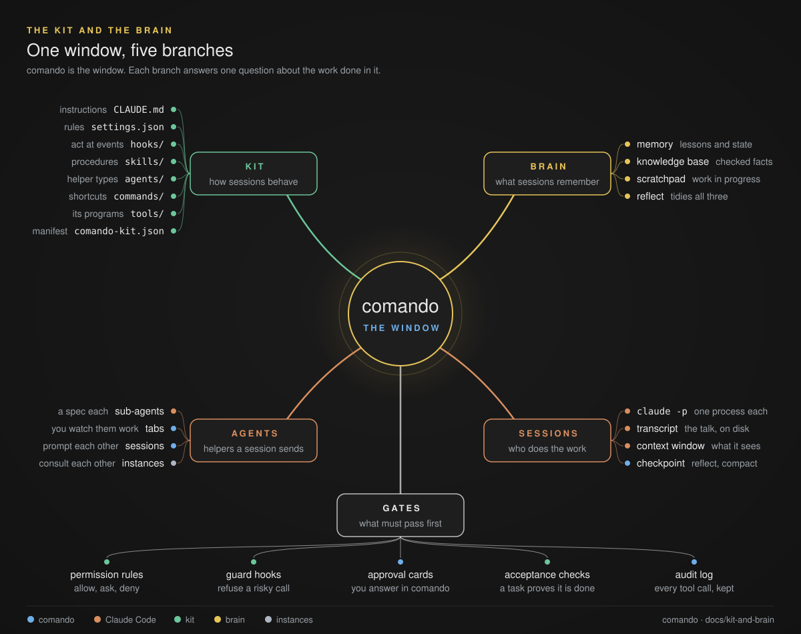
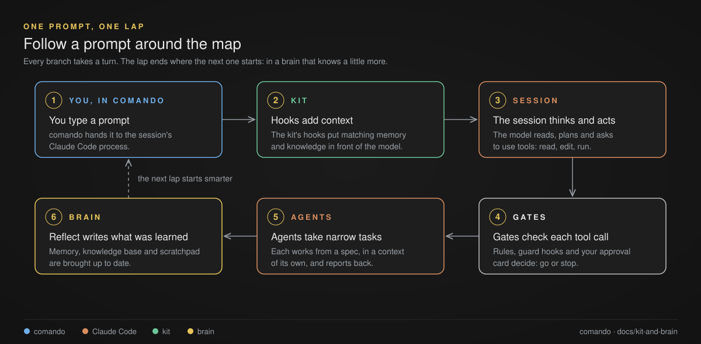

# The kit and the brain

## In one paragraph

comando is a window. What happens inside it depends on two folders it hosts. The **kit** is how the sessions
behave. The **brain** is what they remember and know. This page is the map: five branches around comando, one
short section each, and a link to the page that goes deep. Read it first if the words kit, brain, session, agent
and gate are new to you.

## The map in one table

Each branch answers one question.

| Branch | The question it answers | Where it lives | Go deeper |
|---|---|---|---|
| [Kit](#the-kit) | How do sessions behave? | A folder of Claude Code configuration, in git | [The kit](kit.md) |
| [Brain](#the-brain) | What do sessions remember and know? | A second folder, in git | [The brain](brain.md) |
| [Sessions](#sessions) | Who does the work? | One Claude Code process per session tab | [Claude Code in comando](claude-code.md) |
| [Agents](#agents) | Who helps, on what? | Sub-agents, other sessions, other instances | [Claude Code in comando](claude-code.md) |
| [Gates](#gates) | What may stop an action? | The kit's rules and hooks, comando's approval card | [The kit](kit.md#agents-and-gates) |

No kit ships with comando. You bring one or make one: [Make a minimal kit](kit.md#make-a-minimal-kit).
Without a kit comando still works, on your own Claude Code setup. It then has no brain.

> **Learn: an LLM agent.** A large language model reads text and writes the text that should come next. On its own
> it can only talk. Give it tools, such as "read this file" or "run this command", and a loop: think, use a tool,
> look at the result, think again. Now it can do work. That loop is an agent. Claude Code is such an agent, and
> comando runs many of them side by side, one per session tab.

## The kit

The kit is the agent's habits, written down. It is one folder with eight parts: instructions (`CLAUDE.md`), rules
(`settings.json`), reflexes (`hooks/`), procedures (`skills/`), helper types (`agents/`), saved prompts
(`commands/`), programs (`tools/`) and a manifest for comando (`comando-kit.json`).

comando finds the kit when it starts and points every session at it. It shows the folders the kit's manifest
lists, and a `group` key there makes the **KIT** row. It backs the kit up with a git commit and a push. It offers
an upgrade when a newer release tag is out.

Read [The kit](kit.md) for each part, the manifest, and how comando finds and hosts the folder.

## The brain

The brain is the agent's notebook. A session forgets everything when it ends. The brain is where the useful part
goes, so the next session starts from it. It has three shelves and one habit:

| Part | What it holds |
|---|---|
| Memory | Working context: state, preferences, lessons |
| Knowledge base | What is true about the thing you work on |
| Scratchpad | Work in progress: plans, drafts, reports |
| Reflect | The habit that moves a session's lessons onto the shelves |

comando gives every session the brain's folder and names its memory folder to Claude Code. It runs the checkpoint
that triggers reflect, and backs the brain up with a git commit.

Read [The brain](brain.md) for the shelves, the reflect loop and the context window.

> **Learn: behaviour and state, kept apart.** A game has rules and a saved game. The rules change rarely, and with
> care. The saved game changes every time you play. Mixing them makes both hard to trust: an update to the rules
> could wipe your progress. Good systems keep the two apart. The kit is the rules and the brain is the saved game.
> comando keeps them in two folders, each with its own git history and its own backup.

## Sessions

A session is one conversation with one Claude Code process. comando starts the process, hands it your prompts,
and draws what comes back. The session runs on the kit and writes to the brain.

Every session has a context window: the text the model can see at once. When it fills to a threshold (40 % by
default), comando runs the **checkpoint**. It sends the session's checkpoint command, `/reflect` by default, and
then `/compact`. The session saves what it learned before its history shrinks.
[ADR 0129](adr/0129-a-checkpoint-reflects-then-compacts.md) has the reasons.

Read [Claude Code in comando](claude-code.md) for sessions, models, effort and transcripts.

## Agents

One session cannot hold a large task in its head. So it hands narrow tasks to helpers. There are three kinds.

| Helper | What it is | In comando |
|---|---|---|
| Sub-agent | A helper a session starts, with a context of its own and a type from the kit's `agents/` | A tab you can read ([ADR 0109](adr/0109-a-sub-agent-is-a-session-tab.md)) |
| Another session | A peer with its own topic | Sessions prompt each other ([ADR 0041](adr/0041-a-session-can-prompt-another.md)) |
| Another instance | A second comando with its own name, kit, brain and data | Instances consult each other ([ADR 0123](adr/0123-instances-consult-each-other.md)) |

The kit says how helpers are briefed: [Agents and gates](kit.md#agents-and-gates). Each instance has a map of
its own, with its own kit and brain: [The workbench](workbench.md) shows where instances appear in the window.

## Gates

An agent acts through tools, and a tool can delete a file or send a message. A gate is a point where such a call
can be stopped. The kit and comando stack several: permission rules, guard hooks, the approval card you answer,
and acceptance checks on finished work. comando also keeps an audit log of what passed.

Read [Agents and gates](kit.md#agents-and-gates) for the table of gates and who owns each.

> **Learn: human in the loop.** An automatic system is fast, and it can be wrong at full speed. One fix is to put
> a person at the few steps that cannot be undone. The machine does the routine work and stops to ask before the
> dangerous step. The skill is in choosing those steps: too many questions, and you stop reading them. comando's
> approval card is that stop, and the kit's permission rules decide which calls reach it.

## Follow one prompt around the map

The branches are not a list. They are a loop, and every prompt walks it.

1. **You** type a prompt in comando. comando hands it to the session's process.
2. **The kit**'s hooks add context, such as the memory and knowledge that match your words.
3. **The session** thinks and asks to use tools.
4. **The gates** check each tool call. Most pass. Some stop, and one may ask you.
5. **Agents** take the narrow tasks and report back.
6. **The brain** grows: at the checkpoint, reflect writes down what the session learned.

The next prompt starts from a brain that knows a little more. That is the point of the whole map: the window, the
habits and the notebook together make each session better than the one before.

## Where next

- [The kit](kit.md): the eight parts, the manifest, how comando finds and hosts a kit.
- [The brain](brain.md): memory, knowledge base, scratchpad and reflect.
- [Claude Code in comando](claude-code.md): sessions, approvals and the checkpoint.
- [Architecture](architecture.md): how comando itself is built.
- [The documentation hub](README.md): every page of the network.
