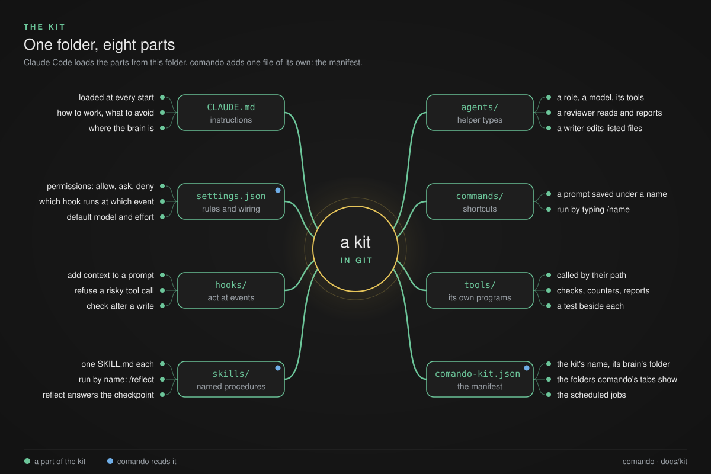
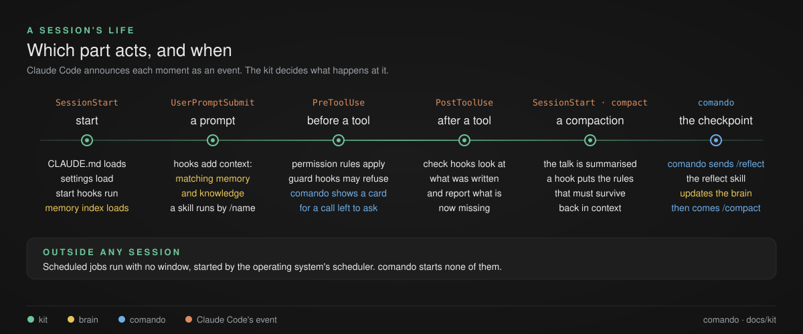
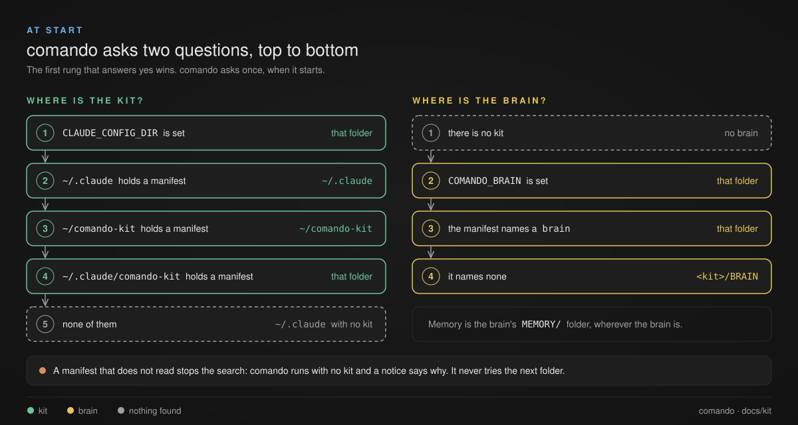
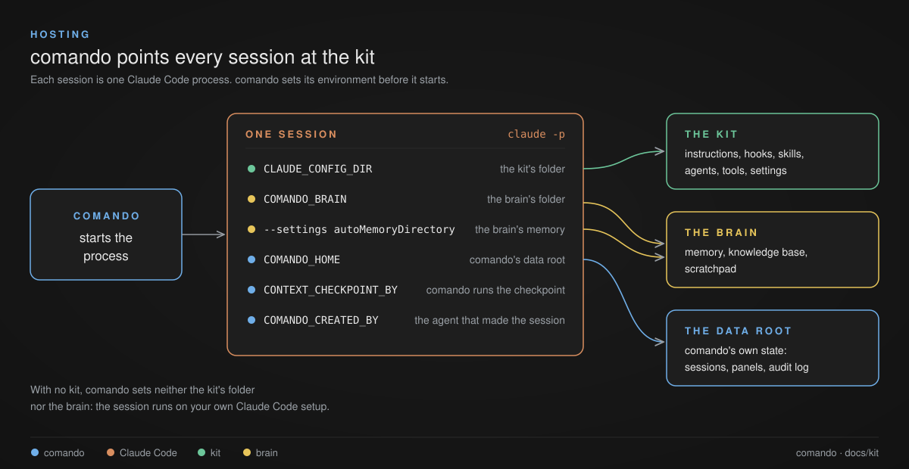
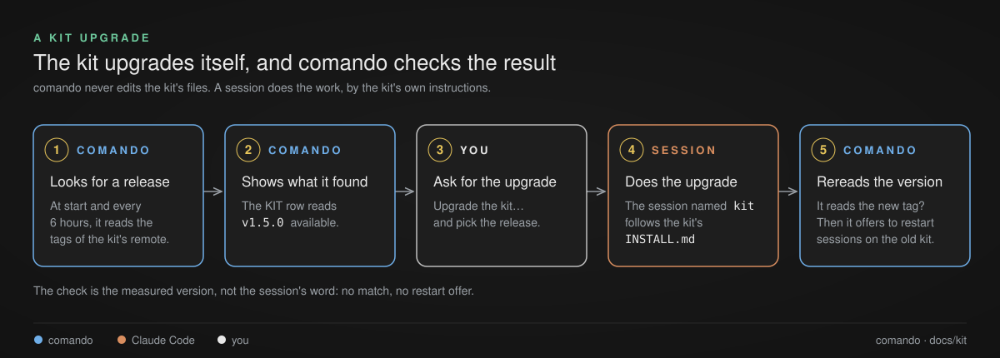
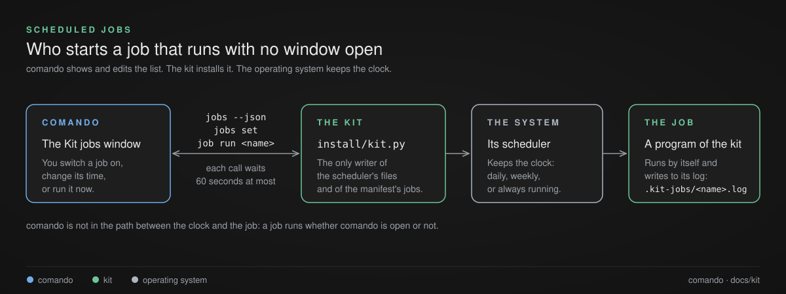

# The kit



## In one paragraph

A kit is a folder that tells Claude Code how to work: its instructions, rules, hooks, skills, helper types and
programs. comando runs every session on that folder. This page says what is in a kit, how comando finds it, and
what comando does with it. The kit holds behaviour. What sessions remember lives in the [brain](brain.md). The
map of both is [The kit and the brain](kit-and-brain.md).

## What a kit is

A kit is configuration, kept as plain files in one folder. Claude Code calls that folder its configuration
directory. Change a file and every later session behaves differently. Nothing is compiled.

Seven parts are Claude Code's. The eighth, the manifest, is comando's.

| Part | What it is | What it does | Read by |
|---|---|---|---|
| `CLAUDE.md` | A text file of instructions | Loads into every session at its start | Claude Code |
| `settings.json` | Rules and wiring | Permission rules, which hook runs at which event, the default model | Claude Code, comando |
| `hooks/` | Small programs | Each runs when Claude Code announces an event | Claude Code |
| `skills/` | Named procedures, one `SKILL.md` each | A session runs one when the task fits or you type `/name` | Claude Code, comando |
| `agents/` | Helper types, one file each | Names a role, a model and the tools a sub-agent gets | Claude Code |
| `commands/` | Saved prompts, one file each | You run one by typing `/name` | Claude Code |
| `tools/` | The kit's own programs | Sessions and hooks call them by their path | the session's shell |
| `comando-kit.json` | The manifest | Names the kit, its brain, its folders and its jobs | comando |

A kit belongs in git. A commit is then a version of how your sessions behave, and a tag is a release of it.

> **Learn: configuration as code.** A program's behaviour comes from two places: its code and its settings. When the
> settings live in files under version control, you treat them like code. You can read what changed, review it, and
> go back to yesterday's version. A kit is exactly that for an AI agent: its behaviour is a folder you can diff.
> comando leans on this. It commits and pushes a kit's changes as a backup, and reads its version from a git tag.

## What each part does

Each part acts at a known moment of a session's life. Claude Code announces these moments as events, and the kit
decides what happens at each.



- **`CLAUDE.md`** is the standing briefing. It says how to work, what to avoid and where the brain is. Keep it
  short: it costs context in every session.
- **`settings.json`** holds the permission rules (`allow`, `ask`, `deny`) and the `hooks` table that ties each
  event to a program. comando reads three values from it as a new session's defaults: `model`, `effortLevel` and
  `permissions.defaultMode`.
- **Hooks** are the kit's reflexes. A hook on `UserPromptSubmit` adds context to your prompt. A hook on
  `PreToolUse` can refuse a tool call. A hook on `PostToolUse` checks what a tool wrote.
- **Skills** are procedures with a name. The most important one answers the checkpoint: comando sends `/reflect`,
  and the kit's reflect skill writes what the session learned into the brain. comando links a skill call in a
  transcript to its `SKILL.md`.
- **Agents** are helper types. A session hands a narrow task to a sub-agent of one type, and that sub-agent works
  in a context of its own.
- **Commands** are prompts you saved under a name.
- **Tools** are ordinary programs the kit brings along: checkers, counters, report writers. A good kit keeps a
  test beside each.

> **Learn: an event hook.** Some programs let you plug in your own code at fixed moments: "before saving", "after
> login". The program announces the moment, runs your code, and reads its answer. That plug-in point is a hook. It
> lets you change behaviour without touching the program itself. Claude Code announces a session's moments this way,
> and a kit's hooks answer them. comando adds no hooks of its own. It shows in the transcript which of the kit's
> hooks ran.

> **Learn: fail closed.** A guard can fail in two ways when something breaks. Fail open means "when unsure, let it
> through". Fail closed means "when unsure, stop". A door lock that opens in a power cut fails open. For a guard on
> risky actions, fail closed is the safe choice. comando does the same with a broken manifest: it runs with no kit
> and says why, instead of guessing.

## How comando finds a kit

comando looks for the kit once, when it starts. It walks a fixed list of places and takes the first that holds a
`comando-kit.json`. The folder it settles on is the **root**.



| Order | The root is | When |
|---|---|---|
| 1 | the folder `CLAUDE_CONFIG_DIR` names | you start comando with that variable set |
| 2 | `~/.claude` | it holds a `comando-kit.json` |
| 3 | `~/comando-kit` | it holds one; a new install puts its kit here |
| 4 | `~/.claude/comando-kit` | it holds one |
| 5 | `~/.claude`, with no kit | none of the above |

A manifest that does not read stops the search. comando then runs with no kit and shows a notice that names the
file and the fault. It never falls through to the next folder: a broken kit is a fact you should see.

The brain is a folder of its own, and only a kit has one.

| Order | The brain is | When |
|---|---|---|
| 1 | the folder `COMANDO_BRAIN` names | you start comando with that variable set |
| 2 | the manifest's `brain` | it names one: absolute, `~/…`, or relative to the kit |
| 3 | `<kit>/BRAIN` | the manifest names none |

A new install uses `~/comando-kit` and `~/comando-brain`. Your own `~/.claude` stays as it is.

> **Learn: first match wins.** When a thing may live in several places, a program needs one rule to pick. The
> simplest rule is an ordered list: try each place in turn and stop at the first hit. Your shell finds commands this
> way through `PATH`. The order is the whole design: earlier places override later ones. comando puts
> `CLAUDE_CONFIG_DIR` first, so one variable can point a second comando at a second kit.

## How comando hosts a kit

Hosting means one thing: every Claude Code process comando starts runs on the kit. comando sets the process's
environment before it starts it. The session then loads the kit's files by itself.



| comando sets | To | When |
|---|---|---|
| `CLAUDE_CONFIG_DIR` | the root | the root is not your own `~/.claude` |
| `COMANDO_BRAIN` | the brain's folder | there is a kit |
| `--settings '{"autoMemoryDirectory": …}'` | the brain's `MEMORY` folder | there is a kit |
| `COMANDO_HOME` | comando's data root | always |
| `CONTEXT_CHECKPOINT_BY` | `comando` | comando runs the checkpoint at its threshold |
| `COMANDO_CREATED_BY` | the agent that made the session | an agent made the session, not you |

The kit's hooks and tools read these variables. A hook finds the brain through `COMANDO_BRAIN`, so the kit holds
no fixed path to it. A hook that sees `CONTEXT_CHECKPOINT_BY` leaves the checkpoint to comando. A hook that sees
`COMANDO_CREATED_BY` knows no person is typing, and leaves out what only a person needs.

One session is an exception. The session named `kit`, working in a root at or inside `~/.claude`, runs on your own
folder. It is the session that upgrades the kit, so it can replace the kit's files.

**Signing in.** Claude Code keeps its sign-in per configuration folder. A kit outside `~/.claude` signs in once,
in your own terminal:

```sh
CLAUDE_CONFIG_DIR=~/comando-kit claude auth login
CLAUDE_CONFIG_DIR=~/comando-kit claude auth status --text
```

> **Learn: an environment variable.** Every process starts with a small table of names and values, handed down by
> the process that starts it. That table is its environment. The child reads it; the parent never has to call the
> child again. It is the cheapest way to tell a program where things are. comando uses it to host a kit: it writes
> five names into the table, and Claude Code and the kit's hooks read them.

## The manifest

`comando-kit.json` is the one file a kit writes for comando. It sits at the top of the kit. It says what the kit is
called, where its brain is, which folders comando's tabs show, and which jobs run on a schedule.

An invented example:

```json
{
  "kit": 1,
  "name": "garden-kit",
  "brain": "~/garden-brain",
  "folders": [
    {"name": "Kit", "path": ".", "group": "Kit"},
    {"name": "Memory", "root": "brain", "path": "MEMORY", "index": "MEMORY.md", "icon": "memory",
     "group": "Brain"},
    {"name": "Knowledge", "root": "brain", "path": "KB", "icon": "knowledge", "group": "Brain"},
    {"name": "Scratchpad", "root": "brain", "path": "SCRATCHPAD", "icon": "scratchpad", "deletable": true}
  ],
  "requirements": [
    {"tool": "git", "check": ["git", "--version"], "install": {"macos": ["brew", "install", "git"]}}
  ],
  "credentials": [
    {"key": "WEATHER_API_KEY", "for": "the weather tool", "where": "settings.local.json"}
  ],
  "jobs": [
    {"name": "nightly-tidy", "description": "Tidies the scratchpad", "schedule": {"daily": "02:00"},
     "command": ["tools/tidy/tidy.py"], "enabled": true}
  ]
}
```

| Key | Meaning | Rule |
|---|---|---|
| `kit` | The schema's version | `1`; absent counts as `1`; any other value is refused |
| `name` | The kit's name | Required |
| `brain` | The brain's folder | Absolute, `~/…`, or relative to the kit; absent means `<kit>/BRAIN` |
| `folders` | The folders comando's tabs show | See below |
| `requirements` | Programs the kit needs | `tool`, a `check` command, an `install` command per `macos`, `linux`, `windows` |
| `credentials` | Secrets the kit needs | `key`, `for`, `where`; never a value |
| `jobs` | Scheduled jobs | See [Scheduled jobs](#scheduled-jobs) |

A folder entry has a `name` (used once), a `root` (`kit`, the default, or `brain`) and a `path` inside that root.
The path is relative and has no `..`; `"."` is the root itself. Optional keys: `index` (the file that lists the
folder), `excludes`, `icon` (`folder`, `scratchpad`, `memory`, `knowledge`, `skills` or `plugin`), `deletable`,
`listedIn` and `group`. comando ignores keys it does not know.

A `group` puts folders under one row, named by the group in capitals. A group of one folder is that folder's own
row. A group of two or more folders that share a parent folder is the parent's row, with only those folders inside.
In the example, the group `Kit` makes the **KIT** row and the group `Brain` makes the **BRAIN** row.

Each folder goes to one sidebar tab. The `scratchpad` icon sends it to **Scratchpad**, the group `Brain` sends it
to **Brain**, and any other folder goes to **Kit**.

comando treats two kinds of fault differently.

| Fault | What comando does |
|---|---|
| Not a JSON object, another `kit` version, no `name`, a folder path empty or outside its root | Refuses the whole file and runs with no kit |
| One folder entry breaks a folder rule | Leaves that entry out, names it, and uses the rest |

**Repair comando-kit.json…** rewrites the file without the entries left out. It asks first and keeps the original
as `comando-kit.json.bak-<time>`. It removes nothing when the file's faults differ from the ones it showed you.

> **Learn: a schema version.** A file format changes over time. A reader built for today's format cannot know
> tomorrow's. So the file carries a number that says which format it is in, and the reader checks it first. A
> number the reader does not know means "stop, do not guess". The manifest's `kit` key is that number. When it is
> higher than comando knows, comando says the kit is newer and asks you to upgrade comando. The reason is in
> [ADR 0133](adr/0133-every-stored-file-has-a-schema-and-a-version.md).

## What comando shows and does

comando shows the folders the manifest lists in the sidebar's **Kit**, **Brain** and **Scratchpad** tabs. A manifest
with no `folders` adds none. With the group `Kit` on the kit's root, the kit shows as one unit: a **KIT** row in the
**Kit** tab, with the kit's folders under it. The group `Brain` gives the brain a **BRAIN** row in the **Brain** tab
the same way ([ADR 0118](adr/0118-brain-and-kit-are-rows-each-one-unit.md)).

| Action | What it does | Available when |
|---|---|---|
| **Use the kit's folders** | Puts the manifest's folders your tabs lack at the top of the list | there is a kit |
| **Back up the kit** | `git add -A`, a commit when something changed, `git push` | the kit is the top of a git repository with a remote |
| **Back up the brain** | The same, for the brain | the brain is the top of a git repository with a remote |
| **Upgrade the kit…** | Starts the upgrade below | the kit's remote has a newer `vN.N.N` tag |
| **Repair comando-kit.json…** | Rewrites the manifest without its bad entries | comando left entries out |
| **Configure kit jobs** | Opens the **Kit jobs** window | there is a kit |

A backup commit names what changed. Its first line reads like `Kit backup <date>: <top folder> N changed; …`.
With nothing changed, a backup makes no commit and only pushes.

comando reads the kit's version with `git describe --tags --always`. It looks for newer tags of the form `vN.N.N`
on the kit's remote at start and every 6 hours. A tag of another form never counts as a release. When a newer one
is out, the KIT row shows `<tag> available`.



The upgrade is a prompt, not a script. comando opens the session named `kit` in the root. It asks that session to
upgrade to the tag you chose, following the kit's own `INSTALL.md`, section Upgrade. When that turn ends without
an error, comando reads the version again. Only when it reads the new tag does comando offer to restart the
sessions still running on the old kit. A busy session is left alone.

## Scheduled jobs

A job is a program of the kit that runs on a clock, with no window open: a nightly tidy, a weekly report. The
manifest lists the jobs. The operating system's scheduler starts them.



comando never writes the scheduler's files. It calls the kit's own installer, `install/kit.py`, with `python3`
(`python` on Windows):

| Call | Purpose |
|---|---|
| `jobs --json --root <root>` | Lists the jobs and whether each is installed |
| `jobs set --root <root>` | Takes the whole edited list on standard input and installs it |
| `job run <name> --root <root>` | Starts one job now, through the scheduler |

Each call waits 60 seconds at most. Its exit code says how it went.

| Exit code | Meaning |
|---|---|
| `0` | Done |
| `1` | Done in part: a running job left as it is, or a load that failed |
| `2` | Refused; nothing written |
| `3` | An unexpected error; part may be done |

| Job key | Meaning |
|---|---|
| `name` | A lower-case letter, then up to 31 of `a-z`, `0-9`, `-` |
| `description` | One line for the **Kit jobs** window |
| `schedule` | `{"daily": "HH:MM"}`, `{"weekly": "MON,THU HH:MM"}` with days `MON`…`SUN`, or `{"service": "always"}` |
| `command` | A program inside the root, then its arguments |
| `env` | Extra variables; names use capitals, digits and `_` |
| `log` | The log file; `.kit-jobs/<name>.log` when absent |
| `enabled` | Whether it runs on its schedule or is paused |
| `awake` | Keeps a Mac from sleeping while the job runs (macOS only) |

The **Kit** tab shows a **Jobs** row first inside the KIT row, the one the group `Kit` makes. It reads "none" for
a kit with no jobs and "cannot be read" when the installer fails. The reasons are in
[ADR 0117](adr/0117-kit-jobs-a-row-and-a-window.md).

The **Kit jobs** window lists the jobs on the left. Each row has a mark for how the job stands (a tick for a last
run that ended well, a cross for one that failed, play while it runs, stop while it is paused, an hourglass before
its first run), its name, and its schedule in grey. Right-click a row to run the job now, open its log or remove
it. Above the fields sit the job's state, its last run with the exit code, and its next run. Each field has a hint
under it, and the ⓘ on its label opens the longer explanation. The Program and Log rows each have an open button
that shows the file in an editor panel, to read or change it. **Save** hands the whole list to the installer.

> **Learn: a scheduler.** A computer has a service whose only work is to start programs at set times. You give it a
> list: this program, at this hour, on these days. It keeps the list even when you log out, and it restarts a
> program that must always run. Each system has its own. comando does not become a scheduler. It hands the kit's
> list to the one your system already has, so a job runs whether comando is open or not.

## Agents and gates

Two parts of a kit decide how safely the work gets done: who does a task, and what may stop it.

**Agents.** A kit's `agents/` folder defines helper types. Two are common: a reviewer that reads and reports, and
a writer that edits a named list of files. A good kit gives each sub-agent a written spec: the context it needs,
the files it may touch, and a check that can run. A check that runs settles "done" without an argument. In
comando each sub-agent is a tab you can read ([ADR 0109](adr/0109-a-sub-agent-is-a-session-tab.md)).

**Gates.** A gate is a point where a tool call can be stopped. A kit and comando stack several.

| Gate | Owner | It stops |
|---|---|---|
| Permission rules | the kit's `settings.json` | A tool call a `deny` rule names; an `ask` rule sends it to you |
| Guard hooks | the kit's `hooks/` | A call the hook judges risky, with the reason and how to proceed |
| Approval card | comando | A call left to ask: you allow or deny it in the window |
| Acceptance check | the kit's agent specs | Work reported as done that fails its own check |
| Audit log | comando | Nothing: it records every tool call comando serves and every decision |

The audit log is append-only: one file of JSON lines per UTC day, in the `audit` folder of comando's data root.
[Claude Code in comando](claude-code.md) covers approvals and permission modes.

> **Learn: defence in depth.** One guard can be wrong, asleep or misconfigured. So careful systems stack several
> guards that work in different ways. A castle has a moat, a wall and a gate, and an attacker must pass all three.
> No single layer needs to be perfect. A kit's rules, its hooks and comando's approval card are three such layers,
> and the audit log shows afterwards what passed.

## Make a minimal kit

You can host a kit with five files. This one is invented; grow it from there.

| File | Content |
|---|---|
| `comando-kit.json` | The manifest below: the kit's name, its brain, and one folder each for the two rows |
| `CLAUDE.md` | A few lines: how to work, and that memory lives in the folder `COMANDO_BRAIN` names |
| `settings.json` | `{"permissions": {"defaultMode": "default"}}`, then your rules and hooks |
| `skills/reflect/SKILL.md` | The procedure the checkpoint runs: write what the session learned into the brain |
| `.gitignore` | `settings.local.json`, `projects/`, and whatever else Claude Code writes while it runs |

```json
{
  "kit": 1,
  "name": "my-kit",
  "brain": "~/comando-brain",
  "folders": [
    {"name": "Kit", "path": ".", "group": "Kit"},
    {"name": "Brain", "root": "brain", "path": ".", "group": "Brain"}
  ]
}
```

1. Create the folder `~/comando-kit`, put the files in it, and run `git init`.
2. Create the brain's folder, `~/comando-brain`, as a git repository of its own.
   [The brain](brain.md) says what goes in it.
3. Sign the kit's folder in, as in [How comando hosts a kit](#how-comando-hosts-a-kit).
4. Restart comando. The **Kit** tab shows the KIT row and the **Brain** tab the BRAIN row, one per `folders` entry.
   A row is missing? **Use the kit's folders** adds it ([the actions](#what-comando-shows-and-does)).

Add a remote and `vN.N.N` tags, and comando offers backups and upgrades. Add `install/kit.py`, and it shows your jobs.

## Where next

- [The brain](brain.md): memory, knowledge base, scratchpad and reflect.
- [The kit and the brain](kit-and-brain.md): the whole map on one page.
- [Claude Code in comando](claude-code.md): sessions, approvals and the checkpoint.
- [The workbench](workbench.md): the window's tabs and panels.
- [Installing comando](../INSTALL.md): the install and upgrade steps.
