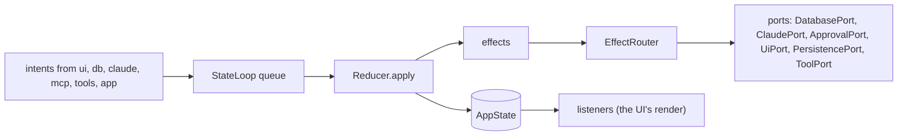
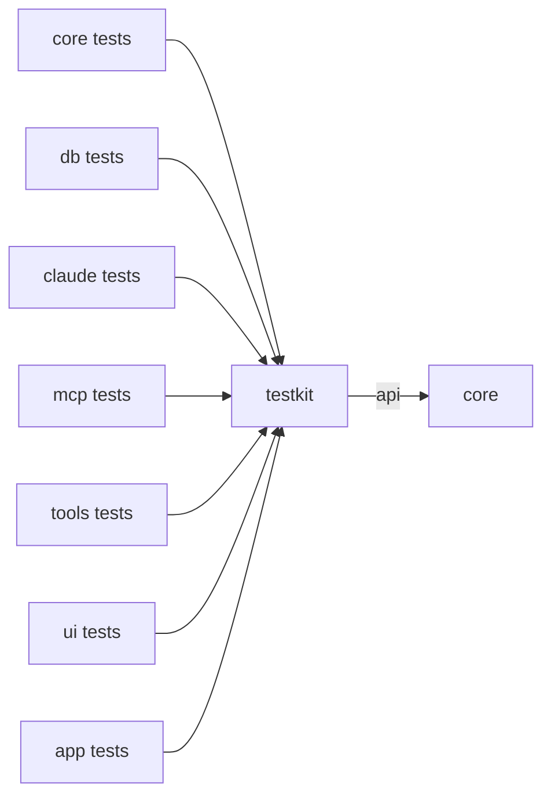
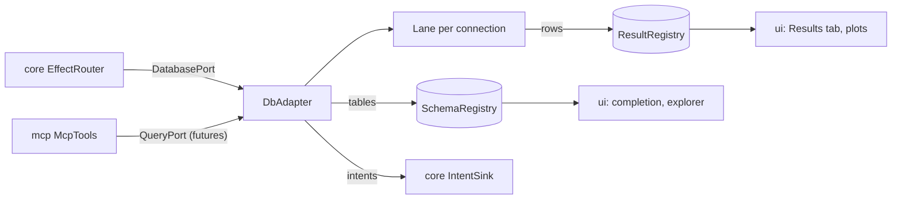
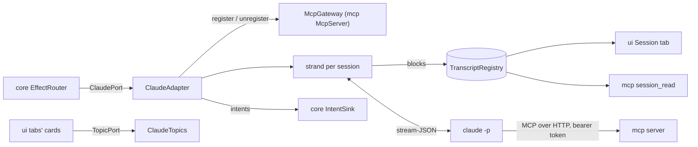
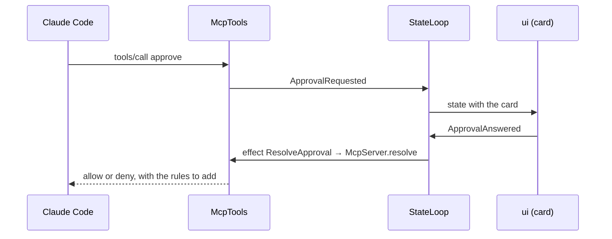
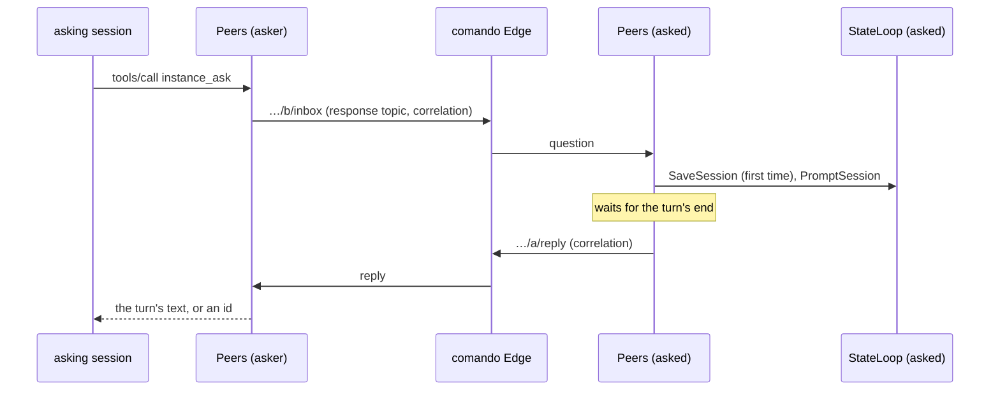
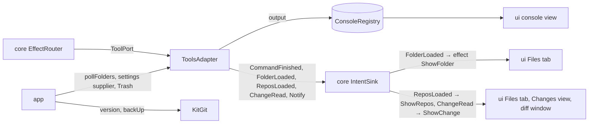
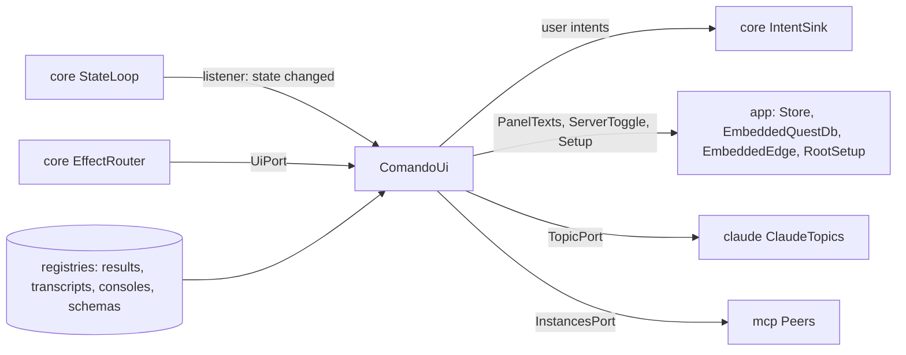
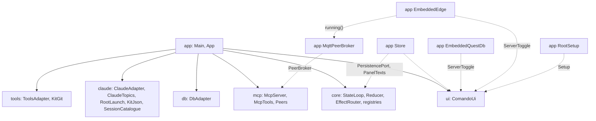

# Modules

Each module of comando: what it holds and what each class does, its interface with the other modules, the threads it
runs and the tests that prove it. The modules and what each depends on are in [Architecture §2](architecture.md#2-modules);
the state, intents and effects in [§4](architecture.md#4-state-intents-effects); every port in
[§5](architecture.md#5-ports-and-test-fakes); every thread by kind in [§6](architecture.md#6-threads); the build and
close order in [§7](architecture.md#7-ownership-and-exit); the UI's layers in [§8](architecture.md#8-ui-packages). This
document holds what those sections do not: the classes, the port methods and what each adapter sends back, each
module's own threads, and each module's tests. A new module gets a section here with the same four parts.

1. [`core`](#1-core)
2. [`testkit`](#2-testkit)
3. [`db`](#3-db)
4. [`claude`](#4-claude)
5. [`mcp`](#5-mcp)
6. [`tools`](#6-tools)
7. [`ui`](#7-ui)
8. [`app`](#8-app)

## 1. `core`

The domain of comando: one immutable state, the intents that change it, the reducer that applies them, the effects it
asks for, the ports through which every outside system is reached, and the thread kit every module uses. It depends on
the JDK only. Every other module depends on it (`api(project(":core"))`; `implementation` in `app`), and no adapter
module depends on another: `app` connects them.


### 1.1 Architecture



`StateLoop` takes intents from any thread and applies each with `Reducer` on its own thread. It publishes the new
`AppState` through a volatile field, hands the effects to `EffectRouter` in order, then tells its listeners. The reducer
is pure in its arguments, a `Clock`, the home folder and the checkpoint threshold (a window setting read at each turn's end). Data too large to copy with every state (result rows,
transcripts, console output, schemas) lives in registries the state refers to by id.

| Package | Holds |
|---|---|
| `state` | `AppState` and its parts: `PanelState`, `ConnectionState`, `SessionState`, `SqlRun`, `ViewState`, `Notice`, `LowerTab`, `BackgroundTask`, `Reflection`, `RunStatus`, `SessionInfo`; `InstancesState`, the other instances on the comando Edge and the questions between them ([record 124](adr/0124-the-sidebar-shows-the-instances.md)) |
| `intent` | `Intent`, the sealed interface of every change; `EditMode` |
| `action` | `Action` and `Actions`: every user action as an agent's tool, with its arguments and class, and every kind of intent classified (offered, event, window, not yet) ([record 121](adr/0121-an-agent-has-every-action-the-user-has.md)) |
| `reduce` | `Reducer` (intent → `Transition`), which hands each intent to the rules of its domain: `PanelRules`, `SessionRules`, `TurnRules`, `QueryRules`, `ApprovalRules`, `FolderRules`, `ViewRules`, with `Shared` for what several use (notices, the saved lists, fresh panel ids); `Transition` (the next state and its effects) |
| `effect` | `Effect`, the sealed interface of work for adapters; `EffectRouter`, which hands each effect to its port |
| `loop` | `StateLoop` (the queue, the reducer thread, its look on the watchdog, listeners and observers); the thread kit: `Threads`, `Errands`, `Watchdog`, `ExecutorStop` (an owner's bounded stop of its executors); `Processes`, the one way a short command is run |
| `port` | the interfaces adapters implement ([§1.2](#12-interface-with-the-rest-of-the-app)); among them `InstancesPort` (`ask`, `deny`, `forget`, `role`: what the user does from the Instances tab, implemented by `mcp`'s `Peers`, record 124) and `ServerSwitch` (`name`, `isRunning`, `want(up)`, `status`: a local server an agent starts or stops naming the direction, the comando Edge or the embedded QuestDB, record 121) |
| `model` | configuration and values every module shares: `ConnectionSpec`, `SessionSpec`, `FolderRoot`, `PanelId`, `Approval`, `ApprovalDecision`, `ApprovalKind`, `PermissionRules`, `PlanUsage`, `Topic`, `HomeDir`, `Status`, `StartMode`; `AtomicFiles` (a file written whole or not at all); `InstanceName` (the name an instance goes by, from `-Dcomando.name`, `COMANDO_NAME`, the data root's `instance.json` or its folder); `KitRoot` (the Claude Code folder sessions run on and its `comando-kit.json`), `KitVersion` (the kit's release and the newer ones), `KitFolders` (the kit's folders merged into the Files tab's), `KitJob` and `KitJobs` (the kit's scheduled jobs, their checks, and how the scheduler holds them); `RepoStatus` (a repository's branch and changed files), `ChangeTexts` (a changed file's two versions), `ChangeAsk` (why they are asked for); `LinearTickets` (ticket ids in a text, with the address Linear shows each at) |
| `resource` | `ResourceKind`, its kinds (`ConnectionKind`, `SessionKind`, `FolderKind`) and `Attribute`: the attributes and rules one dialog edits |
| `dispatch` | `Blocks`, `Statements`, `Classifier`, `Target`: editor text split into blocks and statements, and the SQL-or-prompt decision |
| `view` | `ViewSpec` (the data of each view type), `Placement`, `Layout`, `FileView`, `Clip` |
| `result` | `ResultView` (read access to a run's rows), `ResultRegistry`, `ColumnKind`, `Formats` |
| `transcript` | `Block`, `Transcript` (one writer, many readers), `TranscriptRegistry`, `TopicSource` (what a tab's topic is read from) |
| `console` | `Console` (a command run's output), `ConsoleRegistry` |
| `schema` | `Schema`, `SchemaRegistry` |

### 1.2 Interface with the rest of the app

**Into `core`.** Every producer calls `IntentSink.dispatch`, which `StateLoop` implements and which never blocks.
Readers take `StateLoop.state()`, a consistent snapshot, from any thread. `app` creates the loop and registers an
`IntentObserver` (the intent log); `ui` registers a `Listener` (its coalesced render).

**Out of `core`.** Effects leave through ports. Every port method queues work and returns; outcomes come back as
intents.

| Port | Implemented by | Called by |
|---|---|---|
| `IntentSink` | `StateLoop` | every module |
| `InstancesPort` | `mcp` `Peers` | `ui` (the Instances tab; a call acts off the caller's thread, the outcome comes back as a notice and in `AppState.instances`) |
| `ServerSwitch` | `app` `EmbeddedQuestDb`, `EmbeddedEdge` | `mcp` (`ActionTools`: `server_start`, `server_stop`) |
| `Clock` | `Clock.SYSTEM` | `Reducer`, `mcp` |
| `DatabasePort` | `db` `DbAdapter` | `EffectRouter` |
| `QueryPort` | `db` `DbAdapter` | `mcp` (`db_run_sql`, `db_describe`) |
| `ClaudePort` | `claude` `ClaudeAdapter` | `EffectRouter` |
| `TopicPort` | `claude` `ClaudeTopics` | `ui` (the tabs' cards; a topic is view data and never passes the reducer) |
| `McpGateway` | `mcp` `McpServer` | `claude` (a ticket per process) |
| `ApprovalPort` | `mcp` `McpServer` | `EffectRouter` |
| `ToolPort` | `tools` `ToolsAdapter` | `EffectRouter` |
| `UiPort` | `ui` `ComandoUi` | `EffectRouter` |
| `PersistencePort` | `app` `Store` | `EffectRouter` |

`app` builds `EffectRouter` from the six effect ports once they exist.

**Shared stores.** `app` creates one of each registry (`ResultRegistry`, `TranscriptRegistry`, `ConsoleRegistry`,
`SchemaRegistry`) and hands it to its writer and its readers: [Architecture §4.5](architecture.md#45-stores-outside-the-state).

**Shared helpers.**

| Helper | Decides | Used by |
|---|---|---|
| `Classifier` | SQL or prompt, and DDL | the reducer, the editor (block colours, gutter, completion), `mcp` (DDL in `db_run_sql`) |
| `Statements` | the statements of a block | the reducer, the editor |
| `Intent.Notify.logged` | a failure written to the log, and the notice whose click opens it there (`Notice.log`) | every adapter |
| `HomeDir` | `~` expansion and shortening; Claude Code's folder, the root `KitRoot` resolves | every module |
| `KitRoot` | the root: `CLAUDE_CONFIG_DIR` when comando was started with it, else `~/.claude` with a `comando-kit.json`, else `~/.claude/comando-kit` with one, else `~/.claude` | `app` names it once (`KitRoot.use`) and parses `comando-kit.json` through `claude`'s `KitJson`, as `core` reads no JSON |
| `Clip` | a label shortened the same way in the window and in what Claude is told | `ui`, `claude`, `mcp`, `tools` |
| `PermissionRules` | the allow rules an approval adds | `mcp`, the approval card |

**Adding a change.** A new intent is a record in `Intent`, a case in `Reducer` and a classification in `Actions` (sent by an action, an event, the window's own, or not yet; `ActionParityTest` fails otherwise). A new effect is a record in `Effect`,
a case in `EffectRouter` and a port method, which `testkit`'s `RecordingPorts` must then implement too.

### 1.3 Threads

| Thread | Kind | Does | Stopped by |
|---|---|---|---|
| `comando-reducer` | platform | applies intents in order; the only writer of `AppState` | `StateLoop.close`, after the queued intents, waiting at most 2 s; or an `Error`, for good |
| `watchdog` | platform, shared with the EDT's watchdog (`Watchdog.shared()`) | every 100 ms runs each registered look; an intent still applying at 1 s is logged with the loop's stack | itself, a period after the last look is closed |

`loop` also holds the thread kit of [Architecture §6](architecture.md#6-threads). `Threads` makes strands
(`strand`, `timedStrand`) and forks on virtual threads, and lists the live ones by name for tests (`Threads.alive`).
`Errands` holds one owner's errands, interrupted and waited for at its close. `Watchdog` is the one platform thread that
runs every watchdog's look. `Processes` runs a short command on the caller's thread with its standard streams on
temporary files, so no thread reads a pipe; past its time limit, or when the caller is interrupted, the command and
every process it started are ended.

An intent that takes 200 ms or more is a stall, logged once it ends with its slowest part. One of 1 s or more also sets
a notice whose click opens the log at the hang. The reducer, each effect and each listener are guarded: an exception is
logged and the loop goes on; an `Error` stops the loop for good, and every later intent is dropped with one ERROR line
([Architecture §4.4](architecture.md#44-effects)).

### 1.4 Tests

Unit tests, with no I/O except the temporary files of `FileViewTest`, `KitRootTest`, `KitFoldersTest` and
`AtomicFilesTest`, and the child processes of `ProcessesTest`. They use `testkit`'s `FakeClock` and `States`.

| Subject | Tests |
|---|---|
| reducer | `ReducerTest`, `ReducerNoticeAndLayoutTest`, `ReducerSubagentTest`, `ReducerChangesTest` |
| loop and threads | `StateLoopTest` (`applyNow` drives the loop without its thread), `ThreadKitTest`, `ExecutorStopTest` (an owner's executors have ended when its close returns; `now` gives up at its bound and says so), `WatchdogTest` (a look that fails does not stop the others), `NotifyLoggedTest`, `ProcessesTest` |
| dispatch | `ClassifierTest`, `BlocksTest`, `StatementsTest` |
| stores | `TranscriptTest`, `TopicSourceTest`, `ConsoleTest`, `FormatsTest` |
| state and model | `ReflectionTest`, `ResourceKindTest`, `FileViewTest`, `HomeDirTest`, `InstanceNameTest`, `AtomicFilesTest`, `ClipTest`, `KitRootTest`, `KitVersionTest`, `KitFoldersTest`, `KitJobTest`, `LinearTicketsTest` |

```
./gradlew :core:test
```

Further reading: [Architecture §3–§6](architecture.md#3-the-flow-of-one-command).

## 2. `testkit`

What every module's tests share: a fake for every effect port, a recording intent sink, a fake clock, a small state,
in-memory preferences, Claude Code streams recorded from the real CLI, and a synthetic session for rendering
measurements. It depends on `core`
(`api`, so a test sees `core`'s types through it). Its code sits in `src/main` so that other modules can depend on it;
every module takes it as `testImplementation`, and no production code does.


### 2.1 Architecture

One package, `dev.marregui.comando.testkit`.

| Class | Does |
|---|---|
| `RecordingPorts` | implements `DatabasePort`, `ClaudePort`, `ApprovalPort`, `UiPort`, `PersistencePort` and `ToolPort`; each call is kept as one line, such as `db.execute 7 local SELECT 1`, so a test asserts on the port calls the effect router made |
| `RecordingSink` | an `IntentSink` that keeps what adapters send; `of(type)` filters, `await(type, match, timeout)` waits for a matching intent with a deadline |
| `FakeClock` | a `Clock` a test advances |
| `States` | `twoPanels()`: panel `p1` bound to connection `local` (QuestDB defaults) and session `work`, panel `p2` bound to `local` alone; the connection and the session closed |
| `FakeResult` | a small `ResultView` held as rows of objects |
| `MemoryPreferences` | Java preferences held in memory, so a test never reads or writes the user's store |
| `Fixtures` | `stream(name)`: recorded stream-JSON, one event per line, from `fixtures/stream/<name>.jsonl` |
| `SyntheticSession` | a deterministic eight-turn session: Markdown text, 41 tool calls with one subagent, about 10 k tokens in all; `steps(deltaChars)` replays it as the stream would arrive, `transcript()` gives it whole |

The recorded streams in `src/main/resources/fixtures/stream/` are sanitised recordings of Claude Code:

| Stream | Lines | Recorded from |
|---|---|---|
| `approvals-and-question` | 95 | 2.1.296 |
| `queued-compact-interrupt` | 122 | 2.1.296 |
| `clear` | 24 | 2.1.302 |

The CLI versions comando is tested against are in [Claude §1](claude.md#1-the-claude-bridge).

### 2.2 Interface with the rest of the app



| User | Takes |
|---|---|
| adapter tests (`db`, `claude`, `mcp`, `tools`) | a `RecordingSink` in place of the state loop; the test awaits the intents the adapter sends back |
| reducer tests (`core`) | `States` and `FakeClock`; they assert on the effects a `Transition` returns |
| widget and panel tests (`ui`) | a `RecordingSink` and a state from `States` |
| `UiReplayTest`, `UiKeysTest` (`app`) | `RecordingPorts` behind a real `EffectRouter`, with a real `StateLoop` and Swing shell |
| transcript tests and `./gradlew :ui:transcriptGate` (`ui`) | `SyntheticSession` |
| `StreamMapperTest` (`claude`) | `Fixtures` |
| `SettingsTest` (`ui`) | `MemoryPreferences` |

`RecordingPorts` implements the port interfaces, so a new port method does not compile until it records here too.

### 2.3 Threads

`testkit` starts no thread. `RecordingSink.await` waits on the calling thread, bounded by its timeout.

### 2.4 Tests

`testkit` has no tests of its own; every module's tests exercise it.

## 3. `db`

The database adapter: SQL over the PostgreSQL wire protocol (QuestDB, PostgreSQL) through the PostgreSQL JDBC driver.
It runs the user's statements and Claude's, stores rows by column, reads schemas, reports the outcome of every user
run, open and test as an intent, and answers Claude's queries as futures of rows. It depends on `core` and the
PostgreSQL JDBC driver; `app` alone constructs it.


### 3.1 Architecture

One package, `dev.marregui.comando.db`.

| Class | Does |
|---|---|
| `DbAdapter` | the port: a lane per connection name, a request-to-lane map for cancel, a timer, an errand per connection test, virtual threads for cancels; schema loads |
| `Lane` | one JDBC connection and the one thread that uses it: opens, closes, statements and health checks run on it in order; cancel and abort |
| `ColumnarResult` | a run's rows by column in primitive chunks of 16 384 values (`long` for integers, booleans and times; `double`; text for the rest); implements `core`'s `ResultView` |
| `DbSettings` | tunables; `DEFAULTS`: no statement timeout for the user's runs, 5 000 000 rows kept, 5 000 rows per fetch, a health check every 60 s, abort 2 s after an unanswered cancel |

**A lane per connection.** A JDBC connection runs one statement at a time, so everything a connection does is a task on
its lane. A lane lives while it holds a connection or has work queued. A stopped lane refuses tasks and the adapter
starts a new one, so a connection's intents keep their order.

**Request identity.** Every run carries the request id the reducer assigned. Its rows go to `ResultRegistry` under that
id and its events name it, so the reducer drops events for a run it superseded.

**Cancel.** The caller marks the request cancelled, then reads the running statement; the lane publishes its statement,
then reads the mark. Either the lane sees the mark before it runs, or the caller sees the statement and cancels it. A
statement still running `abortAfterMillis` after its cancel has its connection aborted, which unblocks a socket read the
server ignores. The driver's own cancel is bounded by `cancelSignalTimeout=2`.

**Publication.** The lane fills a row's cells, then publishes the row count with a volatile write. The grid and plots
read rows below the count while the fetch goes on. Progress (`SqlRows`) is sent after 100 rows, then at steps that
double up to 50 000 rows.

**Schema.** QuestDB's own catalogue for up to 50 tables, so the explorer and completion show QuestDB's types (`SYMBOL`,
`TIMESTAMP`); a larger QuestDB and any other server answer one `information_schema.columns` query, at most 50 000 rows.
A close, removal or change of the connection while a load runs overtakes it: its remaining queries do not run and its
tables are not kept.

### 3.2 Interface with the rest of the app



**Provides.**

| Interface | Methods | Caller |
|---|---|---|
| `DatabasePort` | `open`, `close`, `forgetSchema`, `test`, `execute`, `cancel`, `release`, `loadSchema` | the reducer's effects, through `EffectRouter` |
| `QueryPort` | `query(spec, sql, maxRows)`, `describe(spec, table)`: futures of text rows, run on the same lane as the user's statements, each with a 60 s statement timeout and a 65 s network timeout, so a server that stops answering breaks the connection and the lane takes the next run; `describe` caps `SHOW COLUMNS` at 10 000 rows | `mcp` (`db_run_sql`, `db_describe`) |

**Needs.** `app` constructs it with the `IntentSink`, `ResultRegistry`, `SchemaRegistry` and `DbSettings.DEFAULTS`, and
closes it after the MCP server and before the embedded QuestDB.

**Sends back.** `ConnectionOpened`, `ConnectionClosed`, `ConnectionFailed`, `ConnectionLost`, `ConnectionTested`,
`SqlStarted`, `SqlRows`, `SqlCompleted`, `SqlFailed`, `SqlCancelled`, `SqlWarning`, `ShowView` (the schema as a tree,
when `loadSchema` is asked to show it), `Notify`.

`db` imports no other adapter module and no `ui`; the UI reads rows only through `core`'s `ResultView`.

### 3.3 Threads

| Thread | Kind | Does | Stopped by |
|---|---|---|---|
| `db-<connection>` | strand, one per connection | opens, statements, fetches, closes, health checks (`isValid(5)`); its socket waits hold no operating-system thread | `close()`, after the running statement's cancel |
| `db-timer` | timed strand | health checks every 60 s; the abort after an unanswered cancel | `close()` |
| `db-test-<connection>` | errands | a connection test: `isValid(10)` on a connection of its own | `close()`, which interrupts and waits for them |
| unnamed virtual threads | per-task executor | `Statement.cancel()` calls | `close()` |

`close()` cancels running statements and closes every lane, then stops the timer, the testers and the cancellers.

### 3.4 Tests

| Test | Runs against |
|---|---|
| `DbAdapterTest` | an embedded QuestDB in a temporary directory (`EmbeddedQuestDb` in the test sources), PostgreSQL wire on a free port |
| `DbAdapterPostgresTest` | PostgreSQL through Testcontainers; skipped without Docker |
| `ColumnarResultTest`, `LaneTest` | unit tests: readers on other threads read the rows below the count while the writer appends and grows its chunk tables; the lane bounds Claude's queries and the schema loads, so a server that stops answering cannot hold it |

```
./gradlew :db:test
```

Further reading: [Workbench §3](workbench.md#3-the-database),
[Claude §3.2](claude.md#32-sql-from-claude).

## 4. `claude`

The Claude Code adapter: one headless `claude -p` process per session, speaking stream-JSON on standard input and
output, mapped into transcript blocks and intents. It also lists the conversations Claude Code stored, follows
subagents' stored conversations, reads the plans' usage (Claude Code's, and Codex's when its CLI is installed), reads
the tabs' topics with Haiku, checks the installed CLI's version, keeps the sessions' metrics, and reads a kit's
`comando-kit.json`, so that every `claude` it starts runs on the kit's root. It depends on `core` and Jackson; `app`
alone constructs it.


### 4.1 Architecture

One package, `dev.marregui.comando.claude`.

| Class | Does |
|---|---|
| `ClaudeAdapter` | the port; a `Session` per name, each with its strand, its transcript, its `StreamMapper` and its current process run |
| `ClaudeCommand` | the argument list of a session's process: stream-JSON in and out with partial messages, subagent text and hook events (`--verbose`, `--include-partial-messages`, `--forward-subagent-text`, `--include-hook-events`); the start mode (`--session-id`, `--resume`, `--fork-session`); `--name <session>`; `--mcp-config` with `--permission-prompt-tool mcp__comando__approve` and `--append-system-prompt`, only with comando's server; the spec's model, effort, permission mode, extra directories and budget |
| `ClaudeProcess` | one child process and its threads: stdout lines to the strand, stdin from a queue, stderr to a file in the temp folder whose last 40 lines are read at the exit |
| `StreamMapper` | stream-JSON events, or a stored conversation's lines, into `Block`s and intents; streaming blocks grow in place and the complete `assistant` event replaces them |
| `RunSettings` | the model and effort a message ran at, from the assistant line of the conversation's transcript (`message.model`, `perTurnEffort`, else `effort`), read from the file's last 256 KiB on the session's strand; the stream names the model but not the effort |
| `MetricsLog` | what the sessions spend and how their work ends, one JSON line per turn, sub-agent or plan-usage read, in `metrics/metrics-<UTC date>.jsonl` of the data root ([record 110](adr/0110-metrics-for-calibration.md)), and read back once: the context the last turn of a stored conversation ended with, from the last 14 days of files, when the conversation loads (record 120); `MetricsLog.NONE` keeps nothing |
| `BaseEffort` | the effort a model's turns start at, from the root's `settings.json` (`modelSettings.<model>.effortLevel`, else `effortLevel`); the stream does not report it |
| `SubagentFiles` | finds and reads a subagent's stored conversation (`<session-id>/subagents/agent-<id>.jsonl`), reading only what the file gained since the last read |
| `SessionCatalogue` | Claude Code's stored conversations for the import dialog and the session dialog's conversation picker, from a bounded read of each file's head (64 KiB) and tail (256 KiB) |
| `PlanUsageReader` | the plan's usage limits from `claude --safe-mode -p /usage`, a local command that sends no prompt |
| `CodexUsageReader` | the Codex plan's usage limits from `codex app-server` (`account/rateLimits/read` over JSON-RPC on stdio), which sends no prompt; without Codex installed or signed in, the read says why |
| `ClaudeTopics` | the tabs' topics: one or two sentences from Haiku (`claude --safe-mode -p --model haiku`, no tools, no saved session), one read at a time, at most one ask waiting per tab |
| `ClaudeVersion` | `claude --version` against the tested range, 2.1.296 inclusive to 2.2.0 exclusive: a warning outside it, not a refusal |
| `GitBranch` | the working directory's branch from `.git/HEAD`, without running git |
| `KitJson` | a kit's `comando-kit.json` (schema version 1) read into `core`'s `KitRoot.Manifest`, refused whole when it breaks the schema; `resolve()`, the root comando runs on |
| `KitJobsCli` | the kit's scheduled jobs through the root's `install/kit.py` (record 117): `jobs --json` read into `core`'s `KitJobs`, the whole list handed to `jobs set` on standard input, `job run` for one; each call through `Processes`, at most 60 s |
| `RootLaunch` | what every `claude` comando starts gets from the root: `CLAUDE_CONFIG_DIR=<root>` when the root is not `~/.claude`, and with a kit `--settings {"autoMemoryDirectory": "<root>/<brain>/MEMORY"}`, merged into a `--settings` already given; the session `kit` runs on the user's own `~/.claude` when the root is `~/.claude` or inside it, and on its own root for a sibling kit such as `~/.claude_b` (record 122), so it can replace the kit; a session an agent made also gets `COMANDO_CREATED_BY=<creator>`, and one launched while comando runs the checkpoint at the context threshold `CONTEXT_CHECKPOINT_BY=comando` (record 129), both taken out of every other process |
| `ClaudeSettings` | the executable (found in the usual install paths, since an app started from Finder has a short `PATH`), the MCP configuration folder, Claude Code's `projects` folder under the root, the appended instructions, the `RootLaunch` |
| `UiInstructions` | the text appended to the system prompt that tells a session about comando's tools |

**One writer per transcript.** Every change to a session (start, a stdout line, a prompt, interrupt, stop, history) runs
on its strand, a single-threaded virtual executor. The strand is the only writer of the session's `Transcript` and the
only owner of its process.

**MCP per process.** At each start the adapter asks `McpGateway.register` for a ticket (URL and bearer token), writes it
with a 60 min timeout into `<run>/<session>-<uuid>.mcp.json` (mode `0600` from creation), and passes the file with
`--mcp-config`. The file is deleted when the process exits, and the ticket revoked unless a newer run has already replaced the process, in which case it stays until comando closes; files a killed comando left are
deleted at the next start.

**Not `--bare`.** The process loads CLAUDE.md, hooks, plugins, skills and the user's MCP servers as a terminal session
does; the login is the CLI's own.

**On the kit's root.** Sessions, the `/usage` read, the topic reads and `claude --version` all go through the one
`RootLaunch`: one root for every `claude` comando starts.

**Short commands.** The `/usage` read, the topic reads, `claude --version` and `kit.py` run through `core`'s
`Processes`: on the caller's thread, the output on temporary files, ended at the bound with every process they started.

**Measured.** A topic read with 2 000 characters in took a median of 2.0 s on Claude Code 2.1.308, so one reader serves
every tab: however many panels ask, at most one Haiku process runs.

### 4.2 Interface with the rest of the app



**Provides.**

| Interface | Methods | Caller |
|---|---|---|
| `ClaudePort` | `start`, `stop`, `send(name, text, origin, preface)`, `interrupt`, `clearTranscript`, `loadHistory`, `forget`, `showSubagent` | the reducer's effects, through `EffectRouter` |
| `TopicPort` (`ClaudeTopics`) | `read(key, source, urgent, done)` | `ui`, set by `app` through `ComandoUi.topics` |
| `ClaudeAdapter.watchPlanUsage(every)` | reads both plans' usage now and every period | `app` at start (every 5 min) |
| `ClaudeAdapter.metrics(log)`, `checkpointThreshold(supplier)` | the `MetricsLog` the sessions write, and the context size at which a session's checkpoint is due (record 129) | `app`'s wiring |
| `SessionCatalogue.scan(limit)` | the stored conversations, newest first | `app`, which maps each entry to `ui`'s `StoredConversation` for the import dialog and the session dialog |
| `ClaudeVersion.check(executable, launch)` | a warning, or empty | `app` at start |
| `KitJson.resolve`, `KitJson.read` | the root and its kit | `app`'s `AppConfig` |
| `KitJobsCli` | the kit's jobs: read, save, run | `app`'s `RootSetup` |
| `RootLaunch.on(root)` | the root's environment and settings for every `claude` | `app`'s wiring: `ClaudeSettings`, `ClaudeTopics`, `ClaudeVersion` |
| `ClaudeSettings.findExecutable`, `UiInstructions.TEXT` | configuration | `app`'s `AppConfig` and wiring |

**Needs.** The `IntentSink`, the `TranscriptRegistry` it writes, an `McpGateway` (`McpServer`, or `McpGateway.NONE` to
start sessions without comando's tools) and `ClaudeSettings`.

**Sends back.** `SessionStarted`, `SessionInit`, `SessionActivity`, `SessionTurnRunning`, `SessionTurnEnded`,
`SessionTasksChanged`, `SessionExited`, `SessionBranch`, `SessionRanAt` (the model and effort a message ran at),
`SessionContext` (the context size a turn ended with, record 120), `PlanUsageRead`, `ShowView` and `RefreshView` (a
subagent's conversation as a lower view, followed while it grows), `Notify`.

**Reads, never writes:** the root's `projects/`, its `settings.json` and its `comando-kit.json` (the kit's jobs are
written by its `kit.py`, which `KitJobsCli` runs). **Writes in the data root:** `run/` (the MCP configurations) and
`metrics/`, which it reads back for a loaded conversation's last context. **Writes outside it:** only temporary files in the system temp
folder, for each short command's output and each process's stderr, deleted after use.

### 4.3 Threads

| Thread | Kind | Does | Stopped by |
|---|---|---|---|
| `claude-out-<session>` | platform, the one a running session costs | stdout lines; a pipe read holds its operating-system thread even on a virtual thread (measured on JDK 25: 100 blocked readers, 101 carriers) | the end of its output; at most 2 s after the process's exit, when a child still holds the pipe |
| `claude-in-`, `claude-exit-<session>` | forks | the stdin queue; the wait for the exit, then the stderr tail read from its file, which is deleted | the process's exit |
| `claude-strand-<session>` | strand | every change to the session | `close()`, or `forget` of that session |
| `claude-timer` | timed strand | the stop sequence: SIGTERM 3 s after the interrupt, SIGKILL 2 s later; the re-read of a message's model and effort from the transcript, every 100 ms for up to 2 s, until the CLI has written the line | `close()` |
| `subagent-tail` | timed strand | follows up to 4 subagent conversations every 2 s while they run (a fifth stops the oldest); a file that has not grown for 10 minutes stops being followed | `close()` |
| `plan-usage` | timed strand | the periodic `/usage` read, stopped after 30 s; then the Codex read, stopped after 10 s | `close()` |
| `topic-reader` | strand | the tabs' topic reads, one at a time, each stopped after 30 s | `ClaudeTopics.close()` |

`close()` sends SIGTERM to every process, SIGKILL to those alive 2 s later, deletes every MCP configuration file and
revokes its token. `ClaudeVersion.check` runs on its caller's thread, bounded at 5 s, plus one more for the CLI to be killed.

### 4.4 Tests

| Test | Covers |
|---|---|
| `ClaudeAdapterTest`, `SubagentViewTest`, `SubagentFollowTest`, `SubagentTailEdgesTest` | the adapter against fake CLI scripts in `src/test/resources` (`fake-claude.sh`, `fake-claude-crash.sh`, `fake-claude-agents.sh`); two `ClaudeAdapterTest` cases write their own (a process that dies mid-tool; a session launched while the checkpoint threshold is on); the subagent tests shorten the 2 s follow period to 100 ms |
| `ClaudeProcessTest` | the exit after the last line, a child holding the output open, the stderr tail, one platform thread per session |
| `ClaudeCommandTest` | the argument list for a new, resumed and forked session |
| `StreamMapperTest` | `testkit`'s recorded streams (4 of its 16 tests) and stream lines written in the test |
| `RunSettingsTest` | a message's model and effort from a transcript written in a temporary folder; a line not written yet; a file larger than the tail |
| `MetricsTest` | the turn and sub-agent lines `MetricsLog` writes, none from replayed history, nothing when metrics are off |
| `SubagentFilesTest`, `SubagentFilesProbeTest` | the fixtures in `src/test/resources/subagents/`; generated inputs |
| `PlanUsageReaderTest`, `CodexUsageReaderTest`, `ClaudeTopicsTest` | reads against fake scripts written in a temporary folder; `ClaudeTopicsTest` also paces a stubbed read to check one read at a time, the replacement of a waiting ask and the close |
| `ClaudeVersionTest` | the version parse, the half-open tested range, a missing executable |
| `SessionCatalogueTest`, `GitBranchTest` | stored conversations newest first; the branch from any directory, a detached head |
| `KitJobsCliTest` | a stand-in `kit.py` recording its arguments and standard input: the report read, the list handed over in the manifest's form, `job run`, and each failure read as a reason |
| `KitJsonTest`, `RootLaunchTest` | a `comando-kit.json` as the kit's installer writes it, broken ones refused, roots resolved with it; the environment and `--settings` each `claude` gets, the upgrade session's exception, a real process's `CLAUDE_CONFIG_DIR` |

```
./gradlew :claude:test
```

Further reading: [Claude §1](claude.md#1-the-claude-bridge).

## 5. `mcp`

comando's MCP server: the way a Claude Code session reaches back into the window. Streamable HTTP on `127.0.0.1`,
JSON-RPC written on the JDK's `HttpServer` and Jackson with no MCP library, one bearer token per Claude Code process. It
serves the UI tools, the database tools, the session tools, the tools that consult the other comando instances and the
permission-prompt tool behind every approval card. It depends on `core` and Jackson, never on the MQTT client; `app`
constructs it, and `claude` reaches it through `core`'s `McpGateway`.


### 5.1 Architecture

One package, `dev.marregui.comando.mcp`.

| Class | Does |
|---|---|
| `McpServer` | HTTP and JSON-RPC: `POST /mcp`, protocol versions `2025-03-26`, `2025-06-18` (the default), `2025-11-25`; `initialize`, `tools/list`, `tools/call`, `ping`; one JSON response per request and no server-initiated stream; the token-to-session map; 401 for an unknown token, 403 for a foreign `Origin` |
| `McpTools` | the tools: validates arguments, sends intents, answers; parks the calling thread for an approval and for every database call |
| `ActionTools` | the registry's other actions (record 121): their schemas from `core`'s `Actions`, performing them for a caller, rule 1 (no answering one's own or one's sessions' approvals), rule 2 (a destructive action only with a grant in `agents.json`, or on a session the caller created, directly or through others), the start rule, a notice per act other than a read or a refusal; `server_start` and `server_stop` through the `ServerSwitch`es `app` hands it (the comando Edge, the embedded QuestDB) |
| `ViewSpecs` | view arguments into `core`'s `ViewSpec` records (`table`, `plot`, `diff`, `markdown`, `text`, `tree`); an invalid spec is a tool error naming the problem and never reaches the reducer |
| `SqlPolicy` | the lexical check of what Claude may run without asking; it errs towards "not read-only" (a second statement, dollar quoting, a backslash in a string) and does not detect a function with side effects |
| `TranscriptText` | another session's transcript as numbered text blocks after a cursor, for `session_read`; the cursor stops at the first block still streaming; the text of the turn that answers a prompt, for a reply to another instance |
| `Turns` | the wait for a session's turns to end, shared by `session_read` and `Peers` |
| `PeerBroker` | the interface to the broker the instances reach each other through (record 123): connected, a listener on connect, the last will, publish with response topic and correlation data, subscribe; `app`'s `MqttPeerBroker` implements it |
| `Peers` | this instance among the others: its presence (on connect, on a change at most every 2 s, cleared at close), the table of the others, the questions it answers in its session `consult-<asker>` and the replies it waits for; `instances_list`, `instance_ask`, `instance_reply`; and, as `core`'s `InstancesPort`, what the user does from the sidebar's Instances tab (record 124): ask as the user, refuse an asker, forget an instance that left, set this instance's role (written to `instance.json`); the instances seen are remembered in the data root's `instances-seen.json`, and every change sends `InstancesChanged` |
| `Summaries` | one line per permission request, for cards, lists and notifications |
| `AuditLog` | every tool call and approval decision, appended to `audit/audit-<UTC date>.jsonl`; never read back |

The tools: `approve`; `ui_show_table`, `ui_plot`, `ui_show_view`, `ui_set_editor`, `ui_insert`, `ui_open_file`,
`ui_notify`, `ui_get_state`, `ui_set_layout`, `ui_close_view`; `db_run_sql`, `db_describe`; `session_send`,
`session_read`; `instances_list`, `instance_ask`, `instance_reply`; and, through `ActionTools`, every other action of
`core`'s `Actions`. Their arguments and limits are in [Claude §2.2](claude.md#22-the-tools).

**A UI tool** validates its input, sends one intent and returns at once. The reducer decides what the window does: that
session's unpinned view with the same title and placement is replaced, a pinned one never is.

**An approval** gets an id from comando's own counter (ids above 1 000 000), a future, and an `ApprovalRequested`
intent. The request's virtual thread waits on the future until the user answers or 55 minutes pass.



A card is withdrawn (`ApprovalWithdrawn`) and its call denied when Claude Code cancels the call, the process exits, the
session is removed, or the wait expires. A SQL card (`ApprovalKind.SQL_WRITE`) is also withdrawn when its session's turn
ends with nothing running or queued and no background work. At exit every waiting card is denied.

**A question to another instance** (record 123) goes to `comando/v1/local/instance/<peer>/inbox` with the response topic
`…/<this>/reply` and a random id as correlation data; the call waits on the id's future up to `wait_seconds`, else
returns the id for `instance_reply`. The instance asked runs an errand per question: unless its `agents.json` denies the
asker, it makes `consult-<asker>` once (created by `peer:<asker>`), sends `PromptSession`, finds that prompt in the
transcript, waits for the session's turns to end (600 s), and replies with the text of the turn that answers it.



### 5.2 Interface with the rest of the app

**Provides.**

| Interface | Methods | Caller |
|---|---|---|
| `McpGateway` | `register(session)` gives a ticket (URL and token) per process; `unregister(session, ticket)` revokes it | `claude`, at each process start and exit |
| `ApprovalPort` | `resolve(approval, decision)` completes the waiting call | the reducer's `ResolveApproval` effect, through `EffectRouter` |
| `McpServer.start(tools, port, version)`, `url()` | starts the server; port 0 picks a free one | `app` |
| `McpTools.readOnly(predicate)` | panels that take no text (a log), which the editor tools refuse | `app`, with the store's view |
| `McpTools.peers(peers)`; `Peers` (`start()`, `close()`), `Peers.Me.of(name, version, role)` (its `clientId()`, `comando-<slug>`, is the MQTT client id), `Peers.slug(name)`, `Peers.dataRoot(home)`, `Peers.edge(startedHere)`, `Peers.kit(described)` | the instance tools, through the comando Edge; the presence's facts | `app`, with `MqttPeerBroker`; `Peers` also goes to `ui` as its `InstancesPort` |
| `McpTools.agentsFile(path)`, `McpTools.servers(switches)` | rule 2's grants; the servers an agent may start or stop | `app` |
| `PeerBroker` | what `Peers` needs of a broker | implemented by `app`'s `MqttPeerBroker` |

**Needs.** `app` constructs `McpTools` with:

| Dependency | Used for |
|---|---|
| `IntentSink` | every change the tools ask of the window |
| `Supplier<AppState>` | `ui_get_state`, and the panel, connection and session a call refers to |
| `TranscriptRegistry` | `session_read` |
| `QueryPort` (`db`) | `db_run_sql`, `db_describe`, on the connection's lane behind the user's runs |
| `AuditLog`, `Clock`, the approval timeout | the audit file, deadlines |

`app` constructs `Peers` with a `PeerBroker`, this instance's `Me`, the `IntentSink`, `Supplier<AppState>` and
`TranscriptRegistry` above, the folder consult sessions are made in, and `agents.json`.

`core`'s `PermissionRules` derives the allow rules a "For session" or "Always" answer returns.

**Sends back.** `ShowView`, `CloseView`, `EditPanel`, `SessionLayout`, `RunText` (`session_send`), `SchemaChanged`
(after DDL from `db_run_sql`), `ApprovalRequested`, `ApprovalWithdrawn`, `Notify`; for another instance's question,
`SaveSession`, `OpenSession` and `PromptSession`; `InstancesChanged` after each change the Instances tab shows; and,
through `ActionTools`, the intent of every action it performs (`ApprovalAnswered`, `StartSession`, `AddPanel`,
`RunGradle`, `PinView`, … ; `session_new` sends `SaveSession` and `PromptSession`).

The tools never touch Swing or the database directly: the window changes only through intents, and SQL runs only through
`QueryPort`.

### 5.3 Threads

| Thread | Kind | Does | Stopped by |
|---|---|---|---|
| one unnamed virtual thread per HTTP request | per-task executor | JSON-RPC; parks on a future for an approval, a database call or another instance's reply, or polls every 200 ms for `session_read` with `wait_seconds` | `close()`, which denies every waiting approval and stops the listener and the request threads |
| `peers` | K4, timed (`Peers`) | this instance's presence, looked at every 2 s and sent when it changed | `Peers.close()` |
| `peer-answer` | K5 (`Peers`' errands) | one question from another instance, up to 600 s | `Peers.close()`: interrupted, replies `error` |
| `peer-ask` | K5 (`Peers`' errands) | one question asked from the Instances tab as the user, waiting up to 600 s for the reply, then a notice | `Peers.close()`: interrupted |

The JDK's `HttpServer` adds its own dispatcher thread, which is not comando's.

| Wait | Bound | On expiry |
|---|---|---|
| an approval card | 55 min (the session's MCP configuration gives the server a 60 min timeout) | deny; card withdrawn |
| `db_run_sql` | 90 s, a write after its card | a statement still queued is withdrawn; the tool says so |
| `db_describe` | 60 s | tool error |
| `session_read` with `wait_seconds` | 600 s | the blocks so far |
| `instance_ask`, `instance_reply` with `wait_seconds` | 600 s, default 300 | an id for `instance_reply` |
| another instance's question | 600 s for its consult turn | reply `timeout` |

### 5.4 Tests

| Test | Covers |
|---|---|
| `McpServerTest` | the server and every tool over HTTP |
| `SqlPolicyTest` | the read-only policy |
| `ViewSpecsPlotTest` | a plot's arguments into numeric series: named series, top-level `x` and `y`, the error naming a missing or non-numeric field |
| `PermissionRulesTest` | the rules a "For session" or "Always" answer adds |
| `McpToolsFormatTest` | the rows text the database tools return, within its budget |
| `ActionToolsTest` | `session_new` with a first prompt and its creator, edits keeping the creator, the start rule, rule 1, rule 2, every action listed and run |
| `ActionParityTest` | every kind of intent classified once; every intent the window sends offered or said why not |
| `PeersTest` | two or three fake instances over a broker in memory: presence seen, following the sessions, cleared at close and by the last will; the consult session made once and prompted headed with the asker; the reply after the turn ends, Claude's text without tool output; a busy session's own turn; a denied peer refused; an id and `instance_reply`; a consult turn's timeout; the Edge down |

```
./gradlew :mcp:test
```

Further reading: [Claude §2–§3](claude.md#2-mcp-tools).

## 6. `tools`

The development tools behind `core`'s `ToolPort`: Gradle runs with their console and test tree, the Files tab's folders
read as trees and their entries moved to the Trash, and the git repositories of those folders read, and changed on
request from the comparison window (roll back, remove, unstage). It also reads a kit's version and backs up its brain
and its root for `app`. Everything runs outside the reducer and the EDT and ends in an intent or a returned value. It
depends on `core` only, and never imports Swing or AWT.


### 6.1 Architecture

One package, `dev.marregui.comando.tools`.

| Class | Does |
|---|---|
| `ToolsAdapter` | the port: Gradle runs as child processes, folder reads, the folder poll, moves to the Trash, the repositories' reads, and roll back, removal and unstaging through git and the Trash |
| `Git` | the `git` command line: the repositories a folder belongs to (at most 20), `git status --porcelain=v2` parsed into a `RepoStatus` and the ignored entries, a changed file's `HEAD` and working-tree versions (a version over 4 MB is not compared); every run goes through `core`'s `Processes`, its output on temporary files, bounded (10 s, 32 MiB of output, 4 KiB of errors), without optional locks or prompts, with `LC_ALL=C` so its messages, which the code reads, are English whatever the user's locale, killed at close |
| `GradleBuild` | the build a directory belongs to (the nearest directory at or above it with an executable `gradlew`) and the command: `<gradle-serial> <root> <tasks>`, else `<root>/gradlew --console=plain <tasks>` |
| `Args` | splits the tasks the user typed as a POSIX shell splits words, without expansion |
| `TestReports` | JUnit XML written since the run started, as a tree with failures first, each linked to its source line |
| `FolderTree` | a folder as a tree, ordered and bounded (12 levels; 80 000 names listed, 20 000 entries kept), without hidden entries, excluded names and the entries a caller skips |
| `ListingLines` | the lines a listing file (an index file that names the entries beside it) gives an entry, taken out once the entry went to the Trash; other lines naming it stay and are reported |
| `ToolSettings` | where the tools are, by convention: a `gradle-serial` executable on comando's `PATH` when there is one, and the JDK for child processes |
| `KitGit` | the kit's root and brain as git checkouts: `git describe --tags --always` and the newer `vX.Y.Z` tags of `git ls-remote --tags origin` (`core`'s `KitVersion`); the backup of the brain or the kit's root (`git add -A`, a commit when anything changed whose message says what it adds, `Brain backup <date>: <top folders and counts>` or `Kit backup …`, then one line a file, `git push`) only when the folder is a repository's top with a remote; remote runs bounded at 120 s, the commit at 60 s |

**A Gradle run.** The process runs on an errand that copies its output into the run's `Console` and sends
`CommandFinished` with the exit code, the test tree and the failures. Past 4 Mi characters the rest of the output is
held back and its last 64 Ki characters are shown at the end, where a build's failure summary is. A stop sends SIGTERM
to the process tree and SIGKILL 2 s later; output is read at most 2 s after the process exits, so a child holding the
pipe does not hold the run.

**Settings per run.** `ToolsAdapter` takes a `Supplier<ToolSettings>` and asks it at each run, so a `gradle-serial`
installed while comando runs is used from the next run.

**Folders.** `readFolders` reads once and sends each tree. `watchFolders` replaces the set the poll reads, and the poll
sends a tree only when it changed. Reads are ticketed, so an older read never overwrites a newer one.

**Repositories.** `watchRepos` names every configured folder. Each poll first reads the repositories of the watched
folders (of all folders while the Changes view is open), the others every sixth poll, and sends `ReposLoaded`, with
every repository, when any changed. A folder in a repository is read without what git ignores, from a status at most 30
s old; a folder git ignores as a whole is read whole. `readChange` reads a change's two versions on one thread, in the
order asked, and sends `ChangeRead`.

**The Trash.** `deleteFiles` moves entries through a `ToolsAdapter.Trash`, then edits the folder's listing file and
reads the open folders again. Nothing is deleted for good.

### 6.2 Interface with the rest of the app



**Provides.**

| Interface | Methods | Caller |
|---|---|---|
| `ToolPort` | `runGradle(runId, workDir, tasks)`, `cancelRun`, `forgetRun`, `readFolders`, `watchFolders`, `deleteFiles(folder, paths)`, `watchRepos(folders, changesShown)`, `readChange(root, change, ask)`, `rollBack(root, changes)`, `removeFiles(root, paths)`, `unstage(root, paths)` | the reducer's effects, through `EffectRouter` |
| `ToolsAdapter.pollFolders(every)` | starts the folder poll | `app` at start (every 5 s) |
| `ToolsAdapter.Trash` | `moveToTrash(file)`; `Trash.NONE` for tests and desktops without one | implemented in `ui` (`DesktopTrash`), passed in by `app` |
| `KitGit` | `version(root)`, `canBackUp(brain)`, `backUp(brain, today)`, `backUp(repo, what, today)` | `app`'s `RootSetup`, off the EDT: the kit's version at start and every 6 hours, the brain's and the kit's backups when the user asks for them |

**Needs.** The `IntentSink`, the `ConsoleRegistry` it writes, a `Supplier<ToolSettings>` (`app` passes
`ToolSettings::now`), and a `Trash`.

**Sends back.** `CommandFinished` (the reducer updates the run's console view and may ask for a desktop notification),
`FolderLoaded` (the reducer turns it into a `ShowFolder` effect for the Files tab), `ReposLoaded` (`ShowRepos`: the
Files tab's colours and the Changes view), `ChangeRead` (`ShowChange`: the diff window), `Notify`.

The terminal is not here: JediTerm is a Swing component and lives in `ui`.

### 6.3 Threads

| Thread | Kind | Does | Stopped by |
|---|---|---|---|
| `gradle-<run>`, `tool-kill-<run>` | errands of the adapter | the run's process; the SIGKILL 2 s after a stop | `close()`, last, once the processes have ended |
| `tool-output-<run>` | fork | the run's output while the run waits for its process | its run, at most 2 s after the exit |
| `folder-read`, `repo-read`, `file-trash` | errands | a read asked for now; the repositories read at once when `watchRepos` changes them; moves to the Trash and the listing edits | `close()` |
| `folder-poll` | timed strand | reads the watched repositories, then the open folders, every period | `close()` |
| `change-read` | strand | a changed file's two versions, one at a time | `close()` |
| `repo-write` | strand | `RollBack`, `RemoveFiles`, `Unstage` through git (`restore`, `rm --cached`) and the Trash, then the repositories read again | `close()`, which lets the queued writes finish within 10 s first (one git run each), so no `.git/index.lock` is left |

A git run starts no thread: it runs on the calling thread through `Processes`, which writes the output to temporary
files and reads them back once git has exited.

`close()` stops the folder poll and the change reads, lets a queued repository write finish within 10 s, stops every git
run, sends SIGTERM to every run's process tree and SIGKILL 2 s later, and closes the errands last.

### 6.4 Tests

| Test | Covers |
|---|---|
| `ToolsAdapterTest` | Gradle runs against a fake `gradlew` (a shell script that prints its arguments and writes one failing JUnit report); folder reads in temporary directories |
| `GitTest`, `ToolsAdapterReposTest` | a repository built with the real `git` in a temporary directory: a change of each kind, an ignored folder |
| `KitGitTest` | the kit's version and the brain's and the kit's backups, their messages, against a checkout and a bare remote on disk |
| `ListingLinesTest`, `ToolSettingsTest` | unit tests |

```
./gradlew :tools:test
```

Further reading: [Workbench §4.2](workbench.md#42-gradle-runs),
[Workbench §5](workbench.md#5-the-files-tab), [record 62](adr/0062-gradle-runs-by-convention.md),
[record 68](adr/0068-git-changes-and-a-side-by-side-diff.md).

## 7. `ui`

The Swing window: the shell, the editor panels, the lower panel and side pane, the sidebar, the dialogs, the widgets and
the kit they share. It renders `core`'s `AppState`, turns input into intents, and does the effects addressed to the
window. It depends on `core` and the UI libraries (FlatLaf and its extras, jsvg, RSyntaxTextArea and AutoComplete,
CommonMark with its tables extension, java-diff-utils, JediTerm, pty4j, Jackson; slf4j-jdk14 at run time), never on
`db`, `claude`, `mcp` or `tools`. `app` alone constructs it.


### 7.1 Architecture

The packages under `dev.marregui.comando.ui`, in layer order between `kit`, `widget`, `widgets`, `panels`, `dialogs` and
`shell`: a layer uses only the layers above it in this table. Inside `kit` the sub-packages use each other (`kit.theme`
uses `kit.desktop`; `kit.text` and `kit.desktop` each other), and no test orders them.

| Package | Holds |
|---|---|
| `kit.theme` | the palette: `Theme`, `NamedTheme` (the twelve built-in themes, six dark and their six light twins, and the user's own files), `Ground`, `Tint`, `OnGround`, `ContentPalette` (content colours derived from tint and ground), `Oklch`, `SidebarLook`, `TintBarBorder`, `TintTitle`, `GroundIcon`; the themes as JSON files ([record 126](adr/0126-themes-are-json-files.md)): `ThemeSpec` (a file's id, label, mode, ground and tint steps), `BuiltInThemes` (the six under `/themes` on the class path), `ThemeFiles` (the user's, from the data root's `themes` folder), `ThemeRules` (the contrast floors a theme must read above); `ByMode` (a colour with a dark and a light value, record 127); `ThemePreview` (a theme drawn small in its own colours) and `GildedSplitIcon` (the theme button's icon, record 128); `FocusRing` (the tint's hairline around the content view that holds the keyboard) |
| `kit.icon` | `Icons` (the SVGs), `SpinnerIcon`, `OverlayIcon`, `BesideIcon`, `RowIcon` |
| `kit.action` | `Command`, `ActionRegistry`, `CommandPalette`, `MenuEntry`, `KeyPriority` (the commands' keys before the focused component's), `ToolButton` |
| `kit.async` | `Edt`, `Coalescer`, `Debouncer`, `EdtWatchdog`, `ShownTimer` (a timer that ticks only while its owner shows), `UiErrands` |
| `kit.overlay` | `Overlay`, `Balloon`, `Flash` |
| `kit.format` | `Json`, `KeyText` (a key as the desktop writes it), `Labels` |
| `kit.text` | editors and their themes (`Editors`, `EditorThemes`, `Highlighter`), Markdown and HTML (`MarkdownHtml`, `RenderedMarkdown`, `HtmlPane`, `FrontMatter`, `Fences`, `MermaidDiagrams`, `LocalImages`), plain text (`Plain`, `LogLines`, `TextSearch`, `Tooltips`), links (`TextLinks`, `LocalLinks`, `NoteLinks`, `SourceLinks`), diffs (`Diffs`, `DiffPane`, `SplitDiff`) |
| `kit.tree`, `kit.tabs`, `kit.layout` | `TreeView`; `MovableTabs`, `TabStrip`; `ShrinkingRow` |
| `kit.resource` | `ResourceActions`: a resource row's menu |
| `kit.desktop` | `Browser`, `ExternalEditor`, `FileChoosers`, `FileSearch`, `Links` (a double-clicked link followed), `DesktopTrash`, `Platform` (the desktop's keys) |
| `kit.vcs` | `RepoChanges` (the Files tab's git marks), `OpenedFiles` |
| `widget` | the contract: `Widget`, `WidgetContext`, `WidgetRegistry`, `Unmountable` (listeners and timers released in one call); `capability`: `Searchable`, `Copyable`, `Exportable`, `Zoomable`, `FindBar`, `Capabilities` |
| `widgets.*` | one package per widget: `approval` (`ApprovalInbox`), `changes` (`ChangesWidget`, `ChangeEditor`), `console` (`ConsoleWidget`), `diff` (`DiffWidget`), `editor` (`CommandEditor`, `PanelDocument`, `PanelTokenMaker`, `SqlCompletion`), `markdown` (`MarkdownWidget`), `plot` (`PlotWidget`, `PlotCanvas`), `table` (`TableViewWidget`, `GridTable`, `TableSource`), `terminal` (`TerminalWidget`, `Pty`, `InputGate`), `text` (`TextWidget`), `tree` (`TreeWidget`) |
| `widgets.transcript` | `TranscriptWidget`, `TranscriptView`, `AgentWidget` (a sub-agent's tab), `AgentStrip`, `ToolText`; `doc`: `MarkdownDoc`, `Para`, `Span`; `render`: `TranscriptCanvas` (the painted transcript), `Items` and its `Item`s (`ToolCallItem` among them), `Paras`, `Rich`, `TextBox`, `Placed`, `Style`, `Marks`, `Fold`, `Finder` (find within cells), `AgentTracker` |
| `panels` | the window's regions: `Workspace`, `EditorPanel` (with `OutlinePane`), `LowerPanel`, `SidePane`, `StatusBar`, `SessionBar`, `ResultsView` (with `PlanTree`), `TerminalTabs`, `ViewTabs`, `SessionsSidebar` (its rows: `IconRow`, `SessionRow`, `ConnectionRow`; `PanelsWithoutSession`), `FilesTab`, `InstancesTab` (the other instances from their presence on the comando Edge, the questions between them, record 124), `TabCard`, `CardFacts`, `Delegation`, `TabStatus`, `SessionIcons`, `CommandButton`, `ThemeButton`, `ThemeChooser` and `ModeSwitch` (the popover under the swatch and its Dark / Light switch, record 128), `LockVeil` (greys the views of a session whose checkpoint runs, record 130) |
| `dialogs` | `folders` (`FoldersEditor`, `FoldersDialog`), `jobs` (`JobsEditor`, `JobsDialog`), `resource` (`ResourceDialog`, one dialog for connections and sessions; `ConversationField`, the session's conversation picked from those stored), `sessions` (`ImportSessionsDialog`, `StoredConversation`) |
| `shell` | `ComandoUi` (the frame and the UI port) and the parts it delegates to: `Commands` (the command table), `MenuBuilder` and `Menus`, `Keys`, `LayoutKeeper` (splits and panes), `FocusRouter` and `FocusOrigins` (where the keyboard goes back to), `PanelFiles` (files opened, panels saved, views exported), `QuitFlow` and `ClosingCover`, `ShellParts`; then `WindowLayout`, `Settings`, `HelpActions`, `HelpFiles`, `About`, `MarkdownSheet`, `AppIcon`, `KitActions`, `JobActions`, `LivePlots`, `ResultViews`, `Attachments`, `Notifier`, `OpenFiles`, `DiffWindow`, `WorkedIn`, `ThemeFade` (a chosen theme fading in over the one before, record 103); `ServerToggle` and `Setup`, implemented in `app` |
| (top) | `PanelTexts`: editor text between saves, implemented in `app` |

`UiArchitectureTest` (ArchUnit) fails the build when a widget imports another widget, `panels`, `dialogs`, `shell` or
`PanelTexts` (a UI library it may); when `kit` imports a layer below it, or the contract a widget, `panels`, `dialogs` or `shell`;
when `panels` imports `dialogs` or `shell`, or `dialogs` imports `shell`; and on any reference to `db`, `claude`,
`mcp`, `tools` or `java.sql`.

**Render.** `ComandoUi` registers a `StateLoop.Listener`. Each state change requests a render through a `Coalescer`, so
many changes become at most one pending `invokeLater`, which reads the latest state. Growing stores (transcripts,
consoles) ask for repaints the same way.

**Input.** Every user action is a `Command` in the `ActionRegistry` (menus, keys, palette), registered once by
`Commands`; a command dispatches an intent. Blocking work (opening a file, links, exports, the kit's git and `kit.py`
runs) moves to an errand of `UiErrands`.

**Views.** `WidgetRegistry` maps a placed view's type (`table`, `plot`, `diff`, `markdown`, `text`, `tree`, `console`,
`agent`, `changes`) to a widget. `ViewTabs` creates it when the view appears, renders it when its version changes, and
unmounts it when it closes.

**Text from outside** (Claude, a database, a file) reaches Swing as text, never as HTML (`Plain`, `MarkdownHtml`).

A new view type is a `ViewSpec` record in `core`, a package under `widgets`, a registration in `ComandoUi`, and for
Claude a case in `mcp`'s `ViewSpecs`.

### 7.2 Interface with the rest of the app



**Provides.**

| Interface | Methods | Caller |
|---|---|---|
| `UiPort` | `editPanel`, `notifyDesktop`, `forgetPanel`, `deletePanel`, `showFile`, `arrange`, `showFolder`, `showRepos`, `showChange`, `showPlanUsage`; each hands its work to the EDT, an errand (`showFile`) or the store (`forgetPanel`, `deletePanel`) and returns | the reducer's effects, through `EffectRouter` |
| `ComandoUi(Dependencies)`, `topics(port)`, `instances(port)`, `checkpointThreshold(consumer)`, `start()`, `kitStatus(status)`, `close()` | builds and shows the window from any thread; reads the tabs' topics through the port `topics` sets before `start()`; acts on the other instances through the `InstancesPort` `instances` sets (`mcp`'s `Peers`, record 124); tells the given consumer the checkpoint threshold the settings hold (record 129); shows the kit's version on the Files tab's KIT row; closes terminals, live plots, the EDT watchdog and the window, then the errands | `app` |
| `MermaidDiagrams.install(cache)`, `LocalImages.install(cache)` and their `shutdown()` | the drawing services Markdown previews use, with their caches under the data root | `app` |
| `DesktopTrash.moveToTrash(file)` | the desktop's Trash | `app` passes it to `tools` as its `Trash` |

**Needs.** `ComandoUi.Dependencies`, filled by `app`:

| Field | Is |
|---|---|
| `intents`, `state`, `loop` | the `IntentSink`, the state snapshot, the `StateLoop` to listen to |
| `transcripts`, `results`, `consoles`, `schemas` | `core`'s registries, read here |
| `texts` | `PanelTexts`: each panel's file and text (`app`'s `Store`) |
| `catalogue` | the stored conversations for the import dialog and the session dialog's conversation picker (record 125), as `StoredConversation` (`app` maps `claude`'s `SessionCatalogue`) |
| `server` | `ServerToggle`: the embedded QuestDB (`app`'s `EmbeddedQuestDb`) |
| `edge` | `ServerToggle`: the comando Edge (`app`'s `EmbeddedEdge`), its button right of QuestDB's; null, no button |
| `setup` | `Setup`: the kit root comando runs on, the kit's version and newer releases, the brain's and the kit's backups, the kit's jobs (`app`'s `RootSetup`). `KitActions` shows the kit on the KIT row, sends the upgrade to the session `kit` and offers to restart the sessions on the old kit once it reported; `JobActions` reads the kit's jobs at start, after each change and every minute while the Files tab shows, puts them on the Jobs row, and opens the Kit jobs window ([record 117](adr/0117-kit-jobs-a-row-and-a-window.md)) |
| `version`, `home`, `logDir`, `onQuit` | for About, Help and the log; `home` (the data root) holds `settings.json` (the window's layout and settings, record 106), `themes/` (the user's theme files, record 126) and `opened-files`, the files opened once, which the Files tab no longer marks new; a null `home` keeps the settings in memory, offers no user themes and turns Tutorial and Reveal off; what quitting runs once the window has asked |

`PanelTexts`, `ServerToggle` and `Setup` are declared here and implemented in `app`, and `StoredConversation` is a
record declared here that `app` fills, so the window reaches the store, QuestDB, the Edge, the kit and the stored
conversations without importing them.

**Sends back.** The user's intents: panels, running text, connections, schema exploration, sessions (the checkpoint and
a fresh start among them), approvals answered, views, editor edits, files, Gradle runs, folders, the git changes (open,
roll back, remove, unstage), notices ([Architecture §4.2](architecture.md#42-intents)).

**Resources.**

| Resource | Is |
|---|---|
| `icons/` | SVG icons, and the application's `comando.png` |
| `themes/` | the twelve built-in themes, one JSON file each (record 126) |
| `shell/about.md` | the About card's text |
| `shell/markdown-sheet.md` | the Markdown sheet Help shows |
| `help/tutorial.md` | copied from `docs/tutorial.md` by `ui/build.gradle.kts`, so Help ▸ Tutorial and the docs show one text |

### 7.3 Threads

| Thread | Kind | Does | Stopped by |
|---|---|---|---|
| EDT | event loop | renders, handles input; owns every Swing component | the JVM's exit |
| `watchdog` | the shared one (`core`'s `Watchdog`) | `EdtWatchdog` probes the EDT every 100 ms; 200 ms is a stall, 1 s (2 s in the JDK's drawing) a hang logged with the EDT's stack | `ComandoUi.close()` closes the EDT's look |
| `mermaid` | strand | `mmdc`, one diagram at a time, 30 s bound | `MermaidDiagrams.shutdown()`, called by `app` |
| `local-images` | strand | the pictures a Markdown view names; SVGs drawn into `cache/images/` | `LocalImages.shutdown()`, called by `app` |
| `transcript-layout-<n>` | forks | a transcript's layout split across cores when 64 or more items need it, 16 items a fork at least; the caller lays out its share and waits for them | the layout's end |
| `terminal-job` | fork, one per shell | the shell's foreground job, read with `ps`; `terminal-jobs` waits for them within a bound | the bound |
| errands of the window (`UiErrands`) | errands | one blocking call each, off the EDT, named in the next table | `ComandoUi.close()`, which interrupts and waits for those still running |

| Errand | Does |
|---|---|
| `open-file`, `show-file`, `reveal`, `external-editor`, `opened-files` | a file read for a panel or the side pane; a folder opened in the desktop's file manager; the external editor; `opened-files` written |
| `open-link`, `note-link`, `log-entry` | a link or a `[[name]]` note found and opened; the log opened at an entry |
| `outline` | a document's headings for its outline |
| `export`, `plot-prepare`, `diff-compute` | a view written to a file; a plot's series; a comparison's differences |
| `folder-facts`, `read-conversations` | the folders window's facts of a folder; the stored conversations for the import and session dialogs |
| `kit-status`, `brain-backup`, `kit-backup` | the kit's version; the brain's or the kit's backup |
| `kit-jobs`, `kit-jobs-save`, `kit-jobs-apply`, `kit-jobs-run` | the kit's jobs read, saved, applied, one run now, each through `kit.py` |
| `write-tutorial`, `show-tutorial` | the tutorial written to `help/` and opened |
| `notify` | `osascript` posts a desktop notification, bounded at 10 s |
| `pty-preload`, `terminal-exit`, `terminal-jobs`, `terminal-kill` | pty4j loaded before the first shell; the wait for a shell's exit; the shells' foreground jobs before a close; a shell that ignores the hangup killed after a grace |

The terminal's threads (JediTerm's emulator and pty4j's process readers) belong to those libraries.

### 7.4 Tests

Every test class sits in the package of what it tests and uses `testkit`'s fakes where it needs a sink or a state.
Tests that drive components with Swing timers run on the EDT through the `OnEdt` extension.

| Package | Test classes |
|---|---|
| (top) | `UiArchitectureTest`, `PanelTextsTitleTest` |
| `kit.action` | `CommandPaletteTest`, `KeyPriorityTest`, `MenuBarTest` |
| `kit.async` | `EdtTest`, `EdtWatchdogTest`, `DebouncerTest`, `ShownTimerTest` |
| `kit.desktop` | `BrowserTest`, `ExternalEditorTest`, `FileChoosersTest`, `FileSearchTest`, `LinksTest`, `PlatformTest` |
| `kit.format`, `kit.icon`, `kit.layout`, `kit.overlay` | `JsonTest`, `KeyTextTest`; `GildedIconsTest`, `SpinnerIconTest`; `ShrinkingRowTest`; `FlashTest`, `OverlayTest` |
| `kit.resource`, `kit.tabs`, `kit.tree`, `kit.vcs` | `ResourceActionsTest`; `MovableTabsTest`; `TreeViewTest`; `OpenedFilesTest`, `RepoChangesTest` |
| `kit.text` | `MarkdownHtmlTest`, `HtmlPaneTest`, `ContentSheetTest`, `DarkPageTest`, `FrontMatterTest`, `FencesTest`, `MermaidDiagramsTest`, `LocalImagesTest`, `PlainTest`, `LogLinesTest`, `TextLinksTest`, `NoteLinksTest`, `SourceLinksTest`, `EditorsTest`, `EditorThemesTest`, `DiffsTest`, `SplitDiffTest` |
| `kit.theme` | `NamedThemeTest`, `ContentPaletteTest`, `OnGroundTest`, `SerifTest`, `TooltipTintTest`, `TypeAndSpacingRulesTest`, `ThemeFilesTest`, `ThemeChoiceTest`, `ThemePreviewTest`, `FocusRingTest` |
| `widgets.*` | `ApprovalInboxTest`; `ChangesWidgetTest`, `ChangeEditorTest`; `CommandEditorTest`, `PanelTokenMakerTest`, `SqlCompletionTest`; `PlotCanvasTest`; `GridTableTest`, `TableSourceTest`; `TerminalWidgetTest`, `TerminalKeysTest`, `PtyTest`, `InputGateTest`; `TextWidgetTest`; `TreeWidgetTest` |
| `widgets.transcript` | `TranscriptWidgetTest`, `AgentWidgetTest`, `AgentStripTest`, `AgentStripFollowTest`, `SubagentViewRefreshTest`, `ToolTextTest`; `doc`: `MarkdownDocTest`; `render`: `TranscriptCanvasTest`, `TranscriptCanvasViewportTest`, `TranscriptReadingTest`, `TextBoxTest`, `FinderTest`, `ParasTest`, `RichFallbackTest`, `TintSheetTest`, `AgentStatusTest`, `AgentStatusEdgesTest`, `AgentBackgroundTest` |
| `panels` | `WorkspaceTest`, `EditorPanelHeaderTest`, `EditorPanelOutlineTest`, `EditorPanelPreviewTest`, `PanelTextsTest`, `PanelsWithoutSessionTest`, `SessionsSidebarTest`, `SessionRowControlsTest`, `SidebarLookTest`, `SessionBarTest`, `TabStatusTest`, `FilesTabTest`, `FilesTabGroupsTest`, `FilesTabJobsTest`, `ResultsViewTest`, `PlanTreeTest`, `StatusBarNoticeTest`, `StatusBarUsageTest`, `TerminalTabsTest`, `ViewTabsTest`, `TabCardTest`, `ThemeChooserTest`, `CheckpointLockTest` |
| `dialogs.*` | `FoldersEditorTest`, `JobsEditorTest`, `ResourceDialogTest`, `ImportSessionsDialogTest` |
| `shell` | `MenusTest`, `CommandKeysTest`, `KeyTextUseTest`, `WindowLayoutTest`, `FocusOriginsTest`, `OpenFileTest`, `QuitQuestionTest`, `ClosingCoverTest`, `SettingsTest`, `HelpFilesTest`, `AboutTest`, `MarkdownSheetTest`, `KitActionsTest`, `JobActionsTest`, `LivePlotsTest`, `ResultViewsTest`, `AttachmentsTest`, `NotifierTest`, `WorkedInTest` |

| Command | Runs |
|---|---|
| `./gradlew :ui:test` | the tests above, headless |
| `./gradlew :ui:gridGate`, `:ui:plotGate` | grid and plot frame times (`GridGate`, `PlotGate`); print p99 and `HOT` above 4 ms, never fail |
| `./gradlew :ui:transcriptGate` | transcript frame times on `testkit`'s `SyntheticSession` (`TranscriptGate`); fails when p99 exceeds 16 ms |

`TranscriptShot` paints the synthetic session at a scroll offset to a PNG. The real window is tested from `app`
(`./gradlew :app:uiTest`).

Further reading: [UI](ui.md), [Architecture §8](architecture.md#8-ui-packages).

## 8. `app`

The composition root: `main`, the configuration, the wiring of every module, the files comando keeps, the keychain, the
intent log, logging, the embedded QuestDB, the comando Edge and this instance's link to it. It depends on every other
module, QuestDB and the HiveMQ MQTT client; no module depends on it. It also holds the Gradle tasks that run, paint,
replay and package the application.


### 8.1 Architecture

One package, `dev.marregui.comando.app`.

| Class | Does |
|---|---|
| `Main` | sets the dark appearance before AWT starts, reads `AppConfig`, names the instance (`InstanceName`) for the Dock, the menu bar, the window's title and its preferences node, configures logging, takes the data root's lock (`comando.lock`; a second instance on the same root says so and exits), builds and starts `App`, and adds a shutdown hook that closes it |
| `App` | builds every part in dependency order on a stack and closes them in reverse, each once; a failed constructor step closes what was built and rethrows; `App.DeferredEffects` stands in for `EffectRouter` until the adapters it needs exist |
| `AppConfig` | the data root and its folders (`run`, `logs`, `audit`, `metrics`, `questdb`, `edge`), the `claude` executable, the kit root (`claude`'s `KitJson.resolve`), the keychain switch |
| `Store` | implements `core`'s `PersistencePort` and `ui`'s `PanelTexts`: `connections.json`, `sessions.json`, `folders.json` (with a kit's folders first, once per root, recorded in `kit-folders`), `panels.json`, and the panels' text: a Markdown file in `panels/` for a panel of comando's own, the file itself for a document; writes from immutable snapshots on its own threads |
| `PanelFiles` | each panel's text as a file: a panel of comando's own is named after its title and follows renames; a document is bound to its path and never renamed or deleted; no file is overwritten after an edit made outside comando |
| `JsonFile` | one store file, written through `core`'s `AtomicFiles`; an unreadable file is renamed aside (`.corrupt-<time>`), not overwritten |
| `Secrets` | connection passwords in the macOS login keychain through `/usr/bin/security`, each call through `core`'s `Processes`, bounded at 10 s; with the keychain switch off (the default on any data root but `~/.comando`) and on other systems `Secrets.NONE`, and the store keeps the password in `connections.json` |
| `IntentLog` | with `-Dcomando.recordIntents=true`, every intent as a JSON line after the starting state, every `password` field blanked |
| `Logging` | `System.Logger` to `logs/comando-<n>.log` (10 files of 1 MiB), warnings to stderr, uncaught exceptions logged |
| `EmbeddedQuestDb` | `ui`'s `ServerToggle` and `core`'s `ServerSwitch` (an agent's `server_start` and `server_stop`, record 121): a QuestDB server in `questdb/`, every listener on `127.0.0.1` (PostgreSQL wire on 8812, the web console on 9000, its minimal HTTP on 9003, ILP on 9009; UDP off) |
| `EmbeddedEdge` | `ui`'s `ServerToggle` and `core`'s `ServerSwitch`: the one comando Edge on the machine, from the zip `-Dcomando.edge.zip` or `COMANDO_EDGE_ZIP` names, else the pinned release downloaded into `edge/dist`; a child process from a distribution zip installed in `edge/`, every listener on `127.0.0.1` (MQTT 18883, WebSocket 18800, admin API 18080, JMX 18010); `~/.comando-edge.json` names its pid and the instance that started it, which alone stops it; no other process is signalled ([Workbench §3.5](workbench.md#35-the-comando-edge)) |
| `MqttPeerBroker` | `mcp`'s `PeerBroker` on the HiveMQ MQTT client (MQTT 5, async): client `comando-<instance>` to `127.0.0.1:18883` while `~/.comando-edge.json` names a live Edge, read every 5 s; reconnects 1 s after a drop, then at most every 5 s, while the Edge runs, and stops trying once it does not; the subscriptions renewed after every connect; the last will set at connect; messages to their handlers on one strand ([record 123](adr/0123-instances-consult-each-other.md)) |
| `RootSetup` | `ui`'s `Setup`: the kit root, its version and the brain's backup through `tools`' `KitGit`, its scheduled jobs through `claude`'s `KitJobsCli` |
| `Welcome` | the first panel's text on a fresh data root |

**Build and close order.** Every part is pushed on a stack as it is built and popped at the close; three are moved to
the end. The table, with what each close does, is in [Architecture §7](architecture.md#7-ownership-and-exit).

**Configuration.** The data root, the `claude` executable, the intent log, the keychain, the instance's name, `-Dcomando.peers=false`
(every test task of this module, `snapshot` and `docImages` set it, so no test joins a developer's running Edge) and the kit
root: [Build and run §4](build-and-run.md#4-configuration).

A test or tool that points the data root elsewhere never writes the user's keychain. Tests name a temporary root through
`AppConfig`, never the user's `~/.claude`. The JVM options (`-Xms64m -Xmx4g`, `-XX:G1PeriodicGCInterval=60000`, the
export QuestDB's workers need, the dark appearance) are in `app/build.gradle.kts`, for `run` and for the packages
(`dmg`, `appImage`, `package`).

### 8.2 Interface with the rest of the app



What `app` connects, and nothing else does:

| From | To | Through |
|---|---|---|
| `EffectRouter` | `db`, `claude`, `mcp`, `ui`, `Store`, `tools` | the six effect ports |
| `mcp` `McpTools` | `db` | `QueryPort` |
| `claude` `ClaudeAdapter` | `mcp` `McpServer` | `McpGateway` |
| `ui` (the tabs' cards) | `claude` `ClaudeTopics` | `TopicPort`, set with `ComandoUi.topics` |
| `tools` `ToolsAdapter` | the `PATH` | `ToolSettings::now`: a `gradle-serial` on it, else `./gradlew` |
| `ui` `Setup` | `tools` `KitGit` | `RootSetup`: the kit's version, the brain's backup |
| `ui` `Setup` | `claude` `KitJobsCli` | `RootSetup`: the kit's scheduled jobs |
| `tools` `ToolsAdapter` | `ui` `DesktopTrash` | `ToolsAdapter.Trash` |
| `ui` import dialog | `claude` `SessionCatalogue` | a supplier mapping up to 500 entries to `StoredConversation` |
| `mcp` editor tools | `Store` | `McpTools.readOnly`: panels showing a log take no text |
| `Store` | `StateLoop` | `Notify` for a store warning, `FoldersRead` when `folders.json` changed outside |
| `mcp` `Peers` | the comando Edge | `PeerBroker`, implemented by `MqttPeerBroker`, which follows `EmbeddedEdge.running()` |
| `mcp` `McpTools` | `EmbeddedEdge`, `EmbeddedQuestDb` | `ServerSwitch`: an agent starts or stops them (record 121) |
| `mcp` `McpTools` | the data root's `agents.json` | `McpTools.agentsFile`: the callers' grants |
| `mcp` `Peers` | `McpTools` | the instance tools |
| `ui` (the Instances tab) | `mcp` `Peers` | `InstancesPort`, set with `ComandoUi.instances` |
| `ui` (the settings) | the reducer and `claude` | the checkpoint threshold (record 129) |
| the kit's `settings.json` | `SessionKind`'s defaults | the model the CLI observes (record 125) |
| `EmbeddedEdge.startedHere`, the kit's commit | `Peers` | this instance's presence |
| `claude` | `metrics/` | `MetricsLog` |

**At start** (`App.start`): the reducer starts, the window is built, every folder's git repository is watched for the
Files tab's marks, the Files tab's open folders are read every 5 s, the plans' usage every 5 minutes, every session with
a stored conversation loads its transcript, `claude --version` is checked, and, on a kit's root, the kit's version and
its remote's newer releases are read now and every 6 hours for the Files tab's KIT row and this instance's presence, and `Peers` sets its last will and
subscriptions before `MqttPeerBroker` takes its first look at the Edge. Before that, the constructor names the
root (`KitRoot.use`) and gives the Files tab the kit's folders at the first start on it.

**At quit:** the window asks when work would stop, then `onQuit` starts the `exit` thread: `App.close()`, then
`System.exit(0)`. The shutdown hook's `close()` does nothing the second time.

### 8.3 Threads

| Thread | Kind | Does | Stopped by |
|---|---|---|---|
| `store` | timed strand | the store's writes; panel text 800 ms after the first unsaved change; a check of open panels' files and `folders.json` every second | `Store.close()`, which waits up to 5 s for what is queued |
| `store-secrets` | strand | keychain calls apart, so an unlock prompt never holds back panel text | `Store.close()`, which waits up to 11 s (one keychain call) |
| `claude-version` | errand of `App` | the start-up check | the errands' close |
| `kit-check` | timed strand of `App` | the kit's version at start and every 6 hours, through `git` | `App.close()` |
| `questdb-toggle`, `questdb-start`, `questdb-stop` | errands of `EmbeddedQuestDb` | one start or stop from the user's toggle, or from an agent's `ServerSwitch.want`; a toggle meanwhile only says so | `EmbeddedQuestDb.close()` |
| `edge-toggle`, `edge-start`, `edge-stop`, `edge-check` | errands of `EmbeddedEdge` | one start or stop from the toggle or an agent's `ServerSwitch.want`, up to 60 s for the admin API to answer; a read of the registry at most once a second for the button | `EmbeddedEdge.close()` |
| `peer-broker` | timed strand of `MqttPeerBroker` | whether the registry names a live Edge, at start and every 5 s; connects or leaves | `MqttPeerBroker.close()` |
| `peer-messages` | strand of `MqttPeerBroker` | the MQTT client's callbacks (its RxJava scheduler) and every message to its handlers, in order | `MqttPeerBroker.close()`, after the disconnect |
| `exit`, `shutdown` | platform, at quit only | close the application after Quit, or from the shutdown hook | the JVM's exit |

The MQTT client adds one Netty event loop thread, a platform thread of the library's, while a client exists.

The store's threads are virtual, so daemons: `close()` waits for what is queued, at a quit and in the shutdown hook. A
keychain call runs on `store-secrets` through `Processes`, which starts no thread of its own.

### 8.4 Tests

| Test | Covers | Runs in |
|---|---|---|
| `StoreTest`, `StoreSaveNowTest`, `PanelFilesTest`, `IntentLogTest`, `LoggingTest`, `MainTest`, `AppConfigTest`, `EmbeddedQuestDbTest`, `EmbeddedEdgeTest` | the store files and panel files, the intent log, logging, the lock message, the data root's choice, the embedded QuestDB, the comando Edge on a fake distribution and its download from a local server | `./gradlew :app:test` |
| `MqttPeerBrokerTest` | without a broker or a port: a question's response topic and correlation data through the client's types, a message to the handlers whose filters match, no connection while no Edge runs, the reconnect delays | `./gradlew :app:test` |
| `StoreTest`'s keychain round trip | writes and deletes one login keychain item | `./gradlew :app:test -PkeychainTest=true` |
| `EmbeddedEdgeTest`'s live start | downloads the pinned open-source Edge release (359 MB), runs it on free loopback ports, connects to its broker port, stops it | `./gradlew :app:test -PedgeLiveTest=true` |
| `ThreadRulesTest` | ArchUnit over every module: platform threads only in `StateLoop`, `Watchdog`, `ClaudeProcess` and `Main`; virtual threads, executors other than per-task virtual ones, pools and `java.util.Timer` only in `Threads`; nothing on the JDK's shared fork-join pool | `./gradlew :app:test` |
| `ColourRulesTest` | ArchUnit: colours made and named only in `ui`'s `kit.theme` | `./gradlew :app:test` |
| `AdrIndexTest` | `docs/adr/README.md` against the records: one row each, its title, date, deciders and status word for word | `./gradlew :app:test` |
| `UiReplayTest` | intent logs replayed against the real shell with `testkit`'s `RecordingPorts` | `./gradlew :app:uiTest` |
| `UiKeysTest` | keys typed into a real window, with macOS's keys and with the other desktops' | `./gradlew :app:uiTest` |
| `TreeClicksUiTest` | a tree's clicks, and the Files tab of a window started on a temporary kit root | `./gradlew :app:uiTest` |
| `DarkPageTintUiTest`, `LinksUiTest` | a rendered Markdown page in a window: its tint, a memory file's front matter and links | `./gradlew :app:uiTest` |
| `CheckpointCompactUiTest`, `CheckpointLockUiTest` | the Checkpoint button against a stand-in for `claude -p`: the checkpoint, then `/compact`, the conversation kept; the session locked while its checkpoint runs (record 130) | `./gradlew :app:uiTest` |
| `ThemeFadeUiTest` | a theme chosen from the swatch fades in over the one before: ground and tint applied at once, the old picture over the new | `./gradlew :app:uiTest` |
| `SessionCardUiTest` | the card a session's row and a connection's row show | `./gradlew :app:uiTest` |
| `FocusBackUiTest` | closing gives the keyboard back to where the user came from: chained openings, the sidebar, the Session tab | `./gradlew :app:uiTest` |
| `LocateUiTest` | a panel's Locate: the file selected in the Files tab, its folders opened; the session selected in the Sessions tab | `./gradlew :app:uiTest` |
| `LowerDividerUiTest` | the lower divider kept per panel | `./gradlew :app:uiTest` |
| `OutlineUiTest` | a Markdown document's outline: shown at the right, a double click scrolling the page to its heading | `./gradlew :app:uiTest` |
| `OwnLogUiTest` | comando's own log in a panel, following the lines written after it opened | `./gradlew :app:uiTest` |
| `ThreadBudgetTest` | the whole application with more fake sessions than cores (cores + 4): comando's own platform threads are the reducer, the watchdog and one reader per session, and none is left after the close | `./gradlew :app:uiTest` |

`:app:uiTest` needs a display (`xvfb-run` on Linux) and runs one JVM per class; its windows open on no screen and never
take the desktop's focus.

The Gradle tasks of this module (`run`, `snapshot`, `docImages`, `dmg`, `appImage`, `package`) are in
[Build and run §2](build-and-run.md#2-gradle-tasks). `ProbeNewSession`, a `main` in the test sources run from the IDE,
probes the new-session dialog: adds a session, types into its name field and reports the text, caret and focus.

Further reading: [Build and run](build-and-run.md), [Workbench §6](workbench.md#6-persistence).

