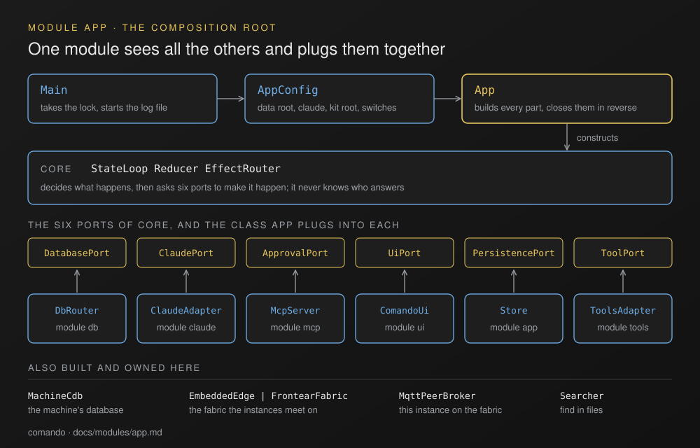
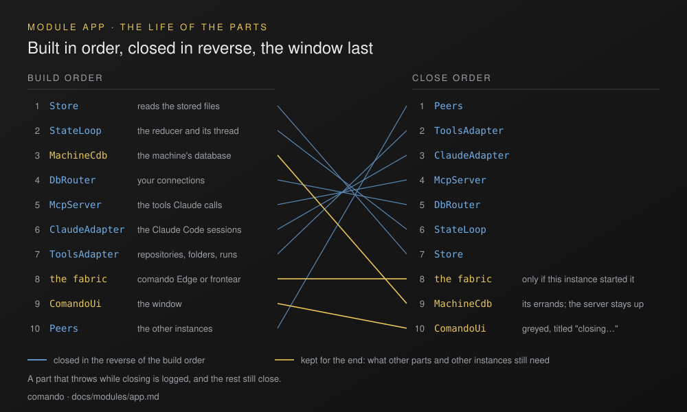
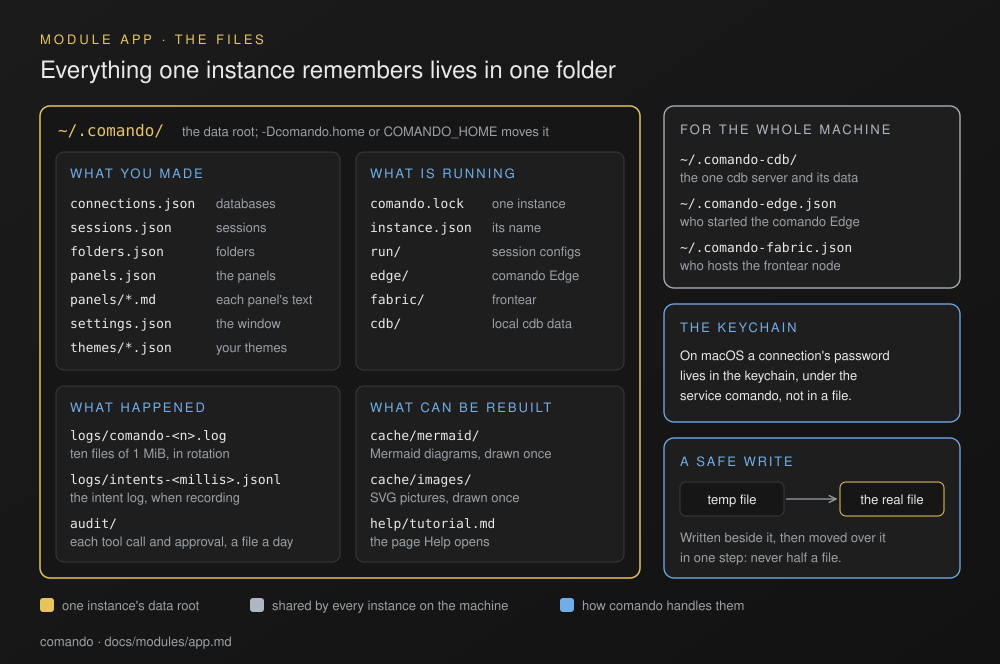
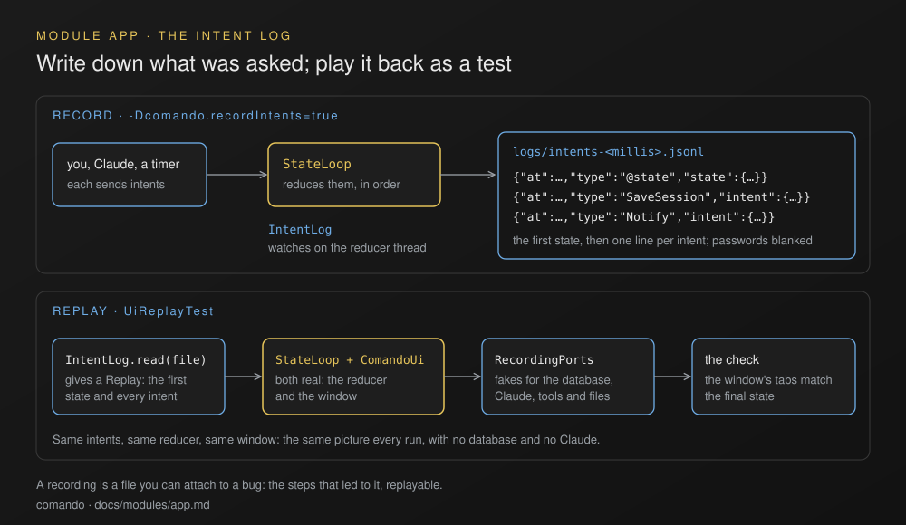

# The `app` module: the composition root



**In one paragraph.** `app` is where comando becomes one program. Every other module is a part with no knowledge of
its neighbours. `app` holds `main`, builds each part, plugs them together and closes them in the right order. It also
owns what belongs to no single part: the files comando keeps, the keychain, the intent log, the machine's database
server and the broker that lets instances talk. Read this page to learn how comando starts, stops, remembers and
ships.

## 1. The idea: one place that knows everything

[`core`](core.md) decides and names six ports. Each port is an interface for one kind of effect. A module implements
a port and knows nothing of the other five. Only `app` sees them all.

| Port of `core` | Class plugged in | Module |
|---|---|---|
| `DatabasePort` | `DbRouter` | [`db`](db.md) |
| `ClaudePort` | `ClaudeAdapter` | [`claude`](claude.md) |
| `ApprovalPort` | `McpServer` | [`mcp`](mcp.md) |
| `UiPort` | `ComandoUi` | [`ui`](ui.md) |
| `PersistencePort` | `Store` | `app` |
| `ToolPort` | `ToolsAdapter` | [`tools`](tools.md) |

One line of `App` joins them: `new EffectRouter(db, claude, mcp, ui, store, devTools)`. The reducer needs an effect
handler before those six exist, so `App.DeferredEffects` stands in until they do.

`app` connects more than the ports. A part asks for an interface, and `app` hands it another part:

| Who asks | What it gets | Through |
|---|---|---|
| `mcp` `McpTools` | The databases of `db` | The router, given at construction |
| `claude` `ClaudeAdapter` | The MCP server of `mcp` | Given at construction |
| `ui` | `claude` `ClaudeTopics` | `ComandoUi.topics` |
| `ui`, the Search view | `Searcher` | `ComandoUi.search` |
| `ui`, the Instances tab | `mcp` `Peers` | `ComandoUi.instances` |
| `ui` | `RootSetup`: the kit root, its version and its jobs | `ui`'s `Setup` |
| `mcp` `McpTools` | The fabric and `MachineCdb`, to start and stop | `core`'s `ServerSwitch` |
| `mcp` `McpTools` | The terminals of the window | `ComandoUi.terminals` |
| `mcp` `Peers` | The broker | `mcp`'s `PeerBroker`, implemented by `MqttPeerBroker` |

> **Learn: dependency injection and the composition root.** A lamp does not contain a power station. It has a plug,
> and someone else decides what the plug goes into. Code built this way asks for what it needs through an interface
> and never builds it. That keeps each part small, and lets a test plug in a fake. Somebody must still do the
> plugging, once, in one place: that place is the composition root. In comando it is the class `App`, and the test
> fakes live in [`testkit`](testkit.md).

## 2. Start and stop

### What `Main` does

1. Sets the window's appearance, before AWT starts.
2. Reads `AppConfig` from system properties and the environment.
3. Names the instance: `-Dcomando.name`, else `COMANDO_NAME`, else `instance.json` in the data root.
4. Configures logging (`Logging`).
5. Takes the lock `comando.lock` in the data root. A second comando on the same root says so and exits with 1.
6. Builds `App`, adds a shutdown hook that calls `App.close()`, and calls `App.start()`.

| Setting | Property or variable | Default |
|---|---|---|
| The data root | `-Dcomando.home`, else `COMANDO_HOME` | `~/.comando` |
| The `claude` executable | `COMANDO_CLAUDE` | a known install path, else `claude` on the `PATH` |
| The instance's name | `-Dcomando.name`, else `COMANDO_NAME` | from `instance.json` |
| Record the intent log | `-Dcomando.recordIntents=true` | off |
| Use the keychain | `-Dcomando.keychain` | on for `~/.comando` only |
| Talk to other instances | `-Dcomando.peers=false` | on |
| Use the machine's cdb | `-Dcomando.metrics=false` | on |

> **Learn: a file lock.** Two programs that write the same files corrupt them. A lock file is a "busy" sign on the
> door. The first program asks the operating system for the lock and gets it. The second asks, is refused, and
> leaves. The operating system holds the sign, so it comes down even when the program crashes. comando locks
> `comando.lock` with `FileChannel.tryLock()`, and that makes each data root the home of one instance.

### The life of the parts



`App` keeps every long-lived part on a stack. The constructor pushes each part as it builds it. `close()` pops, so
the last part built closes first. The picture shows the ten main parts. The table shows them all, in closing order:

| Closes | Part | What it is |
|---|---|---|
| 1 | The kit check's strand | The periodic read of the kit's version and of the queues |
| 2 | `Peers` | This instance among the others |
| 3 | `MqttPeerBroker` | This instance's link to the broker |
| 4 | `Searcher` | The Search view's searches |
| 5 | `ClaudeTopics` | The short asks behind the tabs' cards |
| 6 | `ToolsAdapter` | Repositories, folders and runs |
| 7 | The metrics log | What the sessions measure |
| 8 | `ClaudeAdapter` | The Claude Code sessions and their processes |
| 9 | `McpServer` | The tools Claude calls, and the approvals |
| 10 | `LocalImages`, then `MermaidDiagrams` | The pictures and diagrams of previews |
| 11 | `DbRouter` | Your connections, over `DbAdapter` and `CdbAdapter` |
| 12 | `StateLoop` | The reducer and its thread |
| 13 | `IntentLog`, when recording | After the loop, so the last intents are on record |
| 14 | `App`'s errands | The checks made at start |
| 15 | `Store` | The stored files; it writes what is pending |
| 16 | `KitGit` | The git runs on the kit root |
| 17 | The kit root | The root named before is named again |
| 18 | The fabric | This instance's node stops and its registry entry is marked down |
| 19 | `MachineCdb` | Its errands stop; the server keeps running |
| 20 | `ComandoUi` | The window, greyed and titled "closing…" until then |

Parts 1 to 17 are built in the reverse of this order. The last three are built earlier and moved to the end, because
other parts, and other instances, still need them.

The rules of closing:

- `close()` first has the window save its unsaved edits (`ComandoUi.saveEdits`).
- A part that throws while closing is logged, and the rest still close.
- A part that takes 100 ms or more to close is named in the log.
- A start that fails closes what it built, in the same way, and reports its cause.

### What `App.start()` sets going

| When | What |
|---|---|
| At once | The reducer, then the window |
| At once | A watch on the git repository of every folder |
| Every 5 s | A read of the folders open in the folder tabs |
| Every 20 min | The plans' usage |
| Every 6 h | The kit's version, on a kit root |
| Every minute | The queues' readings |
| Last | `Peers`, then `MqttPeerBroker` |

## 3. The files comando keeps



Everything one instance remembers lives in its data root. `Store` implements `core`'s `PersistencePort` and `ui`'s
`PanelTexts`.

| File | Holds | Written by |
|---|---|---|
| `connections.json` | Your databases | `Store`, through `JsonFile` |
| `sessions.json` | Your sessions | `Store`, through `JsonFile` |
| `folders.json` | The folders of the folder tabs | `Store`, through `JsonFile` |
| `panels.json` | The panels and where they sit | `Store`, through `JsonFile` |
| `panels/*.md` | Each panel's text, one Markdown file a panel | `PanelFiles` |
| `settings.json`, `themes/*.json` | The window's arrangement, your themes | [`ui`](ui.md) |
| `agents.json` | What you grant to agents and refuse to instances | read by `mcp` |
| `logs/comando-<n>.log` | The log: ten files of 1 MiB, in rotation | `Logging` |
| `audit/` | Every tool call and approval, one file a day | `mcp`'s `AuditLog` |
| `run/` | The MCP configuration of each running session | `claude` |
| `cache/` | Drawn diagrams and pictures | `ui` |

The rules of a store file, kept by `JsonFile`:

- **A version in every file.** The shape is `{"version": n, <key>: [...]}`.
- **Never guess a newer file.** A file of a later version is refused, kept as it is and never written. You are told.
- **Never half a file.** A write goes to a temporary file beside the real one, then moves over it in one step.
- **No idle writes.** Bytes equal to the last write are not written again.
- **Keep the evidence.** An unreadable file is renamed aside, `.corrupt-<time>`, and not overwritten.

`Store` writes from immutable snapshots on its own thread, `store`. Panel text is saved 800 ms after its first unsaved
change. `PanelFiles` adds three promises. A panel's file follows the panel's renames. A document bound to its own path
is never renamed or deleted. No file is overwritten after an edit made outside comando.

> **Learn: the atomic write.** Suppose the power fails while a program rewrites your save game. Half the old file and
> half the new one make a file nobody can read. The cure is old and simple. Write the whole new file under another
> name. Then rename it over the old one. The operating system does a rename in one step, so a reader sees the old
> file or the new file, never a mix. Every store file of comando is written this way.

Why each file carries a version:
[every stored file has a schema and a version](../adr/0133-every-stored-file-has-a-schema-and-a-version.md).

## 4. The keychain

A password does not belong in a JSON file. `Secrets` is a small interface: `available`, `read`, `write`, `delete`.

| Where | Implementation | The password lives |
|---|---|---|
| macOS, on the standard data root | The login keychain, through `/usr/bin/security` | In the keychain, under service `comando` |
| Any other data root, any other system | `Secrets.NONE` | In `connections.json` |

The keychain account names the connection and its target: `name user@host:port/database`. A connection you point
elsewhere gets another account, so it never reads the old target's password. Each call to `security` is bounded at
10 s and runs on its own thread, `store-secrets`. An unlock prompt therefore never holds back your panel text.

A test that moves the data root never touches your keychain: the switch is off there by default.

The reasons:
[passwords in the macOS keychain through `security`](../adr/0020-passwords-in-the-macos-keychain-through-security.md).

## 5. The intent log



Start comando with `-Dcomando.recordIntents=true`. `IntentLog` then writes `logs/intents-<millis>.jsonl`:

```
{"at":…,"type":"@state","state":{…}}
{"at":…,"type":"SaveSession","intent":{…}}
{"at":…,"type":"Notify","intent":{…}}
```

The first line is the starting state. Each later line is one intent, in the order the reducer took it. A
`@threshold` line records a change of the checkpoint threshold. Every `password` field is blanked. `IntentLog`
observes the `StateLoop` on the reducer thread, so the order is exact.

`IntentLog.read(file)` gives a `Replay`: the first state and the list of intents. `Replay.loop(clock, effects)` builds
a real `StateLoop` from it. The window test `UiReplayTest` plays a recording this way: see [tests](#9-tests).

> **Learn: the append-only log and replay.** A bank does not store only your balance. It stores every deposit and
> withdrawal, in order, and never erases a line. The balance is what you get when you add them up. A program that
> keeps its inputs this way can rebuild any past moment: start from the first state and apply the same inputs. The
> same inputs through the same rules give the same result, every time. comando's reducer is such a rule, so a
> recorded session becomes a test that never drifts.

## 6. The machine's cdb

`MachineCdb` looks after the one cdb server of the machine. The server is a process of its own, started from
`~/.comando-cdb/`, and it outlives comando.

| Fact | Value |
|---|---|
| Listens on | `127.0.0.1`: HTTP on 9000, PostgreSQL wire on 8812 |
| Registry | `server.json`, in its folder |
| Who stops it | Only the instance that started it |
| When comando quits | The server keeps running |
| With `-Dcomando.metrics=false` | A private one under the data root, `machine-cdb/` |

`MachineCdb` implements three interfaces for three callers: `ui`'s `ServerToggle` (the button), `core`'s
`ServerSwitch` (an agent's tools) and `claude`'s `MetricsEndpoint` (the metrics log).

The server itself: [the `cdb` module](cdb.md) and [the cdb guide](../cdb.md). Why one server for the machine:
[cdb is the machine server](../adr/0180-cdb-is-the-machine-server.md).

## 7. The fabric


Several comando instances can run on one machine and consult each other. They meet on the fabric: one frontear node
inside each instance's JVM, hosted by its `FrontearFabric`, and a link from each node to every other one
([record 187](../adr/0187-frontear-lab-node-per-instance.md)).

| Fact | frontear |
|---|---|
| Class | `FrontearFabric`, named `frontear` to the window and the agents |
| Runs as | A frontear node named as the instance's id, inside its JVM; the node refuses a link client named for another node, and every link client (`0x88`, Server unavailable, which the link retries after its backoff) until `MqttPeerBroker` has its subscriptions acknowledged on it, so what the other nodes queued for this instance is delivered after its inbox is subscribed. An acknowledgement that comes before the start has published the node opens it once published; a refused one is renewed at the next look (every 5 s) |
| Port on `127.0.0.1` | MQTT: the lowest port from 18883 up that is free and that no other instance's entry holds, kept in the registry for that instance from then on |
| Registry | `~/.comando-fabric.json`, version 2: per instance id, the node's port, the pid while it runs (0 once down), its start, the instance's name and data root. Every read-modify-write of it runs under an OS lock on `~/.comando-fabric.json.lock` (bounded wait), so instances starting at once take distinct ports. A file of version 1 is replaced |
| Links | One per other instance in the registry, put through the node's own control plane at each look (every 5 s): to `127.0.0.1` at that instance's port, out its inbox and reply topics and this instance's presence, nothing in, hop limit 1; also at once when `Peers` first sees an instance's presence and before each question to it, as the link is the only subscriber of its inbox on this node. A link to an instance that is merely down stays and queues; forgetting an instance removes its link and its entry |
| Keeps in the data root | `fabric/`, with the key pair `pod.key` and `pod.pub` (Ed25519) and a folder per link with its spec and log |
| Starts | At the peer link's first look, and at any later look while it is down |
| Stops | By hand or at the instance's close; the other nodes keep running. A stop by hand holds in that instance until it is asked again |
| A port held by another process | The node takes the next free port; the process is probed, never signalled |
| Peers gone or back | A look that finds an instance's process gone tells the peer link, which drops that instance's presence if its start matches; a link that connects again, or an instance whose registry entry names a new start, makes this instance send its presence again |

`FrontearFabric` implements `ServerToggle` and `ServerSwitch`, so the window and the agents treat it as they treat the
machine's cdb.

`MqttPeerBroker` is each instance's client of its own node. It connects as the MQTT 5 client `comando-<instance>`.
Every 5 s it checks whether the node runs, and moves to the node's port if that changed. It reconnects after a drop
and renews its subscriptions. The MQTT client it uses lives in [`frontear`](frontear.md), in the package
`frontear.protocol`.

> **Learn: publish and subscribe.** A school notice board has topics: sports, lost property, exams. Whoever pins a
> note does not know who reads it. Whoever reads a topic does not know who pinned the note. A broker is that board
> for programs: one publishes to a topic, and the broker hands the message to every subscriber. Nobody needs
> anybody's address, only the board's. comando's instances meet this way: each pins on its own board, and the boards
> copy to each other the notes meant for one another.

How frontear works: [the `frontear` module](frontear.md) and [the frontear guide](../frontear.md). What instances say
to each other: [the `mcp` module](mcp.md). The reasons:
[instances consult each other](../adr/0123-instances-consult-each-other.md) and
[frontear, comando's own MQTT fabric](../adr/0184-frontear-comandos-own-mqtt-fabric.md) and
[frontear is the only fabric](../adr/0185-frontear-is-the-only-fabric.md).

## 8. What `app` may depend on

| `app` uses | For |
|---|---|
| `core` | The state loop, the reducer, the ports, the kit root (`KitRoot`) |
| `db` | `DbRouter`; `app` reaches `cdb` only through it |
| `claude` | `ClaudeAdapter`, `ClaudeTopics`, the metrics log |
| `mcp` | `McpServer`, `McpTools`, `Peers` |
| `frontear` | The fabric and the MQTT client |
| `tools` | `ToolsAdapter`, `KitGit` |
| `ui` | `ComandoUi` |

No module depends on `app`. The module is one package, `dev.marregui.comando.app`, of sixteen classes:

| Class | Job |
|---|---|
| `Main`, `AppConfig` | Start, and the settings of section 2 |
| `App` | Builds, wires, starts and closes every part |
| `Store`, `JsonFile`, `PanelFiles` | The stored files |
| `Secrets` | The keychain |
| `IntentLog` | The intent log |
| `Logging` | `System.Logger` to the log files, warnings to stderr |
| `MachineCdb` | The machine's cdb |
| `FrontearFabric`, `MqttPeerBroker` | The fabric and the link to it |
| `RootSetup` | `ui`'s `Setup`: the kit root, its version and its jobs |
| `Searcher` | `SearchPort`: one search at a time, at most 1 000 hits |
| `Welcome` | The text of the first panel on a fresh data root |

## 9. Tests

`app` is the only module that can build the whole program, so the tests of the whole program live here.

### Window tests: `./gradlew :app:uiTest`

The task runs 37 test classes against the real Swing window.

| Rule of the task | Why |
|---|---|
| One JVM for each class (`forkEvery = 1`) | A window left behind by one class cannot disturb the next |
| `comando.uiTests=true` | Window tests are skipped everywhere else |
| Off screen (`comando.offScreen=true`) | The window never takes your keyboard |
| A preferences node of its own | Your own window settings stay untouched |
| One `uiTest` JVM at a time on the machine (`UiTestLock`) | Two windows would fight over the focus |
| `-PuiShard=<k>/<n>` | CI splits the classes over several runners |
| Never cached | A window test must really run |

Four of them to know:

| Test | What it proves |
|---|---|
| `UiReplayTest` | A recorded intent log, played through the real `StateLoop` and the real `ComandoUi`, gives the expected window |
| `UiKeysTest` | The keyboard in a real window, with the keys of macOS and of the other desktops |
| `QuitTeardownUiTest` | A step of closing that throws does not stop the quit |
| `ThreadBudgetTest` | comando's own platform threads stay within their budget |

**The window replay.** `UiReplayTest` reads `replay/snapshot.jsonl` with `IntentLog.read`. It builds the loop with
`Replay.loop`, and the window on top. Behind them stand the `RecordingPorts` of `testkit`:
`new EffectRouter(ports, ports, ports, ui, ports, ports)`. No database and no Claude take part. The test checks the
tabs, the lower tabs and the side pane against the final state. It also saves a picture,
`build/reports/replay/snapshot.png`.

### Plain tests: `./gradlew :app:test`

| Tests | Cover |
|---|---|
| `StoreTest`, `JsonFileTest`, `PanelFilesTest`, `JsonGoldenTest` | The store files, byte for byte |
| `IntentLogTest`, `LoggingTest`, `MainTest`, `AppConfigTest` | The intent log, logging, the lock, the data root |
| `AppCloseTest`, `DataRootFoldersTest` | The closing order, whatever a part throws; the folders of the data root |
| `MachineCdbTest`, `FrontearFabricTest`, `MqttPeerBrokerTest` | The servers, each instance's node, its port and registry entry, the links between the nodes, and the client to its own node |

Four rule tests read the classes of every module, because only `app` sees every module:

| Test | The rule it holds |
|---|---|
| `ThreadRulesTest` | A platform thread only where a kind needs one; every other thread from `Threads` |
| `ColourRulesTest` | Colours are made and named only in `ui.kit.theme` |
| `LibraryRulesTest` | Libraries that comando replaced with its own code stay out |
| `FileReadRulesTest` | A file is read through `core.files.Mapped` |

All tests run with `comando.peers=false` and `comando.metrics=false`, so no test joins your instances or writes to
your machine's cdb.

### Tasks that run and ship

| Task | Does |
|---|---|
| `./gradlew :app:run` | Starts comando from a copy of the build output, made at each launch |
| `./gradlew :app:snapshot -Pout=<dir>` | Starts comando on a scratch data root and paints the window to PNG files (`Snapshot`) |
| `./gradlew :app:dmg` | An unsigned macOS disk image with a bundled runtime |
| `./gradlew :app:appImage` | The application folder with a bundled runtime |
| `./gradlew :app:package` | The archive for this system: `.dmg`, `.tar.gz` or `.zip` |

## Where next

- [The `ui` module](ui.md): the window that `app` builds.
- [The `core` module](core.md): the state loop and the ports.
- [The `frontear` module](frontear.md): the broker inside the fabric.
- [Architecture](../architecture.md): the whole picture.
- [Development](../development.md): build, run, test and configure.
