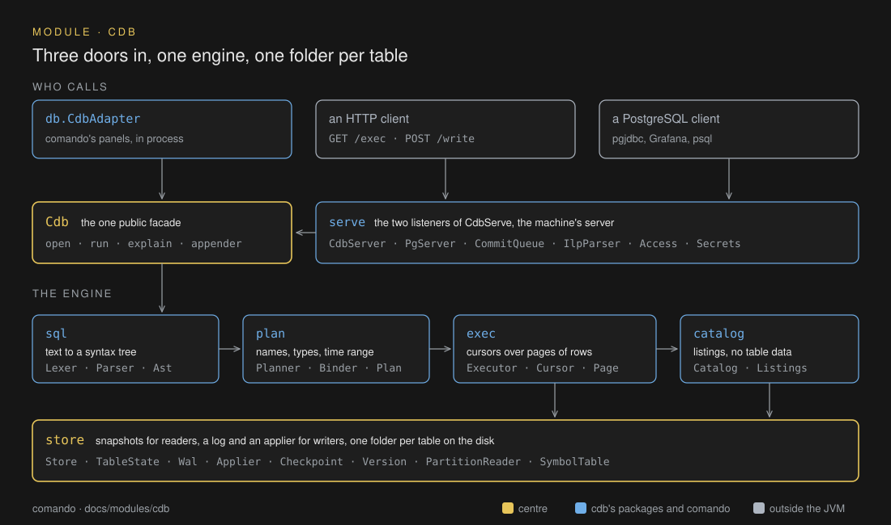
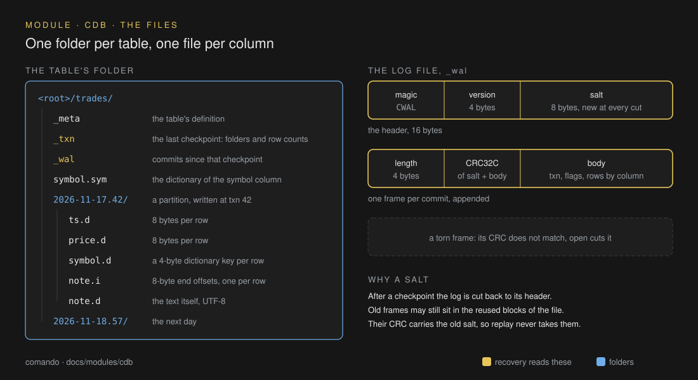
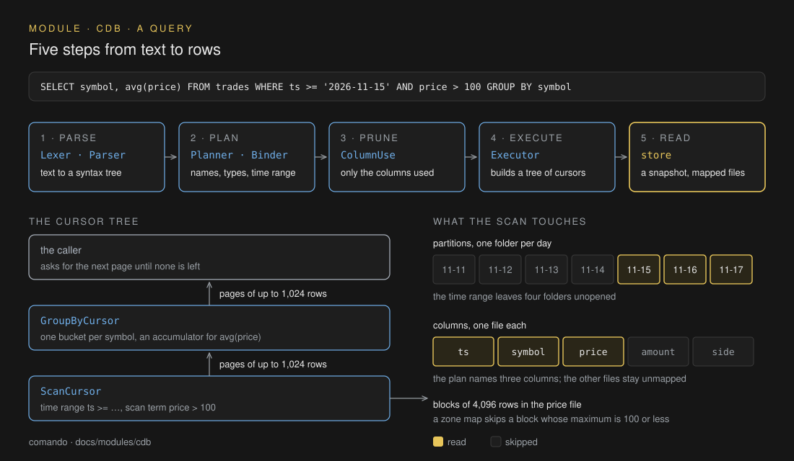
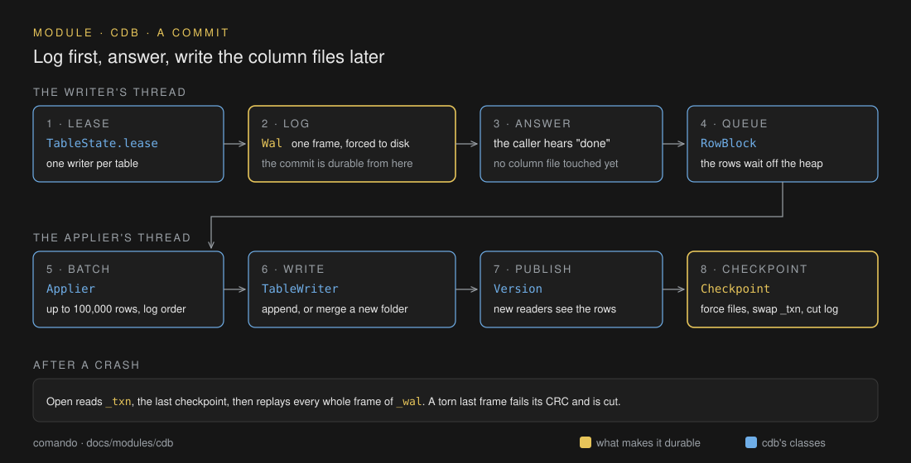

# cdb: the database engine

## In one paragraph

`cdb` is comando's own database: tables of timestamped rows, stored by column, one folder per time slice. It speaks
SQL, answers over HTTP and the PostgreSQL wire, and uses only the JDK. This page is the engineering view: the
packages, the path of a query, the path of a commit, the files and the threads. To use it, read
[cdb](../cdb.md) and the [SQL guide](../cdb-sql.md). Why comando owns a database:
[ADR 0158](../adr/0158-cdb-comandos-own-database.md).

## 1. The idea: columns, time, files

A table is a folder. A partition is a sub-folder that holds one slice of time. A column is a file in that
sub-folder. Rows sit in timestamp order, so "the last hour" is a short walk, not a search.

| File | Holds |
|---|---|
| `_meta` | The table's definition: columns, types, the designated timestamp, the partition unit. |
| `_txn` | The last checkpoint: each partition's folder and row count. Replaced by a rename, never edited. |
| `_wal` | The write-ahead log: every commit since that checkpoint. |
| `<column>.sym` | The dictionary of a `SYMBOL` column: each distinct text once. |
| `<partition>.<txn>/<column>.d` | The values: 8 bytes for `LONG`, `TIMESTAMP`, `DOUBLE`; 1 for `BOOLEAN`; a 4-byte key for `SYMBOL`. |
| `<partition>.<txn>/<column>.i` | For `VARCHAR` and `JSON`: 8-byte end offsets into the `.d` file, which holds the UTF-8 text. |

Every number is little-endian. `PartitionBy` offers `NONE`, `HOUR`, `DAY`, `WEEK`, `MONTH` and `YEAR`. A store
holds at most 1,000 tables, a table at most 1,024 columns, a name at most 127 characters.

> **Learn: columnar storage.** A spreadsheet can be saved row by row or column by column. Row by row is good when you
> want one whole row. Column by column is good when you want one fact about many rows, such as the average price.
> The computer then reads one file of prices and nothing else. Values of one type sit side by side, so the processor
> runs through them fast. cdb stores every column as its own file and maps only the files a query names.

> **Learn: time partitions instead of a B-tree.** Most databases find rows with a B-tree, a sorted index that costs
> work at every insert. Data that arrives in time order is already sorted. cdb cuts the table into folders by time and
> keeps rows in timestamp order inside each. A query for a time range picks the folders by name, then finds its first
> row by binary search. Dropping old data means deleting whole folders.

## 2. What it offers

`Cdb` is the entry point. The root package has six more public types: `CdbResult`, `CdbAppender`, `CdbType`,
`CdbCancel`, `CdbException` and `CdbServe`. Outside the module, only the `Cdb*` classes of the `db` module use
them, and a test holds that line.

| Call | Does |
|---|---|
| `Cdb.open(root)`, `Cdb.open(root, StoreOptions)` | Opens the store in a folder and replays its logs. |
| `run(sql)`, `run(sql, maxRows)`, `run(sql, offset, maxRows, cancel)` | Runs one statement and returns a `CdbResult`. |
| `run(sql, maxRows, maxLagMillis)` | The same, reading rows at most that many milliseconds old. |
| `describe(sql)`, `explain(sql)` | The columns a statement would answer, planned and not run; the plan as text. |
| `appender()` | A `CdbAppender`: rows in line-protocol style, committed by `flush()`. |
| `tables()`, `close()` | The table names; a clean shutdown with a checkpoint. |

`Cdb` is thread-safe: any number of queries at once, one writer per table.

| Package | Role | Main classes |
|---|---|---|
| `cdb` | The facade and the server's entry point | `Cdb`, `CdbAppender`, `CdbResult`, `CdbType`, `CdbCancel`, `CdbException`, `CdbServe` |
| `sql` | Text to a syntax tree | `Lexer`, `Parser`, `Ast` |
| `plan` | Names, types and the shape of the work | `Planner`, `SelectPlanner`, `Binder`, `Plan`, `Pruning`, `ScanTerms`, `ColumnUse`, `PlanText` |
| `exec` | Operators over pages of rows | `Executor`, `Cursor`, `Page`, `Vector`, `ScanCursor`, `GroupByCursor`, `SortCursor`, `JoinCursor`, `QueryPool`, `Frames` |
| `exec.agg` | Aggregate functions | `Accumulator`, `Aggregates` and one accumulator per function |
| `exec.expr` | Expressions and functions | `Arithmetic`, `Comparison`, `Cast`, `Like`, `TimeFns`, `TextFns`, `JsonFns`, `Functions` |
| `json` | JSON text over UTF-8 bytes | `Json` (the check and the path walk, one forward pass, no recursion), `JsonPath` |
| `store` | Files, log, snapshots | `Store`, `TableState`, `Wal`, `Applier`, `Checkpoint`, `Version`, `PartitionReader`, `SymbolTable`, `ZoneMap`, `Retention` |
| `catalog` | Listings that read no table data | `Catalog`, `Listings` (`tables()`, `SHOW COLUMNS`, `show_wal()`) |
| `serve` | The two network listeners | `CdbServer`, `PgServer`, `PgSession`, `IlpParser`, `CommitQueue`, `Access`, `Secrets`, `Limits` |

`CdbType` has seven types: `BOOLEAN`, `LONG`, `DOUBLE`, `TIMESTAMP`, `SYMBOL`, `VARCHAR`, `JSON`. NULL is a
reserved value of each type, not a separate flag. `JSON` is stored, read and compared as `VARCHAR`
(`CdbType.isVarchar()`); the writer checks each value in `DefaultWriter.putText`, the one door every write path takes
(SQL, line protocol, log replay), and drops the row when it is not JSON.

## 3. How a query runs

1. **Parse.** `Lexer` and `Parser` turn the text into an `Ast`.
2. **Plan.** `Planner` and `Binder` resolve names and types and build a `Plan`, a sealed tree: `Scan`, `Filter`,
   `Project`, `Aggregate`, `SampleBy`, `LatestOn`, `Distinct`, `Sort`, `Limit`, `SetOp`, `Join`, `Window`, `Source`
   and `Explain`. A statement that changes data is a `Plan.Change`, such as `Insert`, `Update` or `DropTable`.
   `Pruning` narrows the time range from `WHERE`. `ScanTerms` turns each top-level `column <op> constant` into a
   scan term.
3. **Prune.** `ColumnUse` keeps only the columns the plan names.
4. **Execute.** `Executor` builds one `Cursor` per plan node. Each cursor pulls a `Page` of up to 1,024 rows from
   the one below. A `Vector` holds one column of the page as a primitive array.
5. **Read.** The scan takes a snapshot: one `Version` per partition. A column file is mapped into memory on its
   first read, through the JDK's `MemorySegment`.

The scan avoids work in five ways:

| Trick | What happens |
|---|---|
| Time range | Binary search on the timestamp file finds the first and last row of the range. |
| Zone map | Each block of 4,096 rows keeps its minimum, maximum and "has NULL". A block that cannot match is skipped. |
| Late materialisation | The scan tests one term at a time on 1,024 rows, then gathers only the rows that pass. |
| Late read | `ORDER BY … LIMIT` of at most 10,000 rows reads the sort columns first, the rest for kept rows only. |
| Newest first | `LATEST ON` and `ORDER BY ts DESC` scan from the newest partition. |

A cursor may lend its page instead of handing over a new one (`Cursor.borrow()`). Only seven operators may
borrow, and a test holds the list ([ADR 0179](../adr/0179-cdb-page-borrow.md)).

**Parallel queries.** A scan with its filters and projections is cut into frames of 65,536 rows. Each frame is a
job on `QueryPool`, whose threads are named `cdb-query-<n>`. The consumer merges the partial answers in frame
order. The answer equals the serial one, except the last digits of a `DOUBLE` sum or average
([ADR 0165](../adr/0165-cdb-parallel-queries.md)). By default the pool has one thread fewer than the machine has cores.

> **Learn: a snapshot.** Imagine photographing a whiteboard before someone keeps writing on it. You read your photo;
> they write on the board; neither waits. cdb gives each query such a photo: the list of partition folders and row
> counts at that moment. A writer never changes rows a photo shows. It appends past the counted rows, or builds a new
> folder. So a reader never blocks a writer, and its answer is consistent.

## 4. How a commit runs

A commit takes one of two paths.

| Path | When | Order of work |
|---|---|---|
| Logged | Fewer than 100,000 rows, no change to the table's shape | Append one frame to `_wal`, force it, answer. The `Applier` writes the column files later. |
| Direct | 100,000 rows or more, a record of 16 MiB or more, `ALTER`, `TRUNCATE`, `UPDATE`, `DELETE`, `DROP PARTITION` | Apply the queued commits, write the column files, checkpoint, answer. |

The applier is one thread per store. It takes each table's queued commits in log order, up to 100,000 rows a
batch. Its pause between rounds adapts between 100 ms and 5 s. Rows wait in native memory (`RowBlock`,
`BlockArenas`), at most 64 MiB; a commit past that budget waits up to 10 s. Three failures in a row suspend the
table's applying ([ADR 0162](../adr/0162-cdb-applies-commits-from-its-log.md),
[ADR 0170](../adr/0170-cdb-row-block-epochs.md)).

A batch lands in one of three ways:

| Rows are | The writer |
|---|---|
| In a new partition | Creates the folder. |
| After every committed row | Appends to the column files in place. |
| Anywhere else, or duplicates of upsert keys | Writes a new folder: two sorted runs merged, the last write winning (`Dedup`). |

A **checkpoint** forces the column files, replaces `_txn` by a rename, deletes replaced folders and cuts the log
back to its header. It runs after 256 applied commits, 16 MiB of log, 30 s of idleness, a direct commit, or at
close.

> **Learn: a write-ahead log.** Before a careful cook changes the kitchen, they write the order on a slip and pin it
> up. If the lights go out, the slips say what was promised. A database does the same: it appends each commit to one
> file and makes the disk confirm it, then answers. Appending to one file is fast; updating many column files is slow
> and can wait. After a crash, cdb reads `_txn`, then replays the frames of `_wal`
> ([ADR 0161](../adr/0161-cdb-write-ahead-log.md)).

> **Learn: a CRC.** A CRC is a short number computed from a block of bytes, like a fingerprint. Write the block and
> its fingerprint together. On reading, compute the fingerprint again; if the two differ, the block is damaged. A
> power cut can leave half a frame at the end of the log. cdb stores a CRC32C in every frame, mixed with a random
> salt, and cuts the log at the first frame that fails.

**A timed force.** With `--log-force-ms N` a commit is answered once written, and the thread
`cdb-log-force-<root>` forces the log within N milliseconds. A caller that needs the disk's word asks for it:
`/write?durable=true` or `SET cdb.durable = true` ([ADR 0166](../adr/0166-cdb-timed-log-force.md)). The default
is 0: one force per commit.

**Group commit.** In the server, `CommitQueue` lets one request commit for every request queued on the same
table. One force then pays for many writers. Tables commit in parallel.

## 5. Readers, writers and threads

A reader holds its snapshot and never blocks a writer. It waits only when it asks for rows fresher than
the applier has published, and then at most 10 s. You set that freshness with `max_lag_ms` on `/exec`,
`SET cdb.max_lag_ms`, `--read-max-lag-ms` or `Cdb.run(sql, maxRows, maxLagMillis)`.

A writer takes locks in one fixed order, so two writers cannot deadlock:

1. the table's lease (`TableState.lease`), one writer per table
2. the apply lock (`TableState.applyLock`)
3. the log's monitor (`Wal`)
4. the force monitor
5. the state lock (`TableState.lock`)

| Thread | Kind | Work |
|---|---|---|
| `cdb-applier-<root>` | platform | Writes logged commits into the column files, checkpoints. |
| `cdb-query-<n>` | platform | Runs the frames of parallel queries. |
| `cdb-log-force-<root>` | platform | Forces the log on a timer, when that option is on. |
| `cdb-http-<n>` | virtual | One per HTTP request. |
| `cdb-http-deadline` | virtual | Cancels an HTTP request's query at its deadline. |
| `cdb-pg-accept-<port>` | virtual | Accepts PostgreSQL connections. |
| `cdb-pg-session-<id>` | virtual | One per PostgreSQL connection. |
| `cdb-pg-startup-<id>`, `cdb-pg-deadline-<id>` | virtual | Watch a connection's startup and a query's deadline. |
| `cdb-serve-shutdown` | platform | The shutdown hook of `CdbServe`: holds the exit until the store has closed. |

Only `CdbServe`, `CdbServer`, `PgServer`, `Applier`, `QueryPool` and `LogForcer` create threads. A test reads
that from bytecode ([ADR 0163](../adr/0163-cdb-threads.md)). Mapped files of an idle version are released after
60 s ([ADR 0167](../adr/0167-cdb-heap-reduction.md)).

## 6. The server

`CdbServe` runs the engine as a process of its own, with two listeners from `serve`:

| Listener | Speaks | Bounds |
|---|---|---|
| `CdbServer` | `GET /exec?query=…` answers JSON; `POST /write` takes line protocol | 64 requests at once, a body of 16 MiB |
| `PgServer` | A subset of the PostgreSQL wire protocol 3.0 | 64 connections, 300 s idle |

A query has 60 s and returns at most 1,000,000 rows (`Limits`). `Secrets` reads two files, `secret` and
`secret.readonly`; `Role` is `OWNER`, `READ_ONLY` or `NONE`. `Access` lets a read-only caller run queries,
`SHOW` and `EXPLAIN` only. Ports, flags and the folder layout are in [cdb](../cdb.md). The reasons are in
[ADR 0180](../adr/0180-cdb-is-the-machine-server.md) and
[ADR 0182](../adr/0182-cdb-destructive-sql-explain-and-access.md).

## 7. Dependencies allowed

- `cdb` depends on the JDK and nothing else: no `core`, no library.
- Only `db` may depend on `cdb`, and only on its root package (`CdbArchitectureTest`).
- Everything else reaches cdb over the network, through `serve`.

## 8. Tests

Run them with `./gradlew :cdb:test`. A failed randomised test prints its seed; you replay it with the named
environment variable.

| Test | Proves | Replay |
|---|---|---|
| `StorePowerCutTest` | A seeded workload survives a power cut at every point of a simulated disk. | `CDB_POWERCUT_SEED` |
| `StoreWalTest` | The log's format, torn tails and replay. | `CDB_WAL_SEED` |
| `StoreApplyEquivalenceTest` | Applying in batches equals applying one commit at a time. | `CDB_APPLY_SEED` |
| `StoreLincheckTest` | Concurrent store calls are linearizable (Lincheck). | |
| `ParallelEquivalenceTest` | Pools of 0, 1, 3 and 11 workers give the same answers. | `CDB_PARALLEL_SEED0`, `CDB_PARALLEL_SEED1` |
| `AnswerDigestTest` | Answers pinned by SHA-256 on pools of 1, 2 and 11 workers. | |
| `PageBorrowTest`, task `testPageReuse` | A page kept past its loan reads poison; the task runs again with the lender refilling one page. | |
| `PgProtocolTest` | Malformed and oversized PostgreSQL messages are refused, and the session stays usable. | |
| `TutorialFunctionsTest` | The generator statements of the [tutorial](../tutorial.md) run unmodified. | |
| `CdbArchitectureTest`, `CdbThreadConfinementTest` | The dependency and thread rules above. | |

Each package has its own suites beside these: one per cursor in `exec`, the parser in `sql`, the planner in `plan`.

## Where next

- [cdb](../cdb.md): run the server, connect, back up.
- [The SQL guide](../cdb-sql.md): every statement and function.
- [db](db.md): the module that puts cdb and other databases behind one port.
- [frontear](frontear.md): comando's other engine with a log on disk.
- [Architecture](../architecture.md): where cdb sits among the modules.
