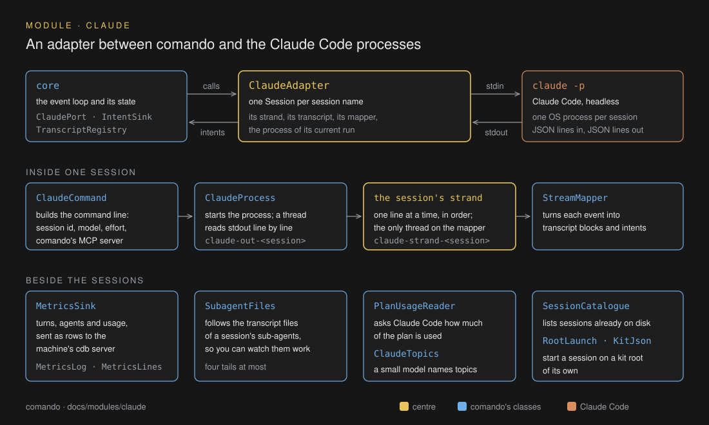
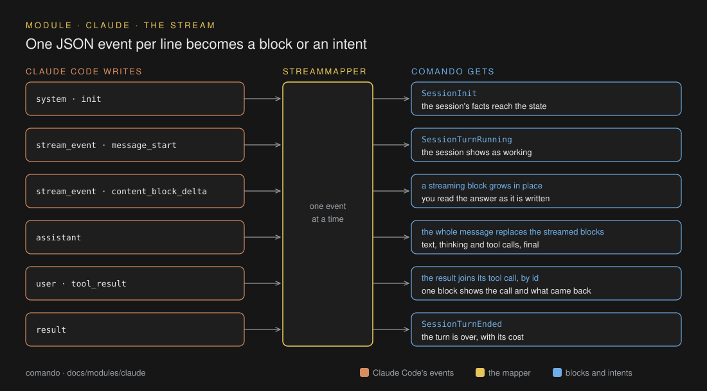

# claude: the Claude Code adapter

## In one paragraph

`claude` is the module that runs Claude Code for comando. It starts one `claude -p` process per session, writes
your prompts to it, and turns what it prints into transcript blocks and intents. The rest of comando never sees
a process or a line of JSON. This page is for engineers who change that adapter. To use sessions, read
[Claude Code in comando](../claude-code.md).

## 1. The idea: a program driven through its pipes

Claude Code is a command-line program. Run with `-p`, it has no screen: it reads messages on its input and
writes events on its output. comando holds both ends.

> **Learn: an LLM agent.** A language model only predicts text. An agent is a loop around it: the model reads the
> conversation and either answers or asks for a tool, such as "read this file". A program runs the tool and adds
> the result to the conversation, and the model continues. Claude Code is that program. comando does not run the
> loop; it starts Claude Code, feeds it your prompts and shows you each step.

> **Learn: a process and its pipes.** Every running program has three standard streams: one to read from and two
> to write to. A parent program can hold the other ends and talk to its child with plain text. comando and Claude
> Code agree on one rule: every line is one JSON object. Lines are easy to split, and JSON is easy to check, so
> neither side guesses where a message ends.

## 2. What it offers

One public door: `ClaudeAdapter`, the implementation of `core`'s `ClaudePort`. `app` constructs it with an
`IntentSink`, a `TranscriptRegistry`, an `McpGateway` and a `ClaudeSettings`.

| Port method | Does |
|---|---|
| `start`, `stop` | Start a session's process; end it and what it started. |
| `send` | Write one user message to the running process. |
| `interrupt` | Ask the running turn to stop. |
| `clearTranscript`, `loadHistory`, `forget` | Empty the tab; load a stored conversation; drop the session. |
| `showSubagent` | Open a view that follows one sub-agent's conversation. |

Every method returns at once. The work runs on the session's strand.

The module is one package, `dev.marregui.comando.claude`:

| Group | Classes | Role |
|---|---|---|
| The session | `ClaudeAdapter`, `ClaudeCommand`, `ClaudeProcess`, `StreamMapper` | Start, feed and read one process per session. |
| What ran | `RunSettings`, `BaseEffort`, `ClaudeVersion` | The model and effort of each message; the tested version range. |
| Metrics | `MetricsLog`, `MetricsLines`, `MetricsSink`, `MetricsEndpoint` | One line per turn, agent and usage reading, sent to cdb. |
| Sub-agents | `SubagentFiles` | Find and read the conversations Claude Code stores for sub-agents. |
| Stored conversations | `SessionCatalogue`, `TranscriptSearch` | List them for import; search them. |
| Side readings | `PlanUsageReader`, `CodexUsageReader`, `ClaudeTopics`, `GitBranch`, `SessionSubjects` | Plan usage, a panel's topic, a session's branch, the repositories it writes to. |
| The launch | `RootLaunch`, `KitJson`, `KitJobsCli`, `ClaudeSettings`, `UiInstructions` | The environment and settings a process starts with. |

## 3. How a session runs

Each session has four parts, shown in the picture above.

1. **The command.** `ClaudeCommand` builds the arguments: `-p`, JSON lines in and out, partial messages, hook
   events and sub-agent text. A new conversation gets `--session-id`; a stored one gets `--resume`.
2. **The process.** `ClaudeProcess` owns the operating-system process. A platform thread reads its output. A
   virtual thread writes its input from a queue. Error output goes to a file, read once at the exit.
3. **The strand.** Every output line, prompt, history load and exit runs on `claude-strand-<session>`, in
   order. The strand is the only writer of the session's transcript.
4. **The mapper.** `StreamMapper` turns each event into blocks and intents.

When comando's MCP server runs, the command also carries `--mcp-config` and
`--permission-prompt-tool mcp__comando__approve`. Claude Code then sends its permission questions to comando,
and you answer them on a card. [mcp](mcp.md) describes that server.

**Stopping.** `stop` records the process tree, asks the turn to stop and closes the input. Three seconds later
it sends SIGTERM to what is left of the tree, and two seconds after that SIGKILL. Nothing the session started
outlives it.

> **Learn: a strand.** Two people editing one sentence at once make a mess. One fix is a lock: whoever holds the
> pen writes. Another is a queue: everyone hands notes to one writer, who applies them in order. A strand is that
> one writer, a thread that takes tasks one at a time. A session's transcript needs no lock, because only its
> strand ever touches it.

## 4. From events to blocks

| Event | What `StreamMapper` does |
|---|---|
| `system` · `init` | Dispatches `SessionInit` with the session's facts. |
| `stream_event` · `message_start` | Dispatches `SessionTurnRunning`. |
| `stream_event` · `content_block_start`, `content_block_delta` | Appends a streaming text or thinking block and grows it. |
| `assistant` | Replaces the streamed blocks with the whole message. |
| `user` · `tool_result` | Attaches the result to its tool call, by id. A result over 64 KiB is cut. |
| `result` | Dispatches `SessionTurnEnded` with the turn's cost. |
| `system` · `api_retry`, `permission_denied` | Adds a note to the transcript. |
| `system` · `task_started` | Dispatches `SessionActivity` with the task's description. |
| `system` · `background_tasks_changed` | Dispatches `SessionTasksChanged` with the open tasks. |

The mapper also dispatches `SessionContext` with the tokens used and the window's size.

> **Learn: streaming.** A model writes its answer one small piece at a time. Waiting for the whole answer could
> take a minute; showing each piece as it arrives feels immediate. The cost is that early pieces are provisional.
> comando shows a streaming block while pieces arrive, then swaps in the finished message, which is the one that
> counts.

> **Learn: a context window.** A model reads the whole conversation again for every reply, and it can only read
> so much: its context window, counted in tokens, pieces of words. A long session fills the window. Claude Code
> then compacts: it replaces old turns with a summary. comando shows how full the window is from `SessionContext`.

## 5. Beside the sessions

| Part | Does |
|---|---|
| Sub-agent views | A sub-agent's conversation is a file Claude Code writes. comando reads its growth every 2 s, for at most 4 views at once, and stops after 10 idle minutes. |
| `MetricsSink` | Queues up to 10,000 lines. Sends batches of 1,000 lines, or every 200 ms, to the machine's cdb. A full queue drops lines: metrics never slow a session. |
| `PlanUsageReader` | Runs `claude --safe-mode -p /usage` and reads the plan's usage. |
| `ClaudeTopics` | Asks a small model for one or two sentences that name a panel's topic. One ask runs at a time. |
| `ClaudeVersion` | Compares the installed version with the tested range. Outside it you get a warning, not a refusal. |

## 6. Threads

| Thread | Kind | Work |
|---|---|---|
| `claude-out-<session>` | platform | Reads the process's output. The one operating-system thread a session costs. |
| `claude-in-<session>`, `claude-exit-<session>` | virtual | Write the input; wait for the exit. |
| `claude-strand-<session>` | strand | Everything that touches the session's state. |
| `claude-timer` | timed strand | The SIGTERM and SIGKILL delays. |
| `subagent-tail` | timed strand | Follows sub-agent files. |
| `plan-usage`, `topic-reader` | strands | The side readings. |

`close()` sends SIGTERM to every process, SIGKILL after the grace, and deletes the MCP config files it wrote.

## 7. Dependencies allowed

- `claude` depends on `core` and the JDK. It reaches the MCP server only through `core`'s `McpGateway`.
- Only `app` depends on `claude`. No other module names a class of it.
- `ClaudeAdapter` never touches the state: it dispatches intents, as every adapter does.

## 8. Tests

Run them with `./gradlew :claude:test`. No test starts the real Claude Code.

| Tests | Prove |
|---|---|
| `ClaudeAdapterTest` | Whole sessions against fake CLI scripts: a normal run, a crash, sub-agents. |
| `ClaudeProcessTest`, `ClaudeCommandTest` | Output delivered whole before the exit; the command line of a new, resumed or forked session. |
| `StreamMapperTest` | Each event's blocks and intents. |
| `MetricsLinesTest`, `MetricsSinkTest`, `MetricsSinkShadowTest` | The lines' format; batching and dropping. |
| `SubagentFilesTest`, `SubagentFollowTest`, `SubagentTailEdgesTest`, `SubagentViewTest` | Finding, following and showing sub-agent conversations. |
| `SessionCatalogueTest`, `TranscriptSearchTest` | Listing and searching stored conversations. |
| `RootLaunchTest`, `KitJsonTest`, `KitJobsCliTest` | The launch environment, the kit's manifest and its jobs. |

## Where next

- [Claude Code in comando](../claude-code.md): sessions, cards and sub-agents as you use them.
- [mcp](mcp.md): the tools a session calls back into comando.
- [core](core.md): `ClaudePort`, intents and the event loop.
- [Kit and brain](../kit-and-brain.md): what a session starts with.
- [Architecture](../architecture.md): where the adapter sits among the modules.
