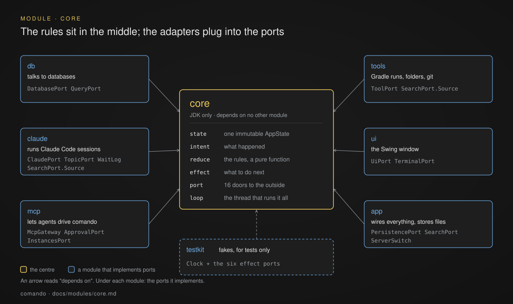
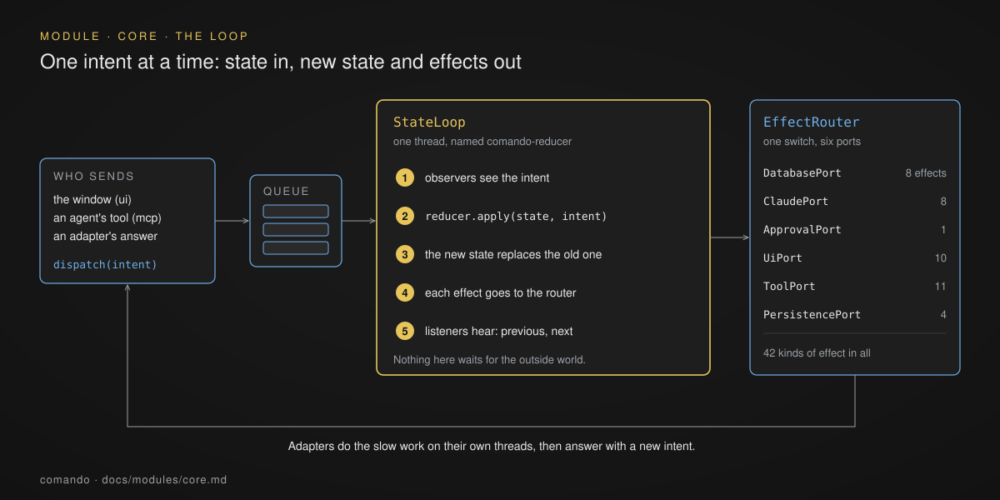
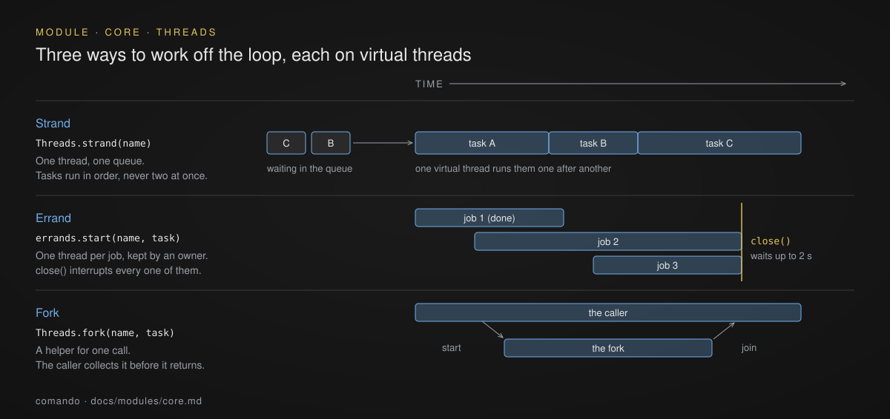
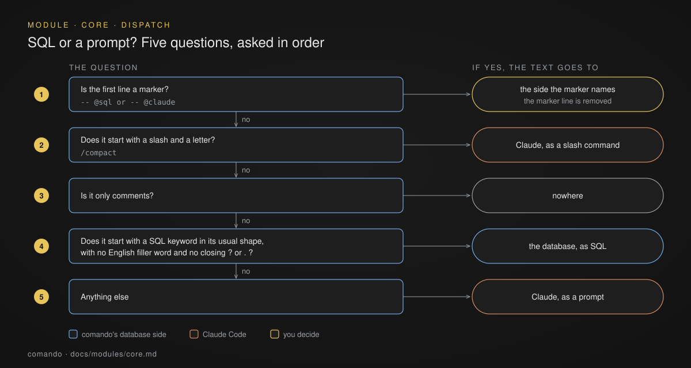

# core: the rules in the middle

**In one paragraph.** `core` is comando's brain without a body. It holds the whole state of the app as one value, the
list of things that can happen, and the rules that turn one into the other. It opens no window, no socket and no file
of yours. It names every outside system as a *port*, an interface, and lets other modules fill it in. Read this page
when you want to know how comando decides anything, or before you add a feature: every feature starts here.

## 1. The idea: decide in one place, act somewhere else

A desktop app talks to slow things: databases, Claude Code, Gradle, the disk. If each of them changed the screen
directly, two answers arriving together would trample each other.

comando splits the work in two. `core` **decides**: given what the app looks like now and what just happened, what
does it look like next, and what must be done? The other modules **act**: they run the SQL, start the session, paint
the window. They report back by telling `core` what happened.

`core` speaks three small vocabularies:

| Word | Type | Meaning | Size |
|---|---|---|---|
| State | `state.AppState` | Everything the app knows, as one immutable record | 16 fields |
| Intent | `intent.Intent` | One thing that happened: a click, an answer, a failure | 95 records |
| Effect | `effect.Effect` | One thing to do in the outside world | 42 records |

> **Learn: ports and adapters.** Picture a wall socket. The wall does not care whether you plug in a lamp or a
> charger; it only fixes the shape of the plug. A *port* is that socket: an interface that says what can be asked. An
> *adapter* is the thing you plug in: the code that really does it. The middle of the program depends only on sockets,
> never on lamps, so you can swap a real database for a fake one in a test. comando's `core.port` package holds 16
> sockets; `db`, `claude`, `mcp`, `tools`, `ui` and `app` are the lamps, and [testkit](testkit.md) is the box of test
> plugs.

## 2. The loop

Everything that happens becomes an `Intent` and waits in one queue. One thread, named `comando-reducer`, takes them
one at a time. `loop.StateLoop` does five things for each:

1. It shows the intent to its observers (the intent log, for one).
2. It calls `reducer.apply(state, intent)`, which returns a `Transition`: the next state and a list of effects.
3. It publishes the next state. Any thread can read it with `state()`.
4. It hands each effect to `effect.EffectRouter`, one `switch` that calls the right port.
5. When the state changed, it tells its listeners, with the previous and the next state. The window redraws from
   that pair.

No step waits for the outside world. A port method starts the work on another thread and returns at once. The answer
comes back later as a new intent, through `port.IntentSink.dispatch`, and goes to the end of the same queue.

| The loop protects itself | How |
|---|---|
| A rule throws a `RuntimeException` | It is logged; the loop takes the next intent |
| An `Error` (out of memory, say) | The loop stops for good; later intents are dropped and logged once |
| One intent takes 200 ms or more | One log line names the slowest part |
| The loop holds for 1 s or more | `loop.Watchdog` logs its stack; once the loop moves again, a notice appears in the window |
| comando quits | Queued intents still apply; `close()` waits at most 2 s |

> **Learn: the event loop.** Imagine one cashier and a single queue. Customers never fight over the till, because
> only one is served at a time. An event loop is that cashier: one thread takes one event, finishes it, then takes
> the next. Nothing needs a lock, since nothing happens at the same moment. The rule that keeps it fast is simple:
> the cashier never leaves the till to fetch something from the warehouse. In comando the cashier is `StateLoop`, the
> customers are intents, and the warehouse trips are effects, done by other threads.

> **Learn: pure functions and immutable state.** A pure function is a vending machine with no memory: the same
> buttons always give the same snack, and pressing them changes nothing else. *Immutable* means a value never
> changes after it is made; to "change" it you build a new one. Put together, they make a program you can replay:
> feed the same intents, get the same states. comando's `reduce.Reducer` is such a function over `AppState`. Beyond
> its two arguments it reads only the clock, the home folder and one setting. That is why a test can check any rule
> with no window and no database.

## 3. State, intents and effects

`AppState` is a Java record. Its fields are lists of smaller records: panels, connections, sessions, folders, SQL
runs, approvals, views, notices, instances. A change builds a new `AppState` through a `with…` method and shares
everything it did not touch. Its constructor refuses a state with no panel, or a focus on a panel that is not there.

`Intent` and `Effect` are *sealed* interfaces: the full list of their records sits in one file each.

The rules live in `reduce`. `Reducer` is the only public door; behind it one class per subject keeps the rules
apart: `PanelRules`, `SessionRules`, `TurnRules`, `QueryRules`, `ApprovalRules`, `FolderRules`, `ViewRules`.
`Reducer.refusal(state, intent)` answers in words why an intent would be refused, so an agent's tool can say so
before it sends one.

Many records carry a small state machine as an enum:

| Enum | Values |
|---|---|
| `model.Status` (a connection, a session) | `CLOSED`, `OPENING`, `OPEN`, `CLOSING`, `FAILED` |
| `state.RunStatus` (one SQL run) | `QUEUED`, `RUNNING`, `DONE`, `FAILED`, `CANCELLED` |
| `state.Attention` (what a session needs from you) | `NEEDS_YOU`, `WORKING`, `TO_READ`, `IDLE` |

Big, fast-changing data stays out of `AppState`: result rows, transcript text, console output, schemas. The state
holds only an id; the bytes live in a registry (`result.ResultRegistry`, `transcript.TranscriptRegistry`,
`console.ConsoleRegistry`, `schema.SchemaRegistry`) that one thread writes and others read.

> **Learn: sealed types and the switch that cannot forget.** Suppose you sort mail into boxes and a new kind of
> letter appears. If nobody tells you, it lands on the floor. A *sealed* type tells the compiler the complete list of
> kinds. A `switch` over it must then handle every kind, or the program does not compile. Add a 43rd effect to
> comando and `EffectRouter` stops compiling until you say which port takes it. The mistake is caught at your desk,
> not in front of a user.

## 4. Work off the loop

Adapters need threads, and threads leak when everyone starts their own. `core.loop` is the only place that makes
them, and it offers a few named kinds:

| You need | Use | What you get |
|---|---|---|
| Tasks in order, never two at once | `Threads.strand(name)` | One virtual thread behind a measured queue |
| The same, with delays and periods | `Threads.timedStrand(name)` | A one-thread scheduler |
| A helper inside one call | `Threads.fork(name, task)` | A started virtual thread you join before you return |
| Independent jobs with one owner | `new Errands(owner).start(name, task)` | A thread per job; `close()` interrupts all and waits 2 s |
| To stop executors on quit | `ExecutorStop.now(…)`, `ExecutorStop.drain(…)` | A bounded stop: 2 s by default |
| A regular look at something | `Watchdog.shared().watch(look)` | One platform thread, a look every 100 ms |
| A child process with limits | `Processes.run(argv, timeout, maxOut)` | Exit code and output; past the limit the process tree is killed |
| To know a queue's depth | `Queues.gauge(name)` | Depth and peak, readable with `Queues.read()` |

The full thread rules, kind by kind, are in [the architecture](../architecture.md). The reasons are in
[threads by kind with a budget](../adr/0082-threads-by-kind-with-a-budget.md).

> **Learn: virtual threads.** A classic thread is like a rented lorry: powerful, but you cannot afford thousands.
> A virtual thread is a bicycle courier: the Java runtime owns a few lorries and lets many couriers hop on and off.
> When a courier waits, for a network answer say, it steps off and the lorry carries someone else. You can write
> plain step-by-step code and still have thousands of waits in flight. comando uses them for every strand, errand
> and fork, and keeps real platform threads for the few that must never be starved: the loop and the watchdog.

## 5. SQL or a prompt?

One editor serves both the database and Claude. `dispatch.Classifier.classify(text)` reads the text you run and
decides where it goes. It asks the five questions in the picture, in that order, and the first "yes" wins. It only
looks at words; it never calls a database or a model. A `dispatch.Target` names the choice: `AUTO` lets the
classifier decide, `SQL` and `CLAUDE` force a side.

Two helpers cut the text first. `Blocks` splits an editor into runs of non-blank lines, so you run the block under
the cursor. `Statements` splits SQL at semicolons, and knows not to split inside quotes, dollar-quoted strings or
comments.

## 6. The toolbox other modules borrow

`core` also carries small, dependency-free tools that every module needs.

| Package | Main classes | What it gives you |
|---|---|---|
| `json`, `json.bind` | `Json`, `JsonNode`, `ObjectNode`, `ArrayNode`, `Binder` | A JSON parser and writer, and records to JSON and back |
| `files` | `Mapped`, `ByteScan`, `OwnerOnly` | Memory-mapped reads, byte search, owner-only permissions |
| `model` | `AtomicFiles`, `VersionedLines`, `KitRoot`, `HomeDir` | Safe file writes, versioned file headers, where the kit is, `~` in paths |
| `result` | `ResultView`, `ResultRegistry`, `ColumnKind`, `Formats` | The shape of a query result and how a cell prints |
| `transcript` | `Transcript`, `Block`, `TranscriptRegistry` | A session's conversation as blocks, one writer and many readers |
| `console` | `Console`, `ConsoleRegistry` | A command's output; past 4 Mi characters only the last 64 Ki are added |
| `view` | `ViewSpec`, `Placement`, `Layout`, `FileView` | What a side or lower view shows: a table, a plot, a tree, a diff, a file |
| `action` | `Action`, `Actions` | The registry of everything you, or an agent, can do |
| `logbook` | `Logbook`, `IndexParser` | The scratchpad's open tasks, read from its newest `INDEX.md` |
| `resource` | `ResourceKind`, `ConnectionKind`, `SessionKind`, `FolderKind` | The kinds of thing you configure in a form: connections, sessions, folders |

Why comando owns its JSON code:
[its own JSON, MQTT, diff, completion and icons](../adr/0157-comando-owns-its-json-mqtt-diff-completion-and-icons.md).
Why every file is mapped: [every file is read mapped](../adr/0140-every-file-is-read-mapped.md).

> **Learn: the atomic file write.** If the power fails while you overwrite a file, you can end up with half the old
> text and half the new: a file that is neither. The cure is to never write in place. You write the new content to a
> temporary file beside the real one, then *rename* it over the original. The operating system does a rename in one
> step: a reader sees the old file or the new file, never a mixture. `model.AtomicFiles` does exactly this for every
> file comando stores, and keeps the file's permissions.

## 7. What core may depend on

| Direction | Rule |
|---|---|
| `core` depends on | The JDK. Nothing else: no other module, no library |
| `core` tests depend on | [testkit](testkit.md), JUnit, AssertJ |
| Depends on `core` | Every other module that touches state, intents or ports |

This rule is the point of the module. If `core` imported Swing or a database driver, the rules could not run without
them. Keep it that way: a new outside system means a new port here and an adapter elsewhere.

## 8. Tests

Run them with `./gradlew :core:test`. They need no display, no network and no database.

| Area | Tests |
|---|---|
| The rules | `ReducerTest`, `ReducerAttentionTest`, `ReducerNoticeAndLayoutTest`, `ReducerSubagentTest`, `ReducerChangesTest`, `ReducerFamilyTest`, `ReducerEtaTest`, `ReducerLowerTabTest`, `ReducerPartitionTest` |
| The loop and threads | `StateLoopTest`, `ThreadKitTest`, `ExecutorStopTest`, `WatchdogTest`, `ProcessesTest`, `QueuesTest`, `NotifyLoggedTest` |
| Routing | `EffectRouterTest` |
| SQL or a prompt | `ClassifierTest`, `BlocksTest`, `StatementsTest` |
| JSON | `JsonParserTest`, `JsonWriterTest`, `JsonNodeTest`, `JsonContainerTest`, `JsonGoldenTest`, `BinderTest` |
| Files | `AtomicFilesTest`, `MappedTest`, `MappedCutTest`, `ByteScanTest`, `OwnerOnlyTest` |
| Results, transcripts, consoles | `FormatsTest`, `ResultTextTest`, `ResultStatsTest`, `TranscriptTest`, `TopicSourceTest`, `ConsoleTest` |
| Kit and model | `KitRootTest`, `KitVersionTest`, `KitFoldersTest`, `KitJobTest`, `HomeDirTest`, `InstanceNameTest`, `LinearTicketsTest` |
| State, views, logbook | `AttentionTest`, `ReflectionTest`, `SessionEtaTest`, `ResourceKindTest`, `FileViewTest`, `ClipTest`, `IndexParserTest`, `IndexParserLiveTest` |

## Where next

- [The architecture](../architecture.md): how the modules fit together, and the thread rules.
- [testkit](testkit.md): the fakes that let these rules run alone.
- [db](db.md): a full adapter behind two ports, with lanes and cancel.
- [ui](ui.md): the listener that turns each new state into pixels.
- [app](app.md): where the loop, the router and the adapters are wired together.
