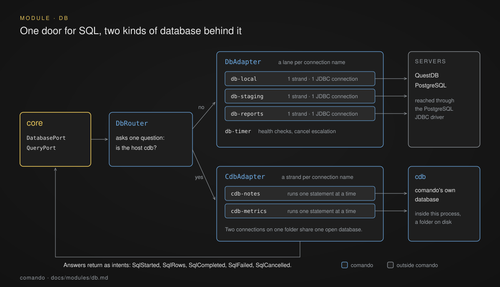
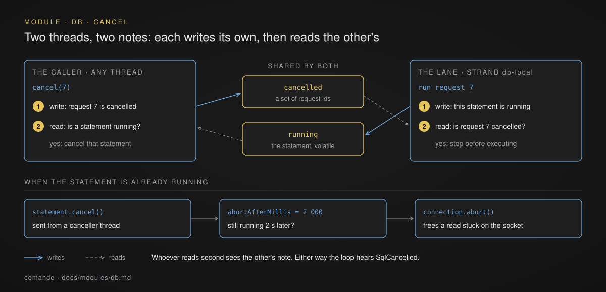
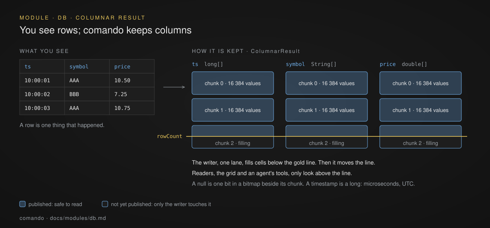

# db: SQL in, columns out

**In one paragraph.** `db` is the adapter that runs your SQL. It opens connections, runs statements, cancels them,
reads schemas, and keeps the answers in memory in a compact form. It talks to servers such as QuestDB and
PostgreSQL through JDBC, and to comando's own database, [cdb](cdb.md), inside the same process. Every call returns
at once; the answer arrives later as an intent. This page is for anyone who wants to know what happens between
pressing Run and seeing rows.

## 1. The idea: one lane per connection

A database connection can do one thing at a time. A window must never wait for one. `db` solves both with a simple
rule: each connection gets its own thread and its own queue, called a *lane*. Work for a connection lines up in its
lane. A slow query on one connection holds up nothing else.

The picture shows the route. [core](core.md) defines two ports and `db` implements both.

| Port | Who calls it | What comes back |
|---|---|---|
| `DatabasePort` | The effect router, for 8 effects: `OpenDb`, `CloseDb`, `TestDb`, `ExecuteSql`, `CancelSql`, `LoadSchema`, `ForgetSchema`, `ReleaseResult` | Intents, through the `IntentSink` |
| `QueryPort` | Claude's database tools, by way of [mcp](mcp.md) | A `CompletableFuture` of text rows, capped |

`DbRouter` is the one object the app hands to both. It looks at a connection's host. A host of `cdb`, or
`cdb:<folder>`, goes to `CdbAdapter`. Every other host goes to `DbAdapter`. The router remembers which adapter owns
each connection name and each request id, so a cancel always finds the right one.

> **Learn: a queue per resource.** Two people cannot write on the same line of a form at the same moment. One fix
> is a lock: whoever holds the pen writes, the other waits. Another fix is a queue: put the form on one clerk's
> desk and hand that clerk the requests. Nobody else touches the form, so nobody needs a lock. The second way is
> called *confinement*. In comando each connection is confined to its lane's thread. Requests wait in the lane's
> queue, the lane runs them one at a time, and the connection never meets two threads at once.

## 2. A statement's life

`DbAdapter` holds a `Lane` for each open connection. A lane is one JDBC connection and one strand named
`db-<connection>`. It lives while it holds a connection or has work queued.

1. The reducer emits `ExecuteSql` with a request id. `DbAdapter.execute` puts a task on the lane and returns.
2. The lane creates the statement and announces `SqlStarted`.
3. Rows arrive. The lane appends them to a `ColumnarResult` and reports progress with `SqlRows`: first after 100
   rows, then less and less often, at most every 50 000.
4. The lane ends with exactly one of `SqlCompleted`, `SqlFailed` or `SqlCancelled`.

The result itself does not travel inside an intent. It sits in core's `ResultRegistry` under its request id, and the
intents carry only the id and the count.

Three more helpers keep a lane honest.

| Helper | Thread | Job |
|---|---|---|
| Health check | `db-timer`, a timed strand, asks; the lane checks | Every 60 s an idle connection must prove it is valid within 5 s, or it becomes `ConnectionLost` |
| Connection test | An errand of `Errands("db")` | Opens a connection of its own, outside any lane, and answers `ConnectionTested` |
| Schema load | The lane itself | Reads tables and columns, which the app can show as a tree in a side view |

The schema load asks QuestDB's own catalogue when there are at most 50 tables. Past that, and for other servers, it
runs one `information_schema.columns` query, capped at 50 000 rows.

`DbSettings.DEFAULTS` holds the numbers that shape a run.

| Setting | Default | Meaning |
|---|---|---|
| `queryTimeoutSeconds` | 0 | No time limit on your own statements |
| `maxRows` | 5 000 000 | Rows kept from one statement |
| `fetchSize` | 5 000 | Rows the driver fetches per round trip |
| `healthPeriodSeconds` | 60 | Time between health checks |
| `abortAfterMillis` | 2 000 | How long a cancel may be ignored before the connection is dropped |

Claude's queries through `QueryPort` are bounded harder: 60 s per statement, and text rows up to the cap the tool
asks for.

## 3. Cancel: two threads, one handshake

Cancel is the hard part, because it comes from another thread while the lane is busy. The danger is a gap: you
press Cancel in the instant after the lane checked for cancels and before the statement is running. If both sides
look first and write second, both see nothing, and the query runs on.

`Lane` closes the gap with an ordering rule. Each side **writes its own mark first, then reads the other's**.

| Side | Writes first | Then reads |
|---|---|---|
| The caller of cancel | "request 7 is cancelled" | Is a statement running? If so, cancel it |
| The lane | "this statement is running" | Is request 7 cancelled? If so, stop before it starts |

Whichever side is second must see the first one's mark. So at least one of them acts, in every interleaving.

A server can still ignore a cancel. The lane does not wait for good manners. The timer checks again after
`abortAfterMillis`, 2 000 ms. If the statement is still running, `connection.abort()` drops the connection, the
statement ends as `SqlCancelled`, and the next run opens a fresh one. The driver's cancel call is itself sent from
a separate virtual thread, because it can block on the network.

> **Learn: a race condition.** Two threads *race* when the result depends on which one gets there first, and one
> of the orders is wrong. Races hide well: the bad order may happen once in a million runs, and never while you
> watch. You do not fix a race by testing harder. You fix it by making every order correct. The trick used here is
> old and has a name, a *store-then-load handshake*: each side announces itself before it looks around. Two people
> entering a dark room who both shout "I'm here" before listening cannot miss each other. In comando the two marks
> are a concurrent set of cancelled ids and a `volatile` field for the running statement.

## 4. Results: kept as columns

A grid shows rows, but `ColumnarResult` stores columns. Each column is a list of arrays, 16 384 values to an array.
A new array is added when the last one fills, so a growing result never copies the values it already holds.

| Column kind | Stored as |
|---|---|
| `LONG`, `BOOLEAN` | `long` |
| `TIMESTAMP` | `long`: microseconds since 1970, UTC |
| `DOUBLE` | `double` |
| `TEXT` | `String` |
| SQL NULL, any kind | One bit in a bitmap beside the column |

> **Learn: rows or columns.** A table can be kept in memory two ways. Row by row is like a stack of index cards:
> each card holds everything about one event. Column by column is like a spreadsheet cut into vertical strips: one
> strip holds every price, another every time. Strips win when you work on one field at a time, such as "average
> the price". The values sit side by side in one plain array, so the processor reads them fast and each takes 8
> bytes with no wrapper object. Analytical databases store data this way. comando does the same for the answer:
> five million rows of numbers stay plain arrays of `long` and `double`.

The grid starts painting while rows are still arriving. That means one thread writes the result while others read
it. `ColumnarResult` makes this safe without a lock: the writer fills the cells of a row first, and only then
raises `rowCount`. Readers ask for `rowCount` and never look past it.

> **Learn: safe publication.** Threads do not automatically see each other's writes at once. A processor may keep
> a fresh value to itself for a while, or reorder two writes. So "I wrote the cells, then the count" is not enough
> on its own: a reader could see the new count and old, empty cells. Java's `volatile` keyword fixes the order. A
> write to a volatile field *publishes* everything that thread wrote before it; a read of that field sees all of
> it. In comando `rowCount` is the volatile field. It is the gold line in the picture: everything above it is
> finished and visible, everything below belongs to the writer alone.

## 5. cdb, without a network

`CdbAdapter` gives the same service for [cdb](cdb.md), which runs inside comando. There is no socket and no driver.
Each connection name gets a strand, `cdb-<name>`, which calls the engine directly.

| Topic | How `CdbAdapter` does it |
|---|---|
| Which database | The host says: `cdb` is the default folder, `cdb:<folder>` names another |
| Two connections, one folder | They share one open database, counted, and closed with the last of them |
| The result | `CdbResultView` shows the engine's own pages; nothing is copied |
| Cancel | A waiting run never starts; a running one stops at its next page |
| Describe | `SHOW COLUMNS`, capped at 10 000 rows |

The reducer cannot tell the two adapters apart. Both answer with the same intents, and both results implement
core's `ResultView`. Why comando has a database of its own is told in
[ADR 0158](../adr/0158-cdb-comandos-own-database.md).

## 6. What db may depend on

| Direction | Rule |
|---|---|
| `db` depends on | [core](core.md), [cdb](cdb.md), and the PostgreSQL JDBC driver |
| Depends on `db` | [app](app.md), which builds it and plugs it into the ports |
| Never | `ui`, `claude`, `mcp`, `tools`. They reach a database only through core's ports |

`db` holds one package, `dev.marregui.comando.db`, with seven classes. Five are public: `DbRouter`, `DbAdapter`,
`CdbAdapter`, `ColumnarResult` and the `DbSettings` record. `Lane` and `CdbResultView` stay package-private.

Passwords never rest in `db`. The app hands `DbAdapter` a function that fills a password in for one connect; see
[ADR 0020](../adr/0020-passwords-in-the-macos-keychain-through-security.md). What SQL Claude may run is decided
before it reaches `QueryPort`; see [ADR 0023](../adr/0023-sql-from-claude-lexical-policy-production-refused.md).

## 7. Tests

Run them with `./gradlew :db:test`. They use real databases, not mocks of JDBC.

| Test | Against | What it pins down |
|---|---|---|
| `DbAdapterTest` | QuestDB, embedded in the test | Open, run, cancel, schema, Claude's queries, no lane left behind |
| `DbAdapterPostgresTest` | PostgreSQL in a container; skipped without Docker | Cancel ends a running statement; a withdrawn query never runs |
| `LaneTest` | A server that stops answering | Claude's queries and schema loads are bounded in time |
| `ColumnarResultTest` | Reader threads beside a writer | Rows below the count read correctly while the result grows |
| `CdbAdapterTest`, `CdbAdapterIntegrationTest` | cdb in a temporary folder | Types, failures, sharing a folder, no strand left behind |
| `CdbRoutingTest` | Both adapters behind `DbRouter` | Each connection reaches its own adapter, and so does its cancel |

Each adapter test waits for intents on a `RecordingSink`; see [testkit](testkit.md).

## Where next

- [cdb](cdb.md): the database on the other side of `CdbAdapter`.
- [core](core.md): strands, errands and the ports this module implements.
- [mcp](mcp.md): how Claude's tools reach `QueryPort`.
- [The architecture](../architecture.md): the thread rules every adapter follows.
