# frontear: the octopus network

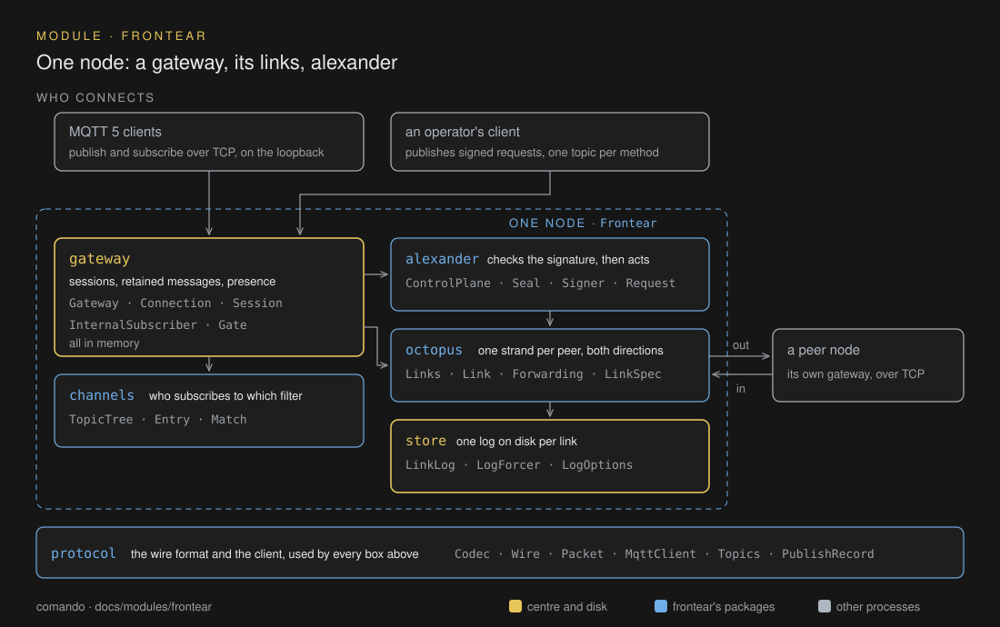

## In one paragraph

`frontear` is comando's own MQTT 5 module: a gateway, which is an MQTT 5 server, a client, links that carry messages
between gateways, and alexander, the control plane, which takes signed orders. Nodes joined by links make an octopus
network, and comando's instances find each other and talk through it. This page is the engineering view: the
packages, their main classes and threads, a link's log on disk, and the tests. To run and configure a node, and for
what each component is, read [frontear](../frontear.md). The reasons are in the decision records
([record 184](../adr/0184-frontear-comandos-own-mqtt-octopus-network.md)).

## 1. The idea: publish, subscribe, forward

A client publishes a message to a topic, a path such as `plant/line1/temp`. Other clients subscribe to filters
such as `plant/#`. The gateway hands each message to every subscriber whose filter matches. A link is a
subscriber too: it forwards what it receives to another gateway.

> **Learn: publish and subscribe.** Think of a school notice board with labelled sections. A teacher pins a note
> under "sports"; every pupil who watches "sports" reads it. The teacher does not know who reads, and the pupils do
> not know who wrote. An MQTT server is that board for programs. MQTT is the protocol they speak to it; a topic is
> the section; `+` matches one level of a topic and `#` matches all the rest. In frontear the server is the gateway,
> and a subscriber can be a client on a TCP connection or code inside the node.

## 2. What it offers

`Frontear.start(node, port, dataDir, trusted, clock)` starts one node: the gateway, the links and alexander
together; `trusted` is the set of Ed25519 public keys whose signatures alexander accepts. `close()` stops alexander,
then the gateway, then the links. `Frontear.main` runs a node from the command line, and `Frontear.listenRemote` opens
the border gateway's listener for other machines. A node keeps its link logs at 64 MiB per segment and 1 GiB per link
(`Frontear.LOG_OPTIONS`).

| Package | Role | Main classes | Section |
|---|---|---|---|
| `frontear` | One node, started and stopped as a unit | `Frontear` | §2 |
| `gateway` | Connections, sessions, retained messages, routing, the gate, the remote listener | `Gateway`, `GatewayOptions`, `Connection`, `Session`, `InternalSubscriber`, `Gate`, `RemoteListen` | §3 |
| `channels` | Which subscriber matches which topic | `TopicTree`, `Entry`, `Match` | §4 |
| `octopus` | Forwarding to and from a peer gateway | `Octopus`, `Links`, `Link`, `LinkSpec`, `LinkFile`, `LinkOptions`, `LinkState`, `Forwarding`, `Direction` | §5 |
| `store` | A link's log on disk | `LinkLog`, `LogForcer`, `LogOptions`, `LogFiles`, `DiskFiles`, `WholeFile`, `Record`, `QuotaExceededException` | §6 |
| `alexander` | Signed requests that change the links; what clients may do | `ControlPlane`, `ControlGate`, `RemoteGate`, `Seal`, `Signer`, `Request`, `Refusal`, `StateTopic` | §7 |
| `watch` | A read-only record of what the node does | `Watch`, `Observation`, `Published`, `LinkStep`, `ForceRound`, `NodeSnapshot`, `ConnectionView`, `LogView` | §8 |
| `tls` | Pinned, mutual TLS 1.3 between machines | `Tls`, `MachineKey`, `MachineKeyManager`, `PinningTrustManager`, `Pins`, `SelfSigned` | §9 |
| `protocol` | The wire format and a client | `Codec`, `Wire`, `Packet`, `MqttClient`, `MqttException`, `Names`, `Topics`, `PublishRecord` | §10 |

What the gateway speaks, and what it declines:

| Speaks | Declines |
|---|---|
| QoS 0 and 1, retained messages, wills with a delay | QoS 2 |
| Session and message expiry, keep alive | Topic aliases, subscription identifiers |
| Receive Maximum, Maximum Packet Size, reason codes | Shared subscriptions |
| No Local, Retain As Published, Retain Handling | Enhanced authentication |
| Request and response, user properties, session takeover | User name and password |

A node listens on the loopback, without TLS and without client authentication. Only the border gateway, the node of
comando's instance `main`, also listens on one network address, with TLS 1.3 and pinned keys (§9).

## 3. The gateway

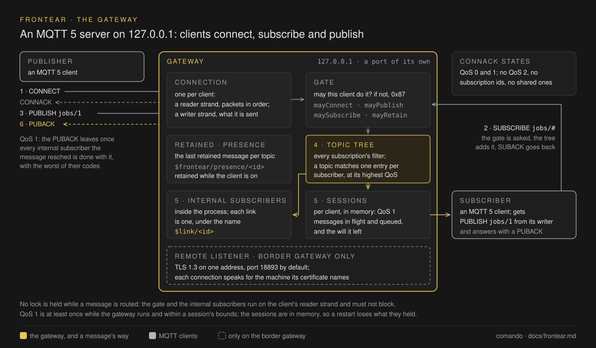

What the gateway is for: [frontear §2.1](../frontear.md#21-the-gateway).

The gateway keeps three things in memory: the sessions, the retained messages and the topic tree (§4). Clients on
TCP and subscribers inside the node share all three.

| Class | Responsibility |
|---|---|
| `Gateway` | Accepts connections, routes every publish, keeps sessions and retained messages, retains presence. Its own publishes carry the origin `$frontear`. |
| `GatewayOptions` | Every bound: Receive Maximum 1,024, packets of 16 MiB, 1,000 sessions, 1,000 queued messages and 64 MiB per session, 64 MiB waiting to be written to one client, 10,000 retained messages and 64 MiB, 128 topic levels, 256 filters per SUBSCRIBE, 1,000 subscriptions per session. |
| `Connection` | One client's connection: CONNECT within 10 s, then silence for 1.5 times its keep alive closes it. |
| `Session` | A client's subscriptions and queued messages, which outlive a connection until the session expires. |
| `InternalSubscriber` | A subscriber inside the node, a link or alexander: it gets each message with its origin and answers a reason code when it has finished. |
| `Gate` | What a client may do: connect, publish, subscribe, retain. By default a remote connection is refused. |
| `RemoteListen` | The remote listener: one address, never the wildcard, an `SSLContext`, how to name a certificate's machine, a cap on connections and a handshake bound. |

- **Acknowledgement.** A QoS 1 publish gets its PUBACK once every internal subscriber it reached has finished.
  The PUBACK carries the worst of their reason codes.
- **Presence.** The gateway retains `{"online":true}` on `$frontear/presence/<client-id>` and clears it when the
  connection ends. A client with an empty client id is assigned `frontear-<uuid>`.
- **Bounds.** Past a bound the gateway answers `0x97`, quota exceeded, or disconnects the client.
- **Remote connections.** The remote listener speaks TLSv1.3 only and needs the client's certificate. comando caps it
  at 64 connections and 10 s per handshake. The gateway removes every `frontear-origin` a remote client sets and adds
  `frontear-origin=@<machine>`, the machine its certificate names.

## 4. Channels: the topic tree

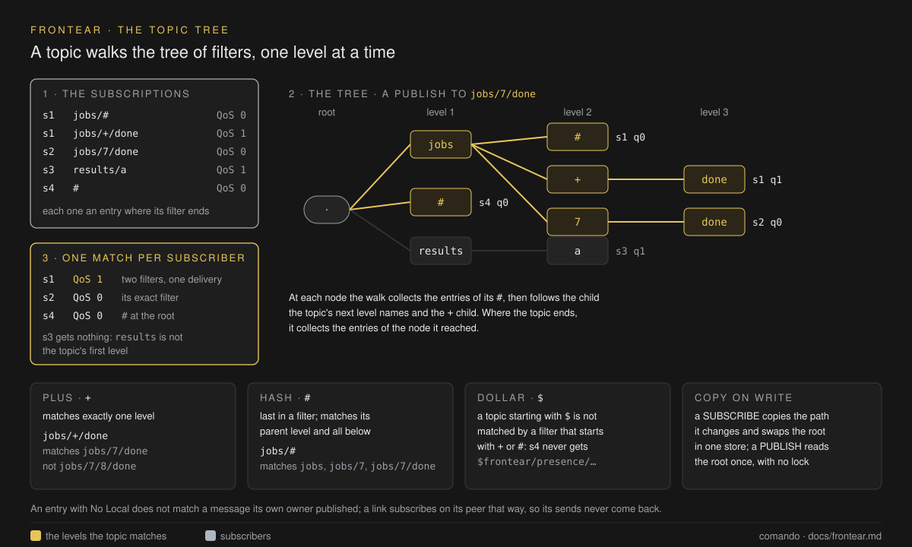

What channels are for: [frontear §2.2](../frontear.md#22-channels-the-topic-tree).

| Class | Responsibility |
|---|---|
| `TopicTree` | The filters as a tree of topic levels; matches a topic name to one `Match` per subscriber. |
| `Entry` | One subscription of one subscriber: its owner, which decides No Local, its QoS, No Local and Retain As Published. |
| `Match` | A subscriber's merged match for one topic: the highest QoS over its matching filters, Retain As Published if any has it. |

The tree is immutable: a subscribe copies the nodes on its filter's path and swaps the root with one volatile
store. Writers take a lock only writers take. A publish reads the root once and walks that snapshot without a lock.
A match allocates only for what it finds. The tree holds no filter and matches no topic deeper than the levels it was
made with, 128 in the gateway. Any thread may call any method.

> **Learn: copy-on-write.** Suppose a class shares one printed timetable. To change it, the teacher prints a new
> sheet and swaps it on the wall in one move. Nobody ever reads a half-edited timetable, and nobody waits for the
> teacher's pen. `TopicTree` works that way: readers follow one pointer to a finished tree. Subscribing costs a
> little copying, and publishing, far more frequent, costs no lock at all.

## 5. The octopus: a link

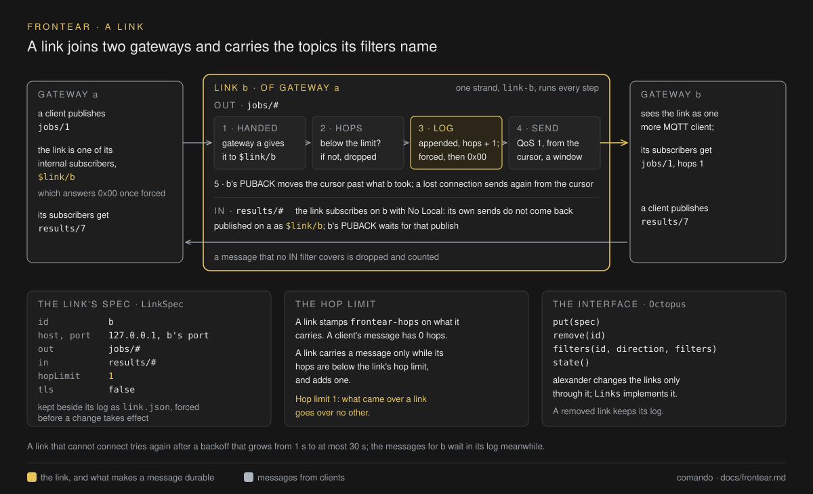

What the octopus is for: [frontear §2.3](../frontear.md#23-the-octopus-links-between-gateways).

| Class | Responsibility |
|---|---|
| `Octopus` | The four operations alexander drives: `put` a link, `remove` one, set the `filters` of one direction, read the `state` of all. |
| `Links` | A node's links: starts each one from its `link.json` at open, in id order, and keeps the specs and the TLS contexts. An id is 1 to 64 characters from `A-Z a-z 0-9 . _ @ -`, and not `.` or `..`. |
| `Link` | One link: its strand, its log, its MQTT client to the peer, both directions. |
| `LinkSpec` | `LinkSpec(id, host, port, out, in, hopLimit, tls)`: what a link is. |
| `LinkFile` | The spec as `link.json`, version 1, written whole and forced before it takes effect. |
| `LinkOptions` | A link's bounds: messages waiting to be logged (16,384, 8 MiB, and 50 ms for the oldest), at most 1,000 in flight to the peer, and the backlog (64 MiB, 24 h). |
| `LinkState` | What `GetState` and the state topic report: `connected`, `queued`, `cursor`, `tail`, `sent`, `dropped`, `reordered`, and why a link is down. |
| `Forwarding` | The user properties a link writes, `frontear-hops` and `frontear-queued-ms`, and the backoff: 1 s doubling to 30 s, up to a fifth taken off at random. |
| `Direction` | `OUT` or `IN`. |

A link joins this node's gateway to a peer's. It has two directions, each with its own topic filters.

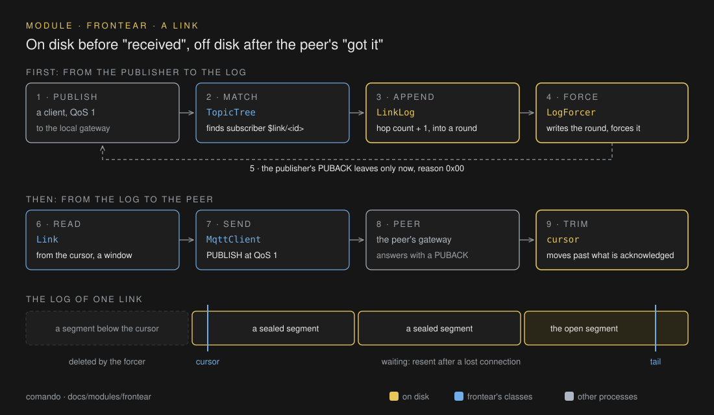

**Out.** The link subscribes inside the gateway as `$link/<id>`. Each message it receives joins the link's log
with its hop count raised by one. The gateway hears success (0x00) only once the record is on disk. The sender
then reads from the log's cursor and publishes to the peer at QoS 1. The cursor moves past what the peer has
acknowledged.

**In.** The link connects to the peer as `<node>~<id>` and subscribes there with No Local, so its own messages do not
come back. What arrives is published on the local gateway, and the peer's PUBACK waits for that local publish. A
message on a topic outside the `in` filters is dropped and counted.

| Event | What the link does |
|---|---|
| The log or the queue in front of it is full | Answers the gateway 0x97. A QoS 0 message is dropped and counted. |
| The peer answers 0x97 or 0x89 | Resends that one message alone after a backoff, 1 s growing to 30 s. |
| The peer answers 0x88 to CONNECT | Tries again after the first backoff, 1 s, without growing it. |
| The connection drops | Resends everything past the cursor, in order. The peer may see a message twice. |
| A message has reached its `hopLimit` | Does not forward it, so a ring of nodes cannot loop forever. |
| A put or a filter change | Writes the spec to `link.json` beside the log (`LinkFile`, version 1), forced, before it takes effect. |
| The link is removed | Deletes `link.json` first; keeps its log on disk. |
| The node starts | `Links` starts every link whose `link.json` it reads, in id order; one it cannot read is logged and skipped. |

The guarantee is **at least once**: no message acknowledged to its publisher is lost, and a duplicate is possible.

> **Learn: at least once.** A courier who gets no signature returns the next day with the same parcel. You may
> receive it twice, but never zero times. The other choice, "at most once", never repeats and sometimes loses.
> frontear links choose the courier's rule. A message leaves the log only after the peer signs for it with a PUBACK.

## 6. The store: a link's log

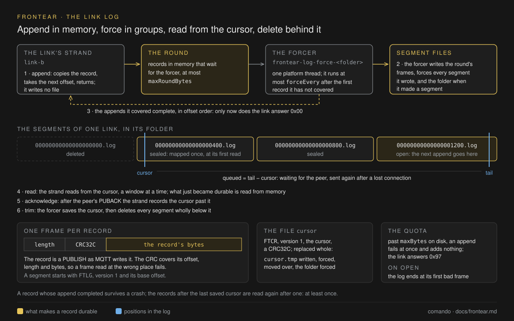

What the store is for: [frontear §2.4](../frontear.md#24-the-store-link-logs).

| Class | Responsibility |
|---|---|
| `LinkLog` | A folder of segment files named by their first offset, plus a `cursor` file: append, read from the cursor, move it, trim, recover. |
| `LogForcer` | One platform daemon thread per log, `frontear-log-force-<folder>`, that writes and forces the waiting round. |
| `LogOptions` | `LogOptions(segmentBytes, maxBytes, forceEvery, maxRoundBytes)`: 64 MiB, 1 GiB, zero and 8 MiB in a node. |
| `LogFiles`, `DiskFiles` | Every file operation of the log behind one interface, so a test can cut the file system at any write or force; `DiskFiles` is the real one. |
| `WholeFile` | A small file replaced whole: written as `<name>.tmp`, forced, moved over the old one, the folder forced. The cursor and `link.json` are written so. |
| `Record` | One record read back: its offset and its bytes. |
| `QuotaExceededException` | An append refused because the log would pass 1 GiB, or the round would pass 8 MiB. Nothing was appended. |

| Piece | Format |
|---|---|
| Segment header | magic `FTLG`, version 2 (version 1 still read), the base offset |
| Frame | length (top bit set: a delta frame), a CRC32C over offset, length and bytes, then the record: whole, the PUBLISH as MQTT 5 writes it, or the bytes it differs by from the record before ([record 191](../adr/0191-frontear-compact-link-log-records.md)); a segment's first record, every 64th and the first after an open are whole |
| `cursor` | magic `FTCR`, version, the cursor, a CRC32C; replaced by a rename |
| Byte order | little-endian |
| Size | 64 MiB per segment and 1 GiB per link in a node (`Frontear.LOG_OPTIONS`) |

The link's strand never writes to the disk. It copies each record into a round in memory, at most 8 MiB. The
forcer writes the round, forces it, completes the appends in order, saves the cursor and deletes segments below it.
Many messages share one force. At open the log deletes segments below the cursor, scans the rest, cuts at the first
frame that is short or fails its CRC, and forces what it kept.

> **Learn: an append-only log.** Imagine a diary you only ever add lines to. Finding "where was I?" needs one
> bookmark. If a line is half written when the power fails, every earlier line is still whole. A link's log is such
> a diary: new messages go to the end, the cursor is the bookmark, and each frame's CRC exposes a half-written line.
> Old pages go when the bookmark has passed them. Writing only at the end is the fastest thing a disk does.

## 7. alexander, the control plane

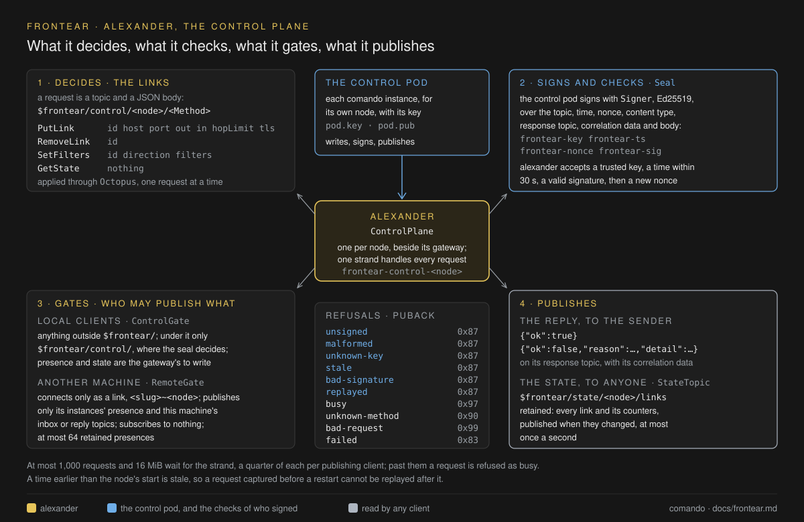

What alexander is for, its four jobs: [frontear §2.5](../frontear.md#25-alexander-the-control-plane).

You change a running node by publishing to it. A request is an MQTT message on
`$frontear/control/<node>/<Method>`, with a JSON body and a signature.

| Class | Responsibility |
|---|---|
| `ControlPlane` | Takes requests on its strand `frontear-control-<node>`, checks the seal, applies the request to the `Octopus`, replies, and publishes the state. Holds at most 1,000 requests and 16 MiB waiting, a quarter of each per client; past that a request is `busy`, without a reply. Installs `ControlGate`. |
| `Request` | The four methods and their bodies; an unknown property is refused. |
| `Seal` | The signature's one definition: the bytes it covers, the four user properties, the check, the 30 s window and up to 10,000 nonces remembered. |
| `Signer` | Signs a request with a private key for a node that trusts its public half. Safe for several threads. |
| `Refusal` | Why a request was refused: its name in the reply, its reason code in the PUBACK. |
| `ControlGate` | Clients publish anything outside `$frontear/` and, under it, only to `$frontear/control/`; they subscribe to anything. |
| `RemoteGate` | A remote machine's connection: a link client only, publishing only its own instances' presences and this machine's instances' `inbox` and `reply` topics, subscribing to nothing, with at most 64 retained presences. A local client is asked of the gate it wraps. |
| `StateTopic` | The retained `$frontear/state/<node>/links`, published when it changed and at most once a second. |

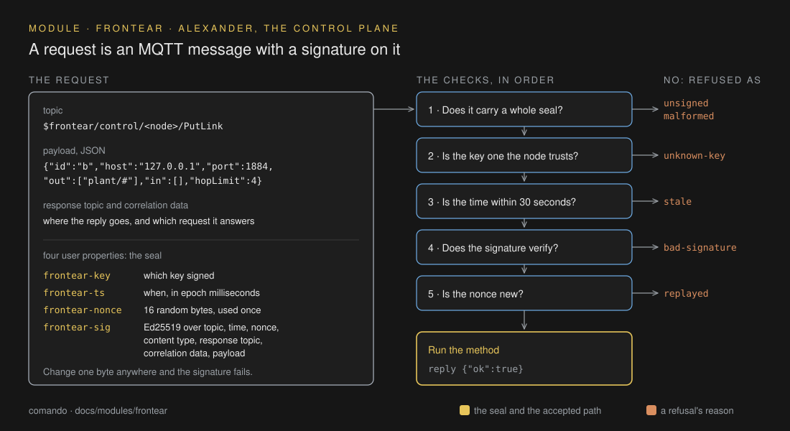

| Method | Body | Does |
|---|---|---|
| `PutLink` | `{id, host, port, out, in, hopLimit}`, and an optional `tls` | Adds a link or replaces it. |
| `RemoveLink` | `{id}` | Stops a link. |
| `SetFilters` | `{id, direction, filters}` | Changes one direction's filters. |
| `GetState` | `{}` | Answers the state of every link. |

The reply goes to the request's response topic: `{"ok":true}` or `{"ok":false,"reason":…,"detail":…}`. A response
topic under `$frontear/` gets no reply. Every refusal is counted and logged at most once a minute.

`Seal` covers the topic, the time, the nonce, the content type, the response topic, the correlation data and the
payload. The node checks the nonce last, so a forged message cannot use up a real one's nonce.

| Refusal | PUBACK | Means |
|---|---|---|
| `unsigned`, `malformed` | `0x87` | The seal is missing or broken. |
| `unknown-key` | `0x87` | The node does not trust the signer. |
| `stale` | `0x87` | The time is outside the 30 s window, or before the node started. |
| `bad-signature` | `0x87` | The message changed after signing, or another key signed it. |
| `replayed` | `0x87` | The node has seen this nonce. |
| `busy` | `0x97` | 1,000 requests or 16 MiB are pending, one sender holds a quarter of either, or 10,000 nonces are remembered. |
| `unknown-method` | `0x90` | The last topic level names no method. |
| `bad-request` | `0x99` | The body is not the method's, or the content type is not `application/json`. |
| `failed` | `0x83` | The change failed. |

> **Learn: a digital signature.** You hold two matching keys: a private one you keep, a public one you hand out.
> With the private key you compute a short code from a message. Anyone with the public key can check that the code
> fits the message, but cannot make one. Change a single letter and the check fails. frontear signs with Ed25519 and
> trusts a list of public keys. A timestamp and a random number used once, the nonce, stop a recorded message from
> working a second time.

## 8. The watch

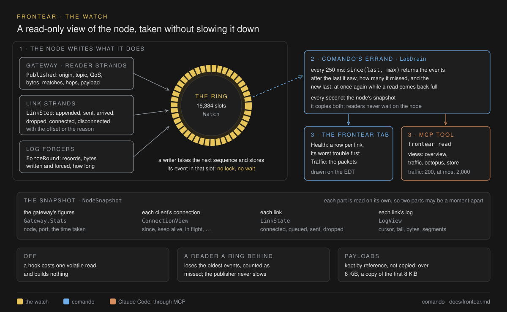

What the watch is for: [frontear §2.6](../frontear.md#26-the-watch).

| Class | Responsibility |
|---|---|
| `Watch` | A ring of a power-of-two number of slots, 16,384 in a node, written by the gateway's, the links' and the logs' threads and read with `since`. Off until `on(true)`; while off a hook costs one volatile read. |
| `Observation` | One event, with its sequence number and time: a `Published`, a `LinkStep` or a `ForceRound`. |
| `Published` | A message the gateway routed: origin, topic, QoS, size, matches, hops, up to 16 bytes of correlation data and up to 8 KiB of payload. |
| `LinkStep` | A step of a link: `APPENDED`, `SENT`, `ARRIVED`, `DROPPED`, `CONNECTED`, `DISCONNECTED`, with why when it has a reason. |
| `ForceRound` | One force of a log: records, bytes and how long it took. |
| `NodeSnapshot` | The node at one moment: the gateway's figures, its connections (`ConnectionView`), its links (`LinkState`) and their logs (`LogView`). |

A hook claims the next sequence, builds its event and stores it in its slot with a release store. It never locks and
never waits: a reader that falls a ring behind loses the oldest events, counted as `missed`. comando's app reads the
watch every 250 ms and the snapshot every second for the frontear tab and the MCP tool `frontear_read`.

## 9. TLS

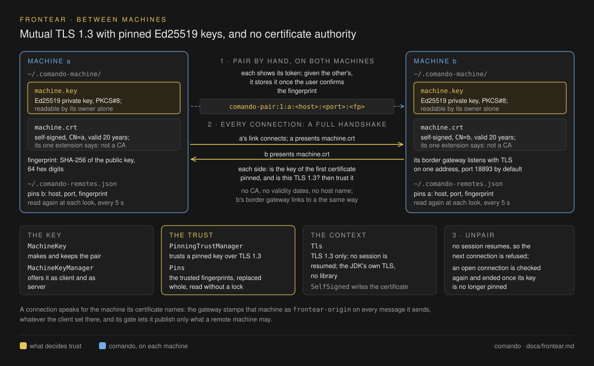

What TLS does between machines: [frontear §2.7](../frontear.md#27-tls-between-machines).

| Class | Responsibility |
|---|---|
| `Tls` | `Tls.context(key, pins)`: an `SSLContext` for `TLSv1.3`, with this machine's key as client and server and a pinning trust manager. Its session timeout is set past the 7 days TLS 1.3 allows a ticket, so no ticket is issued or kept and every connection makes a full handshake. |
| `MachineKey` | This machine's Ed25519 key and self-signed certificate, `CN=<machine>`, valid 20 years, as `machine.key` (PKCS#8 DER) and `machine.crt` (DER), owner-only. Its fingerprint is the SHA-256 of the public key's encoding, 64 lower-case hex digits. |
| `MachineKeyManager` | Offers that key and certificate whenever a handshake asks for an EdDSA key, as client and as server. |
| `PinningTrustManager` | Trusts a peer exactly when the key of its first certificate is pinned and the session is TLS 1.3: no certificate authority, no validity dates, no host name. |
| `Pins` | The pinned fingerprints, each with its machine: replaced whole and read lock-free; `machineOf` names a certificate's machine. |
| `SelfSigned` | Writes the X.509 v3 certificate in DER, signed with Ed25519, with one critical extension that says it is no authority: the JDK has no public way to make one. |

The border gateway's listener takes a context over every paired machine's pin. Its link to one paired machine takes
a context over that machine's pin only.

## 10. The protocol

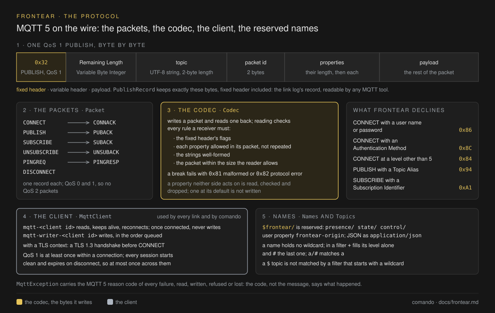

What the protocol does: [frontear §2.8](../frontear.md#28-the-protocol).

| Class | Responsibility |
|---|---|
| `Packet` | The MQTT 5 control packets, one record each. |
| `Codec` | Writes and reads every packet. Refuses a protocol level other than 5, a user name or password, an authentication method, topic aliases and subscription identifiers, each with the reason code that says so. |
| `Wire` | MQTT 5's integers, variable byte integers (at most 268,435,455), UTF-8 strings and binary data; a value that breaks its form is malformed. |
| `MqttClient` | An MQTT 5 client over a blocking socket, optionally TLS 1.3: QoS 0 and 1 both ways, subscriptions, keep alive, a will, reconnection when its handler asks. Connects within 10 s, cuts a write that takes longer than 10 s, and queues at most 1,000 messages. |
| `MqttException` | A failure with its MQTT 5 reason code. |
| `Names` | What frontear reserves: `$frontear/`, its `presence/`, `state/` and `control/` topics, the content type `application/json`, the user property `frontear-origin`. |
| `Topics` | Which topic names and filters are valid, and which names a filter matches. |
| `PublishRecord` | A PUBLISH as bytes and back, the packet as MQTT 5 writes it, for a link's log. |

The client's reader opens each connection, reads it and runs the reconnects; every write after that runs on its
writer. Over TLS the handshake runs on the writer before CONNECT.

## 11. Threads

Everything runs on strands, virtual threads that each do one thing in order, made by `core`'s `Threads`. One
kind of thread is a platform thread: the log forcer, because a force blocks in the operating system.

| Thread | Work |
|---|---|
| `frontear-gateway-accept-<port>` | Accepts connections on the loopback. |
| `frontear-gateway-accept-remote-<port>` | Accepts connections on the border gateway's remote listener. |
| `frontear-gateway-reader-<port>-<n>`, `frontear-gateway-writer-<port>-<n>` | One pair per client connection, numbered. |
| `frontear-gateway-publish-<port>` | Runs publishes that start inside the node. |
| `frontear-gateway-sweep-<port>` | Timed: expires sessions, messages and wills. |
| `link-<id>` | Timed: every step of one link; the only thread on its log's state. |
| `mqtt-<client id>`, `mqtt-writer-<client id>` | A client's reader, timed, and its writer. |
| `frontear-control-<node>` | Timed: verifies and runs control requests, publishes the state. |
| `frontear-log-force-<folder>` | The platform daemon thread: writes and forces one link's log. |

## 12. Dependencies allowed

- `frontear` depends on the JDK and on `core`, of which it uses the packages `loop`, `json`, `files`, `model` and
  `port`.
- `app` depends on `frontear`: it hosts a node in every instance, and its peer client is `frontear.protocol`'s
  `MqttClient`.
- Test fixtures (`FakeGateway`, `Recorder`, `Relay`) are published for `app`'s tests.

## 13. Tests

Run them with `./gradlew :frontear:test`.

| Tests | Prove |
|---|---|
| `protocol/` `CodecTest`, `CodecCorpusTest`, `CodecAllocationTest`, `WireTest`, `TopicsTest`, `PublishRecordTest`, `PublishWeightTest`, `MqttClientTest`, `ClientInteropTest` | Every packet encodes and decodes; the client's flows. |
| `gateway/` `GatewayProtocolTest`, `GatewayConnectTest`, `GatewayPublishTest`, `GatewayLifecycleTest`, `GatewayBoundsTest`, `GatewayRaceTest`, `GatewayRemoteTest`, `NodeRemoteTest` | Sessions that outlive a connection, every bound, a drop and an immediate reconnect, the remote listener. |
| `channels/TopicTreeTest` | Matching with `+` and `#`. |
| `store/` `LinkLogTest`, `LinkLogCrashTest`, `LinkLogCursorSaveTest`, `LinkLogLifecycleTest`, `LinkLogMappingTest` | A cut at every file operation: a kill, a kill mid-write, a power cut. |
| `octopus/` `ForwardingTest`, `LinksTest`, `LinkFileTest`, `LinkRefusalBackoffTest`, `LinkWakeTest` | Hop counts and expiry, order and no loss across restarts, the backoff on a refusal. |
| `alexander/` `SealTest`, `SignerTest`, `RequestTest`, `ControlPlaneTest`, `ControlGateTest`, `ControlGateOnGatewayTest`, `RemoteGateTest`, `StateTopicTest` | The seal's checks, the methods, what each gate lets a client do. |
| `watch/` `WatchTest`, `WatchNodeTest` | The ring, and what a node reports into it. |
| `tls/` `TlsTest`, `MachineKeyTest`, `MqttClientOverTlsTest` | Pinning, the machine key, the client over TLS. |
| `sim/` `LineSimTest`, `RingSimTest`, `ChainSimTest`, `ShortcutSimTest`, `InFilterSimTest`, `LedgerTest`, `PathsTest` | Real nodes on the loopback behind faulty relays; a ledger checks loss, order and hops. |
| `FrontearTest` | One node started, used and closed as a unit. |

A simulation prints its two seeds. Replay it with `COMANDO_SIM_SEED0`, `COMANDO_SIM_SEED1` and
`COMANDO_SIM_RUNS=1`. `COMANDO_SOAK=true` runs ten times as many. `ClientInteropTest` runs against another MQTT 5
server when you set `COMANDO_MQTT_SERVER=host:port`.

## Where next

- [frontear](../frontear.md): what each component is, run a node, link two nodes, sign a request.
- [app](app.md): how comando hosts a node in every instance and finds its peers.
- [core](core.md): strands and the thread rules frontear follows.
- [cdb](cdb.md): comando's other log on disk, the write-ahead log.
- [Architecture](../architecture.md): the octopus network among comando's instances.
