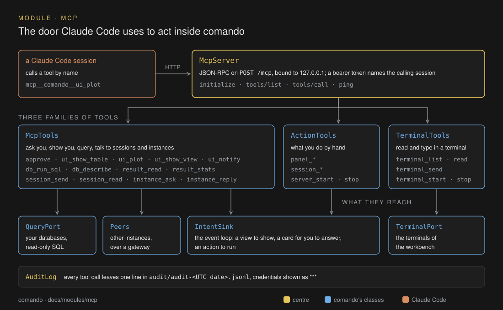
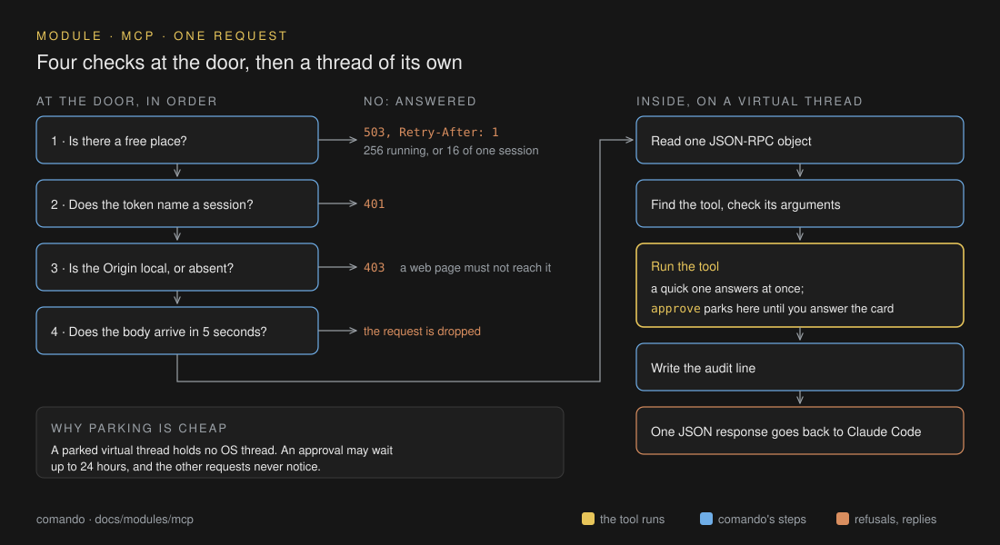

# mcp: the tools Claude Code calls

## In one paragraph

`mcp` is a small server inside comando that gives Claude Code tools. Through it a session shows you a table or a
plot, queries a database, asks your permission, talks to another session or instance, and drives the workbench.
The server listens on this machine only. Every call names its session, passes the same checks and leaves a line
in an audit log. This page is for engineers who add or change a tool. For what the tools do for you, read
[Claude Code in comando](../claude-code.md).

## 1. The idea: tools with a guard at the door

A model cannot click a button. It can only ask for a tool by name, with arguments. MCP, the Model Context
Protocol, is the agreed way for a program to offer such tools. comando is that program.

> **Learn: tools for a model.** A model produces text, nothing else. To act, it writes a request such as "call
> `ui_plot` with these numbers". A program reads the request, does the work and writes the result back into the
> conversation. A tool has a name, a description and a schema of its arguments, and the model reads all three
> before it chooses. So a tool's description is part of its interface: comando's are written for the model to act on.

> **Learn: JSON-RPC.** A remote call needs four things: which method, which arguments, which reply belongs to
> which call, and how an error looks. JSON-RPC fixes those in one small JSON object with `method`, `params` and
> `id`. MCP is built on it. comando answers four methods: `initialize`, `tools/list`, `tools/call` and `ping`.

## 2. What it offers

`app` constructs one `McpServer` and hands it to the Claude adapter as `core`'s `McpGateway`.
`register(session)` returns a URL and a fresh token for that session's process; `unregister` revokes the token.
`McpServer` is also the `ApprovalPort`: your answer to a card reaches the waiting call through it.

The module is one package, `dev.marregui.comando.mcp`:

| Class | Role |
|---|---|
| `McpServer` | The HTTP endpoint, its checks and its bounds. |
| `McpTools` | The approval tool, the view tools, SQL, held results, sessions and instances. |
| `ActionTools` | The workbench's own actions as tools, from `core`'s `Actions.ALL`. |
| `TerminalTools` | Read and type in a panel's terminal. |
| `ViewSpecs` | Checks a view's data before it becomes a `ViewSpec`. |
| `SqlPolicy` | Decides whether a statement only reads. |
| `Peers`, `PeerGateway` | Presence, questions and answers among instances. |
| `TranscriptText`, `Turns`, `Summaries` | A transcript as text; waiting for a turn's end; a card's one line. |
| `AuditLog` | One JSON line per tool call and per approval. |

The tools, by family:

| Family | Tools | Reach |
|---|---|---|
| Ask you | `approve` | A card; the call waits for your answer. |
| Show you | `ui_show_table`, `ui_plot`, `ui_show_view`, `ui_notify`, `ui_open_file`, `ui_set_editor`, `ui_insert`, `ui_set_layout`, `ui_close_view`, `ui_get_state` | Intents to the event loop. |
| Query | `db_run_sql`, `db_describe` | `QueryPort`, read-only. |
| Held results | `result_list`, `result_read`, `result_stats` | The results a panel holds. |
| Sessions | `session_send`, `session_read` | Another session's prompt and transcript. |
| Instances | `instances_list`, `instance_ask`, `instance_reply` | `Peers`. |
| frontear | `frontear_read` | `LabTools`, over `LabPort`: the node's watch as the frontear tab reads it. |
| Machines | `machines` | `MachinesTools`, over `MachinesPort`: this machine and the machines paired with it ([record 189](../adr/0189-frontear-across-machines.md)); listen and pair ask the user on a card. |
| Actions | `panel_*`, `session_*`, `server_start`, `server_stop` and more | The same actions you run by hand. |
| Terminals | `terminal_list`, `terminal_read`, `terminal_send`, `terminal_start`, `terminal_stop`, `terminal_interrupt` | `TerminalPort`. |
| Pages | `page_list`, `page_snapshot`, `page_read` | `PageTools`, over `PagePort`: the HTML pages the panels render ([record 190](../adr/0190-html-pages-render-in-a-panel-through-javafx-webview.md)). |

`ui_show_view` takes six kinds of view: `table`, `plot`, `diff`, `markdown`, `text` and `tree`.

## 3. How a request runs

The server binds to 127.0.0.1 and answers `POST /mcp`. Each request gets one JSON response; the server opens
no stream of its own. The checks run in this order:

| Check | Refusal | Why |
|---|---|---|
| A free place | 503 with `Retry-After: 1` | At most 256 requests run at once, and 16 for one session. |
| A known token | 401 | The token names the calling session. An unknown caller's body is never read. |
| A local `Origin`, or none | 403 | A web page in your browser must not reach the server. |
| The method is `POST` | `DELETE` is answered 200; any other method 405 | The server opens no stream, so there is nothing else to ask for. |
| The body arrives within 5 s | The connection is closed | A stalled body holds no place for long. |
| The body fits 64 MiB | 413 | |
| The body is one JSON-RPC object | 400 | |

Then a virtual thread reads the JSON-RPC object, finds the tool, runs it, writes the audit line and answers.

> **Learn: a bearer token.** A cloakroom ticket proves the coat is yours: whoever bears the ticket gets the coat.
> A bearer token is such a ticket, a long random number sent with each request. comando makes a fresh one for
> each Claude Code process, so the server knows which session calls. When the process ends, the ticket is void.

> **Learn: virtual threads.** An operating-system thread is costly, so servers once kept a small pool and never
> let one wait. A virtual thread is a thread the Java runtime schedules itself. While it waits, it holds no
> operating-system thread and costs a little memory. So comando writes each request as plain, blocking code. A call
> that waits a day for your answer disturbs nobody.

## 4. Approval

Claude Code starts with `--permission-prompt-tool mcp__comando__approve`. When it needs permission, it calls
`approve` instead of asking in a terminal.

1. `approve` dispatches `ApprovalRequested`. A card appears in the window.
2. The request's virtual thread waits on a future, for up to 24 hours.
3. You answer; `ApprovalPort` completes the future; the tool returns your decision to Claude Code.
4. A card nobody can answer any more is withdrawn with `ApprovalWithdrawn`: the call was cancelled, the process
   exited, the session was removed, the time ran out, or comando is closing.

A session in bypass mode allows its own `Bash`, `Edit`, `Write`, `MultiEdit` and `NotebookEdit` calls without a
card. The exception is a `Bash` command that contains the word `rm` or `rmdir`, `git rm` apart
([ADR 0164](../adr/0164-comando-allows-claude-codes-own-cards-in-bypass.md)).

> **Learn: a human in the loop.** An agent that can run any command can also run the wrong one. One defence is to
> pause before an action with consequences and ask a person. The pause must be cheap, or people switch it off. In
> comando the pause is a card with one line that says what is asked; the agent waits, and other sessions work on.

## 5. Rules every tool obeys

| Rule | Where | What it prevents |
|---|---|---|
| A session never answers its own card, nor one from its creation family. | `ActionTools` | An agent approving its own request through a session it made. |
| A destructive action needs a grant in `agents.json`, or a session the caller created. | `ActionTools` | An agent removing another's work. |
| Typing into a terminal raises a card, unless `agents.json` grants it. | `TerminalTools` | Commands you never saw. |
| `db_run_sql` runs only statements that read. | `SqlPolicy` | A write through the query tool. |
| A result is bounded: 200 rows by default, 10,000 a page, 64 KiB of text. | `McpTools` | A reply that floods the model's context. |
| A wait is bounded: 600 s for a session or an instance, 120 s for a terminal. | `McpTools`, `TerminalTools` | A call that never returns. |

`SqlPolicy` reads only words. A statement passes when it starts with `SELECT`, `WITH`, `SHOW`, `EXPLAIN`,
`DESCRIBE` or `TABLES` and contains no word that writes. When in doubt it answers "not read-only".

> **Learn: least privilege.** Give each actor only the power its job needs. A cashier opens the till, not the
> safe. Then a mistake, or a trick played on the actor, does limited harm. An agent reads text from many places,
> and some of it may try to steer it. So comando's tools default to reading and showing; changing and removing
> need your grant or your answer.

## 6. Instances

`Peers` connects this comando to the others through a `PeerGateway`, an interface `app` implements over MQTT.
It publishes this instance's presence every 2 s and keeps a list of the instances it sees.

- The presence, retained on `comando/v1/local/instance/<slug>/presence`, says whether the instance hosts frontear
  and, for each session, its name, whether it is busy and its state. It changes only when a session starts or ends a
  turn or changes state, and is sent only then: about 1.3 KB for 20 sessions.
- The sessions' details go retained on `comando/v1/local/instance/<slug>/sessions`, before the presence, each time
  they change: since when each turn runs, model, effort, context, folder, branch, background tasks, and the first
  line of the last prompt and reply. A peer reads them beside the presence; details with no presence, left by an
  instance that died, show nothing, and its next start replaces them.
- What a turn is doing now is not sent: it changes too often. A peer shows the session busy, without it.
- Both carry `schema` 2 (`Peers.PRESENCE_SCHEMA`). A presence of schema 1, from an older comando, carries every
  detail in its sessions and is read as it is; an older comando reads a schema 2 presence for the keys it has and
  shows its sessions without details. Questions and replies stay at schema 1 (`Peers.PEER_SCHEMA`).

- `instance_ask` sends a question to another instance, optionally to a named session there (`session`, sent as
  `to`), and waits for the answer.
- The asked instance answers in the session named, made when it is missing, else in `consult-<asker>`. A session
  waiting on its own question is refused at once.
- Every session is told the trust rules (record 186) through `UiInstructions.text`: main is the overseer.
- A question delivered twice is answered once.

## 7. The audit log

`AuditLog` appends one JSON line for every tool call and every approval decision. Lines go to
`audit/audit-<UTC date>.jsonl`, one file per day, readable by your user only. Each line names the session, the
tool, its arguments and the outcome. Credentials in arguments are written as `***`.

> **Learn: an audit log.** A ship's log records every order as it happens, and nobody edits yesterday's page.
> When something goes wrong, you read the log and see what was done, by whom and in which order. An append-only
> file gives a program the same memory. With agents acting for you, "what did it do?" needs an answer you can check.

## 8. Threads and dependencies

| Thread | Work |
|---|---|
| One virtual thread per request | The whole call, including a wait for your answer. |
| `peers` | Presence, on a timer. |
| `peer-ask`, `peer-answer` | A question sent; a question answered. |
| `mcp-deadlines` | The 5 s limit on a request's body. |

- `mcp` depends on `core` and the JDK. It reaches databases, terminals and the window through `core`'s ports.
- Only `app` depends on `mcp`. [claude](claude.md) knows it only as `McpGateway`.
- No tool touches the state: a tool reads a snapshot and dispatches intents.

## 9. Tests

Run them with `./gradlew :mcp:test`.

| Tests | Prove |
|---|---|
| `McpServerTest` | The protocol, every check at the door, the bounds, approvals and their withdrawal. |
| `ActionToolsTest`, `ActionParityTest` | The two rules; every action you have in the window is offered as a tool. |
| `TerminalToolsTest` | The card on a send, the grants, a read cut at its budget. |
| `SqlPolicyTest` | What counts as read-only. |
| `ViewSpecsPlotTest`, `ViewSpecsDeliverablesTest` | Valid and invalid view data. |
| `McpToolsAuditTest`, `AuditLogTest` | Credentials written as `***`; the folder and files are your user's alone. |
| `PeersTest` | Instances consulting each other through a gateway in memory. |
| `SelfAllowTest`, `PermissionRulesTest` | What a bypass session allows itself; the rule an approval saves. |

## Where next

- [Claude Code in comando](../claude-code.md): the tools and the cards as you meet them.
- [claude](claude.md): the adapter that starts the sessions and registers them here.
- [core](core.md): intents, ports and `Actions.ALL`.
- [db](db.md): what stands behind `QueryPort`.
- [The workbench](../workbench.md): the panels, views and terminals the tools drive.
