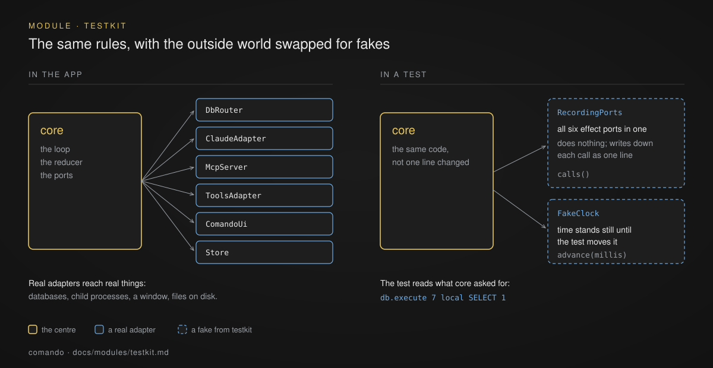
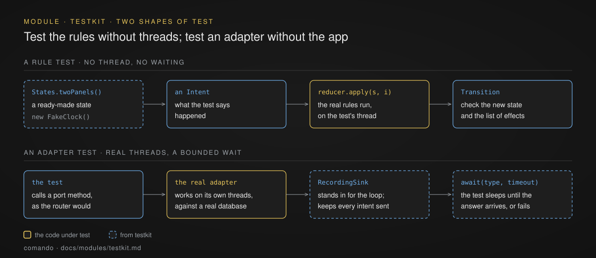

# testkit: the outside world, faked

**In one paragraph.** `testkit` is a small box of stand-ins that every module's tests share. It holds a fake for each
port that [core](core.md) defines, a clock you move by hand, ready-made states, and recorded Claude Code output. With
it a test runs the real rules, or one real adapter, with nothing else around: no window, no Claude, no database
server. Read this page before you write a test in any module.

## 1. The idea: swap the world, keep the code

`core` reaches the outside only through ports. So a test can hand it ports that do nothing but take notes. The code
under test does not change by one line; only what it is plugged into does.

The picture shows both worlds. In the app, six adapters do real work. In a test, one object, `RecordingPorts`, sits
behind all six effect ports and writes each call down as a line of text, such as `db.execute 7 local SELECT 1`. The
test then compares lines.

> **Learn: test doubles.** A film uses a stunt double when the real actor would be too slow, too costly or too
> risky to use. Tests do the same with databases, networks and clocks. A *fake* is a simple working stand-in, like
> an in-memory list instead of a database. A *recorder* (also called a spy) does nothing except remember how it was
> called, so the test can check the calls. Doubles only work where the code talks to an interface, not to the real
> thing directly. comando's ports are those interfaces, and `testkit` is its cast of doubles: `RecordingPorts` and
> `RecordingSink` record, while `FakeClock`, `FakeResult` and `MemoryPreferences` are fakes.

## 2. Two shapes of test

Almost every test in comando has one of two shapes.

**A rule test** checks a decision. It takes a state from `States`, builds an `Intent`, and calls
`reducer.apply(state, intent)` on its own thread. It then reads the `Transition`: the next state and the effects.
Nothing waits, so thousands of these run in seconds.

**An adapter test** checks real work. It calls a port method on a real adapter, as the router would. The adapter
works on its own threads and answers with intents. A `RecordingSink` stands where the loop would be and keeps every
intent. The test calls `sink.await(type, timeout)`: it sleeps until a matching intent arrives, or fails when the
time is up.

> **Learn: a clock you control.** A rule such as "warn after five minutes of silence" is awkward to test: nobody
> wants a test that sleeps for five minutes. The trick is to stop asking the computer for the time. The code asks a
> `Clock` object instead, and the test passes one whose time only moves when told. `clock.advance(300_000)` is five
> minutes, in no time at all. It also makes the test *deterministic*: it gives the same answer on a fast laptop and
> a slow build server. In comando the reducer takes a `core.port.Clock`; the app passes the real one, and tests
> pass `FakeClock`.

## 3. What is in the box

One package, `dev.marregui.comando.testkit`, eight classes.

| Class | What it stands in for | What a test does with it |
|---|---|---|
| `RecordingPorts` | The six effect ports: database, Claude, approvals, UI, persistence, tools | `calls()` lists each call as one line; `clear()` starts over |
| `RecordingSink` | The loop, as an `IntentSink` | `intents()`, `of(type)`, `await(type, timeout)`, `await(type, match, timeout)` |
| `FakeClock` | `core.port.Clock` | `millis()` reads it, `advance(millis)` moves it |
| `States` | A hand-built `AppState` | `States.twoPanels()`: panels `P1` and `P2`, connection `LOCAL`, session `WORK` |
| `FakeResult` | A query result (`ResultView`) | A record of names, kinds and rows of plain objects |
| `MemoryPreferences` | Java's preferences store | Settings tests never touch your real preferences |
| `Fixtures` | Claude Code's output stream | `Fixtures.stream(name)` returns the recorded lines |
| `SyntheticSession` | A long conversation | `steps(deltaChars)` replays it as a stream would arrive |

Two of these carry data rather than behaviour.

**Recorded streams.** `fixtures/stream/` holds three recordings of Claude Code's stream-JSON, one event per line.
The `claude` module's `StreamMapperTest` feeds them to the real mapper.

| Fixture | Lines | What it exercises |
|---|---|---|
| `approvals-and-question.jsonl` | 95 | Tool approvals and a question to the user |
| `queued-compact-interrupt.jsonl` | 122 | Queued prompts, a compaction, an interrupt |
| `clear.jsonl` | 24 | A clear, which starts a new conversation with an empty context |

**A synthetic session.** `SyntheticSession` is the same conversation every time: eight turns of Markdown, 41 tool
calls with their results, one subagent, about 10 000 tokens. The `ui` tests use it to measure and check how a
transcript renders.

> **Learn: fixtures and golden files.** How do you test code that reads another program's output? You could
> describe that output from memory, and get it subtly wrong. Better: record the real thing once, save it in a file,
> and replay it in every test. That file is a *fixture*. A *golden file* is the same idea for output: a saved,
> approved answer that new answers are compared with. Both turn "it looked right to me" into something a machine
> checks. comando replays real Claude Code streams from `fixtures/stream/`, and `core` keeps golden JSON files for
> its parser.

## 4. Who uses what

Counts are test files that import the class.

| Class | core | db | claude | mcp | tools | ui | app |
|---|---|---|---|---|---|---|---|
| `RecordingSink` | | 6 | 9 | 5 | 3 | 5 | 4 |
| `States` | 10 | | | 7 | | 10 | 2 |
| `FakeClock` | 10 | | | 7 | | 2 | |
| `FakeResult` | 2 | | | 1 | | 3 | |
| `SyntheticSession` | | | | | | 7 | 1 |
| `RecordingPorts` | 1 | | | | | | 2 |
| `Fixtures` | | | 1 | | | | |
| `MemoryPreferences` | | | | | | 1 | |

The pattern is visible in the table. Adapter modules (`db`, `claude`, `tools`) need only `RecordingSink`. Modules
that reason about state (`core`, `mcp`, `ui`) reach for `States` and `FakeClock`. `app` replays a recorded session
through the real loop, router and window, with `RecordingPorts` behind the other five ports.

## 5. What testkit may depend on

| Direction | Rule |
|---|---|
| `testkit` depends on | [core](core.md) only, exported as `api`, so a test gets `core` with it |
| Depends on `testkit` | Tests only: `testImplementation(project(":testkit"))` in `core`, `db`, `claude`, `mcp`, `tools`, `frontear`, `ui`, `app` |
| Never | Production code. Nothing that ships imports `testkit` |

Its classes sit in `src/main`, not `src/test`, because Gradle shares a module's main code with other modules, not
its tests. `testkit` starts no thread of its own: `RecordingSink.await` waits on the test's thread.

## 6. Tests

`testkit` has one test of its own, `FakeResultTest`. It checks that the fake answers `getText` as the real result
does, so a test built on the fake means what it seems to. Run it with `./gradlew :testkit:test`. The rest of
`testkit` is exercised by every other module's tests.

## Where next

- [core](core.md): the ports these fakes stand behind, and the reducer they let you test.
- [db](db.md): adapter tests in practice, against an embedded database.
- [Development](../development.md): how to build comando and run every test.
- [The architecture](../architecture.md): the whole picture the fakes cut a piece out of.
