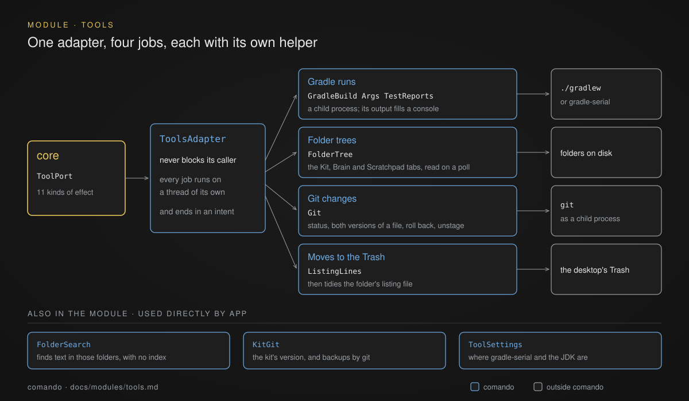
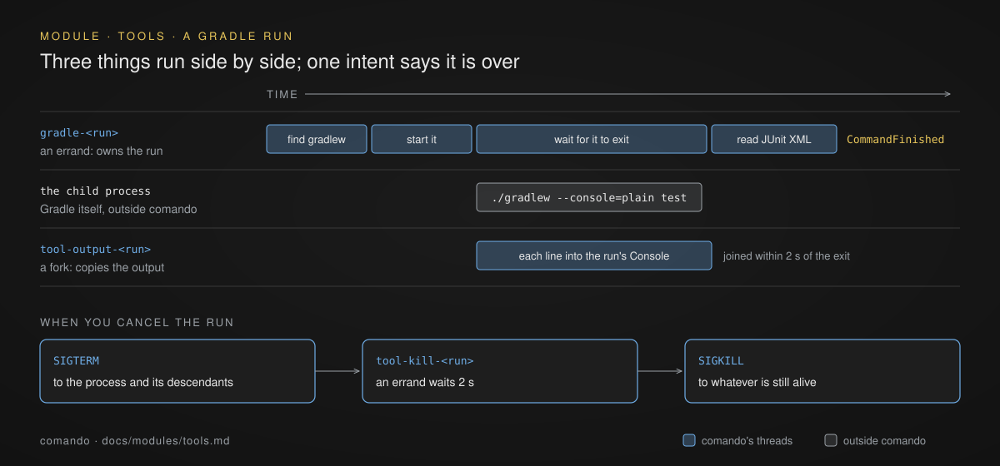

# tools: builds, folders and git

**In one paragraph.** `tools` is the adapter for a developer's everyday chores. It runs Gradle builds and shows their
output, reads the folder trees of the folder tabs, asks git what changed, and moves files to the Trash. Each chore
means waiting for something slow outside comando: another program, or the disk. `tools` does that waiting on its own
threads and answers with an intent. Read this page to see how a desktop app runs other programs without ever
freezing.

## 1. The idea: slow work, bounded and off to the side

Everything here is slow by a window's standards. A build takes minutes. A folder may hold a hundred thousand files.
Git may meet a lock. So `tools` follows two rules everywhere.

- **Nothing blocks the caller.** Each method of `ToolsAdapter` hands the work to a thread and returns.
- **Everything has a limit.** Each job has a bound on time, on output or on size, and says so when it reaches it.

[core](core.md) defines `ToolPort`; `ToolsAdapter` implements it. The effect router calls it for 11 effects.

| Job | Effects | Answer |
|---|---|---|
| Gradle runs | `RunGradle`, `CancelCommand`, `ForgetCommand` | Output in the run's console, then `CommandFinished` |
| Folder trees | `ReadFolders`, `WatchFolders` | `FolderLoaded`, one per folder |
| Git changes | `WatchRepos`, `ReadChange`, `RollBack`, `RemoveFiles`, `Unstage` | `ReposLoaded`, `ChangeRead` |
| Trash | `DeleteFiles` | A notice, then a fresh read of the open folders |

## 2. A Gradle run

You ask for a run with a folder and a task line, such as `test --tests 'com.x.FooTest'`. Three things then run side
by side, as the picture shows: the errand, the child process and the fork. The steps are:

1. An errand, `gradle-<run>`, owns the run. `GradleBuild.root` walks up from the folder to the nearest `gradlew`.
   With none, the console says so and the run ends.
2. `Args` splits the task line into words. The errand starts Gradle as a child process, with its error output
   merged into its normal output.
3. A fork, `tool-output-<run>`, copies each line the child prints into the run's console in core's
   `ConsoleRegistry`. The window shows the console as it grows.
4. The child exits. The errand gives the fork 2 s to finish reading, then `TestReports` reads the JUnit XML files
   the run wrote.
5. One intent ends it: `CommandFinished`, with the exit code, the time taken, and a tree of test results. Failed
   tests come first, each linked to the line of test source its stack names.

`ToolSettings.now()` is read at each run. It finds a `gradle-serial` wrapper on your `PATH` when you have one, and
otherwise the run uses the build's own `./gradlew --console=plain`. There is nothing to configure; see
[ADR 0062](../adr/0062-gradle-runs-by-convention.md).

> **Learn: processes and pipes.** A *process* is a running program with its own private memory. Your computer runs
> hundreds at once. One process can start another, called its *child*, but cannot reach into the child's memory.
> They talk through *pipes*: one end writes bytes, the other end reads them, like a tube between two rooms. That is
> why a build can crash without taking the app down with it. comando starts Gradle as a child and reads the pipe
> from its output, line by line, into a console.

**Cancel** uses signals. `cancelRun` sends SIGTERM to the child and all its descendants. An errand,
`tool-kill-<run>`, waits 2 s and sends SIGKILL to any that remain. A cancel that arrives before the child exists is
remembered, so the run stops as soon as it starts.

> **Learn: asking nicely, then not.** How do you stop a program you did not write? Operating systems offer
> *signals*, tiny messages from one process to another. SIGTERM means "please finish up": the program may save its
> work and exit. It may also ignore you. SIGKILL is not delivered to the program at all; the system simply removes
> it. Good manners are to send the first, wait a moment, then send the second. A build also starts helpers of its
> own, so the signal must reach the whole family tree. comando does exactly this, with a 2 s wait in between.

## 3. Folder trees

The folder tabs, Kit, Brain and Scratchpad, each show a folder on disk as a tree; [Kit and brain](../kit-and-brain.md)
says what those folders are. `FolderTree` builds each tree with a fixed order and fixed limits.

| Rule | Value |
|---|---|
| Order | The index file, then folders by name, then dated folders oldest first, then files |
| Left out | Hidden entries, excluded names, and whatever git ignores |
| Links | A link to a folder is listed, not followed |
| Depth | 12 levels |
| Size | 20 000 entries shown, 80 000 looked at |
| Past a limit | The folder ends with a "more" row instead of growing without end |
| Unreadable | The tree says so on that row and carries on |

Trees stay fresh by polling. The app calls `pollFolders` with a period of 5 s. Each round runs on one timed strand,
`folder-poll`: it reads the repositories of the open folders, then the open folders, and sends a tree only when an
entry was added, removed, renamed or resized. Other repositories are read every sixth round. With no folder tab
showing, or no comando window active, no tree is read at all.

> **Learn: polling or watching.** There are two ways to learn that something changed. *Watching* means the system
> rings you when it happens. *Polling* means you go and look every few seconds. Watching sounds better, and for one
> small folder it is. But watchers differ between systems, miss changes on some disks, and cost one registration
> per folder in a deep tree. Polling is dull and dependable: it finds every change, a little late. Its cost is the
> looking, so a good poller looks only where someone is looking. comando polls every 5 s, only the open folders,
> and only while a window is active.

The same poll feeds one more reader. `watchLogbook` reads the `INDEX.md` of the newest dated folder under a
scratchpad and hands its contents on whenever they differ from the last time.

## 4. Git changes

`Git` runs the `git` program as a child process; `tools` contains no git library. One status call returns the
branch, every changed file and the ignored folders. A second kind of call fetches the two versions of a changed
file for the side-by-side view. Roll back, remove and unstage run in order on one strand, `repo-write`.

`Git` is a careful guest in your repository.

| Risk | What `Git` does |
|---|---|
| Holding up your own git commands | Takes no optional lock |
| A hidden prompt for a password | Prompts are switched off; the call fails instead |
| A git that hangs | Every run ends after 10 s |
| A flood of output | Output stops at 32 MiB; a file to compare, at 4 MiB |
| Binary files | Detected and not compared |
| Losing your work on a roll back | What a roll back replaces is kept in the Trash |

The design of the Changes view is in [ADR 0068](../adr/0068-git-changes-and-a-side-by-side-diff.md).

> **Learn: bounded work.** A program that says "read all of it" trusts the world to be small. One day a folder
> holds a million files, or a tool prints forever, and the program hangs or runs out of memory. The cure is to give
> every loop that depends on the outside a limit: so many seconds, so many bytes, so many entries. Then decide what
> happens at the limit, and tell the user. A bounded program can be slow, but it cannot be stuck. In `tools` every
> wait and every read has a number, and a cut tree or a cut result says that it was cut.

## 5. The Trash, and a tidy listing

`DeleteFiles` never deletes for good. `ToolsAdapter` takes a `Trash`, a one-method interface, and the app passes the
desktop's own. In tests, and on a machine without one, `Trash.NONE` moves nothing, so nothing is lost.

After a move, `ListingLines` tidies the nearest listing file above the entry, such as a folder's `INDEX.md`. It
removes the list item or table row whose first element names the entry. Lines inside fenced code are left alone.
Other lines that still mention the entry stay, and the notice reports them.

## 6. Also in the module

Three public classes are used by [app](app.md) directly, not through `ToolPort`.

| Class | What it does |
|---|---|
| `FolderSearch` | Finds text in the folder tabs' folders with no index: file names first, then contents. Several forks scan files; hits arrive in the walk's order, so the same search lists the same hits. Binary files are skipped. It is one source of core's `SearchPort`; see [ADR 0139](../adr/0139-one-window-finds-in-files-and-conversations.md) |
| `KitGit` | Treats a kit folder as a git checkout: its version, newer releases on the remote, and a backup by commit and push. Each method blocks, so its callers run it off the window's thread; see [ADR 0117](../adr/0117-kit-jobs-a-row-and-a-window.md) |
| `ToolSettings` | Where `gradle-serial` and the JDK are, found by convention at each run |

`Args` deserves a note of its own. It splits `--tests 'com.x.FooTest'` the way a shell would: quotes group words and
a backslash escapes a character. It expands nothing: no variables, no wildcards. What you type is what Gradle gets.

## 7. What tools may depend on

| Direction | Rule |
|---|---|
| `tools` depends on | [core](core.md) only |
| Depends on `tools` | [app](app.md), which builds `ToolsAdapter`, `FolderSearch` and `KitGit` |
| Never | `ui`, `db`, `claude`, `mcp`. None of them calls `tools`; a request goes through core's `ToolPort` |

One package, `dev.marregui.comando.tools`, ten classes. Four are public: `ToolsAdapter`, `FolderSearch`, `KitGit`,
`ToolSettings`. The helpers `GradleBuild`, `Args`, `TestReports`, `FolderTree`, `Git` and `ListingLines` stay
package-private. Every thread comes from core's `Threads` and `Errands`, and `close()` stops them within a bound.

## 8. Tests

Run them with `./gradlew :tools:test`. They use real folders, real git repositories and real child processes, all
in temporary directories.

| Test | What it pins down |
|---|---|
| `ToolsAdapterTest` | Gradle runs and their console, failed tests with their place, cancel of a process tree that ignores SIGTERM, tree order and limits, moves to the Trash |
| `ToolsAdapterReposTest` | Repository status, ignored entries left out of trees, both texts of a change, roll back, remove |
| `ToolsAdapterLogbookTest` | The newest dated folder wins; an unchanged index is not sent twice |
| `GitTest` | Every kind of change, binary files, a repository with no commits, a missing git |
| `KitGitTest` | Version and newer tags; a backup commits, pushes and reports a failed push |
| `FolderSearchTest` | Names before lines, snippets, binary files skipped, the same order whichever fork reads first |
| `ListingLinesTest` | Which lines leave a listing and which stay |
| `ToolSettingsTest` | Finding `gradle-serial` on a path |

Adapter tests wait for intents on a `RecordingSink`; see [testkit](testkit.md).

## Where next

- [core](core.md): `ToolPort`, consoles, errands and forks.
- [app](app.md): where the adapter, the Trash and the 5 s poll are wired together.
- [Kit and brain](../kit-and-brain.md): what the folder tabs show.
- [The workbench](../workbench.md): the window these jobs show up in, feature by feature.
