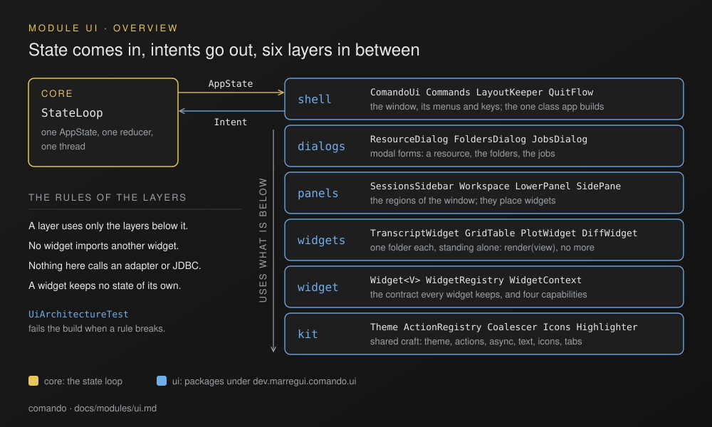
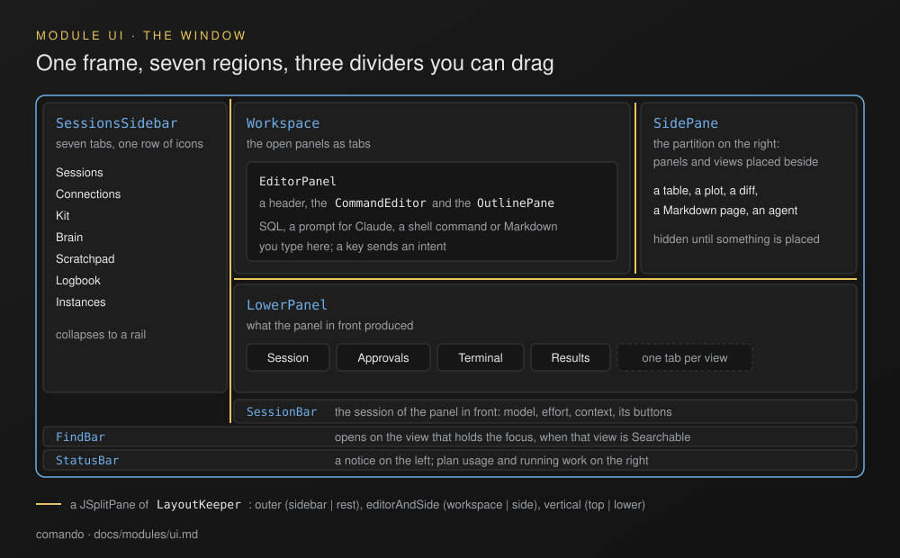
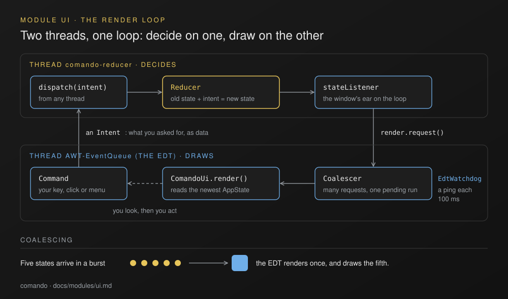
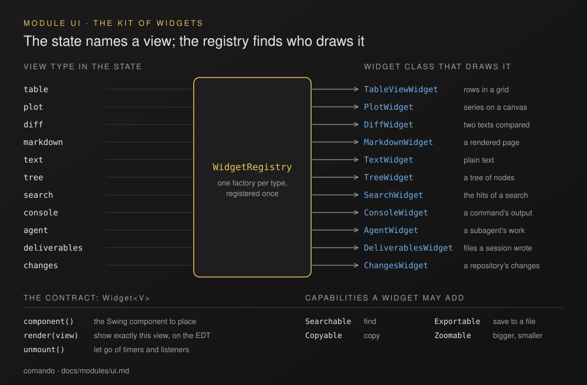
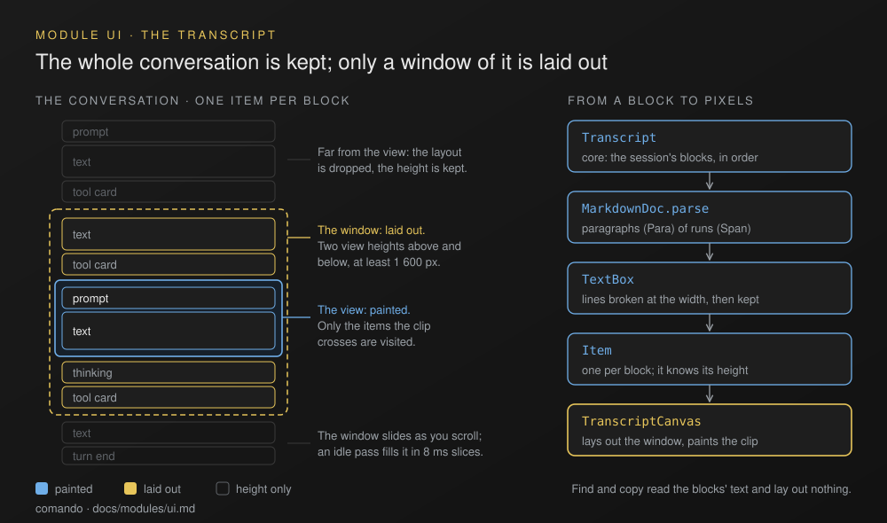
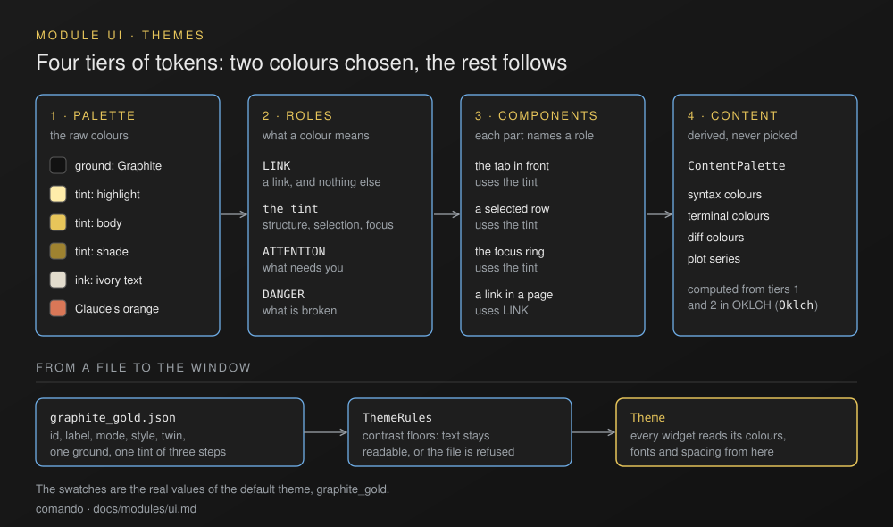

# The `ui` module: the window



**In one paragraph.** `ui` is comando's window: everything you see and touch, built with Java Swing. Read this page if
you want to change how comando looks, add a view, or learn how a desktop program stays smooth. The module exists to
keep drawing apart from deciding: the window shows the state and reports what you ask, and decides nothing else. What
the window does for its user is in [the workbench](../workbench.md). This page is the engineering view.

## 1. The idea: a window that shows and asks

comando keeps one `AppState`, in [`core`](core.md). The window holds no second copy of the truth.

- **State in.** After each change the window reads the newest `AppState` and draws it.
- **Intents out.** A key, a click or a menu entry becomes an `Intent`: a small record of what you want.
- **Nothing sideways.** No class here opens a database, starts Claude or writes a store file.

`ui` implements one port of `core`, `UiPort`, with one class: `ComandoUi`. The port carries the few effects only a
window can perform: `editPanel`, `showFile`, `showFolder`, `showRepos`, `showChange`, `arrange`, `notifyDesktop`,
`showPlanUsage`, `forgetPanel` and `deletePanel`.

> **Learn: one-way data flow.** Picture the scoreboard at a match. Players do not climb up and change the numbers.
> They play, the referee decides, and the board shows the result. A program built this way is easy to reason about: to
> learn why the screen shows something, you look at one state, not at a hundred widgets. In comando the window is the
> board and the buttons, and the reducer in `core` is the referee.

## 2. The window and its panels



`ComandoUi` builds one `JFrame` from parts. Each part is a class in `ui.panels`, except `FindBar`, which lives in
`ui.widget.capability`.

| Region | Class | What it holds |
|---|---|---|
| Left column | `SessionsSidebar` | Seven tabs: Sessions, Connections, Kit, Brain, Scratchpad, Logbook, Instances. It collapses to a rail. |
| Centre | `Workspace` | The open panels as tabs. Each is an `EditorPanel`: a header, a `CommandEditor` and an `OutlinePane`. |
| Right | `SidePane` | The panels and views you place beside the editor. |
| Below | `LowerPanel` | The tabs Session, Approvals, Terminal and Results, then one tab per view. |
| Under the lower panel | `SessionBar` | The session of the panel in front: model, effort, context and its buttons. |
| Bottom | `FindBar`, `StatusBar` | Find in the focused view; then a notice, plan usage and running work. |

Four classes of `ui.shell` hold the frame together:

| Class | Job |
|---|---|
| `ShellParts` | The record of the parts: frame, workspace, lower panel, side pane, sidebar and bars. |
| `LayoutKeeper` | Owns the three `JSplitPane`s and where you drag their dividers. |
| `FocusRouter` | Decides which part holds the keyboard, before and after each render. |
| `WindowLayout`, `Settings` | Keep the arrangement in `settings.json` in the data root. |

## 3. The render loop: the EDT and the reducer



Two threads share the work, and each has one job.

1. The **reducer thread**, `comando-reducer`, takes an intent and makes the next `AppState`.
2. A listener of `ComandoUi` hears the change and calls `render.request()` on a `Coalescer`.
3. The `Coalescer` queues one run on the EDT, unless one already waits.
4. On the **EDT**, `ComandoUi.render()` reads the newest state and hands each part its share.
5. You act. A `Command` runs on the EDT and dispatches the next intent.

The whole `Coalescer` is one atomic flag:

```java
public void request() {
    if (pending.compareAndSet(false, true)) {
        SwingUtilities.invokeLater(() -> { pending.set(false); task.run(); });
    }
}
```

A hundred state changes in a burst cost one render, and that render draws the last state. A second `Coalescer` does
the same for the transcript.

Slow work never runs on the EDT. The package `ui.kit.async` holds the tools for that:

| Class | Job |
|---|---|
| `Edt` | Runs a task on the EDT (`run`, `runAndWait`). |
| `Coalescer` | Many requests, at most one pending run. |
| `Debouncer` | Waits until the requests stop, then runs once. |
| `UiErrands` | Blocking calls on virtual threads, interrupted and waited for when the window closes. |
| `SharedClock`, `ShownTimer` | The shared timer of the looping animations, such as spinners: full rate in front, one beat in six behind, none minimised. |
| `EdtWatchdog` | Pings the EDT every 100 ms. An answer later than 200 ms counts as a stall. |

> **Learn: the event loop.** A window toolkit has one thread that does everything you can see. It takes the next event
> from a queue (a key, a click, "repaint this"), handles it, and takes the next. One thread means no two pieces of code
> change a button at once, so the toolkit needs no locks. The price: while one event takes a second, the whole window
> freezes for a second. In Swing this thread is the Event Dispatch Thread, the EDT. comando keeps each handler short,
> sends slow work to other threads, and lets `EdtWatchdog` time the loop.

> **Learn: coalescing.** If ten friends text you "look at the board", you look once. Coalescing merges requests that
> ask for the same thing into one piece of work. It is safe when the work reads the latest state and not the request
> itself. comando's render does exactly that, so a burst of changes costs one repaint.

Why the reducer gets the same watchdog as the EDT:
[the reducer is watched as the EDT is](../adr/0066-the-reducer-is-watched-as-the-edt-is.md).

## 4. Layers and the kit of widgets



The module is six layers of packages. A layer uses only the layers below it, as the first picture shows.

| Layer | Package | Main classes |
|---|---|---|
| shell | `ui.shell` | `ComandoUi`, `Commands`, `Menus`, `Keys`, `LayoutKeeper`, `FocusRouter`, `QuitFlow`, `Notifier`, `HelpFiles` |
| dialogs | `ui.dialogs` | `ResourceDialog` (sessions and connections), `FoldersDialog`, `JobsDialog`, `ImportSessionsDialog` |
| panels | `ui.panels` | The regions of section 2, plus `TerminalTabs`, `FilesTab`, `InstancesTab`, `LogbookTab`, `ThemeChooser` |
| widgets | `ui.widgets.*` | One folder per widget |
| widget | `ui.widget` | `Widget<V>`, `WidgetRegistry`, `WidgetContext`, `Unmountable`, the capabilities |
| kit | `ui.kit.*` | `theme`, `action`, `async`, `text`, `icon`, `tabs`, `tree`, `overlay`, `desktop`, `format`, `layout`, `resource`, `vcs` |

### The contract

A widget is a small machine with one input:

```java
public interface Widget<V> extends Unmountable {
    JComponent component();
    void render(V view);
    default void unmount() {}
}
```

A widget keeps no state beyond Swing's own. It calls no adapter, starts no thread and imports no other widget. It
receives a `WidgetContext`: an `IntentSink` to speak with, and an `ActionRegistry` to offer commands through.

A view in the state is a `ViewSpec` record of `core`. `ComandoUi` registers one factory per type in `WidgetRegistry`,
and the picture lists all eleven. Panels place five more parts themselves, and the registry never looks them up:

| Part | Where you meet it | Built on | Implements `Widget<V>` |
|---|---|---|---|
| `TranscriptWidget` | The Session tab | Java2D (`TranscriptCanvas`) | yes |
| `ApprovalInbox` | The Approvals tab | Swing | yes |
| `CommandEditor` | The editor of a panel | RSyntaxTextArea | no, capabilities only |
| `GridTable` | The Results tab | Java2D | no, capabilities only |
| `TerminalWidget` | The Terminal tab | JediTerm on pty4j | no, capabilities only |

### Capabilities

A part adds a capability by implementing an interface of `ui.widget.capability`. The command acts on the part that
holds the focus, and stays disabled when that part lacks the capability.

| Capability | Key | Offered by |
|---|---|---|
| `Searchable` | ⌘F | `AgentWidget`, `CommandEditor`, `ConsoleWidget`, `DiffWidget`, `GridTable`, `TerminalWidget`, `TextWidget`, `TranscriptWidget` |
| `Copyable` | ⌘⇧C | `AgentWidget`, `ChangesWidget`, `ConsoleWidget`, `DeliverablesWidget`, `DiffWidget`, `GridTable`, `MarkdownWidget`, `ResultsView`, `SearchWidget`, `TextWidget`, `TranscriptWidget`, `TreeWidget` |
| `Exportable` | ⌘⇧S | `DiffWidget`, `GridTable`, `MarkdownWidget`, `PlotWidget` |
| `Zoomable` | ⌘= ⌘- ⌘0 | `AgentWidget`, `CommandEditor`, `PlotWidget`, `TerminalWidget`, `TextWidget`, `TranscriptWidget` |

### Commands, keys and the palette

Everything you can do is a `Command(id, label, icon, key, group, run, enabled)`. `Commands` registers the table once.
`ActionRegistry` builds the menus, the key bindings and the command palette (⌘⇧P) from it. `KeyPriority` claims a
command's key before the focused component sees it, because an editor or a terminal swallows keys.

## 5. The painted transcript



Three widgets draw their own pixels with Java2D: the transcript, the grid (`GridTable`) and the plot (`PlotCanvas`).
The transcript is the hardest of the three. A day of work reaches thousands of blocks, and the last block changes
with every word Claude streams.

### From a block to pixels

| Step | Type | What it does |
|---|---|---|
| Data | `Transcript`, in `core` | The session's blocks: `UserPrompt`, `AssistantText`, `Thinking`, `ToolCall`, `Note`, `TurnEnd`. A block with a `parent` belongs to a subagent, started by an Agent or a Skill call. |
| Paragraphs | `MarkdownDoc.parse` | Markdown to a list of `Para`, each a run of `Span`s. A `path:line` reference becomes a link. |
| Lines | `TextBox` | Breaks the lines at the width with `LineBreakMeasurer`. |
| Item | `Item`, made by `Items` | The painter of one block. It keeps its layout until the block, the width or the style changes. |
| Canvas | `TranscriptCanvas` | One item per block. It lays out the window and paints the clip. |

### What keeps it fast

- **A window, not the whole.** The canvas lays out two view heights above and below the view, at least 1 600 px.
- **Far away costs nothing.** An item far from the view drops its layout and keeps its height.
- **Idle work in slices.** After a change of width, an idle pass lays items out in slices of 8 ms.
- **Paint the clip.** Painting visits only the items that cross the clip.
- **Find without layout.** `Finder` reads the blocks' text, so a find over the whole conversation lays out nothing.
- **Many cores.** `Forks` spreads an exact layout, a find or a copy of a long conversation over the cores.

> **Learn: paint only what you see.** A long conversation holds a hundred thousand lines, and your screen shows fifty.
> A naive program builds an object for every line and asks the toolkit to manage them all. A virtualised view keeps
> the data as plain records and draws just the rows inside the visible rectangle. Scrolling then costs the same for a
> hundred lines as for a million. comando's transcript, grid and plot all work this way.

### The widget around the canvas

| Class | Job |
|---|---|
| `TranscriptWidget` | Holds the conversation. It follows the end while you are at the end, and a "↓ Latest" button brings you back. |
| `TranscriptWidget.Move` | Six commands, `transcript.<id>`: Home, End, ⌥↑ and ⌥↓ (previous and next prompt), PgUp, PgDn. |
| `ToolCallItem` | A tool card: open or closed, with the call's input and result. |
| `Fold` | Whether a card is open and who opened it. Your click wins over every automatic rule. |
| `AgentTracker` | The running cards, the running subagents and the cards that wait for an approval. |
| `AgentStrip` | One line above the transcript while subagents run: a chip for each. |
| `AgentWidget` | A subagent's own tab: the same transcript, read from the subagent's file as it grows. |

While you read further up, the block at the top of the view keeps its place as new blocks arrive.

### The frame-time gate

A screen at 60 frames a second leaves 16 ms for each frame. Three programs in the `ui` test sources measure that
budget. Each paints off screen and prints percentiles.

| Gate | What it paints | Verdict |
|---|---|---|
| `./gradlew :ui:transcriptGate` | `SyntheticSession` of `testkit` (8 turns, 41 tool calls), one delta per frame, in 1200 × 800. Then a long thinking block, and a turn of 224 calls folding, opening and closing. | Exits 1 when a p99 exceeds 16 ms. |
| `./gradlew :ui:gridGate` | A `GridTable` of 100 000 rows × 12 columns in 1600 × 900, a fling and a slow scroll. | Prints `HOT` above 4 ms and `OVER BUDGET` above 16 ms. |
| `./gradlew :ui:plotGate` | A `PlotCanvas` of 4 series × 200 000 points in 1600 × 900. | Prints `HOT` above 4 ms and `OVER BUDGET` above 16 ms. |

A gate that is still alive 10 s after its measurement exits 2. A leftover Swing timer would otherwise hang it.
`TranscriptShot`, beside the gate, paints the synthetic session at a scroll offset to a PNG.

> **Learn: measure the slow frames, not the average.** An average hides the bad moments. If 99 frames take 2 ms and
> one takes 200 ms, the average says 4 ms, and your eye still sees a stutter. A percentile asks a better question:
> p99 is the time that 99 frames in 100 stay under. A gate turns that number into a rule the build can fail. comando
> holds the transcript's p99 under the 16 ms of one frame.

The reasons: [painted transcript](../adr/0021-painted-transcript.md) and
[own table and plot on Java2D](../adr/0010-own-table-and-plot-on-java2d.md).

## 6. Themes



A theme is two choices made together: a **ground** and a **tint** of three steps. Everything else follows.

| Tier | What it holds | Example |
|---|---|---|
| 1. Palette | The ground, surfaces, ink, the tint, status colours, Claude's orange | Graphite `#121212`, Treasure gold `#E7C55A` |
| 2. Roles | What a colour means | `Theme.LINK`, `Theme.ATTENTION`, `Theme.DANGER`; the tint for structure, selection and focus |
| 3. Components | Each part names a role | The tab in front uses the tint |
| 4. Content | Palettes derived from tiers 1 and 2 | `ContentPalette`: syntax, terminal, diff, plots |

The rules that keep a theme whole:

- **One source.** Widgets take colours, fonts and spacing from `Theme`. `ColourRulesTest` fails any class outside
  `ui.kit.theme` that makes or names a `Color`.
- **Dark and light.** A colour that a light ground cannot take has a second value, read at each paint (`ByMode`,
  `OnGround`).
- **Readable by rule.** `ThemeRules` checks contrast floors. A theme file that fails them is refused.
- **One icon set.** `Icons` loads SVGs from `/icons`, and the theme recolours them.

A theme is a JSON file, read by `ThemeSpec`:

```json
{
  "id": "graphite_gold",
  "label": "Graphite and gold",
  "mode": "dark",
  "ground": { "label": "Graphite", "color": "#121212" },
  "tint": { "label": "Treasure gold", "highlight": "#FFEDAA", "body": "#E7C55A", "shade": "#9E8230" }
}
```

Optional keys: `description`, `style` (`plain` or `console`) and `twin`, the id of the same theme in the other mode.
The `id` names the command `theme.<id>`. Put your own `*.json` in `themes/` of the data root, and `ThemeFiles` loads
it. Fourteen themes ship in the jar:

| Dark | Light twin |
|---|---|
| `graphite_gold` (the default) | `paper_ochre` |
| `espresso_champagne` | `cream_bronze` |
| `slate_silver` | `fog_slate` |
| `midnight_blue` | `ice_navy` |
| `aubergine_gold` | `lilac_gold` |
| `evergreen_forest` | `mint_forest` |

Two more use the console style: `console_amber` and `console_cyan`. A change of theme cross-fades (`ThemeFade`).

> **Learn: design tokens.** A big program names its colours instead of writing them. Code says "the colour for
> danger", never "red number 220, 50, 47". The names are tokens, and one table maps them to real values. Change the
> table and the whole program changes, with no line of drawing code touched. comando's `Theme` is that table, in four
> tiers, and a test forbids colour values anywhere else.

> **Learn: perceptual colour.** Screens store a colour as red, green and blue. Equal steps in those numbers do not
> look like equal steps to your eye: a yellow looks far brighter than a blue of the same strength. OKLCH describes a
> colour by lightness, chroma (how vivid) and hue, tuned to how people see. Keep the lightness, turn the hue, and you
> get a family of colours that look equally strong. comando derives its syntax, terminal, diff and plot colours this
> way (`Oklch`), so they suit any ground and tint you choose.

The reasons: [a theme is four tiers of tokens](../adr/0100-a-theme-is-four-tiers-of-tokens.md),
[content colours derived from the theme](../adr/0101-content-colours-derived-from-the-theme.md),
[themes are JSON files](../adr/0126-themes-are-json-files.md) and [light themes](../adr/0127-light-themes.md).

## 7. What `ui` may depend on

| `ui` uses | For |
|---|---|
| `core` (as `api`) | State, intents, ports, the `ViewSpec` records |
| FlatLaf | The look and feel |
| jsvg | SVG icons |
| RSyntaxTextArea | The editor |
| commonmark, with tables | Markdown to HTML |
| JediTerm, pty4j | The terminal |
| OpenJFX 25 (`javafx-web`, `javafx-media`, `javafx-swing`), per platform | HTML pages in a panel (`kit.web`, [record 190](../adr/0190-html-pages-render-in-a-panel-through-javafx-webview.md)); MP4 videos in the lower panel, one playing at a time (`kit.media`, [record 196](../adr/0196-mp4-videos-play-in-the-side-pane-through-javafx-media.md)); JavaFX started once by `kit.fx.FxToolkit` |

`ui` sees no adapter module and no JDBC. Where the window needs something from outside, it declares an interface and
[`app`](app.md) implements it: `PanelTexts`, `ServerToggle` and `Setup`. `app` also hands over three ports of `core`
(`SearchPort`, `TopicPort`, `InstancesPort`) through `ComandoUi.search`, `topics` and `instances`. Only `app`
constructs `ComandoUi`, through `ComandoUi.Dependencies`.

`UiArchitectureTest` holds these rules with ArchUnit: no widget imports another widget, the kit knows no layer above
it, panels know no dialog and no shell, and nothing calls an adapter.

> **Learn: architecture tests.** A rule written in a document is forgotten within a month. A rule written as a test
> fails the build the day someone breaks it. An architecture test reads the compiled classes and checks who imports
> whom. comando writes its layer rules this way, so the picture at the top of this page stays true.

Why Swing: [Swing and FlatLaf as the UI toolkit](../adr/0002-swing-and-flatlaf-as-the-ui-toolkit.md).

## 8. Tests

| What | Where | Run it |
|---|---|---|
| Unit tests of widgets, panels and kit; `OnEdt` runs a test on the EDT | `ui/src/test` | `./gradlew :ui:test` |
| The layer rules | `UiArchitectureTest` | part of `:ui:test` |
| Every test of every module carries its doc comment | `TestDocsTest` | `./gradlew :ui:testDocs` |
| Frame times of the transcript, the grid and the plot | `TranscriptGate`, `GridGate`, `PlotGate` | [the frame-time gate](#the-frame-time-gate) |
| The real window: keys, focus, layout, themes, replay | `app` | `./gradlew :app:uiTest` |

The window tests live in `app`, because only `app` can build the whole window:
see [the tests of app](app.md#9-tests).

## Where next

- [The workbench](../workbench.md): what the window does for you.
- [The `app` module](app.md): who builds the window and what stands behind it.
- [The `core` module](core.md): the state, the intents and the reducer.
- [Architecture](../architecture.md): the whole picture, and the thread rules.
- [Development](../development.md): build, run and test.
