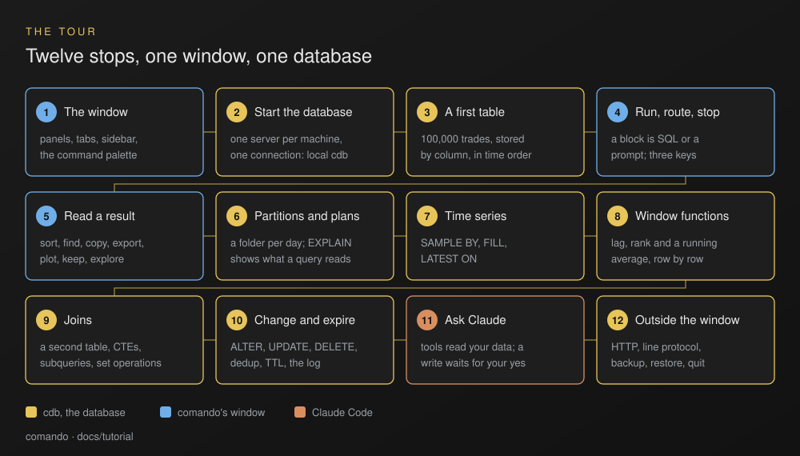
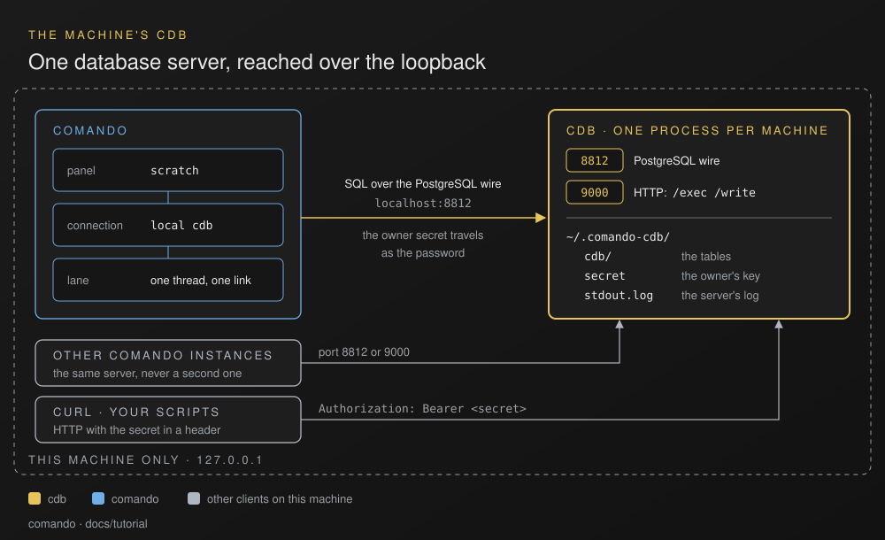
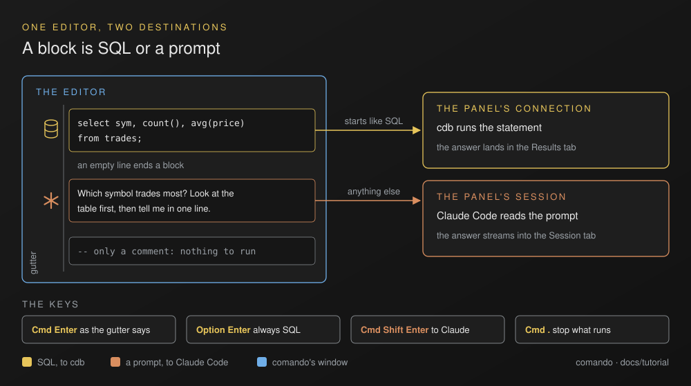
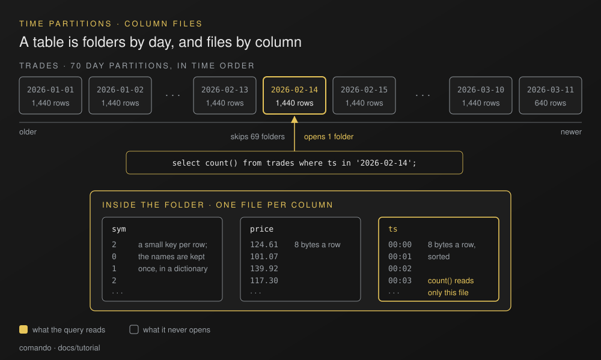
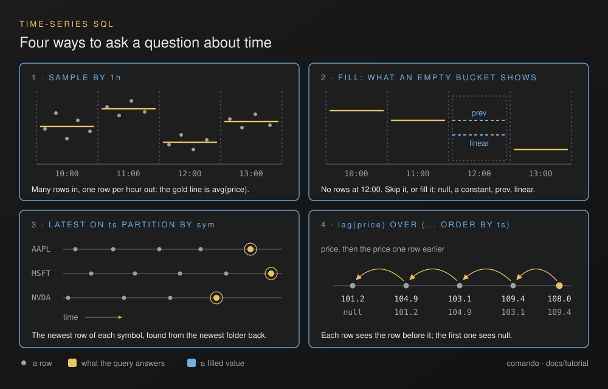
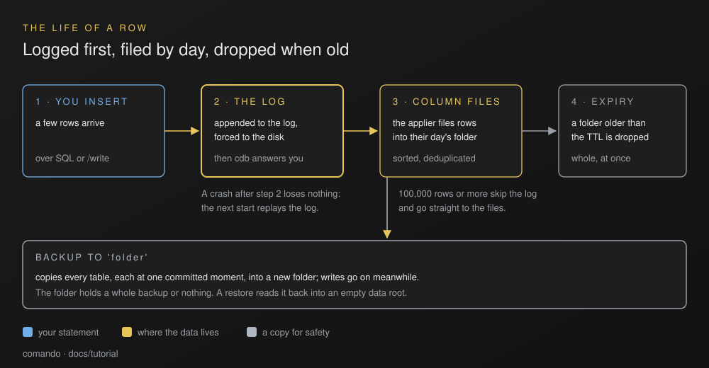

# comando and its database, hands on



**In one paragraph.** This page is a tour you take with your hands on the keys. You open comando, start cdb (the
database comando brings along), fill a table with 100,000 rows and question it in a dozen ways. Then a Claude session
questions it for you, and you copy the whole database to a safe place. It is for anyone who knows a little SQL, or
wants to. It exists because a tool is learned by using it. Each stop says what to type, what you see, and what idea
is at work. The pictures help, and the text is complete without them.

| Stop | You do | You learn |
|---|---|---|
| [0. Before you start](#0-before-you-start) | check three things | what the tour needs |
| [1. The window](#1-the-window) | open comando | where everything is |
| [2. Start the database](#2-start-the-database) | start cdb, connect | client and server |
| [3. A first table](#3-a-first-table) | create `trades`, load 100,000 rows | types, time as a number |
| [4. Run, route, stop](#4-run-route-stop) | run blocks, stop a query | how text finds its way |
| [5. Read a result](#5-read-a-result) | sort, plot, keep, export | the grid and the plot |
| [6. Partitions and plans](#6-partitions-and-plans) | ask for one day, read a plan | why a time query is fast |
| [7. Time series](#7-time-series) | `SAMPLE BY`, `FILL`, `LATEST ON` | downsampling |
| [8. Window functions](#8-window-functions) | `lag`, `row_number`, running averages | rows that see their neighbours |
| [9. Joins](#9-joins) | a second table, joins, a CTE | combining tables |
| [10. Change and expire](#10-change-and-expire) | alter, update, dedup, TTL | the life of a row |
| [11. Ask Claude](#11-ask-claude) | a session reads and writes your data | a model, its tools, your approval |
| [12. Outside the window](#12-outside-the-window) | terminal, HTTP, backup, restore | the same database from anywhere |

## 0. Before you start

| You need | Check |
|---|---|
| macOS or Linux | the keys below are written as on a Mac |
| comando | installed from a release (`INSTALL.md` at the top of the repository), or a clone and JDK 25 |
| Claude Code, logged in (from stop 11) | `claude --version` prints a version and `claude -p "hi"` answers |

Create an empty folder for the Claude session and the backup:

```
mkdir -p ~/comando-tutorial
```

## 1. The window

Start comando: the installed application, or `./gradlew :app:run` in a clone. The window opens with one panel,
**scratch**, holding a short welcome text.

| Part | What it is |
|---|---|
| **Sidebar**, left | tabs in one row: Sessions, Connections, Kit, Brain, Scratchpad, Logbook, Instances |
| **Panel tabs**, top | each tab is a panel: one editor with its own text |
| **Panel header** | the panel's connection: a database icon and a name; then **Run** and **Stop** |
| **Editor** | where you write SQL and prompts, mixed in one text |
| **Lower tabs** | **Session**, **Approvals**, **Terminal**, **Results**; plots open more tabs here |
| **Session bar** | the panel's Claude session, its model and its context |
| **Status bar**, bottom | the current message; the work running and the requests waiting |

One idea runs through the whole window: **a panel is bound to at most one connection and one session**. SQL you run
in a panel goes to its connection. Anything else goes to its session.

Two keys find everything else. **⌘⇧P** opens the palette: every command that can run now, with its key. **⌘⇧/**
shows the table of keys.

> **Learn: the read-eval-print loop.** The oldest way to talk to a computer is a loop. You type a line. The machine
> reads it, works it out, prints the answer, and waits. Programmers call it a REPL. It is fast to learn with, because
> every answer arrives while the question is still in your head. comando is that loop grown up. The editor is where
> you type, a database or a model works it out, and the lower tabs print the answer.

## 2. Start the database

comando brings its own database, **cdb**. It runs as a separate program on your machine, one for the whole machine,
and every comando window talks to that one.

1. Press **⌘⇧P**, type `machine's`, and press **⏎** on **Start the machine's cdb**. The database button at the tab
   row's right end does the same. *You should see* "cdb is up: PG wire on 127.0.0.1:8812, HTTP on
   http://localhost:9000" in the status bar. When cdb runs already, the button shows it running.
2. Look at the header of the **scratch** panel: a grey database icon and the name `local cdb`. Click the icon.
   *You should see* the icon turn blue: the panel is connected. If it fails, the status bar says why in red.
3. Put the caret in the line `SELECT now();` of the welcome text and press **⌘⏎**. *You should see* the **Results**
   tab with one row: the server's clock, in UTC.



`local cdb` is an ordinary connection that a new comando already has: host `localhost`, port `8812`, database `qdb`,
user `admin`. cdb speaks the PostgreSQL wire protocol there, so any PostgreSQL client can talk to it. If you removed
`local cdb`, right-click the **Connections** tab and choose **New connection…**: its defaults reach the same server.

| The machine's cdb | Value |
|---|---|
| Listens on | `127.0.0.1` only: port `8812` for SQL clients, port `9000` for HTTP |
| Keeps its data in | `~/.comando-cdb/cdb/`, one folder per table |
| Is protected by | a secret in `~/.comando-cdb/secret`; comando reads the file and sends it as the password |
| Writes its log to | `~/.comando-cdb/stdout.log`; **Help ▸ Show cdb's log** opens it |
| Keeps running | after you quit comando; **Stop the machine's cdb** stops one this comando started, and its data stays |

> **Learn: client and server.** A server is a program that waits for requests and answers them. A client is a program
> that asks. The two talk over a network connection, even when both run on one machine. The address `127.0.0.1`
> means "this machine itself", so nothing outside your computer can reach a server that listens only there. comando
> is the client and cdb the server: cdb keeps serving after comando quits, and other programs can ask it too.

## 3. A first table

Click in the editor, press **⌘A**, then **⌫**: the welcome text is gone. One rule matters more than any other: **a
block ends at an empty line**. Type each statement as a block of its own, with an empty line between blocks.

```
create table trades (sym symbol, price double, ts timestamp) timestamp(ts) partition by day;

insert into trades select rnd_symbol('AAPL', 'MSFT', 'NVDA'), 100 + rnd_double() * 50, timestamp_sequence('2026-01-01', 60000000L) from long_sequence(100000);

select sym, count(), avg(price) from trades;
```

Put the caret in the first block and press **⌘⏎**. Do the same in the second, then the third.

| Block | *You should see* in Results | What it did |
|---|---|---|
| `create table` | "Done." | made a table of three typed columns, ordered by `ts`, one folder per day |
| `insert` | "100,000 rows changed" | wrote one invented trade per minute from 1 January 2026 |
| `select` | three rows, one per symbol | counted and averaged; each symbol has about a third of the rows |

The `insert` builds its rows from functions. `long_sequence(100000)` yields 100,000 rows. `rnd_symbol` picks one of
three names, `rnd_double()` a number between 0 and 1. `timestamp_sequence` starts at a time and steps by a number of
microseconds. `60000000L` is one minute, and the `L` marks a whole number of type `LONG`. The `select` names `sym`
beside two aggregates and has no `GROUP BY`: cdb groups by the plain column itself.

Now ask the database what it holds:

```
select count(), min(ts), max(ts) from trades;

show tables;

show columns from trades;

show create table trades;
```

*You should see* four answers. First, 100,000 rows from 1 January 00:00 to 11 March 10:39. Then the table's name.
Then its three columns with their types, `ts` marked as designated. Last, the statement that would create the table
again. **⌘⇧E** shows the same in a side pane: the connection, its tables, and each table's columns and types.

| Type | Holds | Size of a value |
|---|---|---|
| `BOOLEAN` | true or false | 1 byte |
| `LONG` | a whole number | 8 bytes |
| `DOUBLE` | a number with a fraction | 8 bytes |
| `TIMESTAMP` | a moment, in microseconds, UTC | 8 bytes |
| `SYMBOL` | a name that repeats, such as `NVDA` | a 4-byte key; the name is stored once |
| `VARCHAR` | any text | its bytes, plus an offset |

> **Learn: time as a number.** A computer stores a moment as a count: here, the microseconds that passed since the
> first instant of 1970, in UTC. A count is easy to compare, sort and subtract, and it means the same in every time
> zone. In cdb each table can name one `TIMESTAMP` column as its **designated timestamp**. cdb keeps the rows sorted by
> it and files them by it, and everything in stops 6 and 7 rests on that order.

> **Learn: a dictionary for repeated names.** `NVDA` appears in a third of the rows. Writing the four letters 33,000
> times wastes space, and comparing text is slow. So a `SYMBOL` column keeps each distinct name once, in a
> dictionary, and stores a small number per row that points at it. Comparing two small numbers is one step for a
> processor. That is why `sym` is a `SYMBOL` and a free text, such as a company's full name, is a `VARCHAR`.

## 4. Run, route, stop

Look at the **gutter**, left of the line numbers. Each block carries an icon: a **database** for SQL, Claude's
**asterisk** for a prompt. comando decides before you run, and the icon shows where the text will go.



| You do | What runs |
|---|---|
| **⌘⏎** with the caret in a block | that block, where the gutter says |
| **⌘⏎** with text selected | the selection |
| **⌘⏎** on an empty line | the nearest block above |
| a click on a block's gutter icon | that block, as **⌘⏎** would |
| **⌥⏎** | the block as SQL, whatever the gutter says |
| **⌘⇧⏎** | the block as a prompt to Claude, whatever the gutter says |

The rule behind the icon is short. A block is SQL when it starts with a SQL keyword in the shape that keyword takes:
`select …`, `insert into …`, `show …`. It is a prompt when it holds an everyday word such as "the", "my" or "please"
outside quotes, or ends with `?` or `.`. A first line `-- @sql` or `-- @claude` settles it by hand. A block of `--`
comments alone has nothing to run.

Now stop a query. Type this block and run it with **⌘⏎**:

```
select sum(rnd_double()) from long_sequence(20000000000);
```

Press **⌘.** while it runs. *You should see* "Running on local cdb · 3 s" counting up, then "Cancelled.". The
database stops working on it, and the connection is ready for the next query. Left alone, cdb ends a query itself
after 60 seconds.

Last, a mistake on purpose, to see what one looks like:

```
select prize from trades;
```

*You should see* the database's error in Results, as text you can copy: `cannot find column [column=prize]`. When an
error names a position, comando underlines that word in the editor. **⌃Space** completes table and column names as
you type, which avoids most of these.

> **Learn: a rule of thumb, with a way out.** comando cannot know for sure whether a line is SQL or a question. So
> it uses a heuristic: a simple rule that is right nearly always and cheap to check. Engineers pair every heuristic
> with an override, because "nearly always" still leaves a remainder. Here the gutter icon shows the guess before
> anything runs, and two keys overrule it.

## 5. Read a result

Run this block. A negative `limit` counts from the end, so it answers the three newest trades:

```
select * from trades limit -3;
```

The **Results** grid is more than a printout:

| You do | You get |
|---|---|
| look at the `#` column | each row's number |
| click a column's header | the rows sorted by it, ▲; click again for ▼ |
| drag a header | the columns in another order |
| read the line under the grid | the connection, the row count, and the time: `exec`, `fetch`, `total` |
| **⌘F**, then **⌘G** | a search through the result |
| **⌘⇧C**, **⌘⇧S** | the result copied, or exported as a CSV file |
| **⌘⇧R** | the result kept in a tab of its own, up to its first 100,000 rows |

Now a picture. Run this block, then press **⌘J**:

```
select ts, price from trades where sym = 'NVDA' limit 2000;
```

*You should see* a new lower tab, **plot · scratch**, with the prices over time. The first time column becomes the
x axis; up to eight other numeric columns become lines. **⌘⇧J** asks for an interval in seconds, then runs the query
again at that interval and redraws: a live chart for data that changes.

A few statements to practise on. Each answers one row per symbol:

```
select sym, round(min(price), 2) low, round(avg(price), 2) mean, round(max(price), 2) high from trades;

select sym, approx_median(price), percentile_cont(price, 0.99) from trades;

select sym, case when price >= 140 then 'high' when price >= 110 then 'mid' else 'low' end band, count() from trades group by sym, band order by sym, band;
```

The last one answers nine rows: three price bands for each symbol.

> **Learn: aggregation.** A hundred thousand numbers tell you nothing until you fold them into a few. `count`, `avg`,
> `min` and `max` each fold a whole group of rows into one value. The median is the middle value: half the rows lie
> below it. The 99th percentile is the value that 99 rows in 100 stay under, which is how engineers describe "the slow
> cases". A plot is the same folding done by your eye: 2,000 points become one shape.

## 6. Partitions and plans

`partition by day` made cdb file the rows by day. See the folders:

```
show partitions from trades;

select count() from table_partitions('trades');
```

*You should see* one row per day, then the number 70: seventy days of 1,440 minutes each, the last one shorter.



A time filter picks folders before it reads a single row. `ts in '2026-02-14'` means "any moment of that day":

```
select count() from trades where ts in '2026-02-14';

select count() from trades where ts in '2026-02';

select count() from trades where ts >= '2026-03-01' and ts < '2026-03-02';

select count() from trades where ts between '2026-03-01' and '2026-03-02';
```

*You should see* 1,440 for the day, 40,320 for the month, 1,440 again, and then 1,441. `between` includes both ends,
so it counts the first minute of 2 March too.

Now ask cdb how it answers, without running the query. Put `explain` in front:

```
explain select count() from trades where ts in '2026-02-14';
```

*You should see* the plan as a tree of three steps. comando draws it as a tree; the **Plan as tree** switch under the
result shows the same lines as rows. Read it from the bottom:

```
Aggregate keys=[] aggs=[count():LONG=count()] -- parallel over frames
  Filter and(>=($2, 2026-02-14T00:00:00Z), <($2, 2026-02-15T00:00:00Z)) -- per frame on the pool
    Scan trades [0, 1, 2] [2026-02-14T00:00:00Z, 2026-02-15T00:00:00Z) -- reads [ts], frames on the pool
```

The `Scan` line holds the two facts of the picture. Its time range is one day, so one folder is opened. And it
`reads [ts]`: of three column files, one. Try one more, and find the words `newest first` in its plan:

```
explain select * from trades order by ts desc limit 5;
```

cdb reads the newest folder backwards and stops after five rows. It sorts nothing.

> **Learn: store by column.** A spreadsheet keeps a row together. cdb does the opposite: each column lives in its
> own file, value after value. A question such as "the average price" then reads one file of plain numbers and never
> touches the others. Numbers of one kind, packed side by side, are also what a processor reads fastest. Databases
> built for analysis are column stores for these two reasons.

> **Learn: the fastest work is the work you skip.** Most databases find rows with an index, a separate sorted
> structure they must keep up to date on every write. Time-series data offers a cheaper trick: rows arrive in time
> order, so the layout on disk can be the index. cdb files rows by day and keeps each day sorted. A time filter then
> becomes "open these folders, ignore the rest".

> **Learn: the plan.** SQL says what you want, never how to get it. The database turns your statement into a plan:
> a small tree of steps such as scan, filter, aggregate. `explain` prints that tree. Reading plans is how engineers
> find out why a query is slow, before they change anything.

## 7. Time series

A time series is a value that changes over time: a price, a temperature, a heartbeat. cdb's SQL has words for the
questions such data raises.



**`SAMPLE BY` cuts time into equal buckets** and answers one row per bucket. The first statement answers one row per
day and symbol. The second builds the candles of a price chart: the first, highest, lowest and last price of each hour.

```
select ts, sym, avg(price), min(price), max(price), count() from trades sample by 1d limit 6;

select ts, sym, first(price) open, max(price) high, min(price) low, last(price) close from trades where sym = 'NVDA' sample by 1h limit 5;
```

Plot a sampled series. Run this block and press **⌘J**: about 1,700 hourly points stand in for 33,000 trades.

```
select ts, avg(price) from trades where sym = 'NVDA' sample by 1h;
```

**`FILL` decides what an empty bucket shows.** Trades above 149.9 are rare, so most two-hour buckets hold none:

```
select ts, count() from trades where price > 149.9 and ts in '2026-02-14' sample by 2h;

select ts, count() from trades where price > 149.9 and ts in '2026-02-14' sample by 2h fill(0);

select ts, max(price) from trades where price > 149.9 and ts in '2026-02-14' sample by 2h fill(prev);

select ts, max(price) from trades where price > 149.9 and ts in '2026-02-14' sample by 2h fill(linear);
```

*You should see* a few rows from the first statement, with gaps between their times. The others put a row in each
gap. `fill(0)` writes the constant 0, and `fill(prev)` the previous bucket's value. `fill(linear)` writes a value on
the straight line between its neighbours. `fill(null)` says "unknown" outright, and the grid shows it as a muted
`null`.

**`LATEST ON` answers the newest row of each series.** The second statement adds "as of the end of January":

```
select * from trades latest on ts partition by sym;

select * from trades where ts < '2026-02-01' latest on ts partition by sym;
```

*You should see* three rows each time, one per symbol: the last trade of each.

> **Learn: downsampling.** A sensor may report a thousand times a second, and no screen has that many pixels. So you
> replace each stretch of time with one summary value: its average, its maximum, its last value. That is
> downsampling, and it is how every chart of a long period is drawn. Which summary you pick matters: an average
> hides a spike that a maximum keeps.

> **Learn: a gap is a decision.** When a bucket has no data, any value you show is a claim. Zero says "nothing
> happened". The previous value says "nothing changed". A straight line says "it moved evenly". Null says "we do not
> know". None is right everywhere, so cdb makes you choose, and an honest chart says which choice it made.

## 8. Window functions

`GROUP BY` folds rows away. A **window function** keeps every row and lets it look at its neighbours. The words
`over (partition by sym order by ts)` name the neighbours: the rows of the same symbol, in time order.

```
select sym, ts, price, price - lag(price) over (partition by sym order by ts) change from trades where ts in '2026-01-01' limit 6;

select sym, ts, price, row_number() over (partition by sym order by price desc) rank from trades where ts in '2026-01-01' order by rank, sym limit 6;

select ts, sym, price, avg(price) over (partition by sym order by ts) running_avg from trades where ts in '2026-03-11T10' and sym = 'NVDA' limit 5;

select sym, ts, price, first_value(price) over (partition by sym order by ts) first_price, lead(price) over (partition by sym order by ts) next_price from trades where ts in '2026-03-11T10' limit 4;
```

| Statement | *You should see* |
|---|---|
| `lag` | each trade's change from the same symbol's trade before; the first of each symbol has `null` |
| `row_number` | each symbol's most expensive trade of the day, rank 1, then each symbol's runner-up, rank 2 |
| `avg … over` | an average that moves on with every row: the mean of the rows so far |
| `first_value`, `lead` | beside each price, the first of its symbol in that hour and the next one |

cdb has `row_number`, `lag`, `lead`, `first_value` and `last_value`, and the aggregates, over `partition by` and
`order by`. It has no frame clause (`rows between …`).

> **Learn: a row that sees its neighbours.** Many questions are about change. How much did it move since the last
> reading? Which reading was the highest? What is the average so far? A plain query sees one row at a time, so it
> cannot answer them. A window function sorts each group once and then hands every row a view of the rows around it.
> The sort is the cost, and the plan shows it: put `explain` in front of the first statement and find the `Window`
> step.

## 9. Joins

`trades` knows symbols, not companies. Put the companies in a second table, without a timestamp:

```
create table companies (sym symbol, name varchar, sector symbol, listed timestamp);

insert into companies values ('AAPL', 'Apple', 'hardware', '1980-12-12'), ('MSFT', 'Microsoft', 'software', '1986-03-13'), ('NVDA', 'Nvidia', 'chips', '1999-01-22');

insert into companies values ('TSLA', 'Tesla', 'cars', '2010-06-29');
```

A **join** matches the rows of two tables on a column they share:

```
select c.name, c.sector, count() trades, avg(t.price) avg_price from trades t join companies c on t.sym = c.sym order by c.name;

select c.name, l.price, l.ts from (select * from trades latest on ts partition by sym) l join companies c on l.sym = c.sym order by c.name;

select c.name, count(t.price) trades from companies c left join trades t on c.sym = t.sym order by c.name;

select c.name from companies c left join trades t on c.sym = t.sym where t.price is null;
```

| Statement | *You should see* |
|---|---|
| `join` | three companies with their trade counts; Tesla is missing, as it has no trades |
| join on a subquery | each company's newest price: the subquery finds the newest rows, the join names them |
| `left join` | four companies; Tesla stays, with 0 trades |
| `left join … is null` | Tesla alone: the companies without a single trade |

A statement can also name a step and build on it. `with` names one; a subquery in `in` filters by another table;
`union` and `except` combine two answers:

```
with daily as (select ts, sym, avg(price) avg_price from trades sample by 1d) select sym, max(avg_price) best_day_avg from daily order by sym;

select name from companies where sym in (select sym from trades where price > 149.99);

select sym from companies except select sym from trades;

select name, to_str(listed, 'yyyy-MM-dd') listed, datediff('y', listed, now()) years from companies order by listed;
```

*You should see* each symbol's best daily average, then the companies with a trade above 149.99. The third answers
`TSLA`, the one symbol with no trade. The last lists each company with the years since it was listed.

> **Learn: the hash join.** To match 100,000 trades with four companies, comparing every pair would take 400,000
> steps. A hash join is smarter. It reads the small table first and builds a lookup table, like the index at
> the back of a book. Then it streams the big table past and finds each row's partner in one step. Run `explain` on
> the first join: its plan says `build side right: read whole first, the left streams`.

## 10. Change and expire

Tables change shape, rows change value, and old data leaves. `companies` has no partitions, so cdb updates it in
place. Run these in order:

```
alter table companies add column employees long;

update companies set employees = 164000 where sym = 'AAPL';

select name, coalesce(employees, 0) employees from companies order by name;

alter table companies rename column employees to staff;

alter table companies drop column staff;

delete from companies where sym = 'TSLA';
```

*You should see* "Done." after each `alter`, and "1 row changed" after the `update` and the `delete`. The `select`
answers four names: Apple with 164,000, the others with 0 where the new column is still `null`.

**Deduplication.** A table with `dedup upsert keys` holds one row per key. A second row with the same key replaces
the first:

```
create table quotes (sym symbol, bid double, ask double, ts timestamp) timestamp(ts) partition by day dedup upsert keys(ts, sym);

insert into quotes values ('NVDA', 124.1, 124.3, '2026-03-11T10:00:00Z'), ('AAPL', 112.4, 112.6, '2026-03-11T10:00:00Z');

insert into quotes values ('NVDA', 125.0, 125.2, '2026-03-11T10:00:00Z');

select * from quotes;
```

*You should see* two rows, not three, and NVDA's bid is 125.0.

**Expiry.** A table with a TTL (time to live) drops a day's folder once it lies that far behind the newest row:

```
create table readings (sensor symbol, value double, ts timestamp) timestamp(ts) partition by day ttl 7 days;

insert into readings select rnd_symbol('kitchen', 'attic'), 15 + rnd_double() * 10, timestamp_sequence(dateadd('d', -10, now()), 60000000L) from long_sequence(14400);

select count(), min(ts), max(ts) from readings;

alter table readings set ttl 3 days;

select count(), min(ts), max(ts) from readings;
```

*You should see* fewer than the 14,400 rows you inserted: ten days went in, and the oldest were dropped at once.
After the `alter`, fewer still. You can also drop folders by hand:

```
alter table trades drop partition where ts < '2026-01-08';

select count(), min(ts) from trades;
```

*You should see* 89,920 rows, the first on 8 January: seven folders and their 10,080 rows are gone, without a scan.



Two statements show every table's settings and the state of its log. Then tidy up:

```
select table_name, designatedTimestamp, partitionBy, ttlValue, ttlUnit, dedup from tables();

show wal;

drop table quotes;
```

> **Learn: write it down first.** Filing a row in the right folder, sorted, takes many small steps. If the power
> fails halfway, the files would be left half-written. So cdb first appends the change to a log, a plain list of what
> to do, and forces that to the disk. Only then does it answer you. A background worker files the rows later, and
> after a crash the next start replays the log. This is a write-ahead log, and nearly every database has one. A
> commit of 100,000 rows or more skips the log and goes straight to the files, as your first `insert` did.

> **Learn: say it twice, get it once.** Networks lose answers. A program that sent a row and heard nothing cannot
> know whether the row arrived, so it sends it again. Without care the table now holds it twice. An operation that
> gives the same result however often you repeat it is called idempotent. `dedup upsert keys` makes an insert
> idempotent: the retry lands on the same key and replaces the row.

## 11. Ask Claude

A session is a Claude Code process that comando starts for you, in a folder and with a model you choose. Through
tools that comando gives it, the session can read your database, draw in your window and write into your editor.


1. With the **scratch** panel in front, right-click the **Sessions** tab and choose **New session…**. Fill in:

   | Field | Value |
   |---|---|
   | Name | `tutor` |
   | Model | `haiku` |
   | Working directory, under **▸ More** | your `~/comando-tutorial` folder |

   Click **Save**. *You should see* a new panel, **tutor**, with `local cdb` in its header. A session comes with a
   panel of its own, which takes the connection of the panel you were in.
2. In the **tutor** panel, type this block and press **⌘⇧⏎**:

   ```
   In one sentence, what is a time-series database?
   ```

   *You should see* the session start, the lower panel switch to **Session**, and the answer stream in.
3. Let Claude write SQL for you. Type this block and press **⌘⏎**; the gutter shows the asterisk:

   ```
   Look up the columns of the trades table with db_describe, then put a SQL query that returns the hourly average price
   per symbol into my editor with ui_insert.
   ```

   *You should see* two tool cards in the Session tab, `db_describe` and `ui_insert`. The query appears at the end of
   the editor as a block of its own, and the status bar says how many lines tutor added. Run it with **⌘⏎**.
4. Ask a question about the data:

   ```
   Which symbol had the highest average price in February? Look at the table first, then run one query.
   ```

   *You should see* a `db_run_sql` card with a `select`, and then the answer. Nothing asked for your approval: the
   statement only reads.
5. Now a write. Type this block and press **⌘⇧⏎**:

   ```
   Use db_run_sql to insert one row into companies: sym 'AMZN', name 'Amazon', sector 'retail', listed '1997-05-15'.
   ```

   *You should see* "1 waiting for approval" in the status bar, and the **Approvals** tab come forward with a card.
   The card shows the connection and the exact statement. Type `just testing` in its note field and click **Deny**.
   Claude reports the denial and your note.
6. Send the same block again. This time click **Run** on the card (or press **⏎**). Then check for yourself:

   ```
   select * from companies;
   ```

7. Ask for a picture:

   ```
   Call ui_plot with title squares and one series named squares, x=[1,2,3,4,5] and y=[1,4,9,16,25].
   ```

   *You should see* a **squares** plot tab.
8. Hand Claude a result. Run the block below, then press **⌘⇧I**: the rows are appended to the editor as a block,
   with the caret on the line under it. Type `Which symbol has the highest average?` on that line, with no empty line
   in between, and press **⌘⏎**. The rows and the question travel together.

   ```
   select sym, count(), avg(price) from trades;
   ```

| Tool | What Claude does with it | Asks you first |
|---|---|---|
| `db_describe` | reads tables and columns | no |
| `db_run_sql` | runs one statement on the panel's connection | unless it only reads: it starts with `select`, `with`, `show`, `explain`, `describe` or `tables` |
| `result_list`, `result_read`, `result_stats` | reads results you already have | no |
| `ui_plot`, `ui_show_table` | draws a plot tab, shows a table | no |
| `ui_insert` | writes a block into your editor; never runs it | no |

A connection marked **Production** gets no card at all: comando refuses every statement from Claude that is not
read-only. Other requests, such as a shell command or a file edit, arrive as cards of the same kind:

| Button | Key | Does |
|---|---|---|
| **Allow once** | ⏎ or A | allows this call |
| **For session** | S | allows the same kind for the rest of the session |
| **Always** | L, then L again | allows it from now on |
| **Deny** | D or Esc | refuses the call |

**comando measures itself in the same database.** Each finished turn of a session becomes a row in cdb, so the tools
of this tour work on your own sessions:

```
select table_name from tables() where table_name like 'comando%';

select session, model, count() turns, avg(duration_ms) / 1000 avg_seconds, sum(output_tokens) output_tokens from comando_turn order by turns desc;

select ts, count() turns, sum(output_tokens) output_tokens from comando_turn sample by 1d;
```

*You should see* comando's own tables; then one row per session and model, `tutor` among them; then your turns per
day.

> **Learn: a model and its tools.** A language model produces text and nothing else. It cannot read your table or
> draw a chart. What it can do is write a request, such as "run this query", in a fixed format. The program around it
> carries the request out and hands back the result as more text. The model reads that and decides the next step.
> This loop is what "an AI agent" means. Everything Claude knows about `trades` came through a tool's answer, which
> is why "look at the table first" gives better SQL.

> **Learn: a human in the loop.** A model can be wrong with full confidence, and a wrong `delete` cannot be taken
> back. So the engineering question is where a person must decide. comando draws the line at change: reading is
> free, writing waits for you, and a production database takes no writes from the model at all. Giving a helper the
> smallest set of powers that does the job is called the principle of least privilege.

## 12. Outside the window

**The terminal.** In the **tutor** panel, press **⌃3**: the **Terminal** tab starts your shell in the session's
folder. **⌘E** returns to the editor. There, type `date` on a line of its own and press **⌃⏎**: the line is typed
into the terminal and runs.

**HTTP.** cdb answers plain HTTP on port 9000, so any program can ask it. The secret travels in a header. In the
terminal:

```
curl -G http://localhost:9000/exec -H "Authorization: Bearer $(cat ~/.comando-cdb/secret)" --data-urlencode "query=select count() from trades"
```

*You should see* the answer as JSON, ending in `"dataset":[[89920]],"count":1}`. Leave the header out and cdb
answers `refuse request without a valid secret`. A second file, `~/.comando-cdb/secret.readonly`, holds a secret
that may only read: with it, `select`, `show` and `explain` work and every change is refused.

Rows go in the same way. `/write` takes one row per line: the table, a comma, the tags (names that repeat), a space,
then the measured values. This line has no time of its own, so cdb stamps it with its clock:

```
curl -X POST http://localhost:9000/write -H "Authorization: Bearer $(cat ~/.comando-cdb/secret)" --data-binary 'sensors,room=attic temp=21.5'
```

There is no `sensors` table, so cdb creates one from the line. Back in the editor, see what it made:

```
show create table sensors;

select * from sensors;
```

*You should see* a table by day with a `SYMBOL` column `room`, a `DOUBLE` column `temp` and a designated
`timestamp`. It holds one row, stamped with the moment it arrived.

**Backup.** One statement copies every table into a new folder. Write the full path of your home folder; the
folder `backup` must not exist yet:

```
backup to '/Users/you/comando-tutorial/backup';
```

The gutter shows the asterisk for this block: comando's rule does not know the statement. Press **⌥⏎**, which runs
it as SQL. cdb answers with a count: the tables it copied. Run it a second time and cdb refuses, because it
never writes into a folder that exists.

**Restore.** A backup you never tried to restore is a hope, not a backup. The file `~/.comando-cdb/bin/start.sh`
shows the `java` and the jar the server runs on. Use the same two in the terminal. The first command reads the
backup into a new data root. The second serves that copy on two other ports:

```
JAVA=/the/java/that/start.sh/names
JAR=/the/jar/that/start.sh/names

"$JAVA" -cp "$JAR" dev.marregui.comando.cdb.CdbServe --restore ~/comando-tutorial/backup ~/comando-tutorial/restored

"$JAVA" -cp "$JAR" dev.marregui.comando.cdb.CdbServe ~/comando-tutorial/restored 9100 --pg-port 8813 --bind 127.0.0.1
```

*You should see*, after a few log lines, a line starting `cdb restored` that names the tables, and then
`cdb serving`. In a second terminal, ask the copy; this server runs without a secret:

```
curl -G http://localhost:9100/exec --data-urlencode "query=select count() from trades"
```

*You should see* 89,920 again. Stop the copy with **⌃C** in its terminal.

> **Learn: a backup is a moment.** Copying a database while it is being written risks a copy that never existed.
> It may hold half of an insert, or two tables from different minutes. cdb copies each table at one committed
> moment, called a snapshot, while writes go on beside it. It builds the copy under a temporary name and renames it
> at the end, so the folder holds a whole backup or nothing. A backup counts only once a restore has worked, and
> yours just did.

**Quit and come back.** Press **⌘Q**. comando stops the session's process and saves everything; cdb keeps running.
Start comando again. *You should see* your panels, their text and their bindings as you left them. Sessions come
back stopped, and the next prompt resumes the same conversation. Connections come back closed: click the database
icon again.

**Clean up.** Drop the tutorial's tables, and leave the `comando_` ones to comando:

```
drop table trades;

drop table companies;

drop table readings;

drop table sensors;
```

To remove the session, right-click `tutor` in the **Sessions** tab and choose **Remove…**.

## Cheat sheet

| Key | Does |
|---|---|
| ⌘⏎ | run the selection or block where the gutter says |
| ⌥⏎ | run it as SQL |
| ⌘⇧⏎ | send it to Claude |
| ⌃⏎ | type the line into the terminal |
| ⌘. | stop the query |
| ⌘⇧. | interrupt the session's turn |
| ⌃Space | complete SQL |
| ⌘J / ⌘⇧J | plot the last result / plot it and keep refreshing |
| ⌘⇧R | keep the result in a tab |
| ⌘⇧I | attach the result, or the selected rows, to the editor |
| ⌘⇧E | explore the schema |
| ⌘F, ⌘G, ⌘⇧G | find in the view, next, previous |
| ⌘⇧C / ⌘⇧S | copy / export the view |
| ⌃1 ⌃2 ⌃3 ⌃4 ⌃5 | Session, Approvals, Terminal, Results, frontear |
| ⌘E | focus the editor |
| ⌘T / ⌘W / ⌘⇧T | new panel / close / reopen the last closed panel |
| ⌘⇧O / ⌘⇧K | the panel's connection / session settings |
| ⌘⇧P | command palette |
| ⌘⇧/ | the table of every key |
| ⌘Q | quit |

| SQL | Answers |
|---|---|
| `… where ts in '2026-02-14'` | the rows of one day (or month, or hour) |
| `… sample by 1h fill(prev)` | one row per hour, gaps filled |
| `… latest on ts partition by sym` | the newest row of each symbol |
| `lag(x) over (partition by k order by ts)` | the value one row earlier |
| `explain …` | the plan, without running |
| `show tables`, `show columns from t`, `show partitions from t` | what the database holds |
| `backup to '<new folder>'` | a copy of every table |

## Where next

- [The workbench](workbench.md): every part and gesture of the window.
- [cdb's SQL](cdb-sql.md): every statement, type and function cdb takes, and what it refuses.
- [cdb](cdb.md): how the database stores, logs and serves your rows.
- [Claude Code in comando](claude-code.md): sessions, tools, approvals and what Claude may do without asking.
- [The kit and the brain](kit-and-brain.md): how sessions get standing instructions and memory.
