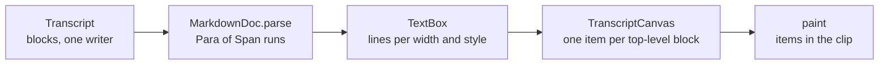

# UI

The Swing side of comando: the kit every part builds on, commands and keys, the widget contract and the widgets, and
the painted transcript. For a reader changing the `ui` module; the package layers are in
[Architecture §8](architecture.md#8-ui-packages).

1. [The kit](#1-the-kit)
2. [Commands and keys](#2-commands-and-keys)
3. [Widgets](#3-widgets)
4. [The transcript](#4-the-transcript)

## 1. The kit

`ui.kit` holds what would otherwise be written once per widget. It depends on no widget, panel or shell class.

| Package | Holds |
|---|---|
| `theme` | `Theme`: FlatLaf dark (`FlatMacDarkLaf` on macOS) on the ground chosen, the colour tokens in four tiers ([record 100](adr/0100-a-theme-is-four-tiers-of-tokens.md)), spacing, the fonts; `Tint` and `Ground`, the two choices; `ContentPalette`, the colours of syntax, the terminal, diffs, plots and code derived from them in OKLCH (`Oklch`) ([record 101](adr/0101-content-colours-derived-from-the-theme.md)); `SidebarLook`; the swatches. Dark only; a JVM option at launch sets the macOS appearance dark |
| `icon` | `Icons` (one SVG set under `/icons`, HiDPI); `SpinnerIcon` (one shared wheel, advanced by its owner's timer); `RowIcon` (icons in a row: two marks where a cell has room for one, [record 78](adr/0078-a-rows-marks-and-double-click-show-its-changes.md)) |
| `action` | `Command`, `ActionRegistry`, `MenuEntry`, `CommandPalette`, `KeyPriority`, `ToolButton` ([§2](#2-commands-and-keys)) |
| `resource` | `ResourceActions`: a list of resources' add, from its tab's menu, and its removal question, from a row's menu; no bar of buttons ([Workbench §1.3](workbench.md#13-the-sidebar)) |
| `overlay` | `Overlay`, `Balloon`, `Flash` ([§1.3](#13-trees-tabs-and-overlays)) |
| `async` | `Edt`, `Coalescer`, `Debouncer`, `ShownTimer`, `EdtWatchdog` ([§1.1](#11-threads)) |
| `format` | `Labels` (times, uptimes, counts, short paths), `Json`, `KeyText` (keys named as the desktop names them) |
| `text` | editors, find, diffs, Markdown and links ([§1.2](#12-text)) |
| `tree`, `layout`, `tabs` | `TreeView`, `ShrinkingRow`, `TabStrip`, `MovableTabs` ([§1.3](#13-trees-tabs-and-overlays)) |
| `vcs` | `RepoChanges`: the watched git repositories on the EDT, looked up by path (a file's change, a folder holding one), with git's colour for each kind. `OpenedFiles`: the files opened in comando, kept in `opened-files`, so the Files tab stops marking a new file once it is opened. The Files tab and the Changes view keep one each |
| `desktop` | `ExternalEditor` (IntelliJ, else the default application), `FileChoosers` (native on macOS), `Platform` (macOS or not, the menu modifier, `PATH` lookup), `Browser`, `DesktopTrash` (the Files tab's Trash), `Links` ([§1.2](#12-text)) |

### 1.1 Threads

| Class | Does |
|---|---|
| `Edt.run`, `Edt.runAndWait` | run on the EDT now, or posted; the bounded wait gives up, and a task given up never starts late |
| `Coalescer` | many requests from any thread become at most one pending run on the EDT, which reads the latest data |
| `Debouncer` | runs once requests stop for a delay (the editor's gutter: 250 ms) |
| `ShownTimer` | repeats while its owner wants it and the owner component is showing (the working spinners, the approval ages, running cards' elapsed time) |
| `EdtWatchdog` | posts a probe to the EDT every 100 ms. A probe waiting 200 ms is a stall, classified once as `startup`, `drawing` (in Java2D's render queue), `comando` or `jdk`, with where it was; one INFO line when it ends. A stall of 1 s, or 2 s for `drawing`, is a hang, logged with the EDT's stack |

### 1.2 Text

| Class | Does |
|---|---|
| `Editors` | configures every text area: the theme's content colours, the font, syntax by extension, file name or fence language |
| `EditorThemes`, `Fences` | the editors' theme, built from `Theme.content()` and built again for another tint or ground, the font and zoom kept ([record 101](adr/0101-content-colours-derived-from-the-theme.md)); a fenced block's language |
| `TextSearch` | find in a text area, with every match marked |
| `Highlighter` | syntax colours for text painted outside a text area (the transcript); callable from any thread |
| `Diffs`, `DiffPane` | a unified diff with three lines of context, coloured |
| `SplitDiff` | two versions side by side in editors, each with its syntax colours and line numbers, the right one editable: lost lines red, gained green, changed words marked, a band joining each difference, scrolling kept in step by the diff's line mapping. F7 and ⇧F7 move between differences. `compute` works the match out off the EDT and stops at a deadline; `remark` marks a comparison worked out for its new text without setting it ([record 68](adr/0068-git-changes-and-a-side-by-side-diff.md)) |
| `MarkdownHtml`, `HtmlPane` | CommonMark with tables to HTML for Swing, raw HTML escaped. An image is its picture when it is a file on this machine (`LocalImages`: PNG, JPEG and GIF as they are, an SVG drawn by jsvg into `cache/images/`), else its alt text. Fences are coloured as in the editors; a pane has one dark style sheet (`HtmlPane.styles`). Headings carry GitHub's ids. Web addresses and `[[name]]` note links in text become links; front matter shows as a table of its facts (`FrontMatter`) |
| `RenderedMarkdown` | an `HtmlPane` padded in a scroll pane: a panel's preview, the comparison window's rendered sides, which `MarkdownHtml.Marks` shades where a comparison found changes |
| `MermaidDiagrams` | Mermaid blocks drawn by `mmdc` into `cache/mermaid/`, once per diagram text, one at a time. A diagram or picture not ready yet stands as an element of its own, which the picture replaces when it arrives; the rest of the page is untouched. Without `mmdc`, no diagram is drawn |
| `SourceLinks` | `path/File.java:42` becomes a link that opens the file at the line |
| `TextLinks` | the one finder of links in plain text: web addresses, `[[name]]` notes, `path:line` references, file paths with a folder (`docs/a.md`, `/tmp/b.log`, `~/c.md`) and, outside parsed Markdown, Markdown links |
| `NoteLinks` | `[[name]]`, `[[name#heading]]` and `[[name\|label]]` as `comando-note:` links. `resolve` looks in the repository that holds the document, else in its folder, hidden folders left out: a file named `name` or `name.md`, then a Markdown file whose front matter says `name: <name>`, then the name with `-` and `_` swapped; the nearest wins; off the EDT |
| `Links` (`kit/desktop`) | follows a link from any surface: a web address to the browser; a file or a note to the opener the shell installs (a panel); a note that names no file is told as a notice. A session's links are read from its working directory ([record 94](adr/0094-links-in-both-styles-everywhere.md)) |
| `LocalLinks` | the file on this machine a link in a document names: the one reading of a link destination as a path |
| `LogLines` | an entry of comando's log, found by its time |
| `Plain` | `Plain.only(c)` turns HTML rendering off before text is set; `Plain.text(s)` guards a string that starts with `<html>` |

A link in a rendered page is followed at a double click. A `#` link scrolls to its heading and keeps it in place as
pictures arrive, until the reader scrolls; any other link goes to the pane's owner, else to `Links`.
`Workspace.headingWhenOpen` scrolls another document's panel to the heading its link names.

### 1.3 Trees, tabs and overlays

| Class | Does |
|---|---|
| `TreeView` | the one tree. A double click activates a leaf, Enter the selected node; per node a label colour, an icon and a trailing icon after the name. Optionally one click opens or closes a folder, and a double click's first click can be undone by its caller. `rowsChanged` lays the shown rows out again when a caller's cells change width, as a mark appearing does |
| `ShrinkingRow` | a row in which chips give up width before buttons |
| `TabStrip` | tab headers in one row, icons named by their tooltips; a right click asks for a tab's menu |
| `MovableTabs` | a tab dragged along the row reports where it lands |
| `Overlay` | the empty, loading and error states a widget switches between |
| `Balloon` | a short word beside a component that asks for nothing, gone after 2.5 s or at the next click or key |
| `Flash` | the hint on what a click brought into view: attention's gold (`Theme.ATTENTION`) fading to nothing over 2 s, one at a time on a component; a line's flash spans the text's whole width, under the text ([record 79](adr/0079-a-notice-takes-you-to-what-it-is-about.md)) |

A tree row is plain labels, never HTML, and the tree names a node by its label. Measured with HTML labels and a node
record's own text as its name, a row cost 63 µs: HTML in a renderer is parsed again for every row, and a record's
`toString` prints its whole subtree. With plain labels it costs 2.5 µs.

### 1.4 Rules

| Rule | Except | Record |
|---|---|---|
| colours, fonts and spacing come from `Theme` | the transcript's `Style`, the terminal's palette | — |
| comando is dark throughout; there is no light theme | — | [record 93](adr/0093-comando-is-dark-throughout.md) |
| placeholder, spinner and error states are an `Overlay` | the terminal: its placeholder starts the shell on a click, its exit bar offers a restart | — |
| a user action is a `Command` | — | [§2](#2-commands-and-keys) |
| work from other threads reaches Swing through `Edt` or a `Coalescer` | — | — |
| a tooltip is one line of at most 80 characters, imperative, without a closing period: what the control does and one fact it does not show (its key through `KeyText`, where the result goes, what it costs). A tooltip that reports live state keeps its data | a form field's tooltip, which may run to four short lines ([record 73](adr/0073-the-claude-folders-window-explains-and-creates-the-index.md)) | [record 70](adr/0070-the-sidebars-tabs-in-one-row-with-a-menu-each.md) |

## 2. Commands and keys

Every user action is a `Command`: id, label, icon, key, menu path or area, action, enablement. Key bindings and the
palette (⌘⇧P) come from the `ActionRegistry`.

The menu bar is built from `Menus`. After the application menu macOS draws come Edit and Help. Help holds the palette,
a separator, then the help. The theme, the shell, the refreshing plots and the embedded QuestDB (when comando has one)
are buttons at the tab row's right end, left of New panel (`Menus.corner`, `CommandButton`: each shows the first of
its commands that can run now) ([record 114](adr/0114-help-menu-and-corner-buttons.md)). The bar holds only what has no key or control in the window, and what macOS expects in a menu
([record 75](adr/0075-the-menu-bar-is-edit-and-actions-flat.md)). Every item has an icon and a tooltip saying what it
does. A command in no menu is named by its area in the palette and in the keyboard shortcuts: Panels, Run, Session,
Session ▸ Model, Session ▸ Effort, Connection, Results, Edit, Files, Kit, Window, Theme, comando. The registry refuses a
command with neither.

About comando, in the application menu and the palette, opens `About`'s card: drawn by hand (warm charcoal, a tinted
hairline, Helvetica Neue Light, Charter italic, spaced small capitals) and worded by `about.md` beside the class, whose
`{version}`, `{java}`, `{claude}`, `{system}`, `{home}` and `{year}` take the run's values
([record 60](adr/0060-about-is-a-card-worded-by-a-file.md)).

| Rule | Mechanism |
|---|---|
| one place, one key | a command sits in at most one menu and has at most one key; registering an id twice throws |
| comando's keys first | in the main window a command's key is claimed before the focused component sees it (`KeyPriority`). RSyntaxTextArea binds ⌘⏎, ⌘J and ⌘⇧K, which comando's commands also use, and the terminal takes every key |
| the terminal's keys | the terminal keeps Ctrl with a letter, `[`, `\`, `]` or space for its shell, which elsewhere is ⌘'s key, and on macOS ⌘K for its Clear Buffer (`TerminalWidget.keepsKey`) |
| a disabled command yields | a disabled command leaves its key to the component. So ⌘J (plot) stays enabled and says "The panel has no rows to plot" rather than joining lines; ⌘/ is left to the editor |
| where keys act | run keys act only in the focused panel's editor. Edit commands (undo, redo, cut, copy, paste, select all) run the focused component's own binding |
| what shows | menu items grey out what cannot run; the palette lists only what can, ranked by label match |
| quit | on macOS ⌘Q belongs to the application menu's quit handler |
| other desktops | `Platform.macKeys()` chooses macOS's keys or the other desktops': Ctrl for ⌘, the lower tabs on Alt+1–4, the line to the terminal on Ctrl+Alt+⏎. `-Dcomando.keys=mac` or `linux` chooses either on any desktop, for tests. Every text that names a key passes through `KeyText.of`, and the palette's `keyText` names keys the same way ([record 65](adr/0065-keys-on-desktops-other-than-macos.md)) |

## 3. Widgets

### 3.1 The contract

```java
public interface Widget<V> {
    JComponent component();
    void render(V view);          // on the EDT, when the value or its version changes
    default void unmount() { }    // about to leave the hierarchy
}
```

A widget holds no state beyond what Swing needs and changes nothing directly: it dispatches intents through
`WidgetContext.intents()`. It calls no adapter, imports no other widget, and in `unmount()` removes every listener it
added to a long-lived object. `WidgetContext` carries the intent sink and the action registry.

### 3.2 The registry

`WidgetRegistry` maps a placed view's type to a factory; a new widget is one registration and one `ViewSpec` record.
`ViewTabs` creates the widget when the view appears, renders it when the view's version changes, and unmounts it when
the view closes. A view tab has a pin toggle and a close button.

| Type | Widget | Shows |
|---|---|---|
| `table` | `TableViewWidget` over `GridTable` | rows; sort and find run on the EDT, so they stop at 200 000 rows; a growing result appends rows |
| `plot` | `PlotWidget` over `PlotCanvas` | series over shared axes, each pixel column reduced to its min and max; more than 100 000 points are sorted off the EDT; time axes step on clock units; drag to zoom, double-click to reset |
| `changes` | `ChangesWidget` | the Files tab's git repositories: Changed, Untracked and Removed, by folder. A file opens the side-by-side window, whose body is `ChangeEditor`: edited and saved every second with an edited/saved cue, undo by keys, roll back and remove from its menu, Markdown rendered. The selection's menu rolls back or removes its files ([Workbench §5.1](workbench.md#51-changes)) |
| `diff` | `DiffWidget` | a unified diff |
| `markdown` | `MarkdownWidget` | rendered Markdown |
| `text` | `TextWidget` | a file or text, read-only, highlighted, at a line; a header button opens it in IntelliJ |
| `tree` | `TreeWidget` | test results, a schema; file links open files, insert links fill the editor |
| `console` | `ConsoleWidget` | a Gradle run: output, state, stop, test tree |

Panels build the rest:

| Part | Is |
|---|---|
| `CommandEditor` | RSyntaxTextArea with per-block gutter icons. Each block is coloured as what it is, SQL only while the panel's database is open, with SQL completion from the bound schema while it is open. A session's insert is one undo step and never moves the caret |
| the Results grid | the panel's last result |
| `TranscriptWidget` | the Session tab ([§4](#4-the-transcript)) |
| `TerminalWidget` | JediTerm on pty4j |
| `ApprovalInbox` | the approval cards |

### 3.3 Capabilities

A widget marks its root with `Capabilities.mark` and implements what it can do. The shell binds each key once; the key
acts on the capability nearest the focused component, else on the lower tab in front.

| Capability | Key | Implemented by |
|---|---|---|
| `Searchable` | ⌘F opens the one find bar (finds as you type; ⌘G, ⌘⇧G; Esc closes) | transcript, text, diff, grid, console, editor, terminal |
| `Copyable` | ⌘⇧C | transcript, text, markdown, diff, tree, changes, grid, console, Results |
| `Exportable` | ⌘⇧S (a save dialog in the last export directory) | grid (CSV), plot (PNG), markdown, diff |
| `Zoomable` | ⌘= ⌘- ⌘0 | transcript, text, editor, plot, terminal (8–40 pt) |

## 4. The transcript

The Session tab paints a session's transcript with Java2D rather than Swing text components. Swing's HTML renderer
lays out the whole document on every change; a day's transcript reaches thousands of blocks, and its last block
changes on every stream delta. The painted renderer lays out a block once per width and style, lays out again only what
changed, and paints only the clip.

### 4.1 Data and layout



| Layer | Type | Notes |
|---|---|---|
| Store | `Transcript` (`core.transcript`) | the session's blocks; one writer (the strand); appended or replaced by index, published through a volatile version |
| Block | `UserPrompt`, `AssistantText`, `Thinking`, `ToolCall`, `Note`, `TurnEnd` | a block with a `parent` belongs to a subagent |
| Paragraphs | `MarkdownDoc.parse` → `Para` of `Span` runs | headings, text, lists, quotes, code, tables, rules; `path:line` and a file path become links, in code spans too |
| Layout | `TextBox` | lines broken with `LineBreakMeasurer`, kept until the width or style changes |

While text streams, paragraphs equal to earlier ones keep their layout; only the growing last one is laid out again.
`TranscriptCanvas` holds one item per top-level block, a subagent's blocks inside its tool card. Changed and visible
items are laid out at once. After a width or zoom change the rest get an estimated height, and an idle pass lays them
out in 8 ms slices, nearest the viewport first, keeping the first visible line in place. Painting finds the items in
the clip by binary search.

The canvas paints no ground of its own; the viewport under it is the ground chosen (`Theme.ground()`, Graphite `#121212` by default), not pure
black, as bright text on pure black blurs at its edges. A character a run's font lacks is drawn in Java's logical sans
serif, which covers most of Unicode on every desktop.

| What | Colour |
|---|---|
| text outside the prompt bubble and the tool cards: Claude's text, thinking, notes, hook lines, the turn's time | a warm ivory, low in saturation (`Theme.TRANSCRIPT_TEXT`, `#E2DCCD`) |
| Claude's headings, list marks, a quote's bar, a table's head | the theme's tint, chosen from the swatch left of New panel (`Theme.tint()`, Treasure gold by default) ([record 83](adr/0083-one-gold-chosen-beside-clear.md), [record 96](adr/0096-a-tint-chosen-in-actions.md)) |
| headings, first three levels | a serif: New York on macOS, else Georgia or another installed serif, else Java's logical serif. The first two levels run along the tint's ramp from highlight to shade, with a rule under them. Sizes ×1.45, ×1.25, ×1.1 of the text's (`Theme.HEADING_SCALE`), in rendered pages too |
| bold | a brighter ivory |
| inline code | a quiet teal of the content palette, on a ground a step above the panels' ([record 101](adr/0101-content-colours-derived-from-the-theme.md)) |
| the turn's report: its last text, when only notes, hooks or thinking follow it | the transcript's ground, a bar of the tint down its left edge |
| errors, links, code | red, blue, the code's highlighting |

Every tooltip, and the tab card, reads as a report: the transcript's ground, a bar of the tint down the left edge,
ivory text. A rendered Markdown page (an editor tab's preview, a view) reads as an answer, its headings in the serif and
the tint. What asks to be looked at (an approval waiting, "● edited", the flash, the warning icons) is Treasure gold in
every tint (`Theme.ATTENTION`), a status colour as red is for errors.

| Item | Paints |
|---|---|
| prompt | a bubble, with the panel it came from |
| text | paragraphs, highlighted code, tables, quotes; the turn's report framed |
| thinking | shown only while it is the latest item of its list; collapsed with its token count once it ends |
| tool card | running, done or failed; a one-line summary; "running · 12 s", or "waiting for your approval · ⌃2". Open: the input, the result (400 lines), a subagent's blocks. It opens by itself for edits, errors and running subagents |
| subagent card | adds the tool calls its blocks made, at any depth, and the latest: "running · 1 min 04 s · 9 tools · Read docs/ui.md" (the latest drops first when the card is narrow), then "done · 1 min 30 s · 12 tools". An Agent call whose result says it launched its subagent into the background reads "running in background · …" while the session lists that subagent among its open tasks, and done once it leaves the list. A card with no nested blocks shows no count: a stored conversation keeps a subagent's blocks in a file of its own. The header links to the subagent's stored conversation |
| note | an icon by kind and the first line; error notes start open |
| hook group | consecutive hook outputs as one line: "hooks · UserPromptSubmit, SessionStart (3)" |
| turn end | the duration, no cost ([record 46](adr/0046-clear-buttons-text-coloured-by-kind-checkpoint-due.md)); a failed turn shows its error first, in red; an interrupted turn reads "interrupted · 12.0 s", in the ivory of any text |

### 4.2 The widget

`TranscriptWidget` loads the last 2 000 blocks, with a button for the 2 000 before; later blocks are appended. It
follows the end until the user scrolls; a "↓ Latest" button returns, and sending a prompt follows again. Selection
runs across blocks; ⌘⇧C copies it, or the loaded blocks, as Markdown. ⌘F opens the cards that hold matches and closes
them again afterwards. A link is followed at a double click: a `path:line` link opens the file in the side pane at
the line; a file path opens as the Files tab opens a file, in a panel, or brings forward the panel that has it (a binary
or large file in the side pane), and a relative one that is not under the session's folder is looked for in that
folder's tree, then in the Files tab's folders ([record 111](adr/0111-a-file-link-opens-as-the-files-tab-does.md)); a web address, a `[[name]]` note or a Markdown link goes to `Links`. Every text a card
shows has its links: the prompt, the text, thinking, hook notes, a tool's result and what the call is given (a
command, a delegation's prompt, the JSON of any other call); a card's summary links the file a file tool works on,
whole even when the summary is clipped, the address a fetch reads, and a skill's `SKILL.md` in the user's skills
folder ([record 108](adr/0108-links-in-every-card.md)).

While a subagent runs, a strip above the transcript holds one chip per running top-level Agent card, foreground or
background, in start order: a spinner, the description clipped to 28 characters, the elapsed time. Then comes one chip
per background subagent of the session (`local_agent` tasks, an hourglass) that no card in the loaded window shows.
Shell tasks stay out; they show in the session's waiting status. A click on a card's chip opens the card and scrolls it
to the top of the view. The strip is one line: chips that do not fit are counted in a last "+N" chip, whose tooltip
names them. The strip hides when it is empty, and its timer runs only while it shows; a transcript that followed its
end still does when the strip appears or goes. A card's counts are kept as blocks arrive, never by walking its blocks
on a paint, and its times survive a rebuild of the tab (a session switch, "Show earlier").

The "transcript" link in a subagent card's header (`subagent:<toolUseId>`), and a line of the session card's
sub-agents outline, open the subagent's stored conversation as a tab of its own in the lower panel, "agent ·
<description>", with the agent icon ([record 109](adr/0109-a-sub-agent-is-a-session-tab.md)): the same transcript a
session's Session tab shows (`AgentWidget` around a `TranscriptWidget`), its cards, links and strip, read from the
subagent's own file (`SubagentFiles.Conversation` hands each whole line to a `StreamMapper` that reads it as a stored
conversation's and tells the window nothing). Its transcript is kept under `TranscriptRegistry.subagentKey` and goes
with its session. A nested subagent's link opens its own tab the same way. Two subagents with one description get
"agent · <description>" and "agent · <description> (2)"; a file over 256 MB is read from its last 256 MB, and a note
says so.

While the subagent runs, the lines its file gains are read every 2 s into the tab's transcript, which follows its end
as a session's does; a line over it reads "Updating while the sub-agent runs.". When updates stop, the line says why: the subagent ended, the session stopped, nothing was written for 10 min, or four newer views
follow it (the last two say the link follows it again). Any Markdown view replaced by another document starts at its
top.

### 4.3 The frame-time gate

`./gradlew :ui:transcriptGate` replays `SyntheticSession` (8 turns, 41 tool calls with a subagent, about 10 k tokens)
one 16-character delta per frame, laying out and painting a 1200 × 800 viewport at the end, then streams a
9 000-character open thinking block. It fails when either 99th percentile exceeds 16 ms. It also prints, without
failing on them, the frames of a 1 500-line code fence whose last 100 lines stream (a growing block keeps the layouts
of its whole lines), and the time of a find over 2 000 loaded blocks, for a word in most of them and for a word in a
few. An exact layout of many blocks, which a find needs for exact positions, spreads them over the cores. The gate
has no `System.exit` on its happy path: AWT ends the JVM once nothing posts to it, so a Swing timer or a displayable
component left behind by the code under measurement would hang it; a daemon watch reports the non-daemon threads and
exits 2 when the JVM is still alive 10 s after the measurement (2026-10-28: a never-shown `RSyntaxTextArea`, built only
to read a `Theme` from, kept its caret blinking, and CI waited 30 min for the step).

| Measure (2026-10-18, Apple silicon, 12 cores, JDK 25, headless, 1 798 frames) | Value |
|---|---|
| frame p99 | 3.39 ms |
| open thinking block, p99 | 1.41 ms |
| 1 500-line code fence, p99 | 4.75 ms |
| find, a word in most blocks | 540 ms |
| find, a word in a few blocks | 457 ms |

On one core the find took 1.4 s: the font code contends, so 12 cores give about 2.7 times.

`TranscriptShot <file> <offset> [width] [height]`, a main class in the `ui` test sources with no Gradle task, paints
the synthetic session at a scroll offset to a PNG.
