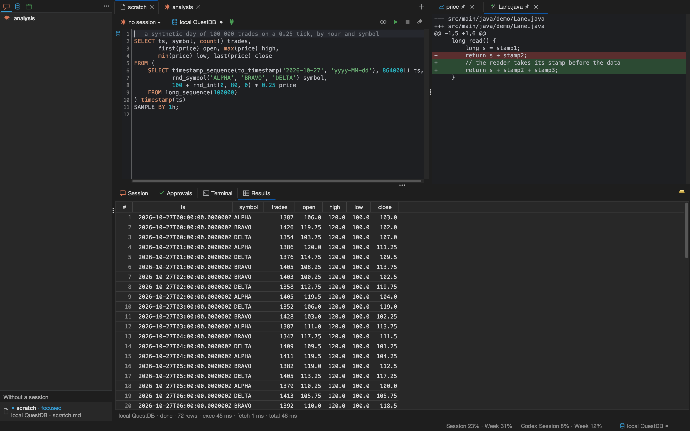
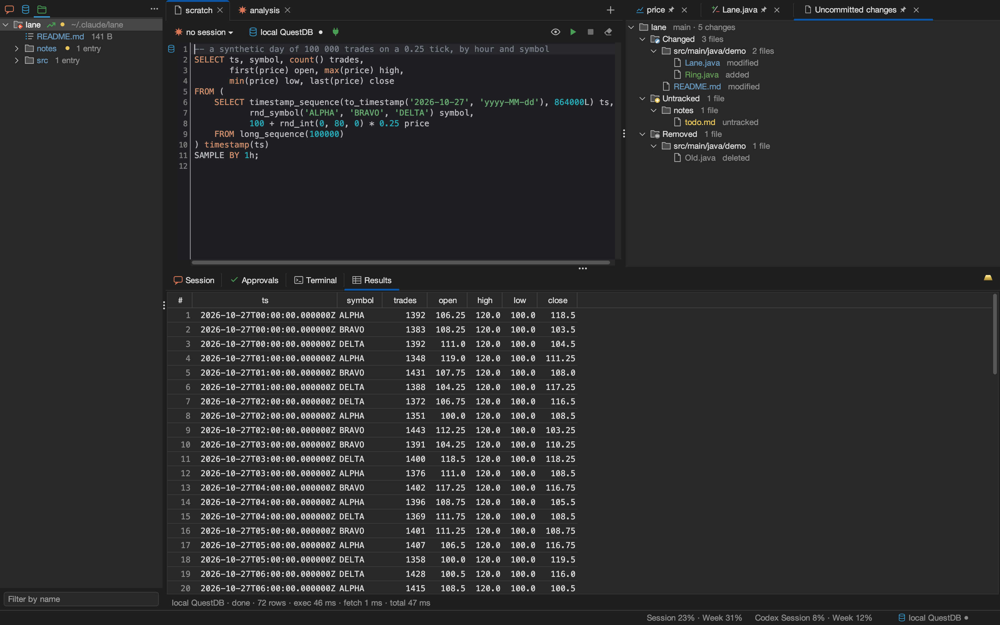
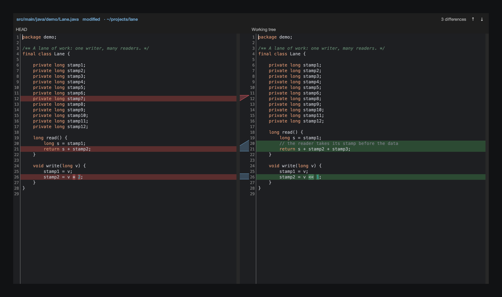

# Workbench

What the window does: panels and their bindings, running text, the database, the development tools, the Files tab,
what is kept on disk, and the kit. It is for a user who wants the exact rules behind a gesture, and for a contributor
who checks a behaviour against the code; the [tutorial](tutorial.md) is the shorter way in.

1. [Panels and resources](#1-panels-and-resources)
2. [Running text](#2-running-text)
3. [The database](#3-the-database)
4. [Development tools](#4-development-tools)
5. [The Files tab](#5-the-files-tab)
6. [Persistence](#6-persistence)
7. [The kit](#7-the-kit)

## 1. Panels and resources

### 1.1 One model for connections, sessions and folders

A connection, a session and a folder of the Files tab are resources: configured, stored and listed in the sidebar.
Each is written once as a resource kind. Connections and sessions are edited in one dialog; folders in a window of
their own, Configure ~/.claude folders, which keeps them in `folders.json` ([§5](#5-the-files-tab)).

| Layer | Connection | Session | Folder |
|---|---|---|---|
| Spec (`core.model`) | `ConnectionSpec`: name, host, port, database, user, password, production, TLS mode | `SessionSpec`: name, directory, model, effort, permission mode, extra directories, budget, checkpoint command, conversation id, next start (new, resume, fork), the summary a checkpoint carries into the next prompt | `FolderRoot`: name, path, index file, names left out, icon, whether entries go to the Trash, the listing file, whether it is a repository |
| Kind (`core.resource`) | `ConnectionKind` | `SessionKind` (a clone forks the conversation) | `FolderKind` |
| Live state (`core.state`) | `ConnectionState`: closed, opening, open, closing, failed, last error | `SessionState`: the same, plus turns, context, activity, branch, background tasks | none |
| Store file | `connections.json` | `sessions.json` | `folders.json` |

`ResourceDialog` edits one resource: stored, new, or an unsaved copy
([record 40](adr/0040-one-resource-per-dialog-and-two-tab-rows.md)). The form is generated from the kind's attributes,
with a hint under each field; fields set rarely sit under "▸ Advanced". ⏎ saves. ⌘⏎ saves and then binds a connection
to the focused panel, or brings a session's own panel forward (the button reads Assign to panel for a connection, Open
its panel for a session). Esc or the close button asks before dropping unsaved changes. Connect or Start, and the
Assign or Open button save a changed form first; Test tries the form as typed, without saving it. Their outcome shows
on the line above the buttons.

### 1.2 Panels

A panel is a tab in the workspace: an id, a title, its text, and two bindings by name, a connection and a session,
either empty. Several panels may share a connection. Every session has one panel of comando's own, titled with its
name: the two are one, renamed together (refused while the session runs) and removed together, after one question.
Any number of document panels may be attached to a session
([record 38](adr/0038-a-session-has-one-panel.md), [record 88](adr/0088-a-session-and-its-panel-share-a-name.md)).

- **Opening a session** (a double click on its row, Open in a panel, the dialog's Open its panel, the session bar's chip)
  brings its own panel forward, open or closed. A session that has none (a conversation imported and never opened)
  takes a panel of comando's own without a session that bears its name, or else gets a new panel titled with its name
  and the focused panel's connection. A new session opens its own panel the same way.
- **The session chip's menu** depends on the panel's kind. On a session's own panel it says so and offers nothing
  else. On a panel without a session it offers "New session ‹title›…" (the session dialog, named after the panel) and
  lists the sessions, whose own panels a choice brings forward. On a document it offers "Attach to ‹session›" or
  "Detach from ‹session›". A selection run in an attached document goes to its session, and while the document is
  focused the session bar shows that session and its buttons act on it.
- **A new panel** (⌘T) gets the focused panel's connection and no session. A title already taken, or a session's
  name, gets a number.
- **Renaming** a panel: double-click its tab, Rename… on its row under the sessions (a panel without a session), or
  "Rename panel…" in the palette.
- **Restore layout** (palette) puts the sidebar, side pane and lower divider back as they were before a session
  arranged them; it is greyed out while nothing was arranged.
- **Moving** a tab: drag it along the row; a line marks where it lands. The order is saved and kept across restarts.
- **HTML files** open as text, to edit; the Browser button opens the page in the desktop's browser
  ([record 56](adr/0056-html-opens-in-the-browser-not-in-comando.md)).
- **Links**, wherever text shows (a rendered page, a panel's text, the transcript, a tool's result, a tab's card), are
  followed at a double click; a single click follows nothing ([record 94](adr/0094-links-in-both-styles-everywhere.md)).
  A web address, written as a link or bare, opens in the browser. A link to a file, beside the document or by its full
  path, opens that file in a panel, or brings forward the panel that has it. A note link, `[[name]]`, opens the file
  it names, found in the document's git repository (else its folder): a file named `name` or `name.md`, then a
  Markdown file whose front matter says `name: <name>`, then a file named with `-` and `_` swapped; the nearest match
  wins. A link to a heading (`#` and the heading's id, as GitHub makes it: the text in lower case, punctuation
  dropped, each space a hyphen, `-1`, `-2` on a repeated heading) scrolls that heading to the top, in the same
  document or in the other one as it opens, or in its open panel (one showing its text stays as it is); `#` alone goes
  to the top. Until the reader scrolls, the heading stays at the top as pictures and diagrams arrive above it.
  Front matter at the top of a page shows as a table of its keys and values.
- **Running** SQL opens the panel's connection when closed; a prompt starts its session when stopped.
- **The session bar**, under the lower panel, shows the focused panel's session
  ([record 105](adr/0105-a-session-bar-under-the-lower-panel.md)). On the left: its chip, the session's state icon
  (as on its row: orange running, grey stopped, faint starting, red failed) with its name and ⎇ branch, whose menu is
  the session chip's menu above; a plug (green when running) that starts or stops it; a fresh start, shown once the
  session has a conversation and usable while it is stopped (a new conversation starts; the old one stays
  importable); then what the session does, "working · 12 s", last, so that nothing moves as it changes. On the right:
  the model and the effort, each a menu that changes it now and keeps it, as the session's menu in the sidebar does;
  the context ("ctx 412k (41%)", "ctx –" until a turn reports it); and right after it the checkpoint, shown while the
  session has a checkpoint command, `/reflect` by default
  ([records 45 and 46](adr/0046-clear-buttons-text-coloured-by-kind-checkpoint-due.md)). The context and the
  checkpoint turn purple together once a turn ended with the context at 60% of the window or more and the command was
  not sent since; after a checkpoint the context has to drop below 60% and cross it again before the next one is due.
  What a checkpoint does once its turn has finished is in [§1.4](#14-the-checkpoint). Compact has no button: the
  palette's "Compact the conversation", the session's menu and `/compact` do it. A panel without a session shows only
  the chip, "no session ▾".
- **The window's status bar**, under everything, holds the window's state: the standing notice on the left; the kit,
  the plans' usage and the work running in every session and query on the right.
- **The header** shows the connection as a chip with a status dot and a plug (green when connected) that connects or
  disconnects. On the right, icons without a button's shape: Browser (HTML: the page in the browser), Preview or Edit (Markdown),
  Run, Stop, Clear (the panel's own text, one ⌘Z step; not on documents). A production connection frames the panel in
  red ([record 57](adr/0057-a-light-editor-and-a-header-of-icons.md)).
- **The theme** is dark throughout: the window is FlatLaf's dark look (`FlatMacDarkLaf` on macOS, `FlatDarkLaf`
  elsewhere) on the ground chosen. The editors' and the terminal's colours, diffs and plots are derived from the tint
  and the ground: keywords in the tint, six syntax categories of one weight, comments muted
  ([record 101](adr/0101-content-colours-derived-from-the-theme.md)): the text, its gutter, its rendered Markdown (code
  blocks in the theme's colours, Mermaid diagrams drawn in Mermaid's dark theme by `mmdc` when it is installed; without it no
  diagram is drawn). There is no light theme
  ([record 93](adr/0093-comando-is-dark-throughout.md)).
- **Pictures in Markdown**: an image link to a PNG, JPEG, GIF or SVG on this machine, named from the document's folder
  (`images/chart.png`, `../img/flow.svg`) or by its full path, shows the picture, no wider than the panel; it is read on
  a thread of its own and shown when ready, and read again when the file changes. A web address shows the alt text, and
  so does a missing file, with the reason ([record 58](adr/0058-markdown-shows-the-pictures-beside-it.md)).
- **The tab icon** shows the first that applies
  ([records 42 and 43](adr/0043-a-session-waiting-on-background-work-shows-it.md)): a question mark while a request
  waits; a red mark when the last turn or query failed, or the session died, out of view; a green check when a turn or
  query finished out of view; a spinner while one runs; an hourglass while background work the session started has not
  ended; otherwise, for a session's panel, the session's state icon ([§1.3](#13-the-sidebar)), and the file icon for a
  panel without a session. The first three put "● " before the title: the question mark's until the request is
  answered, the others' until the tab is looked at. A waiting request or a failure bounces the Dock while the window
  is not active.
- **The lower panel** follows the focused panel: its last SQL run, its session's transcript, its terminal. Approvals
  lists every session's requests. Its tab strip holds the tabs alone; the palette's "Clear the Session tab" empties
  the Session tab once the turn has ended, while the conversation goes on
  ([record 104](adr/0104-the-theme-beside-new-panel.md)).
- **The theme's swatch**, the theme's ground with a bar of its tint, sits at the top right, left of New panel; its
  tooltip names the theme, and a click opens the six, as Actions ▸ Theme does
  ([record 104](adr/0104-the-theme-beside-new-panel.md)).
- **Actions ▸ Theme** chooses a ground and the tint made for it together: Graphite and gold (the default), Espresso
  and champagne, Aubergine and yellow gold, Midnight and electric blue, Evergreen and tropical forest, Slate and silver;
  kept across restarts. Cards, borders and the prompt's bubble are laid over the ground and follow it
  ([record 103](adr/0103-curated-themes-in-actions.md)). Text sizes are steps of one scale and spacing a 4-point grid
  ([record 102](adr/0102-one-type-scale-and-a-grid.md)).
- **Closing** (⌘W when no view has the keyboard; the last open panel cannot be closed) keeps a panel of comando's own,
  closed, with its file, title and bindings, until removed; a document is dropped
  ([record 39](adr/0039-panels-are-kept-until-removed.md)). ⌘⇧T reopens the last of ten recently closed. The Sessions
  tab reopens any: a session's own panel by opening the session, a panel without a session from its section under the
  sessions ([record 91](adr/0091-the-panels-tab-folds-into-the-sessions-tab.md)). Closing asks first when the panel's
  shell runs a job in the foreground.
- **A tab's menu** (right click on the tab, not the panel) closes it, the others, the tabs to its right or those to its
  left, in the order shown after any drag. Such a close puts the clicked tab in front and asks nothing: a tab waiting
  for the user and a tab whose shell runs a program stay open, and one notice says how many closed and stayed; a tab
  mid-turn closes and its session runs on
  ([record 63](adr/0063-a-tabs-menu-closes-many-and-a-scratchpads-entries-go-to-the-trash.md)).
- **Renaming** a connection or session renames every binding (a running session must stop first); removing one closes
  it and unbinds its panels; removing a session also removes its own panel, and its attached documents stay, detached.

### 1.3 The sidebar

Three tabs in one row, each an icon named by its tooltip: Sessions, Connections, Files; the tab in front is kept across
restarts ([record 70](adr/0070-the-sidebars-tabs-in-one-row-with-a-menu-each.md),
[record 91](adr/0091-the-panels-tab-folds-into-the-sessions-tab.md)). A right click on a tab selects it and opens its
menu: the tab's own actions, then the window's commands for it with their keys. Every panel of the window, the sidebar
included, lies on one ground set once (`Theme.ground()`, the theme's); names are in the transcript's ivory; the folders' icons are
outlines in one grey ink, told apart by their shape; the tint chosen draws the group headers, the tab in front's
underline and the selection: a band of its shade, the name in its highlight and the report's bar at the left edge
([record 98](adr/0098-the-sidebars-look.md), [record 100](adr/0100-a-theme-is-four-tiers-of-tokens.md)).

| Tab | Its menu |
|---|---|
| Sessions | New session…, Import stored conversations…, Sort: running first, then by name (on only after a drag ordered the rows by hand); New panel, Reopen closed panel |
| Connections | New connection…; Start embedded QuestDB, Stop embedded QuestDB |
| Files | Configure ~/.claude folders ([record 73](adr/0073-the-claude-folders-window-explains-and-creates-the-index.md)) |

No list has a bar of buttons ([record 74](adr/0074-the-sidebars-lists-have-no-bar-of-buttons.md)): a row's menu edits,
clones and removes it (`ResourceActions`). Removing something in use asks **Stop and remove**, **Disconnect and remove**
or **Close and remove**, or **Leave it** ([record 37](adr/0037-session-actions-act-on-the-selected-row.md)). ⌘B or the
`⋯` button hides the sidebar to a rail on the left edge.

**A session row** is one line: the state icon and the name
([record 90](adr/0090-a-session-row-is-its-icon-and-name.md)). The icon, which a click starts or stops, is
Claude's mark at one size in every state: Claude's orange while the session runs, grey while it is stopped, faint while
it starts or stops, red when it failed; it spins while the session works and shows the hourglass while it waits on
background work. The name is dimmed while its own panel is not open and takes the accent colour while one of its panels
has the focus. Marks follow the name: a gold ↑ when the session runs an older Claude Code than another running session
(each start runs the CLI installed then; start it again to use the newer), the context in purple once its checkpoint
is due, and ⚑ with the count of approvals waiting. A double click on the row opens its panel.

Resting the pointer on the row's name shows the card the panel tabs show
([record 87](adr/0087-a-session-row-shows-the-tabs-card.md)): the card of the session's panel (the focused panel when it
is the session's, else its own), or, for a session with no panel open, a card of its own whose summary is read from the
end of its conversation. Its title is set in the headings' serif, in the tint; then come its facts (`CardFacts`), each once and
only when known: State, Model · effort, Context, Folder · branch, Conversation, Claude Code, and the panel's Session,
Connection and File where the title does not say them; then the summary.

Everything else is in the row's menu:

| Item | Shown | Does |
|---|---|---|
| Open in a panel | always | brings the session's own panel forward |
| Start, Stop | stopped, running | starts or stops the process |
| Interrupt the turn | while a turn runs | as ⌘⇧. |
| Start a new conversation | stopped, with a conversation to leave | the next start is a new conversation; the old one stays importable |
| Checkpoint (Checkpoint, due) | the session has a checkpoint command | as the header's ([§1.4](#14-the-checkpoint)) |
| Compact the conversation | running | sends `/compact` from the session's panel |
| Rewrite ‹panel› as a document | running, with a panel open; off while its text is blank | sends the panel's text to the session with an instruction to rewrite it as a Markdown document and put it in place with `ui_set_editor` ([record 85](adr/0085-a-panel-rewritten-as-a-document.md)) |
| Model: ‹family› ▸, Effort: ‹level› ▸ | always | each names what the session runs at; a choice saves and, on a running session, sends `/model` or `/effort` |
| Copy details | always | as ⌘C on the row: name, path, branch, full conversation id, status, uptime and start, context with tokens, model and effort, Claude Code version |
| Edit…, Clone…, Remove… | always | the session dialog; a copy; removal with its own panel |

The model shown is, while the session runs, the one it reported at its start, by family (`opus`, not `default`); while
stopped, the one set for the next start, else "default". The effort shown is the one set for the session; else, while
it runs, the one Claude Code's `settings.json` gives its model (`modelSettings.<model>.effortLevel`, else
`effortLevel`), read at its start; else "default". That effort is the base each turn starts at, which a turn may raise;
the stream does not report it ([record 89](adr/0089-a-session-row-is-one-line.md)).

The rows are listed running first, then by name, until a row is dragged. While the pointer is on the list, a session
that starts or stops keeps its row, and the order applies when the pointer leaves, so a second click lands on the same
session. A dragged order then stands (saved in `sessions.json`) until Sort in the tab's menu
([record 53](adr/0053-session-rows-compact-clear-copy-and-an-order-of-your-own.md)). Import lists stored conversations
([Claude §1.4](claude.md#14-stored-conversations)).

**Without a session** is a section under the sessions, shown only while it has a row: comando's own panels that no
session has, open and closed, by title, at most 4 rows before it scrolls (`PanelsWithoutSession`). A row shows a dot
for open (●) or closed (○), the title, the connection and the file; a double click opens it or brings it forward. Its
menu:
Open (or Bring forward), Rename…, New session ‹title›… (the session dialog with the name filled in; saved, the panel
becomes the session's own), Remove… (deletes the panel's file; removing the last open panel leaves an empty one). A
session's own panel and a document are not listed: the session's row and the Files tab reach them.

**A connection row** is one line too: the state icon, which a click connects or disconnects, and the name; a red
"prod" marks a production database, and the name takes the accent colour while the focused panel uses it
([record 92](adr/0092-a-connection-row-is-its-icon-and-name.md)). The icon is the database glyph at one size: blue while
connected, grey while disconnected, faint while it connects or disconnects, red when it failed. Resting on the name
shows a card of facts without a summary: State, Database (`<database> on <host>:<port>`), User, TLS, Production, and
the open Panels that use it. A double click on the name binds the connection to the focused panel. Its menu: Bind to
the focused panel, Connect or Disconnect, Test, Explore the schema, Copy details (as ⌘C; never the password), Edit…,
Clone…, Remove….

### 1.4 The checkpoint

The checkpoint button (the panel's header or the session's menu) sends the session's checkpoint command. Once that turn
has finished (nothing runs or is queued, no background work it started is still out), comando keeps the turn's last
answer as the session's carried summary, sends `/clear`, and empties the Session tab to that summary; the panel's text
stays. The tab cards drop their summary and read it again at the next show. The summary goes in front of the next
prompt that is not a slash command, and is kept in `sessions.json` until then
([record 86](adr/0086-a-checkpoint-clears-and-carries-its-summary.md)).

The conversation is kept instead when a prompt is sent before the turn ends, the turn fails or is interrupted, the
process ends, the answer is blank (a warning says so), or a summary from the last checkpoint still waits. A checkpoint
typed by hand, or sent by another session, is a prompt like any other and clears nothing.
[Claude §1.3](claude.md#13-turns-interrupt-stop) gives the stream-level sequence.

## 2. Running text

One editor holds SQL and prompts. SQL goes to the panel's connection, anything else to the panel's session.

### 2.1 What runs

The selection, when there is one; else the block under the caret: a run of non-blank lines between blank lines. On a
blank line, the nearest block above. A block of several SQL statements runs in one call; Results shows the first
result, and a warning says how many statements ran; a failure says the statements before it may have run. The block
that ran is tinted until the next edit, not selected, so the next keystroke cannot replace it.

### 2.2 SQL or prompt

`Classifier.classify` decides, in order:

1. A first line `-- @sql` or `-- @claude` decides, and is removed.
2. A leading `/` and a letter is a Claude command (`/compact`, a skill).
3. A block of comments only has nothing to run: no gutter icon; ⌘⏎ says "Nothing to run".
4. A leading SQL keyword followed by the shape that keyword takes is SQL, unless an English function word appears
   outside quotes or the text ends with `?` or `.`. Keywords: `SELECT`, `WITH`, `INSERT`, `UPDATE`, `DELETE`,
   `CREATE`, `ALTER`, `DROP`, `TRUNCATE`, `EXPLAIN`, `SHOW`, `COPY`, `VACUUM`, `REINDEX`, `SET`, `CANCEL`, `BACKUP`,
   `CHECKPOINT`, `SNAPSHOT`, `DECLARE`, `BEGIN`, `COMMIT`, `ROLLBACK`.
5. Otherwise a prompt.

"update the README" and "show me the log" are prompts: no `SET`, and function words. Identifiers count as whole words
(`my_table`, `us_east`), quoted strings and comments are skipped, and the gutter shows each block's target (database or
Claude icon) 250 ms after the last keystroke, before anything runs. A statement the classifier misses is forced with
⌥⏎.

### 2.3 Keys

| Key | Runs | As |
|---|---|---|
| ⌘⏎ | selection or block | classified |
| ⌘⇧⏎ | selection or block | prompt |
| ⌥⏎ | selection or block | SQL |
| ⌃⏎ | selection or line | typed into the panel's terminal |
| ⌘. | none | stops the panel's SQL run, else interrupts the session's turn |
| ⌘⇧. | none | interrupts the session's turn |

The run keys act while the keyboard is in the focused panel's editor.

Keys are written as macOS writes them. On other desktops each is the same with Ctrl for ⌘ (⌘⇧P is Ctrl+Shift+P), but
for two that would be another command's there: the lower tabs ⌃1–⌃4 are Alt+1–4, and ⌃⏎ is Ctrl+Alt+⏎. In the
terminal Ctrl with a letter, `[`, `\`, `]` or space goes to the shell, as ⌃ does on macOS; comando's other keys work
there. The palette, the shortcuts table and every text in the window name the desktop's own keys
([record 65](adr/0065-keys-on-desktops-other-than-macos.md)).

### 2.4 Where things land

SQL results fill the Results tab; an error is selectable text, and a position the database names is underlined in a
single-statement block until the next edit. A prompt's turn streams into the Session tab. ⌘⇧I appends what the panel's
last run produced as a block of its own: the selected rows (up to 500), else the first 50, else the error, as
tab-separated text in a fence with no blank line inside; a question typed on the next line belongs to the same block,
so ⌘⏎ sends rows and question together. A query of 10 s or more ends with a desktop notification naming its panel
while the window is not active; a live plot's refresh gives none.

## 3. The database

PostgreSQL and QuestDB over the PostgreSQL wire protocol, through the PostgreSQL JDBC driver.

### 3.1 Lanes

Each connection name has a lane: one connection and one thread running its opens, closes, statements and health checks
in order. The user's runs and Claude's `db_run_sql` queue on the same lane. A lane's thread stops once its last task
ends with no connection; renaming, repointing or removing a connection also forgets its schema.

| Property | Value |
|---|---|
| URL | `jdbc:postgresql://<host>:<port>/<database>` |
| Driver properties | `ApplicationName=comando`, `loginTimeout=20`, `tcpKeepAlive=true`, `cancelSignalTimeout=2`, `sslmode` (`prefer` by default, or `disable`, `allow`, `require`, `verify-ca`, `verify-full`) |
| Autocommit | on |
| Fetch | 5 000 rows per round trip; at most 5 000 000 rows kept, then the run is marked truncated |
| Health check | `isValid(5)` every 60 s on the lane, skipped while a statement runs; a failure closes the connection and reports it lost |

**Cancel.** ⌘. marks the request cancelled, then reads the statement the lane runs; the lane publishes its statement,
then reads the mark. Either the lane sees the mark first, or the caller sees the statement and cancels it. A statement
still running 2 s after its cancel has its connection aborted; the lane reconnects on the next run.

### 3.2 Results

`ColumnarResult` stores rows by column in primitive chunks of 16 384 values: integers, booleans and times (epoch
microseconds UTC) as `long`, floats as `double`, everything else (`numeric` included) as text. The lane publishes the
row count with a volatile write, so the grid and plots read while the fetch continues. The grid paints visible rows
only, formatting cells into one reused buffer.

| Key | Does |
|---|---|
| ⌘J | plots the last result: x is the first time column, else the first numeric one; up to eight more numeric columns as series; at most 2 000 000 rows |
| ⌘⇧J | the same, re-running the query each period (default 5 s) while it is not running; another run in the panel or a failed query or connection stops it with a notice; closing its tab stops it quietly; Actions ▸ Stop refreshing plots stops them all, the plots staying as they are |
| ⌘⇧R | keeps the result in a tab of its own (at most 100 000 rows) |
| ⌘⇧I | attaches the result to the editor ([§2.4](#24-where-things-land)) |
| ⌘⇧S | exports the grid as CSV in the order shown, written off the EDT |

A one-column `EXPLAIN` result shows as a tree by indentation, with a toggle back to rows.

### 3.3 Schema

When a connection opens, its schema loads in the background: from QuestDB's catalogue (`tables()` and each table's
columns, up to 50 tables), else from `information_schema.columns`; at most 50 000 rows. A `CREATE`, `ALTER`, `DROP`,
`TRUNCATE` or `RENAME` from the editor or from Claude reloads it. It feeds completion (keywords, then tables and columns
of the bound connection) and the explorer (⌘⇧E): a tree in the side pane, whose table menu inserts
`SELECT * FROM <table> LIMIT 100;`.

### 3.4 Embedded QuestDB

**Actions ▸ Start embedded QuestDB** (also in the Connections tab's menu) starts a QuestDB server in `questdb/` of the
data root, on QuestDB's default ports (PG wire 8812, console 9000, ILP 9009). Every listener binds `127.0.0.1` and ILP
over UDP is off, through `QDB_` environment overrides, because QuestDB binds all interfaces by default and its default
login is public. It stops at exit, after the lanes.

## 4. Development tools

Runs go through `ToolPort` (`tools` module); the terminal lives in the UI because JediTerm is a Swing component.

### 4.1 Terminal

JediTerm on a pseudo-terminal from pty4j, one per panel, started the first time it is shown, as `$SHELL -l` (else
`/bin/zsh`, else `/bin/sh`) in the session's directory, else home; `TERM=xterm-256color`, `TERM_PROGRAM=comando`. ⌃3
shows it. ⌃⏎ in the editor types the selection or line into it and presses Enter, waiting until a starting shell has
written and then been quiet for 200 ms (at most 3 s). An exited shell offers a restart bar; Actions ▸ Restart the shell
ends the focused panel's shell and starts a new one in the session's directory.

### 4.2 Gradle runs

⌥⌘G asks for tasks (the last ones used, `build` the first time) and runs them in the build of the focused panel's
session: the nearest directory at or above its working directory with an executable `gradlew`.

- **Command:** `gradle-serial <root> <tasks>` when an executable `gradle-serial` is on comando's `PATH` (a wrapper the
  user may install to serialise Gradle runs per checkout), else `<root>/gradlew --console=plain <tasks>`; each run looks
  again. Arguments split like shell words, without expansion. Nothing configures it
  ([record 62](adr/0062-gradle-runs-by-convention.md)).
- **Output:** a console view filled as output arrives; past 4 MB the rest is held and its last 64 kB shown at the end.
  The same command again replaces an unpinned view and stops the old run.
- **Stop:** SIGTERM to the process tree, SIGKILL 2 s later; output is read at most 2 s after the process exits.
- **Tests:** JUnit XML written since the run started becomes a tree, failures first; a failure links to its source
  line, and "Send failures to Claude" sends messages and stacks (60 lines each) to the session of the panel the run
  came from.
- A run of 10 s or more ends with a desktop notification while the window is not active.

## 5. The Files tab

The folders the user chose inside `~/.claude`, one top-level row each, as a navigator of their folders and files
([records 49, 51, 52, 55](adr/0055-the-files-tab-only-shows-folders-json-configures-it.md)). It is no browser of code
repositories: those are read in an IDE ([record 95](adr/0095-the-files-tab-holds-no-code-repositories.md)). The tab only shows and
opens: it has no buttons, and writes nothing but the Trash of a deletable folder
([record 63](adr/0063-a-tabs-menu-closes-many-and-a-scratchpads-entries-go-to-the-trash.md)). The files it opens are
edited and saved like any other; a `.log` stays read-only.

- **Folders** are resources ([§1.1](#11-one-model-for-connections-sessions-and-folders)): a unique name, a full path,
  an optional index file inside it, names to leave out, the row's icon (folder, scratchpad, memory, knowledge, skills,
  plugin), whether its entries go to the Trash (`deletable`), the file name that lists them (`listedIn`) and a group
  (`group`): the tab shows a group's name as a header above the first of a run of its folders, nothing nested (the
  kit's Brain over Scratchpad, KB and Memory, [record 98](adr/0098-the-sidebars-look.md)); a
  `repository` key, written by older versions, is ignored. With a kit, its folders come first, as its `comando-kit.json` lists them
  ([§7](#7-the-kit)). Without a kit and without `folders.json` there is one folder, Claude Code's (`~/.claude`),
  opening `CLAUDE.md` and leaving out Claude Code's transcripts, caches and per-session state; an emptied list stays
  empty. Here and below, `~/.claude` stands for the root comando's sessions run on ([§7.1](#71-the-root)).
- **Configuring.** The Files tab's menu (a right click on its header) and the Files menu open the `~/.claude` folders
  window (its title names Claude Code's folder wherever it is)
  ([records 69, 73](adr/0073-the-claude-folders-window-explains-and-creates-the-index.md), [record 95](adr/0095-the-files-tab-holds-no-code-repositories.md)). The entries are on the
  left in the tab's order (+ chooses a folder first and names it after it, − takes one out, ↑ ↓ or ⌥↑ ⌥↓ move it), and
  the selected one's fields on the right, each field's name explaining it under the mouse. Each field is checked as it
  is typed: a name used once in `folders.json`; a folder that exists and can be read, set only by choosing it, inside
  `~/.claude` (an entry elsewhere, as an older file's repository, is marked until taken out); an index inside it whose
  own folder exists; a listing file name. A field that fails is outlined in red and one line under the form says why, or notes
  what Save will do. A pick outside `~/.claude`, or a file outside the entry's folder, is not taken, and that line says
  so. The index file and the listing file are typed or picked (…); a picked listing file gives its name. Under that
  line, the git repository holding the folder: `repo: ~/.claude · master · 1 uncommitted`, or `repo: none`.
- **Saving.** Save, on only when every entry passes, writes `folders.json` once, and creates the index file a folder inside `~/.claude` names but does not have, with a title and one line on
  how it is kept. Cancel or Esc drop the edits, asking first. The store checks `folders.json` every second: a change it
  did not write is read again and the tab follows; an entry that breaks the rules is left out with a notice; a file
  that does not parse keeps the tab's folders, says why and stays where it is. A `readOnly` key is ignored.
- **Order.** At a folder's top level its index file comes first. Every level then lists folders not named after a date,
  date-named folders (`yyyy-MM-dd`) oldest first, then files, by name ignoring case. Hidden entries, `node_modules`,
  `build`, `target`, `__pycache__`, `out` and the folder's own exclusions are left out, and so is what git ignores in
  a repository (a folder git ignores as a whole shows all it holds); a link to a folder is listed, not followed.
- **Bounds.** 12 levels; at most 80 000 names listed and 20 000 entries kept per folder tree; past a bound the folder
  ends with `…`. An unreadable subfolder says why and the rest stands.
- **Clicks.** A click on a folder opens or closes it; on a file it selects. A double click opens a file in a panel
  (Enter opens a file). On a folder's row a double click shows the row's
  changes instead and leaves the row open or closed as it was; on a subfolder it does nothing more than its first
  click ([record 78](adr/0078-a-rows-marks-and-double-click-show-its-changes.md)). A text file of at most 2 MB opens in
  a panel bound to it; a larger one (to 4 MB) or a binary one shows in the side pane. Opening a folder opens no file;
  the first time, its newest date-named folder opens too.
- **Menus.** A file's: Open in a panel, Edit in a panel (its text rather than rendered), and Compare with HEAD when it
  changed. A folder row's: Open ‹index file›. A folder row's and a subfolder's: Show changes in it (off, as No changes
  in it, when it holds none): the Changes view of the repository holding it (`~/.claude`'s, the brain's), inside it alone,
  its row named after the folder's row and the subfolders leading to it. A row of a folder inside the brain also
  offers Back up the brain ([§7.4](#74-back-up-the-brain)).
- **Trash.** In a deletable folder, a file's or subfolder's menu moves the selection (⌘- or ⇧-click for several) to the
  desktop's Trash after one question naming it; the folder's row never goes, and a selection reaching another folder
  offers nothing. Without a Trash nothing moves; nothing is deleted for good. With `listedIn` set, each entry moved
  leaves the nearest such file in its folder or above: its own lines go (a list item or table row whose first element
  is its path relative to that file, `READ-01-X.md`, `work/a.py`, a folder with its slash `work/`, with the lines
  indented under an item; never inside a code block), and the notice gives the lines that still name it. A panel on a
  moved file is removed as for any file deleted outside.
- **Sync.** Only folders whose rows are open are read: at once when opened, then every 5 s on `folder-poll`, sent only
  when something changed. A tree carries the settings it was read with and is dropped if the folder was edited since;
  reads are ticketed so an older one never overwrites a newer one. The tree keeps what the user opened and selected.
- **Git.** In a git repository a name keeps the names' colour whatever git says of it; only a file in conflict is red
  ([record 98](adr/0098-the-sidebars-look.md)). How it differs is said by marks after the names: a new (untracked) file and every folder on the way down to it
  carry a dot in the tint after the name, so the closed folders to open are marked from the folder's row down. Once the new
  file is opened (in a panel or the side pane, from any place) it reads as any other file, without its dot, and
  counts for its folders no more; comando keeps the opened files in `opened-files`
  ([record 76](adr/0076-new-files-are-gold-and-marked-from-the-top.md)). A file git tracks that differs from `HEAD`
  (changed, added, renamed, in conflict) and every folder on the way down to it carry the rising arrow after the name,
  until a commit or a roll back clears it; opening the file does not ([record 97](adr/0097-a-changed-files-trail-of-arrows.md)).
- **Repository marks.** A repository's top folder (a folder row, such as the kit's, or a subfolder, such as the
  brain) has the git icon, and a rising arrow after its name while the repository has changes; hovering
  it says its branch (or a detached `HEAD`) and what it holds uncommitted, by kind ("On main · 3 uncommitted: 2
  modified, 1 untracked"). A folder's row inside a repository (KB, Memory, any folder of `~/.claude`) has the same
  arrow while what it holds differs from `HEAD`, and says so for what it holds ("On master · 2 uncommitted here: 1
  modified, 1 untracked"); a row holding both a change and a new file not opened yet shows the arrow, then the dot. A
  double click on a row opens the Changes view of what it holds: a repository's top folder all of the repository, a
  folder's row its folder only (KB's shows `KB/`, not the whole of `~/.claude`); with nothing to show, or no repository holding
  the folder, a balloon says so ([record 78](adr/0078-a-rows-marks-and-double-click-show-its-changes.md)). The open
  folders' repositories are read with them every 5 s, the others every 30 s
  ([record 68](adr/0068-git-changes-and-a-side-by-side-diff.md)).
- **Filter.** A field under the tree finds entries by name across every folder, reading never-read folders once; a
  second tree shows the matches with the folders leading to them; Esc returns to the tree as left. The palette's Files
  command puts the keyboard there.

| Entry | Icon |
|---|---|
| a folder row | its icon setting: folder; a pencil, chip, book, bolt or puzzle piece on it |
| a git repository's top folder | folder with git's mark |
| a folder; `work` | folder; folder with a gear |
| `*plan*.md`; `READ-*`; an index file name; Markdown | plan; book; index; Markdown |
| code; data (`.json`, `.yaml`, …); shell; `.sql`; `.csv`; images; diffs; `.txt`, `.log` | code; braces; terminal; database; table; image; diff; text |

### 5.1 Changes

The Changes view, titled Uncommitted changes, in the side pane, lists what the repositories of the Files tab's folders
hold that their last commits do not, read only, as IntelliJ's commit view does
([record 68](adr/0068-git-changes-and-a-side-by-side-diff.md)). ⌘K opens it on every folder's repository, and closes
it when it shows them all. A row's double click in the Files tab shows what that row holds, and a folder's menu the
changes inside that folder alone ([records 71, 78](adr/0078-a-rows-marks-and-double-click-show-its-changes.md)), each
replacing what the view showed.

- **Repositories.** The one holding a folder, else those directly inside it; one row each, with its branch and its
  count, however many folders share it. Read every 5 s while the view is open, with the `git` command line
  (`status --porcelain=v2`, no optional locks, 10 s per run); a repository that cannot be read says why.
- **Rows.** Up to three groups, each with its icon (a folder with a pencil, a plus or a minus): Changed (the working
  tree and the index together against `HEAD`: modified, added, renamed, copied, in conflict), Untracked (new files git
  does not track) and Removed (deleted), each by folder, a chain of single folders in one row. A file is named in its
  colour, with how it changed and the path it had when renamed. At most 2 000 changes per repository. New rows come
  open; what the user closed and selected stays.
- **Comparing.** A double click or Enter on a file, or Compare with HEAD in its menu, opens it side by side with its
  `HEAD` version in one window floating over comando's, reused for every file; moving the selection moves an open
  window along without taking the keyboard. Lost lines are red, gained lines green, and the words that changed inside
  a changed stretch are marked; a band joins each difference across; scrolling one side scrolls the other to the
  matching line. F7 and ⇧F7 go from difference to difference, Esc closes. While it shows, the file is read again every
  3 s, so a session's edits show where the user scrolled to. The line match stops after 2 s and the texts are then
  compared as a whole; line ends are compared as git commits them (`core.autocrlf`), a link as its target. A binary
  file, a version over 4 MB, a line over 10 000 characters, a Git LFS file or a submodule is not compared, and the
  window says why. A terminal with the keyboard keeps ⌘K, its Clear Buffer. The comparison takes the editors' theme.
  The file's menu also opens it in a panel.
- **Editing** ([record 72](adr/0072-the-comparison-window-edits-rolls-back-and-removes.md)). The working tree's side is
  an editor, the only one of the two: the differences are worked out again 250 ms after typing pauses, and ⌘Z and ⌘⇧Z
  (⌘Y) go back and forth through every edit made there since the file was shown; the window has no buttons for them.
  The text is written every second while it has edits, on ⌘S, and on leaving the file: another file, the window
  closing, comando quitting (waiting up to 2 s). Beside the working tree's title, "● edited" (gold) shows while edits
  wait, "✓ saved" (green) once they are written, "✗ not saved" (red) when a write fails, which a notice explains and
  the next second tries again; on macOS the window's close button carries a dot meanwhile. A read of the file while it
  has unsaved edits is not shown; a panel open on the same file takes the saved text as any change made outside it. A
  removed file stays removed while its text is empty. Links, binary files and files not compared are not edited.
- **Markdown.** A `.md` file's window offers both sides rendered (its eye button, ⌘⇧M), with the renderer an editor
  panel's preview uses, scrolled together by the share of their length; editing happens on the texts. What changed is
  shaded as in the texts: a block (paragraph, heading, list item, table cell, code block, diagram) whose source lines
  differ is red on `HEAD`'s side and green on the working tree's, and the words that changed inside it more strongly.
- **Rolling back and removing.** The working tree's right-click menu offers both. Roll back to HEAD gives a changed or
  removed file `HEAD`'s text as one edit that undo takes back, saves it and unstages the file. Any other file goes back
  through git after a question, its version to the Trash first: an untracked file goes no further; an added or copied
  one leaves the index (`git rm --cached`); a renamed one leaves the index and its old path comes back; the rest take
  `git restore --source=HEAD --staged --worktree`. Move to the Trash… moves the file to the Trash after a question, and
  out of the index when `HEAD` does not have it. In the view, the menu of the selection (⌘- or ⇧-click for several)
  rolls back or removes every file in it, a folder's, a group's or a repository's row standing for every file under
  it, after one question. Without a Trash nothing changes. Edit ▸ Undo, Redo, Cut, Copy and Paste act on the window
  while it has the keyboard.

## 6. Persistence

### 6.1 The data root

`-Dcomando.home`, else `COMANDO_HOME`, else `~/.comando`.

| Path | Holds |
|---|---|
| `connections.json`, `sessions.json`, `folders.json`, `panels.json` | the specs and panel metadata (bindings, file name, closed) |
| `panels/<title>.md` | each panel's text ([record 26](adr/0026-a-file-per-panel.md)) |
| `comando.lock` | held while comando runs; a second start on the same root refuses |
| `run/` | MCP configurations of running sessions (`0600`) |
| `audit/audit-<UTC date>.jsonl` | every MCP tool call and approval decision |
| `logs/comando-<n>.log` | the log, 10 files of 1 MiB; Actions ▸ Show the log opens it read-only, a click on a notice that names an entry opens it at that entry |
| `logs/intents-<millis>.jsonl` | the intent log, when recording |
| `help/tutorial.md` | the tutorial, rewritten from the build's copy when it differs |
| `settings.json` | the window's kept state: the theme, the window's bounds and dividers, the sidebar's state and tab, the side pane, the sessions' manual order, Linear's site, the last export's folder, the last Gradle tasks ([record 106](adr/0106-settings-in-the-data-root.md)) |
| `opened-files` | the files opened in comando, one path per line, at most 20 000: a new (untracked) file listed here is no longer marked in the Files tab ([record 76](adr/0076-new-files-are-gold-and-marked-from-the-top.md)) |
| `cache/mermaid/` | diagrams drawn by `mmdc`; safe to delete |
| `cache/images/` | SVG pictures named in Markdown, drawn to PNG; safe to delete |
| `kit-folders` | the roots whose kit folders the Files tab has added, one per line, so a kit folder the user took out stays out ([§7.3](#73-the-files-tab)) |
| `questdb/` | the embedded QuestDB's data |

Outside it: connection passwords in the macOS keychain for the default data root (elsewhere, or off macOS, they stay
in `connections.json`; [Claude §3.3](claude.md#33-secrets)). The Java preferences that held the window's state before
`settings.json` (node `dev/marregui/comando`; tests use `comando.prefsNode`) are read once, when the file does not
exist yet, and left as they were.

In the root ([§7.1](#71-the-root)) comando reads Claude Code's conversations in `projects/` and the effort levels in
`settings.json`, and never writes either. It writes into the root only on the user's action: a file edited in a panel
or the comparison window, an index file the folders window creates, a listing file's lines for an entry moved to the
Trash, and the brain's backup, which commits in the brain's own repository ([§7.4](#74-back-up-the-brain)).

### 6.2 Store files

`JsonFile` writes a temporary file and moves it over the old one with `ATOMIC_MOVE`, so a crash leaves old or new,
never torn. A file that cannot be parsed at start is renamed `<name>.corrupt-<millis>`. `Store` writes from immutable
snapshots: sessions and panels on one thread, connections on another, because a keychain call may wait on an unlock
prompt. Specs are written at once; panel text 800 ms after the first unsaved change. `Store.close()` writes what is
pending.

On a fresh data root comando writes a connection named local QuestDB and one panel, scratch, bound to it, with a
welcome text.

### 6.3 After a restart

Connections and sessions come back closed (sessions with their stored transcripts); folders as stored, none read until
opened; panels with their bindings and text, a binding to a name that no longer exists dropped; the window's size,
position and dividers, the sidebar's tab and whether it shows, and whether the sessions keep a dragged order. Views,
results and terminals belong to one run and are not restored.

### 6.4 Panel files

Each panel's text is a Markdown file of its own in `panels/`, so a panel can be a spec other tools read, diff or keep
in Git.

| Event | Effect on the file |
|---|---|
| new panel | written at once, named after the title (unsafe characters become `-`, at most 80 characters, ` 2`, ` 3` on a clash, compared ignoring case) |
| typing | written 800 ms after the first unsaved change, through a temporary file |
| rename | moves to a free name for the new title |
| close | the text is written; a panel of comando's own stays in `panels.json` as closed; a document is let go |
| remove | the panel's own file is deleted; a document's file never is |
| a write that fails | the text waits in `panels.json` and is retried every 5 s and on every save |
| ⌘O, or a double click in the Files tab | opens the file in a panel titled after it; a file of `panels/` bound by name and titled without `.md`, any other bound by absolute path and titled with its extension (`reviewer.md`), so it never takes a session's or a panel's name; when that title is taken, the folder follows it (`README.md · docs`), then a number; a file already open brings its panel forward ([record 77](adr/0077-a-files-panel-keeps-its-extension.md)) |
| edited outside comando | checked once a second; reloads into its panel when the panel has no unsaved edits (the caret stays, ⌘Z restores) ([record 27](adr/0027-panels-reload-files-changed-outside.md)); otherwise the next save moves the outside version aside as `<name> (outside comando <date time>).md` |
| deleted outside comando | the panel is removed, unless it has unsaved edits, which its save writes back ([record 34](adr/0034-a-deleted-document-closes-its-panel.md)); a session's own panel is kept and its text written again, with a notice ([record 88](adr/0088-a-session-and-its-panel-share-a-name.md)) |
| a file of `panels/` no panel names, at start | becomes a closed panel without a session, listed under the sessions, with a notice |

## 7. The kit

A kit is a Claude Code setup kept in a git repository and versioned by tags `vMAJOR.MINOR.PATCH`. The author's kit,
`marregui/comando-kit`, is the reference: a kit conforms when it has the reference kit's layout, the parts below at the
top of its repository, each where Claude Code loads it from a config folder; no part is a plugin.

| Part | What it holds |
|---|---|
| `CLAUDE.md` | the instructions every session loads |
| `settings.json` | Claude Code's settings, the hooks among them; each hook names its script as `${CLAUDE_CONFIG_DIR:-$HOME/.claude}/hooks/…` |
| `skills/` | the skills; `reflect` answers the checkpoint ([§1.4](#14-the-checkpoint)) |
| `agents/` | the subagent types the sessions dispatch |
| `workflows/` | saved workflows |
| `hooks/` | the hooks' scripts; one, at every session start, puts `bin/` on the Bash tool's `PATH` |
| `bin/` | the scripts on the Bash tool's `PATH` |
| `tools/` | each script's code and its test |
| `templates/` | the agent spec and the knowledge base's set templates |
| `comando-kit.json` | what comando reads: the kit's name, its brain, the Files tab's folders, and what it needs outside the folder |
| `INSTALL.md`, `install/` | the install, upgrade and uninstall recipe, and its installer with the brain's skeleton |

comando's code reads nothing of a kit but `comando-kit.json`; the rest of the layout is what the sessions comando starts
work by. Conformance is documented, not checked: a kit that lacks a part runs without what that part carries. The brain
is no part of the kit ([§7.2](#72-the-brain)). The reference kit and the brain kept beside it, `marregui/comando-brain`,
are private repositories. comando does not install a kit: the agent that installs comando offers the reference kit or one
the user names ([INSTALL.md §5](../INSTALL.md#5-the-kit)), and comando finds it at start
([record 80](adr/0080-the-kit-is-a-claude-code-setup-comando-runs-its-sessions-on.md)).

### 7.1 The root

The root is the Claude Code folder comando's sessions run on, decided once at start (`KitRoot`):

| When | Root |
|---|---|
| comando was started with `CLAUDE_CONFIG_DIR` | that folder |
| `~/.claude/comando-kit.json` exists and parses | `~/.claude`: the user's Claude Code folder is a kit checkout |
| `~/.claude/comando-kit/comando-kit.json` exists and parses | `~/.claude/comando-kit`: a clone of a kit at a tag, beside the user's own setup |
| otherwise | `~/.claude`, without a kit |

A `comando-kit.json` that does not parse is logged and counts as no kit. Every `claude` comando starts (sessions, the
plan usage reader, the topics, the version check) gets `CLAUDE_CONFIG_DIR=<root>` when the root is not `~/.claude`,
and, with a kit, `--settings '{"autoMemoryDirectory": "<root>/<brain>/MEMORY"}'`. Stored conversations and their import
are read from `<root>/projects`. A session on a root other than `~/.claude` neither reads nor
writes `~/.claude`. Claude Code signs a new root in once, with `CLAUDE_CONFIG_DIR=<root> claude auth login`.

### 7.2 The brain

The brain is `<root>/<brain>/` (`brain` in `comando-kit.json`): `MEMORY/`, `KB/` and `SCRATCHPAD/`, what the sessions
learn and write. It is never part of the kit, whose repository ignores it; it can be a git repository of its own.

### 7.3 The Files tab

`comando-kit.json` lists the kit's folders with the fields of a `folders.json` entry ([§5](#5-the-files-tab)), each path
relative to the root. When `folders.json` holds none of them, comando adds them at the top, their paths made absolute
under the root, once, and saves; the user's own entries stay, and a kit folder whose name
an entry already takes is not added (`KitFolders`). An entry that names the same folder on disk as a kit folder (links
followed, letter case ignored) counts as that folder, so an entry through a link is not added twice. **Use the kit's
folders** in the Files tab's folders window adds the missing ones again.

### 7.4 Back up the brain

**Back up the brain** (the palette, the status bar's kit menu, and the Files tab's menu on a folder inside the brain)
runs in `<root>/<brain>`, off the EDT: `git add -A`, `git commit -m "Brain backup <ISO date>"` when anything changed
(nothing to commit is not an error), `git push`. A notice names the commit or the step that failed. The action is off
while the brain is not the top folder of a git repository with a remote, and it never runs by itself.

### 7.5 Version and upgrade

The status bar shows the kit's name and version (`git -C <root> describe --tags --always`) and, when
`git -C <root> ls-remote --tags origin` lists a newer `vX.Y.Z`, "kit ‹name› vA → vB available", with a notice the first
time a newer release is seen. Both are read at start and every 6 hours, off the EDT, never holding the window.

**Upgrade the kit…** (the palette, and the status bar's kit menu) asks for a tag, newest first, then opens or creates a
session named `kit`, working in the root and started on the user's own Claude Code setup rather than the root's (it
replaces the root's files), and sends it: "Upgrade the kit at <root> to <tag>, following <root>/INSTALL.md section
Upgrade. Report what changed." Once the session reports, comando offers to restart the sessions still running on the
old kit.
