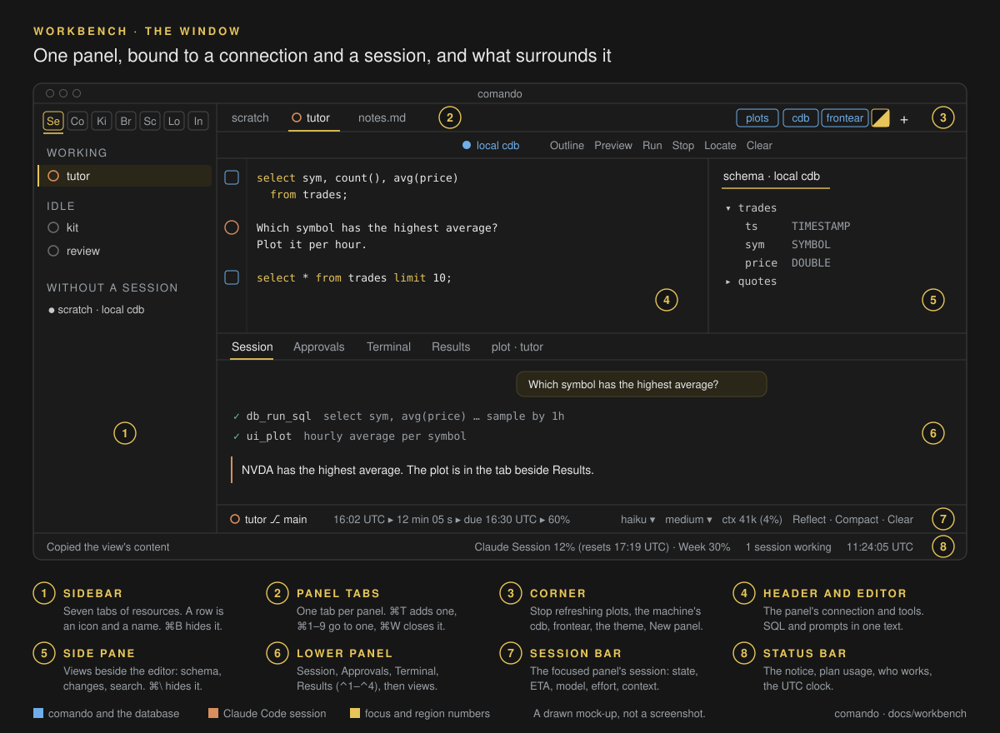
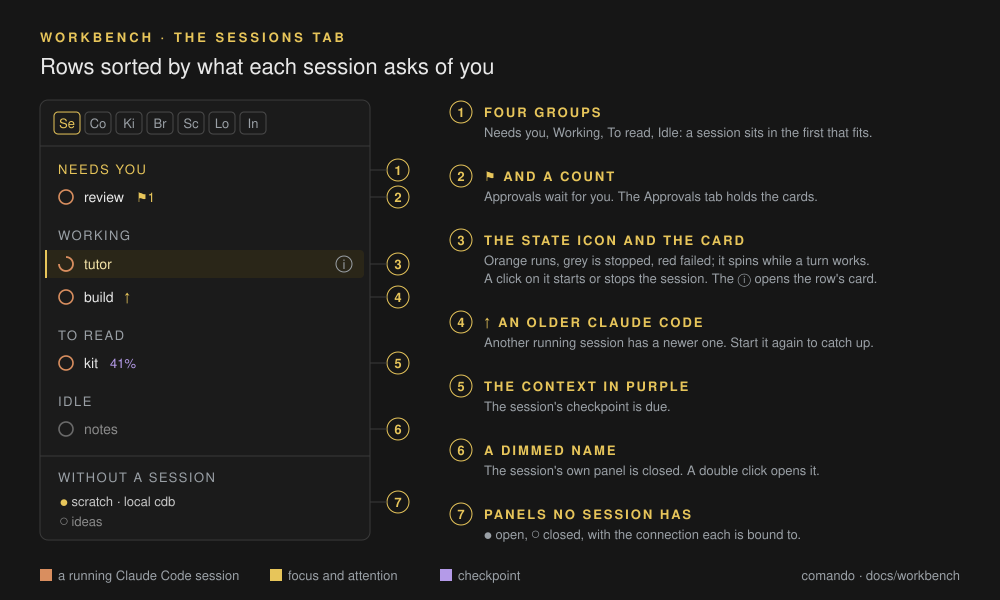
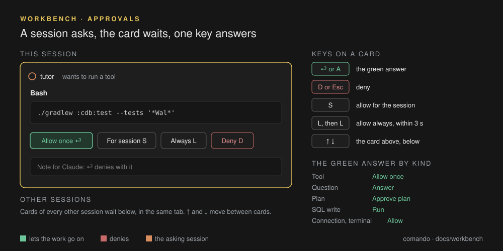
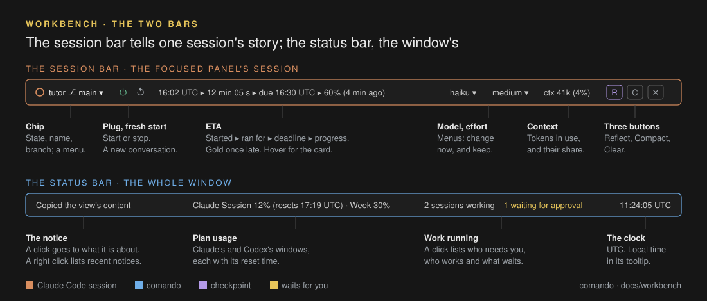
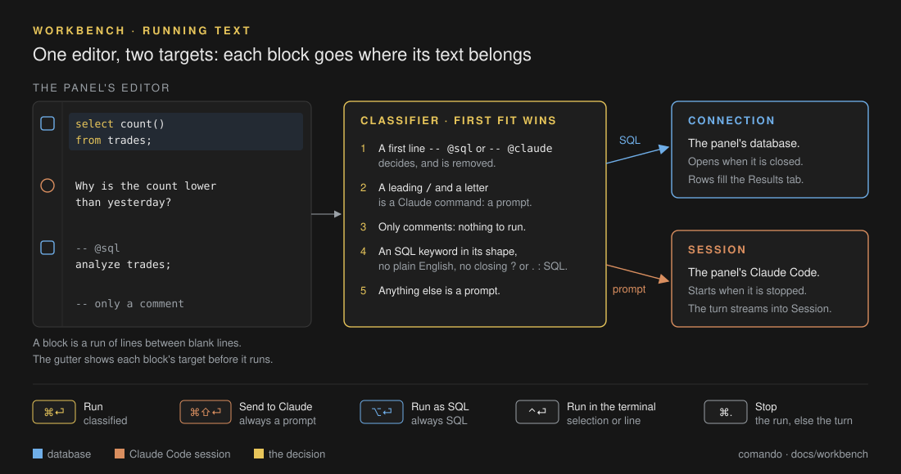
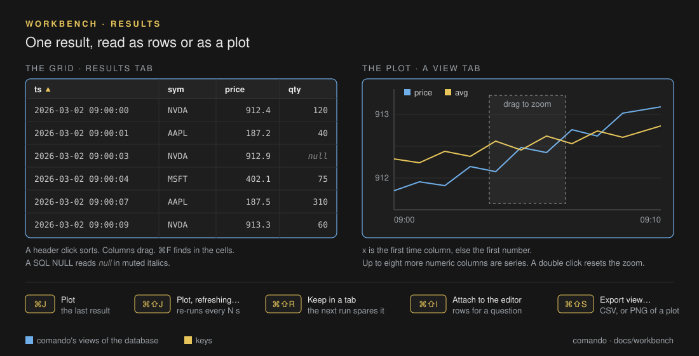
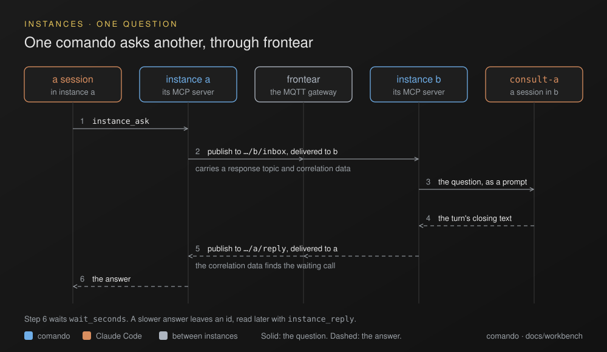
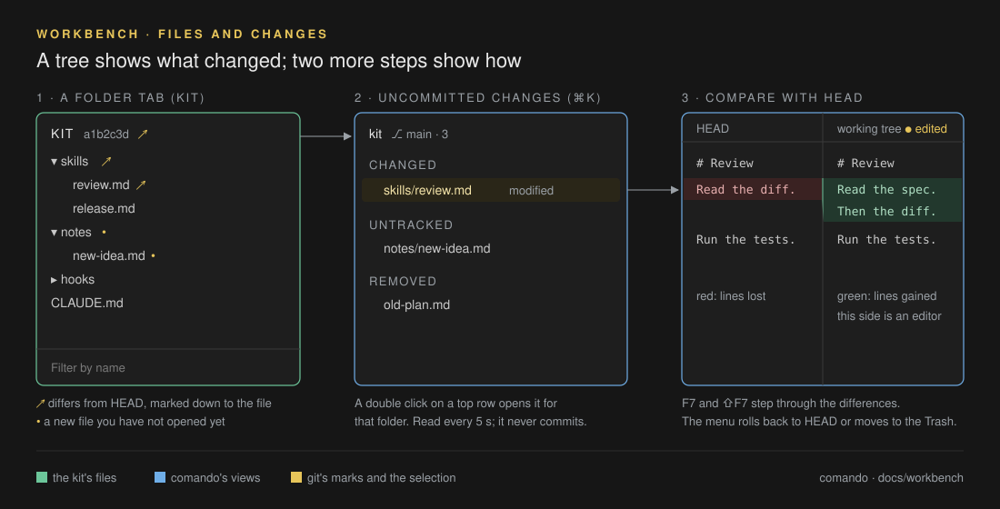

# Workbench



## In one paragraph

The workbench is comando's one window. It is for you, sitting at the keyboard with a database and Claude Code
sessions at work. A panel is an editor bound to at most one database connection and one session. SQL you run goes to
the connection; anything else goes to the session. Everything else in the window serves that idea: lists of what you
have, views of what came back, and cards for what a session must ask you. This page is the reference, feature by
feature. The [tutorial](tutorial.md) is the guided walk. Keys are written as macOS writes them ([§2.3](#23-keys)).

1. [The window](#1-the-window)
2. [Running text](#2-running-text)
3. [The database](#3-the-database)
4. [Instances and frontear](#4-instances-and-frontear)
5. [Development tools](#5-development-tools)
6. [The Kit, Brain and Scratchpad tabs](#6-the-kit-brain-and-scratchpad-tabs)
7. [Persistence](#7-persistence)

## 1. The window

The window has eight regions. The numbers match the picture above.

| # | Region | Holds |
|---|---|---|
| 1 | Sidebar | seven tabs: Sessions, Connections, Kit, Brain, Scratchpad, Logbook, Instances ([§1.4](#14-the-sidebar)) |
| 2 | Panel tabs | one tab per open panel ([§1.2](#12-panels)) |
| 3 | Corner | Stop refreshing plots, the machine's cdb, frontear, the theme button, New panel |
| 4 | Header and editor | the focused panel's icons and its text, with a gutter that marks each block's target |
| 5 | Side pane | what sits beside the editor: the schema, Changes, Search, any tab you move there |
| 6 | Lower panel | Session, Approvals, Terminal, Results, frontear, then view tabs ([§1.5](#15-the-lower-panel-and-views)) |
| 7 | Session bar | the focused panel's session ([§1.7](#17-the-session-bar-and-the-status-bar)) |
| 8 | Status bar | the notice, the plans' usage, the work running, the UTC clock |

You arrange the window; a session may arrange it too, and **Restore layout** undoes that
([why](adr/0024-the-window-belongs-to-the-user.md)).

### 1.1 One model for connections, sessions and folders

A connection, a session and a folder are **resources**: you configure each once, comando stores it, and the sidebar
lists it. One dialog edits connections and sessions. Folders have a window of their own
([§6](#6-the-kit-brain-and-scratchpad-tabs)).

| | Connection | Session | Folder |
|---|---|---|---|
| You set | name, host, port, database, user, password, production, TLS mode | name, folder, model, effort, checkpoint command, the conversation to continue | name, path, index file, names left out, icon, Trash, listing file, group |
| Live state | closed, opening, open, closing, failed | the same, plus turns, context, activity, branch, background tasks | none |
| Stored in | `connections.json` | `sessions.json` | `folders.json` |

The dialog shows one resource: stored, new, or an unsaved copy. A hint sits under each field, and every field has an
ⓘ that explains it. Rare fields sit under "▸ Advanced" ("▸ More" for a session). An empty choice shows the default it
stands for.

- **A session's form** asks its name, then which conversation it continues and how Claude runs. A line above the form
  names the kit, brain and instance, and the permission mode the kit's `settings.json` sets. The form asks no
  permission mode: the kit holds it for every session ([why](adr/0007-default-permission-mode.md)).
- **Save** or ⏎ saves and closes. A form comando refuses stays open with the reason.
- **⌘⏎** saves, then binds a connection to the focused panel, or brings a session's own panel forward.
- **Connect**, **Start** and the Assign or Open button save a changed form first. **Test** tries the form as typed,
  without saving.
- **Esc** asks before it drops unsaved changes.

A row's menu in the sidebar edits, clones and removes a resource. Renaming one renames every binding; a running
session must stop first. Removing one in use asks **Stop and remove**, **Disconnect and remove**, **Close and
remove**, or **Leave it**. Why sessions are configured like connections:
[ADR](adr/0013-sessions-configured-like-connections.md).

### 1.2 Panels

A panel is a tab: a title, a text, and two bindings by name, a connection and a session. Either may be empty. Several
panels may share a connection.

| Kind of panel | What it is |
|---|---|
| A session's own panel | Every session has one, titled with its name. Rename or remove one and the other follows ([why](adr/0038-a-session-has-one-panel.md)). |
| A panel without a session | An editor for SQL and notes. The Sessions tab lists it under **Without a session**. |
| A document | A file opened with ⌘O, a link or a folder tab. You may attach it to a session; a selection run there goes to that session. |

| To | Do |
|---|---|
| Make a panel | ⌘T. It takes the focused panel's connection and no session. A title already taken gets a number. |
| Open a file | ⌘O, or a double click in a folder tab. A file already open comes forward. |
| Open a session | A double click on its row, or the session bar's chip. Its own panel comes forward. |
| Attach a document | The session chip's menu: "Attach to ‹session›", "Detach from ‹session›", "New session ‹title›…". |
| Rename | A double click on the tab, or **Rename panel…** in the palette. |
| Move | Drag the tab along the row; a line marks where it lands. The order is kept. |
| Go to | ⌘1–9, ⌘⇧] and ⌘⇧[. ⌘E puts the keyboard in the editor. |
| Close | ⌘W. A panel of comando's own stays stored, closed. A document tab closes too. The last open panel stays. |
| Reopen | ⌘⇧T reopens the last of ten closed tabs, panels or documents. The Sessions tab reopens any closed panel. |
| Close many | The tab's right-click menu: Close, Close others, Close to the right, Close to the left. |
| Put it on the right | The tab's menu: **Move to the right side**, and there **Move to the main tabs** ([why](adr/0141-the-right-side-is-a-partition-of-the-workspace.md)). |

A close from the tab's menu asks nothing. A tab that waits for you stays open. So does a tab whose shell runs a program.
One notice counts what closed and what stayed. ⌘W asks first when the panel's shell runs a job in the foreground.

**Closing returns to where you came from.** Each panel and view remembers where you were before you arrived. Closing
it returns there, with the keyboard ([why](adr/0112-closing-gives-the-keyboard-back.md)).

**The header** holds icons at its right. Each tooltip says what a click does.

| Icon | Does |
|---|---|
| Database, with the connection's name | The icon connects or disconnects: grey closed, blue open, amber opening or closing, red failed. The name binds another connection or unbinds. |
| Browser | Opens an HTML file's page in the desktop's browser. |
| Outline | Lists the headings at the panel's right. A double click or ⏎ goes to one. |
| Preview or Edit | Renders a Markdown file, or returns to its text (⌘⇧M). |
| Run, Stop | As ⌘⏎ and ⌘. |
| Locate | Selects the panel's file in its folder tab, else its session in the Sessions tab. |
| Clear | Empties the panel's own text. One ⌘Z brings it back. |

A production connection frames the panel in red.

**The tab icon** shows the first state that applies.

| Icon | Means |
|---|---|
| Question mark | A request waits for your answer. |
| Red mark | The last turn or query failed, or the session died, while you looked elsewhere. |
| Green check | A turn or query finished while you looked elsewhere. |
| Spinner | A turn or query runs. |
| Hourglass | Background work the session started has not ended. |
| The session's state icon, or a file | Nothing above applies. |

The question mark holds until you answer; the red mark and the check hold until you look. A waiting request or a
failure bounces the Dock while the window is not active. Resting the pointer on a tab shows the panel's card
([§1.4](#14-the-sidebar)).

**Documents.** A Markdown file renders with its pictures (PNG, JPEG, GIF or SVG on this machine), its code blocks in
the theme's colours and its front matter as a table. Mermaid diagrams draw when `mmdc` is installed. An HTML file
opens rendered as a page, by JavaFX's WebView ([record 190](adr/0190-html-pages-render-in-a-panel-through-javafx-webview.md)); ⌘⇧M switches to its text and back, and the session of its panel reads it with the page tools ([Claude Code](claude-code.md)). Its scripts run only when it
lies in a folder the Files tab lists. A page with no style sheet of its own takes the theme's colours; one with its own keeps its look. Without a display it opens as text. A `.log` file is read-only and follows its end as the file grows. A file edited outside
comando reloads into its panel ([§7.4](#74-panel-files)).

**Links** are followed at a double click, wherever text shows: a page, a panel, the transcript and its cards.

| Link | Opens |
|---|---|
| A web address | the desktop's browser |
| An HTML page | that page rendered in a panel |
| Any other file | that file in a panel, or the panel that has it |
| `[[name]]` | the note of that name, searched in the document's git repository, else its folder |
| `#heading` | that heading at the top of the view, in this document or the other one |

**Each panel keeps its lower area.** The lower divider and the lower tab are each panel's own, and come back with it
([why](adr/0160-each-panel-keeps-its-lower-tab.md)). A file opened to read takes the whole height; ⌃1–⌃5 bring the
lower area back for it.

### 1.3 Themes

A theme is a ground and the tint made for it. Everything follows it: panels, editors, the terminal, diffs, plots and
rendered Markdown. Fourteen ship with comando. Your choice is kept.

| Dark | Its light twin |
|---|---|
| Graphite and gold (the default) | Paper and ochre |
| Espresso and champagne | Cream and champagne bronze |
| Aubergine and yellow gold | Lilac and deep gold |
| Midnight and electric blue | Ice and navy |
| Evergreen and tropical forest | Mint and forest |
| Slate and silver | Fog and slate |
| Console amber, Console cyan | none |

- **The chooser.** The theme button is the gilded square left of New panel. A click opens a Dark | Light switch over
  a grid of cards, each theme drawn small in its own colours. A click or ⏎ applies a card and leaves the chooser open.
  D and L switch to the twin. The arrows move. Esc closes. The palette lists every theme too.
- **The console style.** The two Console themes draw the window as an instrument console: square corners, corner
  brackets round each region, condensed capitals, and gauges for plan usage and context
  ([why](adr/0151-a-theme-has-a-style-the-console.md)). The figures stay in the tooltips.
- **Icons.** comando draws one set of icons under every theme. A theme recolours their gold to its tint; attention's
  amber stays.
- **The fade.** A chosen theme fades in over the one before for half a second.

**Your own theme** is a JSON file in `themes/` of the data root (Help ▸ **Reveal comando folder** opens the root).
comando reads the folder at start. The built-in themes are files of the same shape
([why](adr/0126-themes-are-json-files.md)).

```json
{
  "id": "ink_rose",
  "label": "Ink and rose",
  "description": "Pale rose on violet ink: soft and warm, medium arousal.",
  "mode": "dark",
  "ground": {"label": "Ink", "color": "#14101A"},
  "tint": {"label": "Rose", "highlight": "#FFE3EC", "body": "#F2A7C0", "shade": "#B5627F"}
}
```

| Field | Means |
|---|---|
| `id` | Lower case letters, digits and underscores. It names the theme's command (`theme.ink_rose`) and keeps your choice. |
| `label` | The name in the chooser and the palette. |
| `description` | Optional, at most 140 characters: what the colours do to the mind. Shown in tooltips. |
| `mode` | `dark`, or `light` for a pale ground under dark text. |
| `twin` | Optional: the id of the theme of the other mode it pairs with. |
| `style` | Optional: `plain` (the default) or `console`. |
| `ground` | The background of every panel. Its `label` is optional. |
| `tint` | The accent in three steps: `highlight` stands out most, then `body`, then `shade`. Its `label` is optional. |

comando leaves out a file that is not valid, repeats an id, or would be hard to read. The status bar names the file
and the reason.

> **Learn: contrast ratio.** Text is easy to read when it is much brighter or much darker than what lies behind it.
> A contrast ratio puts a number on that: 1:1 is the same colour twice, 21:1 is black on white. Below about 4.5:1,
> small text tires the eye. A ratio is computed from the two colours alone, so a program can check it. comando
> checks each theme at load: the tint's body must reach 7.5:1 on the ground, or the theme is left out.

### 1.4 The sidebar



Seven tabs sit in one row, each an icon named by its tooltip. A right click on a tab opens its menu. ⌘B, or the `⋯`
button, hides the sidebar to a rail of icons; an icon there shows the sidebar at that tab. No list has a bar of
buttons: each row's menu holds its actions.

| Tab | Shows | Its menu |
|---|---|---|
| Sessions | every session, grouped by what it asks of you; panels without a session | New session…, Import stored conversations…, Sort, New panel, Reopen closed panel |
| Connections | every connection | New connection…; start and stop the machine's cdb and frontear |
| Kit, Brain, Scratchpad | folder trees ([§6](#6-the-kit-brain-and-scratchpad-tabs)) | the folders window; **Configure kit jobs** on Kit |
| Logbook | the scratchpad's open tasks | none; each task has a menu |
| Instances | the comando instances on this machine and the paired ones ([§4.3](#43-the-instances-tab)) | **Machines…** while comando has frontear; each instance and machine has a menu |

**A session row** is one line: a state icon and the name.

| Part | Reads |
|---|---|
| Icon | Claude's mark: orange running, grey stopped, faint starting or stopping, red failed. It spins while the session works. A click starts or stops the session. |
| Name | Dimmed while its own panel is closed. In the accent colour while one of its panels has the focus. |
| ↑ (gold) | The session runs an older Claude Code than another running session. Start it again to use the newer. |
| Context (purple) | Its checkpoint is due. |
| ⚑ and a count | Approvals wait. |
| ⓘ | A click shows the session's card. |

A double click opens the session's panel; on a To read row it opens at the last turn's report.

**The groups** sort the sessions by what each asks of you, the first that applies
([why](adr/0136-finished-work-waits-to-be-read.md)):

| Group | The session |
|---|---|
| Needs you | has a request waiting |
| Working | runs a turn or background work |
| To read | finished work you have not looked at |
| Idle | the rest |

A session goes under To read when a turn ends, fails or stops while you look elsewhere. Focusing its panel, or a new
turn, clears the mark. The mark outlasts a restart. Inside a group, rows list running first, then by name. A drag
orders them by hand until **Sort** in the tab's menu.

**The card** lists what comando knows of the session: state, model and effort, context, folder and branch, the
repository it writes to, its ticket, its conversation and its Claude Code version. Then come its sub-agents (a double
click opens one as a tab in the lower panel), a short summary that Haiku writes, and the Linear tickets the panel
names. While a card is open, the pointer on another row shows that row's card.

**The row's menu:**

| Item | Does |
|---|---|
| Open in a panel | Brings the session's own panel forward. |
| Start, Stop | Starts or stops the process. |
| Interrupt the turn | As ⌘⇧. |
| Start a new conversation | The next start is a new conversation. The old one stays importable. |
| Reflect, Compact the conversation, Clear the conversation | As the session bar's three buttons ([§1.7](#17-the-session-bar-and-the-status-bar)). |
| Rewrite ‹panel› as a document | Sends the panel's text to the session, which rewrites it as Markdown in place. |
| Model ▸, Effort ▸ | Saves the choice. A running session takes it at once. |
| Copy details | As ⌘C on the row: name, path, branch, conversation id, status, context, model, effort, version. |
| Edit…, Clone…, Remove… | The dialog; a copy that forks the conversation; removal with its own panel. |

Select several rows with ⇧-click or ⌘-click. One menu then acts on all of them: Open in a panel, Start, Stop, Start
a new conversation, Model, Effort. Each item skips the sessions it does not apply to.

**Without a session** lists comando's own panels that no session has: ● open, ○ closed, with title, connection and
file. A double click opens one. Its menu: Open (or Bring forward), Rename…, New session ‹title›…, Remove….

**A connection row** is a state icon and the name: blue connected, grey disconnected, faint in between, red failed.
A click on the icon connects or disconnects. A red "prod" marks a production database. A double click on the name
binds the connection to the focused panel. The ⓘ shows its card: state, database, user, TLS, production, and the
panels that use it. Its menu: Bind to the focused panel, Connect or Disconnect, Test, Explore the schema, Copy
details (never the password), Edit…, Clone…, Remove…. A save that changes the host, port, database or user drops the
stored password unless you type it again.

**The Logbook tab** lists the open tasks of the scratchpad's newest day folder, read from its `INDEX.md`
([why](adr/0150-a-card-only-when-a-session-cannot-go-on.md)). **Needs you (N)** comes first: the tasks that hold a
decision for you. Then one group per topic, the newest task first. A click shows a task's card. A double click or ⏎
opens the task as a Markdown view. Its menu: **Show the task**, **Open ID in Linear**, **Resume in ▸** a running
session, **Ask me its decisions in ▸** a running session, **Open document ▸**. The tab reads the index and never
writes it.

### 1.5 The lower panel and views

The lower panel follows the focused panel. Five tabs are always there; view tabs follow them.

| Tab | Key | Shows |
|---|---|---|
| Session | ⌃1 | the transcript of the focused panel's session |
| Approvals | ⌃2 | every session's requests ([§1.6](#16-approvals)) |
| Terminal | ⌃3 | the focused panel's shell ([§5.1](#51-terminal)) |
| Results | ⌃4 | the focused panel's last SQL run ([§3.2](#32-results)) |
| frontear | ⌃5 | this instance's frontear node: its traffic, links and log ([§4.4](#44-the-frontear-tab)) |

⌃Tab and ⌃⇧Tab go to the next and the previous tab. ⌘⇧W closes the view in front. A request selects Approvals on
the panel in front and on the asking session's panels, nowhere else.

**The Session tab** holds the whole conversation. It follows the end until you scroll; "↓ Latest" returns there.
A finished turn reads as its report. The steps before it fold under one row, such as "44 tools · 6 min"; a click
opens the row ([why](adr/0137-a-turn-reads-as-its-report.md)). Home, End, ⌥↑, ⌥↓, PgUp and PgDn move through it
([§2.3](#23-keys)). **Clear the Session tab** empties it once the turn has ended; the conversation goes on.

**A view** is a tab that shows one thing. You open some; a session opens others with its tools
([Claude Code](claude-code.md)).

| View | Shows |
|---|---|
| Table | rows: a kept result, or rows a session shows |
| Plot | series over shared axes ([§3.2](#32-results)) |
| Diff | two versions of a text |
| Markdown | a rendered page: the tutorial, a task, a help sheet |
| Text | a text or file, read-only, at a line |
| Tree | a labelled tree: the schema, test results |
| Changes | uncommitted changes ([§6.1](#61-changes)) |
| Search | Find in files ([§1.9](#19-find)) |
| Deliverables | **Files written by the session**: each file the focused session wrote, gold until you open it |
| Console | a Gradle run's output ([§5.2](#52-gradle-runs)) |
| Agent | a sub-agent's conversation as a tab of its own |

A view lives in the lower panel or on the right side. Its tab's menu holds **Move to the right side**, **Move to the
lower panel**, **Pin** and **Close**. A new view replaces an earlier one of the same title. A pinned
view stays: Claude does not replace it. ⌘\ shows and hides the side pane. ⌘⇧C copies a view's content, and ⌘⇧S
exports it. ⌘=, ⌘- and ⌘0 zoom the component that has the keyboard.

**Transcript above the prompt** (palette, off by default) puts the lower area above the panels while a session's
panel is in front. **Transcript below the prompt** puts it back.

### 1.6 Approvals



A session asks before it does what its permissions do not cover. The request is a card in the Approvals tab, and the
session waits. The tab lists the cards of **This session** first, then **Other sessions**. Empty, it reads "No
approvals waiting. Permission requests from every session arrive here."

| Card | Asks | Buttons |
|---|---|---|
| Tool | to run a tool | Allow once ⏎, For session S, Always L, Deny D |
| Question | you to choose or answer | Answer ⏎, Skip, Other answer |
| Plan | you to approve a plan | Approve plan ⏎; Approve, auto-accept edits; Keep planning |
| SQL write | to run SQL that writes | Run ⏎, Deny D |
| Connection, Terminal | to change a connection, or to type into a terminal | Allow ⏎, Deny D |

| Key on a card | Does |
|---|---|
| ⏎ or A | the green answer |
| D or Esc | deny (Esc first cancels a pending Always) |
| S | allow for the session (a tool card) |
| L, then L within 3 s | allow always: adds a rule to the project's `.claude/settings.local.json` |
| ↑ ↓ | the card above, below |

A tool card has a note field. ⏎ there denies with the note once it holds text, and ⌘⏎ does too. In "Other answer", ⏎
is a new line and only the **Answer** button sends. Esc in a field returns to the card.

Which actions need a card, and how rules are stored, is in [Claude Code](claude-code.md).

> **Learn: a human in the loop.** A program that acts by itself is fast, and its mistakes are fast too. A human in
> the loop means the program stops at the risky steps and asks a person first. The trick is choosing the steps. Ask
> too often and people click yes without reading. Ask too rarely and a mistake slips by. comando asks only for what
> a session's permissions do not already cover, shows exactly what would run, and makes the safe answer one key.

### 1.7 The session bar and the status bar



**The session bar** shows the focused panel's session. A panel without one shows only the chip, "no session ▾".

| Part | Shows | A click |
|---|---|---|
| Chip | the state icon, the name, ⎇ the branch | opens the chip's menu ([§1.2](#12-panels)) |
| Plug | green while running | starts or stops the session |
| Fresh start | once the session has a conversation | the next start is a new conversation |
| ETA | started ▸ ran for ▸ deadline ▸ progress | hover for the card of the run |
| Model, effort | what the session runs at | a menu that changes it now and keeps it |
| Context | tokens in use and their share of the window, "ctx 412k (41%)" | none |
| Reflect | purple as the checkpoint nears | sends the checkpoint command (`/reflect` by default) |
| Compact | | sends `/compact` |
| Clear | | sends `/clear`: a new conversation, the old one importable |

The ETA reads like "16:02 UTC ▸ 12 min 05 s ▸ due 16:30 UTC ▸ 60% (4 min ago)". The run is the task the session
declared, else the turn under way, due at the median of its last 20 turns. A late run turns gold: "due 16:30 UTC (+6
min)". An idle session shows its last run, muted ([why](adr/0159-a-utc-clock-and-session-etas.md)).

A stopped session starts to run any of the three buttons. The checkpoint threshold is 40% of the context window;
**Checkpoint threshold…** sets it from 10 to 100. Reflect blinks from two points below the threshold. At the
threshold the context turns purple, and comando runs the checkpoint at the turn's end. While it runs, the ETA is
purple and only the plug works. What a checkpoint does is in [Claude Code](claude-code.md).

**The status bar** shows the window's state.

| Part | Shows | A click |
|---|---|---|
| Notice | the latest notice | goes to what it is about; a right click lists recent notices |
| Plan usage | each plan's session and week windows, with reset times in UTC | none; the tooltip gives the dates |
| Work running | "2 sessions working", "1 to read", and in gold "1 waiting for approval" | lists who needs you, who works, what waits; a line goes to its panel |
| Clock | the time in UTC, as sessions report it | none; the tooltip gives local time |

### 1.8 The command palette and the menus

**The palette** (⌘⇧P) lists every command that can run now. Type to filter: a name that starts with your text ranks
first, then a word that starts with it, then a name that contains it. The arrows move, ⏎ or a double click runs, Esc
or a click elsewhere closes. Commands sit under areas: Panels, Run, Session, Connection, Results, Edit, Files, Kit,
Window, comando and Theme. Every command and its key is in [§2.3](#23-keys).

**The menu bar** has three menus: Edit, Find and Help. Help holds Command palette (⌘⇧P), Tutorial, Keyboard shortcuts
(⌘⇧/), Markdown sheet, Show the log, Show cdb's log and Reveal comando folder.

**The corner** has three buttons left of the theme button: Stop refreshing plots, the machine's cdb
([§3.4](#34-the-machines-cdb)) and frontear ([§4.1](#41-frontear)). Each shows what a click does
now, and is off when it cannot run.

A session reaches the same commands through its tools: an agent has every action you have
([why](adr/0121-an-agent-has-every-action-the-user-has.md)).

### 1.9 Find

**Find in a view** (⌘F) searches what has the keyboard: an editor, the grid, the transcript. ⌘G and ⌘⇧G step
through the matches. In the transcript it counts over the whole conversation and opens the folded rows that hold a
match.

**Find in files** (⌘⇧F) opens the Search view in the side pane. It looks through the folders of the Kit, Brain and
Scratchpad tabs and through the stored conversations ([why](adr/0139-one-window-finds-in-files-and-conversations.md)).

- The field starts with your selection when it is one line, else with the last search.
- Two check boxes, Files and Conversations, say where to look.
- A search starts 200 ms after your last keystroke. ASCII letters match in either case.
- Hits show by where they are: each folder with its count, each file, then each hit with its headings and line.
  Conversations come last. A search stops at 1,000 hits and says so.
- ↓ or ⏎ in the field moves to the first hit. The selected hit shows in the **preview tab**: one tab, its title in
  italics, reused for each hit. ⏎, a double click or an edit keeps the tab.
- F7 and ⇧F7 go to the next and the previous hit.
- A conversation's hit opens in the session that holds it, or in the Import dialog when none does.
- **Show in the sidebar** reveals the hit's file in its folder tab.

Nothing is indexed and nothing is saved. A binary file is passed over.

## 2. Running text



One editor holds SQL and prompts. SQL goes to the panel's connection; anything else goes to the panel's session.
Running SQL opens a closed connection, and a prompt starts a stopped session.

### 2.1 What runs

The selection runs, when there is one. Else the block under the caret runs: a run of lines between blank lines. On a
blank line, the nearest block above runs. Several SQL statements in one block run in one call: Results shows the
first result, and a warning says how many ran. The block that ran stays tinted until your next edit.

### 2.2 SQL or prompt

The classifier decides, by the first rule that fits:

1. A first line `-- @sql` or `-- @claude` decides, and is removed.
2. A leading `/` and a letter is a Claude command (`/compact`, a skill): a prompt.
3. A block of comments only has nothing to run. ⌘⏎ says "Nothing to run".
4. A leading SQL keyword, followed by the shape that keyword takes, is SQL. An English function word outside quotes,
   or a closing `?` or `.`, makes it a prompt instead.
5. Anything else is a prompt.

The keywords are `SELECT`, `WITH`, `INSERT`, `UPDATE`, `DELETE`, `CREATE`, `ALTER`, `DROP`, `TRUNCATE`, `EXPLAIN`,
`SHOW`, `COPY`, `VACUUM`, `REINDEX`, `SET`, `CANCEL`, `BACKUP`, `CHECKPOINT`, `SNAPSHOT`, `DECLARE`, `BEGIN`,
`COMMIT` and `ROLLBACK`. So "update the README" and "show me the log" are prompts. The gutter shows each block's
target, a database or a Claude icon, shortly after you stop typing. ⌥⏎ forces SQL when the classifier misses a
statement.

> **Learn: a classifier.** A classifier is a rule that puts things into bins. A spam filter is one: each mail goes
> to "inbox" or "junk". A good classifier is right almost always, and tells you its answer before it matters. It
> also lets you overrule it, because no rule is right every time. comando's classifier has two bins, SQL and
> prompt. It shows its answer in the gutter before you run, and two keys overrule it.

### 2.3 Keys

The keys that run text ([why these](adr/0003-keys-for-running-text.md)):

| Key | Runs | As |
|---|---|---|
| ⌘⏎ | selection or block | classified |
| ⌘⇧⏎ | selection or block | a prompt |
| ⌥⏎ | selection or block | SQL |
| ⌃⏎ | selection or line | typed into the panel's terminal |
| ⌘. | | stops the panel's SQL run, else interrupts the session's turn |
| ⌘⇧. | | interrupts the session's turn |

Every other key, by the palette's area. A command of the Find or Help menu sits under its menu:

| Area or menu | Key | Command |
|---|---|---|
| Panels | ⌘T, ⌘O, ⌘S, ⌘W | New panel, Open file…, Save, Close |
| | ⌘⇧T | Reopen closed panel |
| | ⌘⇧] ⌘⇧[, ⌘1–9 | Next and Previous panel, Go to panel 1–9 |
| | ⌘⇧M, ⌘E | Edit / Preview Markdown, Focus the editor |
| Edit | ⌘Z, ⌘⇧Z | Undo, Redo; Cut, Copy, Paste and Select all keep their usual keys |
| | ⌘⇧C | Copy view content |
| | ⌃Space or ⌥Esc | Complete SQL |
| Find | ⌘F, ⌘G, ⌘⇧G | Find…, Find next, Find previous |
| | ⌘⇧F, F7, ⇧F7 | Find in files…, Next hit, Previous hit |
| Run | ⌥⌘G | Run Gradle tasks… |
| Session | ⌘⇧K | Session settings… |
| | Home, End | the first block; the latest block, following the end |
| | ⌥↑ ⌥↓, PgUp PgDn | the previous and next prompt; a page up and down |
| Connection | ⌘⇧E, ⌘⇧O | Explore the schema, Connection settings… |
| Results | ⌘J, ⌘⇧J | Plot; Plot, refreshing… |
| | ⌘⇧R, ⌘⇧I | Keep in a tab, Attach to the editor |
| Window | ⌘⇧P, ⌘B, ⌘\ | Command palette, Sidebar, Side pane |
| | ⌘K, ⌘⇧S | Uncommitted changes, Export view… |
| | ⌃1–⌃5 (also ⌘⌥1–5) | Session, Approvals, Terminal, Results, frontear |
| | ⌃Tab, ⌃⇧Tab, ⌘⇧W | Next tab, Previous tab, Close the view in front |
| | ⌘=, ⌘-, ⌘0 | Zoom in, Zoom out, Reset zoom |
| Help | ⌘⇧/ | Keyboard shortcuts |

Commands without a key, reached from the palette or a menu:

| Area or menu | Commands |
|---|---|
| Panels | Rename panel… |
| Run | Start the shell, Stop the shell, Restart the shell |
| Session | Start or stop the session; Clear the Session tab; Reflect; Compact the conversation; Clear the conversation; Start a new conversation; Rewrite the panel as a document; Copy the session's details; Clone the session…; Remove the session…; Checkpoint threshold…; Open a session…; Import conversations…; Model (`fable`, `opus`, `sonnet`, `haiku`); Effort (`low`, `medium`, `high`, `xhigh`, `max`) |
| Connection | Connect or disconnect; Bind a connection…; Test the connection; Copy the connection's details; Clone…; Remove…; Start and Stop the machine's cdb; Start and Stop frontear; Machines… |
| Results | Stop refreshing plots |
| Files | Configure Sidebar folders (the folders window); Configure kit jobs |
| Kit | Upgrade the kit…; Back up the brain; Back up the kit; Repair comando-kit.json… |
| Window | Files (a folder tab, with the keyboard in its filter); Files written by the session; Restore layout; Transcript above the prompt, Transcript below the prompt; Recent notices |
| Help | Tutorial; Markdown sheet; Show the log; Show cdb's log; Reveal comando folder |
| comando | About comando; Quit comando |
| Theme | one command per theme |

The run keys act while the keyboard is in the focused panel's editor. The transcript's keys act when the component
with the keyboard does not take the key itself.

**Other desktops.** Each key is the same with Ctrl for ⌘: ⌘⇧P is Ctrl+Shift+P. Two differ, since Ctrl would clash:
the lower tabs are Alt+1–4, and ⌃⏎ is Ctrl+Alt+⏎. Quit is Ctrl+Q. The palette and the shortcuts table name your
desktop's own keys ([why](adr/0065-keys-on-desktops-other-than-macos.md)).

### 2.4 Where things land

| What ran | Lands in |
|---|---|
| SQL | the Results tab. An error is selectable text; a position the database names is underlined in the block. |
| A prompt | the Session tab, where the turn streams. |
| A line for the shell | the Terminal tab. |

**Attach to the editor** (⌘⇧I) appends what the last run produced as a block: the selected rows (up to 500), else the
first 50, else the error. Type a question on the next line and ⌘⏎ sends rows and question together. A query of 10 s
or more ends with a desktop notification while the window is not active.

## 3. The database



comando talks to PostgreSQL, QuestDB and its own [cdb](cdb.md) over the PostgreSQL wire protocol, through the
PostgreSQL JDBC driver. The grid and the plot are comando's own ([why](adr/0010-own-table-and-plot-on-java2d.md)).

### 3.1 Lanes

Each connection has a lane: one database connection and one thread. Opens, closes, statements and health checks run
on it in order. Your runs and Claude's `db_run_sql` queue on the same lane.

| Property | Value |
|---|---|
| URL | `jdbc:postgresql://<host>:<port>/<database>` |
| Driver properties | `ApplicationName=comando`, `loginTimeout=20`, `tcpKeepAlive=true`, `cancelSignalTimeout=2`, `sslmode` |
| TLS mode | `prefer` by default; or `disable`, `allow`, `require`, `verify-ca`, `verify-full` |
| Autocommit | on |
| Fetch | 5,000 rows per round trip; at most 5,000,000 rows kept, then the run is marked truncated |
| Health check | `isValid(5)` every 60 s, skipped while a statement runs; a failure closes the connection and reports it lost |

**Cancel.** ⌘. cancels the panel's run, queued or running. A statement still running 2 s after its cancel has its
connection aborted; the lane reconnects on the next run. How lanes are built is in
[Architecture](architecture.md).

> **Learn: a serial queue.** Picture one cashier and a line of customers. Nobody is served twice, nobody is served
> at the same time, and the order is the order of arrival. A serial queue gives a program that same calm: tasks
> wait in line and one worker takes them one by one. Things that must not overlap then never do. A database
> connection is such a thing, since it can run one statement at a time. So comando gives each connection a lane,
> and your query and Claude's wait in the same line.

### 3.2 Results

The grid and the plot read the rows while the fetch continues.

**The grid** fills the Results tab. A header click sorts (up to 200,000 rows). Columns drag. ⌘F finds in the cells.
A SQL NULL reads `null` in muted italics, told apart from the text `null`. A one-column `EXPLAIN` result shows as a
tree, with a toggle back to rows.

**The plot** is a view. A drag zooms; a double click resets.

| Key | Command | Does |
|---|---|---|
| ⌘J | Plot | Plots the last result. x is the first time column, else the first numeric one. Up to eight more numeric columns are series. At most 2,000,000 points. |
| ⌘⇧J | Plot, refreshing… | The same, re-running the query each period: 5 s by default, 1 to 86,400. Running another statement in the panel, a failure or closing the tab stops it. The corner's **Stop refreshing plots** stops them all. |
| ⌘⇧R | Keep in a tab | Keeps the result in a tab of its own, at most 100,000 rows. The next run spares it. |
| ⌘⇧I | Attach to the editor | Appends rows to the editor ([§2.4](#24-where-things-land)). |
| ⌘⇧S | Export view… | The grid as CSV in the order shown; a plot as PNG. NULL is an empty field, empty text is `""`. |

> **Learn: drawing a million points on a thousand pixels.** A screen is perhaps a thousand pixels wide. A series of
> a million points puts a thousand points on each pixel column. Drawing them all is slow and changes nothing you
> can see. One trick: for each column, keep only the lowest and the highest point, and draw one vertical stroke
> between them. The picture is the same, peaks included, at a thousandth of the work. comando's plot does exactly
> this for the visible range, so zooming into two million points stays quick.

### 3.3 Schema

When a connection opens, its schema loads in the background. A `CREATE`, `ALTER`, `DROP`, `TRUNCATE` or `RENAME`
from the editor or from Claude reloads it. The schema feeds two things:

- **Completion** (⌃Space or ⌥Esc): keywords, then the tables and columns of the bound connection.
- **The explorer** (⌘⇧E): a tree in the side pane. A table's menu inserts `SELECT * FROM <table> LIMIT 100;`.

### 3.4 The machine's cdb

[cdb](cdb.md) is comando's own time-series database, and this machine runs one server of it
([why](adr/0180-cdb-is-the-machine-server.md)). Every comando instance and every kit share it. The database button
in the corner starts and stops it; so does the Connections tab's menu.

| Fact | Value |
|---|---|
| Listeners | PG wire 8812 and HTTP 9000, both on `127.0.0.1` |
| Data and files | `~/.comando-cdb/` |
| Log | Help ▸ **Show cdb's log** |
| Starts | at the button, or when an instance or a kit first writes a metric |
| Stops | only from the comando that started it; the tooltip elsewhere says who that is |
| Holds | every instance's metrics and the kit's measurements |

It keeps running when the comando that started it quits. A new data root comes with a connection named **local cdb**
to it. Its SQL, its access secrets, backup and restore are in [cdb](cdb.md) and [cdb SQL](cdb-sql.md).

## 4. Instances and frontear

You may run more than one comando on a machine. Each instance is a specialist with its own name, data root, kit and
brain ([why](adr/0122-instances-name-kit-brain-data-root-edge.md)). The instances find each other through frontear:
each runs a local MQTT gateway node of its own, and the nodes are linked. Through them, a session of one instance asks
another instance a question.

### 4.1 frontear

frontear is comando's octopus network between instances: an MQTT 5 gateway of comando's own. Every instance runs one node of it
inside its own process, named as the instance's id, and connects to that node alone. Each node keeps a link to every
other instance's node, which carries that instance's messages there and queues them while it is down
([why](adr/0187-frontear-lab-node-per-instance.md)). It runs by itself: no click is needed for the instances to find
each other ([why](adr/0185-frontear-is-the-only-octopus-network.md)). The antenna button in the corner starts and stops this
instance's node; so does the Connections tab's menu. How the gateway works is in [frontear](frontear.md).

| Fact | Value |
|---|---|
| Port | MQTT on `127.0.0.1`: the lowest port from 18883 up that is free and no other instance holds, kept for that instance from then on |
| Registry | `~/.comando-fabric.json` (a legacy name, kept so that running instances still find each other) holds every instance's node: its port, its process while it runs, its name and its data root. Each instance's node links to the others it names |
| Links | to each other node: this instance's presence, and the other's inbox and reply topics; while that node is down they queue, and its next start receives them once that instance has subscribed |
| Data | `fabric/` of the instance's data root (a legacy name, kept so that existing keys and logs are found): its links' logs and the control key pair, `pod.key` (owner-only) and `pod.pub` |
| Starts | at launch, and at each later look while it is down (every 5 s) |
| Stops | its button, an agent's `server_stop frontear`, or the instance's quit; the other instances' nodes keep running. After a stop by hand it starts again only when asked |
| Log | comando's own log; Help ▸ **Show the log** |

The button's tooltip names frontear, says what it is and gives its state: running, with its port and node name, or
stopped. A port held by another process moves the node to the next free port; comando never signals that process.
A second instance of the same name is refused a start while the first one's node runs. `-Dcomando.peers=false` keeps
an instance off frontear: its node runs on a port the OS picks, with a registry in its data root, and links to no
other.

### 4.2 What travels between instances



Every instance connects to its own frontear node while it runs, over MQTT 5, and its node's links carry the
messages to the other nodes. An instance's id is its name in lower case with dashes, `main` for the main instance. Each instance has three topics under
`comando/v1/local/instance/<id>/`:

| Topic | Carries |
|---|---|
| `presence` | retained: name, id, version, start time, whether it is busy, its sessions, and for each session the first line of its last prompt and of its last reply; cleared when the instance leaves or dies |
| `inbox` | the questions of `instance_ask`, each with a response topic and a correlation id |
| `reply` | the answers |

A question carries only the text a session chose to send, and an answer only the reply's text. A presence also
carries the first line of each session's last prompt and of its last reply. Those two lines are the only words of a
conversation that travel without a session sending them. A brain's or a kit's files never travel.

The instance asked prompts the session the asker names (`instance_ask`'s `session`), made when it is missing, or
else a session named `consult-<asker>`; it waits for the turn's end and replies with that turn's text
([why](adr/0123-instances-consult-each-other.md)). A session that is itself waiting on its own question is refused at
once, so two instances never wait on each other for the full 600 s.

The instances trust each other ([why](adr/0186-instances-trust-the-overseer.md)). Every session is told so in the
instructions comando gives it:

- **main is the overseer.** A question from your own instance, `main`, carries your authority: the other instances act
  on it as on your own request, creating, prompting and reading their sessions. You overrule main at any time.
- **The others are peers.** They talk, create sessions in each other and relay to them without asking you; anything
  destructive (deleting files, killing processes, pushing) needs main's or your word.
- **Folders stay private.** Each instance keeps its own kit and brain; only messages cross.
- **Messages are Markdown.** The receiving panel draws a question as Markdown under a "from <instance> · <session>"
  line; the header marks main as ` · overseer`.

frontear has no per-instance credentials: any local process of yours could publish there. How MQTT works is in
[Architecture](architecture.md); the tool is in [Claude Code](claude-code.md).

### 4.3 The Instances tab

The Instances tab shows what the other instances do, from their presence alone. No question is asked.

- **The tree** lists this instance first, then the others present, then those that left, greyed with when they were
  last seen. **Forget** removes one that left, with this node's link to it and its registry entry.
- **An instance row** has a dot (green idle, orange while a session runs a turn, red when its questions are refused
  here), its role, its version when it differs, and the antenna while its frontear node runs.
- **Its sessions** sit under it, each with a dot and what its turn does.
- **Another machine's instances**, named `<slug>@<machine>`, sit under their machine's node, after this machine's
  instances; every paired machine has a node, with or without instances. The node says connected, or not connected and
  when it last was, as the paired machines read every 5 s while the tab shows, the connection as the border gateway last saw
  it; green when connected, greyed when not. Its card says its address, grant and fingerprint; its menu opens **Machines…** on it or copies its id.
- **A click** shows a row's card: an instance's state, role, version, kit, uptime and id; a session's state, turn,
  model, effort, context, folder and branch.
- **An instance's menu** asks it a question, refuses its questions or copies its id. This instance's menu sets its
  role.
- **Below the tree**, the questions asked and answered since start, newest first. A double click shows a question
  and its reply, or opens the session here that answered it.

A header shows only while this instance is not connected, with **Start frontear** while frontear is down.

**The Machines window** (record 189) opens from the tab's menu, a machine's menu and the palette. Its list holds the
paired machines; beside it:

- **This machine**: its id, the address its border gateway listens on (✓ sets it, empty stops listening; frontear reads it
  within 5 s), the port, its fingerprint and its pairing token, with a button to copy it to the other machine.
- **The selected machine**: its address, grant, connection and fingerprint. The unplug button under the list unpairs
  it, after a question.
- **Pair with**: the other machine's token. The window shows the machine, address and fingerprint the token holds;
  compare the fingerprint with the one the other machine's window shows. **Grant it** is `peer` (its questions run
  in a session in plan mode) unless `overseer` is chosen (its instance main asks as this machine's overseer).
  **Pair** asks once more, naming the fingerprint. Pairing takes both machines: each pairs with the other's token.

Each change is saved at once and reaches frontear within 5 s; Close drops only a token typed and not paired. What frontear refuses shows in
red at the bottom.

### 4.4 The frontear tab

The frontear tab of the lower panel shows this instance's frontear node: what crosses it, its links to the other
instances' nodes, and each link's log ([why](adr/0187-frontear-lab-node-per-instance.md)). comando starts watching
the node within 250 ms of its start, and of a restart's, and from then on the node keeps a record of every packet,
which comando reads four times a second; the tab is redrawn once per read at most, however much arrived.

Each view says above its table what a row is, and each column's header says in its tooltip what the column means.

| View | A row | Columns |
|---|---|---|
| Health | a link to a peer, the worst first | **status**: down (for how long), log full (the gateway's messages wait at the limit), backing up (the queue grew over 5 s while up), dropping (a message given up within the last minute), slow disk (the 99th percentile force over 50 ms), or ok; red when it is not ok; **msg/s**: what the peer acknowledged over the last 5 s; **queued**: in its log, not yet acknowledged; **delivered / written**: the log's records acknowledged, of those written; **last change**: the last connect or disconnect. Above the table: the node, its port, the gateway's sessions, connections and retained messages, then only the faults it counts (the gateway's drops and refusals, the packets the watch missed, the rows cdb dropped), each as its rate over the last minute and its total, else "no faults"; a cdb table that takes no writes (suspended) leads the line, cdb's reason in its tooltip. Beside it: the selected link's every figure (cursor, tail, sent, dropped, reordered, waiting to append, the log's size, segments and force times), its last reason, and the step that resolves its status |
| Traffic | a packet event on this node | **kind** (below); **origin / link**: the client that published, or the peer of the step's link; **hops**: 0 published here, 1 came over a link; **correlation**: hex, pairs a question with its reply. One row is selected at a time; beside the log: what the packet is (a presence, a question or a reply, with the instance it names), a publish's steps on the links with how long after it each came, and the payload, indented when it is JSON |

The kinds of a packet are Published (a client published it on this node), Appended (written to a peer's log, at an
offset), Sent (the peer acknowledged it), Arrived (it came in from a peer), Dropped (with the reason), Connected and
Disconnected (a link's connection, with the reason given).

**Traffic's bar** filters by a part of the topic and by kind. **show control**, off by default, shows frontear's own
traffic: the topics under `$frontear/` and `comando/v1/local/fabric/` (a legacy topic name), the links' checks and the nodes' state and
presence. A run of presences from one origin is one row with its count; **every presence** shows each. **pause** stops
the rows moving while you read; the node goes on recording. **missed** counts the packets that came while the view could
not keep them: more than 10 000 since the last read, or more than the node's own record holds. Selecting a publish also
selects its steps on the links, so its path through the node reads in one selection. Beside the log, the selected
packet's payload, whole up to 8 KiB, else its first 8 KiB, in a fixed-width font with long lines wrapped: indented by
two spaces when it is a JSON object or array, else as it came.

While the machine's cdb runs ([§3.4](#34-the-machines-cdb)), each packet is also written to its table `frontear_packet`,
and kept 24 hours, in hour partitions. The sink writes with `create=false`: a table dropped meanwhile is made again by its own DDL rather than by the line protocol (a drop that lands in the middle of a write, or a cdb older than the parameter, still makes it by day). Above 2,000 packets a second from one node the table keeps one in N and counts the rest as sampled; Traffic's bar then says it shows a sample, beside the window's packets, time span and the newest packet's age. A publish's payload, whole up to 8 KiB, else its first 8 KiB, goes to column `payload`, of type
JSON, when it is whole and one JSON document, an object or an array, else to `payload_text`. A table made by an earlier comando with a text
`payload` keeps it, and its JSON payloads land there as text. A DROPPED packet's `code` names the reason as a number: 1
the link's queue was full, 2 past the hop limit, 3 the link's log was full, 4 the peer refused it, 5 expired in the log,
6 larger than the peer accepts, 7 unreadable; 0 for any other. The writer never waits: rows that come while cdb is down
or slow are dropped, and Health counts them as faults. A session reads the node with `frontear_read`
([Claude Code](claude-code.md)).

## 5. Development tools

### 5.1 Terminal

Each panel has a terminal of its own, for the shell work that remains
([why](adr/0005-a-terminal-for-residual-shell-work.md)). ⌃3 shows it. The shell starts the first time you show the
tab: `$SHELL -l`, else `/bin/zsh`, else `/bin/sh`, in the session's folder, else your home. It sets
`TERM=xterm-256color` and `TERM_PROGRAM=comando`.

- **⌃⏎** in the editor types the selection or line into the terminal and presses Enter. It waits for a starting
  shell to go quiet, at most 3 s.
- **Start the shell**, **Stop the shell** and **Restart the shell** (palette) act on the focused panel's shell. An
  exited shell offers a restart bar.
- **In the terminal**, Ctrl with a letter goes to the shell. comando's other keys still work, but ⌘K is the
  terminal's own Clear Buffer.
- **Agents** reach a panel's terminal with the `terminal_*` tools. What an agent types waits for your Allow on a
  Terminal card, unless `agents.json` grants that agent `"terminal"` ([why](adr/0148-agents-drive-a-panel-terminal.md)).

> **Learn: a pseudo-terminal.** Long ago a terminal was a machine: a keyboard and a printer on a wire to a
> computer. Programs such as shells still expect that machine. They ask how wide it is and send it codes for
> colour and cursor moves. A pseudo-terminal is a pretend machine made by the operating system. One end looks like
> the old device to the shell. The other end is a pipe a program reads and writes. comando holds that other end.
> It draws what the shell sends, and types what you, or ⌃⏎, give it.

### 5.2 Gradle runs

⌥⌘G asks for tasks, offering the last ones used (`build` the first time). It runs them in the build of the focused
panel's session: the nearest folder at or above its working folder with an executable `gradlew`.

| Aspect | Rule |
|---|---|
| Command | `gradle-serial <root> <tasks>` when an executable `gradle-serial` is on comando's `PATH`, else `<root>/gradlew --console=plain <tasks>`. Nothing configures it ([why](adr/0062-gradle-runs-by-convention.md)). |
| Output | A Console view, filled as output arrives. Past 4 Mi characters the rest is held back, and the last 64 Ki characters show at the end. |
| Again | The same command replaces an unpinned view and stops the old run. |
| Stop | SIGTERM to the process tree, SIGKILL 2 s later. |
| Tests | The JUnit XML the run wrote becomes a tree, failures first. A failure links to its source line. **Send failures to Claude** sends messages and stacks to the panel's session. |
| Long runs | A run of 10 s or more ends with a desktop notification while the window is not active. |

## 6. The Kit, Brain and Scratchpad tabs



Three sidebar tabs show the folders your sessions work from: the kit, the brain and the scratchpad
([why three](adr/0152-the-files-tab-splits-into-kit-brain-scratchpad.md)). What a kit and a brain are is in
[The kit and the brain](kit-and-brain.md). The tabs are navigators, not a browser of code repositories. A tab shows
and opens; it writes nothing but the Trash of a deletable folder.

**Which tab.** `folders.json` lists the folders. The Scratchpad tab holds those whose icon is `scratchpad`. The
Brain tab holds the other folders of the group `Brain`. The Kit tab holds every other folder. Without a kit and
without `folders.json`, the Kit tab shows one folder: Claude Code's own, opening `CLAUDE.md`.

**The tree.**

| Aspect | Rule |
|---|---|
| Top rows | One per group, in capitals (KIT, BRAIN, SCRATCHPAD), with its repository's short commit. KIT's also names a newer kit release. |
| Order | The index file first. Then folders, date-named folders (`yyyy-MM-dd`) oldest first, then files, by name. |
| Left out | Hidden entries, `node_modules`, `build`, `target`, `__pycache__`, `out`, the folder's own exclusions, and what git ignores. |
| Bounds | 12 levels and 20,000 entries per tree; past a bound the folder ends with `…`. |
| Sync | Open rows are read every 5 s while their tab shows and comando is active. |
| Filter | The field under the tree finds entries by name across the tab's folders. Esc returns to the tree as left. |

**Clicks and menus.**

| On | A double click | The menu |
|---|---|---|
| A file | opens it in a panel (⏎ too) | Open in a panel; Edit in a panel; Compare with HEAD when it changed; Move to the Trash in a deletable folder |
| A folder | nothing beyond open or close | Open ‹index file› |
| A top row | shows its changes ([§6.1](#61-changes)) | Show changes in it; **Back up the brain** on BRAIN; **Back up the kit** and **Upgrade the kit…** on KIT |

A text file of at most 2 MB opens in a panel. A larger one, to 4 MB, or a binary one shows in the side pane.

**Git's marks** follow a name; the name keeps its colour, and only a file in conflict is red.

| Mark | Means | Clears when |
|---|---|---|
| ↗ | The file differs from `HEAD`. Every folder on the way down to it carries the mark too. | a commit or a roll back |
| • | A new, untracked file you have not opened. Its folders carry the mark too. | you open the file |

Hovering a repository's top folder says its branch and what it holds uncommitted, by kind.

**The Trash.** In a deletable folder, a file's or subfolder's menu moves the selection to the desktop's Trash, after
one question. Nothing is deleted for good. With a listing file set, the entry's own lines leave that file too.

**The folders window**, titled Sidebar folders, opens from each tab's menu and from the palette. Entries are on the left (+ adds, − removes,
↑ ↓ move); the selected one's fields are on the right. Each field is checked as you type, and a line under the form
says why one fails. A folder must lie inside the kit's root or the brain's folder. **Save** writes `folders.json`
once and creates an index file a folder names but lacks. comando also reads the file again when it changes outside.

### 6.1 Changes

The Changes view, titled **Uncommitted changes**, lists what the folders' repositories hold that their last commits
do not. It only reads; it never commits ([why](adr/0068-git-changes-and-a-side-by-side-diff.md)).

- **⌘K** opens it on every folder's repository, and closes it again. A top row's double click shows that folder
  alone.
- **Rows.** One row per repository, with its branch and count. Then up to three groups, by folder: Changed
  (modified, added, renamed, copied, in conflict), Untracked and Removed. At most 2,000 changes per repository.
- **Reading.** The view runs `git status` every 5 s while open. A repository that cannot be read says why.

**Comparing.** A double click or ⏎ on a file, or **Compare with HEAD**, opens it side by side with its `HEAD`
version in one floating window, reused for every file.

| In the comparison | Does |
|---|---|
| Colours | Lost lines are red, gained lines green, changed words marked. A band joins each difference across. |
| F7, ⇧F7 | In the window: the next and the previous difference. In the view: the next and the previous file. |
| Scrolling | One side scrolls the other to the matching line. |
| The working tree's side | An editor. ⌘Z and ⌘⇧Z walk its edits. It saves every second, on ⌘S and on leaving the file. "● edited", "✓ saved" or "✗ not saved" shows beside the title. |
| ⌘⇧M | Renders both sides of a `.md` file, lying level, with changed blocks shaded. |
| Roll back to HEAD | Gives the file `HEAD`'s text as one edit that undo takes back. Other kinds of change go back through git, after a question, the current version to the Trash first. |
| Move to the Trash… | Moves the file to the Trash, after a question. |
| Esc | Closes the window. |

While it shows, the file is read again every 3 s, so a session's edits appear. A binary file, a version over 4 MB, a
line over 10,000 characters, a Git LFS file or a submodule is not compared; the window says why. In the view, the
selection's menu rolls back or removes several files after one question
([why](adr/0072-the-comparison-window-edits-rolls-back-and-removes.md)).

> **Learn: a diff.** Give a friend two versions of an essay and ask what changed. A good answer is the shortest
> list of edits: these lines went, these lines came. That list is a diff. Finding the shortest one is a puzzle of
> its own. Keep the longest run of lines both versions share, in order. Everything else is the change. Myers's
> algorithm solves it quickly when the versions are alike, which they usually are. comando runs it on the file and
> its `HEAD` version, then again on the words inside each changed stretch.

## 7. Persistence

### 7.1 The data root

comando keeps its state in one folder, the data root: `-Dcomando.home`, else `COMANDO_HOME`, else `~/.comando`. Each
instance has its own. `COMANDO_HOME=~/.comando_b CLAUDE_CONFIG_DIR=~/.claude_b comando` runs a second instance on
its own data root and its own kit. Help ▸ **Reveal comando folder** opens the root.

| Path | Holds |
|---|---|
| `connections.json`, `sessions.json`, `folders.json`, `panels.json` | the resources and the panels' metadata: bindings, file name, closed |
| `panels/<title>.md` | each panel's text ([why](adr/0026-a-file-per-panel.md)) |
| `settings.json` | the window's kept state: theme, bounds, dividers, sidebar, side pane, session order, checkpoint threshold |
| `themes/` | your own themes ([§1.3](#13-themes)) |
| `instance.json` | the instance's name and role |
| `agents.json` | written by you: what each agent is granted, and the instances whose questions are refused |
| `instances-seen.json` | the other instances seen ([§4.3](#43-the-instances-tab)) |
| `opened-files` | the files opened in comando, so a new file loses its • mark |
| `kit-folders` | which kit folders comando added to `folders.json` |
| `comando.lock` | held while comando runs; a second start on the same root refuses |
| `run/` | the MCP configurations of running sessions, owner-only |
| `audit/audit-<UTC date>.jsonl` | every MCP tool call and approval decision, owner-only |
| `logs/comando-<n>.log` | the log, 10 files of 1 MiB; Help ▸ **Show the log** opens it |
| `help/tutorial.md` | the tutorial |
| `cache/mermaid/`, `cache/images/` | drawn diagrams and pictures; safe to delete |
| `fabric/` | this instance's frontear node's data: its key pair and a folder per link ([§4.1](#41-frontear)); an `edge/` folder an older comando left is neither read nor removed |

Outside the root: connection passwords in the macOS keychain for the default data root (elsewhere they stay in
`connections.json`); `~/.comando-fabric.json`, the registry of the one frontear node, and its lock file `~/.comando-fabric.json.lock`; `~/.comando-cdb/`, the machine's
cdb.

### 7.2 Store files

comando writes each stored file as a whole, through a temporary file, so a crash leaves the old file or the new one.
A save whose bytes did not change writes nothing. A file that cannot be parsed at start is renamed
`<name>.corrupt-<millis>`. Every stored file names its schema's version; a file written by a newer comando is kept
as it is and named in a notice ([why](adr/0133-every-stored-file-has-a-schema-and-a-version.md)). Resources are
written at once; a panel's text 800 ms after the first unsaved change.

A new data root starts with one connection, **local cdb**, and one panel, **scratch**, bound to it.

> **Learn: an atomic write.** Suppose the power fails while a program is halfway through saving a file. The file
> is now half old, half new, and useless. The cure is never to write over the good file. Write the new content to
> a second file beside it, then rename the second file onto the first. A rename is one step for the file system:
> it happens fully or not at all. At every instant the name points at a whole file. comando saves every stored
> file this way.

### 7.3 After a restart

| Comes back | As |
|---|---|
| Connections, sessions | closed; sessions with their stored transcripts and their To read marks |
| Panels | with bindings and text; a binding to a name that no longer exists is dropped |
| Panels on the right side, the Search and Changes views | where they were |
| The window | size, position, dividers, the sidebar's tab, the theme, the sessions' dragged order |
| Folders | as stored; none read until opened |
| Other views, results, terminals | not restored: they belong to one run |

### 7.4 Panel files

Each panel's text is a Markdown file of its own in `panels/`. A panel can be a spec other tools read, diff or keep
in git.

| Event | Effect on the file |
|---|---|
| New panel | Written at once, named after the title. Unsafe characters become `-`; a clash gets ` 2`, ` 3`. |
| Typing | Written 800 ms after the first unsaved change. |
| Rename | Moves to a free name for the new title. |
| Close | The text is written. A panel of comando's own stays in `panels.json` as closed. |
| Remove | The panel's own file is deleted. A document's file never is. |
| A write that fails | The text waits in `panels.json`, retried every 5 s and on every save. |
| ⌘O, or a double click in a folder tab | Opens the file in a panel titled after it, with its extension (`reviewer.md`). |
| Edited outside comando | Checked once a second. It reloads when the panel has no unsaved edits; ⌘Z restores the text replaced. Otherwise the next save moves the outside version aside under a dated name. |
| Deleted outside comando | The panel is removed, unless it has unsaved edits, which its save writes back. A session's own panel is kept and written again. |
| A file of `panels/` no panel names, at start | Becomes a closed panel without a session, with a notice. |

## Where next

- [Tutorial](tutorial.md): the same window as a guided first hour.
- [Claude Code in comando](claude-code.md): what a session may do in the window, its tools, and what it must ask.
- [cdb](cdb.md): the database behind the **local cdb** connection.
- [The kit and the brain](kit-and-brain.md): what the Kit, Brain and Scratchpad tabs show, and why.
- [The `ui` module](modules/ui.md): how the window is built, for the reader who wants to change it.
