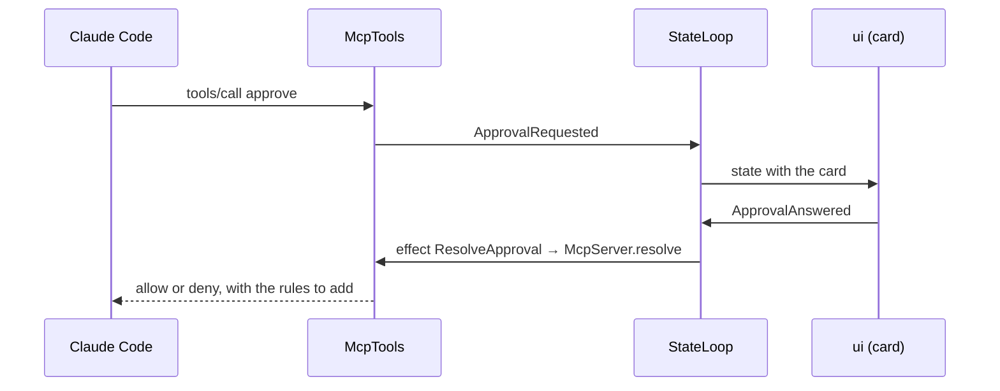
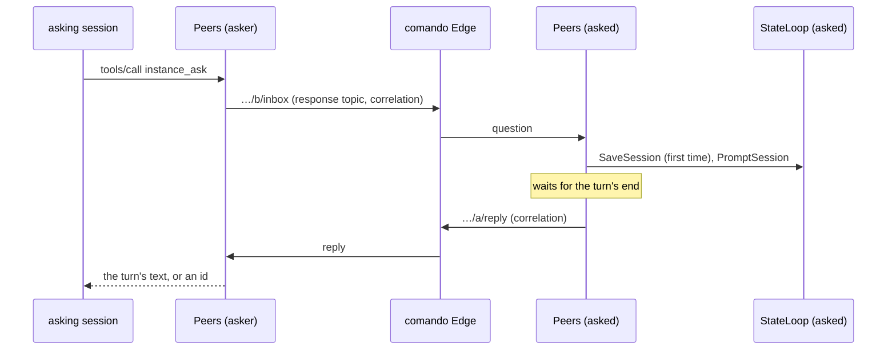

# `mcp`

comando's MCP server: the way a Claude Code session reaches back into the window. Streamable HTTP on `127.0.0.1`,
JSON-RPC written on the JDK's `HttpServer` and Jackson with no MCP library, one bearer token per Claude Code process. It
serves the UI tools, the database tools, the session tools, the tools that consult the other comando instances and the
permission-prompt tool behind every approval card. It depends on `core` and Jackson, never on the MQTT client; `app` constructs it, and `claude` reaches it through `core`'s `McpGateway`.

1. [Architecture](#1-architecture)
2. [Interface with the rest of the app](#2-interface-with-the-rest-of-the-app)
3. [Threads](#3-threads)
4. [Tests](#4-tests)

## 1. Architecture

One package, `dev.marregui.comando.mcp`.

| Class | Does |
|---|---|
| `McpServer` | HTTP and JSON-RPC: `POST /mcp`, protocol versions `2025-03-26`, `2025-06-18` (the default), `2025-11-25`; `initialize`, `tools/list`, `tools/call`, `ping`; one JSON response per request and no server-initiated stream; the token-to-session map; 401 for an unknown token, 403 for a foreign `Origin` |
| `McpTools` | the tools: validates arguments, sends intents, answers; parks the calling thread for an approval and for every database call |
| `ActionTools` | the registry's other actions (record 121): their schemas from `core`'s `Actions`, performing them for a caller, rule 1 (no answering one's own or one's sessions' approvals), rule 2 (destructive actions only with a grant in `agents.json`), the start rule, a notice per act |
| `ViewSpecs` | view arguments into `core`'s `ViewSpec` records (`table`, `plot`, `diff`, `markdown`, `text`, `tree`); an invalid spec is a tool error naming the problem and never reaches the reducer |
| `SqlPolicy` | the lexical check of what Claude may run without asking; it errs towards "not read-only" (a second statement, dollar quoting, a backslash in a string) and does not detect a function with side effects |
| `TranscriptText` | another session's transcript as numbered text blocks after a cursor, for `session_read`; the cursor stops at the first block still streaming; the text of the turn that answers a prompt, for a reply to another instance |
| `Turns` | the wait for a session's turns to end, shared by `session_read` and `Peers` |
| `PeerBroker` | the interface to the broker the instances reach each other through (record 123): connected, a listener on connect, the last will, publish with response topic and correlation data, subscribe; `app`'s `MqttPeerBroker` implements it |
| `Peers` | this instance among the others: its presence (on connect, on a change at most every 2 s, cleared at close), the table of the others, the questions it answers in its session `consult-<asker>` and the replies it waits for; `instances_list`, `instance_ask`, `instance_reply` |
| `Summaries` | one line per permission request, for cards, lists and notifications |
| `AuditLog` | every tool call and approval decision, appended to `audit/audit-<UTC date>.jsonl`; never read back |

The tools: `approve`; `ui_show_table`, `ui_plot`, `ui_show_view`, `ui_set_editor`, `ui_insert`, `ui_open_file`,
`ui_notify`, `ui_get_state`, `ui_set_layout`, `ui_close_view`; `db_run_sql`, `db_describe`; `session_send`,
`session_read`; `instances_list`, `instance_ask`, `instance_reply`. Their arguments and limits are in [Claude §2.2](../docs/claude.md#22-the-tools).

**A UI tool** validates its input, sends one intent and returns at once. The reducer decides what the window does: that
session's unpinned view with the same title and placement is replaced, a pinned one never is.

**An approval** gets an id from comando's own counter (ids above 1 000 000), a future, and an `ApprovalRequested`
intent. The request's virtual thread waits on the future until the user answers or 55 minutes pass.



A card is withdrawn (`ApprovalWithdrawn`) and its call denied when Claude Code cancels the call, the process exits, the
session is removed, or the wait expires. A SQL card (`ApprovalKind.SQL_WRITE`) is also withdrawn when its session's turn
ends with nothing running or queued and no background work. At exit every waiting card is denied.

**A question to another instance** (record 123) goes to `comando/v1/local/instance/<peer>/inbox` with the response topic
`…/<this>/reply` and a random id as correlation data; the call waits on the id's future up to `wait_seconds`, else
returns the id for `instance_reply`. The instance asked runs an errand per question: unless its `agents.json` denies the
asker, it makes `consult-<asker>` once (created by `peer:<asker>`), sends `PromptSession`, finds that prompt in the
transcript, waits for the session's turns to end (600 s), and replies with the text of the turn that answers it.



## 2. Interface with the rest of the app

**Provides.**

| Interface | Methods | Caller |
|---|---|---|
| `McpGateway` | `register(session)` gives a ticket (URL and token) per process; `unregister(session, ticket)` revokes it | `claude`, at each process start and exit |
| `ApprovalPort` | `resolve(approval, decision)` completes the waiting call | the reducer's `ResolveApproval` effect, through `EffectRouter` |
| `McpServer.start(tools, port, version)`, `url()` | starts the server; port 0 picks a free one | `app` |
| `McpTools.readOnly(predicate)` | panels that take no text (a log), which the editor tools refuse | `app`, with the store's view |
| `McpTools.peers(peers)`; `Peers` (`start()`, `close()`), `Peers.Me.of(name, version)`, `Peers.slug(name)` | the instance tools, through the comando Edge | `app`, with `MqttPeerBroker` |
| `PeerBroker` | what `Peers` needs of a broker | implemented by `app`'s `MqttPeerBroker` |

**Needs.** `app` constructs `McpTools` with:

| Dependency | Used for |
|---|---|
| `IntentSink` | every change the tools ask of the window |
| `Supplier<AppState>` | `ui_get_state`, and the panel, connection and session a call refers to |
| `TranscriptRegistry` | `session_read` |
| `QueryPort` (`db`) | `db_run_sql`, `db_describe`, on the connection's lane behind the user's runs |
| `AuditLog`, `Clock`, the approval timeout | the audit file, deadlines |

`app` constructs `Peers` with a `PeerBroker`, this instance's `Me`, the `IntentSink`, `Supplier<AppState>` and
`TranscriptRegistry` above, the folder consult sessions are made in, and `agents.json`.

`core`'s `PermissionRules` derives the allow rules a "For session" or "Always" answer returns.

**Sends back.** `ShowView`, `CloseView`, `EditPanel`, `SessionLayout`, `RunText` (`session_send`), `SchemaChanged`
(after DDL from `db_run_sql`), `ApprovalRequested`, `ApprovalWithdrawn`, `Notify`; for another instance's question,
`SaveSession`, `OpenSession` and `PromptSession`.

The tools never touch Swing or the database directly: the window changes only through intents, and SQL runs only through
`QueryPort`.

## 3. Threads

| Thread | Kind | Does | Stopped by |
|---|---|---|---|
| one unnamed virtual thread per HTTP request | per-task executor | JSON-RPC; parks on a future for an approval, a database call or another instance's reply, or polls every 200 ms for `session_read` with `wait_seconds` | `close()`, which denies every waiting approval and stops the listener and the request threads |
| `peers` | K4, timed (`Peers`) | this instance's presence, looked at every 2 s and sent when it changed | `Peers.close()` |
| `peer-answer` | K5 (`Peers`' errands) | one question from another instance, up to 600 s | `Peers.close()`: interrupted, replies `error` |

The JDK's `HttpServer` adds its own dispatcher thread, which is not comando's.

| Wait | Bound | On expiry |
|---|---|---|
| an approval card | 55 min (the session's MCP configuration gives the server a 60 min timeout) | deny; card withdrawn |
| `db_run_sql` | 90 s, a write after its card | a statement still queued is withdrawn; the tool says so |
| `db_describe` | 60 s | tool error |
| `session_read` with `wait_seconds` | 600 s | the blocks so far |
| `instance_ask`, `instance_reply` with `wait_seconds` | 600 s, default 300 | an id for `instance_reply` |
| another instance's question | 600 s for its consult turn | reply `timeout` |

## 4. Tests

| Test | Covers |
|---|---|
| `McpServerTest` | the server and every tool over HTTP |
| `SqlPolicyTest` | the read-only policy |
| `PermissionRulesTest` | the rules a "For session" or "Always" answer adds |
| `McpToolsFormatTest` | the rows text the database tools return, within its budget |
| `ActionToolsTest` | `session_new` with a first prompt and its creator, edits keeping the creator, the start rule, rule 1, rule 2, every action listed and run |
| `ActionParityTest` | every kind of intent classified once; every intent the window sends offered or said why not |
| `PeersTest` | two or three fake instances over a broker in memory: presence seen, following the sessions, cleared at close and by the last will; the consult session made once and prompted headed with the asker; the reply after the turn ends, Claude's text without tool output; a busy session's own turn; a denied peer refused; an id and `instance_reply`; a consult turn's timeout; the Edge down |

```
./gradlew :mcp:test
```

Further reading: [Claude §2–§3](../docs/claude.md#2-mcp-tools).
