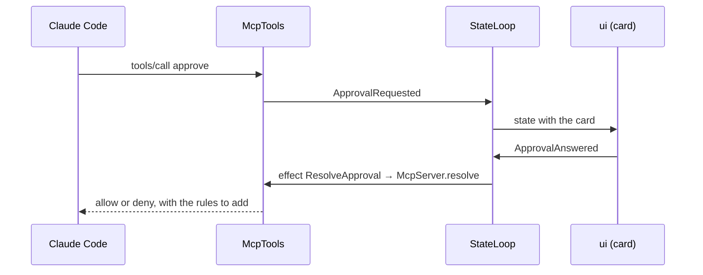

# `mcp`

comando's MCP server: the way a Claude Code session reaches back into the window. Streamable HTTP on `127.0.0.1`,
JSON-RPC written on the JDK's `HttpServer` and Jackson with no MCP library, one bearer token per Claude Code process.
It serves the UI tools, the database tools, the session tools and the permission-prompt tool behind every approval
card. It depends on `core` and Jackson.

1. [Architecture](#1-architecture)
2. [Interface with the rest of the app](#2-interface-with-the-rest-of-the-app)
3. [Threads](#3-threads)
4. [Tests](#4-tests)

## 1. Architecture

| Class | Does |
|---|---|
| `McpServer` | HTTP and JSON-RPC: `POST /mcp`, protocol versions `2025-03-26`, `2025-06-18`, `2025-11-25`; `initialize`, `tools/list`, `tools/call`, `ping`; the token-to-session map; 401 for an unknown token, 403 for a foreign `Origin` |
| `McpTools` | the tools: validates arguments, sends intents, answers; parks the calling thread for an approval and for every database call |
| `ViewSpecs` | view arguments into `core`'s `ViewSpec` records; an invalid spec is a tool error naming the problem and never reaches the reducer |
| `SqlPolicy` | the lexical check of what Claude may run without asking; errs towards "not read-only" |
| `TranscriptText` | another session's transcript as numbered text blocks after a cursor, for `session_read` |
| `Summaries` | one line per permission request, for cards, lists and notifications |
| `AuditLog` | every tool call and approval decision, appended to `audit/audit-<UTC date>.jsonl`; never read back |

Tools: `approve`; `ui_show_table`, `ui_plot`, `ui_show_view`, `ui_set_editor`, `ui_insert`, `ui_open_file`,
`ui_notify`, `ui_get_state`, `ui_set_layout`, `ui_close_view`; `db_run_sql`, `db_describe`; `session_send`,
`session_read`. Their arguments and limits are in [Claude §2.2](../docs/claude.md#22-the-tools).

- **A UI tool** validates its input, sends one intent and returns at once; the reducer decides what the window does
  (that session's unpinned view with the same title and placement is replaced, a pinned one never is).
- **An approval** gets an id from comando's own counter (ids above 1 000 000), a future, and an `ApprovalRequested` intent;
  the request's virtual thread waits on the future until the user answers or 55 minutes pass.

A card is withdrawn (`ApprovalWithdrawn`) and its call denied when the call is cancelled, the process exits, the session
is removed, or the wait expires; a SQL card is also denied when its session's turn ends with nothing queued and no
background work; at exit every waiting card is denied.

## 2. Interface with the rest of the app

**Provides.**

| Interface | Methods | Caller |
|---|---|---|
| `McpGateway` | `register(session)` gives a ticket (URL and token) per process; `unregister(session, ticket)` revokes it | `claude`, at each process start and exit |
| `ApprovalPort` | `resolve(approval, decision)` completes the waiting call | the reducer's `ResolveApproval` effect, through `EffectRouter` |
| `McpServer.start(tools, port, version)`, `url()` | starts the server; port 0 picks a free one | `app` |
| `McpTools.readOnly(predicate)` | panels that take no text (a log), which the editor tools refuse | `app`, with the store's view |

**Needs.** `McpTools` is constructed by `app` with:

| Dependency | Used for |
|---|---|
| `IntentSink` | every change the tools ask of the window |
| `Supplier<AppState>` | `ui_get_state`, and the panel, connection and session a call refers to |
| `TranscriptRegistry` | `session_read` |
| `QueryPort` (`db`) | `db_run_sql`, `db_describe`, on the connection's lane behind the user's runs |
| `AuditLog`, `Clock`, the approval timeout | the audit file, deadlines |

`core`'s `PermissionRules` derives the allow rules a "For session" or "Always" answer returns.

**Sends back.** `ShowView`, `CloseView`, `EditPanel`, `SessionLayout`, `RunText` (`session_send`), `SchemaChanged`
(after DDL from `db_run_sql`), `ApprovalRequested`, `ApprovalWithdrawn`, `Notify`.

The tools never touch Swing or the database directly: the window changes only through intents, and SQL runs only
through `QueryPort`.

## 3. Threads

One virtual thread per HTTP request. An approval parks it on a future for up to 55 min; every `db_run_sql` and
`db_describe` parks it on the query's future (90 s, 60 s), a write after its card; `session_read` with `wait_seconds`
polls every 200 ms until its deadline.
`close()` denies every waiting approval and stops the server.

| Wait | Bound |
|---|---|
| an approval card | 55 min (the session's MCP configuration sets a 60 min timeout) |
| `db_run_sql` | 90 s; a statement still queued is then withdrawn |
| `db_describe` | 60 s |
| `session_read` with `wait_seconds` | 600 s |

## 4. Tests

`McpServerTest` drives the server and every tool over HTTP; `SqlPolicyTest` covers the policy; `PermissionRulesTest`
the derived rules; `McpToolsFormatTest` the rows text the database tools return, within its budget.

Further reading: [Claude §2–§3](../docs/claude.md#2-mcp-tools).
