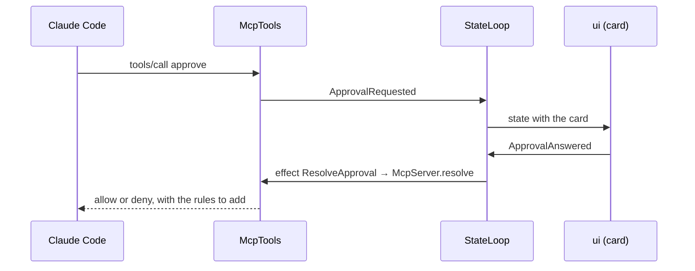

# `mcp`

comando's MCP server: the way a Claude Code session reaches back into the window. Streamable HTTP on `127.0.0.1`,
JSON-RPC written on the JDK's `HttpServer` and Jackson with no MCP library, one bearer token per Claude Code process. It
serves the UI tools, the database tools, the session tools and the permission-prompt tool behind every approval card.
It depends on `core` and Jackson; `app` constructs it, and `claude` reaches it through `core`'s `McpGateway`.

1. [Architecture](#1-architecture)
2. [Interface with the rest of the app](#2-interface-with-the-rest-of-the-app)
3. [Threads](#3-threads)
4. [Tests](#4-tests)

## 1. Architecture

One package, `dev.marregui.comando.mcp`.

| Class | Does |
|---|---|
| `McpServer` | HTTP and JSON-RPC: `POST /mcp`, protocol versions `2025-03-26`, `2025-06-18` (the default), `2025-11-25`; `initialize`, `tools/list`, `tools/call`, `ping`; one JSON response per request and no server-initiated stream; the token-to-session map; 401 for an unknown token, 403 for a foreign `Origin` |
| `McpTools` | the tools: validates arguments, sends intents, answers; parks the calling thread for an approval and for every database call |
| `ViewSpecs` | view arguments into `core`'s `ViewSpec` records (`table`, `plot`, `diff`, `markdown`, `text`, `tree`); an invalid spec is a tool error naming the problem and never reaches the reducer |
| `SqlPolicy` | the lexical check of what Claude may run without asking; it errs towards "not read-only" (a second statement, dollar quoting, a backslash in a string) and does not detect a function with side effects |
| `TranscriptText` | another session's transcript as numbered text blocks after a cursor, for `session_read`; the cursor stops at the first block still streaming |
| `Summaries` | one line per permission request, for cards, lists and notifications |
| `AuditLog` | every tool call and approval decision, appended to `audit/audit-<UTC date>.jsonl`; never read back |

The tools: `approve`; `ui_show_table`, `ui_plot`, `ui_show_view`, `ui_set_editor`, `ui_insert`, `ui_open_file`,
`ui_notify`, `ui_get_state`, `ui_set_layout`, `ui_close_view`; `db_run_sql`, `db_describe`; `session_send`,
`session_read`. Their arguments and limits are in [Claude §2.2](../docs/claude.md#22-the-tools).

**A UI tool** validates its input, sends one intent and returns at once. The reducer decides what the window does: that
session's unpinned view with the same title and placement is replaced, a pinned one never is.

**An approval** gets an id from comando's own counter (ids above 1 000 000), a future, and an `ApprovalRequested`
intent. The request's virtual thread waits on the future until the user answers or 55 minutes pass.



A card is withdrawn (`ApprovalWithdrawn`) and its call denied when Claude Code cancels the call, the process exits, the
session is removed, or the wait expires. A SQL card (`ApprovalKind.SQL_WRITE`) is also withdrawn when its session's turn
ends with nothing running or queued and no background work. At exit every waiting card is denied.

## 2. Interface with the rest of the app

**Provides.**

| Interface | Methods | Caller |
|---|---|---|
| `McpGateway` | `register(session)` gives a ticket (URL and token) per process; `unregister(session, ticket)` revokes it | `claude`, at each process start and exit |
| `ApprovalPort` | `resolve(approval, decision)` completes the waiting call | the reducer's `ResolveApproval` effect, through `EffectRouter` |
| `McpServer.start(tools, port, version)`, `url()` | starts the server; port 0 picks a free one | `app` |
| `McpTools.readOnly(predicate)` | panels that take no text (a log), which the editor tools refuse | `app`, with the store's view |

**Needs.** `app` constructs `McpTools` with:

| Dependency | Used for |
|---|---|
| `IntentSink` | every change the tools ask of the window |
| `Supplier<AppState>` | `ui_get_state`, and the panel, connection and session a call refers to |
| `TranscriptRegistry` | `session_read` |
| `QueryPort` (`db`) | `db_run_sql`, `db_describe`, on the connection's lane behind the user's runs |
| `AuditLog`, `Clock`, the approval timeout | the audit file, deadlines |

`core`'s `PermissionRules` derives the allow rules a "For session" or "Always" answer returns.

**Sends back.** `ShowView`, `CloseView`, `EditPanel`, `SessionLayout`, `RunText` (`session_send`), `SchemaChanged`
(after DDL from `db_run_sql`), `ApprovalRequested`, `ApprovalWithdrawn`, `Notify`.

The tools never touch Swing or the database directly: the window changes only through intents, and SQL runs only through
`QueryPort`.

## 3. Threads

| Thread | Kind | Does | Stopped by |
|---|---|---|---|
| one unnamed virtual thread per HTTP request | per-task executor | JSON-RPC; parks on a future for an approval or a database call, or polls every 200 ms for `session_read` with `wait_seconds` | `close()`, which denies every waiting approval and stops the listener and the request threads |

The JDK's `HttpServer` adds its own dispatcher thread, which is not comando's.

| Wait | Bound | On expiry |
|---|---|---|
| an approval card | 55 min (the session's MCP configuration gives the server a 60 min timeout) | deny; card withdrawn |
| `db_run_sql` | 90 s, a write after its card | a statement still queued is withdrawn; the tool says so |
| `db_describe` | 60 s | tool error |
| `session_read` with `wait_seconds` | 600 s | the blocks so far |

## 4. Tests

| Test | Covers |
|---|---|
| `McpServerTest` | the server and every tool over HTTP |
| `SqlPolicyTest` | the read-only policy |
| `PermissionRulesTest` | the rules a "For session" or "Always" answer adds |
| `McpToolsFormatTest` | the rows text the database tools return, within its budget |

```
./gradlew :mcp:test
```

Further reading: [Claude §2–§3](../docs/claude.md#2-mcp-tools).
