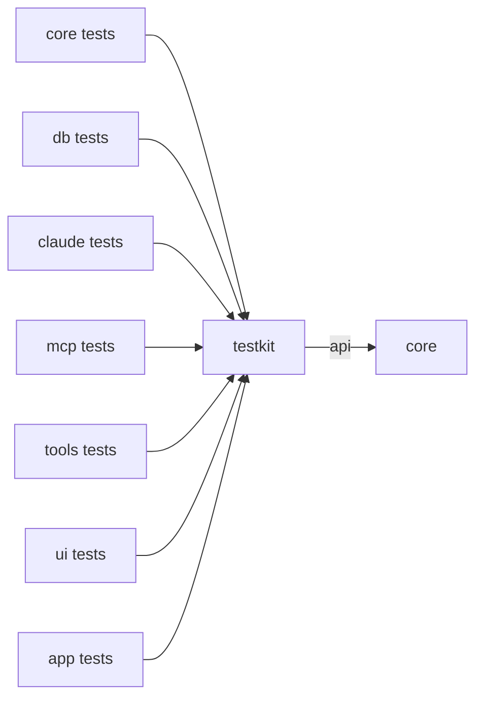

# `testkit`

What every module's tests share: a fake for every effect port, a recording intent sink, a fake clock, a small state,
Claude Code streams recorded from the real CLI, and a synthetic session for rendering measurements. Its code sits in
`src/main` so other modules can depend on it; no production module does.

1. [Architecture](#1-architecture)
2. [Interface with the rest of the app](#2-interface-with-the-rest-of-the-app)

## 1. Architecture

| Class | Does |
|---|---|
| `RecordingPorts` | implements `DatabasePort`, `ClaudePort`, `ApprovalPort`, `UiPort`, `PersistencePort` and `ToolPort`; each call is kept as one line, such as `db.execute 7 local SELECT 1`, so a test asserts on the effects a reducer step produced |
| `RecordingSink` | an `IntentSink` that keeps what adapters send; `of(type)` filters, `await(type, match, timeout)` waits for a matching intent with a deadline |
| `FakeClock` | a `Clock` a test sets and advances |
| `States` | `twoPanels()`: panels `p1` and `p2`, both bound to connection `local` (QuestDB defaults) and session `work`; the connection and the session closed |
| `FakeResult` | a small `ResultView` held as rows of objects |
| `Fixtures` | `stream(name)`: recorded stream-JSON, one event per line, from `fixtures/stream/<name>.jsonl` |
| `SyntheticSession` | a deterministic eight-turn session (Markdown, forty tool calls, one subagent, about 10 k tokens); `steps(deltaChars)` replays it as the stream would arrive, `transcript()` gives it whole |

Recorded streams in `src/main/resources/fixtures/stream/`: `approvals-and-question`, `clear`,
`queued-compact-interrupt`. They are sanitized recordings of Claude Code 2.1.296
([Claude §1](../docs/claude.md#1-the-claude-bridge)).

## 2. Interface with the rest of the app

- Depends on `core` only (`api`, so a test sees `core`'s types through it); every module takes it as
  `testImplementation`.
- Adapter tests give the adapter a `RecordingSink` in place of the state loop and await the intents it sends back.
  Reducer and UI tests give the code under test `RecordingPorts` in place of the adapters.
- `app`'s `UiReplayTest` runs a real `StateLoop` and Swing shell with `RecordingPorts` for every other port.
- `SyntheticSession` feeds the transcript tests in `ui` and the frame-time gate (`./gradlew :ui:transcriptGate`);
  `Fixtures` feeds `claude`'s `StreamMapperTest`.
- `RecordingPorts` implements the port interfaces, so a new port method does not compile until it records here too.
