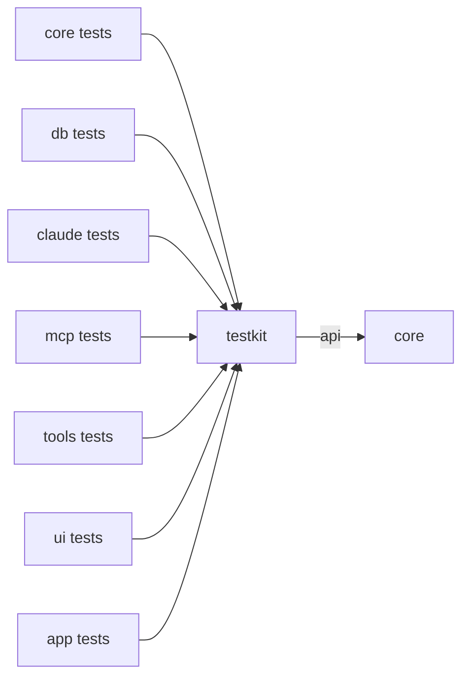

# `testkit`

What every module's tests share: a fake for every effect port, a recording intent sink, a fake clock, a small state,
Claude Code streams recorded from the real CLI, and a synthetic session for rendering measurements. It depends on `core`
(`api`, so a test sees `core`'s types through it). Its code sits in `src/main` so that other modules can depend on it;
every module takes it as `testImplementation`, and no production code does.

1. [Architecture](#1-architecture)
2. [Interface with the rest of the app](#2-interface-with-the-rest-of-the-app)
3. [Threads](#3-threads)
4. [Tests](#4-tests)

## 1. Architecture

One package, `dev.marregui.comando.testkit`.

| Class | Does |
|---|---|
| `RecordingPorts` | implements `DatabasePort`, `ClaudePort`, `ApprovalPort`, `UiPort`, `PersistencePort` and `ToolPort`; each call is kept as one line, such as `db.execute 7 local SELECT 1`, so a test asserts on the port calls the effect router made |
| `RecordingSink` | an `IntentSink` that keeps what adapters send; `of(type)` filters, `await(type, match, timeout)` waits for a matching intent with a deadline |
| `FakeClock` | a `Clock` a test sets and advances |
| `States` | `twoPanels()`: panel `p1` bound to connection `local` (QuestDB defaults) and session `work`, panel `p2` bound to `local` alone; the connection and the session closed |
| `FakeResult` | a small `ResultView` held as rows of objects |
| `Fixtures` | `stream(name)`: recorded stream-JSON, one event per line, from `fixtures/stream/<name>.jsonl` |
| `SyntheticSession` | a deterministic eight-turn session: Markdown text, 41 tool calls with one subagent, about 10 k tokens in all; `steps(deltaChars)` replays it as the stream would arrive, `transcript()` gives it whole |

The recorded streams in `src/main/resources/fixtures/stream/` are sanitised recordings of Claude Code:

| Stream | Lines | Recorded from |
|---|---|---|
| `approvals-and-question` | 95 | 2.1.296 |
| `queued-compact-interrupt` | 122 | 2.1.296 |
| `clear` | 24 | 2.1.302 |

The CLI versions comando is tested against are in [Claude §1](../docs/claude.md#1-the-claude-bridge).

## 2. Interface with the rest of the app

| User | Takes |
|---|---|
| adapter tests (`db`, `claude`, `mcp`, `tools`) | a `RecordingSink` in place of the state loop; the test awaits the intents the adapter sends back |
| reducer tests (`core`) | `States` and `FakeClock`; they assert on the effects a `Transition` returns |
| widget and panel tests (`ui`) | a `RecordingSink` and a state from `States` |
| `UiReplayTest`, `UiKeysTest` (`app`) | `RecordingPorts` behind a real `EffectRouter`, with a real `StateLoop` and Swing shell |
| transcript tests and `./gradlew :ui:transcriptGate` (`ui`) | `SyntheticSession` |
| `StreamMapperTest` (`claude`) | `Fixtures` |

`RecordingPorts` implements the port interfaces, so a new port method does not compile until it records here too.

## 3. Threads

`testkit` starts no thread. `RecordingSink.await` waits on the calling thread, bounded by its timeout.

## 4. Tests

`testkit` has no tests of its own; every module's tests exercise it.
