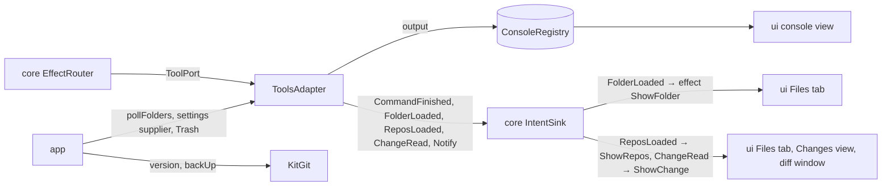

# `tools`

The development tools behind `core`'s `ToolPort`: Gradle runs with their console and test tree, the Files tab's folders
read as trees and their entries moved to the Trash, and the git repositories of those folders read, and changed on
request from the comparison window (roll back, remove, unstage). It also reads a kit's version and backs up its brain
and its root for `app`. Everything runs outside the reducer and the EDT and ends in an intent or a returned value. It
depends on `core` only, and never imports Swing or AWT.

1. [Architecture](#1-architecture)
2. [Interface with the rest of the app](#2-interface-with-the-rest-of-the-app)
3. [Threads](#3-threads)
4. [Tests](#4-tests)

## 1. Architecture

One package, `dev.marregui.comando.tools`.

| Class | Does |
|---|---|
| `ToolsAdapter` | the port: Gradle runs as child processes, folder reads, the folder poll, moves to the Trash, the repositories' reads, and roll back, removal and unstaging through git and the Trash |
| `Git` | the `git` command line: the repositories a folder belongs to (at most 20), `git status --porcelain=v2` parsed into a `RepoStatus` and the ignored entries, a changed file's `HEAD` and working-tree versions (a version over 4 MB is not compared); every run goes through `core`'s `Processes`, its output on temporary files, bounded (10 s, 32 MiB of output, 4 KiB of errors), without optional locks or prompts, with `LC_ALL=C` so its messages, which the code reads, are English whatever the user's locale, killed at close |
| `GradleBuild` | the build a directory belongs to (the nearest directory at or above it with an executable `gradlew`) and the command: `<gradle-serial> <root> <tasks>`, else `<root>/gradlew --console=plain <tasks>` |
| `Args` | splits the tasks the user typed as a POSIX shell splits words, without expansion |
| `TestReports` | JUnit XML written since the run started, as a tree with failures first, each linked to its source line |
| `FolderTree` | a folder as a tree, ordered and bounded (12 levels; 80 000 names listed, 20 000 entries kept), without hidden entries, excluded names and the entries a caller skips |
| `ListingLines` | the lines a listing file (an index file that names the entries beside it) gives an entry, taken out once the entry went to the Trash; other lines naming it stay and are reported |
| `ToolSettings` | where the tools are, by convention: a `gradle-serial` executable on comando's `PATH` when there is one, and the JDK for child processes |
| `KitGit` | the kit's root and brain as git checkouts: `git describe --tags --always` and the newer `vX.Y.Z` tags of `git ls-remote --tags origin` (`core`'s `KitVersion`); the backup of the brain or the kit's root (`git add -A`, a commit when anything changed whose message says what it adds, `Brain backup <date>: <top folders and counts>` or `Kit backup …`, then one line a file, `git push`) only when the folder is a repository's top with a remote; remote runs bounded at 120 s, the commit at 60 s |

**A Gradle run.** The process runs on an errand that copies its output into the run's `Console` and sends
`CommandFinished` with the exit code, the test tree and the failures. Past 4 Mi characters the rest of the output is
held back and its last 64 Ki characters are shown at the end, where a build's failure summary is. A stop sends SIGTERM
to the process tree and SIGKILL 2 s later; output is read at most 2 s after the process exits, so a child holding the
pipe does not hold the run.

**Settings per run.** `ToolsAdapter` takes a `Supplier<ToolSettings>` and asks it at each run, so a `gradle-serial`
installed while comando runs is used from the next run.

**Folders.** `readFolders` reads once and sends each tree. `watchFolders` replaces the set the poll reads, and the poll
sends a tree only when it changed. Reads are ticketed, so an older read never overwrites a newer one.

**Repositories.** `watchRepos` names every configured folder. Each poll first reads the repositories of the watched
folders (of all folders while the Changes view is open), the others every sixth poll, and sends `ReposLoaded`, with
every repository, when any changed. A folder in a repository is read without what git ignores, from a status at most 30
s old; a folder git ignores as a whole is read whole. `readChange` reads a change's two versions on one thread, in the
order asked, and sends `ChangeRead`.

**The Trash.** `deleteFiles` moves entries through a `ToolsAdapter.Trash`, then edits the folder's listing file and
reads the open folders again. Nothing is deleted for good.

## 2. Interface with the rest of the app



**Provides.**

| Interface | Methods | Caller |
|---|---|---|
| `ToolPort` | `runGradle(runId, workDir, tasks)`, `cancelRun`, `forgetRun`, `readFolders`, `watchFolders`, `deleteFiles(folder, paths)`, `watchRepos(folders, changesShown)`, `readChange(root, change, ask)`, `rollBack(root, changes)`, `removeFiles(root, paths)`, `unstage(root, paths)` | the reducer's effects, through `EffectRouter` |
| `ToolsAdapter.pollFolders(every)` | starts the folder poll | `app` at start (every 5 s) |
| `ToolsAdapter.Trash` | `moveToTrash(file)`; `Trash.NONE` for tests and desktops without one | implemented in `ui` (`DesktopTrash`), passed in by `app` |
| `KitGit` | `version(root)`, `canBackUp(brain)`, `backUp(brain, today)`, `backUp(repo, what, today)` | `app`'s `RootSetup`, off the EDT: the kit's version at start and every 6 hours, the brain's and the kit's backups when the user asks for them |

**Needs.** The `IntentSink`, the `ConsoleRegistry` it writes, a `Supplier<ToolSettings>` (`app` passes
`ToolSettings::now`), and a `Trash`.

**Sends back.** `CommandFinished` (the reducer updates the run's console view and may ask for a desktop notification),
`FolderLoaded` (the reducer turns it into a `ShowFolder` effect for the Files tab), `ReposLoaded` (`ShowRepos`: the
Files tab's colours and the Changes view), `ChangeRead` (`ShowChange`: the diff window), `Notify`.

The terminal is not here: JediTerm is a Swing component and lives in `ui`.

## 3. Threads

| Thread | Kind | Does | Stopped by |
|---|---|---|---|
| `gradle-<run>`, `tool-kill-<run>` | errands of the adapter | the run's process; the SIGKILL 2 s after a stop | `close()`, last, once the processes have ended |
| `tool-output-<run>` | fork | the run's output while the run waits for its process | its run, at most 2 s after the exit |
| `folder-read`, `repo-read`, `file-trash` | errands | a read asked for now; the repositories read at once when `watchRepos` changes them; moves to the Trash and the listing edits | `close()` |
| `folder-poll` | timed strand | reads the watched repositories, then the open folders, every period | `close()` |
| `change-read` | strand | a changed file's two versions, one at a time | `close()` |
| `repo-write` | strand | `RollBack`, `RemoveFiles`, `Unstage` through git (`restore`, `rm --cached`) and the Trash, then the repositories read again | `close()` |

A git run starts no thread: it runs on the calling thread through `Processes`, which writes the output to temporary
files and reads them back once git has exited.

`close()` stops the folder poll, the change reads, the repository writes and every git run, sends SIGTERM to every run's
process tree and SIGKILL 2 s later, and closes the errands last.

## 4. Tests

| Test | Covers |
|---|---|
| `ToolsAdapterTest` | Gradle runs against a fake `gradlew` (a shell script that prints its arguments and writes one failing JUnit report); folder reads in temporary directories |
| `GitTest`, `ToolsAdapterReposTest` | a repository built with the real `git` in a temporary directory: a change of each kind, an ignored folder |
| `KitGitTest` | the kit's version and the brain's and the kit's backups, their messages, against a checkout and a bare remote on disk |
| `ListingLinesTest`, `ToolSettingsTest` | unit tests |

```
./gradlew :tools:test
```

Further reading: [Workbench §4.2](../docs/workbench.md#42-gradle-runs),
[Workbench §5](../docs/workbench.md#5-the-files-tab), [record 62](../docs/adr/0062-gradle-runs-by-convention.md),
[record 68](../docs/adr/0068-git-changes-and-a-side-by-side-diff.md).
